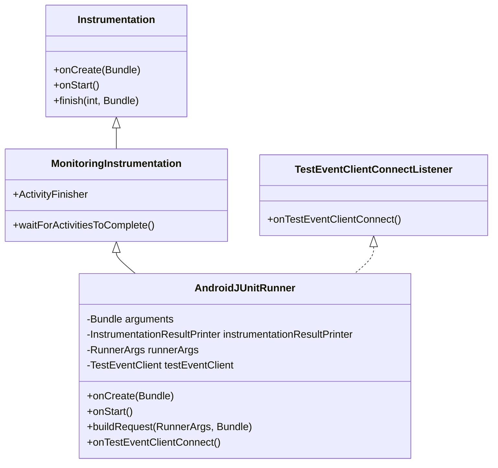
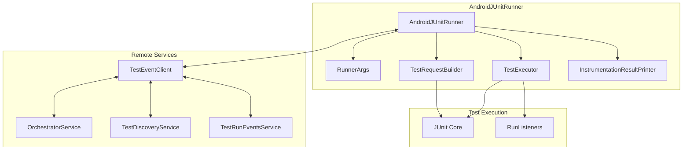
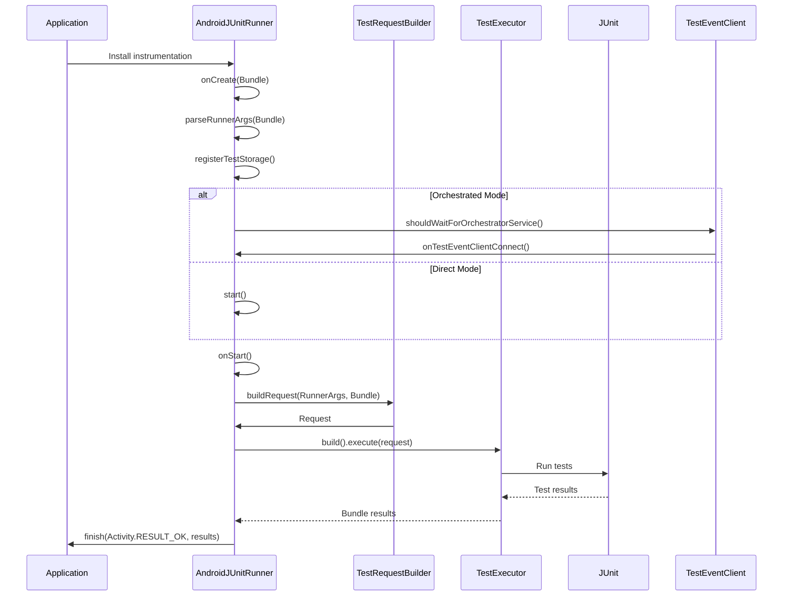
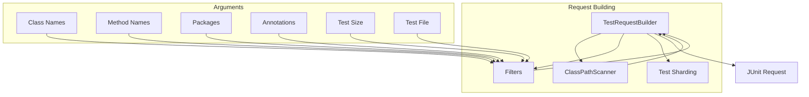
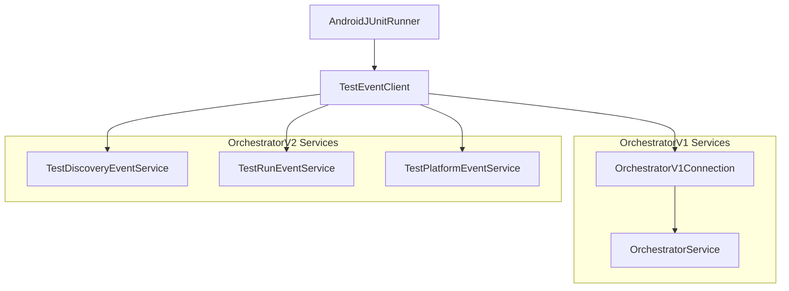
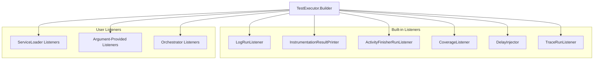
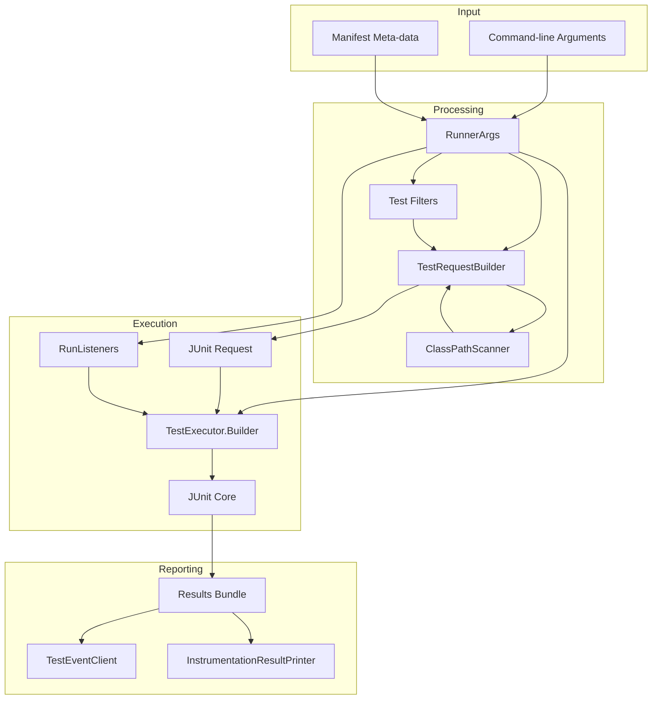
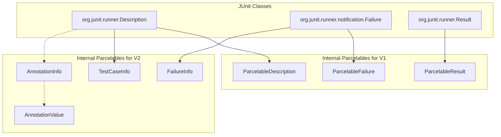

<!-- source: DeepWiki mcp.deepwiki.com · repo android/android-test · page 5.1 AndroidJUnitRunner · fetched 2026-10-23 -->

# AndroidJUnitRunner

<details>
<summary>Relevant source files</summary>

The following files were used as context for generating this wiki page:

- [runner/android_junit_runner/java/androidx/test/internal/events/client/TestEventClient.java](runner/android_junit_runner/java/androidx/test/internal/events/client/TestEventClient.java)
- [runner/android_junit_runner/java/androidx/test/internal/events/client/TestEventClientConnectListener.java](runner/android_junit_runner/java/androidx/test/internal/events/client/TestEventClientConnectListener.java)
- [runner/android_junit_runner/java/androidx/test/orchestrator/callback/BundleConverter.java](runner/android_junit_runner/java/androidx/test/orchestrator/callback/BundleConverter.java)
- [runner/android_junit_runner/java/androidx/test/orchestrator/callback/OrchestratorV1Connection.java](runner/android_junit_runner/java/androidx/test/orchestrator/callback/OrchestratorV1Connection.java)
- [runner/android_junit_runner/java/androidx/test/orchestrator/junit/ParcelableDescription.java](runner/android_junit_runner/java/androidx/test/orchestrator/junit/ParcelableDescription.java)
- [runner/android_junit_runner/java/androidx/test/orchestrator/junit/ParcelableFailure.java](runner/android_junit_runner/java/androidx/test/orchestrator/junit/ParcelableFailure.java)
- [runner/android_junit_runner/java/androidx/test/orchestrator/junit/ParcelableResult.java](runner/android_junit_runner/java/androidx/test/orchestrator/junit/ParcelableResult.java)
- [runner/android_junit_runner/java/androidx/test/runner/AndroidJUnitRunner.java](runner/android_junit_runner/java/androidx/test/runner/AndroidJUnitRunner.java)
- [services/events/java/androidx/test/services/events/ParcelableConverter.java](services/events/java/androidx/test/services/events/ParcelableConverter.java)

</details>


## Purpose and Overview

AndroidJUnitRunner (AJR) is the primary test runner for executing JUnit3 and JUnit4 tests on Android devices. It serves as a replacement for and superset of the legacy `android.test.InstrumentationTestRunner`, providing a robust framework for Android test execution with enhanced functionality.

This page documents the architecture, functionality, and usage of AndroidJUnitRunner within the Android Test framework. For information about test orchestration, see [Test Orchestration](#5.2).

## Architecture

AndroidJUnitRunner extends Android's [`Instrumentation`](https://developer.android.com/reference/android/app/Instrumentation) class through the `MonitoringInstrumentation` intermediary, enabling it to hook into the Android application lifecycle and execute tests against Android applications.



Sources: [runner/android_junit_runner/java/androidx/test/runner/AndroidJUnitRunner.java:274-275]()

### Key Components

AndroidJUnitRunner integrates with several critical components to perform test execution:

1. **RunnerArgs**: Encapsulates all command-line and manifest-provided arguments for test execution
2. **TestEventClient**: Handles communication with remote orchestration services
3. **InstrumentationResultPrinter**: Reports test results back to the caller
4. **TestRequestBuilder**: Builds test requests based on provided arguments
5. **TestExecutor**: Executes the actual test runs



Sources: [runner/android_junit_runner/java/androidx/test/runner/AndroidJUnitRunner.java:277-284](), [runner/android_junit_runner/java/androidx/test/internal/events/client/TestEventClient.java:51-56]()

## Lifecycle and Execution Flow

AndroidJUnitRunner follows a well-defined lifecycle for executing tests:



Sources: [runner/android_junit_runner/java/androidx/test/runner/AndroidJUnitRunner.java:303-346](), [runner/android_junit_runner/java/androidx/test/runner/AndroidJUnitRunner.java:444-477]()

### Initialization

The test execution process begins when the `onCreate(Bundle)` method is called. During initialization, AndroidJUnitRunner:

1. Sets up the instrumentation result printer
2. Parses and processes arguments from the manifest and command line
3. Registers the test storage mechanism 
4. Waits for a debugger to connect if requested
5. Adds application lifecycle callbacks
6. Adds screenshot capture processors
7. Determines whether to wait for an orchestrator service

Sources: [runner/android_junit_runner/java/androidx/test/runner/AndroidJUnitRunner.java:303-346]()

### Test Execution

Test execution begins in the `onStart()` method, which:

1. Builds a test request using `buildRequest()`
2. Creates a `TestExecutor.Builder` and adds appropriate listeners
3. Executes the test request and collects results
4. Finishes the instrumentation with the results

Sources: [runner/android_junit_runner/java/androidx/test/runner/AndroidJUnitRunner.java:444-477]()

## Test Request Building

One of AndroidJUnitRunner's key responsibilities is to build a test request based on user-provided arguments. This is handled in `buildRequest(RunnerArgs, Bundle)`:



Sources: [runner/android_junit_runner/java/androidx/test/runner/AndroidJUnitRunner.java:662-673]()

## Orchestration and Remote Services

AndroidJUnitRunner can connect to remote orchestration services through the `TestEventClient` class. This provides two primary modes of operation:

1. **Direct Mode**: Tests are executed directly within the test process
2. **Orchestrated Mode**: Tests are coordinated by a remote orchestration service

When in orchestrated mode, AndroidJUnitRunner waits for a connection to the orchestrator service before starting test execution.



Sources: [runner/android_junit_runner/java/androidx/test/runner/AndroidJUnitRunner.java:353-370](), [runner/android_junit_runner/java/androidx/test/internal/events/client/TestEventClient.java:119-156]()

### Orchestration Communication Flow

The orchestration communication follows this sequence:

1. `shouldWaitForOrchestratorService()` checks if orchestration is needed
2. `TestEventClient.connect()` establishes a connection with the orchestrator
3. When connected, the orchestrator calls `onTestEventClientConnect()`
4. `start()` is called to begin test execution

In orchestrated mode, the `TestEventClient` can operate in one of two modes:
- **Test Discovery Mode**: Sends test case information to the orchestrator
- **Test Run Events Mode**: Sends test execution events to the orchestrator

Sources: [runner/android_junit_runner/java/androidx/test/runner/AndroidJUnitRunner.java:353-370](), [runner/android_junit_runner/java/androidx/test/runner/AndroidJUnitRunner.java:396-401](), [runner/android_junit_runner/java/androidx/test/internal/events/client/TestEventClient.java:173-186]()

## Listeners and Result Reporting

AndroidJUnitRunner uses JUnit's `RunListener` system to observe and report test execution. It provides two ordering strategies for listeners:

1. **Legacy Order**: Built-in listeners are added before user-defined listeners
2. **New Order**: User-defined listeners are added before built-in listeners



Sources: [runner/android_junit_runner/java/androidx/test/runner/AndroidJUnitRunner.java:480-564]()

### Result Reporting

Test results are reported through multiple channels:

1. `InstrumentationResultPrinter` sends results to the instrumentation caller
2. `TestEventClient` sends results to remote orchestration services
3. Custom listeners receive notifications of test events

When a test process crashes, special handling is implemented in `onException(Object, Throwable)` to ensure crash reports are properly sent before the process terminates.

Sources: [runner/android_junit_runner/java/androidx/test/runner/AndroidJUnitRunner.java:598-649]()

## Command Line Options

AndroidJUnitRunner supports an extensive set of command-line arguments to customize test execution. The most common options include:

| Option | Purpose | Example |
|--------|---------|---------|
| `class` | Specify test class(es) to run | `-e class com.example.TestClass` |
| `package` | Run tests in package | `-e package com.example.tests` |
| `notClass` | Exclude test class(es) | `-e notClass com.example.TestToSkip` |
| `annotation` | Filter by annotation | `-e annotation com.example.MyAnnotation` |
| `notAnnotation` | Exclude by annotation | `-e notAnnotation com.example.Skip` |
| `size` | Filter by test size | `-e size small` |
| `debug` | Wait for debugger | `-e debug true` |
| `coverage` | Generate coverage | `-e coverage true` |
| `listener` | Add custom listeners | `-e listener com.example.MyListener` |
| `numShards` & `shardIndex` | Enable test sharding | `-e numShards 4 -e shardIndex 1` |

These options can be specified as command-line arguments or in the AndroidManifest.xml through `<meta-data>` tags.

Sources: [runner/android_junit_runner/java/androidx/test/runner/AndroidJUnitRunner.java:88-273]()

## Data Flow and Architecture

The following diagram illustrates the data flow during test execution within AndroidJUnitRunner:



Sources: [runner/android_junit_runner/java/androidx/test/runner/AndroidJUnitRunner.java:411-413](), [runner/android_junit_runner/java/androidx/test/runner/AndroidJUnitRunner.java:662-673](), [runner/android_junit_runner/java/androidx/test/runner/AndroidJUnitRunner.java:466-467]()

## Test Data Transformation for Orchestration

When using an orchestrator, AndroidJUnitRunner must convert JUnit test data to parcelable forms for cross-process communication:



Sources: [runner/android_junit_runner/java/androidx/test/services/events/ParcelableConverter.java:48-73](), [runner/android_junit_runner/java/androidx/test/orchestrator/junit/ParcelableDescription.java:24-33](), [runner/android_junit_runner/java/androidx/test/orchestrator/junit/ParcelableFailure.java:26-38](), [runner/android_junit_runner/java/androidx/test/orchestrator/junit/ParcelableResult.java:26-38]()

## Integration with Test Storage

AndroidJUnitRunner integrates with the test storage system to manage file I/O during testing. It supports two modes:

1. **Test Storage Service**: Uses remote service for file operations
2. **Raw File System**: Uses direct file I/O

This is configured during initialization in the `registerTestStorage` method.

Sources: [runner/android_junit_runner/java/androidx/test/runner/AndroidJUnitRunner.java:680-687]()

## Usage Example

To use AndroidJUnitRunner, you need to configure it in your app's `AndroidManifest.xml`:

```xml
<instrumentation
    android:name="androidx.test.runner.AndroidJUnitRunner"
    android:targetPackage="com.example.app">
    <meta-data
        android:name="listener"
        android:value="com.example.MyCustomListener" />
</instrumentation>
```

You can then execute tests using the `adb` command:

```bash
# Run all tests
adb shell am instrument -w com.example.app/androidx.test.runner.AndroidJUnitRunner

# Run specific test class
adb shell am instrument -w -e class com.example.TestClass com.example.app/androidx.test.runner.AndroidJUnitRunner

# Run tests with custom arguments
adb shell am instrument -w -e debug true -e coverage true com.example.app/androidx.test.runner.AndroidJUnitRunner
```

---

