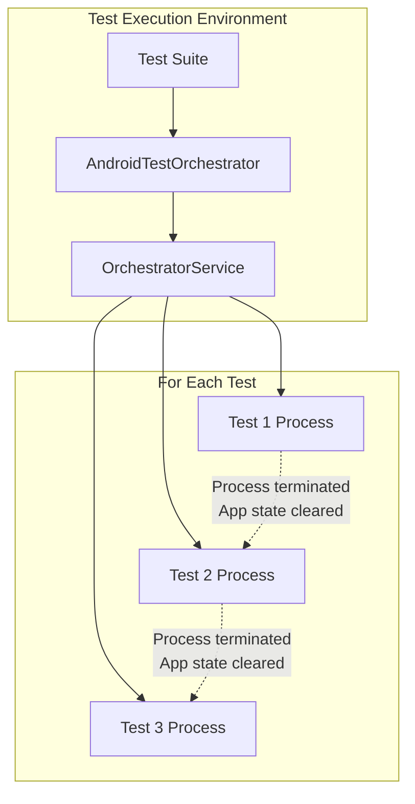
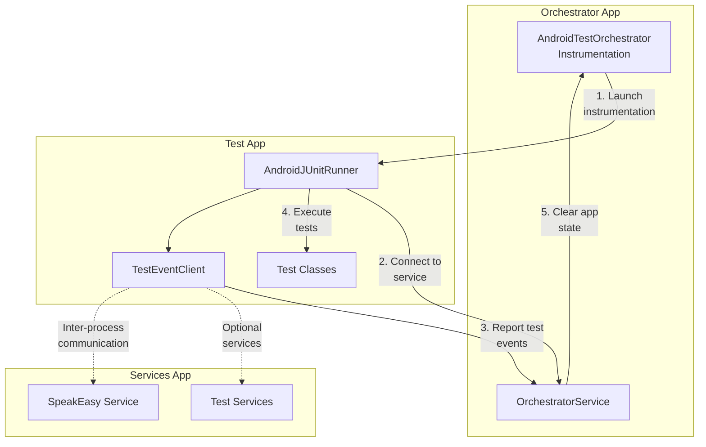
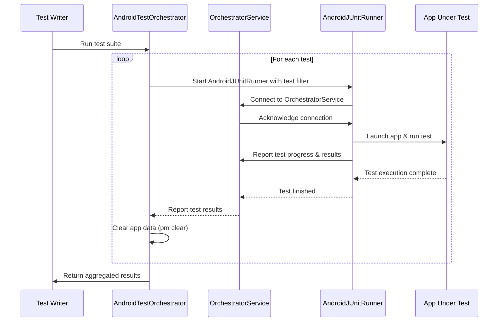
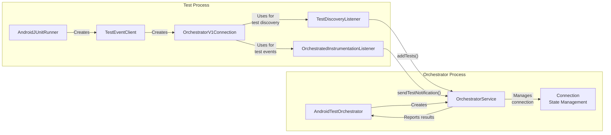
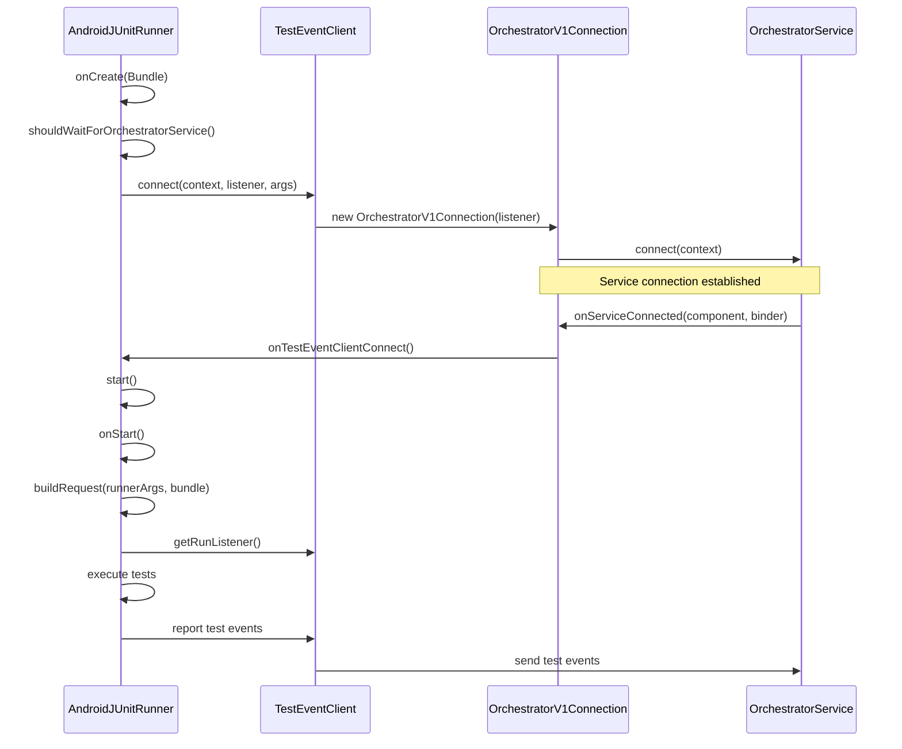
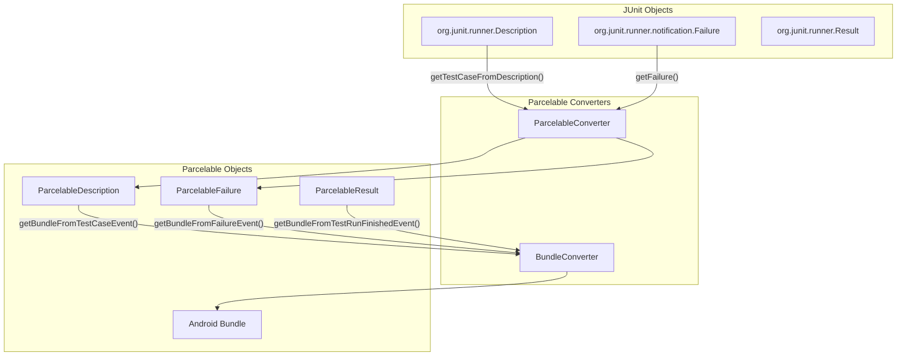

<!-- source: DeepWiki mcp.deepwiki.com · repo android/android-test · page 5.2 Test Orchestration · fetched 2026-10-23 -->

# Test Orchestration

<details>
<summary>Relevant source files</summary>

The following files were used as context for generating this wiki page:

- [espresso/contrib/java/androidx/test/espresso/contrib/BUILD](espresso/contrib/java/androidx/test/espresso/contrib/BUILD)
- [espresso/idling_resource/concurrent/java/androidx/test/espresso/idling/concurrent/BUILD](espresso/idling_resource/concurrent/java/androidx/test/espresso/idling/concurrent/BUILD)
- [espresso/idling_resource/net/java/androidx/test/espresso/idling/net/BUILD](espresso/idling_resource/net/java/androidx/test/espresso/idling/net/BUILD)
- [runner/android_junit_runner/java/androidx/test/AndroidManifest.xml](runner/android_junit_runner/java/androidx/test/AndroidManifest.xml)
- [runner/android_junit_runner/java/androidx/test/internal/events/client/TestEventClient.java](runner/android_junit_runner/java/androidx/test/internal/events/client/TestEventClient.java)
- [runner/android_junit_runner/java/androidx/test/internal/events/client/TestEventClientConnectListener.java](runner/android_junit_runner/java/androidx/test/internal/events/client/TestEventClientConnectListener.java)
- [runner/android_junit_runner/java/androidx/test/orchestrator/callback/BundleConverter.java](runner/android_junit_runner/java/androidx/test/orchestrator/callback/BundleConverter.java)
- [runner/android_junit_runner/java/androidx/test/orchestrator/callback/OrchestratorV1Connection.java](runner/android_junit_runner/java/androidx/test/orchestrator/callback/OrchestratorV1Connection.java)
- [runner/android_junit_runner/java/androidx/test/orchestrator/junit/ParcelableDescription.java](runner/android_junit_runner/java/androidx/test/orchestrator/junit/ParcelableDescription.java)
- [runner/android_junit_runner/java/androidx/test/orchestrator/junit/ParcelableFailure.java](runner/android_junit_runner/java/androidx/test/orchestrator/junit/ParcelableFailure.java)
- [runner/android_junit_runner/java/androidx/test/orchestrator/junit/ParcelableResult.java](runner/android_junit_runner/java/androidx/test/orchestrator/junit/ParcelableResult.java)
- [runner/android_junit_runner/java/androidx/test/runner/AndroidJUnitRunner.java](runner/android_junit_runner/java/androidx/test/runner/AndroidJUnitRunner.java)
- [runner/android_test_orchestrator/stubapp/BUILD](runner/android_test_orchestrator/stubapp/BUILD)
- [runner/android_test_orchestrator/stubapp/src/AndroidManifest.xml](runner/android_test_orchestrator/stubapp/src/AndroidManifest.xml)
- [services/AndroidManifest.xml](services/AndroidManifest.xml)
- [services/events/java/androidx/test/services/events/ParcelableConverter.java](services/events/java/androidx/test/services/events/ParcelableConverter.java)
- [services/speakeasy/java/androidx/test/services/speakeasy/client/AppConnection.java](services/speakeasy/java/androidx/test/services/speakeasy/client/AppConnection.java)
- [services/speakeasy/java/androidx/test/services/speakeasy/client/ToolConnection.java](services/speakeasy/java/androidx/test/services/speakeasy/client/ToolConnection.java)
- [services/speakeasy/java/androidx/test/services/speakeasy/server/SpeakEasyContentProvider.java](services/speakeasy/java/androidx/test/services/speakeasy/server/SpeakEasyContentProvider.java)
- [services/speakeasy/java/androidx/test/services/speakeasy/server/SpeakEasyService.java](services/speakeasy/java/androidx/test/services/speakeasy/server/SpeakEasyService.java)
- [services/storage/java/androidx/test/services/storage/AndroidManifest.xml](services/storage/java/androidx/test/services/storage/AndroidManifest.xml)
- [services/storage/java/androidx/test/services/storage/provider/AndroidManifest.xml](services/storage/java/androidx/test/services/storage/provider/AndroidManifest.xml)
- [services/storage/java/androidx/test/services/storage/provider/AndroidManifest_opensource.xml](services/storage/java/androidx/test/services/storage/provider/AndroidManifest_opensource.xml)
- [services/storage/javatests/androidx/test/services/storage/provider/AndroidManifest_opensource.xml](services/storage/javatests/androidx/test/services/storage/provider/AndroidManifest_opensource.xml)

</details>


Test Orchestration is a system in the AndroidX Test framework designed to run tests in isolation for improved reliability. It allows each test to run in a fresh app instance, preventing test interdependencies and side effects that can cause flaky tests.

For information about actually running tests, see [Runner](#5) and [AndroidJUnitRunner](#5.1).

## Overview

The Android Test Orchestrator runs each test in a separate instrumentation invocation, with each test being run in a fresh app instance. This approach provides several benefits:

- **Isolation**: Each test runs in a separate process with a clean app state
- **Reliability**: Crashes in one test don't affect other tests
- **State clearing**: The app's state is completely cleared between tests
- **Resource cleanup**: System resources are properly released between tests



Sources: [runner/android_test_orchestrator/stubapp/src/AndroidManifest.xml:45-53](), [runner/android_junit_runner/java/androidx/test/runner/AndroidJUnitRunner.java:335-346]()

## Architecture

The Test Orchestration system consists of several key components that work together to provide test isolation:

1. **AndroidTestOrchestrator**: An instrumentation that coordinates test execution
2. **OrchestratorService**: A service that manages communication with test processes
3. **AndroidJUnitRunner**: Executes the actual tests and communicates with the orchestrator
4. **TestEventClient**: Handles communication between the test runner and orchestrator



Sources: [runner/android_junit_runner/java/androidx/test/internal/events/client/TestEventClient.java:30-50](), [runner/android_test_orchestrator/stubapp/src/AndroidManifest.xml:17-61](), [services/AndroidManifest.xml:41-87]()

## How Test Orchestration Works

### Isolation Mechanism

The Test Orchestrator achieves isolation by:

1. Starting each test in a separate instrumentation process
2. Clearing the test app's state between each test with `pm clear` command
3. Using a service-based communication channel for test events

This approach ensures each test starts with a clean environment and prevents side effects from previous tests.



Sources: [runner/android_junit_runner/java/androidx/test/runner/AndroidJUnitRunner.java:336-345](), [runner/android_junit_runner/java/androidx/test/internal/events/client/TestEventClient.java:120-154]()

### Communication Process

The Test Orchestrator utilizes a sophisticated event system to manage test execution:

1. **Test Discovery**: Identifies test methods to be executed
2. **Test Execution**: Runs tests and monitors their progress
3. **Event Reporting**: Transmits test events (start, finish, failures) to the orchestrator
4. **Process Management**: Handles process lifecycle and state clearing



Sources: [runner/android_junit_runner/java/androidx/test/orchestrator/callback/OrchestratorV1Connection.java:43-90](), [runner/android_junit_runner/java/androidx/test/internal/events/client/TestEventClient.java:80-107]()

## Setting Up Test Orchestration

To use the Android Test Orchestrator, you need to:

1. Include the Orchestrator artifacts in your project
2. Configure Gradle to use the test orchestrator
3. Run tests with orchestration enabled

### Gradle Configuration

To enable test orchestration in your Gradle build:

```gradle
android {
    defaultConfig {
        testInstrumentationRunner "androidx.test.runner.AndroidJUnitRunner"
        testInstrumentationRunnerArguments clearPackageData: 'true'
    }
    
    testOptions {
        execution 'ANDROIDX_TEST_ORCHESTRATOR'
        
        androidTest {
            useOrchestrator = true
        }
    }
}

dependencies {
    androidTestImplementation 'androidx.test:runner:X.Y.Z'
    androidTestUtil 'androidx.test:orchestrator:X.Y.Z'
}
```

Sources: [runner/android_test_orchestrator/stubapp/BUILD:15-35]()

## Test Orchestration Internals

### Key Components

The Test Orchestration system consists of several key components:

| Component | Purpose | Key Classes |
|-----------|---------|-------------|
| Orchestrator | Manages test execution | `AndroidTestOrchestrator`, `OrchestratorService` |
| Test Runner | Executes the tests | `AndroidJUnitRunner` |
| Event System | Handles communication | `TestEventClient`, `OrchestratorV1Connection` |
| Parcelable Converters | Serializes test data | `ParcelableResult`, `ParcelableFailure`, `ParcelableDescription` |
| Service Connection | Manages inter-process communication | `SpeakEasyService`, `TestStorage` |

Sources: [runner/android_junit_runner/java/androidx/test/orchestrator/junit/ParcelableResult.java:26-82](), [runner/android_junit_runner/java/androidx/test/orchestrator/junit/ParcelableFailure.java:26-100](), [runner/android_junit_runner/java/androidx/test/orchestrator/junit/ParcelableDescription.java:24-94]()

### Orchestrator Connection Flow

When a test runs with orchestration, a sophisticated connection sequence occurs:



Sources: [runner/android_junit_runner/java/androidx/test/runner/AndroidJUnitRunner.java:396-401](), [runner/android_junit_runner/java/androidx/test/internal/events/client/TestEventClient.java:156-186](), [runner/android_junit_runner/java/androidx/test/orchestrator/callback/OrchestratorV1Connection.java:58-89]()

### Event Serialization

Test events need to be serialized to pass between processes. This is handled by several mechanisms:

1. **TestRunEvents**: Used for passing test execution events
2. **TestDiscoveryEvents**: Used for passing test case information
3. **Parcelable Converters**: Convert JUnit objects to Android Parcelables



Sources: [services/events/java/androidx/test/services/events/ParcelableConverter.java:42-204](), [runner/android_junit_runner/java/androidx/test/orchestrator/callback/BundleConverter.java:47-129]()

## Auxiliary Services

Test Orchestration relies on several services to facilitate communication and state management:

### SpeakEasy Service

SpeakEasy provides inter-process communication capabilities that allow the orchestrator and test processes to communicate:

- Allows binding exchange between processes
- Provides a registry for finding named objects
- Operates as a foreground service to maintain stability

Sources: [services/speakeasy/java/androidx/test/services/speakeasy/server/SpeakEasyService.java:38-180](), [services/speakeasy/java/androidx/test/services/speakeasy/server/SpeakEasyContentProvider.java:28-81]()

### Test Storage

Test Orchestration utilizes Test Storage services to manage test files and data across process boundaries:

- Provides access to test input files
- Allows saving test output files
- Manages test-specific properties
- Preserves data across process terminations

Sources: [services/storage/java/androidx/test/services/storage/provider/AndroidManifest_opensource.xml:16-57](), [services/storage/java/androidx/test/services/storage/AndroidManifest.xml:17-24]()

## Conclusion

The Android Test Orchestrator provides a robust solution for running tests in isolation, improving test reliability by preventing cross-test pollution and side effects. By running each test in its own process with a clean app state, it ensures that tests are truly independent, making them more reliable and easier to maintain.

The system achieves this through a sophisticated architecture involving inter-process communication, event serialization, and state management services. While adding some complexity to the test infrastructure, the benefits of test isolation far outweigh the costs for most testing scenarios.

---

