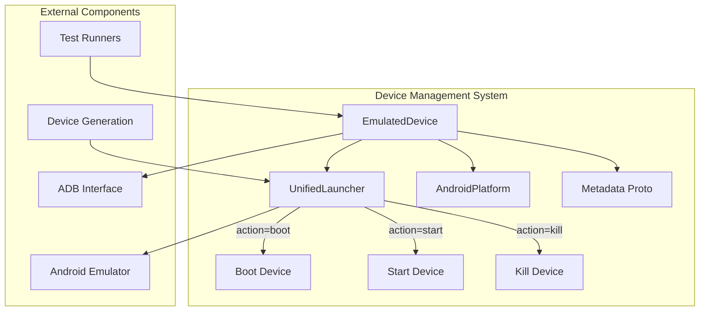
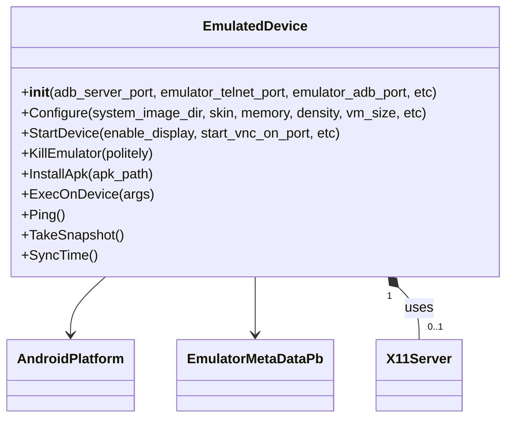
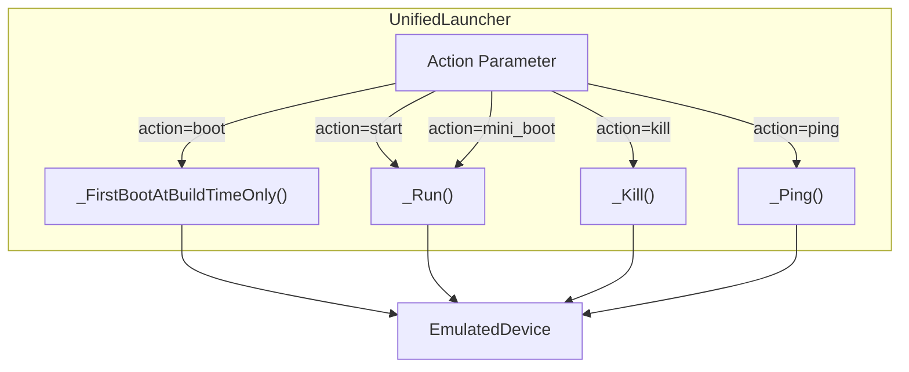
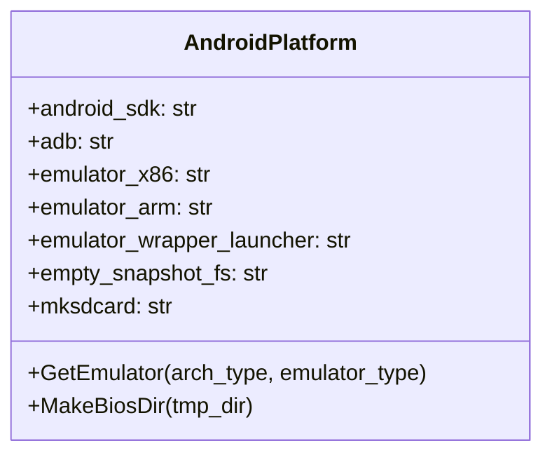
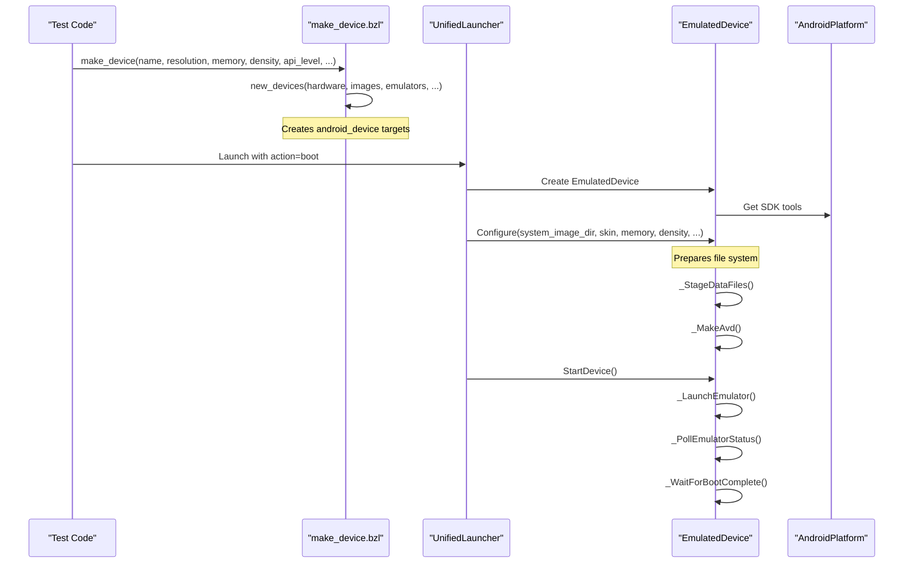
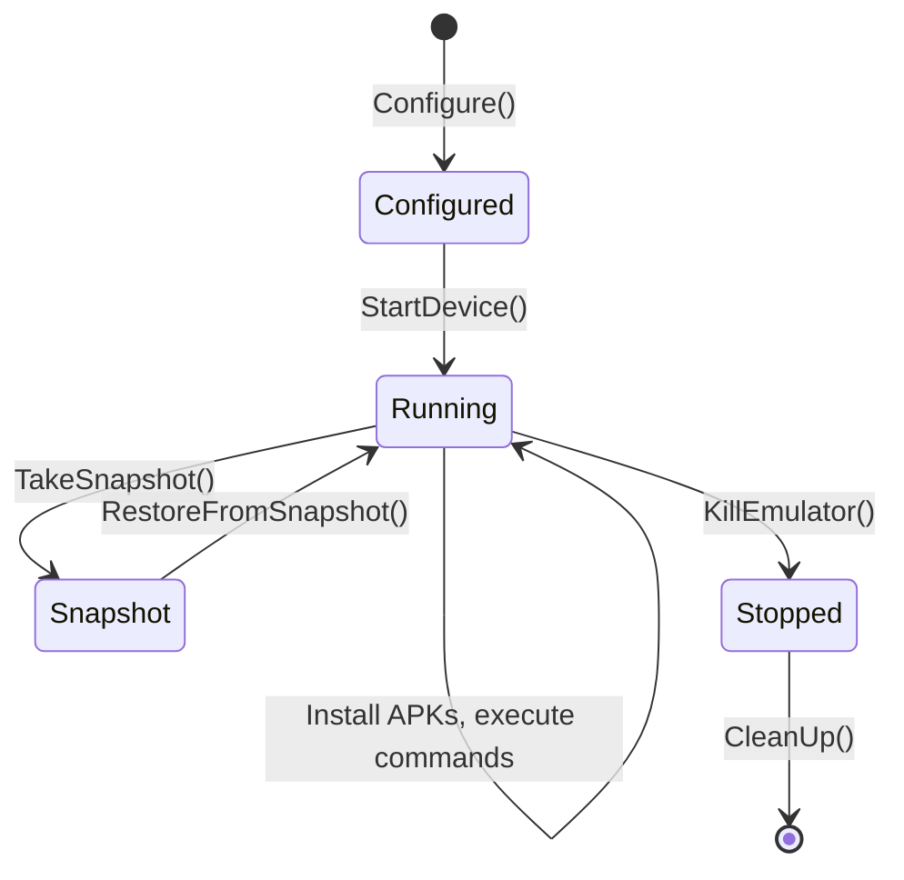
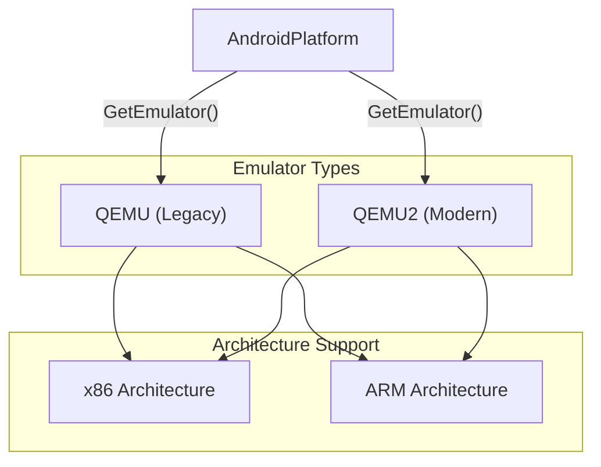
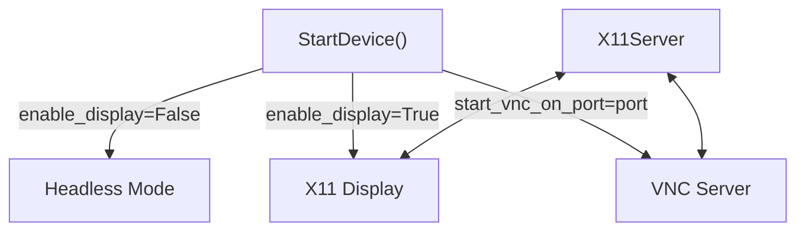
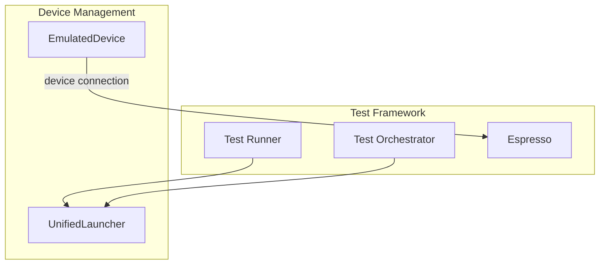

<!-- source: DeepWiki mcp.deepwiki.com · repo android/android-test · page 6 Device Management · fetched 2026-10-23 -->

# Device Management

<details>
<summary>Relevant source files</summary>

The following files were used as context for generating this wiki page:

- [tools/android/emulated_devices/macro/emulator.bzl](tools/android/emulated_devices/macro/emulator.bzl)
- [tools/android/emulated_devices/macro/emulator_info.bzl](tools/android/emulated_devices/macro/emulator_info.bzl)
- [tools/android/emulated_devices/macro/hardware.bzl](tools/android/emulated_devices/macro/hardware.bzl)
- [tools/android/emulated_devices/macro/image.bzl](tools/android/emulated_devices/macro/image.bzl)
- [tools/android/emulated_devices/macro/image_info.bzl](tools/android/emulated_devices/macro/image_info.bzl)
- [tools/android/emulated_devices/macro/make_device.bzl](tools/android/emulated_devices/macro/make_device.bzl)
- [tools/android/emulated_devices/macro/props.bzl](tools/android/emulated_devices/macro/props.bzl)
- [tools/android/emulated_devices/macro/props_info.bzl](tools/android/emulated_devices/macro/props_info.bzl)
- [tools/android/emulator/BUILD.bazel](tools/android/emulator/BUILD.bazel)
- [tools/android/emulator/emulated_device.py](tools/android/emulator/emulated_device.py)
- [tools/android/emulator/emulated_device_integration_test_arm.py](tools/android/emulator/emulated_device_integration_test_arm.py)
- [tools/android/emulator/emulated_device_software_open_gl_integration_test.py](tools/android/emulator/emulated_device_software_open_gl_integration_test.py)
- [tools/android/emulator/emulated_device_test.py](tools/android/emulator/emulated_device_test.py)
- [tools/android/emulator/fake_android_platform_util.py](tools/android/emulator/fake_android_platform_util.py)
- [tools/android/emulator/support/adb.turbo](tools/android/emulator/support/adb.turbo)
- [tools/android/emulator/support/default_sdcard.256.img.tar.gz](tools/android/emulator/support/default_sdcard.256.img.tar.gz)
- [tools/android/emulator/unified_launcher.py](tools/android/emulator/unified_launcher.py)
- [tools/android/emulator/unified_launcher_test.py](tools/android/emulator/unified_launcher_test.py)
- [tools/android/emulator/xserver.py](tools/android/emulator/xserver.py)

</details>


The Device Management system in the AndroidX Test framework provides tools and APIs for controlling Android emulators during testing. This module handles the lifecycle of emulated devices, including their creation, configuration, startup, interaction, and shutdown. For information about specific device configurations, see [Device Generation](#6.2).

## Overview

The Device Management system enables the Android Test framework to launch and control emulated Android devices with precise configurations. It supports various device types, architectures, API levels, and customizations, allowing tests to run in well-defined environments.



Sources: 
- [tools/android/emulator/emulated_device.py:319-321]()
- [tools/android/emulator/unified_launcher.py:15-16]()
- [tools/android/emulator/unified_launcher.py:46-47]()

## Core Components

### EmulatedDevice

The `EmulatedDevice` class is the central component in the Device Management system. It provides a comprehensive API for managing the entire lifecycle of an emulated Android device.



The `EmulatedDevice` class provides these key functionalities:

- **Device configuration**: Setting up device specifications, system images, and properties
- **Lifecycle management**: Starting, monitoring, and stopping the emulator
- **Device interaction**: Installing APKs, executing shell commands, managing files
- **State management**: Creating and restoring device snapshots

Sources:
- [tools/android/emulator/emulated_device.py:320-391]()
- [tools/android/emulator/emulated_device.py:734-904]()

### Unified Launcher

The `UnifiedLauncher` provides a simpler interface for common operations on emulated devices. It supports several actions:

- **boot**: First-time boot of a device, typically used at build time
- **start**: Start an emulator from existing images
- **mini_boot**: Minimal startup for basic operations
- **ping**: Check if an emulator is running
- **kill**: Terminate an emulator
- **info**: Retrieve information about an emulator



Sources:
- [tools/android/emulator/unified_launcher.py:15-16]()
- [tools/android/emulator/unified_launcher.py:46-47]()
- [tools/android/emulator/unified_launcher.py:266-539]()

### Android Platform

The `AndroidPlatform` class encapsulates access to the Android SDK tools needed for emulation, such as ADB, emulator binaries, and system image components.



Sources:
- [tools/android/emulator/emulated_device.py:261-317]()

## Device Configuration Process

The configuration process involves several steps to set up an emulated device with the desired specifications.



The configuration involves two main paths:

1. **Build-time configuration**: Using Bazel's `make_device.bzl` to define device specifications declaratively
2. **Runtime configuration**: Using the EmulatedDevice API to configure a device programmatically

### Build-time Configuration

The build system provides the `make_device` function that creates Android device targets with specific configurations:

```python
make_device(
    name,
    horizontal_resolution,
    vertical_resolution,
    screen_density,
    ram,
    vm_heap,
    cache,
    min_api,
    max_api,
    system_image_flavors,
    ...
)
```

This configuration is packaged into a Bazel target that can be used by tests.

Sources:
- [tools/android/emulated_devices/macro/make_device.bzl:60-143]()
- [tools/android/emulated_devices/macro/make_device.bzl:176-297]()

### Runtime Configuration

The `EmulatedDevice.Configure()` method sets up the device according to specified parameters:

```python
device.Configure(
    system_image_dir,
    skin,
    memory,
    density,
    vm_size,
    source_properties,
    default_properties,
    ...
)
```

This configuration includes:
- Hardware specifications (screen size, RAM, etc.)
- System image selection
- Boot properties
- AVD (Android Virtual Device) configuration

Sources:
- [tools/android/emulator/emulated_device.py:734-904]()

## Device Lifecycle Management

The Device Management system provides several methods for controlling the device lifecycle.



### Device Startup

The startup process involves:

1. Preparing system image files
2. Creating AVD configuration
3. Launching the emulator process
4. Waiting for the device to complete booting
5. Setting up network and other services

The `StartDevice()` method orchestrates this process, and can be customized with various parameters:

```python
device.StartDevice(
    enable_display,        # Whether to show GUI
    start_vnc_on_port,     # VNC server port
    net_type,              # Network type
    userdata_tarball,      # User data image
    new_process_group,     # Process management
    with_audio,            # Audio support
    open_gl_driver,        # OpenGL driver type
    ...
)
```

Sources:
- [tools/android/emulator/emulated_device.py:905-1000]()
- [tools/android/emulator/unified_launcher.py:432-523]()

### Device Interaction

Once a device is running, it can be interacted with through several methods:

- **Installing APKs**: `InstallApk()`, `InstallSystemApks()`
- **Running commands**: `ExecOnDevice()`
- **Managing files**: `PushFile()`, `PullFile()`
- **Controlling state**: `Reboot()`, `TakeSnapshot()`

Sources:
- [tools/android/emulator/emulated_device.py:1000-1200]()
- [tools/android/emulator/unified_launcher.py:526-535]()

### Device Shutdown

Devices can be stopped using the `KillEmulator()` method, which can terminate the emulator either politely (graceful shutdown) or forcefully.

Sources:
- [tools/android/emulator/emulated_device.py:1200-1300]()
- [tools/android/emulator/unified_launcher.py:390-415]()

## Emulator Support

The Device Management system supports different emulator implementations through a plug-in architecture.



The system supports:
- **QEMU**: The legacy emulator, suitable for older API levels
- **QEMU2**: The modern emulator with better performance, particularly for x86 images

Each emulator type has specific capabilities and limitations regarding API level and architecture support.

Sources:
- [tools/android/emulated_devices/macro/emulator_info.bzl:18-84]()
- [tools/android/emulator/emulated_device.py:286-298]()

## Advanced Features

### Snapshot Management

The Device Management system supports creating and restoring emulator snapshots, which can significantly speed up test execution by avoiding full device boots.


Sources:
- [tools/android/emulator/unified_launcher.py:401-414]()
- [tools/android/emulator/emulated_device.py:734-904]()

### Display Management

The system supports different display modes:

- **Headless**: No visible display, suitable for CI/CD environments
- **X11 Display**: Normal GUI display
- **VNC Server**: Remote access through VNC



The `xserver.py` module provides X11 server management for GUI display modes.

Sources:
- [tools/android/emulator/xserver.py:15-26]()
- [tools/android/emulator/emulated_device.py:905-1000]()

### OpenGL Support

The system supports different OpenGL implementations for hardware acceleration:

- **Auto**: Automatically selects the best option
- **Host**: Uses host GPU for acceleration
- **Guest**: Uses emulated GPU in the guest
- **Mesa**: Uses Mesa software rendering
- **Swiftshader**: Uses Google's SwiftShader software renderer

Sources:
- [tools/android/emulator/emulated_device.py:157-165]()
- [tools/android/emulator/unified_launcher.py:186-191]()

## Integration with Test Framework

The Device Management system integrates with the Android test framework, providing a foundation for test execution.



The main integration points include:

1. **Device Launch**: Test frameworks use UnifiedLauncher to start devices with specific configurations
2. **Device Connection**: Tests connect to running devices through ADB
3. **Device Cleanup**: Test frameworks kill and clean up devices after test execution

Sources:
- [tools/android/emulator/unified_launcher.py:539-646]()

## Summary

The Device Management system provides a comprehensive set of tools for creating, configuring, and controlling emulated Android devices for testing purposes. It offers flexibility in device specifications, emulator types, and runtime behaviors, enabling tests to run in well-defined and consistent environments.

Key capabilities include:
- Declarative device configuration
- Support for multiple emulator types and architectures
- Snapshot management for fast startup
- Various display modes
- OpenGL acceleration options
- Rich device interaction capabilities

This foundation enables reliable and efficient Android test execution across different device configurations.

---

