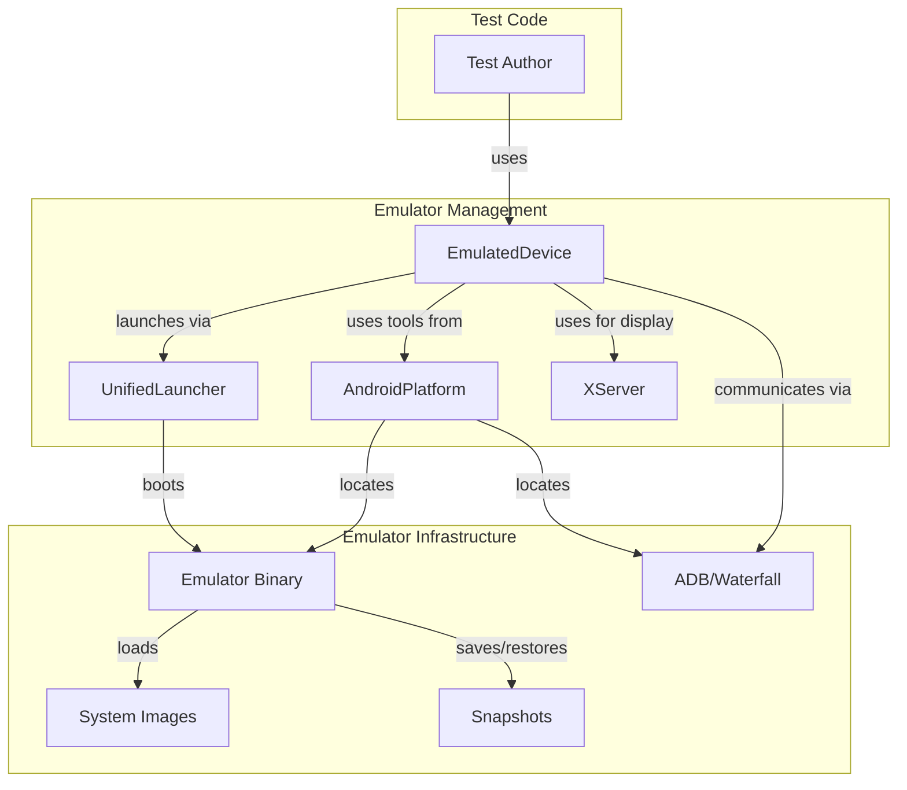
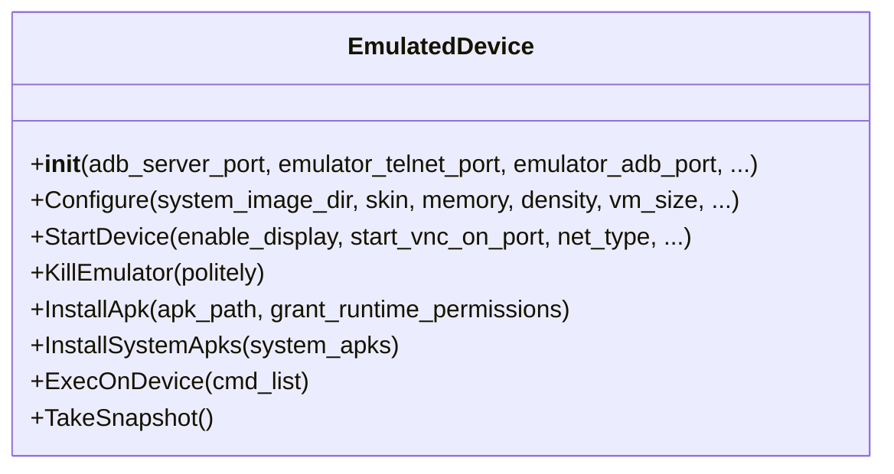
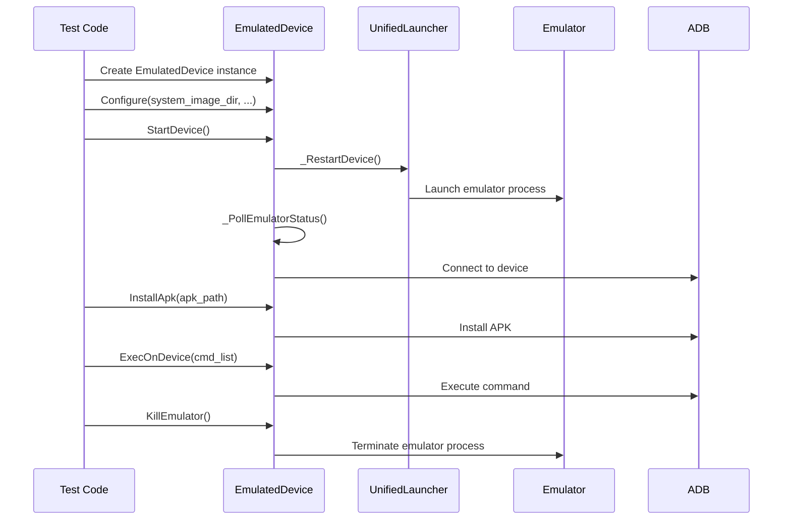
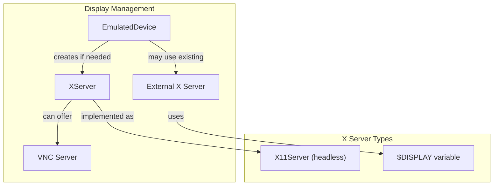
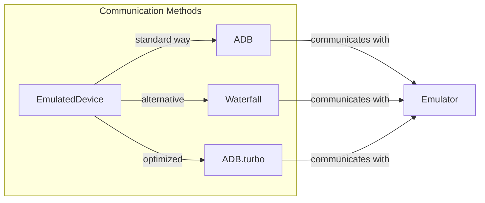

<!-- source: DeepWiki mcp.deepwiki.com · repo android/android-test · page 6.1 Emulated Device · fetched 2026-10-23 -->

# Emulated Device

<details>
<summary>Relevant source files</summary>

The following files were used as context for generating this wiki page:

- [tools/android/emulator/BUILD.bazel](tools/android/emulator/BUILD.bazel)
- [tools/android/emulator/emulated_device.py](tools/android/emulator/emulated_device.py)
- [tools/android/emulator/emulated_device_integration_test_arm.py](tools/android/emulator/emulated_device_integration_test_arm.py)
- [tools/android/emulator/emulated_device_software_open_gl_integration_test.py](tools/android/emulator/emulated_device_software_open_gl_integration_test.py)
- [tools/android/emulator/emulated_device_test.py](tools/android/emulator/emulated_device_test.py)
- [tools/android/emulator/fake_android_platform_util.py](tools/android/emulator/fake_android_platform_util.py)
- [tools/android/emulator/support/adb.turbo](tools/android/emulator/support/adb.turbo)
- [tools/android/emulator/support/default_sdcard.256.img.tar.gz](tools/android/emulator/support/default_sdcard.256.img.tar.gz)
- [tools/android/emulator/unified_launcher.py](tools/android/emulator/unified_launcher.py)
- [tools/android/emulator/unified_launcher_test.py](tools/android/emulator/unified_launcher_test.py)
- [tools/android/emulator/xserver.py](tools/android/emulator/xserver.py)

</details>


The Emulated Device component provides a programmatic interface for controlling Android emulators during automated testing. It handles launching, configuring, interacting with, and shutting down Android emulators, enabling reliable and reproducible test environments. 

For information about the device generation system that creates emulator configurations, see [Device Generation](#6.2).

## System Overview

The Emulated Device system serves as the bridge between test code and Android emulators. It provides a consistent interface for test authors to:

1. Configure emulator hardware parameters
2. Launch emulator instances with specific characteristics
3. Install and manage applications on emulator devices
4. Execute commands and tests on emulator devices
5. Manage emulator lifecycle (boot, restart, shutdown)
6. Create and restore emulator snapshots for faster testing

This system is designed to work within the Android Test Framework and relies on the Android SDK tools while providing higher-level abstractions for test development.

## Architecture

The Emulated Device system consists of several key components that work together to manage Android emulators:



Sources: [tools/android/emulator/emulated_device.py:320-392](), [tools/android/emulator/unified_launcher.py:1-65]()

### Core Components

1. **EmulatedDevice**: The primary class for configuring and controlling emulated Android devices
2. **UnifiedLauncher**: Handles the boot, start, and shutdown processes for emulators
3. **AndroidPlatform**: Locates and provides access to Android SDK tools and resources
4. **XServer**: Manages the X11 display environment for the emulator UI

## EmulatedDevice Class

The `EmulatedDevice` class is the central component of the system, responsible for managing the entire lifecycle of an emulated Android device.



Sources: [tools/android/emulator/emulated_device.py:320-392](), [tools/android/emulator/emulated_device_test.py:71-435]()

### Key Methods

| Method | Description |
|--------|-------------|
| `Configure()` | Sets up emulator parameters like screen size, memory, and system images |
| `StartDevice()` | Launches the emulator with the configured parameters |
| `KillEmulator()` | Terminates the emulator process |
| `InstallApk()` | Installs an application package on the emulated device |
| `ExecOnDevice()` | Executes a command on the emulated device |
| `Ping()` | Checks if the emulator is responsive |
| `TakeSnapshot()` | Creates a snapshot of the current emulator state for faster restarts |

Sources: [tools/android/emulator/emulated_device.py:736-904](), [tools/android/emulator/emulated_device.py:452-486]()

## Device Lifecycle

The EmulatedDevice system manages the complete lifecycle of an emulator, from configuration to shutdown:



Sources: [tools/android/emulator/unified_launcher.py:393-646](), [tools/android/emulator/emulated_device_test.py:242-297]()

### Launch Process

1. **Configuration**: Set up the emulator's hardware profile, including screen size, memory, and system images
2. **Boot**: First-time boot initializes the system images and prepares them for use
3. **Start**: Launch the emulator with the configured parameters
4. **Connection**: Connect to the emulator via ADB or Waterfall
5. **Verification**: Ensure the emulator has fully booted and is responsive

Sources: [tools/android/emulator/unified_launcher.py:266-389](), [tools/android/emulator/unified_launcher.py:425-523]()

## Configuration Options

The EmulatedDevice system supports a wide range of configuration options:

### Hardware Configuration

| Parameter | Description | Example |
|-----------|-------------|---------|
| `skin` | Screen size in pixels | `'800x480'` |
| `memory` | RAM allocation in MB | `'1024'` |
| `density` | Screen density (DPI) | `240` |
| `vm_size` | Dalvik VM heap size in MB | `256` |
| `cores` | Number of CPU cores | `2` |
| `sdcard_size_mb` | SD card size in MB | `256` |

### Network Configuration

Network types control emulator network characteristics:

| Network Type | Speed (kbps) | Delay (ms) |
|--------------|--------------|------------|
| `edge` | 118.4/236.8 | 80-400 |
| `fastnet` | full | none |
| `gprs` | 40.0/80.0 | 150-550 |
| `gsm` | 14.4/14.4 | 300-1000 |
| `hsdpa` | 348.0/14400.0 | none |
| `umts` | 128.0/1920.0 | 35-200 |

Sources: [tools/android/emulator/emulated_device.py:84-115]()

### OpenGL Options

The emulator supports various OpenGL driver configurations:

| OpenGL Option | Description |
|---------------|-------------|
| `auto` | Automatically select the best available driver |
| `guest` | Use guest-side GPU emulation |
| `host` | Use host GPU acceleration |
| `mesa` | Use software Mesa OpenGL implementation |
| `swiftshader` | Use SwiftShader software renderer |
| `no_open_gl` | Disable OpenGL support |

Sources: [tools/android/emulator/emulated_device.py:157-165]()

## Usage Examples

### Basic Usage

```python
# Create an EmulatedDevice instance
device = EmulatedDevice(android_platform=android_platform)

# Configure the device
device.Configure(
    system_image_dir='/path/to/system/images',
    skin='800x480',
    memory='1024',
    density=240,
    vm_size=256,
    source_properties={'systemimage.abi': 'x86',
                      'androidversion.apilevel': '28'}
)

# Start the device
device.StartDevice(enable_display=True)

# Install an APK
device.InstallApk('/path/to/app.apk')

# Execute a command
output = device.ExecOnDevice(['pm', 'list', 'packages'])

# Kill the emulator when done
device.KillEmulator()
```

Sources: [tools/android/emulator/emulated_device_test.py:242-297](), [tools/android/emulator/emulated_device_software_open_gl_integration_test.py:37-87]()

### Using OpenGL Acceleration

```python
# Configure with OpenGL support
device.Configure(
    system_image_dir='/path/to/system/images',
    skin='800x480',
    memory='1024',
    density=240,
    vm_size=256,
    source_properties={'systemimage.abi': 'x86',
                      'androidversion.apilevel': '28',
                      'systemimage.gpusupport': 'yes'}
)

# Start with Mesa OpenGL driver
device.StartDevice(enable_display=True, open_gl_driver='mesa')
```

Sources: [tools/android/emulator/emulated_device_software_open_gl_integration_test.py:52-73]()

## UnifiedLauncher

The UnifiedLauncher component provides actions for controlling the emulator:

| Action | Description |
|--------|-------------|
| `boot` | Performs first-time boot of a system image |
| `start` | Launches an existing emulator configuration |
| `mini_boot` | Starts an emulator with minimal services for faster startup |
| `kill` | Terminates a running emulator |
| `info` | Displays information about an emulator |

Sources: [tools/android/emulator/unified_launcher.py:45-47](), [tools/android/emulator/unified_launcher.py:266-389]()

## Advanced Features

### Snapshots

The EmulatedDevice system can create and use snapshots to speed up emulator startup:

```python
# Save a snapshot after setup
device.TakeSnapshot()

# Later, start with the snapshot
device.StartDevice(enable_display=True, save_snapshot=True, snapshot_file='/path/to/snapshot')
```

Sources: [tools/android/emulator/unified_launcher.py:227-230](), [tools/android/emulator/unified_launcher.py:373-385]()

### VNC Support

Emulators can be accessed remotely via VNC:

```python
# Start with VNC server on a specific port
vnc_port = 5900
device.StartDevice(enable_display=True, start_vnc_on_port=vnc_port)
```

Sources: [tools/android/emulator/unified_launcher.py:184-185](), [tools/android/emulator/xserver.py:15-26]()

### X Server Management

The emulator uses an X server for display:



Sources: [tools/android/emulator/xserver.py:38-126](), [tools/android/emulator/xserver.py:190-226]()

## Common Issues and Troubleshooting

### Emulator Fails to Start

Possible causes:
- Insufficient memory on host machine
- Incompatible system image and emulator version
- X server issues
- OpenGL configuration problems

Solutions:
- Decrease emulator memory allocation
- Use compatible system image version
- Check X server configuration
- Try different OpenGL driver settings

### ADB Connection Issues

Possible causes:
- ADB server conflicts
- Port already in use
- Emulator not fully booted

Solutions:
- Use a different ADB server port
- Kill existing ADB processes
- Ensure the emulator is fully booted

Sources: [tools/android/emulator/emulated_device.py:377-392](), [tools/android/emulator/emulated_device_test.py:111-145]()

### Performance Issues

Possible improvements:
- Use snapshots for faster startup
- Enable KVM acceleration for x86 emulators
- Use appropriate OpenGL driver settings
- Reduce screen size and density
- Use mini_boot mode for minimal services

Sources: [tools/android/emulator/unified_launcher.py:465-487](), [tools/android/emulator/emulated_device.py:157-165]()

## Communication Methods

The EmulatedDevice system communicates with emulators using either ADB or Waterfall:



Sources: [tools/android/emulator/emulated_device.py:126-137](), [tools/android/emulator/unified_launcher.py:645-646](), [tools/android/emulator/support/adb.turbo]()

## System Requirements

The EmulatedDevice system requires:

1. Android SDK with emulator tools
2. X11 environment (real or virtual)
3. KVM support (optional, for improved performance on x86 emulators)
4. Sufficient RAM and disk space for emulator images

Sources: [tools/android/emulator/unified_launcher.py:463-481](), [tools/android/emulator/xserver.py:15-26]()

---

