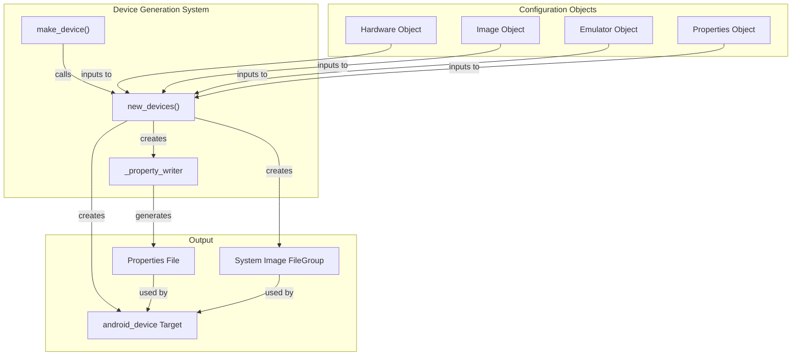
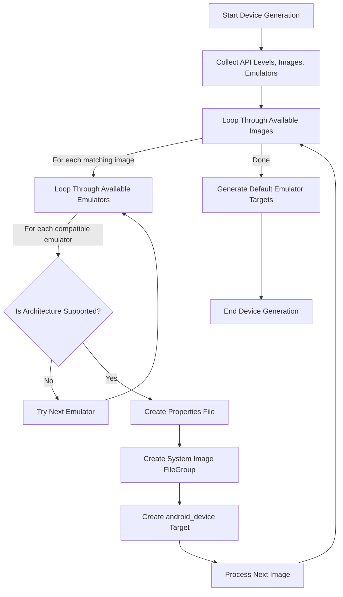
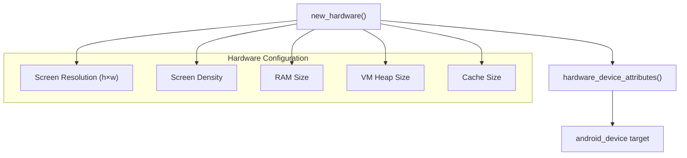
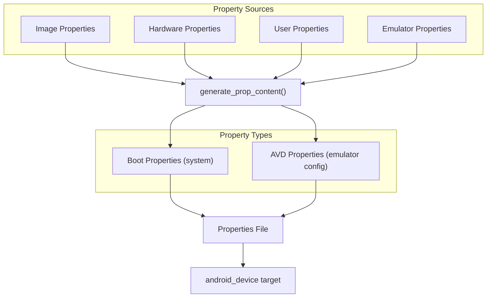

<!-- source: DeepWiki mcp.deepwiki.com · repo android/android-test · page 6.2 Device Generation · fetched 2026-10-23 -->

# Device Generation

<details>
<summary>Relevant source files</summary>

The following files were used as context for generating this wiki page:

- [tools/android/emulated_devices/macro/emulator.bzl](tools/android/emulated_devices/macro/emulator.bzl)
- [tools/android/emulated_devices/macro/emulator_info.bzl](tools/android/emulated_devices/macro/emulator_info.bzl)
- [tools/android/emulated_devices/macro/hardware.bzl](tools/android/emulated_devices/macro/hardware.bzl)
- [tools/android/emulated_devices/macro/image.bzl](tools/android/emulated_devices/macro/image.bzl)
- [tools/android/emulated_devices/macro/image_info.bzl](tools/android/emulated_devices/macro/image_info.bzl)
- [tools/android/emulated_devices/macro/make_device.bzl](tools/android/emulated_devices/macro/make_device.bzl)
- [tools/android/emulated_devices/macro/props.bzl](tools/android/emulated_devices/macro/props.bzl)
- [tools/android/emulated_devices/macro/props_info.bzl](tools/android/emulated_devices/macro/props_info.bzl)

</details>


The Device Generation system is responsible for creating and configuring Android emulator devices for testing purposes within the AndroidX Test framework. This system generates Bazel targets that represent specific Android device configurations with predefined hardware characteristics, system images, and properties.

For information about the actual emulator management during test execution, see [Emulated Device](#6.1).

## Overview

The Device Generation system provides a configurable way to create Android virtual devices with specific hardware properties, Android API levels, and emulator types. It acts as the bridge between test writers who need specific device configurations and the underlying Android emulator infrastructure.



Sources: [tools/android/emulated_devices/macro/make_device.bzl:60-142](), [tools/android/emulated_devices/macro/make_device.bzl:176-220]()

## Core Components

The Device Generation system is built around several core components that work together to create emulated device configurations:

### Configuration Objects

The system uses four main types of configuration objects:

1. **Hardware Object**: Defines physical device characteristics (screen resolution, density, RAM, etc.)
2. **Image Object**: Represents an Android system image with specific API level, architecture, and flavor
3. **Emulator Object**: Specifies which emulator binary to use and its capabilities
4. **Properties Object**: Contains system and AVD properties for configuration

```mermaid
classDiagram
    class Hardware {
        horizontal_resolution
        vertical_resolution
        screen_density
        ram
        vm_heap
        cache
        props
    }
    
    class Image {
        api_level
        flavor
        arch
        files
        device_visibility
        version_string
        props
        compressed
    }
    
    class Emulator {
        emulator_type
        supports
        uses_kvm
        extra_files
        props
        qemu2
        default_visibility
    }
    
    class Props {
        boot{}
        avd{}
    }
    
    Hardware --> Props: contains
    Image --> Props: contains
    Emulator --> Props: contains
```

Sources: [tools/android/emulated_devices/macro/hardware.bzl:5-22](), [tools/android/emulated_devices/macro/image.bzl:12-33](), [tools/android/emulated_devices/macro/emulator.bzl:6-39](), [tools/android/emulated_devices/macro/props.bzl:3-13]()

### Entry Point Functions

The main entry points to the Device Generation system are:

1. **`make_device()`**: The high-level function that takes hardware specifications and generates device targets
2. **`new_devices()`**: The implementation function that handles the actual device generation

The system also includes helper functions for creating property files and system image filegroups.

Sources: [tools/android/emulated_devices/macro/make_device.bzl:60-142](), [tools/android/emulated_devices/macro/make_device.bzl:176-220]()

## Device Generation Process

The device generation process follows a series of steps to create properly configured Android device targets:



Sources: [tools/android/emulated_devices/macro/make_device.bzl:176-298]()

The main steps in this process are:

1. **Collect Available Resources**: Gather all available API levels, system images, and emulators
2. **Filter and Match**: Iterate through images and emulators to find compatible combinations
3. **Create Properties**: Generate property files for each valid device configuration
4. **Create System Image**: Bundle system image files with any additional required files
5. **Create Device Target**: Generate the final `android_device` Bazel target

Sources: [tools/android/emulated_devices/macro/make_device.bzl:226-297]()

## Emulator and Image Configuration

### Available Emulators

The system supports two primary emulator types:

| Emulator Type | Description | Supported Architectures | Supported API Levels |
|---------------|-------------|-------------------------|----------------------|
| QEMU          | Legacy emulator | x86: 10-25<br>ARM: 10-19 | Lower API levels |
| QEMU2         | Modern emulator | x86: 10-29<br>ARM: 21-24 | All API levels (preferred) |

Sources: [tools/android/emulated_devices/macro/emulator_info.bzl:15-84]()

### System Images

System images are defined by:
- API level (Android version)
- Architecture (x86, ARM)
- Flavor (google, android, wear, tv, etc.)

The system maintains a registry of available system images across different API levels and flavors.

Sources: [tools/android/emulated_devices/macro/image_info.bzl:21-88]()

### Hardware Configuration

Hardware configurations specify physical device characteristics:



Sources: [tools/android/emulated_devices/macro/hardware.bzl:5-22](), [tools/android/emulated_devices/macro/hardware.bzl:24-32]()

## Property Management

Properties for device configuration come from four sources:

1. **Image properties**: Defined by the system image
2. **Hardware properties**: Based on hardware configuration
3. **User properties**: Provided by the user
4. **Emulator properties**: Added by the selected emulator

These properties are combined in a specific order to ensure proper precedence. The combined properties are written to a property file used during emulator startup.



Sources: [tools/android/emulated_devices/macro/props_info.bzl:33-74]()

The property generation follows specific rules for precedence:

1. Read-only ("ro.") properties: emulator → user → hardware → image
2. Mutable properties: image → hardware → user → emulator
3. AVD properties: image → hardware → user → emulator

Sources: [tools/android/emulated_devices/macro/props_info.bzl:44-73]()

## Usage and Integration

### Basic Usage

To generate device targets, you call `make_device()` with hardware specifications and desired API levels:

```
make_device(
    name = "pixel",
    horizontal_resolution = 1080,
    vertical_resolution = 1920,
    screen_density = 420,
    ram = 2048,
    vm_heap = 256,
    cache = 32,
    min_api = 21,
    max_api = 29,
    system_image_flavors = ["google"],
)
```

This generates multiple `android_device` targets based on the specified parameters, one for each compatible combination of API level, architecture, and emulator type.

Sources: [tools/android/emulated_devices/macro/make_device.bzl:60-142]()

### More Advanced Configuration

For more control, you can use `new_devices()` directly:

```
new_devices(
    name = "pixel",
    hardware = new_hardware(
        horizontal_resolution = 1080,
        vertical_resolution = 1920,
        screen_density = 420,
        ram = 2048,
        vm_heap = 256,
        cache = 32,
    ),
    min_api = 21,
    max_api = 29,
    user_props = new_props(
        boot_properties = {"ro.product.model": "Pixel"},
        avd_properties = {"hw.mainKeys": "no"},
    ),
    emulators = [QEMU2],
    system_image_flavors = ["google"],
)
```

Sources: [tools/android/emulated_devices/macro/make_device.bzl:176-220]()

## Generated Targets

The system generates several types of Bazel targets:

1. **Property file targets**: Contains combined system and AVD properties
2. **System image filegroups**: Bundles system image files with emulator dependencies
3. **android_device targets**: Final targets representing complete device configurations

The naming convention for generated targets follows the pattern:
`[name]_[flavor]_[api]_[arch]_[emulator]` (e.g., `pixel_google_29_x86_qemu2`)

Sources: [tools/android/emulated_devices/macro/make_device.bzl:144-165](), [tools/android/emulated_devices/macro/make_device.bzl:299-337]()

## Integration with Testing Framework

The generated device targets can be used directly in test rules:

```
android_instrumentation_test(
    name = "my_test",
    target_device = ":pixel_google_29_x86_qemu2",
    ...
)
```

For more information about how these devices are used during test execution, see the [Emulated Device](#6.1) page.

---

