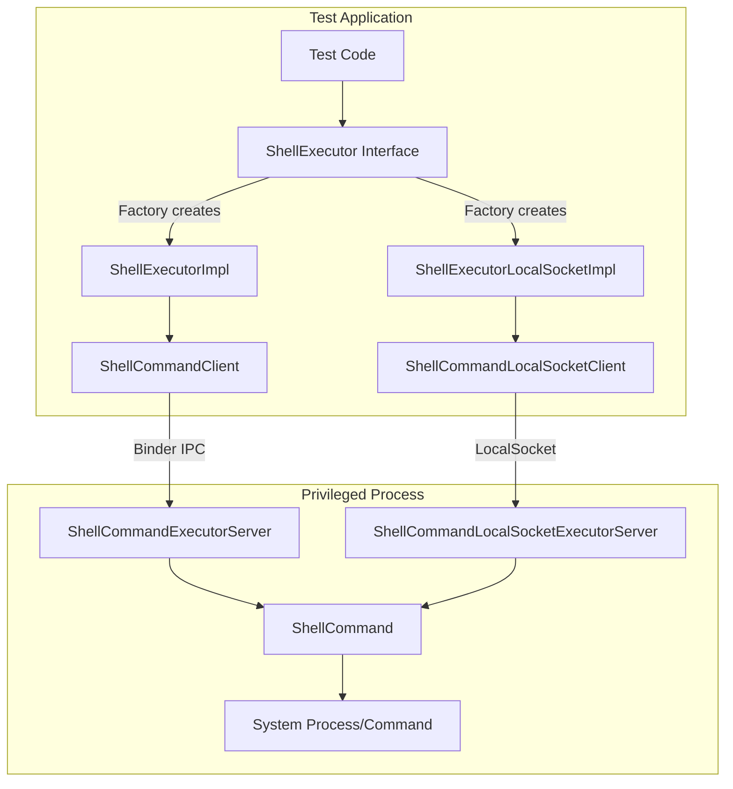
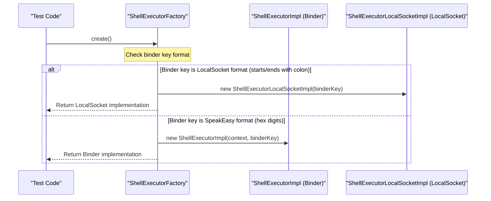
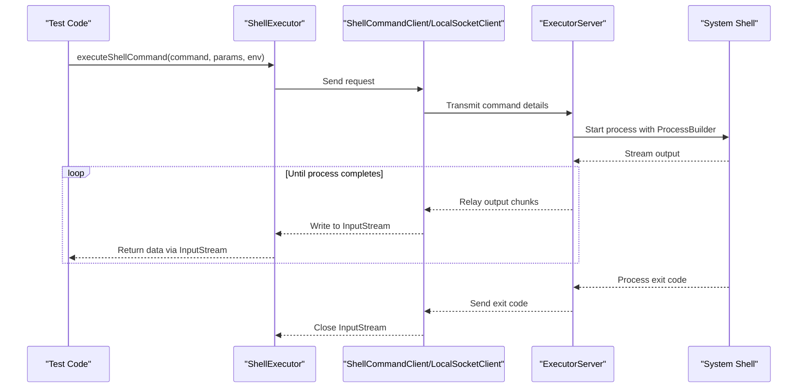
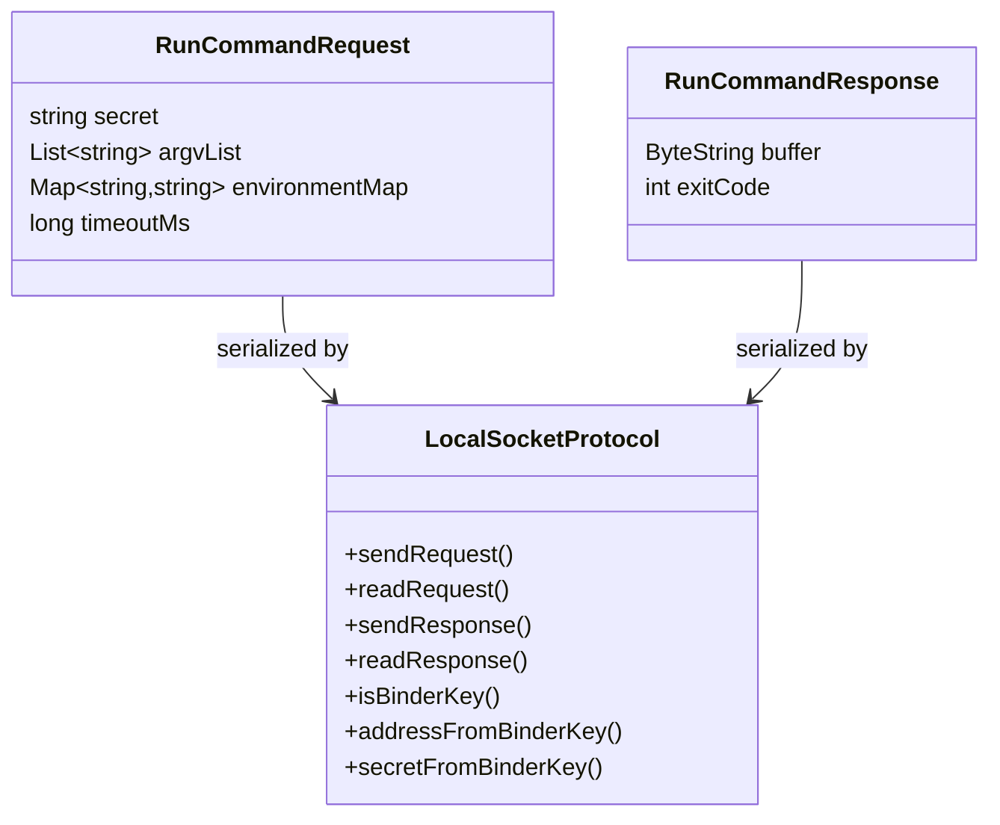

<!-- source: DeepWiki mcp.deepwiki.com · repo android/android-test · page 6.3 Shell Execution · fetched 2026-10-23 -->

# Shell Execution

<details>
<summary>Relevant source files</summary>

The following files were used as context for generating this wiki page:

- [services/shellexecutor/java/androidx/test/services/shellexecutor/BUILD](services/shellexecutor/java/androidx/test/services/shellexecutor/BUILD)
- [services/shellexecutor/java/androidx/test/services/shellexecutor/LocalSocketShellMain.kt](services/shellexecutor/java/androidx/test/services/shellexecutor/LocalSocketShellMain.kt)
- [services/shellexecutor/java/androidx/test/services/shellexecutor/ShellCommandLocalSocketClient.kt](services/shellexecutor/java/androidx/test/services/shellexecutor/ShellCommandLocalSocketClient.kt)
- [services/shellexecutor/java/androidx/test/services/shellexecutor/ShellCommandLocalSocketExecutorServer.kt](services/shellexecutor/java/androidx/test/services/shellexecutor/ShellCommandLocalSocketExecutorServer.kt)
- [services/shellexecutor/java/androidx/test/services/shellexecutor/ShellExecutorFactory.java](services/shellexecutor/java/androidx/test/services/shellexecutor/ShellExecutorFactory.java)
- [services/shellexecutor/java/androidx/test/services/shellexecutor/ShellExecutorLocalSocketImpl.kt](services/shellexecutor/java/androidx/test/services/shellexecutor/ShellExecutorLocalSocketImpl.kt)
- [services/shellexecutor/javatests/androidx/test/services/shellexecutor/BUILD](services/shellexecutor/javatests/androidx/test/services/shellexecutor/BUILD)
- [services/shellexecutor/javatests/androidx/test/services/shellexecutor/ShellCommandLocalSocketClientTest.kt](services/shellexecutor/javatests/androidx/test/services/shellexecutor/ShellCommandLocalSocketClientTest.kt)
- [services/shellexecutor/javatests/androidx/test/services/shellexecutor/ShellCommandLocalSocketExecutorServerTest.kt](services/shellexecutor/javatests/androidx/test/services/shellexecutor/ShellCommandLocalSocketExecutorServerTest.kt)
- [services/shellexecutor/javatests/androidx/test/services/shellexecutor/ShellCommandTest.java](services/shellexecutor/javatests/androidx/test/services/shellexecutor/ShellCommandTest.java)
- [services/shellexecutor/javatests/androidx/test/services/shellexecutor/ShellExecutorTest.java](services/shellexecutor/javatests/androidx/test/services/shellexecutor/ShellExecutorTest.java)

</details>


## Purpose and Overview

The Shell Execution system enables Android tests to execute shell commands with elevated permissions on Android devices. This system is essential because Android's security model restricts what apps can do, but automated tests often need to run privileged commands for setup, verification, or cleanup.

The Shell Execution system provides a client-server architecture that allows test code to execute commands like `adb shell` commands but from within the application context. If you're looking for information about how to control device configurations like screen orientation, see [Device Control](#6.2) instead.

Sources: [services/shellexecutor/java/androidx/test/services/shellexecutor/BUILD:7-8](), [services/shellexecutor/java/androidx/test/services/shellexecutor/ShellExecutorFactory.java:21-41]()

## Architecture Overview

The Shell Execution system follows a client-server architecture that enables privileged command execution for Android tests. The system supports two communication methods: Binder-based (via SpeakEasy services) and LocalSocket-based.



The Shell Execution system operates through these key components:
- **ShellExecutor** (Interface): Defines methods for executing shell commands
- **ShellExecutorFactory**: Creates appropriate implementation based on binder key format
- **Client Implementations**: Send command requests to the server
- **Server Implementations**: Run in a privileged process and execute the commands
- **Communication Channels**: Either Binder IPC or LocalSocket connections

Sources: [services/shellexecutor/java/androidx/test/services/shellexecutor/ShellExecutorFactory.java:21-41](), [services/shellexecutor/java/androidx/test/services/shellexecutor/BUILD:42-71](), [services/shellexecutor/java/androidx/test/services/shellexecutor/BUILD:73-96]()

## Communication Protocols

The Shell Execution system supports two communication protocols between clients and servers:

1. **Binder-based (SpeakEasy)**: The original implementation using Android's Binder IPC
2. **LocalSocket-based**: A newer implementation using Android's LocalSocket mechanism

The factory determines which implementation to use based on the format of the binder key:



The LocalSocket protocol was introduced to improve reliability and performance, particularly on older API levels. The factory makes this choice transparent to the caller.

Sources: [services/shellexecutor/java/androidx/test/services/shellexecutor/ShellExecutorFactory.java:32-40](), [services/shellexecutor/javatests/androidx/test/services/shellexecutor/ShellCommandTest.java:50-81]()

## Shell Execution Flow

The execution flow for a shell command follows this sequence:



When a test executes a shell command:
1. The request is packaged with command, parameters, environment variables, and timeout
2. The server receives the request and launches a process using ProcessBuilder
3. The output is streamed back to the client in chunks
4. When the process completes, the exit code is sent and the streams are closed

Sources: [services/shellexecutor/java/androidx/test/services/shellexecutor/ShellCommandLocalSocketExecutorServer.kt:126-183](), [services/shellexecutor/java/androidx/test/services/shellexecutor/ShellCommandLocalSocketClient.kt:63-142]()

## Key Components

### ShellExecutor Interface

The `ShellExecutor` interface defines the core functionality for executing shell commands:

| Method | Description |
|--------|-------------|
| `executeShellCommand` | Executes a command asynchronously, returning an InputStream for output |
| `executeShellCommandSync` | Executes a command synchronously, returning output as a String |
| `getBinderKey` | Returns the binder key used to communicate with the server |

The interface has two implementations:
- `ShellExecutorImpl`: Uses binder-based communication
- `ShellExecutorLocalSocketImpl`: Uses LocalSocket-based communication

Sources: [services/shellexecutor/java/androidx/test/services/shellexecutor/ShellExecutorLocalSocketImpl.kt:24-86](), [services/shellexecutor/java/androidx/test/services/shellexecutor/BUILD:82-85]()

### Client Components

The client components are responsible for sending requests to the server:

1. **ShellCommandClient**: Communicates with the server using Binder IPC
2. **ShellCommandLocalSocketClient**: Communicates using LocalSocket
   - Creates a connection to the server
   - Sends command details including timeout, environment variables
   - Reads responses and pipes them to an InputStream for the caller
   - Handles timeouts and error conditions

Sources: [services/shellexecutor/java/androidx/test/services/shellexecutor/ShellCommandLocalSocketClient.kt:50-154](), [services/shellexecutor/java/androidx/test/services/shellexecutor/BUILD:74-96]()

### Server Components

The server components run with elevated privileges and execute commands:

1. **ShellCommandExecutorServer**: Binder-based server implementation
2. **ShellCommandLocalSocketExecutorServer**: LocalSocket-based server
   - Listens on a LocalSocket
   - Authenticates requests using a secret key
   - Creates processes using ProcessBuilder
   - Streams output back to the client
   - Handles timeouts and process termination

The `ShellCommandLocalSocketExecutorServer` uses a random secure secret to authenticate clients, preventing unauthorized command execution.

Sources: [services/shellexecutor/java/androidx/test/services/shellexecutor/ShellCommandLocalSocketExecutorServer.kt:49-245](), [services/shellexecutor/java/androidx/test/services/shellexecutor/BUILD:48-71]()

## LocalSocket Protocol

The LocalSocket protocol is a newer implementation that provides several benefits:



The protocol uses Protocol Buffers to define the message format for requests and responses. This ensures compatibility and efficient serialization/deserialization.

The binder key in the LocalSocket protocol has a specific format that encodes both the socket address and a secret key, providing security while maintaining ease of connection.

Sources: [services/shellexecutor/java/androidx/test/services/shellexecutor/BUILD:16-40](), [services/shellexecutor/javatests/androidx/test/services/shellexecutor/ShellCommandLocalSocketClientTest.kt:40-48]()

## Entry Points and Bootstrapping

The system is bootstrapped through these entry points:

1. **ShellMain**: Entry point for the binder-based implementation
2. **LocalSocketShellMain**: Entry point for the LocalSocket-based implementation
   - Sets up the server
   - Launches the specified command with the server's binder key
   - Handles stdin/stdout/stderr redirection
   - Returns the process exit code

The `LocalSocketShellMain` can be used to launch a separate test process that will have access to the shell server, enabling privileged command execution from that process.

Sources: [services/shellexecutor/java/androidx/test/services/shellexecutor/LocalSocketShellMain.kt:32-89](), [services/shellexecutor/java/androidx/test/services/shellexecutor/BUILD:52-58]()

## Usage Examples

### Basic Command Execution

The Shell Execution system can be used to execute basic shell commands:

```
ShellExecutorFactory factory = new ShellExecutorFactory(context, binderKey);
ShellExecutor shellExecutor = factory.create();
String result = shellExecutor.executeShellCommandSync("id", null, null, false);
// Result contains output showing the process is running as root
```

### Using Environment Variables

Environment variables can be passed to the shell command:

```
Map<String, String> env = new HashMap<>();
env.put("name", "Shell Exec");
String results = shellExecutor.executeShellCommandSync("echo Hello $name", null, env, true);
// Results contains "Hello Shell Exec"
```

### Command Parameters

Parameters can be passed as a list:

```
List<String> params = Arrays.asList("-c", "2", "localhost");
String results = shellExecutor.executeShellCommandSync("ping", params, null, false);
// Results contains ping output for localhost
```

### Asynchronous Execution with InputStream

For commands that produce a lot of output, the asynchronous API can be used:

```
InputStream stream = shellExecutor.executeShellCommand(
    "dd if=/dev/urandom bs=2048 count=16384", null, null, true);
// Read from stream as needed
```

Sources: [services/shellexecutor/javatests/androidx/test/services/shellexecutor/ShellExecutorTest.java:46-53](), [services/shellexecutor/javatests/androidx/test/services/shellexecutor/ShellCommandTest.java:101-178]()

## Security Considerations

The Shell Execution system includes several security measures:

1. **Secret Key Authentication**: Clients must provide the correct secret key to execute commands
2. **Isolated Process**: Commands run in a separate privileged process
3. **Timeouts**: All commands can specify a timeout to prevent runaway processes

The system should be used carefully, as it provides elevated privileges that could potentially be misused if the binder key were to be compromised.

Sources: [services/shellexecutor/java/androidx/test/services/shellexecutor/ShellCommandLocalSocketExecutorServer.kt:134-138](), [services/shellexecutor/javatests/androidx/test/services/shellexecutor/ShellCommandLocalSocketExecutorServerTest.kt:88-103]()

---

