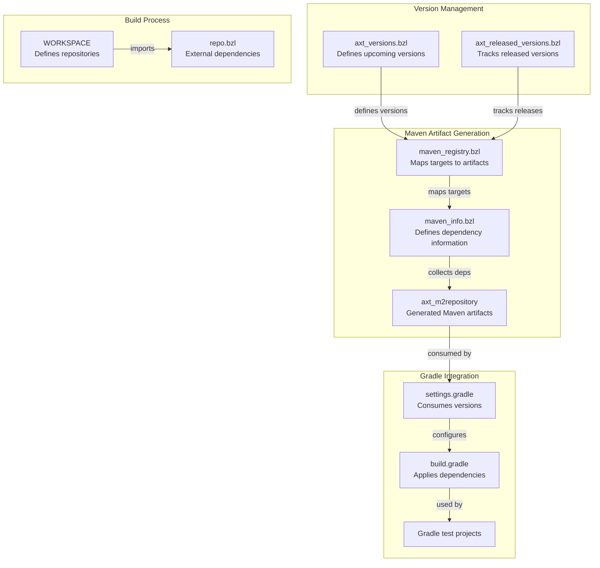
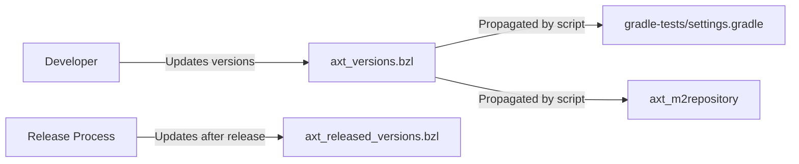
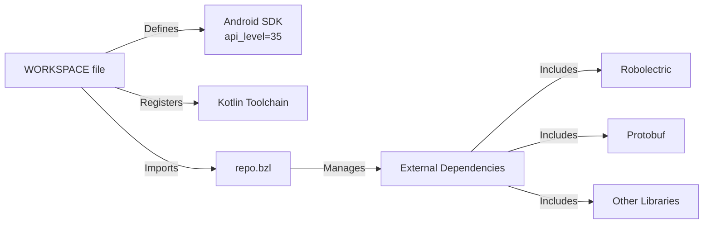
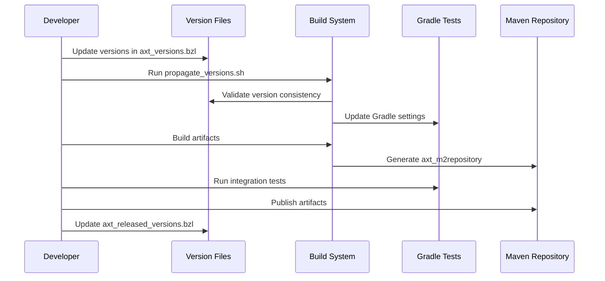

<!-- source: DeepWiki mcp.deepwiki.com · repo android/android-test · page 7 Build System · fetched 2026-10-23 -->

# Build System

<details>
<summary>Relevant source files</summary>

The following files were used as context for generating this wiki page:

- [WORKSPACE](WORKSPACE)
- [api/axt_1.4.0-alpha04.txt](api/axt_1.4.0-alpha04.txt)
- [build_extensions/axt_released_versions.bzl](build_extensions/axt_released_versions.bzl)
- [build_extensions/axt_versions.bzl](build_extensions/axt_versions.bzl)
- [gradle-tests/BUILD.bazel](gradle-tests/BUILD.bazel)
- [gradle-tests/espresso/device/build.gradle](gradle-tests/espresso/device/build.gradle)
- [gradle-tests/espresso/device/src/androidTest/java/test/gradletests/espresso/device/EspressoDeviceTest.kt](gradle-tests/espresso/device/src/androidTest/java/test/gradletests/espresso/device/EspressoDeviceTest.kt)
- [gradle-tests/espresso/device/src/main/AndroidManifest.xml](gradle-tests/espresso/device/src/main/AndroidManifest.xml)
- [gradle-tests/espresso/device/src/main/java/androidx/test/gradletests/espresso/device/ScreenOrientationActivity.kt](gradle-tests/espresso/device/src/main/java/androidx/test/gradletests/espresso/device/ScreenOrientationActivity.kt)
- [gradle-tests/espresso/device/src/main/res/layout/activity_screen_orientation.xml](gradle-tests/espresso/device/src/main/res/layout/activity_screen_orientation.xml)
- [gradle-tests/espresso/device/src/main/res/values/strings.xml](gradle-tests/espresso/device/src/main/res/values/strings.xml)
- [gradle-tests/gradle.properties](gradle-tests/gradle.properties)
- [gradle-tests/settings.gradle](gradle-tests/settings.gradle)
- [gradle-tests/settings.gradle.template](gradle-tests/settings.gradle.template)
- [opensource/gflags.BUILD](opensource/gflags.BUILD)
- [opensource/google-apputils.BUILD](opensource/google-apputils.BUILD)
- [opensource/mox.BUILD](opensource/mox.BUILD)
- [opensource/portpicker.BUILD](opensource/portpicker.BUILD)
- [opensource/six.BUILD](opensource/six.BUILD)
- [repo.bzl](repo.bzl)
- [runner/android_junit_runner/java/androidx/test/internal/runner/tracker/UsageTrackerRegistry.java](runner/android_junit_runner/java/androidx/test/internal/runner/tracker/UsageTrackerRegistry.java)

</details>


The Build System is the foundation of the AndroidX Test framework, responsible for version management, artifact generation, and dependency management. It enables consistent builds across environments and provides the necessary infrastructure for releasing AndroidX Test components to developers.

## Overview

The AndroidX Test Build System primarily uses Bazel as its build tool, with integration points for Gradle to support Android app developers. This system manages version information, generates Maven artifacts, and handles dependencies for all AndroidX Test components.

For information about Continuous Integration and Delivery, see [CI/CD Pipeline](#7.3).



Sources: [build_extensions/axt_versions.bzl](), [build_extensions/axt_released_versions.bzl](), [WORKSPACE](), [repo.bzl](), [gradle-tests/settings.gradle]()

## Version Management

Version management is a critical part of the build system. It ensures consistent versioning across all AndroidX Test components and coordinates releases.

### Version Definition Files

The system uses two primary Bazel files for version management:

1. **axt_versions.bzl**: Defines the next-to-be-released versions of all AndroidX Test components.
2. **axt_released_versions.bzl**: Tracks the currently released versions.

These files include version information for core components like:
- Runner
- Espresso
- Core
- Orchestrator
- Services



Sources: [build_extensions/axt_versions.bzl](), [build_extensions/axt_released_versions.bzl](), [gradle-tests/BUILD.bazel]()

### Version Propagation

When version numbers are updated in `axt_versions.bzl`, they need to be propagated to other parts of the system. This is done using the `validate_and_propagate_versions.sh` script, which:

1. Updates the Maven repository configuration
2. Updates Gradle settings for testing
3. Validates that versions are consistent across the codebase

The version propagation enables a single source of truth for component versions throughout the build system.

Sources: [build_extensions/axt_versions.bzl:1-5](), [gradle-tests/BUILD.bazel:37-38]()

## Maven Artifact Generation

The AndroidX Test components are published as Maven artifacts, which allows Android developers to easily include them in their projects.

### Maven Registry

The Maven registry system maps Bazel targets to Maven artifacts. It handles versioning and coordinates to ensure that the generated artifacts follow Maven conventions. The system also manages transitive dependencies between components.

### Artifact Structure

The generated artifacts follow the standard Maven repository structure:
- Group ID: Typically "androidx.test" or "androidx.test.espresso"
- Artifact ID: Component name (e.g., "runner", "espresso-core")
- Version: Defined in the version management files

Each component has its own Maven coordinates. For example:

| Component | Maven Coordinate |
|-----------|------------------|
| Runner | androidx.test:runner:${RUNNER_VERSION} |
| Espresso Core | androidx.test.espresso:espresso-core:${ESPRESSO_VERSION} |
| Services APK | androidx.test.services:test-services:${SERVICES_VERSION} |
| Orchestrator | androidx.test:orchestrator:${ORCHESTRATOR_VERSION} |

Sources: [build_extensions/axt_versions.bzl:7-20]()

## Bazel Configuration

The project uses Bazel as its primary build system. Bazel is responsible for managing dependencies, building artifacts, and running tests.

### WORKSPACE Configuration

The `WORKSPACE` file defines the root of the Bazel build and includes essential configurations:

- Android SDK repository setup
- Kotlin toolchain registration
- External dependencies through `repo.bzl`



Sources: [WORKSPACE](), [repo.bzl]()

### External Dependencies

The system manages external dependencies through `repo.bzl`, which:

1. Defines development-only dependencies
2. Defines user-facing dependencies
3. Manages repository rules for Bazel

The dependencies include testing frameworks, utilities, and Android-specific libraries needed for the AndroidX Test components.

Sources: [repo.bzl:1-157]()

## Gradle Integration

While the project is built with Bazel, it provides integration with Gradle to support Android developers who use the standard Android build system.

### Gradle Settings Generation

The build system generates Gradle settings files from templates, using the version information from `axt_versions.bzl`. This ensures that the Gradle test projects use the correct component versions.

The generated files include:
- `settings.gradle`: Defines the component versions and repositories
- Build files for individual test modules

### Version Catalog

The system uses Gradle's version catalog feature to define dependencies in a structured way. This approach makes it easier to manage dependencies and ensures consistency across modules.

```
dependencyResolutionManagement {
    versionCatalogs {
        libs {
            library('core', 'androidx.test:core:1.7.0-alpha04')
            library('runner', 'androidx.test:runner:1.7.0-alpha04')
            // More libraries...
        }
    }
}
```

Sources: [gradle-tests/settings.gradle:19-36](), [gradle-tests/settings.gradle.template]()

### Gradle Test Projects

The system includes several Gradle test projects that verify the correct functioning of AndroidX Test components in a Gradle environment. These projects:

1. Consume the Maven artifacts
2. Test different integration scenarios
3. Ensure compatibility with Gradle builds

The Gradle integration allows the team to verify that AndroidX Test components work correctly in real-world Android projects.

Sources: [gradle-tests/espresso/device/build.gradle](), [gradle-tests/gradle.properties]()

## Build and Release Process

The build and release process integrates the version management, artifact generation, and dependency management systems to produce releasable artifacts.

### Build Process Steps

1. **Version Update**: Update component versions in `axt_versions.bzl`
2. **Propagate Versions**: Run the version propagation script
3. **Build Artifacts**: Use Bazel to build components and generate Maven artifacts
4. **Verification**: Run tests to ensure artifacts work correctly
5. **Release**: Publish artifacts to Maven repositories
6. **Post-Release**: Update `axt_released_versions.bzl` with the new versions



Sources: [build_extensions/axt_versions.bzl:1-5](), [build_extensions/axt_released_versions.bzl]()

### Version Management Workflow

The version management workflow follows these steps:

1. Increment versions in `axt_versions.bzl` for components being updated
2. Run validation and propagation script
3. Build and test with new versions
4. Upon successful release, update `axt_released_versions.bzl`

This workflow ensures that versions are properly incremented, propagated, and tracked throughout the release cycle.

Sources: [build_extensions/axt_versions.bzl](), [build_extensions/axt_released_versions.bzl]()

## Integration with Android SDK

The build system integrates with the Android SDK to ensure compatibility with the target Android versions.

### Android SDK Repository

The `WORKSPACE` file configures the Android SDK repository with specific API levels and build tools:

```
android_sdk_repository(
    name = "androidsdk",
    api_level = 35,
    build_tools_version = "35.0.0",
)
```

This configuration ensures that the AndroidX Test components are built against the correct Android SDK version.

Sources: [WORKSPACE:4-10]()

## Conclusion

The AndroidX Test Build System provides a robust foundation for building, testing, and releasing test components. It combines Bazel for primary builds with Gradle integration for end-user consumption. 

The version management system ensures consistency across components, while the Maven artifact generation system produces artifacts that can be easily consumed by Android developers. The integration with the Android SDK ensures compatibility with the target platforms.

---

