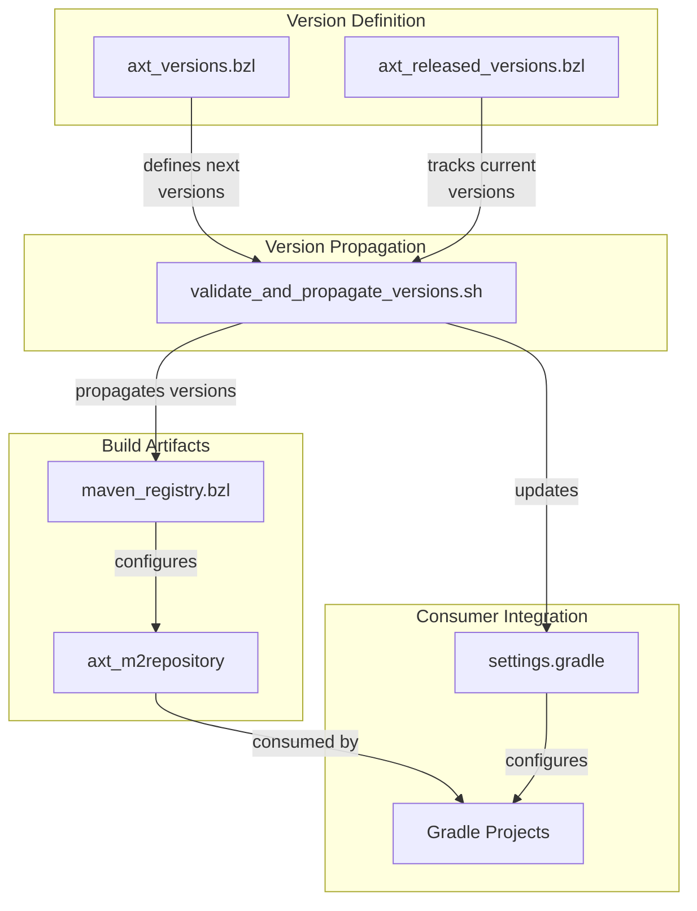
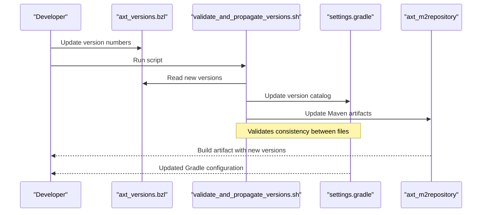
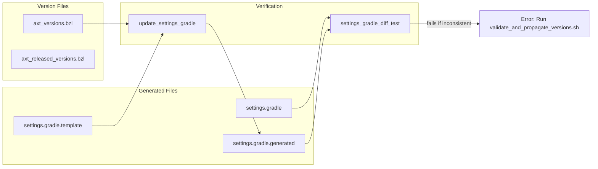

<!-- source: DeepWiki mcp.deepwiki.com · repo android/android-test · page 7.1 Version Management · fetched 2026-10-23 -->

# Version Management

<details>
<summary>Relevant source files</summary>

The following files were used as context for generating this wiki page:

- [api/axt_1.4.0-alpha04.txt](api/axt_1.4.0-alpha04.txt)
- [build_extensions/axt_released_versions.bzl](build_extensions/axt_released_versions.bzl)
- [build_extensions/axt_versions.bzl](build_extensions/axt_versions.bzl)
- [gradle-tests/BUILD.bazel](gradle-tests/BUILD.bazel)
- [gradle-tests/espresso/device/build.gradle](gradle-tests/espresso/device/build.gradle)
- [gradle-tests/espresso/device/src/androidTest/java/test/gradletests/espresso/device/EspressoDeviceTest.kt](gradle-tests/espresso/device/src/androidTest/java/test/gradletests/espresso/device/EspressoDeviceTest.kt)
- [gradle-tests/espresso/device/src/main/AndroidManifest.xml](gradle-tests/espresso/device/src/main/AndroidManifest.xml)
- [gradle-tests/espresso/device/src/main/java/androidx/test/gradletests/espresso/device/ScreenOrientationActivity.kt](gradle-tests/espresso/device/src/main/java/androidx/test/gradletests/espresso/device/ScreenOrientationActivity.kt)
- [gradle-tests/espresso/device/src/main/res/layout/activity_screen_orientation.xml](gradle-tests/espresso/device/src/main/res/layout/activity_screen_orientation.xml)
- [gradle-tests/espresso/device/src/main/res/values/strings.xml](gradle-tests/espresso/device/src/main/res/values/strings.xml)
- [gradle-tests/gradle.properties](gradle-tests/gradle.properties)
- [gradle-tests/settings.gradle](gradle-tests/settings.gradle)
- [gradle-tests/settings.gradle.template](gradle-tests/settings.gradle.template)
- [runner/android_junit_runner/java/androidx/test/internal/runner/tracker/UsageTrackerRegistry.java](runner/android_junit_runner/java/androidx/test/internal/runner/tracker/UsageTrackerRegistry.java)

</details>


Version Management in the AndroidX Test framework is responsible for defining, maintaining, and propagating version information across all components of the test framework. This system ensures consistent versioning across the library modules, facilitates artifact generation for Maven, and enables proper integration with Gradle projects.

## Overview of Version Management System

The version management system in AndroidX Test defines version numbers for all framework components and propagates these versions to build artifacts, which are then published to Maven repositories and consumed by Gradle projects.



Sources: [build_extensions/axt_versions.bzl](), [build_extensions/axt_released_versions.bzl](), [gradle-tests/settings.gradle]()

## Version Definition Files

The AndroidX Test framework manages its versions through two primary Bazel files:

### 1. Next Release Versions

The `axt_versions.bzl` file defines the next versions to be released for all AndroidX Test components. This file is the primary source of truth for ongoing development.

```mermaid
classDiagram
    class "axt_versions.bzl" {
        +RUNNER_VERSION: String
        +RULES_VERSION: String
        +MONITOR_VERSION: String
        +ESPRESSO_VERSION: String
        +CORE_VERSION: String
        +ESPRESSO_DEVICE_VERSION: String
        +ANDROIDX_JUNIT_VERSION: String
        +ANDROIDX_TRUTH_VERSION: String
        +ORCHESTRATOR_VERSION: String
        +SERVICES_VERSION: String
        +SERVICES_APK_ARTIFACT: String
        +ORCHESTRATOR_ARTIFACT: String
    }
```

Sources: [build_extensions/axt_versions.bzl]()

### 2. Current Released Versions

The `axt_released_versions.bzl` file maintains the versions of components that have been officially released. This serves as historical tracking and helps in maintaining backward compatibility.

```mermaid
classDiagram
    class "axt_released_versions.bzl" {
        +RUNNER_VERSION: String
        +RULES_VERSION: String
        +MONITOR_VERSION: String
        +ESPRESSO_VERSION: String
        +CORE_VERSION: String
        +ESPRESSO_DEVICE_VERSION: String
        +ANDROIDX_JUNIT_VERSION: String
        +ANDROIDX_TRUTH_VERSION: String
        +ORCHESTRATOR_VERSION: String
        +SERVICES_VERSION: String
    }
```

Sources: [build_extensions/axt_released_versions.bzl]()

## Version Structure

AndroidX Test components follow a standardized versioning scheme that aligns with Semantic Versioning principles. The current version format is:

```
MAJOR.MINOR.PATCH-QUALIFIER
```

For example: `1.7.0-alpha04`

- **MAJOR**: Incremented for incompatible API changes
- **MINOR**: Incremented for backward-compatible functionality additions
- **PATCH**: Incremented for backward-compatible bug fixes
- **QUALIFIER**: Indicates pre-release status (alpha, beta, etc.)

The version numbers are defined as string constants in the version files:

```
RUNNER_VERSION = "1.7.0-alpha04"
ESPRESSO_VERSION = "3.7.0-alpha04"
```

Sources: [build_extensions/axt_versions.bzl]()

## Version Propagation System

Version information is propagated throughout the build system using a dedicated script and build rules.



### Validation and Propagation Script

The `validate_and_propagate_versions.sh` script serves two key purposes:

1. **Validation**: Ensures version consistency across the codebase
2. **Propagation**: Updates dependent files with the new versions

The script is referenced in the Gradle settings file:

```
// This file is auto-generated from tools/release/validation_and_propagate_versions.sh
// DO NOT MODIFY locally
```

Sources: [gradle-tests/settings.gradle:1-2]()

## Gradle Integration

The version information is propagated to Gradle projects through the `settings.gradle` file, which defines a version catalog for all AndroidX Test components.

### Version Catalog

The `settings.gradle` file contains a version catalog that maps each component to its Maven artifact coordinates with the appropriate version:

| Component | Maven Artifact |
|-----------|----------------|
| Core | `androidx.test:core:1.7.0-alpha04` |
| Runner | `androidx.test:runner:1.7.0-alpha04` |
| JUnit Extensions | `androidx.test.ext:junit:1.3.0-alpha04` |
| Espresso Core | `androidx.test.espresso:espresso-core:3.7.0-alpha04` |
| Espresso Device | `androidx.test.espresso:espresso-device:1.1.0-alpha04` |
| Orchestrator | `androidx.test:orchestrator:1.6.0-alpha05` |

This version catalog is consumed by Gradle projects to ensure they use the correct versions of AndroidX Test components.

Sources: [gradle-tests/settings.gradle:19-36]()

## Version Verification

The build system includes verification steps to ensure version consistency:



The Bazel build file includes a `diff_test` rule that verifies the generated `settings.gradle` file matches what would be generated from the current version files. This ensures developers run the propagation script after updating versions.

Sources: [gradle-tests/BUILD.bazel:49-55]()

## Usage in Application Code

The version information is occasionally referenced in application code to provide metadata about the test framework. For example, the `UsageTrackerRegistry` includes an interface for AXT versions:

```java
public interface AxtVersions {
    // Espresso version includes: Espresso, Espresso-Web, Intents, Espresso-MPE
    String ESPRESSO_VERSION = "na";
    // Runner version includes: Runner
    String RUNNER_VERSION = "na";
    // Test services version.
    String SERVICES_VERSION = "na";
}
```

However, this interface is marked as deprecated and is likely not actively used in newer code.

Sources: [runner/android_junit_runner/java/androidx/test/internal/runner/tracker/UsageTrackerRegistry.java:36-44]()

## Release Process Integration

For information about how version management integrates with the wider CI/CD pipeline for AndroidX Test, see [CI/CD Pipeline](#7.3).

The version management system is a critical part of the build infrastructure for AndroidX Test, ensuring that all components maintain consistent versioning and that consumers can easily integrate the test framework into their projects.

---

