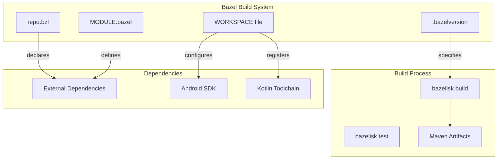
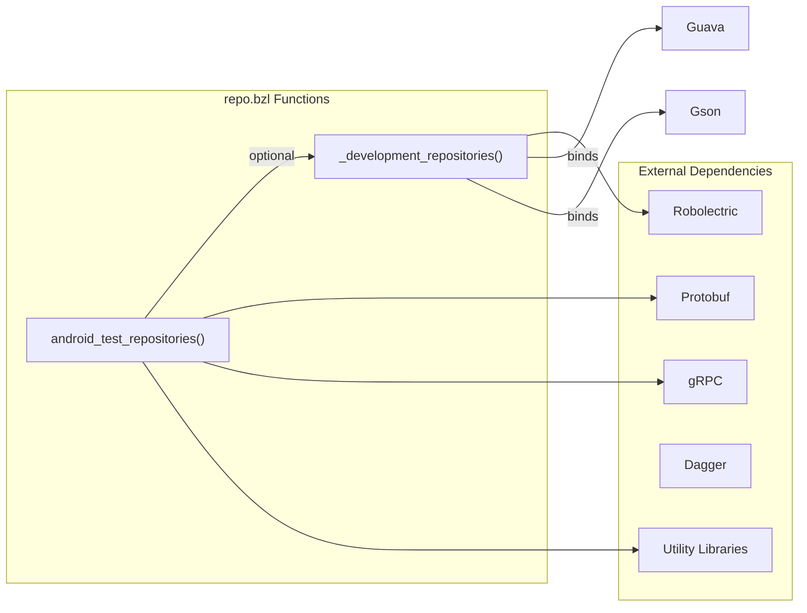
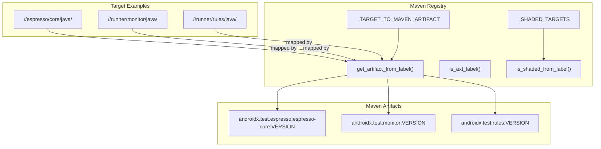
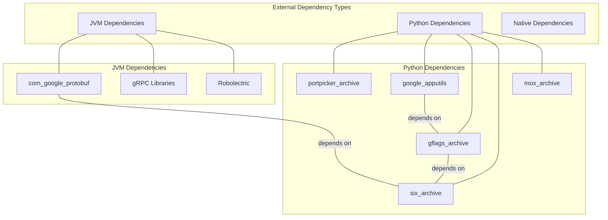

<!-- source: DeepWiki mcp.deepwiki.com · repo android/android-test · page 7.2 Bazel Setup · fetched 2026-10-23 -->

# Bazel Setup

<details>
<summary>Relevant source files</summary>

The following files were used as context for generating this wiki page:

- [.bazelproject](.bazelproject)
- [.bazelversion](.bazelversion)
- [.gitignore](.gitignore)
- [CONTRIBUTING.md](CONTRIBUTING.md)
- [Dockerfile](Dockerfile)
- [WORKSPACE](WORKSPACE)
- [bazelci/buildkite-pipeline.yml](bazelci/buildkite-pipeline.yml)
- [build_extensions/maven/maven_info.bzl](build_extensions/maven/maven_info.bzl)
- [build_extensions/maven/maven_registry.bzl](build_extensions/maven/maven_registry.bzl)
- [gradle-tests/espresso/.gitignore](gradle-tests/espresso/.gitignore)
- [gradle-tests/orchestrator/.gitignore](gradle-tests/orchestrator/.gitignore)
- [opensource/gflags.BUILD](opensource/gflags.BUILD)
- [opensource/google-apputils.BUILD](opensource/google-apputils.BUILD)
- [opensource/mox.BUILD](opensource/mox.BUILD)
- [opensource/portpicker.BUILD](opensource/portpicker.BUILD)
- [opensource/six.BUILD](opensource/six.BUILD)
- [repo.bzl](repo.bzl)
- [tools/device_broker/proto/BUILD.bazel](tools/device_broker/proto/BUILD.bazel)

</details>


This document details the Bazel build system configuration used in the AndroidX Test framework. It covers the essential Bazel setup files, dependency management, and build workflows. For information about version management, see [Version Management](#7.1), and for CI/CD pipeline details, see [CI/CD Pipeline](#7.3).

## Overview

The AndroidX Test framework uses [Bazel](https://bazel.build) as its primary build system to manage dependencies, build artifacts, and run tests. Bazel provides hermetic builds, reproducibility, and efficient dependency management for the codebase.



Sources: [WORKSPACE](), [.bazelversion](), [repo.bzl]()

## Core Configuration Files

### WORKSPACE File

The WORKSPACE file defines the top-level build configuration for the project. It primarily:

1. Configures the Android SDK repository
2. Registers the Kotlin toolchain

```
android_sdk_repository(
    name = "androidsdk",
    api_level = 35,
    build_tools_version = "35.0.0",
)

register_toolchains("//:kotlin_toolchain")
```

Sources: [WORKSPACE:6-12]()

### Bazel Version

The project uses Bazel version 7.5.0, as specified in the `.bazelversion` file. This ensures consistent builds across different environments.

Sources: [.bazelversion:1]()

### repo.bzl

This file provides Skylark rules for setting up the WORKSPACE in the open-source Bazel environment. It contains:

1. Development repository configurations
2. External dependency declarations
3. The main `android_test_repositories` function that loads workspace dependencies



Sources: [repo.bzl:1-158]()

## Maven Integration

The AndroidX Test framework uses Bazel to generate Maven artifacts for distribution. This is managed through the maven_registry.bzl and maven_info.bzl files.

### Maven Registry

The maven_registry.bzl file:
1. Maps target paths to Maven artifacts with specific versions
2. Defines which targets should be shaded (embedded) in final artifacts
3. Provides utility functions to retrieve Maven information from Bazel labels



Sources: [build_extensions/maven/maven_registry.bzl:1-128]()

### Maven Info Collection

The maven_info.bzl file provides:
1. An aspect to collect Maven information from targets
2. Providers for Maven artifacts and their dependencies
3. Rules for propagating Maven metadata through the build graph

The file defines two key aspects:
- `collect_maven_info`: Collects Maven information for JAR/AAR artifacts
- `collect_maven_apk_info`: Collects Maven information for APK artifacts

Sources: [build_extensions/maven/maven_info.bzl:1-210]()

## Building with Bazel

### Basic Build Commands

To build the AndroidX Test maven repository:

```
bazelisk build :axt_m2repository
```

This generates a ZIP file containing all the Maven artifacts required for distribution.

### Understanding Build Targets

The project organizes its code according to Maven artifacts. Each directory typically corresponds to a specific Maven artifact, making it easier to manage dependencies and releases.

```
//runner/android_junit_runner/java/  -->  androidx.test:runner
//espresso/core/java/               -->  androidx.test.espresso:espresso-core
//core/java/                        -->  androidx.test:core
```

Sources: [build_extensions/maven/maven_registry.bzl:25-52](), [CONTRIBUTING.md:62-69]()

## Testing with Bazel

### Running Tests

To run tests with Bazel:

```
bazelisk test <target path>
```

For example, to run the core tests:

```
bazelisk test //core/javatests/...
```

To run all Robolectric local tests:

```
bazelisk test ... --test_tag_filters=robolectric --build_tag_filters=robolectric
```

Sources: [CONTRIBUTING.md:71-83]()

### Gradle Integration Tests

After building the Maven repository, you can run Gradle integration tests:

```
bazelisk build :axt_m2repository
unzip bazel-bin/axt_m2repository.zip -d ~/.m2/
cd gradle-tests
./gradlew nexusOneDebugAndroidTest
```

This validates that the built artifacts work correctly when consumed by Gradle projects.

Sources: [CONTRIBUTING.md:85-91]()

## External Dependencies

The project manages several external dependencies through Bazel's repository rules. These are primarily defined in repo.bzl.



Sources: [repo.bzl:80-157](), [opensource/six.BUILD](), [opensource/portpicker.BUILD](), [opensource/google-apputils.BUILD](), [opensource/gflags.BUILD](), [opensource/mox.BUILD]()

## IDE Integration

AndroidX Test supports Android Studio development through the Bazel Android Studio plugin.

The `.bazelproject` file configures:
1. Source directories to include
2. Build targets for IDE resolution
3. Additional language support (Kotlin)
4. Android SDK platform version

```
directories:
  .

targets:
  //core/...
  //espresso/...
  //ext/...
  //ktx/...
  //runner/...

additional_languages:
  kotlin

android_sdk_platform: android-34
```

Sources: [.bazelproject:1-22](), [CONTRIBUTING.md:46-57]()

## Troubleshooting

Common Bazel setup issues include:

1. **Missing Android SDK components**:
   - Ensure you have installed the correct build-tools and platform versions specified in the WORKSPACE file
   - Current configuration requires build-tools 35.0.0 and API level 35

2. **ANDROID_HOME environment variable issues**:
   - Set `ANDROID_HOME` to point to your Android SDK location
   - You can explicitly specify the SDK path in WORKSPACE if needed

3. **Unresolved imports after build**:
   - Check that the Android SDK components specified in WORKSPACE are installed
   - Verify the `ANDROID_HOME` environment variable is set correctly

Sources: [CONTRIBUTING.md:93-121]()

## Continuous Integration

The project uses Buildkite for CI, configured in the buildkite-pipeline.yml file. The CI builds and tests the project using Bazel, focusing on Robolectric tests for quicker feedback.

```
platforms:
  ubuntu1804:
    build_targets:
    - "//..."
    build_flags:
    - "--build_tag_filters=robolectric"
    test_flags:
    - "--local_test_jobs=8"
    - "--test_tag_filters=robolectric"
    test_targets:
    - "//..."
```

Sources: [bazelci/buildkite-pipeline.yml:1-14]()

A Docker configuration is also available for setting up consistent build environments with Bazel 3.5.0 and the necessary Android SDK components.

Sources: [Dockerfile:1-21]()

---

