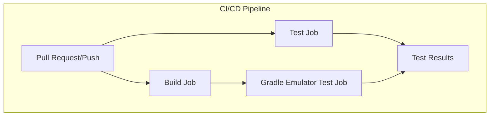
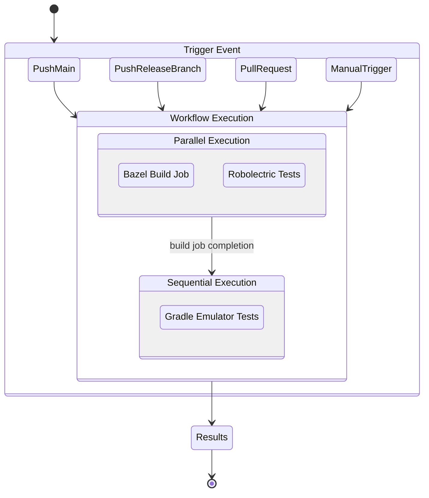
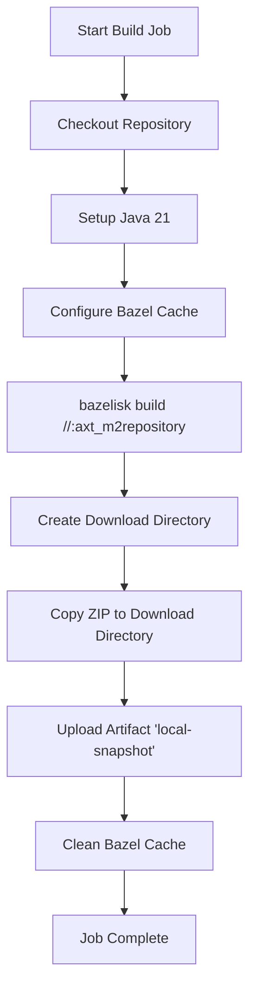
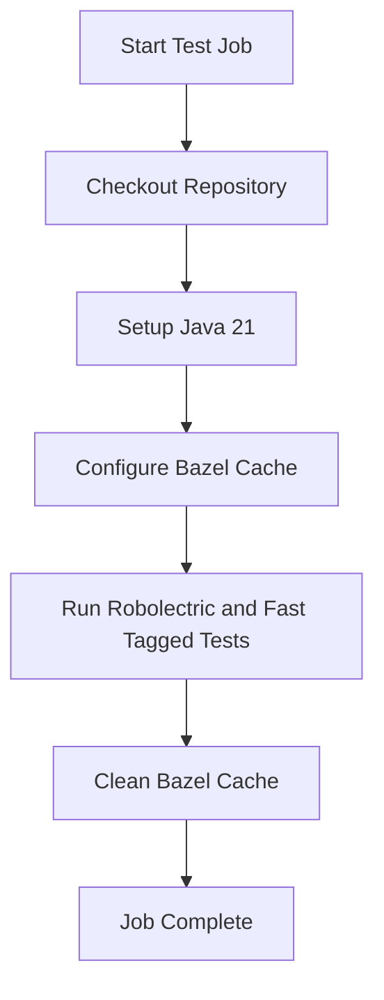
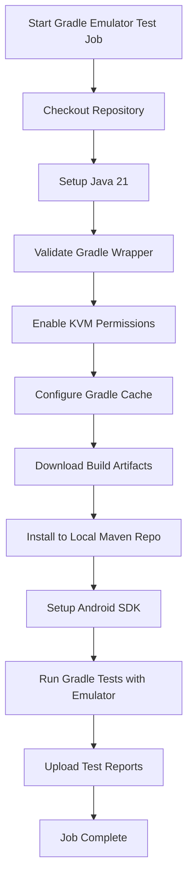
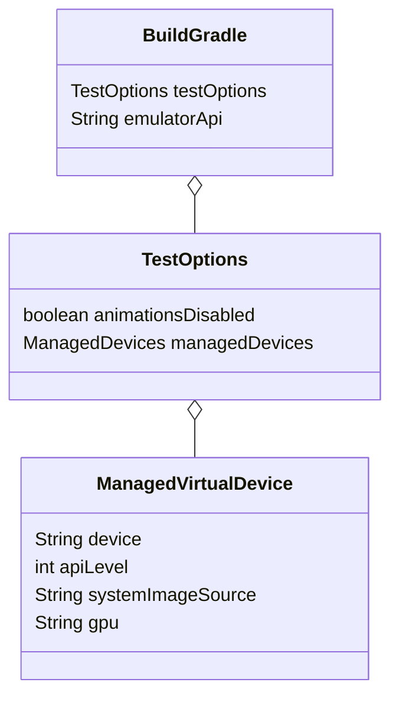
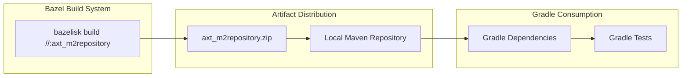
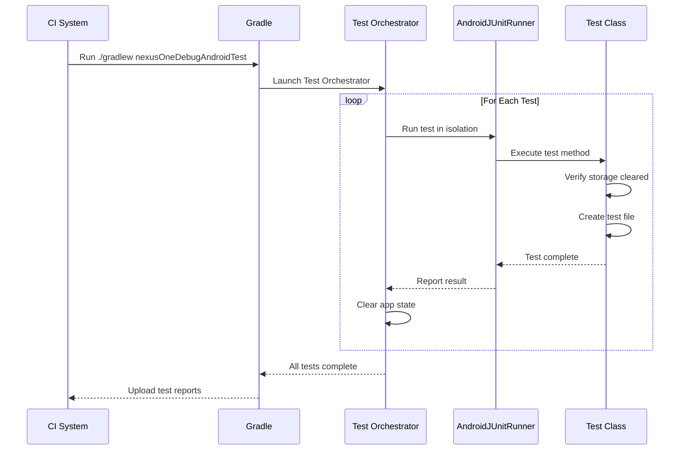

<!-- source: DeepWiki mcp.deepwiki.com · repo android/android-test · page 7.3 CI/CD Pipeline · fetched 2026-10-23 -->

# CI/CD Pipeline

Relevant source files

The following files were used as context for generating this wiki page:

- [.github/workflows/ci.yml](.github/workflows/ci.yml)
- [gradle-tests/build.gradle](gradle-tests/build.gradle)
- [gradle-tests/espresso/accessibility/build.gradle](gradle-tests/espresso/accessibility/build.gradle)
- [gradle-tests/espresso/build.gradle](gradle-tests/espresso/build.gradle)
- [gradle-tests/espresso/contrib/build.gradle](gradle-tests/espresso/contrib/build.gradle)
- [gradle-tests/espresso/idling_resource/build.gradle](gradle-tests/espresso/idling_resource/build.gradle)
- [gradle-tests/espresso/web/build.gradle](gradle-tests/espresso/web/build.gradle)
- [gradle-tests/gradle/wrapper/gradle-wrapper.properties](gradle-tests/gradle/wrapper/gradle-wrapper.properties)
- [gradle-tests/orchestrator/build.gradle](gradle-tests/orchestrator/build.gradle)
- [gradle-tests/orchestrator/src/androidTest/java/androidx/test/gradletests/orchestrator/OrchestratorTest.kt](gradle-tests/orchestrator/src/androidTest/java/androidx/test/gradletests/orchestrator/OrchestratorTest.kt)
- [gradle-tests/runner/build.gradle](gradle-tests/runner/build.gradle)
- [kokoro/test_artifacts.sh](kokoro/test_artifacts.sh)

This document describes the Continuous Integration and Continuous Deployment (CI/CD) pipeline for the AndroidX Test framework. The pipeline automates building, testing, and verifying the framework components across different environments to ensure code quality and compatibility.

For information about version management used in builds, see [Version Management](#7.1). For details about the Bazel workspace configuration, see [Bazel Setup](#7.2).

## Overview

The AndroidX Test framework uses GitHub Actions as its primary CI/CD system to automate the build and test process. The pipeline performs the following key functions:

1. Building Maven artifacts using Bazel
2. Running unit tests and Robolectric tests
3. Running instrumentation tests on Android emulators
4. Reporting test results

Sources: [.github/workflows/ci.yml:1-122]()

## Pipeline Architecture

The CI/CD pipeline is implemented as a GitHub Actions workflow defined in the `.github/workflows/ci.yml` file. The workflow is triggered on:

- Pushes to the `main` branch
- Pushes to release branches (matching pattern `axt_**_release_branch`)
- Pull requests targeting these branches
- Manual triggers via workflow_dispatch

Sources: [.github/workflows/ci.yml:1-13](), [.github/workflows/ci.yml:17-78]()

## Build Job

The build job is responsible for compiling the codebase and generating Maven artifacts using Bazel. It runs on an Ubuntu runner and uses Java 21 for compilation.

### Key Steps:
1. Repository checkout
2. Java 21 setup
3. Bazel cache configuration
4. Building Maven artifacts using Bazel
5. Artifact upload for use in subsequent jobs

Sources: [.github/workflows/ci.yml:18-52]()

## Test Job

The test job runs Robolectric tests and tests tagged with "fast" using Bazel. This allows quick feedback without requiring an emulator.

### Key Steps:
1. Repository checkout
2. Java 21 setup
3. Bazel cache configuration
4. Running tests with specific tag filters
5. Cache cleanup

Sources: [.github/workflows/ci.yml:53-77]()

## Gradle Emulator Test Job

This job sets up an Android emulator and runs instrumentation tests to verify that the framework functions correctly on an actual Android environment.

### Key Steps:
1. Repository checkout and Java setup
2. Gradle wrapper validation
3. KVM permission configuration for emulator acceleration
4. Download and installation of Maven artifacts from the build job
5. Android SDK setup
6. Running Gradle tests with emulator
7. Uploading test reports

Sources: [.github/workflows/ci.yml:78-122](), [gradle-tests/build.gradle:1-17]()

## Emulator Configuration

Gradle tests are configured to run on a virtual device with specific properties for optimal performance in CI environments.

The emulator is configured with:
- Device model: "Nexus One" (low resolution for better performance)
- API level: 33 (default, configurable)
- System image: "aosp-atd" (Android Open Source Project Automated Test Device)
- GPU: "swiftshader_indirect"

Sources: [gradle-tests/build.gradle:13-17](), [gradle-tests/orchestrator/build.gradle:32-47](), [.github/workflows/ci.yml:114]()

## Maven Artifact Generation

The pipeline builds Maven artifacts that can be consumed by Gradle projects. This involves:

1. Building a Maven repository ZIP using Bazel
2. Installing artifacts to a local Maven repository for testing
3. Running tests against these locally built artifacts

Sources: [.github/workflows/ci.yml:36-42](), [.github/workflows/ci.yml:104-108]()

## Kokoro Integration

In addition to GitHub Actions, the repository also integrates with Kokoro, which appears to be an internal build system. The `kokoro/test_artifacts.sh` script performs similar functions to the GitHub Actions workflow:

1. Unpacks Maven artifacts into a local repository
2. Sets up the Java environment
3. Runs Gradle tests with an emulator

Sources: [kokoro/test_artifacts.sh:1-20]()

## Test Project Structure

The gradle-tests directory contains various test projects that verify different components of the AndroidX Test framework:

| Module | Purpose |
|--------|---------|
| orchestrator | Tests for the Test Orchestrator functionality |
| runner | Tests for AndroidJUnitRunner |
| espresso | Tests for Espresso core functionality |
| espresso/web | Tests for Espresso web integration |
| espresso/contrib | Tests for Espresso contrib library |
| espresso/accessibility | Tests for Espresso accessibility testing |
| espresso/idling_resource | Tests for Espresso idling resources |

Each test module is configured with its own build.gradle file that sets up the necessary dependencies and emulator configuration.

Sources: [gradle-tests/orchestrator/build.gradle:1-56](), [gradle-tests/runner/build.gradle:1-48](), [gradle-tests/espresso/build.gradle:1-54](), [gradle-tests/espresso/web/build.gradle:1-51](), [gradle-tests/espresso/contrib/build.gradle:1-54](), [gradle-tests/espresso/accessibility/build.gradle:1-53](), [gradle-tests/espresso/idling_resource/build.gradle:1-56]()

## Test Execution Example

The orchestrator test module provides a good example of how tests are structured and executed in the CI/CD pipeline. It includes tests that verify the Test Orchestrator's ability to clear application state between test runs.

Sources: [gradle-tests/orchestrator/src/androidTest/java/androidx/test/gradletests/orchestrator/OrchestratorTest.kt:1-53](), [.github/workflows/ci.yml:112-121]()

## Performance Optimizations

The CI/CD pipeline includes several optimizations to improve performance:

1. Caching of Bazel and Gradle files between runs
2. Using low-resolution emulator devices
3. Using the AOSP Automated Test Device (ATD) image
4. Configuring GPU rendering for optimal emulator performance
5. Disabling animations during tests

Sources: [.github/workflows/ci.yml:29-35](), [.github/workflows/ci.yml:64-70](), [.github/workflows/ci.yml:97-98](), [gradle-tests/orchestrator/build.gradle:32-47]()

---

