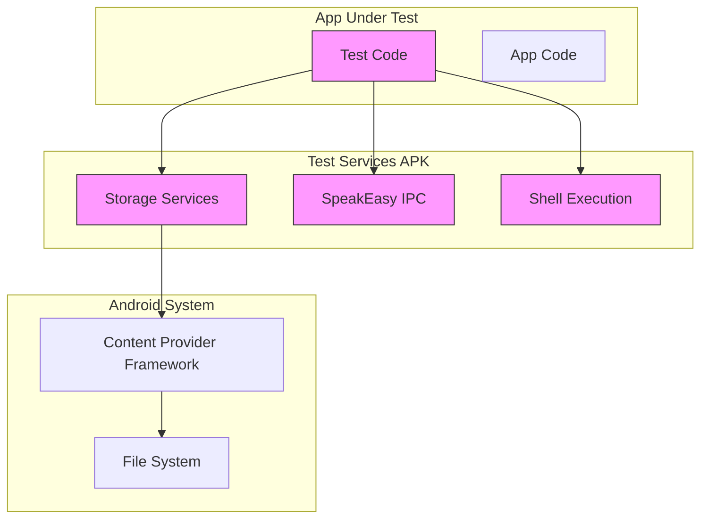
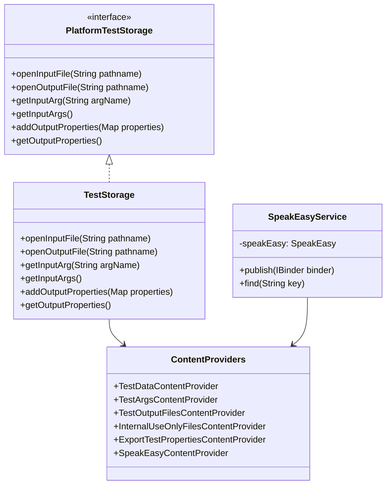
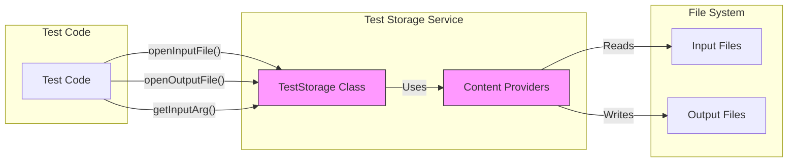
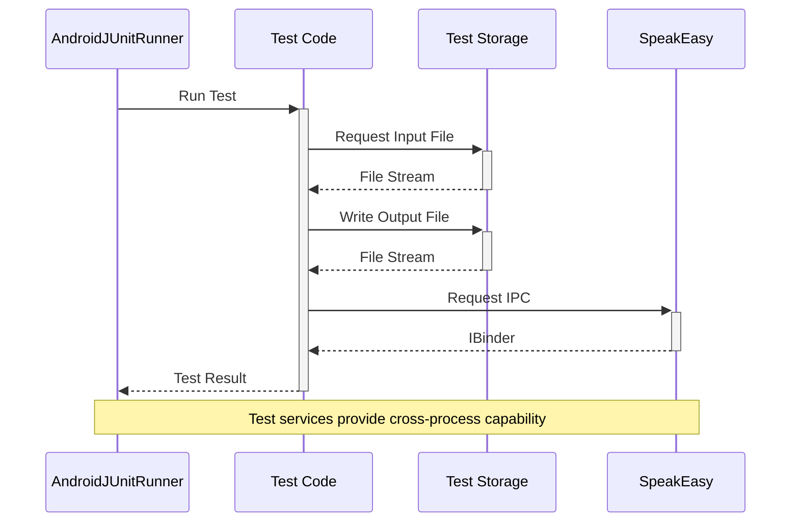
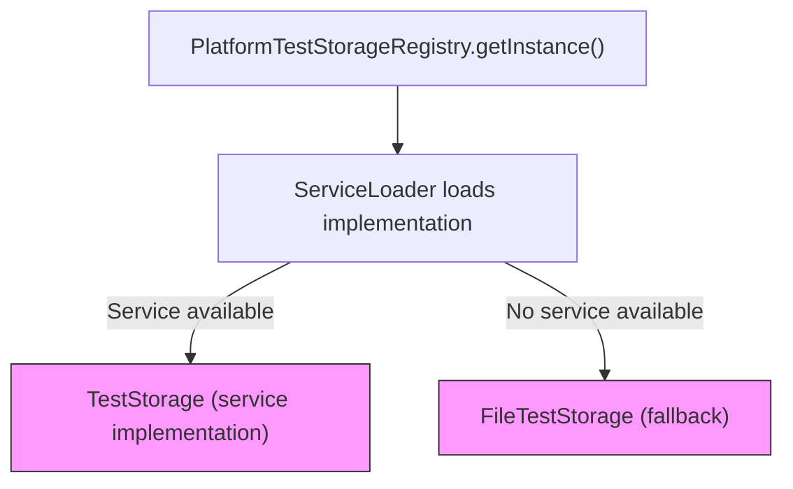

<!-- source: DeepWiki mcp.deepwiki.com · repo android/android-test · page 8 Test Services · fetched 2026-10-23 -->

# Test Services

<details>
<summary>Relevant source files</summary>

The following files were used as context for generating this wiki page:

- [core/javatests/androidx/test/core/graphics/BitmapStorageTest.kt](core/javatests/androidx/test/core/graphics/BitmapStorageTest.kt)
- [espresso/contrib/java/androidx/test/espresso/contrib/BUILD](espresso/contrib/java/androidx/test/espresso/contrib/BUILD)
- [espresso/idling_resource/concurrent/java/androidx/test/espresso/idling/concurrent/BUILD](espresso/idling_resource/concurrent/java/androidx/test/espresso/idling/concurrent/BUILD)
- [espresso/idling_resource/net/java/androidx/test/espresso/idling/net/BUILD](espresso/idling_resource/net/java/androidx/test/espresso/idling/net/BUILD)
- [runner/android_junit_runner/java/androidx/test/AndroidManifest.xml](runner/android_junit_runner/java/androidx/test/AndroidManifest.xml)
- [runner/android_junit_runner/java/androidx/test/filters/SdkSuppress.java](runner/android_junit_runner/java/androidx/test/filters/SdkSuppress.java)
- [runner/android_junit_runner/java/androidx/test/internal/runner/RunnerArgs.java](runner/android_junit_runner/java/androidx/test/internal/runner/RunnerArgs.java)
- [runner/android_junit_runner/java/androidx/test/internal/runner/TestRequestBuilder.java](runner/android_junit_runner/java/androidx/test/internal/runner/TestRequestBuilder.java)
- [runner/android_junit_runner/javatests/androidx/test/internal/runner/RunnerArgsTest.java](runner/android_junit_runner/javatests/androidx/test/internal/runner/RunnerArgsTest.java)
- [runner/android_junit_runner/javatests/androidx/test/internal/runner/SdkSuppressTest.java](runner/android_junit_runner/javatests/androidx/test/internal/runner/SdkSuppressTest.java)
- [runner/android_junit_runner/javatests/androidx/test/internal/runner/TestRequestBuilderTest.java](runner/android_junit_runner/javatests/androidx/test/internal/runner/TestRequestBuilderTest.java)
- [runner/android_test_orchestrator/stubapp/BUILD](runner/android_test_orchestrator/stubapp/BUILD)
- [runner/android_test_orchestrator/stubapp/src/AndroidManifest.xml](runner/android_test_orchestrator/stubapp/src/AndroidManifest.xml)
- [runner/monitor/java/androidx/test/platform/io/FileTestStorage.java](runner/monitor/java/androidx/test/platform/io/FileTestStorage.java)
- [runner/monitor/java/androidx/test/platform/io/PlatformTestStorage.java](runner/monitor/java/androidx/test/platform/io/PlatformTestStorage.java)
- [runner/monitor/java/androidx/test/platform/io/PlatformTestStorageRegistry.java](runner/monitor/java/androidx/test/platform/io/PlatformTestStorageRegistry.java)
- [services/AndroidManifest.xml](services/AndroidManifest.xml)
- [services/speakeasy/java/androidx/test/services/speakeasy/client/AppConnection.java](services/speakeasy/java/androidx/test/services/speakeasy/client/AppConnection.java)
- [services/speakeasy/java/androidx/test/services/speakeasy/client/ToolConnection.java](services/speakeasy/java/androidx/test/services/speakeasy/client/ToolConnection.java)
- [services/speakeasy/java/androidx/test/services/speakeasy/server/SpeakEasyContentProvider.java](services/speakeasy/java/androidx/test/services/speakeasy/server/SpeakEasyContentProvider.java)
- [services/speakeasy/java/androidx/test/services/speakeasy/server/SpeakEasyService.java](services/speakeasy/java/androidx/test/services/speakeasy/server/SpeakEasyService.java)
- [services/storage/java/androidx/test/services/storage/AndroidManifest.xml](services/storage/java/androidx/test/services/storage/AndroidManifest.xml)
- [services/storage/java/androidx/test/services/storage/TestStorage.java](services/storage/java/androidx/test/services/storage/TestStorage.java)
- [services/storage/java/androidx/test/services/storage/provider/AndroidManifest.xml](services/storage/java/androidx/test/services/storage/provider/AndroidManifest.xml)
- [services/storage/java/androidx/test/services/storage/provider/AndroidManifest_opensource.xml](services/storage/java/androidx/test/services/storage/provider/AndroidManifest_opensource.xml)
- [services/storage/javatests/androidx/test/services/storage/provider/AndroidManifest_opensource.xml](services/storage/javatests/androidx/test/services/storage/provider/AndroidManifest_opensource.xml)

</details>


Test Services is a collection of auxiliary services that support the AndroidX Test framework. This page explains the core test services infrastructure that facilitates testing on Android devices by providing essential capabilities including file I/O, inter-process communication, and platform integration.

For information about specific services like SpeakEasy for inter-process communication, see [SpeakEasy](#8.1). For details on shell execution services, see [Shell Services](#8.2).

## Overview

The AndroidX Test framework relies on several background services to enable test execution, isolation, and communication between components. These test services run in a separate process from the app under test, providing infrastructure capabilities that cross process boundaries, including:

- File input/output operations for test data
- Test arguments and properties management
- Inter-process communication between test components
- Privileged operations that require special permissions



Sources: [services/AndroidManifest.xml](), [services/storage/java/androidx/test/services/storage/TestStorage.java]()

## Architecture

The Test Services infrastructure is packaged as a separate APK (`androidx.test.services`) that must be installed on the device alongside the app under test. The services are implemented as content providers and services in this APK, which exposes several key components:



Sources: [services/AndroidManifest.xml](), [services/storage/java/androidx/test/services/storage/TestStorage.java](), [runner/monitor/java/androidx/test/platform/io/PlatformTestStorage.java]()

The Test Services APK requires several permissions to function correctly:

```
<uses-permission android:name="android.permission.INTERACT_ACROSS_USERS" />
<uses-permission android:name="android.permission.ACCESS_CONTENT_PROVIDERS_EXTERNALLY" />
<uses-permission android:name="android.permission.READ_EXTERNAL_STORAGE" />
<uses-permission android:name="android.permission.WRITE_EXTERNAL_STORAGE" />
<uses-permission android:name="android.permission.MANAGE_EXTERNAL_STORAGE" />
<uses-permission android:name="android.permission.FOREGROUND_SERVICE" />
<uses-permission android:name="android.permission.INTERNET"/>
<uses-permission android:name="android.permission.ACCESS_NETWORK_STATE"/>
<uses-permission android:name="android.permission.QUERY_ALL_PACKAGES" />
```

Sources: [services/AndroidManifest.xml:29-39]()

## Test Storage Service

The Test Storage service is one of the core components that provides file I/O operations for tests. It implements the `PlatformTestStorage` interface and provides methods for reading and writing files, accessing test arguments, and managing test properties.



Sources: [services/storage/java/androidx/test/services/storage/TestStorage.java](), [runner/monitor/java/androidx/test/platform/io/PlatformTestStorage.java]()

The `TestStorage` class provides several key methods:

1. **File Operations**:
   - `openInputFile(String pathname)`: Opens an input file from test data
   - `openOutputFile(String pathname)`: Creates/opens an output file for writing
   - `getInputFileUri(String pathname)`: Gets a URI for a test file
   - `getOutputFileUri(String pathname)`: Gets a URI for an output file

2. **Test Arguments**:
   - `getInputArg(String argName)`: Gets a test argument by name
   - `getInputArgs()`: Gets all test arguments

3. **Test Properties**:
   - `addOutputProperties(Map<String, Serializable> properties)`: Adds test properties
   - `getOutputProperties()`: Gets all test properties

Sources: [services/storage/java/androidx/test/services/storage/TestStorage.java:60-321]()

### Test Storage Content Providers

The Test Storage service uses several content providers to implement its functionality:

| Content Provider | Authority | Purpose |
|------------------|-----------|---------|
| TestDataContentProvider | androidx.test.services.storage.runfiles | Provides access to test input files |
| TestArgsContentProvider | androidx.test.services.storage.testargs | Provides access to test arguments |
| TestOutputFilesContentProvider | androidx.test.services.storage.outputfiles | Provides access to test output files |
| InternalUseOnlyFilesContentProvider | androidx.test.services.storage._internal_use_files | Internal file operations |
| ExportTestPropertiesContentProvider | androidx.test.services.storage.properties | Manages test properties |

Sources: [services/AndroidManifest.xml:52-86](), [services/storage/java/androidx/test/services/storage/provider/AndroidManifest_opensource.xml]()

## Integration with Test Runner

The Test Services infrastructure integrates with the AndroidJUnitRunner and test orchestrator to provide essential capabilities for test execution. The Test Runner uses these services to:



Sources: [runner/android_junit_runner/java/androidx/test/internal/runner/TestRequestBuilder.java](), [runner/android_junit_runner/java/androidx/test/internal/runner/RunnerArgs.java]()

### Configuration in Test Runner

The Test Runner can be configured to use Test Services through several instrumentation arguments:

| Argument | Purpose |
|----------|---------|
| useTestStorageService | Enables the Test Storage service |
| shellExecBinderKey | Specifies the key for the Shell Execution service |
| testFile | Specifies a file containing test names to run |
| notTestFile | Specifies a file containing test names to exclude |

Sources: [runner/android_junit_runner/java/androidx/test/internal/runner/RunnerArgs.java:92-96]()

The RunnerArgs class parses these arguments and configures the TestRequestBuilder to use the appropriate services:

```java
// Parse and load test file using Test Storage
TestFileArgs testFileArgs = 
    parseTestFile(instr, useTestStorageService, bundle.getString(ARGUMENT_TEST_FILE));
```

Sources: [runner/android_junit_runner/java/androidx/test/internal/runner/RunnerArgs.java:277-284]()

## Using Test Services in Tests

Test code can access the Test Services through the `PlatformTestStorageRegistry`:

```java
// Get the PlatformTestStorage instance
PlatformTestStorage storage = PlatformTestStorageRegistry.getInstance();

// Read a test file
InputStream inputStream = storage.openInputFile("test_data.json");

// Write a test output file
OutputStream outputStream = storage.openOutputFile("test_output.log");

// Get a test argument
String testArg = storage.getInputArg("test_parameter");
```

Sources: [runner/monitor/java/androidx/test/platform/io/PlatformTestStorageRegistry.java](), [runner/monitor/java/androidx/test/platform/io/PlatformTestStorage.java:42-102]()

### Fallback Mechanism

If the Test Services APK is not installed, the framework provides a fallback implementation using direct file I/O:



Sources: [runner/monitor/java/androidx/test/platform/io/PlatformTestStorageRegistry.java:34-36](), [runner/monitor/java/androidx/test/platform/io/FileTestStorage.java]()

## Permissions and Security

The Test Services APK requires several permissions to operate correctly. These are automatically granted when the APK is installed as a test-only app. In Android 10 and above, the APK uses scoped storage and requires the `requestLegacyExternalStorage` flag to maintain compatibility:

```xml
<application android:label="TestServices"
             android:name="androidx.multidex.MultiDexApplication"
             android:directBootAware="true"
             android:requestLegacyExternalStorage="true"
             tools:replace="android:label">
```

Sources: [services/AndroidManifest.xml:41-45](), [services/storage/java/androidx/test/services/storage/provider/AndroidManifest.xml]()

## Deployment and Configuration

To use Test Services in your tests, you need to:

1. Include the Test Services APK as a test dependency
2. Enable the Test Storage service through instrumentation arguments
3. Use the `PlatformTestStorage` API in your tests

For Gradle projects:

```
dependencies {
    androidTestUtil "androidx.test.services:test-services:VERSION"
}

android {
    defaultConfig {
        testInstrumentationRunnerArguments useTestStorageService: "true"
    }
}
```

Sources: [runner/monitor/java/androidx/test/platform/io/PlatformTestStorageRegistry.java:58-65]()

## Compatibility and Version Support

The Test Services APK targets Android API level 21 (Android 5.0) and above:

```xml
<uses-sdk
  android:minSdkVersion="21"
  tools:overrideLibrary="android.support.graphics.drawable, androidx.vectordrawable.graphics.drawable.animated, androidx.test.services.speakeasy.server, androidx.test.services.storage.provider"
  android:targetSdkVersion="30" />
```

Sources: [services/AndroidManifest.xml:24-27]()

The Test Storage API is part of the androidx.test platform module and is designed to work with modern Android testing environments, including both instrumentation tests and Robolectric tests.

---

