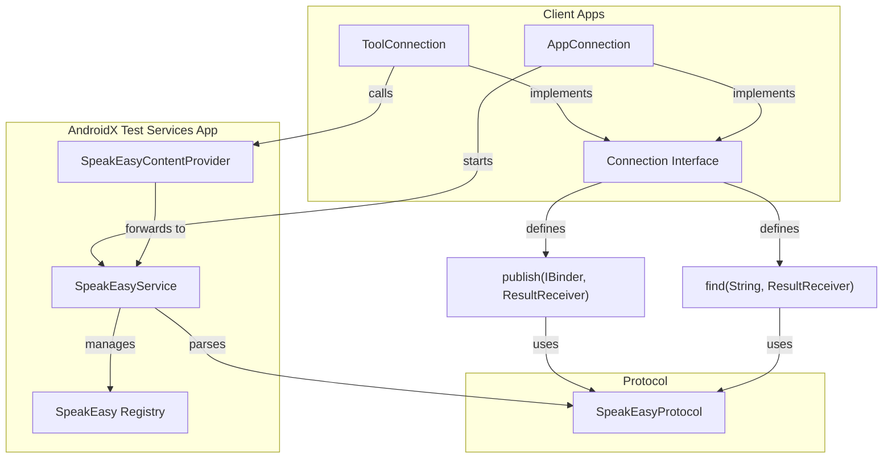
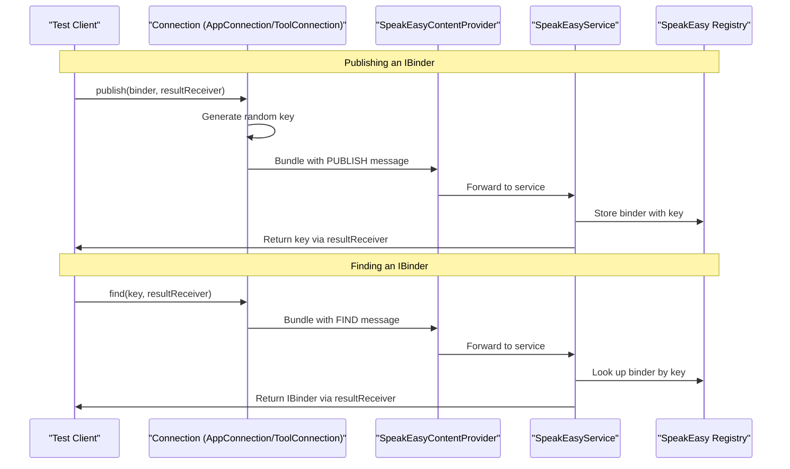
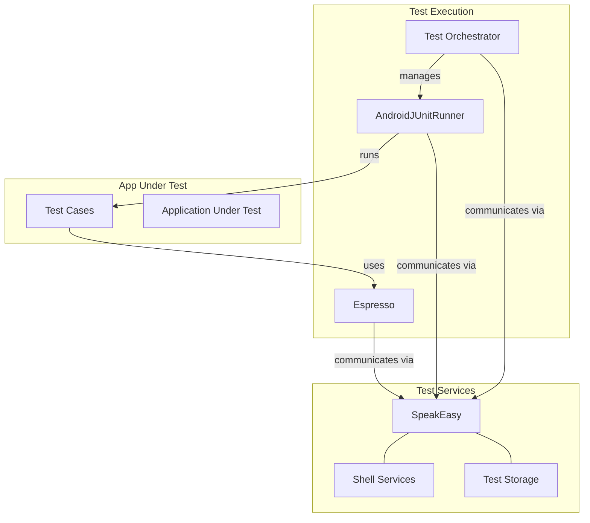

<!-- source: DeepWiki mcp.deepwiki.com · repo android/android-test · page 8.1 SpeakEasy · fetched 2026-10-23 -->

# SpeakEasy

<details>
<summary>Relevant source files</summary>

The following files were used as context for generating this wiki page:

- [espresso/contrib/java/androidx/test/espresso/contrib/BUILD](espresso/contrib/java/androidx/test/espresso/contrib/BUILD)
- [espresso/idling_resource/concurrent/java/androidx/test/espresso/idling/concurrent/BUILD](espresso/idling_resource/concurrent/java/androidx/test/espresso/idling/concurrent/BUILD)
- [espresso/idling_resource/net/java/androidx/test/espresso/idling/net/BUILD](espresso/idling_resource/net/java/androidx/test/espresso/idling/net/BUILD)
- [runner/android_junit_runner/java/androidx/test/AndroidManifest.xml](runner/android_junit_runner/java/androidx/test/AndroidManifest.xml)
- [runner/android_test_orchestrator/stubapp/BUILD](runner/android_test_orchestrator/stubapp/BUILD)
- [runner/android_test_orchestrator/stubapp/src/AndroidManifest.xml](runner/android_test_orchestrator/stubapp/src/AndroidManifest.xml)
- [services/AndroidManifest.xml](services/AndroidManifest.xml)
- [services/speakeasy/java/androidx/test/services/speakeasy/client/AppConnection.java](services/speakeasy/java/androidx/test/services/speakeasy/client/AppConnection.java)
- [services/speakeasy/java/androidx/test/services/speakeasy/client/ToolConnection.java](services/speakeasy/java/androidx/test/services/speakeasy/client/ToolConnection.java)
- [services/speakeasy/java/androidx/test/services/speakeasy/server/SpeakEasyContentProvider.java](services/speakeasy/java/androidx/test/services/speakeasy/server/SpeakEasyContentProvider.java)
- [services/speakeasy/java/androidx/test/services/speakeasy/server/SpeakEasyService.java](services/speakeasy/java/androidx/test/services/speakeasy/server/SpeakEasyService.java)
- [services/storage/java/androidx/test/services/storage/AndroidManifest.xml](services/storage/java/androidx/test/services/storage/AndroidManifest.xml)
- [services/storage/java/androidx/test/services/storage/provider/AndroidManifest.xml](services/storage/java/androidx/test/services/storage/provider/AndroidManifest.xml)
- [services/storage/java/androidx/test/services/storage/provider/AndroidManifest_opensource.xml](services/storage/java/androidx/test/services/storage/provider/AndroidManifest_opensource.xml)
- [services/storage/javatests/androidx/test/services/storage/provider/AndroidManifest_opensource.xml](services/storage/javatests/androidx/test/services/storage/provider/AndroidManifest_opensource.xml)

</details>


## Purpose and Overview

SpeakEasy is a service within the AndroidX Test framework that facilitates inter-process communication (IPC) during testing. It provides a binder registry that allows test components running in separate processes to discover and communicate with each other through IBinder objects. This is essential for components like AndroidJUnitRunner, Test Orchestrator, and Espresso tests to coordinate effectively across process boundaries.

SpeakEasy solves the challenge of establishing communication channels between:
- Test runners and the instrumented application
- Test services and test code
- Orchestrator and individual test processes

Sources: [services/AndroidManifest.xml:46-57](), [services/speakeasy/java/androidx/test/services/speakeasy/server/SpeakEasyService.java:37-39]()

## Architecture

### Component Overview



SpeakEasy consists of multiple components working together to provide IPC functionality across separate Android processes.

Sources: [services/speakeasy/java/androidx/test/services/speakeasy/client/ToolConnection.java:36-94](), [services/speakeasy/java/androidx/test/services/speakeasy/client/AppConnection.java:28-90](), [services/speakeasy/java/androidx/test/services/speakeasy/server/SpeakEasyService.java:38-180](), [services/speakeasy/java/androidx/test/services/speakeasy/server/SpeakEasyContentProvider.java:29-81]()

### Core Components

1. **SpeakEasyService**: A foreground Android service that maintains the binder registry and processes publish/find requests.

2. **SpeakEasyContentProvider**: A content provider that serves as an entry point for external processes to communicate with the SpeakEasy service.

3. **Connection Interface**: Defines the client API with two primary operations:
   - `publish`: Registers an IBinder with the SpeakEasy service
   - `find`: Retrieves a previously published IBinder by its key

4. **Client Implementations**:
   - **AppConnection**: Used by Android apps with a Context
   - **ToolConnection**: Used by tools without a Context (uses reflection to access content providers)

5. **SpeakEasyProtocol**: Defines the message format for communication between clients and the service.

Sources: [services/AndroidManifest.xml:46-57](), [services/speakeasy/java/androidx/test/services/speakeasy/server/SpeakEasyService.java:38-55](), [services/speakeasy/java/androidx/test/services/speakeasy/client/ToolConnection.java:36-42]()

## Communication Flow



The diagram above illustrates the typical flow of communication for publishing and finding IBinder objects through SpeakEasy.

Sources: [services/speakeasy/java/androidx/test/services/speakeasy/client/AppConnection.java:49-66](), [services/speakeasy/java/androidx/test/services/speakeasy/client/ToolConnection.java:64-92](), [services/speakeasy/java/androidx/test/services/speakeasy/server/SpeakEasyContentProvider.java:62-70](), [services/speakeasy/java/androidx/test/services/speakeasy/server/SpeakEasyService.java:110-148]()

## Integration with Test Framework



SpeakEasy is a critical part of the AndroidX Test framework, enabling communication between various test components. It allows the Test Orchestrator to coordinate with AndroidJUnitRunner instances, lets test cases communicate with test services, and enables Espresso to interact with the application under test.

Sources: [runner/android_junit_runner/java/androidx/test/AndroidManifest.xml:19-22](), [runner/android_test_orchestrator/stubapp/src/AndroidManifest.xml:23-24]()

## Implementation Details

### Service Registration

SpeakEasy components are registered in the AndroidX Test Services app's manifest:

```
<service
    android:directBootAware="true"
    android:name="androidx.test.services.speakeasy.server.SpeakEasyService"
    android:exported="true">
</service>

<provider
    android:directBootAware="true"
    android:name="androidx.test.services.speakeasy.server.SpeakEasyContentProvider"
    android:authorities="androidx_test_services.speak_easy"
    android:exported="true"
    android:grantUriPermissions="true" />
```

The service and content provider are both exported, allowing other applications to access them.

Sources: [services/AndroidManifest.xml:46-57]()

### Client Connection

#### AppConnection

The AppConnection is used by Android applications that have a Context. It communicates with the SpeakEasy service by starting it through an Intent:

```java
public void publish(IBinder binder, PublishResultReceiver rr) {
    // Generate a random key for the binder
    String key = Long.toHexString(random.nextLong());
    Intent intent = makeIntent();
    intent.putExtras(SpeakEasyProtocol.Publish.asBundle(key, binder, rr));
    startForegroundService(context, intent);
}
```

Sources: [services/speakeasy/java/androidx/test/services/speakeasy/client/AppConnection.java:49-57]()

#### ToolConnection

The ToolConnection is more complex as it's designed to work without a Context. It uses reflection to access ActivityManager and content provider methods:

```java
protected final void doCall(Bundle b) throws RemoteException {
    // Get reference to ActivityManager
    Object activityManager = getActivityManager();
    
    // Get contentProvider through ActivityManager
    Object cph = getCPEMethod.invoke(activityManager, contentProvider, userId, token);
    
    // Get provider field and invoke call method
    Field f = cph.getClass().getDeclaredField("provider");
    f.setAccessible(true);
    Object provider = f.get(cph);
    
    // Find and invoke the call method
    Method call = findCallMethod(provider);
    call.invoke(provider, ...);
}
```

This complex reflection-based approach allows SpeakEasy to be used by tools running outside the Android app environment.

Sources: [services/speakeasy/java/androidx/test/services/speakeasy/client/ToolConnection.java:105-207]()

### Handling Binder Death

SpeakEasy monitors the health of registered binders and automatically removes them when they die:

```java
private static class DeathCallback implements SpeakEasy.BinderDeathCallback {
    private final Context context;

    @Override
    public void binderDeath(String key, IBinder dead) {
        Intent msg = new Intent(context, SpeakEasyService.class);
        msg.putExtras(SpeakEasyProtocol.Remove.asBundle(key));
        startForegroundService(context, msg);
    }
}
```

This ensures that the registry doesn't hold references to dead binders, which could cause memory leaks or errors.

Sources: [services/speakeasy/java/androidx/test/services/speakeasy/server/SpeakEasyService.java:156-168]()

## Usage in the AndroidX Test Framework

SpeakEasy is a critical infrastructure component that enables various test components to communicate across process boundaries. Here are some examples of how it's used:

| Component | Role in Using SpeakEasy |
|-----------|-------------------------|
| Test Orchestrator | Uses SpeakEasy to communicate with AndroidJUnitRunner instances |
| AndroidJUnitRunner | Uses SpeakEasy to access test services |
| Espresso | May use SpeakEasy to communicate with idling resources in separate processes |
| Test Services | Use SpeakEasy to provide functionality to test processes |

The Test Orchestrator and AndroidJUnitRunner explicitly query for the Test Services package, which contains SpeakEasy:

```xml
<queries>
    <package android:name="androidx.test.services" />
</queries>
```

This querability ensures that the components can find and communicate with SpeakEasy even with Android's package visibility restrictions.

Sources: [runner/android_junit_runner/java/androidx/test/AndroidManifest.xml:19-22](), [runner/android_test_orchestrator/stubapp/src/AndroidManifest.xml:23-24]()

## Permissions

SpeakEasy requires several permissions to function properly:

```xml
<uses-permission android:name="android.permission.INTERACT_ACROSS_USERS" />
<uses-permission android:name="android.permission.ACCESS_CONTENT_PROVIDERS_EXTERNALLY" />
<uses-permission android:name="android.permission.FOREGROUND_SERVICE" />
<uses-permission android:name="android.permission.INTERNET"/>
<uses-permission android:name="android.permission.ACCESS_NETWORK_STATE"/>
```

These permissions allow SpeakEasy to run as a foreground service and communicate across different applications and user spaces.

Sources: [services/AndroidManifest.xml:29-36]()

## Summary

SpeakEasy is a sophisticated inter-process communication mechanism within the AndroidX Test framework. It provides a reliable way for test components running in different processes to discover and communicate with each other, which is essential for coordinating complex test scenarios. The service-based architecture with content provider access ensures that components can communicate even with Android's strict process isolation.

---

