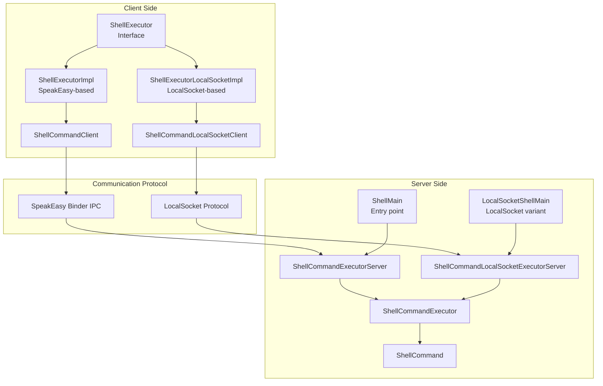
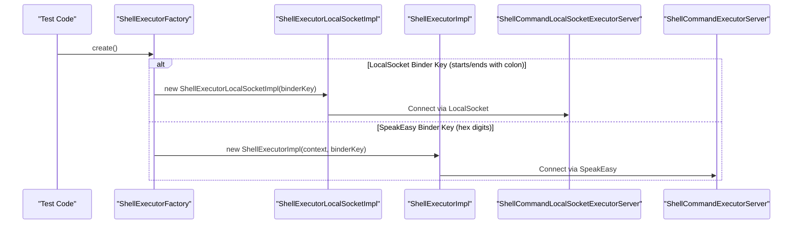
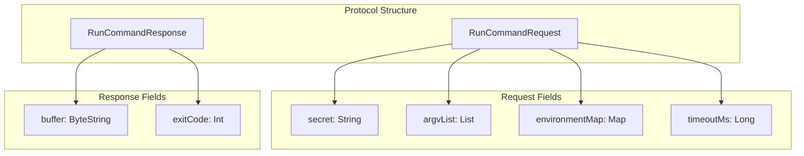
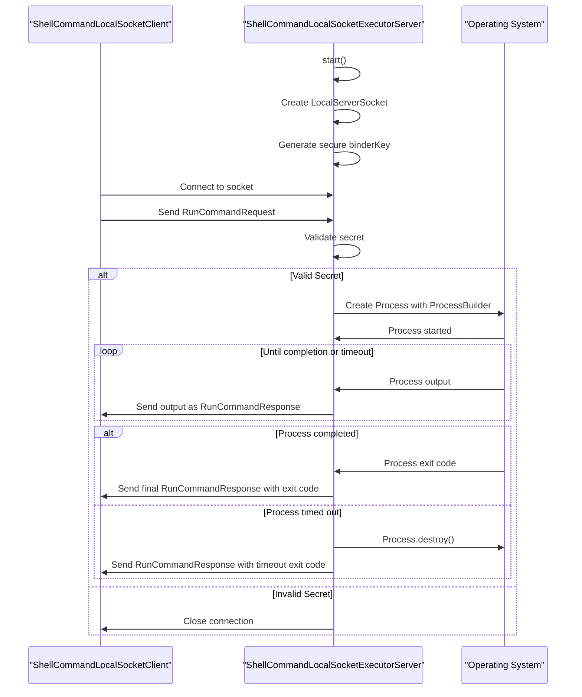
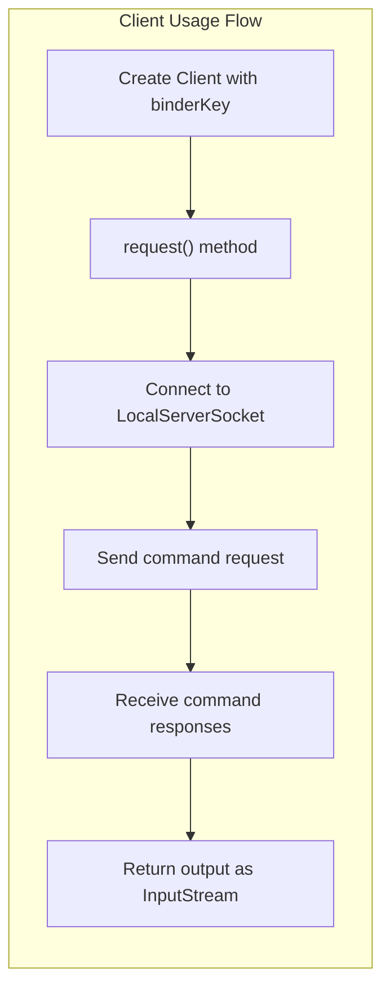
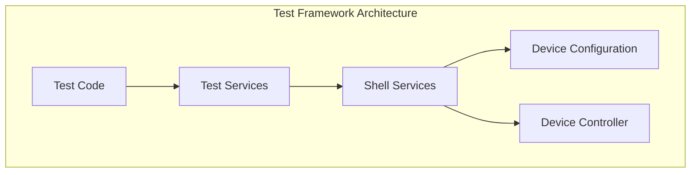

<!-- source: DeepWiki mcp.deepwiki.com · repo android/android-test · page 8.2 Shell Services · fetched 2026-10-23 -->

# Shell Services

Relevant source files

The following files were used as context for generating this wiki page:

- [services/shellexecutor/java/androidx/test/services/shellexecutor/BUILD](services/shellexecutor/java/androidx/test/services/shellexecutor/BUILD)
- [services/shellexecutor/java/androidx/test/services/shellexecutor/LocalSocketShellMain.kt](services/shellexecutor/java/androidx/test/services/shellexecutor/LocalSocketShellMain.kt)
- [services/shellexecutor/java/androidx/test/services/shellexecutor/ShellCommandLocalSocketClient.kt](services/shellexecutor/java/androidx/test/services/shellexecutor/ShellCommandLocalSocketClient.kt)
- [services/shellexecutor/java/androidx/test/services/shellexecutor/ShellCommandLocalSocketExecutorServer.kt](services/shellexecutor/java/androidx/test/services/shellexecutor/ShellCommandLocalSocketExecutorServer.kt)
- [services/shellexecutor/java/androidx/test/services/shellexecutor/ShellExecutorFactory.java](services/shellexecutor/java/androidx/test/services/shellexecutor/ShellExecutorFactory.java)
- [services/shellexecutor/javatests/androidx/test/services/shellexecutor/BUILD](services/shellexecutor/javatests/androidx/test/services/shellexecutor/BUILD)
- [services/shellexecutor/javatests/androidx/test/services/shellexecutor/ShellCommandLocalSocketClientTest.kt](services/shellexecutor/javatests/androidx/test/services/shellexecutor/ShellCommandLocalSocketClientTest.kt)
- [services/shellexecutor/javatests/androidx/test/services/shellexecutor/ShellCommandLocalSocketExecutorServerTest.kt](services/shellexecutor/javatests/androidx/test/services/shellexecutor/ShellCommandLocalSocketExecutorServerTest.kt)

## Purpose and Scope

Shell Services provides a mechanism for executing shell commands with elevated permissions during Android test execution. This is crucial for tests that need to perform privileged operations that wouldn't normally be available to the application under test.

This document explains the architecture, components, and usage of the Shell Services system. For information about inter-process communication during testing in general, see [SpeakEasy](#8.1).

Sources: [services/shellexecutor/java/androidx/test/services/shellexecutor/BUILD:7-7]()

## Architecture Overview

Shell Services follows a client-server architecture that enables privileged command execution. The server component runs with elevated permissions and executes commands on behalf of client requests. Communication between client and server occurs through either Android Binder IPC (via SpeakEasy) or Android LocalSocket connections.

### Component Architecture

Sources: 
[services/shellexecutor/java/androidx/test/services/shellexecutor/BUILD:42-71]()
[services/shellexecutor/java/androidx/test/services/shellexecutor/BUILD:73-97]()
[services/shellexecutor/java/androidx/test/services/shellexecutor/ShellCommandLocalSocketExecutorServer.kt:48-245]()
[services/shellexecutor/java/androidx/test/services/shellexecutor/LocalSocketShellMain.kt:32-89]()

## Communication Protocols

Shell Services supports two communication protocols:

1. **SpeakEasy Binder IPC**: The original protocol using Android's Binder IPC mechanism
2. **LocalSocket Protocol**: A newer alternative using Android's LocalSocket API

The `ShellExecutorFactory` determines which protocol to use based on the binder key format:

Sources:
[services/shellexecutor/java/androidx/test/services/shellexecutor/ShellExecutorFactory.java:22-41]()

### LocalSocket Protocol

The LocalSocket protocol uses Protocol Buffers to serialize messages between client and server. This provides a more efficient communication channel compared to Android Binder.

Sources:
[services/shellexecutor/java/androidx/test/services/shellexecutor/BUILD:16-27]()
[services/shellexecutor/java/androidx/test/services/shellexecutor/LocalSocketShellMain.kt:32-89]()
[services/shellexecutor/javatests/androidx/test/services/shellexecutor/ShellCommandLocalSocketClientTest.kt:41-111]()

## Server-Side Components

### ShellCommandLocalSocketExecutorServer

This server component listens on a LocalSocket and executes incoming command requests. Key features include:

- Accepts client connections over LocalSocket
- Validates request secrets for security
- Executes commands using ProcessBuilder
- Handles command timeouts
- Streams command output back to client
- Relays exit codes upon command completion

Sources:
[services/shellexecutor/java/androidx/test/services/shellexecutor/ShellCommandLocalSocketExecutorServer.kt:48-245]()
[services/shellexecutor/javatests/androidx/test/services/shellexecutor/ShellCommandLocalSocketExecutorServerTest.kt:21-104]()

### LocalSocketShellMain

This class serves as the entry point for the LocalSocket-based shell executor server. It:

1. Starts the `ShellCommandLocalSocketExecutorServer`
2. Establishes input/output stream connections
3. Runs the specified command
4. Relays standard input/output/error between the calling process and the command

Sources:
[services/shellexecutor/java/androidx/test/services/shellexecutor/LocalSocketShellMain.kt:32-89]()

## Client-Side Components

### ShellCommandLocalSocketClient

This client communicates with the server using LocalSocket connections:

- Establishes socket connection to the server
- Serializes commands as `RunCommandRequest` protocol buffer messages
- Handles command execution through shell if specified
- Manages command timeouts
- Processes command output streams

Sources:
[services/shellexecutor/java/androidx/test/services/shellexecutor/ShellCommandLocalSocketClient.kt:50-172]()
[services/shellexecutor/javatests/androidx/test/services/shellexecutor/ShellCommandLocalSocketClientTest.kt:36-115]()

### ShellExecutorFactory

The `ShellExecutorFactory` decides which implementation to use based on the binder key format:

- If the binder key starts and ends with a colon, it uses `ShellExecutorLocalSocketImpl`
- Otherwise, it uses the original `ShellExecutorImpl` that works with SpeakEasy

Sources:
[services/shellexecutor/java/androidx/test/services/shellexecutor/ShellExecutorFactory.java:22-41]()

## Usage Patterns

### Executing Commands

Shell Services can execute commands in two primary ways:

1. **Direct execution**: Commands are executed directly with parameters
2. **Shell execution**: Commands are executed through a shell (`sh -c`) which allows for shell features like environment variable expansion

### Connection Types

| Connection Type | Binder Key Format | Implementation Class | Best For |
|-----------------|-------------------|----------------------|----------|
| LocalSocket | `:encoded_address:secret:` | `ShellExecutorLocalSocketImpl` | High-bandwidth command output, newer Android versions |
| SpeakEasy Binder | Hexadecimal string | `ShellExecutorImpl` | Compatibility with older systems |

Sources:
[services/shellexecutor/java/androidx/test/services/shellexecutor/ShellExecutorFactory.java:22-41]()
[services/shellexecutor/javatests/androidx/test/services/shellexecutor/ShellCommandLocalSocketClientTest.kt:36-115]()

### Security Considerations

Shell Services uses a secure random token (secret) to validate connections, preventing unauthorized access to privileged command execution. This secret is embedded in the binder key and validated for each request.

Sources:
[services/shellexecutor/java/androidx/test/services/shellexecutor/ShellCommandLocalSocketExecutorServer.kt:134-138]()

## Integration with Test Framework

Shell Services integrates with the broader AndroidX Test framework by providing a mechanism for test code to execute privileged commands. This is particularly useful for:

- Modifying system settings
- Accessing protected files
- Interacting with system services that require elevated permissions
- Managing test device state

Sources:
[services/shellexecutor/java/androidx/test/services/shellexecutor/BUILD:7-7]()
[services/shellexecutor/javatests/androidx/test/services/shellexecutor/BUILD:30-70]()