# Page: Overview

# Overview

<details>
<summary>Relevant source files</summary>

The following files were used as context for generating this wiki page:

- [.bazelproject](.bazelproject)
- [.bazelversion](.bazelversion)
- [.gitignore](.gitignore)
- [CONTRIBUTING.md](CONTRIBUTING.md)
- [Dockerfile](Dockerfile)
- [ISSUE_TEMPLATE.md](ISSUE_TEMPLATE.md)
- [LICENSE](LICENSE)
- [README.md](README.md)
- [bazelci/buildkite-pipeline.yml](bazelci/buildkite-pipeline.yml)
- [build_extensions/maven/maven_info.bzl](build_extensions/maven/maven_info.bzl)
- [build_extensions/maven/maven_registry.bzl](build_extensions/maven/maven_registry.bzl)
- [gradle-tests/espresso/.gitignore](gradle-tests/espresso/.gitignore)
- [gradle-tests/orchestrator/.gitignore](gradle-tests/orchestrator/.gitignore)
- [tools/android/emulator/common.py](tools/android/emulator/common.py)
- [tools/android/emulator/common_subprocess_test.py](tools/android/emulator/common_subprocess_test.py)
- [tools/android/emulator/common_test.py](tools/android/emulator/common_test.py)
- [tools/android/emulator/daemon/x86/pipe_traversal](tools/android/emulator/daemon/x86/pipe_traversal)
- [tools/device_broker/proto/BUILD.bazel](tools/device_broker/proto/BUILD.bazel)

</details>


This document provides an introduction to the AndroidX Test repository, which hosts two primary projects:

1. **AndroidX Test libraries**: A comprehensive framework for testing Android applications
2. **Bazel support for android_instrumentation_test**: Tools enabling Android instrumentation testing in Bazel build environments

This overview focuses on the AndroidX Test libraries, explaining their purpose, component architecture, and how they work together to provide a complete Android testing solution.

Sources:
- [README.md:1-9]()

## Purpose

The AndroidX Test Library provides a comprehensive framework for testing Android applications. It offers a set of APIs that enable developers to build and run test code for their apps, including JUnit 4 tests and functional user interface (UI) tests. Tests created with these libraries can be run from the Android Studio IDE or from the command line.

Key capabilities include:
- **UI testing** with Espresso
- **Component testing** with ActivityScenario
- **Test isolation** with the Test Orchestrator
- **Device configuration** for testing different device states
- **Test execution** with AndroidJUnitRunner

Sources:
- [README.md:7-9]()

## Maven Artifacts

The AndroidX Test framework is distributed as a collection of Maven artifacts, each serving a specific purpose in the testing ecosystem:

| Artifact | Path in Repository | Purpose |
|----------|-------------------|---------|
| androidx.test:core | //core/java/ | Core testing utilities |
| androidx.test:core-ktx | //ktx/core/java/ | Kotlin extensions for core |
| androidx.test.espresso:* | //espresso/*/java/ | UI testing framework |
| androidx.test.ext:junit | //ext/junit/java/ | JUnit 4 extensions |
| androidx.test.ext:junit-ktx | //ktx/ext/junit/java/ | Kotlin extensions for JUnit |
| androidx.test:orchestrator | //runner/android_test_orchestrator/ | Test isolation service |
| androidx.test:runner | //runner/android_junit_runner/java/ | Test runner |
| androidx.test:rules | //runner/rules/java/ | Test environment setup |
| androidx.test:monitor | //runner/monitor/java/ | Activity lifecycle monitoring |
| androidx.test:services | //services/ | Test supporting services |

Sources:
- [README.md:11-22]()
- [build_extensions/maven/maven_registry.bzl:25-61]()

## Architecture Overview

### High-Level System Architecture

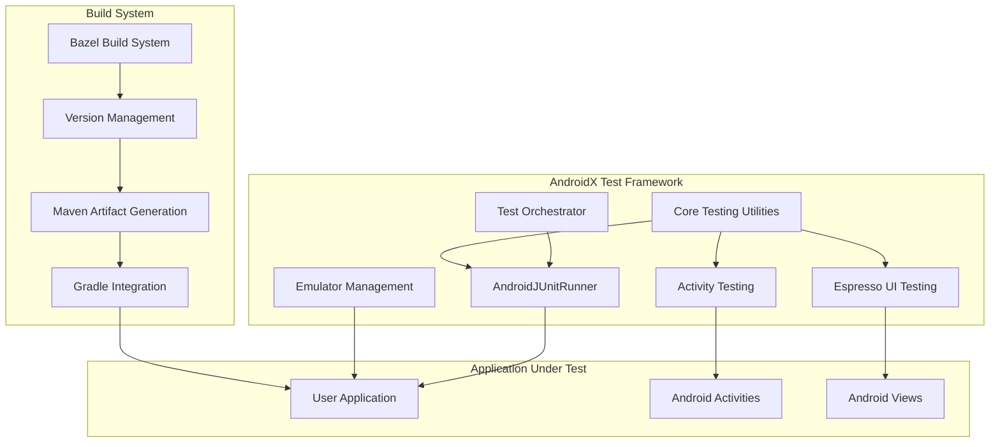

This diagram shows the high-level components of the AndroidX Test framework and how they relate to each other. The framework provides testing capabilities through various interconnected components, supported by a Bazel-based build system that produces Maven artifacts for consumption in Gradle-based Android projects.

Sources:
- The provided high-level architecture diagram

### Component Class Relationships

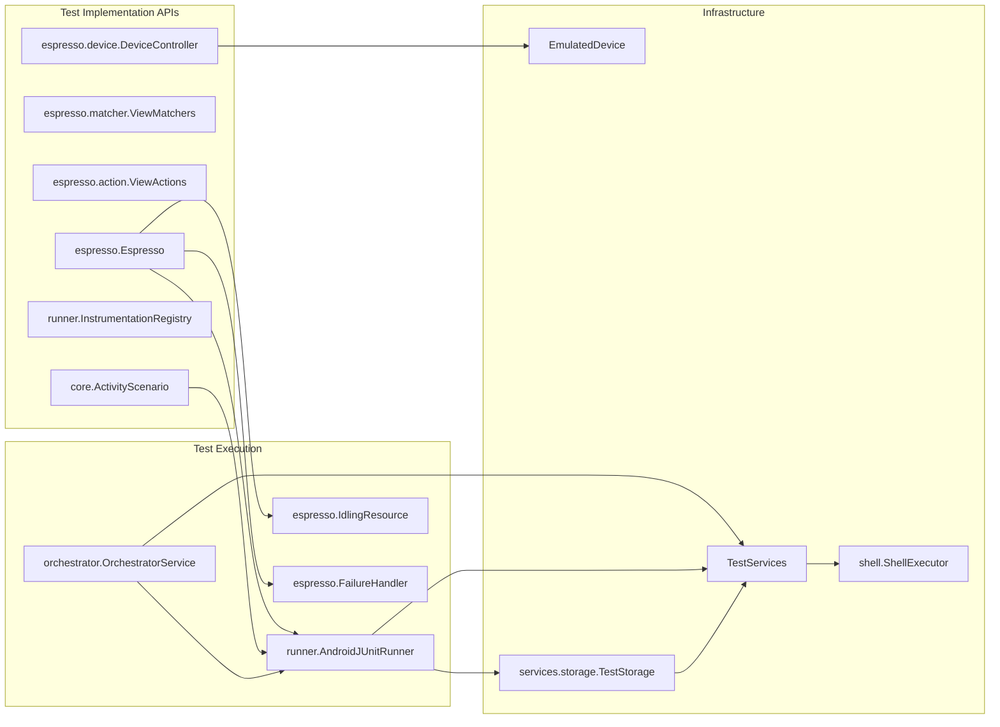

This diagram illustrates the relationships between key classes across the different layers of the testing framework. Test writers interact with the Test Implementation APIs like `Espresso` and `ActivityScenario`, which in turn use the Test Execution components. These execution components rely on the Infrastructure layer for services like device control and storage.

Sources:
- The provided component relationships diagram

## Test Execution Flow

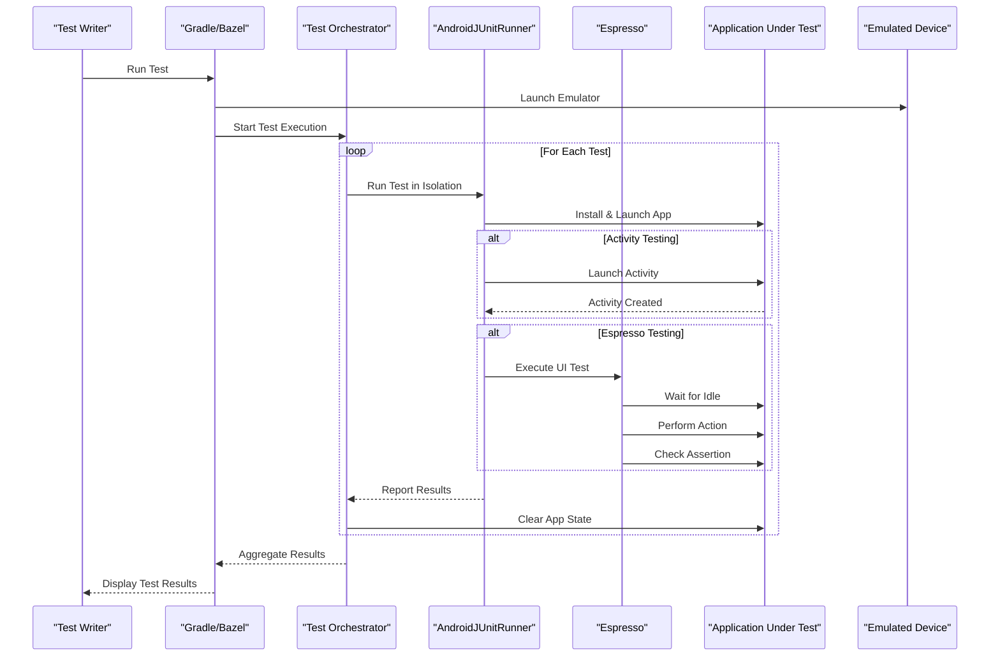

This sequence diagram illustrates how tests flow through the AndroidX Test system. When a developer runs a test, the build system launches an emulator and starts the Test Orchestrator. For each test, the AndroidJUnitRunner executes it in isolation, and after completion, the Orchestrator clears the app state before the next test. This isolation improves test reliability by preventing state leakage between tests.

Sources:
- The provided test execution flow diagram

## Core Components

### Espresso

Espresso is the UI testing framework within AndroidX Test that allows developers to write concise, reliable UI tests. It provides a fluent API for:

- Finding UI elements using matchers (`onView(withId(R.id.my_button))`)
- Performing actions on elements (`perform(click())`) 
- Verifying element states (`check(matches(isDisplayed()))`)

Key Espresso modules include:

| Module | Path | Purpose |
|--------|------|---------|
| espresso-core | //espresso/core/java/ | Core functionality |
| espresso-contrib | //espresso/contrib/java/ | Additional UI interactions |
| espresso-web | //espresso/web/java/ | WebView testing |
| espresso-intents | //espresso/intents/java/ | Intent verification |
| espresso-device | //espresso/device/java/ | Device configuration control |
| espresso-idling-resource | //espresso/idling_resource/java/ | Synchronization with app |

The modular design allows test writers to include only the components they need.

Sources:
- [build_extensions/maven/maven_registry.bzl:33-42]()

### AndroidJUnitRunner

AndroidJUnitRunner (`runner.AndroidJUnitRunner`) is the test instrumentation runner that executes JUnit 4 tests on Android devices. It:

- Loads and runs test classes
- Provides access to the instrumentation context
- Manages activity lifecycle during tests
- Integrates with the Test Orchestrator

All tests using AndroidX Test require AndroidJUnitRunner or a subclass configured in the application's build setup.

Sources:
- [build_extensions/maven/maven_registry.bzl:26]()

### Activity Testing

Activity testing is facilitated by `ActivityScenario` in the Core module. This class provides:

- Programmatic control over activity lifecycle (create, start, resume, pause, stop, destroy)
- Synchronization with UI thread
- Clean state between tests

`ActivityScenario` replaces the older `ActivityTestRule` with a more flexible, programmatic approach.

Sources:
- [build_extensions/maven/maven_registry.bzl:31]()

### Emulator Management

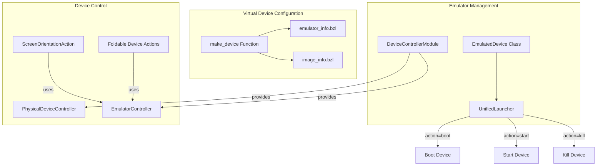

The Emulator Management system allows controlling emulator instances during testing. It includes components for launching emulators, configuring virtual devices, and controlling device states like screen orientation and foldable device configurations.

Sources:
- The provided emulator management system diagram
- [tools/android/emulator/common.py:15-384]()

## Build System

The AndroidX Test framework uses Bazel for building, with support for Maven artifact generation:

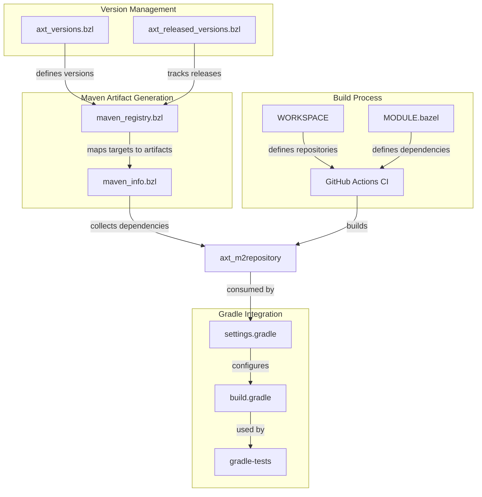

Key build system files:
- `.bazelversion`: Specifies the required Bazel version (7.5.0)
- `maven_registry.bzl`: Maps Bazel targets to Maven artifacts
- `maven_info.bzl`: Collects Maven dependency information
- Gradle test projects for integration testing

Sources:
- [.bazelversion:1-2]()
- [build_extensions/maven/maven_registry.bzl:1-128]()
- [build_extensions/maven/maven_info.bzl:1-210]()
- The provided build and version management system diagram

## Development and Contribution

The repository uses Bazel for building and testing. To contribute:

1. Fork and clone the repository
2. Install Bazelisk and the Android SDK
3. Set ANDROID_HOME environment variable
4. Build with `bazelisk build :axt_m2repository`
5. Test with `bazelisk test //core/javatests/...`

Integration tests can be run using the Gradle test projects.

Sources:
- [CONTRIBUTING.md:18-91]()

## Related Documentation

For more detailed information on specific components, refer to the following wiki pages:

- [Architecture](#2): Detailed architectural explanation
- [Core Components](#3): Details on fundamental building blocks
- [Espresso](#4): UI testing framework documentation
- [Runner](#5): Test runner and execution documentation
- [Device Management](#6): Emulator and device control
- [Build System](#7): Build infrastructure details
- [Test Services](#8): Service components documentation

External documentation is available at [developers.android.com/testing](https://developers.android.com/testing).

Sources:
- [README.md:9-42]()

---

# Page: Architecture

# Architecture

<details>
<summary>Relevant source files</summary>

The following files were used as context for generating this wiki page:

- [MODULE.bazel](MODULE.bazel)
- [build_extensions/axt_deps_versions.bzl](build_extensions/axt_deps_versions.bzl)
- [core/CHANGELOG.md](core/CHANGELOG.md)
- [espresso/CHANGELOG.md](espresso/CHANGELOG.md)
- [espresso/core/java/androidx/test/espresso/api/current_public.txt](espresso/core/java/androidx/test/espresso/api/current_public.txt)
- [espresso/device/CHANGELOG.md](espresso/device/CHANGELOG.md)
- [espresso/device/java/androidx/test/espresso/device/api/current_public.txt](espresso/device/java/androidx/test/espresso/device/api/current_public.txt)
- [espresso/intents/java/androidx/test/espresso/intent/api/current_public.txt](espresso/intents/java/androidx/test/espresso/intent/api/current_public.txt)
- [espresso/remote/java/androidx/test/espresso/remote/api/current_public.txt](espresso/remote/java/androidx/test/espresso/remote/api/current_public.txt)
- [espresso/web/java/androidx/test/espresso/web/api/current_public.txt](espresso/web/java/androidx/test/espresso/web/api/current_public.txt)
- [espresso/web/java/androidx/test/espresso/web/util/concurrent/FutureCallback.java](espresso/web/java/androidx/test/espresso/web/util/concurrent/FutureCallback.java)
- [ext/junit/CHANGELOG.md](ext/junit/CHANGELOG.md)
- [ext/junit/java/androidx/test/ext/junit/api/current_public.txt](ext/junit/java/androidx/test/ext/junit/api/current_public.txt)
- [ext/truth/CHANGELOG.md](ext/truth/CHANGELOG.md)
- [ext/truth/java/androidx/test/ext/truth/api/current_public.txt](ext/truth/java/androidx/test/ext/truth/api/current_public.txt)
- [runner/android_junit_runner/CHANGELOG.md](runner/android_junit_runner/CHANGELOG.md)
- [runner/android_junit_runner/java/androidx/test/api/current_public.txt](runner/android_junit_runner/java/androidx/test/api/current_public.txt)
- [runner/android_junit_runner/java/androidx/test/filters/Suppress.java](runner/android_junit_runner/java/androidx/test/filters/Suppress.java)
- [runner/android_test_orchestrator/CHANGELOG.md](runner/android_test_orchestrator/CHANGELOG.md)
- [runner/monitor/CHANGELOG.md](runner/monitor/CHANGELOG.md)
- [runner/monitor/java/androidx/test/api/current_internal.txt](runner/monitor/java/androidx/test/api/current_internal.txt)
- [runner/monitor/java/androidx/test/api/current_public.txt](runner/monitor/java/androidx/test/api/current_public.txt)
- [runner/monitor/java/androidx/test/platform/device/DeviceController.java](runner/monitor/java/androidx/test/platform/device/DeviceController.java)
- [runner/rules/CHANGELOG.md](runner/rules/CHANGELOG.md)
- [services/CHANGELOG.md](services/CHANGELOG.md)

</details>


## Introduction

This document provides a comprehensive overview of the architectural design of the AndroidX Test framework. It explains how the various components of the framework interact to enable effective testing of Android applications. The architecture is organized into several interconnected subsystems that work together to provide UI testing, component testing, test isolation, device management, and integration with build systems.

For information about specific components like Espresso, the Runner system, or device management, please refer to their respective dedicated pages: [Espresso](#4), [Runner](#5), or [Device Management](#6).

Sources: [core/CHANGELOG.md](), [espresso/CHANGELOG.md](), [runner/android_junit_runner/CHANGELOG.md](), [services/CHANGELOG.md]()

## Core Components

The AndroidX Test framework consists of several core components, each with specific responsibilities:

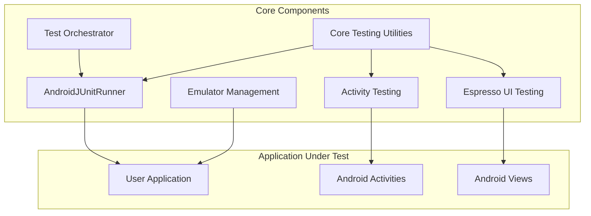

### Espresso

Espresso provides a fluent API for UI testing, focusing on testing a single application. It offers automatic synchronization with the UI thread, making tests more reliable. The main components include:

- **ViewMatchers**: Find views in the hierarchy (e.g., `withId`, `withText`)
- **ViewActions**: Perform actions on views (e.g., `click()`, `typeText()`)
- **ViewAssertions**: Verify view states (e.g., `matches()`, `doesNotExist()`)
- **Espresso Class**: Entry point providing methods like `onView()`, `onData()`, `pressBack()`
- **IdlingResources**: Synchronization mechanism for asynchronous operations

Espresso is designed to be concise and test actions from a user's perspective, hiding implementation details of the UI.

Sources: [espresso/core/java/androidx/test/espresso/api/current_public.txt:1-507](), [espresso/core/java/androidx/test/espresso/api/current_public.txt:193-471]()

### AndroidJUnitRunner

AndroidJUnitRunner is a JUnit 4-compatible test runner that executes tests on Android devices. It extends `MonitoringInstrumentation` and handles:

- Test discovery and execution
- Test lifecycle management
- Activity and application monitoring
- Instrumentation integration
- Intent interception and monitoring

The runner is the bridge between test code written with JUnit and the Android runtime environment.

Sources: [runner/android_junit_runner/java/androidx/test/api/current_public.txt:229-246](), [runner/monitor/java/androidx/test/api/current_public.txt:106-136]()

### Core Testing Utilities

The Core module provides essential functionality used by other components:

- **ActivityLifecycleMonitor**: Tracks activity lifecycle state changes
- **ApplicationLifecycleMonitor**: Tracks application lifecycle events
- **IntentMonitor/Stubber**: For intent monitoring and stubbing
- **TestStorage**: Manages test files and data
- **ThreadChecker**: Enforces thread constraints for test operations

These utilities form the foundation for higher-level testing tools.

Sources: [core/CHANGELOG.md](), [runner/monitor/java/androidx/test/api/current_public.txt:177-224]()

### Test Orchestrator

Test Orchestrator isolates each test by running it in a separate instrumentation process, preventing test pollution. Key components include:

- **OrchestratorCallback**: Interface for communicating between test processes
- **OrchestrationListenerManager**: Manages test lifecycle notification
- **BundleJUnitUtils**: Utilities for passing test data between processes 
- **ParcelableResult/Description/Failure**: Test result data structures that can cross process boundaries

This isolation improves test reliability by ensuring that state changes in one test don't affect others.

Sources: [runner/android_junit_runner/java/androidx/test/api/current_public.txt:45-152](), [runner/android_test_orchestrator/CHANGELOG.md]()

### Activity Testing

The framework provides tools for testing activities:

- **ActivityScenario**: Primary API for testing activities in isolation
- **ActivityScenarioRule**: JUnit rule for ActivityScenario management
- **ActivityLifecycleTimeout**: Configures timeouts for activity operations
- **ActivityInvoker**: Interface for controlling activity lifecycle

These components make it easier to test single activities without the complexities of full application testing.

Sources: [ext/junit/java/androidx/test/ext/junit/api/current_public.txt:4-20](), [runner/monitor/java/androidx/test/internal/platform/app/ActivityInvoker.java]()

### Device Management

Device Management provides capabilities for controlling and configuring Android devices during testing:

- **DeviceController**: Base interface for device operations
- **ScreenOrientation**: Controls device orientation (portrait/landscape)
- **DeviceMode**: For foldable device configurations (flat, book, tabletop, closed)

This subsystem enables tests to control device configurations for testing different UI states.

Sources: [runner/monitor/java/androidx/test/platform/device/DeviceController.java](), [espresso/device/java/androidx/test/espresso/device/api/current_public.txt:30-49]()

## Component Relationships and Layered Architecture

The AndroidX Test framework is organized into three primary layers:

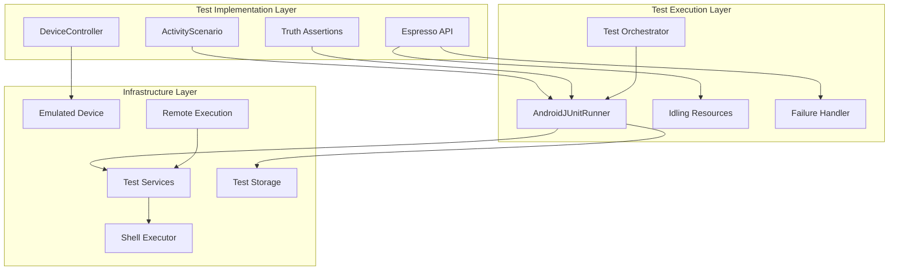

### Test Implementation Layer

This is the primary interface for test writers, providing high-level APIs for test creation:

- **Espresso API**: For UI testing with `onView()`, `onData()`, and related methods
- **ActivityScenario**: For testing activities in isolation
- **DeviceController**: For controlling device configuration
- **Truth Assertions**: For fluent assertions on Android components

These components present simple, focused APIs that hide implementation complexity.

Sources: [espresso/core/java/androidx/test/espresso/api/current_public.txt:44-59](), [ext/junit/java/androidx/test/ext/junit/api/current_public.txt:4-10](), [ext/truth/java/androidx/test/ext/truth/api/current_public.txt]()

### Test Execution Layer

This layer handles the mechanics of test execution:

- **AndroidJUnitRunner**: Test runner that integrates with JUnit
- **Test Orchestrator**: Manages test isolation
- **IdlingResources**: Handles synchronization with asynchronous operations
- **FailureHandler**: Processes and reports test failures

This layer translates test instructions into actions on the device and application.

Sources: [runner/android_junit_runner/java/androidx/test/api/current_public.txt:237-239](), [espresso/core/java/androidx/test/espresso/api/current_public.txt:64-87]()

### Infrastructure Layer

This foundational layer provides core services and capabilities:

- **Emulated Device**: Manages virtual device instances
- **Test Services**: Provides services to test processes
- **Shell Executor**: Executes privileged commands
- **Test Storage**: Manages test files and data
- **Remote Execution**: Enables cross-process testing

These components handle low-level operations required for test execution.

Sources: [services/CHANGELOG.md](), [runner/monitor/java/androidx/test/api/current_public.txt:66-79](), [espresso/remote/java/androidx/test/espresso/remote/api/current_public.txt]()

## Test Execution Flow

The test execution process follows a specific sequence of operations:

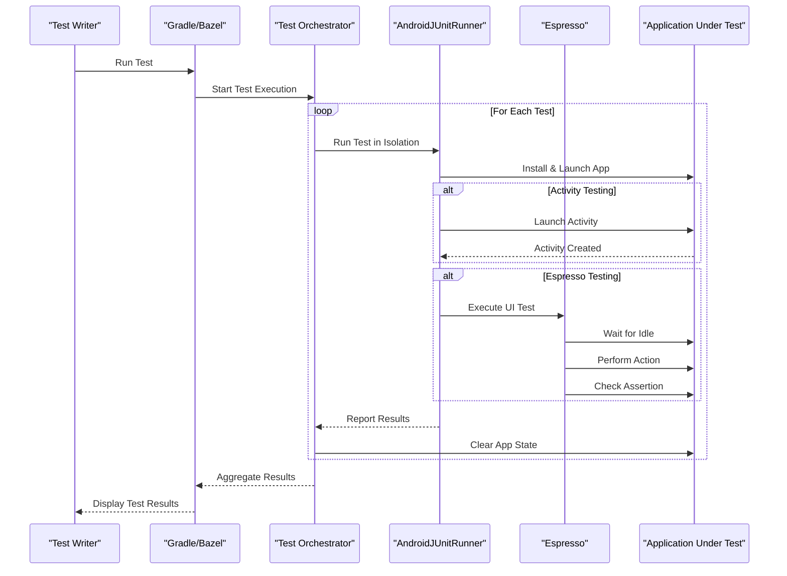

This flow demonstrates how:

1. Tests initiated by developers are processed by the build system (Gradle or Bazel)
2. Test Orchestrator manages isolated execution of individual tests
3. AndroidJUnitRunner executes tests within the application environment
4. Different testing approaches (Activity testing, UI testing) are handled
5. Test results flow back through the system to the developer

The key innovation is the isolation provided by Test Orchestrator, which launches each test in a fresh instrumentation process to prevent test pollution.

Sources: [runner/android_junit_runner/java/androidx/test/api/current_public.txt:45-172](), [runner/android_test_orchestrator/CHANGELOG.md]()

## Device Management Architecture

The Device Management subsystem controls the testing environment:

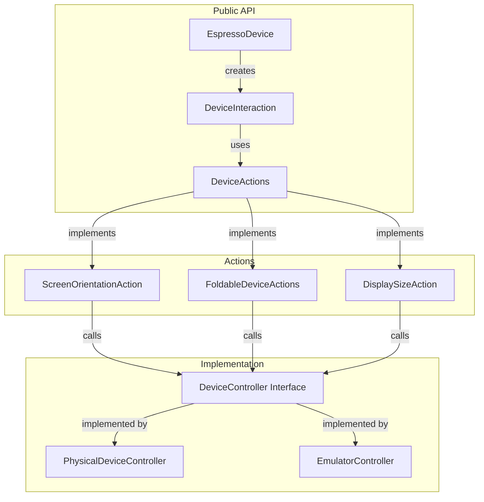

The architecture provides a clear separation between:

- **Public API**: High-level interfaces for test writers (`EspressoDevice`, `DeviceInteraction`)
- **Implementation**: Device controller implementations for different device types
- **Actions**: Specific operations that can be performed on devices

This design allows tests to control device configuration (orientation, foldable state, display size) without needing to know the implementation details for different device types.

Sources: [espresso/device/java/androidx/test/espresso/device/api/current_public.txt:19-27](), [espresso/device/java/androidx/test/espresso/device/api/current_public.txt:30-49](), [runner/monitor/java/androidx/test/platform/device/DeviceController.java]()

## Build and Version Management

The AndroidX Test framework uses a sophisticated build system:

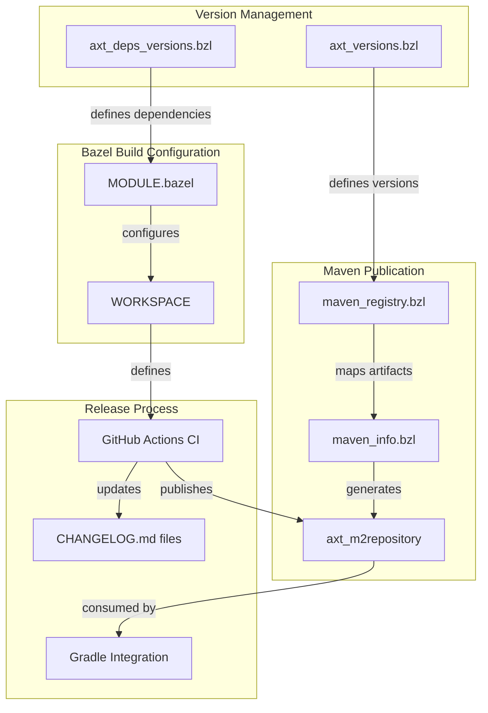

This system manages:

1. **Version Control**: Using `axt_versions.bzl` and `axt_deps_versions.bzl` to define component versions
2. **Build Configuration**: Using `MODULE.bazel` and `WORKSPACE` files for Bazel builds
3. **Maven Publication**: Generating Maven artifacts from Bazel targets
4. **Release Process**: Managing changelogs and CI integration

The system ensures compatibility with both Bazel (for framework development) and Gradle (for user consumption).

Sources: [build_extensions/axt_deps_versions.bzl](), [MODULE.bazel](), [espresso/CHANGELOG.md](), [core/CHANGELOG.md](), [runner/android_junit_runner/CHANGELOG.md](), [services/CHANGELOG.md]()

## Conclusion

The AndroidX Test framework architecture provides a comprehensive solution for Android application testing through a layered design. Each component focuses on specific responsibilities while interconnecting to deliver a cohesive testing experience:

1. The top-level Test Implementation Layer provides intuitive APIs for test writers
2. The middle Test Execution Layer handles the mechanics of test running and synchronization
3. The foundational Infrastructure Layer provides essential services and device control

This architecture enables developers to write concise, reliable tests that can verify application behavior across different device configurations and states. Understanding these architectural relationships helps developers leverage the framework effectively for their testing needs.

---

# Page: Core Components

# Core Components

<details>
<summary>Relevant source files</summary>

The following files were used as context for generating this wiki page:

- [core/java/androidx/test/core/app/ActivityScenario.java](core/java/androidx/test/core/app/ActivityScenario.java)
- [core/java/androidx/test/core/app/InstrumentationActivityInvoker.java](core/java/androidx/test/core/app/InstrumentationActivityInvoker.java)
- [core/javatests/androidx/test/core/app/ActivityScenarioTest.java](core/javatests/androidx/test/core/app/ActivityScenarioTest.java)
- [core/javatests/androidx/test/core/app/testing/AndroidManifest.xml](core/javatests/androidx/test/core/app/testing/AndroidManifest.xml)
- [core/javatests/androidx/test/core/app/testing/AsyncRecordingActivity.java](core/javatests/androidx/test/core/app/testing/AsyncRecordingActivity.java)
- [core/javatests/androidx/test/core/app/testing/IntentActivity.java](core/javatests/androidx/test/core/app/testing/IntentActivity.java)
- [core/javatests/androidx/test/core/app/testing/RecordingActivity.java](core/javatests/androidx/test/core/app/testing/RecordingActivity.java)
- [core/javatests/androidx/test/core/app/testing/RedirectingActivity.java](core/javatests/androidx/test/core/app/testing/RedirectingActivity.java)
- [espresso/core/java/androidx/test/espresso/api/current_public.txt](espresso/core/java/androidx/test/espresso/api/current_public.txt)
- [espresso/device/java/androidx/test/espresso/device/api/current_public.txt](espresso/device/java/androidx/test/espresso/device/api/current_public.txt)
- [espresso/intents/java/androidx/test/espresso/intent/api/current_public.txt](espresso/intents/java/androidx/test/espresso/intent/api/current_public.txt)
- [espresso/remote/java/androidx/test/espresso/remote/api/current_public.txt](espresso/remote/java/androidx/test/espresso/remote/api/current_public.txt)
- [espresso/web/java/androidx/test/espresso/web/api/current_public.txt](espresso/web/java/androidx/test/espresso/web/api/current_public.txt)
- [espresso/web/java/androidx/test/espresso/web/util/concurrent/FutureCallback.java](espresso/web/java/androidx/test/espresso/web/util/concurrent/FutureCallback.java)
- [ext/junit/java/androidx/test/ext/junit/api/current_public.txt](ext/junit/java/androidx/test/ext/junit/api/current_public.txt)
- [ext/junit/java/androidx/test/ext/junit/rules/ActivityScenarioRule.java](ext/junit/java/androidx/test/ext/junit/rules/ActivityScenarioRule.java)
- [ext/junit/javatests/androidx/test/ext/junit/rules/ActivityScenarioRuleWithCustomIntentTest.java](ext/junit/javatests/androidx/test/ext/junit/rules/ActivityScenarioRuleWithCustomIntentTest.java)
- [ext/truth/java/androidx/test/ext/truth/api/current_public.txt](ext/truth/java/androidx/test/ext/truth/api/current_public.txt)
- [ktx/core/java/androidx/test/core/app/ActivityScenario.kt](ktx/core/java/androidx/test/core/app/ActivityScenario.kt)
- [ktx/core/javatests/androidx/test/core/app/ActivityScenarioKotlinTest.kt](ktx/core/javatests/androidx/test/core/app/ActivityScenarioKotlinTest.kt)
- [ktx/ext/junit/java/androidx/test/ext/junit/rules/ActivityScenarioRule.kt](ktx/ext/junit/java/androidx/test/ext/junit/rules/ActivityScenarioRule.kt)
- [ktx/ext/junit/javatests/androidx/test/ext/junit/rules/ActivityScenarioRuleWithCustomIntentKotlinTest.kt](ktx/ext/junit/javatests/androidx/test/ext/junit/rules/ActivityScenarioRuleWithCustomIntentKotlinTest.kt)
- [runner/android_junit_runner/java/androidx/test/api/current_public.txt](runner/android_junit_runner/java/androidx/test/api/current_public.txt)
- [runner/android_junit_runner/java/androidx/test/filters/Suppress.java](runner/android_junit_runner/java/androidx/test/filters/Suppress.java)
- [runner/monitor/java/androidx/test/api/current_internal.txt](runner/monitor/java/androidx/test/api/current_internal.txt)
- [runner/monitor/java/androidx/test/api/current_public.txt](runner/monitor/java/androidx/test/api/current_public.txt)
- [runner/monitor/java/androidx/test/internal/platform/app/ActivityInvoker.java](runner/monitor/java/androidx/test/internal/platform/app/ActivityInvoker.java)
- [runner/monitor/java/androidx/test/platform/device/DeviceController.java](runner/monitor/java/androidx/test/platform/device/DeviceController.java)

</details>


This page describes the fundamental building blocks of the AndroidX Test framework. These components provide the foundation for testing Android applications effectively and are used extensively throughout the testing APIs. For information about UI testing specifically, see [Espresso](#4).

## Overview of Core Components

The AndroidX Test framework provides several key components that form the foundation for Android testing. These components enable developers to control the application lifecycle, set up and tear down test environments, and interact with application components in a consistent and predictable way.

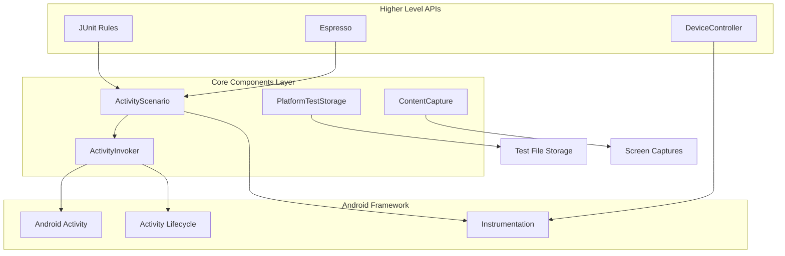

Sources: 
- [core/java/androidx/test/core/app/ActivityScenario.java:24-57](core/java/androidx/test/core/app/ActivityScenario.java:24-57)
- [core/java/androidx/test/core/app/InstrumentationActivityInvoker.java:16-52](core/java/androidx/test/core/app/InstrumentationActivityInvoker.java:16-52)
- [runner/monitor/java/androidx/test/platform/device/DeviceController.java:16-29](runner/monitor/java/androidx/test/platform/device/DeviceController.java:16-29)

## ActivityScenario

ActivityScenario is the primary component for testing activities in the AndroidX Test framework. It provides APIs to launch an activity and control its lifecycle state for testing purposes.

### Purpose and Lifecycle States

ActivityScenario allows you to:
- Launch an activity with a specific intent or activity class
- Move an activity through different lifecycle states
- Recreate an activity to test instance state restoration
- Execute code on the activity's main thread
- Get activity results

ActivityScenario works with the standard Android activity lifecycle states:

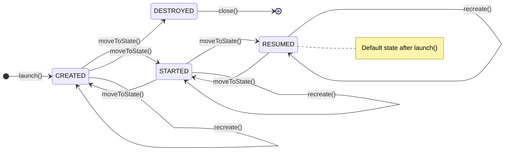

Sources:
- [core/java/androidx/test/core/app/ActivityScenario.java:57-117](core/java/androidx/test/core/app/ActivityScenario.java:57-117)
- [core/javatests/androidx/test/core/app/ActivityScenarioTest.java:69-135](core/javatests/androidx/test/core/app/ActivityScenarioTest.java:69-135)

### Implementation Architecture

ActivityScenario uses an `ActivityInvoker` to control the activity lifecycle. The standard implementation, `InstrumentationActivityInvoker`, uses Android's `Instrumentation` API to manipulate activities.

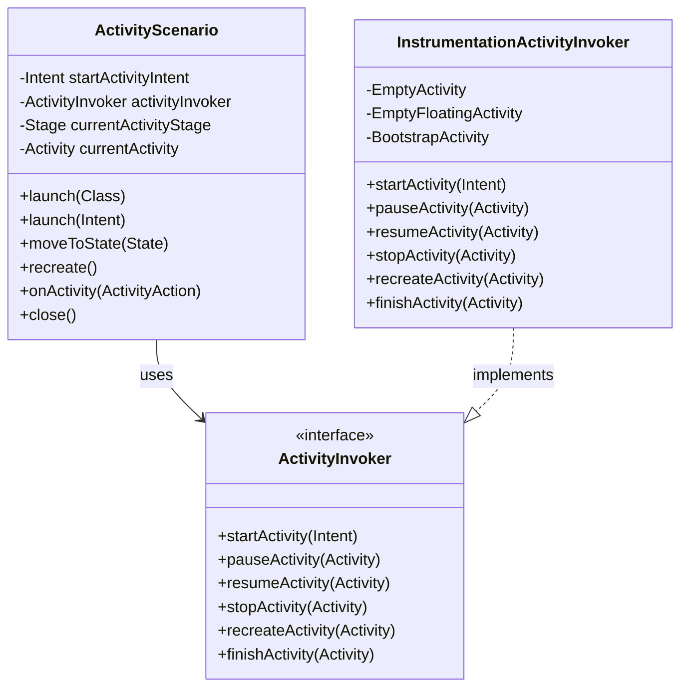

Sources:
- [core/java/androidx/test/core/app/ActivityScenario.java:117-173](core/java/androidx/test/core/app/ActivityScenario.java:117-173)
- [core/java/androidx/test/core/app/InstrumentationActivityInvoker.java:59-102](core/java/androidx/test/core/app/InstrumentationActivityInvoker.java:59-102)
- [runner/monitor/java/androidx/test/internal/platform/app/ActivityInvoker.java:37-59](runner/monitor/java/androidx/test/internal/platform/app/ActivityInvoker.java:37-59)

### Key Methods

| Method | Description |
|--------|-------------|
| `launch(Class)` | Launches an activity of the given class |
| `launch(Intent)` | Launches an activity with the given intent |
| `launchActivityForResult()` | Launches an activity that returns a result |
| `moveToState(State)` | Transitions the activity to the specified state |
| `recreate()` | Recreates the activity |
| `onActivity(ActivityAction)` | Executes code on the activity's main thread |
| `getResult()` | Gets the result of an activity started with `launchActivityForResult()` |
| `close()` | Cleans up resources and finishes the activity |

Sources:
- [core/java/androidx/test/core/app/ActivityScenario.java:201-283](core/java/androidx/test/core/app/ActivityScenario.java:201-283)
- [core/java/androidx/test/core/app/ActivityScenario.java:417-427](core/java/androidx/test/core/app/ActivityScenario.java:417-427)
- [core/java/androidx/test/core/app/ActivityScenario.java:652-691](core/java/androidx/test/core/app/ActivityScenario.java:652-691)
- [core/java/androidx/test/core/app/ActivityScenario.java:706-736](core/java/androidx/test/core/app/ActivityScenario.java:706-736)
- [core/java/androidx/test/core/app/ActivityScenario.java:783-811](core/java/androidx/test/core/app/ActivityScenario.java:783-811)

### Usage Examples

Basic usage pattern for ActivityScenario:

```java
// Launch an activity
try (ActivityScenario<MyActivity> scenario = ActivityScenario.launch(MyActivity.class)) {
    // Execute code on the activity
    scenario.onActivity(activity -> {
        // Verify activity state
        assertThat(activity.getSomething()).isEqualTo("something");
    });
    
    // Move the activity to a different state
    scenario.moveToState(State.STARTED);
    
    // Recreate the activity
    scenario.recreate();
} // ActivityScenario is automatically closed
```

Kotlin extension functions are also provided for a more idiomatic Kotlin experience:

```kotlin
// Launch an activity with Kotlin extension
launchActivity<MyActivity>().use { scenario ->
    // Execute code on the activity
    scenario.onActivity { activity ->
        // Verify activity state
        assertThat(activity.something).isEqualTo("something")
    }
}
```

Sources:
- [core/java/androidx/test/core/app/ActivityScenario.java:89-115](core/java/androidx/test/core/app/ActivityScenario.java:89-115)
- [ktx/core/java/androidx/test/core/app/ActivityScenario.kt:16-44](ktx/core/java/androidx/test/core/app/ActivityScenario.kt:16-44)
- [ktx/core/javatests/androidx/test/core/app/ActivityScenarioKotlinTest.kt:39-75](ktx/core/javatests/androidx/test/core/app/ActivityScenarioKotlinTest.kt:39-75)

## ActivityInvoker

The ActivityInvoker interface defines methods for controlling the lifecycle of activities. This abstraction allows for different implementations of activity lifecycle control.

### Purpose

ActivityInvoker serves as an abstraction layer between ActivityScenario and the actual mechanisms used to control activity lifecycle. This separation makes it possible to test in different environments (like Robolectric) by providing different implementations.

### Implementation

The primary implementation is InstrumentationActivityInvoker, which uses Android's Instrumentation API to control activities. It includes several helper activities:

- **EmptyActivity**: Used to force a tested activity into the STOPPED state
- **EmptyFloatingActivity**: Used to force a tested activity into the PAUSED state
- **BootstrapActivity**: Used for starting activities for result

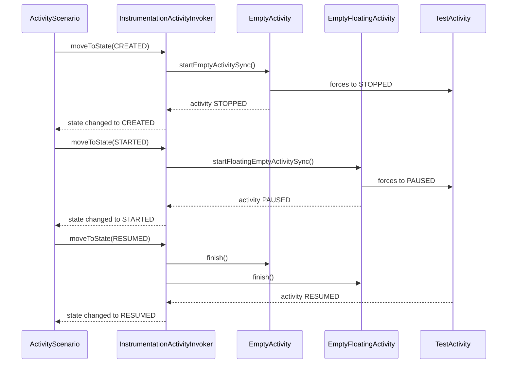

Sources:
- [core/java/androidx/test/core/app/InstrumentationActivityInvoker.java:128-232](core/java/androidx/test/core/app/InstrumentationActivityInvoker.java:128-232)
- [core/java/androidx/test/core/app/InstrumentationActivityInvoker.java:308-394](core/java/androidx/test/core/app/InstrumentationActivityInvoker.java:308-394)
- [runner/monitor/java/androidx/test/internal/platform/app/ActivityInvoker.java:18-37](runner/monitor/java/androidx/test/internal/platform/app/ActivityInvoker.java:18-37)

### Key Methods

| Method | Description |
|--------|-------------|
| `startActivity(Intent)` | Starts an activity with the given intent |
| `startActivityForResult(Intent)` | Starts an activity for result |
| `getActivityResult()` | Gets the result of the activity |
| `resumeActivity(Activity)` | Transitions an activity to the RESUMED state |
| `pauseActivity(Activity)` | Transitions an activity to the PAUSED state |
| `stopActivity(Activity)` | Transitions an activity to the STOPPED state |
| `recreateActivity(Activity)` | Recreates an activity |
| `finishActivity(Activity)` | Finishes an activity |

Sources:
- [runner/monitor/java/androidx/test/internal/platform/app/ActivityInvoker.java:55-127](runner/monitor/java/androidx/test/internal/platform/app/ActivityInvoker.java:55-127)
- [core/java/androidx/test/core/app/InstrumentationActivityInvoker.java:400-502](core/java/androidx/test/core/app/InstrumentationActivityInvoker.java:400-502)
- [core/java/androidx/test/core/app/InstrumentationActivityInvoker.java:508-581](core/java/androidx/test/core/app/InstrumentationActivityInvoker.java:508-581)

## ActivityScenarioRule

ActivityScenarioRule is a JUnit 4 rule that wraps ActivityScenario to make it easier to use in tests. It automatically launches the activity before the test and closes it after the test.

### Purpose

ActivityScenarioRule simplifies the setup and teardown of activities in JUnit tests. It:
- Automatically launches the activity before each test method
- Makes the ActivityScenario available through the `getScenario()` method
- Automatically closes the activity after each test method

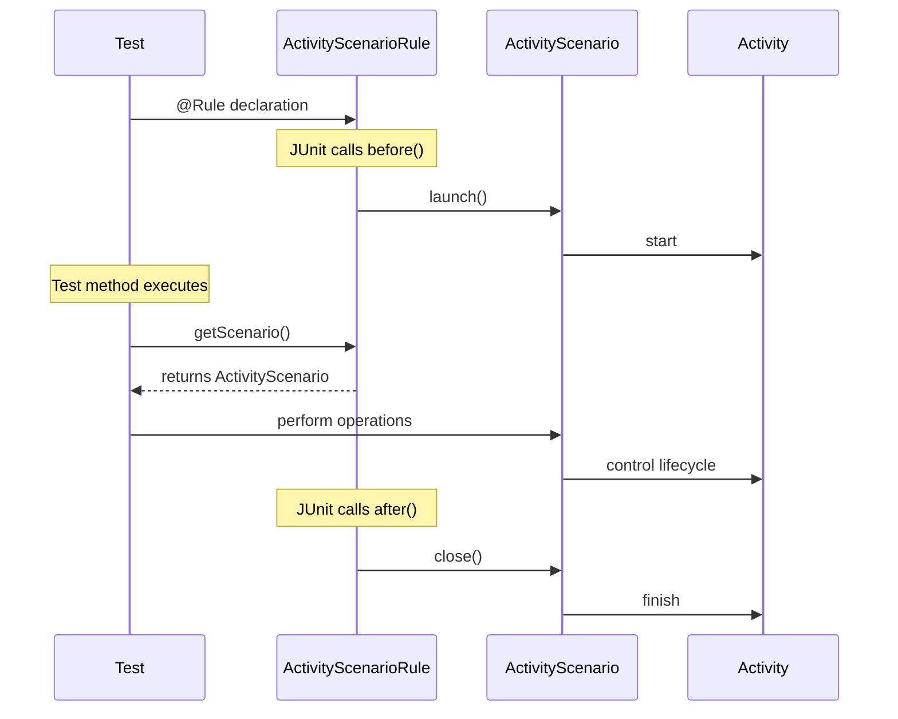

Sources:
- [ext/junit/java/androidx/test/ext/junit/rules/ActivityScenarioRule.java:16-57](ext/junit/java/androidx/test/ext/junit/rules/ActivityScenarioRule.java:16-57)
- [ext/junit/java/androidx/test/ext/junit/rules/ActivityScenarioRule.java:110-120](ext/junit/java/androidx/test/ext/junit/rules/ActivityScenarioRule.java:110-120)

### Usage Examples

Basic usage in Java:

```java
@Rule
public ActivityScenarioRule<MyActivity> rule = new ActivityScenarioRule<>(MyActivity.class);

@Test
public void testSomething() {
    ActivityScenario<MyActivity> scenario = rule.getScenario();
    // Use scenario to control activity
}
```

With a custom intent:

```java
@Rule
public ActivityScenarioRule<MyActivity> rule = new ActivityScenarioRule<>(
    new Intent(getApplicationContext(), MyActivity.class)
        .putExtra("key", "value")
);
```

Kotlin extension function for more idiomatic Kotlin:

```kotlin
@get:Rule
val rule = activityScenarioRule<MyActivity>()

@Test
fun testSomething() {
    val scenario = rule.scenario
    // Use scenario to control activity
}
```

Sources:
- [ext/junit/java/androidx/test/ext/junit/rules/ActivityScenarioRule.java:72-97](ext/junit/java/androidx/test/ext/junit/rules/ActivityScenarioRule.java:72-97)
- [ktx/ext/junit/java/androidx/test/ext/junit/rules/ActivityScenarioRule.kt:16-37](ktx/ext/junit/java/androidx/test/ext/junit/rules/ActivityScenarioRule.kt:16-37)
- [ext/junit/javatests/androidx/test/ext/junit/rules/ActivityScenarioRuleWithCustomIntentTest.java:33-69](ext/junit/javatests/androidx/test/ext/junit/rules/ActivityScenarioRuleWithCustomIntentTest.java:33-69)

## DeviceController

DeviceController is an interface that provides base-level device operations, such as changing screen orientation or controlling foldable devices.

### Purpose

DeviceController serves as a lower-level API for controlling device state during tests. It provides methods to:
- Change screen orientation (portrait/landscape)
- Set device mode (for foldable devices)

This interface is primarily used by higher-level APIs like Espresso's device actions, but can also be used directly when needed.

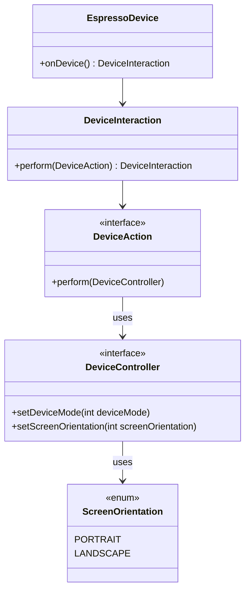

Sources:
- [runner/monitor/java/androidx/test/platform/device/DeviceController.java:16-50](runner/monitor/java/androidx/test/platform/device/DeviceController.java:16-50)
- [espresso/device/java/androidx/test/espresso/device/api/current_public.txt:16-49](espresso/device/java/androidx/test/espresso/device/api/current_public.txt:16-49)

## Integration with Other Components

The Core Components integrate with several other parts of the AndroidX Test framework:

### Integration with Espresso

Espresso uses ActivityScenario for launching and controlling activities during UI tests. This ensures consistent activity state management across UI test frameworks.

### Integration with JUnit

ActivityScenarioRule provides integration with JUnit 4, allowing for easy setup and teardown of activities in test methods.

### Integration with Test Orchestrator

The Test Orchestrator and AndroidJUnitRunner work with these core components to run tests in isolation and manage the test lifecycle.

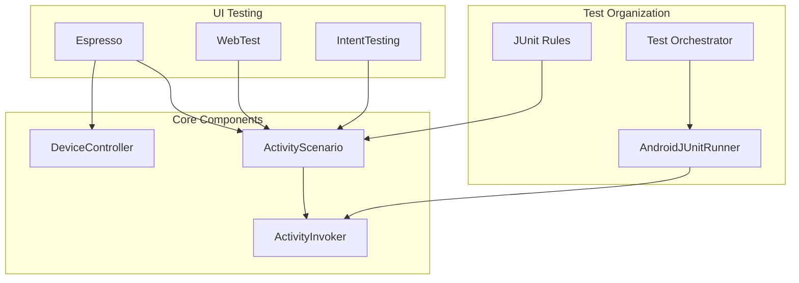

Sources:
- [ext/junit/java/androidx/test/ext/junit/api/current_public.txt:4-15](ext/junit/java/androidx/test/ext/junit/api/current_public.txt:4-15)
- [runner/android_junit_runner/java/androidx/test/api/current_public.txt:227-235](runner/android_junit_runner/java/androidx/test/api/current_public.txt:227-235)
- [espresso/core/java/androidx/test/espresso/api/current_public.txt:43-60](espresso/core/java/androidx/test/espresso/api/current_public.txt:43-60)

---

# Page: ActivityScenario

# ActivityScenario

<details>
<summary>Relevant source files</summary>

The following files were used as context for generating this wiki page:

- [core/java/androidx/test/core/app/ActivityScenario.java](core/java/androidx/test/core/app/ActivityScenario.java)
- [core/java/androidx/test/core/app/InstrumentationActivityInvoker.java](core/java/androidx/test/core/app/InstrumentationActivityInvoker.java)
- [core/javatests/androidx/test/core/app/ActivityScenarioTest.java](core/javatests/androidx/test/core/app/ActivityScenarioTest.java)
- [core/javatests/androidx/test/core/app/testing/AndroidManifest.xml](core/javatests/androidx/test/core/app/testing/AndroidManifest.xml)
- [core/javatests/androidx/test/core/app/testing/AsyncRecordingActivity.java](core/javatests/androidx/test/core/app/testing/AsyncRecordingActivity.java)
- [core/javatests/androidx/test/core/app/testing/IntentActivity.java](core/javatests/androidx/test/core/app/testing/IntentActivity.java)
- [core/javatests/androidx/test/core/app/testing/RecordingActivity.java](core/javatests/androidx/test/core/app/testing/RecordingActivity.java)
- [core/javatests/androidx/test/core/app/testing/RedirectingActivity.java](core/javatests/androidx/test/core/app/testing/RedirectingActivity.java)
- [ext/junit/java/androidx/test/ext/junit/rules/ActivityScenarioRule.java](ext/junit/java/androidx/test/ext/junit/rules/ActivityScenarioRule.java)
- [ext/junit/javatests/androidx/test/ext/junit/rules/ActivityScenarioRuleWithCustomIntentTest.java](ext/junit/javatests/androidx/test/ext/junit/rules/ActivityScenarioRuleWithCustomIntentTest.java)
- [ktx/core/java/androidx/test/core/app/ActivityScenario.kt](ktx/core/java/androidx/test/core/app/ActivityScenario.kt)
- [ktx/core/javatests/androidx/test/core/app/ActivityScenarioKotlinTest.kt](ktx/core/javatests/androidx/test/core/app/ActivityScenarioKotlinTest.kt)
- [ktx/ext/junit/java/androidx/test/ext/junit/rules/ActivityScenarioRule.kt](ktx/ext/junit/java/androidx/test/ext/junit/rules/ActivityScenarioRule.kt)
- [ktx/ext/junit/javatests/androidx/test/ext/junit/rules/ActivityScenarioRuleWithCustomIntentKotlinTest.kt](ktx/ext/junit/javatests/androidx/test/ext/junit/rules/ActivityScenarioRuleWithCustomIntentKotlinTest.kt)
- [runner/monitor/java/androidx/test/internal/platform/app/ActivityInvoker.java](runner/monitor/java/androidx/test/internal/platform/app/ActivityInvoker.java)

</details>


## Purpose and Overview

ActivityScenario is a core component of the AndroidX Test framework that provides APIs to launch, control, and test Android activities' lifecycle states. It allows test authors to drive an activity through its lifecycle stages programmatically, facilitating thorough testing of activity behavior across different states.

ActivityScenario is designed to work consistently across different versions of the Android framework and serves as a modern replacement for ActivityController in Robolectric and ActivityTestRule in ATSL.

For information about testing activities using JUnit Rules, see [ActivityScenarioRule](#3.1).

Sources: [core/java/androidx/test/core/app/ActivityScenario.java:58-115]()

## Lifecycle Management

ActivityScenario manages activities according to the Android lifecycle model, supporting transitions between four primary states:

- `CREATED`: Activity has been created but is not visible
- `STARTED`: Activity is visible but does not have focus
- `RESUMED`: Activity is visible and has focus
- `DESTROYED`: Activity has been destroyed

The diagram below illustrates the transitions between these states that ActivityScenario can orchestrate:

```mermaid
stateDiagram-v2
    direction LR
    [*] --> "RESUMED" : launch()
    "RESUMED" --> "STARTED" : moveToState()
    "STARTED" --> "CREATED" : moveToState()
    "CREATED" --> "STARTED" : moveToState()
    "STARTED" --> "RESUMED" : moveToState()
    
    "RESUMED" --> "RESUMED" : recreate()
    "STARTED" --> "STARTED" : recreate()
    "CREATED" --> "CREATED" : recreate()
    
    "RESUMED" --> "DESTROYED" : moveToState()/close()
    "STARTED" --> "DESTROYED" : moveToState()/close()
    "CREATED" --> "DESTROYED" : moveToState()/close()
    "DESTROYED" --> [*]
    
    note right of "RESUMED"
        The default state after launching
    end note
    
    note right of "DESTROYED"
        Terminal state - cannot transition
        to other states afterward
    end note
```

Sources: [core/java/androidx/test/core/app/ActivityScenario.java:69-78](), [core/java/androidx/test/core/app/ActivityScenario.java:631-691]()

## Component Architecture

ActivityScenario interacts with several other components to manage activity lifecycle:

```mermaid
flowchart TD
    subgraph "Test Components"
        TestClass["Test Class"]
        JUnitRule["ActivityScenarioRule"]
    end
    
    subgraph "ActivityScenario System"
        ActivityScenario["ActivityScenario"]
        ActivityAction["ActivityAction Interface"]
        ActivityInvoker["ActivityInvoker Interface"]
        InstrumentationActivityInvoker["InstrumentationActivityInvoker"]
    end
    
    subgraph "Android Framework"
        ActivityLifecycleMonitor["ActivityLifecycleMonitorRegistry"]
        ActivityUnderTest["Activity Under Test"]
        Intent["Intent"]
    end
    
    TestClass -->|"uses"| ActivityScenario
    TestClass -->|"uses"| JUnitRule
    JUnitRule -->|"manages"| ActivityScenario
    
    ActivityScenario -->|"creates/controls"| ActivityUnderTest
    ActivityScenario -->|"monitors"| ActivityLifecycleMonitor
    ActivityScenario -->|"delegates lifecycle ops to"| ActivityInvoker
    ActivityInvoker <|--|"implements"| InstrumentationActivityInvoker
    
    ActivityScenario -->|"launches with"| Intent
    ActivityScenario -->|"defines"| ActivityAction
    ActivityAction -->|"operates on"| ActivityUnderTest
    
    ActivityLifecycleMonitor -->|"tracks"| ActivityUnderTest
```

Sources: [core/java/androidx/test/core/app/ActivityScenario.java:117-175](), [core/java/androidx/test/core/app/InstrumentationActivityInvoker.java:59-649]()

## Core Methods and Usage

### Launching an Activity

ActivityScenario provides several static methods to launch activities:

| Method | Description |
|--------|-------------|
| `launch(Class<A>)` | Launches activity by class |
| `launch(Class<A>, Bundle)` | Launches activity by class with options |
| `launch(Intent)` | Launches activity by intent |
| `launch(Intent, Bundle)` | Launches activity by intent with options |
| `launchActivityForResult(Class<A>)` | Launches activity by class and captures result |
| `launchActivityForResult(Intent)` | Launches activity by intent and captures result |

Sources: [core/java/androidx/test/core/app/ActivityScenario.java:184-254](), [core/java/androidx/test/core/app/ActivityScenario.java:272-334]()

### Lifecycle Control

After launching an activity, you can control its lifecycle using:

| Method | Description |
|--------|-------------|
| `moveToState(State)` | Transitions activity to specified lifecycle state |
| `recreate()` | Recreates the activity (simulates configuration change) |
| `close()` | Destroys activity and cleans up resources |

Sources: [core/java/androidx/test/core/app/ActivityScenario.java:631-736](), [core/java/androidx/test/core/app/ActivityScenario.java:386-427]()

### Interacting with Activity

ActivityScenario provides the `onActivity()` method to safely interact with the activity instance:

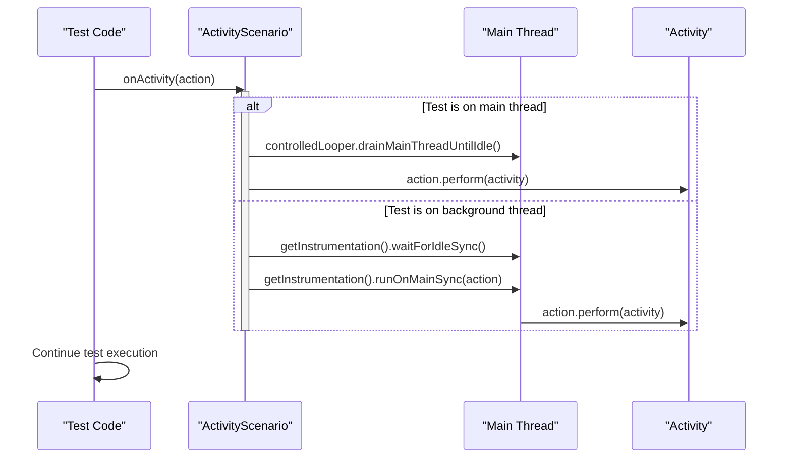

Sources: [core/java/androidx/test/core/app/ActivityScenario.java:766-811]()

## Implementation Details

### Internal State Management

ActivityScenario maintains internal state to track the current activity and its lifecycle stage:

```mermaid
classDiagram
    class ActivityScenario {
        -Intent startActivityIntent
        -ActivityInvoker activityInvoker
        -Stage currentActivityStage
        -A currentActivity
        -ReentrantLock lock
        -Condition stateChangedCondition
        +launch(Class~A~) ActivityScenario~A~
        +launch(Intent) ActivityScenario~A~
        +moveToState(State) ActivityScenario~A~
        +recreate() ActivityScenario~A~
        +onActivity(ActivityAction~A~) ActivityScenario~A~
        +getResult() ActivityResult
        +getState() State
        +close() void
    }
    
    class ActivityState {
        +A activity
        +State state
        +Stage stage
    }
    
    class ActivityAction {
        <<interface>>
        +perform(A activity) void
    }
    
    ActivityScenario -- ActivityState : creates
    ActivityScenario -- ActivityAction : uses
```

ActivityScenario uses an `ActivityLifecycleCallback` to track lifecycle changes and sync its internal state with the Android system. It also employs locks and conditions to synchronize between the test thread and UI thread.

Sources: [core/java/androidx/test/core/app/ActivityScenario.java:140-172](), [core/java/androidx/test/core/app/ActivityScenario.java:471-541](), [core/java/androidx/test/core/app/ActivityScenario.java:605-630]()

### Activity Invoker

ActivityScenario delegates the actual lifecycle operations to an `ActivityInvoker` implementation, which provides methods to start, resume, pause, stop, and finish activities. The default implementation is `InstrumentationActivityInvoker`, which uses Android's Instrumentation API to control activities.

Sources: [core/java/androidx/test/core/app/InstrumentationActivityInvoker.java:59-649](), [runner/monitor/java/androidx/test/internal/platform/app/ActivityInvoker.java:38-128]()

## Best Practices

### Handling Activity References

You should never keep references to the Activity beyond the scope of the `onActivity()` method for two key reasons:

1. Android may recreate the Activity during lifecycle changes, making your reference stale
2. Holding references may affect the framework's behavior and prevent garbage collection

```
// INCORRECT USAGE:
ActivityScenario<MyActivity> scenario = ActivityScenario.launch(MyActivity.class);
final MyActivity[] activityHolder = new MyActivity[1];
scenario.onActivity(activity -> {
    activityHolder[0] = activity; // Don't do this!
});
// activityHolder[0] might be stale or cause memory leaks

// CORRECT USAGE:
ActivityScenario<MyActivity> scenario = ActivityScenario.launch(MyActivity.class);
scenario.onActivity(activity -> {
    // Use activity only within this scope
    String value = activity.getSomeValue();
    assertThat(value).isEqualTo("expected");
});
```

Sources: [core/java/androidx/test/core/app/ActivityScenario.java:738-764]()

### Resource Cleanup

Always clean up ActivityScenario instances to prevent resource leaks. Use one of these approaches:

1. Use try-with-resources (recommended)
   ```
   try (ActivityScenario<MyActivity> scenario = ActivityScenario.launch(MyActivity.class)) {
       // Your test code
   } // Automatically calls scenario.close()
   ```

2. Use ActivityScenarioRule with JUnit
   ```
   @Rule
   public ActivityScenarioRule<MyActivity> rule = new ActivityScenarioRule<>(MyActivity.class);
   
   @Test
   public void myTest() {
       ActivityScenario<MyActivity> scenario = rule.getScenario();
       // Your test code
   } // Rule automatically handles cleanup
   ```

Sources: [core/java/androidx/test/core/app/ActivityScenario.java:386-427](), [ext/junit/java/androidx/test/ext/junit/rules/ActivityScenarioRule.java:30-54]()

## Kotlin Extensions

ActivityScenario provides Kotlin extension functions for more concise syntax:

```
// Java syntax
ActivityScenario<MyActivity> scenario = ActivityScenario.launch(MyActivity.class);

// Kotlin with extensions
val scenario = launchActivity<MyActivity>()
```

The Kotlin extension functions include:
- `launchActivity<A>(intent: Intent? = null, activityOptions: Bundle? = null)`
- `launchActivityForResult<A>(intent: Intent? = null, activityOptions: Bundle? = null)`
- `activityScenarioRule<A>(intent: Intent? = null, activityOptions: Bundle? = null)`

Sources: [ktx/core/java/androidx/test/core/app/ActivityScenario.kt:37-67](), [ktx/ext/junit/java/androidx/test/ext/junit/rules/ActivityScenarioRule.kt:30-37]()

## Integration with JUnit

ActivityScenarioRule is a JUnit rule that manages the lifecycle of an ActivityScenario, launching the activity before tests and cleaning up after. This simplifies test code and ensures proper cleanup:

```mermaid
sequenceDiagram
    participant JUnit as "JUnit Runner"
    participant Rule as "ActivityScenarioRule"
    participant Scenario as "ActivityScenario"
    participant Activity as "Activity"
    
    JUnit->>Rule: before() (called automatically)
    activate Rule
    Rule->>Scenario: launch activity
    Scenario->>Activity: create and start
    deactivate Rule
    
    JUnit->>Test: run test method
    activate Test
    Test->>Rule: getScenario()
    Rule-->>Test: ActivityScenario instance
    Test->>Scenario: perform test operations
    Scenario->>Activity: modify/verify state
    deactivate Test
    
    JUnit->>Rule: after() (called automatically)
    activate Rule
    Rule->>Scenario: close()
    Scenario->>Activity: destroy
    deactivate Rule
```

Sources: [ext/junit/java/androidx/test/ext/junit/rules/ActivityScenarioRule.java:56-129]()

## Practical Examples

### Basic Activity Testing

```
// Launch activity and verify initial state
try (ActivityScenario<MyActivity> scenario = ActivityScenario.launch(MyActivity.class)) {
    scenario.onActivity(activity -> {
        assertThat(activity.getText()).isEqualTo("Initial Text");
    });
    
    // Recreate activity and verify state is maintained
    scenario.recreate();
    scenario.onActivity(activity -> {
        assertThat(activity.getText()).isEqualTo("Initial Text");
    });
    
    // Navigate through lifecycle states
    scenario.moveToState(State.CREATED);
    assertThat(scenario.getState()).isEqualTo(State.CREATED);
    
    scenario.moveToState(State.RESUMED);
    assertThat(scenario.getState()).isEqualTo(State.RESUMED);
}
```

### Testing Activity Results

```
// Launch activity for result testing
try (ActivityScenario<MyActivity> scenario = 
        ActivityScenario.launchActivityForResult(MyActivity.class)) {
    
    // Set a result and finish the activity
    scenario.onActivity(activity -> {
        Intent resultData = new Intent();
        resultData.putExtra("key", "value");
        activity.setResult(Activity.RESULT_OK, resultData);
        activity.finish();
    });
    
    // Verify the result
    ActivityResult result = scenario.getResult();
    assertThat(result.getResultCode()).isEqualTo(Activity.RESULT_OK);
    assertThat(result.getResultData()).extras().string("key").isEqualTo("value");
}
```

Sources: [core/javatests/androidx/test/core/app/ActivityScenarioTest.java:69-389](), [ktx/core/javatests/androidx/test/core/app/ActivityScenarioKotlinTest.kt:42-134]()

---

# Page: Test Storage

# Test Storage

<details>
<summary>Relevant source files</summary>

The following files were used as context for generating this wiki page:

- [core/javatests/androidx/test/core/graphics/BitmapStorageTest.kt](core/javatests/androidx/test/core/graphics/BitmapStorageTest.kt)
- [runner/android_junit_runner/java/androidx/test/filters/SdkSuppress.java](runner/android_junit_runner/java/androidx/test/filters/SdkSuppress.java)
- [runner/android_junit_runner/java/androidx/test/internal/runner/RunnerArgs.java](runner/android_junit_runner/java/androidx/test/internal/runner/RunnerArgs.java)
- [runner/android_junit_runner/java/androidx/test/internal/runner/TestRequestBuilder.java](runner/android_junit_runner/java/androidx/test/internal/runner/TestRequestBuilder.java)
- [runner/android_junit_runner/javatests/androidx/test/internal/runner/RunnerArgsTest.java](runner/android_junit_runner/javatests/androidx/test/internal/runner/RunnerArgsTest.java)
- [runner/android_junit_runner/javatests/androidx/test/internal/runner/SdkSuppressTest.java](runner/android_junit_runner/javatests/androidx/test/internal/runner/SdkSuppressTest.java)
- [runner/android_junit_runner/javatests/androidx/test/internal/runner/TestRequestBuilderTest.java](runner/android_junit_runner/javatests/androidx/test/internal/runner/TestRequestBuilderTest.java)
- [runner/monitor/java/androidx/test/platform/io/FileTestStorage.java](runner/monitor/java/androidx/test/platform/io/FileTestStorage.java)
- [runner/monitor/java/androidx/test/platform/io/PlatformTestStorage.java](runner/monitor/java/androidx/test/platform/io/PlatformTestStorage.java)
- [runner/monitor/java/androidx/test/platform/io/PlatformTestStorageRegistry.java](runner/monitor/java/androidx/test/platform/io/PlatformTestStorageRegistry.java)
- [services/storage/java/androidx/test/services/storage/TestStorage.java](services/storage/java/androidx/test/services/storage/TestStorage.java)

</details>


The Test Storage system provides a standardized mechanism for Android tests to read input files, write output files, retrieve test arguments, and store properties. It enables tests to interact with file resources in a consistent way across different testing environments, whether running on a device through instrumentation or in Robolectric.

## Overview

The Test Storage system is built around the `PlatformTestStorage` interface with implementations that handle file I/O operations through different backends. Tests access these implementations via the `PlatformTestStorageRegistry` which automatically selects the appropriate implementation based on the testing environment.

```mermaid
graph TD
    subgraph "Test Storage System"
        PTS["PlatformTestStorage<br>(Interface)"]
        TS["TestStorage<br>(Content Provider Based)"]
        FTS["FileTestStorage<br>(File System Based)"]
        PTSR["PlatformTestStorageRegistry"]
    end
    
    subgraph "Test Code"
        TC["Test Classes"]
    end
    
    subgraph "Storage Backends"
        CP["Test Services<br>Content Provider"]
        FS["Local File System"]
    end
    
    TC --> PTSR
    PTSR --> TS
    PTSR --> FTS
    TS --> PTS
    FTS --> PTS
    TS --> CP
    FTS --> FS
```

Sources:
- [runner/monitor/java/androidx/test/platform/io/PlatformTestStorage.java]()
- [services/storage/java/androidx/test/services/storage/TestStorage.java]()
- [runner/monitor/java/androidx/test/platform/io/FileTestStorage.java]()
- [runner/monitor/java/androidx/test/platform/io/PlatformTestStorageRegistry.java]()

## Architecture Components

### PlatformTestStorage Interface

The `PlatformTestStorage` interface defines the core operations for test data access:

- `openInputFile` - Provides an InputStream to a test file dependency
- `openOutputFile` - Provides an OutputStream to write test output
- `getInputArg` - Retrieves a test argument by name
- `getInputArgs` - Returns all test arguments
- `addOutputProperties` - Stores serializable test properties
- `getOutputProperties` - Retrieves stored test properties
- `getInputFileUri` - Gets a URI for a test input file
- `getOutputFileUri` - Gets a URI for a test output file

```mermaid
classDiagram
    class PlatformTestStorage {
        <<interface>>
        +openInputFile(String pathname) InputStream
        +openOutputFile(String pathname) OutputStream
        +openOutputFile(String pathname, boolean append) OutputStream
        +getInputArg(String argName) String
        +getInputArgs() Map~String,String~
        +addOutputProperties(Map~String,Serializable~ properties) void
        +getOutputProperties() Map~String,Serializable~
        +getInputFileUri(String pathname) Uri
        +getOutputFileUri(String pathname) Uri
        +isTestStorageFilePath(String pathname) boolean
    }
```

Sources:
- [runner/monitor/java/androidx/test/platform/io/PlatformTestStorage.java:42-193]()

### TestStorage Implementation

The `TestStorage` class implements `PlatformTestStorage` using a content provider housed in the androidx.test.services APK. This implementation provides full support for all interface operations including property storage.

Key features:
- Uses a content provider for file I/O (requires androidx.test.services APK)
- Stores and retrieves serializable properties 
- Supports file URI operations

```mermaid
sequenceDiagram
    participant Test as "Test Code"
    participant TS as "TestStorage"
    participant CP as "Content Provider"
    
    Test->>TS: openInputFile("data.txt")
    TS->>TS: getInputFileUri("data.txt")
    TS->>CP: query URI
    CP-->>TS: input stream
    TS-->>Test: InputStream

    Test->>TS: openOutputFile("results.txt")
    TS->>TS: getOutputFileUri("results.txt")
    TS->>CP: query URI
    CP-->>TS: output stream
    TS-->>Test: OutputStream
    
    Test->>TS: addOutputProperties(properties)
    TS->>TS: getPropertyFileUri()
    TS->>CP: write serialized properties
    
    Test->>TS: getOutputProperties()
    TS->>TS: getPropertyFileUri()
    TS->>CP: read serialized properties
    CP-->>TS: properties data
    TS-->>Test: deserialized properties
```

Sources:
- [services/storage/java/androidx/test/services/storage/TestStorage.java:60-416]()

### FileTestStorage Implementation

The `FileTestStorage` class implements `PlatformTestStorage` using the local file system. It provides basic file I/O capabilities but has limited support for property storage.

Key features:
- Uses direct file system access
- Works in environments without the test services APK (like Robolectric)
- Limited property storage support

Sources:
- [runner/monitor/java/androidx/test/platform/io/FileTestStorage.java:48-168]()

### PlatformTestStorageRegistry

The `PlatformTestStorageRegistry` provides access to the appropriate `PlatformTestStorage` implementation. It uses a service loader mechanism to find implementations but defaults to `FileTestStorage` if no others are available.

```java
// How to access the Test Storage system in your tests
PlatformTestStorage storage = PlatformTestStorageRegistry.getInstance();
```

Sources:
- [runner/monitor/java/androidx/test/platform/io/PlatformTestStorageRegistry.java:28-74]()

## Test Storage Configuration

The Test Storage system can be configured through instrumentation arguments:

| Argument | Description |
|----------|-------------|
| `useTestStorageService` | When set to "true", enables the content provider-based `TestStorage` implementation |

```mermaid
flowchart TD
    Start["Test starts"] --> ArgCheck{"Is useTestStorageService=true?"}
    ArgCheck -->|Yes| TSServices["Use TestStorage<br>(Content Provider)"]
    ArgCheck -->|No| FileTS["Use FileTestStorage<br>(File System)"]
    TSServices --> Usage["Test accesses storage via<br>PlatformTestStorageRegistry.getInstance()"]
    FileTS --> Usage
```

Sources:
- [runner/android_junit_runner/java/androidx/test/internal/runner/RunnerArgs.java:95]()
- [runner/android_junit_runner/java/androidx/test/internal/runner/RunnerArgs.java:242-267]()

## Integration with Test Framework

The Test Storage system is integrated with other parts of the AndroidX Test framework:

1. `AndroidJUnitRunner` uses Test Storage to read test files and configurations
2. `TestRequestBuilder` builds test requests based on files loaded through Test Storage
3. `RunnerArgs` processes test arguments that may come from Test Storage

```mermaid
graph TB
    subgraph "Test Execution"
        AJR["AndroidJUnitRunner"]
        TRB["TestRequestBuilder"]
        RA["RunnerArgs"]
    end
    
    subgraph "Test Storage"
        TS["TestStorage"]
        FTS["FileTestStorage"]
        PTSR["PlatformTestStorageRegistry"]
    end
    
    AJR --> RA
    TRB --> RA
    RA --> PTSR
    PTSR --> TS
    PTSR --> FTS
```

Sources:
- [runner/android_junit_runner/java/androidx/test/internal/runner/TestRequestBuilder.java]()
- [runner/android_junit_runner/java/androidx/test/internal/runner/RunnerArgs.java:249-256]()

## Using Test Storage

### Reading Input Files

```java
// Get the storage instance
PlatformTestStorage storage = PlatformTestStorageRegistry.getInstance();

// Read from an input file
try (InputStream in = storage.openInputFile("test_data.json")) {
    // Process the input stream
    // Note: You may want to buffer this stream for better performance
}
```

### Writing Output Files

```java
// Get the storage instance
PlatformTestStorage storage = PlatformTestStorageRegistry.getInstance();

// Write to an output file
try (OutputStream out = storage.openOutputFile("test_results.txt")) {
    // Write to the output stream
    // Note: You may want to buffer this stream for better performance
}

// Append to an existing output file
try (OutputStream out = storage.openOutputFile("test_log.txt", true)) {
    // Append to the output stream
}
```

### Working with Test Arguments

```java
// Get the storage instance
PlatformTestStorage storage = PlatformTestStorageRegistry.getInstance();

// Get a specific test argument
String apiKey = storage.getInputArg("api_key");

// Get all test arguments
Map<String, String> allArgs = storage.getInputArgs();
```

### Managing Test Properties

When using the `TestStorage` implementation, you can store and retrieve serializable properties:

```java
// Get the storage instance
PlatformTestStorage storage = PlatformTestStorageRegistry.getInstance();

// Store properties
Map<String, Serializable> properties = new HashMap<>();
properties.put("testDuration", 1234L);
properties.put("testResult", "PASSED");
storage.addOutputProperties(properties);

// Retrieve properties
Map<String, Serializable> retrievedProps = storage.getOutputProperties();
```

### URI Operations

For advanced use cases, you can work with file URIs directly:

```java
// Get the storage instance
PlatformTestStorage storage = PlatformTestStorageRegistry.getInstance();

// Get URIs for files
Uri inputUri = storage.getInputFileUri("test_data.json");
Uri outputUri = storage.getOutputFileUri("test_results.txt");
```

Sources:
- [services/storage/java/androidx/test/services/storage/TestStorage.java:158-162]()
- [services/storage/java/androidx/test/services/storage/TestStorage.java:234-256]()
- [services/storage/java/androidx/test/services/storage/TestStorage.java:179-204]()
- [services/storage/java/androidx/test/services/storage/TestStorage.java:264-321]()

## Best Practices

1. **Use the Registry**: Always access Test Storage through `PlatformTestStorageRegistry.getInstance()` to get the appropriate implementation for your environment.

2. **Resource Management**: Always close streams after use, preferably with try-with-resources.

3. **Buffering**: The streams provided by Test Storage may not be buffered. For better performance, wrap them in buffered streams:
   ```java
   try (BufferedReader reader = new BufferedReader(
           new InputStreamReader(storage.openInputFile("data.txt")))) {
       // Read buffered content
   }
   ```

4. **File Paths**: Use relative paths for test files for better portability.

5. **Exception Handling**: Handle `FileNotFoundException` and `IOException` appropriately.

6. **Content Provider Availability**: Be aware that the content provider-based implementation requires the androidx.test.services APK to be installed.

7. **Environment Awareness**: The `FileTestStorage` implementation has limited functionality compared to `TestStorage`, particularly for property storage.

Sources:
- [services/storage/java/androidx/test/services/storage/TestStorage.java:278-290]()
- [runner/monitor/java/androidx/test/platform/io/PlatformTestStorageRegistry.java:71-73]()

## Compatibility with Testing Frameworks

The Test Storage system is compatible with various testing frameworks in the Android ecosystem:

- **JUnit4 with AndroidJUnitRunner**: Fully supported, can use all Test Storage features
- **Robolectric**: Supported with `FileTestStorage`, limited property storage
- **Espresso**: Can use Test Storage for accessing test data and writing outputs
- **Bazel/Blaze**: Integrates with the build system for test data dependencies
- **Gradle**: Support for writing output files in Android Gradle Plugin 8.0+

Sources:
- [runner/android_junit_runner/javatests/androidx/test/internal/runner/RunnerArgsTest.java:300-341]()
- [core/javatests/androidx/test/core/graphics/BitmapStorageTest.kt:27-30]()

---

# Page: Content Capture

# Content Capture

<details>
<summary>Relevant source files</summary>

The following files were used as context for generating this wiki page:

- [core/java/androidx/test/core/app/DeviceCapture.kt](core/java/androidx/test/core/app/DeviceCapture.kt)
- [core/java/androidx/test/core/graphics/BitmapStorageExt.kt](core/java/androidx/test/core/graphics/BitmapStorageExt.kt)
- [core/java/androidx/test/core/view/ViewCapture.kt](core/java/androidx/test/core/view/ViewCapture.kt)
- [core/java/androidx/test/core/view/WindowCapture.kt](core/java/androidx/test/core/view/WindowCapture.kt)
- [espresso/core/java/androidx/test/espresso/NoMatchingViewException.java](espresso/core/java/androidx/test/espresso/NoMatchingViewException.java)
- [espresso/core/java/androidx/test/espresso/RootViewException.java](espresso/core/java/androidx/test/espresso/RootViewException.java)
- [espresso/core/java/androidx/test/espresso/action/CaptureToBitmapAction.kt](espresso/core/java/androidx/test/espresso/action/CaptureToBitmapAction.kt)
- [espresso/core/java/androidx/test/espresso/base/BaseLayerModule.java](espresso/core/java/androidx/test/espresso/base/BaseLayerModule.java)
- [espresso/core/java/androidx/test/espresso/base/DefaultFailureHandler.java](espresso/core/java/androidx/test/espresso/base/DefaultFailureHandler.java)
- [espresso/core/javatests/androidx/test/espresso/base/DefaultFailureHandlerTest.java](espresso/core/javatests/androidx/test/espresso/base/DefaultFailureHandlerTest.java)
- [runner/monitor/java/androidx/test/internal/platform/os/ControlledLooper.java](runner/monitor/java/androidx/test/internal/platform/os/ControlledLooper.java)

</details>


This document explains the Content Capture system in Android Test, which provides mechanisms for capturing screenshots, views, and view hierarchies for testing and debugging purposes. For information about test storage which is used to store these captures, see [Test Storage](#3.2).

## Overview

The Content Capture system allows test authors to:

1. Capture screenshots of individual views
2. Capture screenshots of windows
3. Capture full device screenshots
4. Store captures for test reporting and debugging

These capabilities are critical for visual verification, failure diagnosis, and creating better test reports.

```mermaid
flowchart TD
    subgraph "Content Capture System"
        ViewCapture["ViewCapture"]
        WindowCapture["WindowCapture"]
        DeviceCapture["DeviceCapture"]
        BitmapStorage["BitmapStorage"]
    end
    
    subgraph "Consumers"
        EspressoActions["Espresso Actions"]
        FailureHandler["DefaultFailureHandler"]
        TestAuthor["Direct Test Usage"]
    end
    
    subgraph "Storage"
        TestStorage["PlatformTestStorage"]
    end
    
    ViewCapture --> BitmapStorage
    WindowCapture --> BitmapStorage
    DeviceCapture --> BitmapStorage
    BitmapStorage --> TestStorage
    
    EspressoActions --> ViewCapture
    FailureHandler --> DeviceCapture
    TestAuthor --> ViewCapture
    TestAuthor --> WindowCapture
    TestAuthor --> DeviceCapture
```

Sources: [core/java/androidx/test/core/view/ViewCapture.kt](), [core/java/androidx/test/core/view/WindowCapture.kt](), [core/java/androidx/test/core/app/DeviceCapture.kt](), [core/java/androidx/test/core/graphics/BitmapStorageExt.kt]()

## Capture Components

The Content Capture system consists of three main components that provide different levels of capturing capabilities:

### ViewCapture

Captures an image of a specific View into a Bitmap. This is the most focused capture method, targeting a single view component.

### WindowCapture

Captures an image of an entire window, which may contain multiple views.

### DeviceCapture

Captures a screenshot of the entire device screen, including all visible UI elements regardless of application boundaries.

```mermaid
classDiagram
    class "ViewCapture" {
        +captureToBitmap(rect: Rect?): Bitmap
        +captureToBitmapAsync(rect: Rect?): ListenableFuture~Bitmap~
        -forceRedraw()
        -generateBitmap(rect: Rect?): Bitmap
    }
    
    class "WindowCapture" {
        +captureRegionToBitmap(boundsInWindow: Rect?): Bitmap
        +captureRegionToBitmapAsync(boundsInWindow: Rect?): ListenableFuture~Bitmap~
        -generateBitmap(boundsInWindow: Rect?): Bitmap
    }
    
    class "DeviceCapture" {
        +canTakeScreenshot(): Boolean
        +takeScreenshot(): Bitmap
        +takeScreenshotNoSync(): Bitmap
        -forceRedrawGlobalWindowViews()
    }
    
    class "BitmapStorage" {
        +writeToTestStorage(name: String)
        +writeToTestStorage(testStorage: PlatformTestStorage, name: String)
    }
    
    "ViewCapture" --> "BitmapStorage": stores bitmap
    "WindowCapture" --> "BitmapStorage": stores bitmap
    "DeviceCapture" --> "BitmapStorage": stores bitmap
```

Sources: [core/java/androidx/test/core/view/ViewCapture.kt](), [core/java/androidx/test/core/view/WindowCapture.kt](), [core/java/androidx/test/core/app/DeviceCapture.kt](), [core/java/androidx/test/core/graphics/BitmapStorageExt.kt]()

## View Capture

ViewCapture provides functionality to capture an image of a View into a Bitmap. It handles different Android API levels with appropriate capture strategies.

### Key Features

- Supports capturing specific regions of a view using the optional `rect` parameter
- Handles hardware acceleration settings automatically
- Supports both synchronous and asynchronous capture for Java usage
- Forces redraw before capture to ensure the view is in its latest state

### Implementation Details

The implementation uses different strategies based on the Android API level:
- For API < 26: Uses `View.draw()` to a Canvas
- For API ≥ 26 and < 34: Uses `PixelCopy`
- For API ≥ 34: Uses the modern `PixelCopy.Builder` API

Special handling is provided for SurfaceViews, which require a different capture approach.

```mermaid
sequenceDiagram
    participant Test as "Test Code"
    participant View as "View"
    participant ViewCapture as "ViewCapture"
    participant BitmapStorage as "BitmapStorage"
    
    Test->>ViewCapture: captureToBitmap()
    ViewCapture->>View: forceRedraw()
    Note over View: Ensures view is updated
    
    alt API < 26
        ViewCapture->>View: draw(canvas)
    else API ≥ 26 and API < 34
        ViewCapture->>View: PixelCopy.request()
    else API ≥ 34
        ViewCapture->>View: PixelCopy.Builder.ofWindow()
    end
    
    ViewCapture-->>Test: Return Bitmap
    Test->>BitmapStorage: writeToTestStorage(bitmap, name)
    BitmapStorage->>BitmapStorage: Save to test storage
```

Sources: [core/java/androidx/test/core/view/ViewCapture.kt:83-101](), [core/java/androidx/test/core/view/ViewCapture.kt:161-172]()

### Usage Example

```kotlin
// Kotlin usage
val bitmap = view.captureToBitmap()
bitmap.writeToTestStorage("view-capture")

// Java usage
ListenableFuture<Bitmap> bitmapFuture = ViewCapture.captureToBitmapAsync(view);
Bitmap bitmap = bitmapFuture.get();
BitmapStorage.writeToTestStorage(bitmap, "view-capture");
```

## Window Capture

WindowCapture provides functionality to capture an image of an entire window into a Bitmap. Similar to ViewCapture, it supports different Android API levels.

### Key Features

- Captures an entire window or a specific region of a window
- Handles hardware acceleration automatically
- Provides both synchronous and asynchronous APIs

### Implementation Details

The WindowCapture implementation follows similar strategies to ViewCapture:
- For API < 26: Uses `View.draw()` on the window's decorView
- For API ≥ 26: Uses `PixelCopy.request()` for more accurate window capturing

```mermaid
sequenceDiagram
    participant Test as "Test Code"
    participant Window as "Window"
    participant WindowCapture as "WindowCapture"
    participant DecorView as "Window.decorView"
    
    Test->>WindowCapture: captureRegionToBitmap()
    WindowCapture->>DecorView: forceRedraw()
    
    alt API < 26
        WindowCapture->>DecorView: generateBitmapFromDraw()
    else API ≥ 26
        WindowCapture->>Window: PixelCopy.request()
    end
    
    WindowCapture-->>Test: Return Bitmap
```

Sources: [core/java/androidx/test/core/view/WindowCapture.kt:52-65](), [core/java/androidx/test/core/view/WindowCapture.kt:74-89]()

## Device Capture

DeviceCapture provides functionality to capture a screenshot of the entire device screen. This is particularly useful for debugging test failures.

### Key Features

- Takes a screenshot of the entire device using UiAutomation
- Ensures hardware acceleration is enabled during capture
- Forces all application windows to redraw before capture for a stable state
- Provides a method to check if screenshot capabilities are available

### Implementation Details

DeviceCapture uses Android's UiAutomation APIs to capture the entire screen. It must be called from a non-UI thread.

```mermaid
sequenceDiagram
    participant Test as "Test Code"
    participant DeviceCapture as "DeviceCapture"
    participant UiAutomation as "UiAutomation"
    participant GlobalViews as "GlobalWindowViews"
    
    Test->>DeviceCapture: takeScreenshot()
    DeviceCapture->>DeviceCapture: canTakeScreenshot()
    DeviceCapture->>DeviceCapture: Enable hardware rendering
    DeviceCapture->>GlobalViews: forceRedrawGlobalWindowViews()
    
    DeviceCapture->>UiAutomation: takeScreenshot()
    UiAutomation-->>DeviceCapture: Return Bitmap
    DeviceCapture-->>Test: Return Bitmap
```

Sources: [core/java/androidx/test/core/app/DeviceCapture.kt:76-120](), [core/java/androidx/test/core/app/DeviceCapture.kt:122-128]()

### Usage

```kotlin
// Check if screenshot capability is available
if (DeviceCapture.canTakeScreenshot()) {
    val bitmap = DeviceCapture.takeScreenshot()
    bitmap.writeToTestStorage("device-screenshot")
}
```

## Integration with Espresso

The Content Capture system is deeply integrated with Espresso for automatic and manual capture capabilities.

### Automatic Capture on Test Failures

The `DefaultFailureHandler` in Espresso automatically captures a screenshot when a test fails. This provides valuable visual context for diagnosing test failures.

```mermaid
flowchart TD
    subgraph "Espresso Test Flow"
        Test["Espresso Test"]
        FailureHandler["DefaultFailureHandler"]
        DeviceCap["DeviceCapture"]
        Storage["BitmapStorage"]
    end
    
    Test -->|Test Fails| FailureHandler
    FailureHandler -->|takeScreenshot| DeviceCap
    DeviceCap -->|bitmap| FailureHandler
    FailureHandler -->|writeToTestStorage| Storage
    
    style Test fill:#f4f4f4,stroke:#333
    style FailureHandler fill:#f4f4f4,stroke:#333
    style DeviceCap fill:#f4f4f4,stroke:#333
    style Storage fill:#f4f4f4,stroke:#333
```

Sources: [espresso/core/java/androidx/test/espresso/base/DefaultFailureHandler.java:105-137]()

### Manual Capture in Tests

Espresso provides the `CaptureToBitmapAction` that allows test authors to explicitly capture bitmaps of views during test execution.

```kotlin
// Using the Espresso ViewAction
onView(withId(R.id.my_view))
    .perform(ViewActions.captureToBitmap { bitmap ->
        // Do something with the bitmap
        bitmap.writeToTestStorage("my-view-capture")
    })
```

Sources: [espresso/core/java/androidx/test/espresso/action/CaptureToBitmapAction.kt]()

## Storage of Captured Content

All captures are stored using the `BitmapStorage` utility, which leverages the `PlatformTestStorage` system to save images in a format accessible during and after test execution.

### Key Methods

- `writeToTestStorage(name: String)`: Writes the bitmap to test storage with the given base name (`.png` is appended automatically)

The captured screenshots can be accessed:
1. During test execution via the `PlatformTestStorage` APIs
2. After test execution through test artifacts (if using a test runner that collects artifacts)

Sources: [core/java/androidx/test/core/graphics/BitmapStorageExt.kt:32-36]()

## Cross-API Compatibility

One key aspect of the Content Capture system is how it handles different Android API levels to provide consistent functionality:

| API Level Range | View Capture Strategy | Window Capture Strategy | Device Capture |
|-----------------|------------------------|-------------------------|----------------|
| < 26 (Pre-O)    | View.draw() to canvas  | View.draw() to canvas   | UiAutomation   |
| 26-33 (O-T)     | PixelCopy.request      | PixelCopy.request       | UiAutomation   |
| ≥ 34 (U+)       | PixelCopy.Builder.ofWindow | PixelCopy.request   | UiAutomation   |

The system automatically selects the appropriate strategy based on the device's API level, making the APIs simple to use regardless of the test environment.

Sources: [core/java/androidx/test/core/view/ViewCapture.kt:161-172](), [core/java/androidx/test/core/view/WindowCapture.kt:74-89]()

## Troubleshooting and Limitations

### Common Issues

1. **Hardware acceleration issues**: The system attempts to enable hardware acceleration during capture but may encounter issues on some devices.
   
2. **Main thread usage**: Some capture methods must be called from specific threads:
   - `ViewCapture.captureToBitmap`: Must be called from the view's handler thread
   - `WindowCapture.captureRegionToBitmap`: Must be called from the UI thread
   - `DeviceCapture.takeScreenshot`: Must NOT be called from the main thread

3. **SurfaceView limitations**: Capturing SurfaceViews requires special handling due to their rendering model.

### Best Practices

1. Use the most specific capture method for your needs:
   - Use ViewCapture for individual view verification
   - Use WindowCapture for entire screens
   - Use DeviceCapture only when you need the entire device screen

2. Always wrap capture operations in try/catch blocks to handle potential failures gracefully

3. Consider using the asynchronous variants when capturing from the main thread to avoid blocking UI

Sources: [core/java/androidx/test/core/view/ViewCapture.kt:83-87](), [core/java/androidx/test/core/app/DeviceCapture.kt:51-53]()

---

# Page: Espresso

# Espresso

<details>
<summary>Relevant source files</summary>

The following files were used as context for generating this wiki page:

- [MODULE.bazel](MODULE.bazel)
- [build_extensions/axt_deps_versions.bzl](build_extensions/axt_deps_versions.bzl)
- [core/CHANGELOG.md](core/CHANGELOG.md)
- [espresso/CHANGELOG.md](espresso/CHANGELOG.md)
- [espresso/core/java/androidx/test/espresso/api/current_public.txt](espresso/core/java/androidx/test/espresso/api/current_public.txt)
- [espresso/device/CHANGELOG.md](espresso/device/CHANGELOG.md)
- [espresso/device/java/androidx/test/espresso/device/api/current_public.txt](espresso/device/java/androidx/test/espresso/device/api/current_public.txt)
- [espresso/intents/java/androidx/test/espresso/intent/api/current_public.txt](espresso/intents/java/androidx/test/espresso/intent/api/current_public.txt)
- [espresso/remote/java/androidx/test/espresso/remote/api/current_public.txt](espresso/remote/java/androidx/test/espresso/remote/api/current_public.txt)
- [espresso/web/java/androidx/test/espresso/web/api/current_public.txt](espresso/web/java/androidx/test/espresso/web/api/current_public.txt)
- [espresso/web/java/androidx/test/espresso/web/util/concurrent/FutureCallback.java](espresso/web/java/androidx/test/espresso/web/util/concurrent/FutureCallback.java)
- [ext/junit/CHANGELOG.md](ext/junit/CHANGELOG.md)
- [ext/junit/java/androidx/test/ext/junit/api/current_public.txt](ext/junit/java/androidx/test/ext/junit/api/current_public.txt)
- [ext/truth/CHANGELOG.md](ext/truth/CHANGELOG.md)
- [ext/truth/java/androidx/test/ext/truth/api/current_public.txt](ext/truth/java/androidx/test/ext/truth/api/current_public.txt)
- [runner/android_junit_runner/CHANGELOG.md](runner/android_junit_runner/CHANGELOG.md)
- [runner/android_junit_runner/java/androidx/test/api/current_public.txt](runner/android_junit_runner/java/androidx/test/api/current_public.txt)
- [runner/android_junit_runner/java/androidx/test/filters/Suppress.java](runner/android_junit_runner/java/androidx/test/filters/Suppress.java)
- [runner/android_test_orchestrator/CHANGELOG.md](runner/android_test_orchestrator/CHANGELOG.md)
- [runner/monitor/CHANGELOG.md](runner/monitor/CHANGELOG.md)
- [runner/monitor/java/androidx/test/api/current_internal.txt](runner/monitor/java/androidx/test/api/current_internal.txt)
- [runner/monitor/java/androidx/test/api/current_public.txt](runner/monitor/java/androidx/test/api/current_public.txt)
- [runner/monitor/java/androidx/test/platform/device/DeviceController.java](runner/monitor/java/androidx/test/platform/device/DeviceController.java)
- [runner/rules/CHANGELOG.md](runner/rules/CHANGELOG.md)
- [services/CHANGELOG.md](services/CHANGELOG.md)

</details>


Espresso is a UI testing framework for Android applications, part of the AndroidX Test library. It provides a fluent API to write concise, reliable UI tests that simulate user interactions with the app and verify UI state. Espresso tests run on real or emulated devices and automatically synchronize with the application under test, waiting for the UI thread to be idle before performing actions.

For information about UI testing with WebViews, see [Espresso Web](#4.1). For information about testing device configurations like screen orientation and foldable states, see [Espresso Device](#4.2).

## Architecture

### Espresso Component Architecture

```mermaid
graph TD
    subgraph "Espresso Framework"
        Espresso["Espresso\nMain Entry Point"]
        ViewInteraction["ViewInteraction\nUI Element Testing"]
        DataInteraction["DataInteraction\nAdapter Data Testing"]
        IdlingResource["IdlingResource\nAsynchronous Synchronization"]
        FailureHandler["FailureHandler\nError Reporting"]
    end
    
    subgraph "Testing APIs"
        ViewMatchers["ViewMatchers\nView Locators"]
        ViewActions["ViewActions\nUser Interactions"]
        ViewAssertions["ViewAssertions\nState Verification"]
    end
    
    subgraph "Application Under Test"
        View["Android Views"]
        AdapterView["AdapterViews\n(ListView, RecyclerView)"]
        AsyncOperations["Asynchronous Operations"]
    end
    
    Espresso -->|"onView(matcher)"| ViewInteraction
    Espresso -->|"onData(matcher)"| DataInteraction
    Espresso -->|"manages"| IdlingResource
    
    ViewInteraction -->|"perform()"| ViewActions
    ViewInteraction -->|"check()"| ViewAssertions
    ViewInteraction -->|"uses"| ViewMatchers
    
    DataInteraction -->|"interacts with"| AdapterView
    
    ViewActions -->|"performs actions on"| View
    ViewAssertions -->|"verifies state of"| View
    ViewMatchers -->|"finds"| View
    
    IdlingResource -->|"monitors"| AsyncOperations
    
    Espresso -->|"uses"| FailureHandler
```

Sources:
- espresso/core/java/androidx/test/espresso/api/current_public.txt:44-59
- espresso/core/java/androidx/test/espresso/api/current_public.txt:183-189
- espresso/core/java/androidx/test/espresso/api/current_public.txt:27-35

### Espresso Classes and Relationships

```mermaid
classDiagram
    class Espresso {
        +onView(Matcher<View>) ViewInteraction
        +onData(Matcher<Object>) DataInteraction
        +pressBack()
        +closeSoftKeyboard()
        +openActionBarOverflowOrOptionsMenu()
        +registerIdlingResources(IdlingResource)
    }
    
    class ViewInteraction {
        +perform(ViewAction...) ViewInteraction
        +check(ViewAssertion) ViewInteraction
        +withFailureHandler(FailureHandler) ViewInteraction
        +inRoot(Matcher<Root>) ViewInteraction
    }
    
    class DataInteraction {
        +inAdapterView(Matcher<View>) DataInteraction
        +atPosition(Integer) DataInteraction
        +onChildView(Matcher<View>) DataInteraction
        +perform(ViewAction...) ViewInteraction
        +check(ViewAssertion) ViewInteraction
    }
    
    class ViewAction {
        <<interface>>
        +getConstraints() Matcher<View>
        +getDescription() String
        +perform(UiController, View)
    }
    
    class ViewAssertion {
        <<interface>>
        +check(View, NoMatchingViewException)
    }
    
    class IdlingResource {
        <<interface>>
        +getName() String
        +isIdleNow() boolean
        +registerIdleTransitionCallback(ResourceCallback)
    }
    
    class FailureHandler {
        <<interface>>
        +handle(Throwable, Matcher<View>)
    }
    
    Espresso --> ViewInteraction : creates
    Espresso --> DataInteraction : creates
    Espresso --> IdlingResource : manages
    
    ViewInteraction --> ViewAction : uses
    ViewInteraction --> ViewAssertion : uses
    ViewInteraction --> FailureHandler : can use custom
    
    DataInteraction --> ViewAction : uses
    DataInteraction --> ViewAssertion : uses
```

Sources:
- espresso/core/java/androidx/test/espresso/api/current_public.txt:44-59
- espresso/core/java/androidx/test/espresso/api/current_public.txt:183-189
- espresso/core/java/androidx/test/espresso/api/current_public.txt:27-35
- espresso/core/java/androidx/test/espresso/api/current_public.txt:169-173
- espresso/core/java/androidx/test/espresso/api/current_public.txt:175-177
- espresso/core/java/androidx/test/espresso/api/current_public.txt:65-67

## Core Components

### Espresso Class

The `Espresso` class is the main entry point for UI testing. It provides static methods to create view interactions and handle common testing scenarios.

| Method | Description |
|--------|-------------|
| `onView(Matcher<View>)` | Returns a `ViewInteraction` for a view matching the given matcher |
| `onData(Matcher<? extends Object>)` | Returns a `DataInteraction` for adapter data matching the given matcher |
| `pressBack()` | Simulates pressing the back button |
| `pressBackUnconditionally()` | Presses back button even if no activity is available to handle it |
| `closeSoftKeyboard()` | Closes the soft keyboard |
| `openActionBarOverflowOrOptionsMenu()` | Opens the action bar overflow menu |
| `registerIdlingResources(IdlingResource...)` | Registers IdlingResources for test synchronization |
| `unregisterIdlingResources(IdlingResource...)` | Unregisters previously registered IdlingResources |

Sources:
- espresso/core/java/androidx/test/espresso/api/current_public.txt:44-59

### ViewInteraction

`ViewInteraction` represents an interaction with a view in the UI hierarchy. It's created by `Espresso.onView()` and provides methods to perform actions and check assertions.

```java
// Example of ViewInteraction usage
ViewInteraction viewInteraction = onView(withId(R.id.button));
viewInteraction.perform(click());
viewInteraction.check(matches(isDisplayed()));

// Method chaining is also supported
onView(withId(R.id.button))
    .perform(click())
    .check(matches(isDisplayed()));
```

Sources:
- espresso/core/java/androidx/test/espresso/api/current_public.txt:183-189

### DataInteraction

`DataInteraction` represents an interaction with data in an adapter view (like `ListView` or `RecyclerView`). It's created by `Espresso.onData()` and provides methods to target specific adapter items.

```java
// Example of DataInteraction usage
onData(allOf(is(instanceOf(Map.class)), 
             hasEntry(equalTo("key"), equalTo("value"))))
    .inAdapterView(withId(R.id.list_view))
    .atPosition(3)
    .perform(click());
```

Sources:
- espresso/core/java/androidx/test/espresso/api/current_public.txt:27-35

### ViewActions

`ViewActions` is a utility class providing factory methods for common `ViewAction` implementations:

| Action | Description |
|--------|-------------|
| `click()` | Clicks on the view |
| `doubleClick()` | Performs a double click |
| `longClick()` | Performs a long click |
| `typeText(String)` | Types text into an EditText |
| `clearText()` | Clears text from an EditText |
| `scrollTo()` | Scrolls to the view if it's not visible |
| `swipeLeft()`, `swipeRight()`, etc. | Performs swipe gestures |
| `pressImeActionButton()` | Presses the keyboard's action button |
| `closeSoftKeyboard()` | Closes the soft keyboard |
| `pressMenuKey()` | Presses the menu key |
| `pressBack()` | Presses the back key |

Sources:
- espresso/core/java/androidx/test/espresso/api/current_public.txt:429-464

### ViewAssertions

`ViewAssertions` is a utility class providing factory methods for common `ViewAssertion` implementations:

| Assertion | Description |
|-----------|-------------|
| `matches(Matcher<View>)` | Asserts that the view matches the given matcher |
| `doesNotExist()` | Asserts that the view does not exist |
| `selectedDescendantsMatch(...)` | Asserts that the view's descendants match the given matcher |

Sources:
- espresso/core/java/androidx/test/espresso/api/current_public.txt:500-504

### PositionAssertions

The `PositionAssertions` class provides assertions for checking the relative position of views:

| Position Assertion | Description |
|-------------------|-------------|
| `isCompletelyLeftOf(Matcher<View>)` | Asserts view is completely to the left of another view |
| `isCompletelyRightOf(Matcher<View>)` | Asserts view is completely to the right of another view |
| `isCompletelyAbove(Matcher<View>)` | Asserts view is completely above another view |
| `isCompletelyBelow(Matcher<View>)` | Asserts view is completely below another view |
| `isLeftAlignedWith(Matcher<View>)` | Asserts view is left-aligned with another view |
| `isRightAlignedWith(Matcher<View>)` | Asserts view is right-aligned with another view |
| `isTopAlignedWith(Matcher<View>)` | Asserts view is top-aligned with another view |
| `isBottomAlignedWith(Matcher<View>)` | Asserts view is bottom-aligned with another view |

Sources:
- espresso/core/java/androidx/test/espresso/api/current_public.txt:481-498

### IdlingResource

`IdlingResource` is an interface for synchronizing Espresso with asynchronous operations in the application under test. Espresso waits for all registered IdlingResources to be idle before performing actions or assertions.

```java
public class NetworkIdlingResource implements IdlingResource {
    private volatile ResourceCallback callback;
    private AtomicBoolean isIdle = new AtomicBoolean(true);
    
    @Override
    public String getName() {
        return "Network Idling Resource";
    }
    
    @Override
    public boolean isIdleNow() {
        return isIdle.get();
    }
    
    @Override
    public void registerIdleTransitionCallback(ResourceCallback callback) {
        this.callback = callback;
    }
    
    // Call when network request starts
    public void setNetworkBusy() {
        isIdle.set(false);
    }
    
    // Call when network request finishes
    public void setNetworkIdle() {
        isIdle.set(true);
        if (callback != null) {
            callback.onTransitionToIdle();
        }
    }
}
```

Sources:
- espresso/core/java/androidx/test/espresso/api/current_public.txt:72-87

## Espresso Modules

Espresso is organized into several modules, each providing specific functionality:

| Module | Maven Artifact | Purpose |
|--------|----------------|---------|
| Core | espresso-core | Basic UI testing functionality |
| Contrib | espresso-contrib | Support for RecyclerView and other complex views |
| Web | espresso-web | WebView testing |
| Intents | espresso-intents | Intent testing and stubbing |
| Device | espresso-device | Device configuration testing (orientation, foldable states) |
| Accessibility | espresso-accessibility | Accessibility testing |
| Idling Resource | espresso-idling-resource | Base IdlingResource interface for async operations |
| Idling Concurrent | idling-concurrent | IdlingResources for concurrent operations |
| Idling Net | idling-net | IdlingResources for network operations |

Sources:
- espresso/CHANGELOG.md:7-15

### Espresso Web

Espresso Web provides tools for testing WebViews, including JavaScript execution and DOM inspection.

```java
// Example of Espresso Web usage
onWebView()
    // Find element by ID
    .withElement(findElement(Locator.ID, "username"))
    // Type into the element
    .perform(webKeys("user@example.com"))
    // Find and click the login button
    .withElement(findElement(Locator.ID, "login"))
    .perform(webClick())
    // Check for success message in the DOM
    .withElement(findElement(Locator.ID, "message"))
    .check(webMatches(getText(), containsString("Welcome")));
```

Sources:
- espresso/web/java/androidx/test/espresso/web/api/current_public.txt:175-195

### Espresso Intents

Espresso Intents allows testing of intent-based interactions by stubbing intents and verifying that expected intents were sent.

```java
// Initialize Intents before test
@Rule
public IntentsRule intentsRule = new IntentsRule();

@Test
public void testCameraIntent() {
    // Stub the camera intent
    intending(hasAction(MediaStore.ACTION_IMAGE_CAPTURE))
        .respondWith(new ActivityResult(Activity.RESULT_OK, null));
    
    // Perform the action that triggers the intent
    onView(withId(R.id.take_photo_button)).perform(click());
    
    // Verify the intent was sent
    intended(hasAction(MediaStore.ACTION_IMAGE_CAPTURE));
}
```

Sources:
- espresso/intents/java/androidx/test/espresso/intent/api/current_public.txt:19-27

### Espresso Device

Espresso Device enables testing of different device configurations, particularly useful for foldable devices and orientation changes.

```java
// Example of Espresso Device usage
// Change screen orientation
onDevice().perform(setScreenOrientation(ScreenOrientation.LANDSCAPE));

// For foldable devices
onDevice().perform(setFlatMode()); // Fully unfolded
onDevice().perform(setTabletopMode()); // Half-folded
onDevice().perform(setBookMode()); // Folded like a book
```

Sources:
- espresso/device/java/androidx/test/espresso/device/api/current_public.txt:2-26

## Common Testing Patterns

### Basic View Testing

The most common Espresso testing pattern follows three steps:
1. Find a view with `onView()`
2. Perform an action with `perform()`
3. Verify a result with `check()`

```java
@Test
public void testLoginFlow() {
    // Enter username
    onView(withId(R.id.username))
        .perform(typeText("user@example.com"), closeSoftKeyboard());
    
    // Enter password
    onView(withId(R.id.password))
        .perform(typeText("password123"), closeSoftKeyboard());
    
    // Click login button
    onView(withId(R.id.login_button))
        .perform(click());
    
    // Verify welcome message is displayed
    onView(withId(R.id.welcome_message))
        .check(matches(withText(containsString("Welcome"))));
}
```

Sources:
- espresso/core/java/androidx/test/espresso/api/current_public.txt:183-189

### Testing AdapterViews

For adapter-backed views like `ListView` or `RecyclerView`, use `onData()` to interact with specific items:

```java
@Test
public void testSelectItemInList() {
    // Click on an item in a ListView
    onData(anything())
        .inAdapterView(withId(R.id.list_view))
        .atPosition(2)
        .perform(click());
    
    // Verify the detail view shows the correct item
    onView(withId(R.id.detail_text))
        .check(matches(withText("Item 3")));
}
```

Sources:
- espresso/core/java/androidx/test/espresso/api/current_public.txt:27-35

### Handling Synchronization Issues

Espresso automatically synchronizes with the UI thread, but for custom asynchronous operations, use IdlingResources:

```java
// Create and register an IdlingResource
CountingIdlingResource idlingResource = new CountingIdlingResource("Network");
Espresso.registerIdlingResources(idlingResource);

// In your app code, increment the counter before async operation
idlingResource.increment();

// Execute async operation with callback
networkClient.fetchData(new Callback() {
    @Override
    public void onComplete(Result result) {
        // Decrement the counter when operation completes
        idlingResource.decrement();
    }
});

// Espresso will wait for the IdlingResource to be idle before continuing
onView(withId(R.id.result_view))
    .check(matches(withText("Data loaded")));

// Clean up
Espresso.unregisterIdlingResources(idlingResource);
```

Sources:
- espresso/core/java/androidx/test/espresso/api/current_public.txt:72-87

### Handling Custom Failures

Customize error handling by implementing a custom `FailureHandler`:

```java
public class ScreenshotFailureHandler implements FailureHandler {
    private final FailureHandler delegate;
    private final Context context;
    
    public ScreenshotFailureHandler(Context context) {
        this.delegate = new DefaultFailureHandler(context);
        this.context = context;
    }
    
    @Override
    public void handle(Throwable error, Matcher<View> viewMatcher) {
        // Take a screenshot before delegating the failure
        takeScreenshot("test_failure_" + System.currentTimeMillis());
        
        // Let the default handler do its thing
        delegate.handle(error, viewMatcher);
    }
    
    private void takeScreenshot(String filename) {
        // Screenshot saving logic...
    }
}

// Set the custom failure handler
Espresso.setFailureHandler(new ScreenshotFailureHandler(getContext()));
```

Sources:
- espresso/core/java/androidx/test/espresso/api/current_public.txt:65-67
- espresso/core/java/androidx/test/espresso/base/DefaultFailureHandler.java

## Advanced Topics

### Creating Custom ViewActions

For specialized interactions, implement the `ViewAction` interface:

```java
public static ViewAction swipeLeftToRight() {
    return new GeneralSwipeAction(
        Swipe.SLOW,          // Speed of swipe
        GeneralLocation.CENTER_LEFT,  // Starting point
        GeneralLocation.CENTER_RIGHT, // End point
        Press.FINGER              // Precision
    );
}

// Use the custom action
onView(withId(R.id.swipeable_view))
    .perform(swipeLeftToRight());
```

Sources:
- espresso/core/java/androidx/test/espresso/api/current_public.txt:169-173
- espresso/core/java/androidx/test/espresso/api/current_public.txt:299-304

### Creating Custom ViewMatchers

For specialized view matching, create custom Hamcrest matchers:

```java
public static Matcher<View> withCustomTag(final Object tag) {
    return new BoundedMatcher<View, View>(View.class) {
        @Override
        public void describeTo(Description description) {
            description.appendText("with tag: " + tag);
        }

        @Override
        protected boolean matchesSafely(View view) {
            return tag.equals(view.getTag());
        }
    };
}

// Use the custom matcher
onView(withCustomTag("important_view"))
    .perform(click());
```

Sources:
- espresso/core/java/androidx/test/espresso/api/current_public.txt:4-20

### Exception Handling

Espresso throws various exceptions to indicate test failures:

| Exception | Description |
|-----------|-------------|
| `NoMatchingViewException` | No view matches the specified matcher |
| `AmbiguousViewMatcherException` | Multiple views match the specified matcher |
| `PerformException` | Failed to perform an action on a view |
| `AppNotIdleException` | App has background operations preventing Espresso from proceeding |
| `IdlingResourceTimeoutException` | Timed out waiting for IdlingResource to become idle |

Sources:
- espresso/core/java/androidx/test/espresso/api/current_public.txt:22-140

## Integration with Testing Frameworks

Espresso works seamlessly with JUnit and can be used with both AndroidJUnitRunner and Kotlin test frameworks:

```java
@RunWith(AndroidJUnit4.class)
public class MyEspressoTest {
    @Rule
    public ActivityScenarioRule<MainActivity> activityRule = 
        new ActivityScenarioRule<>(MainActivity.class);
    
    @Test
    public void testFeature() {
        // Espresso test code...
    }
}
```

Sources:
- ext/junit/java/androidx/test/ext/junit/api/current_public.txt:4-21

---

# Page: Espresso Core

# Espresso Core

<details>
<summary>Relevant source files</summary>

The following files were used as context for generating this wiki page:

- [espresso/core/java/androidx/test/espresso/api/current_public.txt](espresso/core/java/androidx/test/espresso/api/current_public.txt)
- [espresso/core/java/androidx/test/espresso/base/BUILD](espresso/core/java/androidx/test/espresso/base/BUILD)
- [espresso/core/java/androidx/test/espresso/base/IdlingResourceRegistry.java](espresso/core/java/androidx/test/espresso/base/IdlingResourceRegistry.java)
- [espresso/core/java/androidx/test/espresso/base/Interrogator.java](espresso/core/java/androidx/test/espresso/base/Interrogator.java)
- [espresso/core/java/androidx/test/espresso/base/LooperIdlingResourceInterrogationHandler.java](espresso/core/java/androidx/test/espresso/base/LooperIdlingResourceInterrogationHandler.java)
- [espresso/core/java/androidx/test/espresso/base/TestLooperManagerCompat.java](espresso/core/java/androidx/test/espresso/base/TestLooperManagerCompat.java)
- [espresso/core/java/androidx/test/espresso/base/UiControllerImpl.java](espresso/core/java/androidx/test/espresso/base/UiControllerImpl.java)
- [espresso/core/javatests/androidx/test/espresso/TestTracer.java](espresso/core/javatests/androidx/test/espresso/TestTracer.java)
- [espresso/core/javatests/androidx/test/espresso/base/BUILD](espresso/core/javatests/androidx/test/espresso/base/BUILD)
- [espresso/core/javatests/androidx/test/espresso/base/EspressoIdleTest.java](espresso/core/javatests/androidx/test/espresso/base/EspressoIdleTest.java)
- [espresso/core/javatests/androidx/test/espresso/base/IdlingResourceRegistryTest.java](espresso/core/javatests/androidx/test/espresso/base/IdlingResourceRegistryTest.java)
- [espresso/core/javatests/androidx/test/espresso/base/UiControllerImplTest.java](espresso/core/javatests/androidx/test/espresso/base/UiControllerImplTest.java)
- [espresso/core/javatests/androidx/test/espresso/util/TreeIterablesTest.java](espresso/core/javatests/androidx/test/espresso/util/TreeIterablesTest.java)
- [espresso/device/java/androidx/test/espresso/device/api/current_public.txt](espresso/device/java/androidx/test/espresso/device/api/current_public.txt)
- [espresso/intents/java/androidx/test/espresso/intent/api/current_public.txt](espresso/intents/java/androidx/test/espresso/intent/api/current_public.txt)
- [espresso/intents/javatests/androidx/test/espresso/intent/IntentsTest.java](espresso/intents/javatests/androidx/test/espresso/intent/IntentsTest.java)
- [espresso/intents/javatests/androidx/test/espresso/intent/matcher/UriMatchersTest.java](espresso/intents/javatests/androidx/test/espresso/intent/matcher/UriMatchersTest.java)
- [espresso/remote/java/androidx/test/espresso/remote/api/current_public.txt](espresso/remote/java/androidx/test/espresso/remote/api/current_public.txt)
- [espresso/web/java/androidx/test/espresso/web/api/current_public.txt](espresso/web/java/androidx/test/espresso/web/api/current_public.txt)
- [espresso/web/java/androidx/test/espresso/web/util/concurrent/FutureCallback.java](espresso/web/java/androidx/test/espresso/web/util/concurrent/FutureCallback.java)
- [ext/junit/java/androidx/test/ext/junit/api/current_public.txt](ext/junit/java/androidx/test/ext/junit/api/current_public.txt)
- [ext/truth/java/androidx/test/ext/truth/api/current_public.txt](ext/truth/java/androidx/test/ext/truth/api/current_public.txt)
- [runner/android_junit_runner/java/androidx/test/api/current_public.txt](runner/android_junit_runner/java/androidx/test/api/current_public.txt)
- [runner/android_junit_runner/java/androidx/test/filters/Suppress.java](runner/android_junit_runner/java/androidx/test/filters/Suppress.java)
- [runner/monitor/java/androidx/test/api/current_internal.txt](runner/monitor/java/androidx/test/api/current_internal.txt)
- [runner/monitor/java/androidx/test/api/current_public.txt](runner/monitor/java/androidx/test/api/current_public.txt)
- [runner/monitor/java/androidx/test/platform/device/DeviceController.java](runner/monitor/java/androidx/test/platform/device/DeviceController.java)

</details>


Espresso Core is the foundation of the Espresso UI testing framework, providing essential components for Android UI testing. It enables developers to write concise, reliable tests that interact with UI elements and verify their state. This document explains the architecture, core components, and typical usage patterns of Espresso Core.

For information about device-specific testing features like screen orientation changes or foldable devices, see [Espresso Device](#4.2). For details on handling intents in tests, see [Espresso Intents](/espresso/intents/java/androidx/test/espresso/intent).

## Architecture Overview

Espresso Core is designed to provide a fluid, synchronous interface for UI testing while handling the complexities of Android's view system and threading model behind the scenes.

```mermaid
graph TD
    subgraph "Test Code"
        Test["Test Case"]
    end
    
    subgraph "Espresso Core"
        Test --> Espresso["Espresso Class"]
        Espresso --> ViewInteraction["ViewInteraction"]
        Espresso --> DataInteraction["DataInteraction"]
        
        ViewInteraction --> ViewFinder["ViewFinder"]
        ViewInteraction --> UC["UiController"]
        
        ViewFinder --> VM["ViewMatcher"]
        ViewFinder --> RM["RootMatcher"]
        
        ViewInteraction --> VA["ViewAction"]
        ViewInteraction --> VAS["ViewAssertion"]
        
        UC --> IRR["IdlingResourceRegistry"]
        UC --> EI["EventInjector"]
    end
    
    subgraph "Application Under Test"
        VH["View Hierarchy"]
        MT["Main Thread"]
        IR["IdlingResources"]
    end
    
    ViewFinder -->|"finds views in"| VH
    UC -->|"synchronizes with"| MT
    IRR -->|"monitors"| IR
    EI -->|"injects events into"| VH
```

Sources:
- [espresso/core/java/androidx/test/espresso/api/current_public.txt:1-191]()
- [espresso/core/java/androidx/test/espresso/base/UiControllerImpl.java:58-711]()
- [espresso/core/java/androidx/test/espresso/base/IdlingResourceRegistry.java:52-559]()

## Core Components and Interactions

The following sequence diagram illustrates how the core components interact during a typical test operation:

```mermaid
sequenceDiagram
    participant Test as Test Code
    participant Espresso as Espresso
    participant ViewInteraction as ViewInteraction
    participant UiController as UiController
    participant ViewFinder as ViewFinder
    participant View as View

    Test->>Espresso: onView(matcher)
    Espresso->>ViewInteraction: create
    
    Test->>ViewInteraction: perform(action)
    ViewInteraction->>UiController: loopMainThreadUntilIdle()
    UiController-->>ViewInteraction: UI thread idle
    
    ViewInteraction->>ViewFinder: getView()
    ViewFinder-->>ViewInteraction: matched view
    
    ViewInteraction->>UiController: perform(action, view)
    UiController->>View: action.perform()
    
    Test->>ViewInteraction: check(assertion)
    ViewInteraction->>UiController: loopMainThreadUntilIdle()
    UiController-->>ViewInteraction: UI thread idle
    
    ViewInteraction->>ViewFinder: getView()
    ViewFinder-->>ViewInteraction: matched view
    
    ViewInteraction->>View: assertion.check(view)
```

Sources:
- [espresso/core/java/androidx/test/espresso/api/current_public.txt:183-189]()
- [espresso/core/java/androidx/test/espresso/base/UiControllerImpl.java:389-455]()

### The Espresso Class

The `Espresso` class is the main entry point for tests. It provides static methods to:

- Find views (`onView()`, `onData()`)
- Control the keyboard (`closeSoftKeyboard()`)
- Navigate (`pressBack()`, `pressBackUnconditionally()`)
- Manage synchronization (`onIdle()`, `registerIdlingResources()`)

```java
// Example usage
onView(withId(R.id.my_view))
    .perform(click())
    .check(matches(isDisplayed()));
```

Sources:
- [espresso/core/java/androidx/test/espresso/api/current_public.txt:44-59]()
- [espresso/core/javatests/androidx/test/espresso/base/EspressoIdleTest.java:26-45]()

### ViewInteraction and DataInteraction

- `ViewInteraction`: Represents an interaction with a view, providing methods to perform actions and check assertions
- `DataInteraction`: Similar to ViewInteraction but designed for interacting with data in AdapterViews

Both provide a fluent interface for test operations.

Sources:
- [espresso/core/java/androidx/test/espresso/api/current_public.txt:27-42]()
- [espresso/core/java/androidx/test/espresso/api/current_public.txt:183-189]()

### ViewAction

A `ViewAction` represents an operation performed on a view. It defines:

1. Constraints specifying which views it can operate on
2. A description of the action
3. The action implementation itself

Espresso provides numerous built-in actions through the `ViewActions` class:

| Category | Examples |
|----------|----------|
| Click | `click()`, `doubleClick()`, `longClick()` |
| Text Input | `typeText()`, `replaceText()`, `clearText()` |
| Scroll/Swipe | `scrollTo()`, `swipeLeft()`, `swipeRight()` |
| Keyboard | `pressImeActionButton()`, `pressKey()` |
| Special | `openLink()`, `closeSoftKeyboard()` |

Sources:
- [espresso/core/java/androidx/test/espresso/api/current_public.txt:169-172]()
- [espresso/core/java/androidx/test/espresso/action/ViewActions.java:428-469]()

### ViewAssertion

A `ViewAssertion` verifies the state of a view. Common assertions provided by `ViewAssertions` include:

- `matches(Matcher<View>)`: Asserts that a view matches specific criteria
- `doesNotExist()`: Asserts that no view matches the criteria
- `selectedDescendantsMatch()`: Asserts conditions on child views

Sources:
- [espresso/core/java/androidx/test/espresso/api/current_public.txt:175-177]()
- [espresso/core/java/androidx/test/espresso/assertion/ViewAssertions.java:500-504]()

### ViewMatcher

ViewMatchers (based on Hamcrest matchers) identify views in the view hierarchy. Common matchers include:

| Category | Examples |
|----------|----------|
| Identity | `withId()`, `withTagKey()`, `withResourceName()` |
| Text | `withText()`, `withHint()`, `withContentDescription()` |
| State | `isDisplayed()`, `isEnabled()`, `isChecked()`, `isFocused()` |
| Hierarchy | `withParent()`, `withChild()`, `hasDescendant()` |
| Compound | `allOf()`, `anyOf()`, `not()` |

Sources:
- [espresso/core/java/androidx/test/espresso/matcher/ViewMatchers.java]()

## Synchronization Mechanism

Espresso's synchronization mechanism is a key feature that reduces flaky tests by ensuring that the UI is in a testable state before proceeding.

```mermaid
graph TD
    subgraph "Test Execution"
        Action["perform(action)"]
        Check["check(assertion)"]
        
        Action --> Sync["Synchronization"]
        Check --> Sync
        
        Sync --> Execute["Execute Operation"]
    end
    
    subgraph "Synchronization Components"
        Sync --> UIC["UiControllerImpl"]
        UIC --> MainThreadIdle["Main Thread Idle?"]
        UIC --> AsyncTasksIdle["AsyncTasks Idle?"]
        UIC --> IdlingResourcesIdle["IdlingResources Idle?"]
        
        MainThreadIdle --> Interrogator["Interrogator"]
        AsyncTasksIdle --> AsyncTaskMonitor["AsyncTaskPoolMonitor"]
        IdlingResourcesIdle --> IRR["IdlingResourceRegistry"]
        
        IRR --> CustomIR["Custom IdlingResources"]
        IRR --> LooperIR["Looper IdlingResources"]
    end
    
    Execute -.->|"only when all are idle"| UIC
```

Sources:
- [espresso/core/java/androidx/test/espresso/base/UiControllerImpl.java:136-455]()
- [espresso/core/java/androidx/test/espresso/base/IdlingResourceRegistry.java:296-332]()
- [espresso/core/java/androidx/test/espresso/base/Interrogator.java:30-211]()

### IdlingResource and IdlingResourceRegistry

The `IdlingResource` interface allows you to tell Espresso about asynchronous operations in your app:

```java
public interface IdlingResource {
    String getName();
    boolean isIdleNow();
    void registerIdleTransitionCallback(ResourceCallback callback);
}
```

The `IdlingResourceRegistry` manages these resources and monitors their idle state.

Espresso automatically waits for three conditions before proceeding:
1. The main (UI) thread's message queue is empty
2. There are no AsyncTasks currently executing
3. All registered IdlingResources report they are idle

Sources:
- [espresso/core/java/androidx/test/espresso/base/IdlingResourceRegistry.java:52-559]()
- [espresso/core/java/androidx/test/espresso/base/LooperIdlingResourceInterrogationHandler.java:26-201]()

## Error Handling and Failures

Espresso provides detailed error information when tests fail:

```mermaid
graph TD
    TestFailure["Test Failure"]
    
    TestFailure --> EspressoExceptions["Espresso Exceptions"]
    
    EspressoExceptions --> NoMatchingViewException["NoMatchingViewException"]
    EspressoExceptions --> AmbiguousViewMatcherException["AmbiguousViewMatcherException"]
    EspressoExceptions --> PerformException["PerformException"]
    EspressoExceptions --> IdlingResourceTimeoutException["IdlingResourceTimeoutException"]
    EspressoExceptions --> AppNotIdleException["AppNotIdleException"]
    
    NoMatchingViewException -->|"handles"| ViewHierarchyExceptionHandler["ViewHierarchyExceptionHandler"]
    AmbiguousViewMatcherException -->|"handles"| ViewHierarchyExceptionHandler
    PerformException -->|"handles"| PerformExceptionHandler["PerformExceptionHandler"]
    
    ViewHierarchyExceptionHandler --> DefaultFailureHandler["DefaultFailureHandler"]
    PerformExceptionHandler --> DefaultFailureHandler
```

The `DefaultFailureHandler` provides detailed context about failures, including:
- View hierarchy dumps
- Matcher descriptions
- Action descriptions
- Screenshots (when configured)

Customizing error handling is possible by implementing the `FailureHandler` interface.

Sources:
- [espresso/core/java/androidx/test/espresso/base/DefaultFailureHandler.java]()
- [espresso/core/java/androidx/test/espresso/api/current_public.txt:4-141]()

## Common Usage Patterns

### Basic View Interactions

```java
// Find a view and perform an action
onView(withId(R.id.button))
    .perform(click());

// Find a view and verify its state
onView(withId(R.id.result_text))
    .check(matches(withText("Button clicked!")));

// Chain multiple actions
onView(withId(R.id.edit_text))
    .perform(clearText(), typeText("Hello Espresso"), closeSoftKeyboard());
```

### AdapterView Interactions

```java
// Interact with items in ListView, Spinner, etc.
onData(allOf(is(instanceOf(String.class)), is("Espresso")))
    .inAdapterView(withId(R.id.list_view))
    .perform(click());
```

### Working with Multiple Windows

```java
// Interact with views in dialogs, etc.
onView(withText("Dialog Title"))
    .inRoot(isDialog())
    .check(matches(isDisplayed()));
```

Sources:
- [espresso/core/java/androidx/test/espresso/api/current_public.txt:44-59]()
- [espresso/core/java/androidx/test/espresso/api/current_public.txt:183-189]()

## Integration with Other Testing Components

Espresso Core integrates with other parts of the AndroidX Test framework:

- **AndroidJUnitRunner**: Runs Espresso tests on Android devices/emulators
- **Test Orchestrator**: Provides test isolation for more reliable test runs
- **ActivityScenario**: Launches activities in a test environment
- **Espresso Device**: Controls device configuration during tests
- **Espresso Intents**: Tests interactions involving Android Intents
- **Espresso Web**: Provides web testing capabilities

Sources:
- [runner/android_junit_runner/java/androidx/test/api/current_public.txt:229-247]()
- [runner/monitor/java/androidx/test/api/current_public.txt:176-225]()

## Advanced Features

### Custom ViewActions

You can create custom actions by implementing the `ViewAction` interface:

```java
public class MyCustomAction implements ViewAction {
    @Override
    public Matcher<View> getConstraints() {
        // Specify which views this action can work with
        return isAssignableFrom(TextView.class);
    }

    @Override
    public String getDescription() {
        return "My custom action description";
    }

    @Override
    public void perform(UiController uiController, View view) {
        // Perform the custom action
        TextView textView = (TextView) view;
        // ... do something with the view
    }
}
```

### Custom ViewMatchers

Custom matchers can be created by extending Hamcrest matchers:

```java
public class HasExactlyChildrenMatcher extends TypeSafeMatcher<View> {
    private final int expectedChildCount;
    
    public HasExactlyChildrenMatcher(int expectedChildCount) {
        this.expectedChildCount = expectedChildCount;
    }
    
    @Override
    protected boolean matchesSafely(View view) {
        if (!(view instanceof ViewGroup)) {
            return false;
        }
        return ((ViewGroup) view).getChildCount() == expectedChildCount;
    }
    
    @Override
    public void describeTo(Description description) {
        description.appendText("with exactly " + expectedChildCount + " children");
    }
}
```

### Custom IdlingResources

For synchronizing with custom asynchronous operations:

```java
public class MyIdlingResource implements IdlingResource {
    private ResourceCallback resourceCallback;
    private boolean isIdle = true;
    
    @Override
    public String getName() {
        return "MyIdlingResource";
    }
    
    @Override
    public boolean isIdleNow() {
        // Return the idle state
        return isIdle;
    }
    
    @Override
    public void registerIdleTransitionCallback(ResourceCallback callback) {
        this.resourceCallback = callback;
    }
    
    // Call when your async operation begins
    public void setIsBusy() {
        isIdle = false;
    }
    
    // Call when your async operation completes
    public void setIsIdle() {
        isIdle = true;
        if (resourceCallback != null) {
            resourceCallback.onTransitionToIdle();
        }
    }
}
```

Sources:
- [espresso/core/java/androidx/test/espresso/api/current_public.txt:169-172]()
- [espresso/core/java/androidx/test/espresso/base/IdlingResourceRegistry.java:393-456]()

## Performance Considerations

To optimize Espresso test performance:

1. **Minimize IdlingResource usage**: Only register IdlingResources when necessary
2. **Use specific matchers**: More specific view matchers are faster
3. **Optimize the app**: Reduce unnecessary animations and background work during tests
4. **Batch operations**: Chain actions together when possible
5. **Use tracing**: The built-in tracing system can help identify performance bottlenecks

Sources:
- [espresso/core/java/androidx/test/espresso/base/IdlingResourceRegistry.java:91-131]()
- [espresso/core/javatests/androidx/test/espresso/TestTracer.java:37-91]()

## Common Issues and Solutions

| Issue | Solution |
|-------|----------|
| View not found | Check view matchers, make sure the view is visible |
| Ambiguous view matcher | Make your matcher more specific |
| Test times out | Implement IdlingResources for asynchronous operations |
| Touch events not working | Ensure views are not obscured and have proper bounds |
| Flaky tests | Use synchronization correctly, avoid hard-coded delays |

Sources:
- [espresso/core/java/androidx/test/espresso/api/current_public.txt:104-126]()
- [espresso/core/java/androidx/test/espresso/api/current_public.txt:4-20]()

## Best Practices

1. **Write atomic tests**: Each test should focus on a single feature/functionality
2. **Use descriptive matcher names**: Make tests readable and maintainable
3. **Isolate tests**: Avoid dependencies between tests
4. **Set up the environment properly**: Initialize the app state before each test
5. **Implement proper IdlingResources**: For reliable synchronization
6. **Handle errors gracefully**: Use custom failure handlers when appropriate

Sources:
- [espresso/core/java/androidx/test/espresso/base/DefaultFailureHandler.java]()
- [espresso/core/java/androidx/test/espresso/api/current_public.txt:65-67]()

Espresso Core provides a robust foundation for Android UI testing that handles the complexities of synchronization, view finding, and interaction. By understanding its architecture and components, you can write reliable and maintainable tests that accurately verify your app's behavior.

---

# Page: Espresso Device

# Espresso Device

<details>
<summary>Relevant source files</summary>

The following files were used as context for generating this wiki page:

- [espresso/device/java/androidx/test/espresso/device/AndroidManifest.xml](espresso/device/java/androidx/test/espresso/device/AndroidManifest.xml)
- [espresso/device/java/androidx/test/espresso/device/action/BUILD](espresso/device/java/androidx/test/espresso/device/action/BUILD)
- [espresso/device/java/androidx/test/espresso/device/action/BaseSingleFoldDeviceAction.kt](espresso/device/java/androidx/test/espresso/device/action/BaseSingleFoldDeviceAction.kt)
- [espresso/device/java/androidx/test/espresso/device/action/BookModeAction.kt](espresso/device/java/androidx/test/espresso/device/action/BookModeAction.kt)
- [espresso/device/java/androidx/test/espresso/device/action/ClosedModeAction.kt](espresso/device/java/androidx/test/espresso/device/action/ClosedModeAction.kt)
- [espresso/device/java/androidx/test/espresso/device/action/FlatModeAction.kt](espresso/device/java/androidx/test/espresso/device/action/FlatModeAction.kt)
- [espresso/device/java/androidx/test/espresso/device/action/ScreenOrientationAction.kt](espresso/device/java/androidx/test/espresso/device/action/ScreenOrientationAction.kt)
- [espresso/device/java/androidx/test/espresso/device/action/TabletopModeAction.kt](espresso/device/java/androidx/test/espresso/device/action/TabletopModeAction.kt)
- [espresso/device/java/androidx/test/espresso/device/common/AccelerometerRotationUtil.kt](espresso/device/java/androidx/test/espresso/device/common/AccelerometerRotationUtil.kt)
- [espresso/device/java/androidx/test/espresso/device/common/ActivityUtil.kt](espresso/device/java/androidx/test/espresso/device/common/ActivityUtil.kt)
- [espresso/device/java/androidx/test/espresso/device/common/DeviceUtil.kt](espresso/device/java/androidx/test/espresso/device/common/DeviceUtil.kt)
- [espresso/device/java/androidx/test/espresso/device/common/SettingsObserver.kt](espresso/device/java/androidx/test/espresso/device/common/SettingsObserver.kt)
- [espresso/device/java/androidx/test/espresso/device/common/UiAutomationUtil.kt](espresso/device/java/androidx/test/espresso/device/common/UiAutomationUtil.kt)
- [espresso/device/java/androidx/test/espresso/device/controller/PhysicalDeviceController.kt](espresso/device/java/androidx/test/espresso/device/controller/PhysicalDeviceController.kt)
- [espresso/device/java/androidx/test/espresso/device/controller/emulator/BUILD](espresso/device/java/androidx/test/espresso/device/controller/emulator/BUILD)
- [espresso/device/java/androidx/test/espresso/device/controller/emulator/EmulatorController.kt](espresso/device/java/androidx/test/espresso/device/controller/emulator/EmulatorController.kt)
- [espresso/device/java/androidx/test/espresso/device/dagger/BUILD](espresso/device/java/androidx/test/espresso/device/dagger/BUILD)
- [espresso/device/java/androidx/test/espresso/device/dagger/DeviceControllerModule.kt](espresso/device/java/androidx/test/espresso/device/dagger/DeviceControllerModule.kt)
- [testapps/foldable_testapp/java/androidx/test/foldable/app/BUILD](testapps/foldable_testapp/java/androidx/test/foldable/app/BUILD)
- [testapps/multiwindow_testapp/java/androidx/test/multiwindow/app/BUILD](testapps/multiwindow_testapp/java/androidx/test/multiwindow/app/BUILD)

</details>


Espresso Device is a component of the Espresso UI testing framework that provides APIs for controlling device configurations during tests. It enables tests to modify screen orientation and device modes (particularly for foldable devices), allowing developers to verify how their applications behave across different device states.

For more general information about Espresso UI testing, see [Espresso Core](#4.1).

## Contents
- [Architecture](#architecture)
- [Device Controllers](#device-controllers)
- [Screen Orientation Control](#screen-orientation-control)
- [Foldable Device Support](#foldable-device-support)
- [Setup Requirements](#setup-requirements)

## Architecture

Espresso Device consists of several key components that work together to control device configuration:

```mermaid
flowchart TD
    subgraph "Espresso Device API"
        DeviceAction["DeviceAction Interface"]
        ScreenOrientation["ScreenOrientationAction"]
        FoldableActions["Foldable Device Actions"]
    end
    
    subgraph "Controller Layer"
        DeviceController["DeviceController Interface"]
        EmulatorImpl["EmulatorController"]
        PhysicalImpl["PhysicalDeviceController"]
        DeviceControllerModule["DeviceControllerModule"]
    end
    
    subgraph "Platform Layer"
        EmulatorGRPC["Emulator gRPC Connection"]
        ShellExecution["Shell Command Execution"]
        WindowLayoutInfo["WindowLayoutInfo APIs"]
    end
    
    DeviceAction --> DeviceController
    ScreenOrientation --> DeviceController
    FoldableActions --> DeviceController
    
    DeviceControllerModule --> EmulatorImpl
    DeviceControllerModule --> PhysicalImpl
    
    EmulatorImpl --> EmulatorGRPC
    PhysicalImpl --> ShellExecution
    FoldableActions --> WindowLayoutInfo
```

The architecture follows a layered approach:

1. **Espresso Device API**: Provides high-level actions that tests can use to modify device configurations
2. **Controller Layer**: Implements the device control logic with different strategies for emulators and physical devices
3. **Platform Layer**: Low-level interfaces to control the actual device through gRPC (for emulators) or shell commands (for physical devices)

The Dagger module `DeviceControllerModule` provides the appropriate `DeviceController` implementation based on the test environment.

Sources:
- [espresso/device/java/androidx/test/espresso/device/dagger/DeviceControllerModule.kt:40-126]()
- [espresso/device/java/androidx/test/espresso/device/controller/emulator/EmulatorController.kt:47-160]()
- [espresso/device/java/androidx/test/espresso/device/controller/PhysicalDeviceController.kt:44-146]()

## Device Controllers

Espresso Device uses two different controller implementations depending on the test environment:

```mermaid
classDiagram
    class "DeviceController" {
        <<interface>>
        +setDeviceMode(deviceMode: int)
        +setScreenOrientation(orientation: int)
    }
    
    class "EmulatorController" {
        -emulatorControllerStub: EmulatorControllerBlockingStub
        +setDeviceMode(deviceMode: int)
        +setScreenOrientation(orientation: int)
        -checkInternetPermission()
    }
    
    class "PhysicalDeviceController" {
        +setDeviceMode(deviceMode: int)
        +setScreenOrientation(orientation: int)
        -setDeviceState(deviceIdentifier: String)
    }
    
    DeviceController <|-- EmulatorController
    DeviceController <|-- PhysicalDeviceController
```

### EmulatorController

The `EmulatorController` uses the Android Emulator's gRPC interface to control the emulator. It can:

- Set different device modes (flat, tabletop, book, closed) for foldable device emulators
- Modify screen orientation by rotating the device using the physical model API
- Requires the INTERNET permission in the app's manifest to communicate with the emulator gRPC service

The controller determines rotation values to provide the correct portrait or landscape orientation.

### PhysicalDeviceController

The `PhysicalDeviceController` uses shell commands to control physical devices. It:

- Manages device states through the `device_state` shell command for foldable devices
- Controls screen orientation by modifying system settings like `user_rotation` and `accelerometer_rotation`
- Has specific handling for different Android API levels and device types

Sources:
- [espresso/device/java/androidx/test/espresso/device/controller/emulator/EmulatorController.kt:47-160]()
- [espresso/device/java/androidx/test/espresso/device/controller/PhysicalDeviceController.kt:44-146]()
- [espresso/device/java/androidx/test/espresso/device/dagger/DeviceControllerModule.kt:40-126]()

## Screen Orientation Control

Espresso Device allows tests to change the screen orientation between portrait and landscape modes:

```mermaid
sequenceDiagram
    participant Test as "Test"
    participant OrientationAction as "ScreenOrientationAction"
    participant Controller as "DeviceController"
    participant Device as "Device"
    
    Test->>OrientationAction: perform(orientation)
    OrientationAction->>OrientationAction: Check current orientation
    
    alt Already in requested orientation
        OrientationAction-->>Test: Return (no-op)
    else Different orientation needed
        OrientationAction->>OrientationAction: Get current activity
        OrientationAction->>OrientationAction: Register callbacks
        OrientationAction->>Controller: setScreenOrientation()
        Controller->>Device: Apply orientation change
        Device-->>OrientationAction: Configuration change
        OrientationAction->>OrientationAction: Wait for synchronization
        OrientationAction-->>Test: Return
    end
```

The `ScreenOrientationAction` class handles:

1. Checking if the device is already in the requested orientation
2. Enabling auto-rotation if needed
3. Synchronizing with the app's activity lifecycle after orientation changes
4. Waiting for the device configuration to update
5. Restoring the device's previous auto-rotation setting

This process ensures that the test remains synchronized with the app's state after the orientation change, regardless of whether the activity handles the configuration change or is recreated.

Sources:
- [espresso/device/java/androidx/test/espresso/device/action/ScreenOrientationAction.kt:41-170]()
- [espresso/device/java/androidx/test/espresso/device/common/ActivityUtil.kt:33-92]()
- [espresso/device/java/androidx/test/espresso/device/common/AccelerometerRotationUtil.kt:32-71]()

## Foldable Device Support

A key feature of Espresso Device is its support for testing foldable device configurations:

```mermaid
flowchart TD
    subgraph "Foldable Device Actions"
        BaseSingleFold["BaseSingleFoldDeviceAction"]
        Flat["FlatModeAction"]
        Tabletop["TabletopModeAction"]
        Book["BookModeAction"]
        Closed["ClosedModeAction"]
    end
    
    subgraph "Device Modes"
        DeviceModes["DeviceMode Enum"]
        FlatMode["FLAT - like a tablet"]
        TabletopMode["TABLETOP - folded with horizontal hinge"]
        BookMode["BOOK - folded with vertical hinge"]
        ClosedMode["CLOSED - completely folded"]
    end
    
    subgraph "Platform Mechanisms"
        WindowInfo["WindowLayoutInfo"]
        FoldFeature["FoldingFeature"]
        DeviceState["Device State Commands"]
        Posture["Emulator Posture API"]
    end
    
    BaseSingleFold --> Flat
    BaseSingleFold --> Tabletop
    BaseSingleFold --> Book
    BaseSingleFold --> Closed
    
    DeviceModes --> FlatMode
    DeviceModes --> TabletopMode
    DeviceModes --> BookMode
    DeviceModes --> ClosedMode
    
    Flat --> FlatMode
    Tabletop --> TabletopMode
    Book --> BookMode
    Closed --> ClosedMode
    
    BaseSingleFold --> WindowInfo
    WindowInfo --> FoldFeature
    BaseSingleFold --> DeviceState
    EmulatorController --> Posture
```

The foldable device support includes:

1. **Device Modes**:
   - **Flat**: Device completely unfolded (like a tablet)
   - **Tabletop**: Device half-folded with hinge horizontally positioned
   - **Book**: Device half-folded with hinge vertically positioned
   - **Closed**: Device completely folded

2. **Implementation Details**:
   - Uses the Jetpack WindowManager library to detect folding features
   - Monitors `WindowLayoutInfo` changes to confirm mode transitions
   - For emulators: uses the Emulator's Posture API
   - For physical devices: uses the `device_state` shell command

3. **Special Handling**:
   - Tabletop and Book modes often require orientation changes to position the fold correctly
   - Different synchronization approaches for API levels and device types

Sources:
- [espresso/device/java/androidx/test/espresso/device/action/BaseSingleFoldDeviceAction.kt:38-123]()
- [espresso/device/java/androidx/test/espresso/device/action/TabletopModeAction.kt:30-74]()
- [espresso/device/java/androidx/test/espresso/device/action/BookModeAction.kt:30-74]()
- [espresso/device/java/androidx/test/espresso/device/action/FlatModeAction.kt:27-44]()
- [espresso/device/java/androidx/test/espresso/device/action/ClosedModeAction.kt:26-42]()
- [espresso/device/java/androidx/test/espresso/device/controller/emulator/EmulatorController.kt:71-90]()

## Setup Requirements

To use Espresso Device properly, several setup requirements must be met:

### Emulator Requirements

1. **Emulator Version**: Android Emulator version 33.1.11 or higher
2. **gRPC Service**: The controller gRPC service must be enabled on the emulator
3. **Internet Permission**: The app must include the INTERNET permission in its manifest:

```xml
<uses-permission android:name="android.permission.INTERNET"/>
```

### API Level Requirements

Different features have different minimum API level requirements:

| Feature | Minimum API Level | Notes |
|---------|------------------|-------|
| Screen Orientation (physical devices) | 21 | Uses UI Automation shell commands |
| Foldable Device Modes | 24 | For shell command execution |
| Half-Folded Orientation Change | 34 | For API level < 34, device must temporarily go to flat mode first |

### Common Issues

- **Connection Failures**: Error connecting to emulator gRPC (check emulator version and gRPC service)
- **Permission Issues**: Missing INTERNET permission
- **Unsupported Operations**: Attempting operations not supported by the device or API level
- **Auto-rotation**: Screen orientation changes require auto-rotation to be enabled

Sources:
- [espresso/device/java/androidx/test/espresso/device/AndroidManifest.xml:17-27]()
- [espresso/device/java/androidx/test/espresso/device/controller/emulator/EmulatorController.kt:85-90]()
- [espresso/device/java/androidx/test/espresso/device/controller/emulator/EmulatorController.kt:146-158]()
- [espresso/device/java/androidx/test/espresso/device/controller/PhysicalDeviceController.kt:77-93]()

---

# Page: Failure Handling

# Failure Handling

<details>
<summary>Relevant source files</summary>

The following files were used as context for generating this wiki page:

- [core/java/androidx/test/core/app/DeviceCapture.kt](core/java/androidx/test/core/app/DeviceCapture.kt)
- [core/java/androidx/test/core/graphics/BitmapStorageExt.kt](core/java/androidx/test/core/graphics/BitmapStorageExt.kt)
- [espresso/core/java/androidx/test/espresso/NoMatchingViewException.java](espresso/core/java/androidx/test/espresso/NoMatchingViewException.java)
- [espresso/core/java/androidx/test/espresso/RootViewException.java](espresso/core/java/androidx/test/espresso/RootViewException.java)
- [espresso/core/java/androidx/test/espresso/base/BaseLayerModule.java](espresso/core/java/androidx/test/espresso/base/BaseLayerModule.java)
- [espresso/core/java/androidx/test/espresso/base/DefaultFailureHandler.java](espresso/core/java/androidx/test/espresso/base/DefaultFailureHandler.java)
- [espresso/core/javatests/androidx/test/espresso/base/DefaultFailureHandlerTest.java](espresso/core/javatests/androidx/test/espresso/base/DefaultFailureHandlerTest.java)
- [runner/monitor/java/androidx/test/internal/platform/os/ControlledLooper.java](runner/monitor/java/androidx/test/internal/platform/os/ControlledLooper.java)

</details>


## Introduction

The Failure Handling system in Espresso provides rich diagnostic information when tests fail, making it easier to diagnose and fix test failures. This system is responsible for processing exceptions that occur during test execution, enhancing them with additional diagnostic information such as screenshots and view hierarchies, and presenting them to the test developer in a meaningful way.

This page focuses on how Espresso processes test failures through its failure handling system. For information about test execution in general, see [Runner](#5) and for information about Espresso's core functionality, see [Espresso Core](#4.1).

Sources: [espresso/core/java/androidx/test/espresso/base/DefaultFailureHandler.java:42-47]()

## Architecture Overview

The Failure Handling system is primarily implemented through the `FailureHandler` interface and its default implementation, `DefaultFailureHandler`. When a test failure occurs, Espresso routes the exception through this system to enhance it with diagnostic information before propagating it back to the test runner.

### Failure Handling Flow

```mermaid
flowchart TD
    subgraph "Test Execution"
        TestCode["Test Code"]
        EspressoAPI["Espresso API"]
    end
    
    subgraph "Failure Processing"
        FailureHandlerHolder["FailureHandlerHolder"]
        DefaultHandler["DefaultFailureHandler"]
        HandlerChain["Exception Handler Chain"]
    end
    
    subgraph "Diagnostic Capture"
        Screenshot["Screenshot Capture"]
        ViewHierarchy["View Hierarchy Capture"]
    end
    
    subgraph "Test Output"
        TestStorage["Test Storage"]
    end
    
    TestCode -->|"Executes"| EspressoAPI
    EspressoAPI -->|"Throws Exception"| FailureHandlerHolder
    FailureHandlerHolder -->|"Routes to"| DefaultHandler
    DefaultHandler -->|"Captures"| Screenshot
    DefaultHandler -->|"Captures"| ViewHierarchy
    DefaultHandler -->|"Processes with"| HandlerChain
    Screenshot -->|"Writes to"| TestStorage
    ViewHierarchy -->|"Writes to"| TestStorage
    HandlerChain -->|"Enhanced Exception"| TestCode
```

Sources: [espresso/core/java/androidx/test/espresso/base/DefaultFailureHandler.java:48-67](), [espresso/core/java/androidx/test/espresso/base/BaseLayerModule.java:131-148]()

## DefaultFailureHandler

The `DefaultFailureHandler` implements the `FailureHandler` interface and serves as Espresso's default mechanism for handling test failures. It enriches exceptions with diagnostic information and maintains a chain of specialized handlers for different exception types.

### Handler Chain

`DefaultFailureHandler` maintains a chain of specialized exception handlers, each responsible for handling a specific type of exception. The handlers are processed in order, with the most specific exception types handled first:

```mermaid
flowchart LR
    subgraph "Handler Chain"
        direction LR
        NMVE["NoMatchingViewExceptionHandler"]
        AVME["AmbiguousViewMatcherExceptionHandler"]
        PE["PerformExceptionHandler"]
        AE["AssertionErrorHandler"]
        EE["EspressoExceptionHandler"]
        TH["ThrowableHandler"]
    end
    
    Exception -->|"Passed to"| NMVE
    NMVE -->|"If not handled"| AVME
    AVME -->|"If not handled"| PE
    PE -->|"If not handled"| AE
    AE -->|"If not handled"| EE
    EE -->|"If not handled"| TH
    TH -->|"Enhanced Exception"| TestRunner
```

The hierarchy of exception types handled is:
- `NoMatchingViewException` - When Espresso cannot find a view matching the specified criteria
- `AmbiguousViewMatcherException` - When multiple views match the specified criteria
- `PerformException` - When an action cannot be performed on a view
- `AssertionError` and `AssertionFailedError` - When an assertion fails
- `EspressoException` - Base class for Espresso-specific exceptions
- Generic `Throwable` - Fallback for any other exceptions

Sources: [espresso/core/java/androidx/test/espresso/base/DefaultFailureHandler.java:63-84]()

## Diagnostic Information Capture

The failure handling system automatically captures diagnostic information to help developers understand the context of a failure.

### Screenshot Capture

When a test failure occurs, the `DefaultFailureHandler` automatically captures a screenshot of the device's screen. This provides visual context for the failure, showing the state of the UI at the time of the failure.

```mermaid
sequenceDiagram
    participant Test as Test
    participant FailureHandler as DefaultFailureHandler
    participant DeviceCapture as DeviceCapture
    participant TestStorage as TestStorage
    
    Test->>FailureHandler: handle(error, viewMatcher)
    FailureHandler->>DeviceCapture: takeScreenshotNoSync()
    DeviceCapture-->>FailureHandler: bitmap
    FailureHandler->>TestStorage: writeToTestStorage(bitmap, filename)
    FailureHandler->>Test: Enhanced Exception
```

The screenshot is stored in the test's output directory with a name like `view-op-error-N.png`, where N is an incrementing counter starting from 1.

Sources: [espresso/core/java/androidx/test/espresso/base/DefaultFailureHandler.java:105-115](), [espresso/core/java/androidx/test/espresso/base/DefaultFailureHandler.java:124-137](), [core/java/androidx/test/core/app/DeviceCapture.kt:76-81]()

### View Hierarchy Capture

In addition to screenshots, the failure handler also captures the view hierarchy at the time of failure. This provides a complete representation of the view structure, which is invaluable for understanding why a view matcher failed or why an action could not be performed.

The view hierarchy is stored in an XML file named `explore-window-hierarchy-N.xml`, where N is the same counter used for screenshots.

Sources: [espresso/core/java/androidx/test/espresso/base/DefaultFailureHandler.java:109]()

## Exception Enrichment

The failure handling system not only captures diagnostic information but also enriches exception messages with useful context.

### NoMatchingViewException Enrichment

For `NoMatchingViewException`, the handler adds:
- A detailed description of the view matcher that failed
- The complete view hierarchy at the time of failure
- A reference to the view hierarchy file for further inspection

Similarly, for `AmbiguousViewMatcherException`, the handler adds information about all the views that matched the criteria.

The messages are formatted to be easily readable, with reasonable truncation to avoid overwhelming the output.

Sources: [espresso/core/java/androidx/test/espresso/NoMatchingViewException.java:81-100]()

## Customizing Failure Handling

Espresso allows you to customize the failure handling process by providing your own implementation of the `FailureHandler` interface.

```java
// Example of setting a custom failure handler
Espresso.setFailureHandler(new CustomFailureHandler());
```

The `FailureHandlerHolder` in `BaseLayerModule` maintains an `AtomicReference` to the current failure handler, allowing it to be updated at runtime while ensuring thread safety.

Sources: [espresso/core/java/androidx/test/espresso/base/BaseLayerModule.java:131-148](), [espresso/core/java/androidx/test/espresso/base/DefaultFailureHandler.java:43-45]()

## Implementation Details

### DefaultFailureHandler Components

The `DefaultFailureHandler` consists of several key components:
- An atomic counter (`failureCount`) to generate unique identifiers for failure artifacts
- A list of specialized exception handlers for different exception types
- Methods for capturing screenshots and view hierarchies
- An abstract `TypedFailureHandler` class that serves as a base for specific exception handlers

Sources: [espresso/core/java/androidx/test/espresso/base/DefaultFailureHandler.java:48-50](), [espresso/core/java/androidx/test/espresso/base/DefaultFailureHandler.java:139-166]()

### Screenshot Implementation

Screenshot capture is implemented using the `DeviceCapture` class, which provides methods for taking screenshots of the device's screen. The implementation:
1. Checks if screenshot capture is possible (not on main thread and UiAutomation available)
2. Forces a redraw of all global window views
3. Waits for the next frame to ensure the redraw is committed
4. Takes the screenshot using UiAutomation
5. Stores the screenshot in the test output directory

If screenshot capture fails, the exception is suppressed and added to the original exception to ensure the root cause is preserved.

Sources: [core/java/androidx/test/core/app/DeviceCapture.kt:52-53](), [core/java/androidx/test/core/app/DeviceCapture.kt:97-120](), [espresso/core/java/androidx/test/espresso/base/DefaultFailureHandler.java:111-115]()

## Integration with Test Framework

The failure handling system is integrated with the broader AndroidX Test framework through Dagger dependency injection in the `BaseLayerModule`. This module:
- Provides the default implementation of `FailureHandler`
- Maintains the `FailureHandlerHolder` for runtime updates
- Configures the handler with the target application context

This integration ensures that the failure handling system is properly initialized and available throughout the test execution lifecycle.

Sources: [espresso/core/java/androidx/test/espresso/base/BaseLayerModule.java:150-177]()

---

# Page: Runner

# Runner

<details>
<summary>Relevant source files</summary>

The following files were used as context for generating this wiki page:

- [runner/android_junit_runner/java/androidx/test/internal/events/client/TestEventClient.java](runner/android_junit_runner/java/androidx/test/internal/events/client/TestEventClient.java)
- [runner/android_junit_runner/java/androidx/test/internal/events/client/TestEventClientConnectListener.java](runner/android_junit_runner/java/androidx/test/internal/events/client/TestEventClientConnectListener.java)
- [runner/android_junit_runner/java/androidx/test/orchestrator/callback/BundleConverter.java](runner/android_junit_runner/java/androidx/test/orchestrator/callback/BundleConverter.java)
- [runner/android_junit_runner/java/androidx/test/orchestrator/callback/OrchestratorV1Connection.java](runner/android_junit_runner/java/androidx/test/orchestrator/callback/OrchestratorV1Connection.java)
- [runner/android_junit_runner/java/androidx/test/orchestrator/junit/ParcelableDescription.java](runner/android_junit_runner/java/androidx/test/orchestrator/junit/ParcelableDescription.java)
- [runner/android_junit_runner/java/androidx/test/orchestrator/junit/ParcelableFailure.java](runner/android_junit_runner/java/androidx/test/orchestrator/junit/ParcelableFailure.java)
- [runner/android_junit_runner/java/androidx/test/orchestrator/junit/ParcelableResult.java](runner/android_junit_runner/java/androidx/test/orchestrator/junit/ParcelableResult.java)
- [runner/android_junit_runner/java/androidx/test/runner/AndroidJUnitRunner.java](runner/android_junit_runner/java/androidx/test/runner/AndroidJUnitRunner.java)
- [services/events/java/androidx/test/services/events/ParcelableConverter.java](services/events/java/androidx/test/services/events/ParcelableConverter.java)

</details>


The Runner component provides the core infrastructure for executing Android tests. It enables running JUnit3 and JUnit4 style tests against Android applications, handling test discovery, execution, and result reporting. This page documents the Runner system architecture, execution flow, and integration with the test orchestration infrastructure.

For information about the specific implementation in AndroidJUnitRunner, see [AndroidJUnitRunner](#5.1).

## Architecture Overview

The Runner component centers around the AndroidJUnitRunner, which extends Android's Instrumentation class to provide JUnit test execution capabilities. It works in conjunction with test orchestration systems to enable test isolation and reliable execution.

### Core Components Diagram

```mermaid
graph TD
    subgraph "Runner System"
        AJR["AndroidJUnitRunner"] --> TRB["TestRequestBuilder"]
        AJR --> TEC["TestEventClient"]
        AJR --> TEX["TestExecutor"]
        AJR --> IRP["InstrumentationResultPrinter"]
        
        TEC --> ORCC["OrchestratorV1Connection"]
        TEC --> TDS["TestDiscoveryEventService"]
        TEC --> TRS["TestRunEventService"]
        
        TEX --> RLs["RunListeners"]
        
        subgraph "Test Execution"
            TRB --> REQ["Request"]
            TEX --> REQ
        end
    end
    
    subgraph "Application Under Test"
        APP["Application"] --> ACT["Activities"]
    end
    
    AJR --> APP
```

Sources: 
- [runner/android_junit_runner/java/androidx/test/runner/AndroidJUnitRunner.java:68-94]()
- [runner/android_junit_runner/java/androidx/test/internal/events/client/TestEventClient.java:30-49]()

## Test Execution Flow

The Runner system follows a well-defined flow for test execution, from initialization through test discovery to execution and result reporting:

```mermaid
sequenceDiagram
    participant User as "Test Executor (User/CI)"
    participant AJR as "AndroidJUnitRunner"
    participant TRB as "TestRequestBuilder"
    participant TEX as "TestExecutor"
    participant TEC as "TestEventClient"
    participant AUT as "App Under Test"
    participant ORC as "Orchestrator (if enabled)"
    
    User->>AJR: Run instrumentation test
    AJR->>AJR: onCreate(Bundle)
    AJR->>AJR: parseRunnerArgs(Bundle)
    
    alt Orchestration Enabled
        AJR->>TEC: connect(Context, Listener, Args)
        TEC->>ORC: Connect to service
        ORC-->>TEC: Connected
        TEC-->>AJR: onTestEventClientConnect()
    end
    
    AJR->>AJR: onStart()
    AJR->>TRB: buildRequest(RunnerArgs, Bundle)
    TRB->>TRB: addFromRunnerArgs(RunnerArgs)
    TRB-->>AJR: Request
    
    AJR->>TEX: build()
    AJR->>TEX: addListeners(RunnerArgs)
    
    AJR->>TEX: execute(Request)
    
    loop For Each Test
        TEX->>AUT: Run test
        AUT-->>TEX: Test results
        
        alt Orchestrated Mode
            TEX->>TEC: Report test events
            TEC->>ORC: Send test events
        end
    end
    
    TEX-->>AJR: Results Bundle
    AJR->>User: finish(Results)
```

Sources:
- [runner/android_junit_runner/java/androidx/test/runner/AndroidJUnitRunner.java:444-477]()
- [runner/android_junit_runner/java/androidx/test/runner/AndroidJUnitRunner.java:398-401]()
- [runner/android_junit_runner/java/androidx/test/internal/events/client/TestEventClient.java:120-156]()

## Orchestration Integration

One of the key features of the Runner system is its ability to integrate with the Test Orchestrator, which provides test isolation by running each test in a fresh application instance. This integration is handled through the TestEventClient, which abstracts communication with different orchestration services.

### Test Orchestration Communication

```mermaid
graph TD
    subgraph "AndroidJUnitRunner Process"
        AJR["AndroidJUnitRunner"]
        TEC["TestEventClient"]
        TDL["TestDiscoveryListener"]
        ORTL["OrchestratedInstrumentationListener"]
        TPFL["TestPlatformListener"]
    end
    
    subgraph "Orchestrator Process"
        OV1["OrchestratorV1Service"]
        OV2D["TestDiscoveryEvent Service"]
        OV2R["TestRunEvent Service"]
    end
    
    AJR --> TEC
    
    TEC --> TDL
    TEC --> ORTL
    TEC --> TPFL
    
    TDL --> OV1
    TDL --> OV2D
    
    ORTL --> OV1
    ORTL --> OV2R
    
    TPFL --> OV2R
```

The Runner supports two orchestration approaches:

1. **Orchestrator V1**: Single service handling both test discovery and test run events
2. **Orchestrator V2**: Separate services for test discovery and test run events

Sources:
- [runner/android_junit_runner/java/androidx/test/internal/events/client/TestEventClient.java:50-56]()
- [runner/android_junit_runner/java/androidx/test/orchestrator/callback/OrchestratorV1Connection.java:43-90]()

## Data Transmission

When tests are executed, especially in orchestrated mode, test data needs to be transmitted between processes. The Runner system uses various parcelable classes to facilitate this data transmission.

### Test Data Classes

| Class | Purpose | Source |
|-------|---------|--------|
| `ParcelableDescription` | Transmits test case identifiers | [ParcelableDescription.java]() |
| `ParcelableFailure` | Transmits test failure information | [ParcelableFailure.java]() |
| `ParcelableResult` | Transmits overall test results | [ParcelableResult.java]() |
| `TestCaseInfo` | Newer format for test case metadata | [ParcelableConverter.java]() |
| `FailureInfo` | Newer format for failure information | [ParcelableConverter.java]() |

The system handles converting between JUnit objects (like `Description` and `Failure`) and their parcelable counterparts for cross-process communication.

Sources:
- [runner/android_junit_runner/java/androidx/test/orchestrator/junit/ParcelableDescription.java:23-94]()
- [runner/android_junit_runner/java/androidx/test/orchestrator/junit/ParcelableFailure.java:26-100]()
- [services/events/java/androidx/test/services/events/ParcelableConverter.java:42-204]()

## Execution Options

The Runner system supports an extensive set of execution options for customizing test behavior:

### Test Selection Options

| Option | Description | Example |
|--------|-------------|---------|
| `class` | Run specific test class(es) | `-e class com.example.MyTest` |
| `package` | Run all tests in package | `-e package com.example` |
| `notClass` | Exclude specific class(es) | `-e notClass com.example.SkipTest` |
| `notPackage` | Exclude specific package | `-e notPackage com.example.skip` |
| `testFile` | Run tests listed in file | `-e testFile /sdcard/testlist.txt` |

### Test Filtering Options

| Option | Description | Example |
|--------|-------------|---------|
| `size` | Filter by test size annotation | `-e size small` |
| `annotation` | Filter by annotation | `-e annotation com.example.MyAnnotation` |
| `notAnnotation` | Exclude by annotation | `-e notAnnotation com.example.Skip` |
| `tests_regex` | Filter by regex pattern | `-e tests_regex .*Ui.*` |

### Execution Control Options

| Option | Description | Example |
|--------|-------------|---------|
| `debug` | Wait for debugger | `-e debug true` |
| `log` | Log-only mode (no execution) | `-e log true` |
| `coverage` | Enable code coverage | `-e coverage true` |
| `numShards` | Number of test shards | `-e numShards 4 -e shardIndex 0` |

Sources:
- [runner/android_junit_runner/java/androidx/test/runner/AndroidJUnitRunner.java:88-272]()

## Integration with Other Components

The Runner system is a central component in the AndroidX Test framework and integrates with several other systems:

```mermaid
graph TD
    subgraph "AndroidX Test Framework"
        Runner["Runner System"]
        Espresso["Espresso UI Testing"]
        Core["Core Testing Utilities"]
        Orchestrator["Test Orchestrator"]
        ActivityScenario["Activity Testing"]
    end
    
    Espresso -->|"Uses for execution"| Runner
    Runner -->|"Coordinates with"| Orchestrator
    Runner -->|"Depends on"| Core
    ActivityScenario -->|"Integrates with"| Runner
    
    subgraph "External Systems"
        IDETools["IDE Test Tools"]
        Gradle["Gradle Plugin"]
        CI["CI Systems"]
    end
    
    IDETools -->|"Launches"| Runner
    Gradle -->|"Configures & runs"| Runner
    CI -->|"Executes"| Runner
```

Sources:
- All files provided

## Error Handling and Reporting

The Runner system includes robust error handling capabilities, ensuring that test failures and crashes are properly reported:

1. Test failures are captured through run listeners and reported via `InstrumentationResultPrinter`
2. Application crashes are detected through the `onException` method
3. In orchestrated mode, crashes are reported to the orchestrator via `TestEventClient.reportProcessCrash()`

This ensures that even if the application under test crashes, the test infrastructure can properly report the issue rather than silently failing.

Sources:
- [runner/android_junit_runner/java/androidx/test/runner/AndroidJUnitRunner.java:598-649]()
- [runner/android_junit_runner/java/androidx/test/internal/events/client/TestEventClient.java:249-276]()

## Summary

The Runner system provides the foundation for Android test execution, with its main component, AndroidJUnitRunner, handling the discovery, execution, and reporting of tests. It supports extensive customization options and integrates with the Test Orchestrator for improved test isolation. The system is designed to be both backward compatible with older testing approaches and forward-looking with support for newer orchestration methods.

---

# Page: AndroidJUnitRunner

# AndroidJUnitRunner

<details>
<summary>Relevant source files</summary>

The following files were used as context for generating this wiki page:

- [runner/android_junit_runner/java/androidx/test/internal/events/client/TestEventClient.java](runner/android_junit_runner/java/androidx/test/internal/events/client/TestEventClient.java)
- [runner/android_junit_runner/java/androidx/test/internal/events/client/TestEventClientConnectListener.java](runner/android_junit_runner/java/androidx/test/internal/events/client/TestEventClientConnectListener.java)
- [runner/android_junit_runner/java/androidx/test/orchestrator/callback/BundleConverter.java](runner/android_junit_runner/java/androidx/test/orchestrator/callback/BundleConverter.java)
- [runner/android_junit_runner/java/androidx/test/orchestrator/callback/OrchestratorV1Connection.java](runner/android_junit_runner/java/androidx/test/orchestrator/callback/OrchestratorV1Connection.java)
- [runner/android_junit_runner/java/androidx/test/orchestrator/junit/ParcelableDescription.java](runner/android_junit_runner/java/androidx/test/orchestrator/junit/ParcelableDescription.java)
- [runner/android_junit_runner/java/androidx/test/orchestrator/junit/ParcelableFailure.java](runner/android_junit_runner/java/androidx/test/orchestrator/junit/ParcelableFailure.java)
- [runner/android_junit_runner/java/androidx/test/orchestrator/junit/ParcelableResult.java](runner/android_junit_runner/java/androidx/test/orchestrator/junit/ParcelableResult.java)
- [runner/android_junit_runner/java/androidx/test/runner/AndroidJUnitRunner.java](runner/android_junit_runner/java/androidx/test/runner/AndroidJUnitRunner.java)
- [services/events/java/androidx/test/services/events/ParcelableConverter.java](services/events/java/androidx/test/services/events/ParcelableConverter.java)

</details>


## Purpose and Overview

AndroidJUnitRunner (AJR) is the primary test runner for executing JUnit3 and JUnit4 tests on Android devices. It serves as a replacement for and superset of the legacy `android.test.InstrumentationTestRunner`, providing a robust framework for Android test execution with enhanced functionality.

This page documents the architecture, functionality, and usage of AndroidJUnitRunner within the Android Test framework. For information about test orchestration, see [Test Orchestration](#5.2).

## Architecture

AndroidJUnitRunner extends Android's [`Instrumentation`](https://developer.android.com/reference/android/app/Instrumentation) class through the `MonitoringInstrumentation` intermediary, enabling it to hook into the Android application lifecycle and execute tests against Android applications.

```mermaid
classDiagram
    class Instrumentation {
        +onCreate(Bundle)
        +onStart()
        +finish(int, Bundle)
    }
    
    class MonitoringInstrumentation {
        +waitForActivitiesToComplete()
        +ActivityFinisher
    }
    
    class AndroidJUnitRunner {
        -Bundle arguments
        -InstrumentationResultPrinter instrumentationResultPrinter
        -RunnerArgs runnerArgs
        -TestEventClient testEventClient
        +onCreate(Bundle)
        +onStart()
        +buildRequest(RunnerArgs, Bundle)
        +onTestEventClientConnect()
    }
    
    class TestEventClientConnectListener {
        +onTestEventClientConnect()
    }
    
    Instrumentation <|-- MonitoringInstrumentation
    MonitoringInstrumentation <|-- AndroidJUnitRunner
    TestEventClientConnectListener <|.. AndroidJUnitRunner
```

Sources: [runner/android_junit_runner/java/androidx/test/runner/AndroidJUnitRunner.java:274-275]()

### Key Components

AndroidJUnitRunner integrates with several critical components to perform test execution:

1. **RunnerArgs**: Encapsulates all command-line and manifest-provided arguments for test execution
2. **TestEventClient**: Handles communication with remote orchestration services
3. **InstrumentationResultPrinter**: Reports test results back to the caller
4. **TestRequestBuilder**: Builds test requests based on provided arguments
5. **TestExecutor**: Executes the actual test runs

```mermaid
graph TD
    subgraph "AndroidJUnitRunner"
        AJR["AndroidJUnitRunner"]
        Args["RunnerArgs"]
        ReqBuilder["TestRequestBuilder"]
        TExec["TestExecutor"]
        ResultPrinter["InstrumentationResultPrinter"]
    end
    
    subgraph "Remote Services"
        TEventClient["TestEventClient"]
        Orchestrator["OrchestratorService"]
        TestDiscovery["TestDiscoveryService"]
        TestRunEvents["TestRunEventsService"]
    end
    
    subgraph "Test Execution"
        JUnitCore["JUnit Core"]
        Listeners["RunListeners"]
    end
    
    AJR --> Args
    AJR --> ReqBuilder
    AJR --> TExec
    AJR --> ResultPrinter
    AJR <--> TEventClient
    
    TEventClient <--> Orchestrator
    TEventClient <--> TestDiscovery
    TEventClient <--> TestRunEvents
    
    TExec --> JUnitCore
    TExec --> Listeners
    
    ReqBuilder --> JUnitCore
```

Sources: [runner/android_junit_runner/java/androidx/test/runner/AndroidJUnitRunner.java:277-284](), [runner/android_junit_runner/java/androidx/test/internal/events/client/TestEventClient.java:51-56]()

## Lifecycle and Execution Flow

AndroidJUnitRunner follows a well-defined lifecycle for executing tests:

```mermaid
sequenceDiagram
    participant App as Application
    participant AJR as AndroidJUnitRunner
    participant TB as TestRequestBuilder
    participant TE as TestExecutor
    participant JU as JUnit
    participant TEC as TestEventClient
    
    App->>AJR: Install instrumentation
    AJR->>AJR: onCreate(Bundle)
    AJR->>AJR: parseRunnerArgs(Bundle)
    AJR->>AJR: registerTestStorage()
    
    alt Orchestrated Mode
        AJR->>TEC: shouldWaitForOrchestratorService()
        TEC->>AJR: onTestEventClientConnect()
    else Direct Mode
        AJR->>AJR: start()
    end
    
    AJR->>AJR: onStart()
    AJR->>TB: buildRequest(RunnerArgs, Bundle)
    TB->>AJR: Request
    
    AJR->>TE: build().execute(request)
    TE->>JU: Run tests
    JU-->>TE: Test results
    TE-->>AJR: Bundle results
    
    AJR->>App: finish(Activity.RESULT_OK, results)
```

Sources: [runner/android_junit_runner/java/androidx/test/runner/AndroidJUnitRunner.java:303-346](), [runner/android_junit_runner/java/androidx/test/runner/AndroidJUnitRunner.java:444-477]()

### Initialization

The test execution process begins when the `onCreate(Bundle)` method is called. During initialization, AndroidJUnitRunner:

1. Sets up the instrumentation result printer
2. Parses and processes arguments from the manifest and command line
3. Registers the test storage mechanism 
4. Waits for a debugger to connect if requested
5. Adds application lifecycle callbacks
6. Adds screenshot capture processors
7. Determines whether to wait for an orchestrator service

Sources: [runner/android_junit_runner/java/androidx/test/runner/AndroidJUnitRunner.java:303-346]()

### Test Execution

Test execution begins in the `onStart()` method, which:

1. Builds a test request using `buildRequest()`
2. Creates a `TestExecutor.Builder` and adds appropriate listeners
3. Executes the test request and collects results
4. Finishes the instrumentation with the results

Sources: [runner/android_junit_runner/java/androidx/test/runner/AndroidJUnitRunner.java:444-477]()

## Test Request Building

One of AndroidJUnitRunner's key responsibilities is to build a test request based on user-provided arguments. This is handled in `buildRequest(RunnerArgs, Bundle)`:

```mermaid
graph TD
    subgraph "Request Building"
        Builder["TestRequestBuilder"]
        Scanner["ClassPathScanner"]
        Filter["Filters"]
        Sharding["Test Sharding"]
    end
    
    subgraph "Arguments"
        ClassNames["Class Names"]
        MethodNames["Method Names"]
        Packages["Packages"]
        Annotation["Annotations"]
        Size["Test Size"]
        TestFile["Test File"]
    end
    
    Builder --> Scanner
    Builder --> Filter
    Builder --> Sharding
    
    ClassNames --> Filter
    MethodNames --> Filter
    Packages --> Filter
    Annotation --> Filter
    Size --> Filter
    TestFile --> Filter
    
    Scanner --> Builder
    Filter --> Builder
    Builder --> Request["JUnit Request"]
```

Sources: [runner/android_junit_runner/java/androidx/test/runner/AndroidJUnitRunner.java:662-673]()

## Orchestration and Remote Services

AndroidJUnitRunner can connect to remote orchestration services through the `TestEventClient` class. This provides two primary modes of operation:

1. **Direct Mode**: Tests are executed directly within the test process
2. **Orchestrated Mode**: Tests are coordinated by a remote orchestration service

When in orchestrated mode, AndroidJUnitRunner waits for a connection to the orchestrator service before starting test execution.

```mermaid
graph TD
    AJR["AndroidJUnitRunner"]
    TEC["TestEventClient"]
    
    subgraph "OrchestratorV1 Services"
        OV1["OrchestratorV1Connection"]
        OService["OrchestratorService"]
    end
    
    subgraph "OrchestratorV2 Services"
        Discovery["TestDiscoveryEventService"]
        RunEvents["TestRunEventService"]
        TPlatform["TestPlatformEventService"]
    end
    
    AJR --> TEC
    TEC --> OV1
    TEC --> Discovery
    TEC --> RunEvents
    TEC --> TPlatform
    
    OV1 --> OService
```

Sources: [runner/android_junit_runner/java/androidx/test/runner/AndroidJUnitRunner.java:353-370](), [runner/android_junit_runner/java/androidx/test/internal/events/client/TestEventClient.java:119-156]()

### Orchestration Communication Flow

The orchestration communication follows this sequence:

1. `shouldWaitForOrchestratorService()` checks if orchestration is needed
2. `TestEventClient.connect()` establishes a connection with the orchestrator
3. When connected, the orchestrator calls `onTestEventClientConnect()`
4. `start()` is called to begin test execution

In orchestrated mode, the `TestEventClient` can operate in one of two modes:
- **Test Discovery Mode**: Sends test case information to the orchestrator
- **Test Run Events Mode**: Sends test execution events to the orchestrator

Sources: [runner/android_junit_runner/java/androidx/test/runner/AndroidJUnitRunner.java:353-370](), [runner/android_junit_runner/java/androidx/test/runner/AndroidJUnitRunner.java:396-401](), [runner/android_junit_runner/java/androidx/test/internal/events/client/TestEventClient.java:173-186]()

## Listeners and Result Reporting

AndroidJUnitRunner uses JUnit's `RunListener` system to observe and report test execution. It provides two ordering strategies for listeners:

1. **Legacy Order**: Built-in listeners are added before user-defined listeners
2. **New Order**: User-defined listeners are added before built-in listeners

```mermaid
graph TD
    subgraph "Built-in Listeners"
        Log["LogRunListener"]
        Result["InstrumentationResultPrinter"]
        Activity["ActivityFinisherRunListener"]
        Coverage["CoverageListener"]
        Delay["DelayInjector"]
        Trace["TraceRunListener"]
    end
    
    subgraph "User Listeners"
        ServiceLoader["ServiceLoader Listeners"]
        ArgListeners["Argument-Provided Listeners"]
        RemoteService["Orchestrator Listeners"]
    end
    
    Builder["TestExecutor.Builder"]
    
    Builder --> ServiceLoader
    Builder --> ArgListeners
    Builder --> Log
    Builder --> Delay
    Builder --> Coverage
    Builder --> RemoteService
    Builder --> Result
    Builder --> Activity
    Builder --> Trace
```

Sources: [runner/android_junit_runner/java/androidx/test/runner/AndroidJUnitRunner.java:480-564]()

### Result Reporting

Test results are reported through multiple channels:

1. `InstrumentationResultPrinter` sends results to the instrumentation caller
2. `TestEventClient` sends results to remote orchestration services
3. Custom listeners receive notifications of test events

When a test process crashes, special handling is implemented in `onException(Object, Throwable)` to ensure crash reports are properly sent before the process terminates.

Sources: [runner/android_junit_runner/java/androidx/test/runner/AndroidJUnitRunner.java:598-649]()

## Command Line Options

AndroidJUnitRunner supports an extensive set of command-line arguments to customize test execution. The most common options include:

| Option | Purpose | Example |
|--------|---------|---------|
| `class` | Specify test class(es) to run | `-e class com.example.TestClass` |
| `package` | Run tests in package | `-e package com.example.tests` |
| `notClass` | Exclude test class(es) | `-e notClass com.example.TestToSkip` |
| `annotation` | Filter by annotation | `-e annotation com.example.MyAnnotation` |
| `notAnnotation` | Exclude by annotation | `-e notAnnotation com.example.Skip` |
| `size` | Filter by test size | `-e size small` |
| `debug` | Wait for debugger | `-e debug true` |
| `coverage` | Generate coverage | `-e coverage true` |
| `listener` | Add custom listeners | `-e listener com.example.MyListener` |
| `numShards` & `shardIndex` | Enable test sharding | `-e numShards 4 -e shardIndex 1` |

These options can be specified as command-line arguments or in the AndroidManifest.xml through `<meta-data>` tags.

Sources: [runner/android_junit_runner/java/androidx/test/runner/AndroidJUnitRunner.java:88-273]()

## Data Flow and Architecture

The following diagram illustrates the data flow during test execution within AndroidJUnitRunner:

```mermaid
flowchart TB
    subgraph "Input"
        Args["Command-line Arguments"]
        Manifest["Manifest Meta-data"]
    end
    
    subgraph "Processing"
        RunnerArgs["RunnerArgs"]
        ReqBuilder["TestRequestBuilder"]
        ClassScanner["ClassPathScanner"]
        Filters["Test Filters"]
    end
    
    subgraph "Execution"
        ExecBuilder["TestExecutor.Builder"]
        Request["JUnit Request"]
        Listeners["RunListeners"]
        JUnitCore["JUnit Core"]
    end
    
    subgraph "Reporting"
        EventClient["TestEventClient"]
        ResultPrinter["InstrumentationResultPrinter"]
        Bundle["Results Bundle"]
    end
    
    Args --> RunnerArgs
    Manifest --> RunnerArgs
    
    RunnerArgs --> ReqBuilder
    RunnerArgs --> Filters
    RunnerArgs --> ExecBuilder
    
    ReqBuilder --> ClassScanner
    ClassScanner --> ReqBuilder
    Filters --> ReqBuilder
    ReqBuilder --> Request
    
    Request --> ExecBuilder
    RunnerArgs --> Listeners
    Listeners --> ExecBuilder
    
    ExecBuilder --> JUnitCore
    JUnitCore --> Bundle
    
    Bundle --> ResultPrinter
    Bundle --> EventClient
```

Sources: [runner/android_junit_runner/java/androidx/test/runner/AndroidJUnitRunner.java:411-413](), [runner/android_junit_runner/java/androidx/test/runner/AndroidJUnitRunner.java:662-673](), [runner/android_junit_runner/java/androidx/test/runner/AndroidJUnitRunner.java:466-467]()

## Test Data Transformation for Orchestration

When using an orchestrator, AndroidJUnitRunner must convert JUnit test data to parcelable forms for cross-process communication:

```mermaid
graph TD
    subgraph "JUnit Classes"
        Description["org.junit.runner.Description"]
        Failure["org.junit.runner.notification.Failure"]
        Result["org.junit.runner.Result"]
    end
    
    subgraph "Internal Parcelables for V1"
        PDesc["ParcelableDescription"]
        PFail["ParcelableFailure"]
        PResult["ParcelableResult"]
    end
    
    subgraph "Internal Parcelables for V2"
        TestCase["TestCaseInfo"]
        FailInfo["FailureInfo"]
        AnnoInfo["AnnotationInfo"]
        AnnoValue["AnnotationValue"]
    end
    
    Description --> PDesc
    Description --> TestCase
    
    Failure --> PFail
    Failure --> FailInfo
    
    Result --> PResult
    
    Description -.-> AnnoInfo
    AnnoInfo -.-> AnnoValue
```

Sources: [runner/android_junit_runner/java/androidx/test/services/events/ParcelableConverter.java:48-73](), [runner/android_junit_runner/java/androidx/test/orchestrator/junit/ParcelableDescription.java:24-33](), [runner/android_junit_runner/java/androidx/test/orchestrator/junit/ParcelableFailure.java:26-38](), [runner/android_junit_runner/java/androidx/test/orchestrator/junit/ParcelableResult.java:26-38]()

## Integration with Test Storage

AndroidJUnitRunner integrates with the test storage system to manage file I/O during testing. It supports two modes:

1. **Test Storage Service**: Uses remote service for file operations
2. **Raw File System**: Uses direct file I/O

This is configured during initialization in the `registerTestStorage` method.

Sources: [runner/android_junit_runner/java/androidx/test/runner/AndroidJUnitRunner.java:680-687]()

## Usage Example

To use AndroidJUnitRunner, you need to configure it in your app's `AndroidManifest.xml`:

```xml
<instrumentation
    android:name="androidx.test.runner.AndroidJUnitRunner"
    android:targetPackage="com.example.app">
    <meta-data
        android:name="listener"
        android:value="com.example.MyCustomListener" />
</instrumentation>
```

You can then execute tests using the `adb` command:

```bash
# Run all tests
adb shell am instrument -w com.example.app/androidx.test.runner.AndroidJUnitRunner

# Run specific test class
adb shell am instrument -w -e class com.example.TestClass com.example.app/androidx.test.runner.AndroidJUnitRunner

# Run tests with custom arguments
adb shell am instrument -w -e debug true -e coverage true com.example.app/androidx.test.runner.AndroidJUnitRunner
```

---

# Page: Test Orchestration

# Test Orchestration

<details>
<summary>Relevant source files</summary>

The following files were used as context for generating this wiki page:

- [espresso/contrib/java/androidx/test/espresso/contrib/BUILD](espresso/contrib/java/androidx/test/espresso/contrib/BUILD)
- [espresso/idling_resource/concurrent/java/androidx/test/espresso/idling/concurrent/BUILD](espresso/idling_resource/concurrent/java/androidx/test/espresso/idling/concurrent/BUILD)
- [espresso/idling_resource/net/java/androidx/test/espresso/idling/net/BUILD](espresso/idling_resource/net/java/androidx/test/espresso/idling/net/BUILD)
- [runner/android_junit_runner/java/androidx/test/AndroidManifest.xml](runner/android_junit_runner/java/androidx/test/AndroidManifest.xml)
- [runner/android_junit_runner/java/androidx/test/internal/events/client/TestEventClient.java](runner/android_junit_runner/java/androidx/test/internal/events/client/TestEventClient.java)
- [runner/android_junit_runner/java/androidx/test/internal/events/client/TestEventClientConnectListener.java](runner/android_junit_runner/java/androidx/test/internal/events/client/TestEventClientConnectListener.java)
- [runner/android_junit_runner/java/androidx/test/orchestrator/callback/BundleConverter.java](runner/android_junit_runner/java/androidx/test/orchestrator/callback/BundleConverter.java)
- [runner/android_junit_runner/java/androidx/test/orchestrator/callback/OrchestratorV1Connection.java](runner/android_junit_runner/java/androidx/test/orchestrator/callback/OrchestratorV1Connection.java)
- [runner/android_junit_runner/java/androidx/test/orchestrator/junit/ParcelableDescription.java](runner/android_junit_runner/java/androidx/test/orchestrator/junit/ParcelableDescription.java)
- [runner/android_junit_runner/java/androidx/test/orchestrator/junit/ParcelableFailure.java](runner/android_junit_runner/java/androidx/test/orchestrator/junit/ParcelableFailure.java)
- [runner/android_junit_runner/java/androidx/test/orchestrator/junit/ParcelableResult.java](runner/android_junit_runner/java/androidx/test/orchestrator/junit/ParcelableResult.java)
- [runner/android_junit_runner/java/androidx/test/runner/AndroidJUnitRunner.java](runner/android_junit_runner/java/androidx/test/runner/AndroidJUnitRunner.java)
- [runner/android_test_orchestrator/stubapp/BUILD](runner/android_test_orchestrator/stubapp/BUILD)
- [runner/android_test_orchestrator/stubapp/src/AndroidManifest.xml](runner/android_test_orchestrator/stubapp/src/AndroidManifest.xml)
- [services/AndroidManifest.xml](services/AndroidManifest.xml)
- [services/events/java/androidx/test/services/events/ParcelableConverter.java](services/events/java/androidx/test/services/events/ParcelableConverter.java)
- [services/speakeasy/java/androidx/test/services/speakeasy/client/AppConnection.java](services/speakeasy/java/androidx/test/services/speakeasy/client/AppConnection.java)
- [services/speakeasy/java/androidx/test/services/speakeasy/client/ToolConnection.java](services/speakeasy/java/androidx/test/services/speakeasy/client/ToolConnection.java)
- [services/speakeasy/java/androidx/test/services/speakeasy/server/SpeakEasyContentProvider.java](services/speakeasy/java/androidx/test/services/speakeasy/server/SpeakEasyContentProvider.java)
- [services/speakeasy/java/androidx/test/services/speakeasy/server/SpeakEasyService.java](services/speakeasy/java/androidx/test/services/speakeasy/server/SpeakEasyService.java)
- [services/storage/java/androidx/test/services/storage/AndroidManifest.xml](services/storage/java/androidx/test/services/storage/AndroidManifest.xml)
- [services/storage/java/androidx/test/services/storage/provider/AndroidManifest.xml](services/storage/java/androidx/test/services/storage/provider/AndroidManifest.xml)
- [services/storage/java/androidx/test/services/storage/provider/AndroidManifest_opensource.xml](services/storage/java/androidx/test/services/storage/provider/AndroidManifest_opensource.xml)
- [services/storage/javatests/androidx/test/services/storage/provider/AndroidManifest_opensource.xml](services/storage/javatests/androidx/test/services/storage/provider/AndroidManifest_opensource.xml)

</details>


Test Orchestration is a system in the AndroidX Test framework designed to run tests in isolation for improved reliability. It allows each test to run in a fresh app instance, preventing test interdependencies and side effects that can cause flaky tests.

For information about actually running tests, see [Runner](#5) and [AndroidJUnitRunner](#5.1).

## Overview

The Android Test Orchestrator runs each test in a separate instrumentation invocation, with each test being run in a fresh app instance. This approach provides several benefits:

- **Isolation**: Each test runs in a separate process with a clean app state
- **Reliability**: Crashes in one test don't affect other tests
- **State clearing**: The app's state is completely cleared between tests
- **Resource cleanup**: System resources are properly released between tests

```mermaid
flowchart TD
    subgraph "Test Execution Environment"
        ATO["AndroidTestOrchestrator"]
        OS["OrchestratorService"]
        TESTS["Test Suite"]
    end
    
    subgraph "For Each Test"
        TEST1["Test 1 Process"]
        TEST2["Test 2 Process"]
        TEST3["Test 3 Process"]
    end
    
    TESTS --> ATO
    ATO --> OS
    OS --> TEST1
    OS --> TEST2
    OS --> TEST3
    
    TEST1 -.-> |"Process terminated\nApp state cleared"| TEST2
    TEST2 -.-> |"Process terminated\nApp state cleared"| TEST3
```

Sources: [runner/android_test_orchestrator/stubapp/src/AndroidManifest.xml:45-53](), [runner/android_junit_runner/java/androidx/test/runner/AndroidJUnitRunner.java:335-346]()

## Architecture

The Test Orchestration system consists of several key components that work together to provide test isolation:

1. **AndroidTestOrchestrator**: An instrumentation that coordinates test execution
2. **OrchestratorService**: A service that manages communication with test processes
3. **AndroidJUnitRunner**: Executes the actual tests and communicates with the orchestrator
4. **TestEventClient**: Handles communication between the test runner and orchestrator

```mermaid
graph TD
    subgraph "Orchestrator App"
        ATO["AndroidTestOrchestrator\nInstrumentation"]
        OS["OrchestratorService"]
    end
    
    subgraph "Test App"
        AJR["AndroidJUnitRunner"]
        TEC["TestEventClient"]
        TestClass["Test Classes"]
    end
    
    subgraph "Services App"
        TS["Test Services"]
        SS["SpeakEasy Service"]
    end
    
    ATO --> |"1. Launch\ninstrumentation"| AJR
    AJR --> |"2. Connect to\nservice"| OS
    TEC --> |"3. Report test\nevents"| OS
    AJR --> |"4. Execute\ntests"| TestClass
    OS --> |"5. Clear app\nstate"| ATO
    
    AJR --> TEC
    TEC -.-> |"Optional\nservices"| TS
    TEC -.-> |"Inter-process\ncommunication"| SS
```

Sources: [runner/android_junit_runner/java/androidx/test/internal/events/client/TestEventClient.java:30-50](), [runner/android_test_orchestrator/stubapp/src/AndroidManifest.xml:17-61](), [services/AndroidManifest.xml:41-87]()

## How Test Orchestration Works

### Isolation Mechanism

The Test Orchestrator achieves isolation by:

1. Starting each test in a separate instrumentation process
2. Clearing the test app's state between each test with `pm clear` command
3. Using a service-based communication channel for test events

This approach ensures each test starts with a clean environment and prevents side effects from previous tests.

```mermaid
sequenceDiagram
    participant T as Test Writer
    participant O as AndroidTestOrchestrator
    participant S as OrchestratorService
    participant R as AndroidJUnitRunner
    participant A as App Under Test
    
    T->>O: Run test suite
    
    loop For each test
        O->>R: Start AndroidJUnitRunner with test filter
        R->>S: Connect to OrchestratorService
        S->>R: Acknowledge connection
        R->>A: Launch app & run test
        R->>S: Report test progress & results
        A-->>R: Test execution complete
        R-->>S: Test finished
        S-->>O: Report test results
        O->>O: Clear app data (pm clear)
    end
    
    O->>T: Return aggregated results
```

Sources: [runner/android_junit_runner/java/androidx/test/runner/AndroidJUnitRunner.java:336-345](), [runner/android_junit_runner/java/androidx/test/internal/events/client/TestEventClient.java:120-154]()

### Communication Process

The Test Orchestrator utilizes a sophisticated event system to manage test execution:

1. **Test Discovery**: Identifies test methods to be executed
2. **Test Execution**: Runs tests and monitors their progress
3. **Event Reporting**: Transmits test events (start, finish, failures) to the orchestrator
4. **Process Management**: Handles process lifecycle and state clearing

```mermaid
graph LR
    subgraph "Orchestrator Process"
        ORC["AndroidTestOrchestrator"]
        OS["OrchestratorService"]
        CSM["Connection\nState Management"]
    end
    
    subgraph "Test Process"
        AJR["AndroidJUnitRunner"]
        TEC["TestEventClient"]
        OV1C["OrchestratorV1Connection"]
        TDEL["TestDiscoveryListener"]
        ORIL["OrchestratedInstrumentationListener"]
    end
    
    ORC --> |"Creates"| OS
    OS --> |"Manages\nconnection"| CSM
    
    AJR --> |"Creates"| TEC
    TEC --> |"Creates"| OV1C
    OV1C --> |"Uses for\ntest discovery"| TDEL
    OV1C --> |"Uses for\ntest events"| ORIL
    
    TDEL --> |"addTests()"| OS
    ORIL --> |"sendTestNotification()"| OS
    
    OS --> |"Reports results"| ORC
```

Sources: [runner/android_junit_runner/java/androidx/test/orchestrator/callback/OrchestratorV1Connection.java:43-90](), [runner/android_junit_runner/java/androidx/test/internal/events/client/TestEventClient.java:80-107]()

## Setting Up Test Orchestration

To use the Android Test Orchestrator, you need to:

1. Include the Orchestrator artifacts in your project
2. Configure Gradle to use the test orchestrator
3. Run tests with orchestration enabled

### Gradle Configuration

To enable test orchestration in your Gradle build:

```gradle
android {
    defaultConfig {
        testInstrumentationRunner "androidx.test.runner.AndroidJUnitRunner"
        testInstrumentationRunnerArguments clearPackageData: 'true'
    }
    
    testOptions {
        execution 'ANDROIDX_TEST_ORCHESTRATOR'
        
        androidTest {
            useOrchestrator = true
        }
    }
}

dependencies {
    androidTestImplementation 'androidx.test:runner:X.Y.Z'
    androidTestUtil 'androidx.test:orchestrator:X.Y.Z'
}
```

Sources: [runner/android_test_orchestrator/stubapp/BUILD:15-35]()

## Test Orchestration Internals

### Key Components

The Test Orchestration system consists of several key components:

| Component | Purpose | Key Classes |
|-----------|---------|-------------|
| Orchestrator | Manages test execution | `AndroidTestOrchestrator`, `OrchestratorService` |
| Test Runner | Executes the tests | `AndroidJUnitRunner` |
| Event System | Handles communication | `TestEventClient`, `OrchestratorV1Connection` |
| Parcelable Converters | Serializes test data | `ParcelableResult`, `ParcelableFailure`, `ParcelableDescription` |
| Service Connection | Manages inter-process communication | `SpeakEasyService`, `TestStorage` |

Sources: [runner/android_junit_runner/java/androidx/test/orchestrator/junit/ParcelableResult.java:26-82](), [runner/android_junit_runner/java/androidx/test/orchestrator/junit/ParcelableFailure.java:26-100](), [runner/android_junit_runner/java/androidx/test/orchestrator/junit/ParcelableDescription.java:24-94]()

### Orchestrator Connection Flow

When a test runs with orchestration, a sophisticated connection sequence occurs:

```mermaid
sequenceDiagram
    participant AJR as AndroidJUnitRunner
    participant TEC as TestEventClient
    participant OV1C as OrchestratorV1Connection
    participant OS as OrchestratorService
    
    AJR->>AJR: onCreate(Bundle)
    AJR->>AJR: shouldWaitForOrchestratorService()
    AJR->>TEC: connect(context, listener, args)
    TEC->>OV1C: new OrchestratorV1Connection(listener)
    OV1C->>OS: connect(context)
    Note over OV1C,OS: Service connection established
    OS->>OV1C: onServiceConnected(component, binder)
    OV1C->>AJR: onTestEventClientConnect()
    AJR->>AJR: start()
    AJR->>AJR: onStart()
    AJR->>AJR: buildRequest(runnerArgs, bundle)
    AJR->>TEC: getRunListener()
    AJR->>AJR: execute tests
    AJR->>TEC: report test events
    TEC->>OS: send test events
```

Sources: [runner/android_junit_runner/java/androidx/test/runner/AndroidJUnitRunner.java:396-401](), [runner/android_junit_runner/java/androidx/test/internal/events/client/TestEventClient.java:156-186](), [runner/android_junit_runner/java/androidx/test/orchestrator/callback/OrchestratorV1Connection.java:58-89]()

### Event Serialization

Test events need to be serialized to pass between processes. This is handled by several mechanisms:

1. **TestRunEvents**: Used for passing test execution events
2. **TestDiscoveryEvents**: Used for passing test case information
3. **Parcelable Converters**: Convert JUnit objects to Android Parcelables

```mermaid
graph TD
    subgraph "JUnit Objects"
        Description["org.junit.runner.Description"]
        Failure["org.junit.runner.notification.Failure"]
        Result["org.junit.runner.Result"]
    end
    
    subgraph "Parcelable Converters"
        ParcelableConverter["ParcelableConverter"]
        BundleConverter["BundleConverter"]
    end
    
    subgraph "Parcelable Objects"
        PDesc["ParcelableDescription"]
        PFail["ParcelableFailure"]
        PRes["ParcelableResult"]
        Bundle["Android Bundle"]
    end
    
    Description --> |"getTestCaseFromDescription()"| ParcelableConverter
    Failure --> |"getFailure()"| ParcelableConverter
    ParcelableConverter --> PDesc
    ParcelableConverter --> PFail
    
    PDesc --> |"getBundleFromTestCaseEvent()"| BundleConverter
    PFail --> |"getBundleFromFailureEvent()"| BundleConverter
    PRes --> |"getBundleFromTestRunFinishedEvent()"| BundleConverter
    BundleConverter --> Bundle
```

Sources: [services/events/java/androidx/test/services/events/ParcelableConverter.java:42-204](), [runner/android_junit_runner/java/androidx/test/orchestrator/callback/BundleConverter.java:47-129]()

## Auxiliary Services

Test Orchestration relies on several services to facilitate communication and state management:

### SpeakEasy Service

SpeakEasy provides inter-process communication capabilities that allow the orchestrator and test processes to communicate:

- Allows binding exchange between processes
- Provides a registry for finding named objects
- Operates as a foreground service to maintain stability

Sources: [services/speakeasy/java/androidx/test/services/speakeasy/server/SpeakEasyService.java:38-180](), [services/speakeasy/java/androidx/test/services/speakeasy/server/SpeakEasyContentProvider.java:28-81]()

### Test Storage

Test Orchestration utilizes Test Storage services to manage test files and data across process boundaries:

- Provides access to test input files
- Allows saving test output files
- Manages test-specific properties
- Preserves data across process terminations

Sources: [services/storage/java/androidx/test/services/storage/provider/AndroidManifest_opensource.xml:16-57](), [services/storage/java/androidx/test/services/storage/AndroidManifest.xml:17-24]()

## Conclusion

The Android Test Orchestrator provides a robust solution for running tests in isolation, improving test reliability by preventing cross-test pollution and side effects. By running each test in its own process with a clean app state, it ensures that tests are truly independent, making them more reliable and easier to maintain.

The system achieves this through a sophisticated architecture involving inter-process communication, event serialization, and state management services. While adding some complexity to the test infrastructure, the benefits of test isolation far outweigh the costs for most testing scenarios.

---

# Page: Device Management

# Device Management

<details>
<summary>Relevant source files</summary>

The following files were used as context for generating this wiki page:

- [tools/android/emulated_devices/macro/emulator.bzl](tools/android/emulated_devices/macro/emulator.bzl)
- [tools/android/emulated_devices/macro/emulator_info.bzl](tools/android/emulated_devices/macro/emulator_info.bzl)
- [tools/android/emulated_devices/macro/hardware.bzl](tools/android/emulated_devices/macro/hardware.bzl)
- [tools/android/emulated_devices/macro/image.bzl](tools/android/emulated_devices/macro/image.bzl)
- [tools/android/emulated_devices/macro/image_info.bzl](tools/android/emulated_devices/macro/image_info.bzl)
- [tools/android/emulated_devices/macro/make_device.bzl](tools/android/emulated_devices/macro/make_device.bzl)
- [tools/android/emulated_devices/macro/props.bzl](tools/android/emulated_devices/macro/props.bzl)
- [tools/android/emulated_devices/macro/props_info.bzl](tools/android/emulated_devices/macro/props_info.bzl)
- [tools/android/emulator/BUILD.bazel](tools/android/emulator/BUILD.bazel)
- [tools/android/emulator/emulated_device.py](tools/android/emulator/emulated_device.py)
- [tools/android/emulator/emulated_device_integration_test_arm.py](tools/android/emulator/emulated_device_integration_test_arm.py)
- [tools/android/emulator/emulated_device_software_open_gl_integration_test.py](tools/android/emulator/emulated_device_software_open_gl_integration_test.py)
- [tools/android/emulator/emulated_device_test.py](tools/android/emulator/emulated_device_test.py)
- [tools/android/emulator/fake_android_platform_util.py](tools/android/emulator/fake_android_platform_util.py)
- [tools/android/emulator/support/adb.turbo](tools/android/emulator/support/adb.turbo)
- [tools/android/emulator/support/default_sdcard.256.img.tar.gz](tools/android/emulator/support/default_sdcard.256.img.tar.gz)
- [tools/android/emulator/unified_launcher.py](tools/android/emulator/unified_launcher.py)
- [tools/android/emulator/unified_launcher_test.py](tools/android/emulator/unified_launcher_test.py)
- [tools/android/emulator/xserver.py](tools/android/emulator/xserver.py)

</details>


The Device Management system in the AndroidX Test framework provides tools and APIs for controlling Android emulators during testing. This module handles the lifecycle of emulated devices, including their creation, configuration, startup, interaction, and shutdown. For information about specific device configurations, see [Device Generation](#6.2).

## Overview

The Device Management system enables the Android Test framework to launch and control emulated Android devices with precise configurations. It supports various device types, architectures, API levels, and customizations, allowing tests to run in well-defined environments.

```mermaid
flowchart TD
    subgraph "Device Management System"
        ED["EmulatedDevice"] --> UL["UnifiedLauncher"]
        ED --> AP["AndroidPlatform"]
        ED --> MD["Metadata Proto"]
        UL --> |"action=boot"| Boot["Boot Device"]
        UL --> |"action=start"| Start["Start Device"]
        UL --> |"action=kill"| Kill["Kill Device"]
    end
    
    subgraph "External Components"
        TestRunner["Test Runners"] --> ED
        UL --> Emulator["Android Emulator"]
        ED --> ADB["ADB Interface"]
        DeviceGeneration["Device Generation"] --> UL
    end
```

Sources: 
- [tools/android/emulator/emulated_device.py:319-321]()
- [tools/android/emulator/unified_launcher.py:15-16]()
- [tools/android/emulator/unified_launcher.py:46-47]()

## Core Components

### EmulatedDevice

The `EmulatedDevice` class is the central component in the Device Management system. It provides a comprehensive API for managing the entire lifecycle of an emulated Android device.

```mermaid
classDiagram
    class EmulatedDevice {
        +__init__(adb_server_port, emulator_telnet_port, emulator_adb_port, etc)
        +Configure(system_image_dir, skin, memory, density, vm_size, etc)
        +StartDevice(enable_display, start_vnc_on_port, etc)
        +KillEmulator(politely)
        +InstallApk(apk_path)
        +ExecOnDevice(args)
        +Ping()
        +TakeSnapshot()
        +SyncTime()
    }
    
    EmulatedDevice --> AndroidPlatform
    EmulatedDevice --> EmulatorMetaDataPb
    EmulatedDevice "1" *-- "0..1" X11Server : uses
```

The `EmulatedDevice` class provides these key functionalities:

- **Device configuration**: Setting up device specifications, system images, and properties
- **Lifecycle management**: Starting, monitoring, and stopping the emulator
- **Device interaction**: Installing APKs, executing shell commands, managing files
- **State management**: Creating and restoring device snapshots

Sources:
- [tools/android/emulator/emulated_device.py:320-391]()
- [tools/android/emulator/emulated_device.py:734-904]()

### Unified Launcher

The `UnifiedLauncher` provides a simpler interface for common operations on emulated devices. It supports several actions:

- **boot**: First-time boot of a device, typically used at build time
- **start**: Start an emulator from existing images
- **mini_boot**: Minimal startup for basic operations
- **ping**: Check if an emulator is running
- **kill**: Terminate an emulator
- **info**: Retrieve information about an emulator

```mermaid
flowchart TD
    subgraph "UnifiedLauncher"
        Action[Action Parameter]
        Boot["_FirstBootAtBuildTimeOnly()"]
        Start["_Run()"]
        Kill["_Kill()"]
        Ping["_Ping()"]
    end
    
    Action -->|"action=boot"| Boot
    Action -->|"action=start"| Start
    Action -->|"action=mini_boot"| Start
    Action -->|"action=kill"| Kill
    Action -->|"action=ping"| Ping
    
    Boot --> ED["EmulatedDevice"]
    Start --> ED
    Kill --> ED
    Ping --> ED
```

Sources:
- [tools/android/emulator/unified_launcher.py:15-16]()
- [tools/android/emulator/unified_launcher.py:46-47]()
- [tools/android/emulator/unified_launcher.py:266-539]()

### Android Platform

The `AndroidPlatform` class encapsulates access to the Android SDK tools needed for emulation, such as ADB, emulator binaries, and system image components.

```mermaid
classDiagram
    class AndroidPlatform {
        +android_sdk: str
        +adb: str
        +emulator_x86: str
        +emulator_arm: str
        +emulator_wrapper_launcher: str
        +empty_snapshot_fs: str
        +mksdcard: str
        +GetEmulator(arch_type, emulator_type)
        +MakeBiosDir(tmp_dir)
    }
```

Sources:
- [tools/android/emulator/emulated_device.py:261-317]()

## Device Configuration Process

The configuration process involves several steps to set up an emulated device with the desired specifications.

```mermaid
sequenceDiagram
    participant TestCode as "Test Code"
    participant MD as "make_device.bzl"
    participant UL as "UnifiedLauncher"
    participant ED as "EmulatedDevice"
    participant AP as "AndroidPlatform"
    
    TestCode->>MD: make_device(name, resolution, memory, density, api_level, ...)
    MD->>MD: new_devices(hardware, images, emulators, ...)
    Note over MD: Creates android_device targets
    
    TestCode->>UL: Launch with action=boot
    UL->>ED: Create EmulatedDevice
    ED->>AP: Get SDK tools
    UL->>ED: Configure(system_image_dir, skin, memory, density, ...)
    
    Note over ED: Prepares file system
    ED->>ED: _StageDataFiles()
    ED->>ED: _MakeAvd()
    
    UL->>ED: StartDevice()
    ED->>ED: _LaunchEmulator()
    ED->>ED: _PollEmulatorStatus()
    ED->>ED: _WaitForBootComplete()
```

The configuration involves two main paths:

1. **Build-time configuration**: Using Bazel's `make_device.bzl` to define device specifications declaratively
2. **Runtime configuration**: Using the EmulatedDevice API to configure a device programmatically

### Build-time Configuration

The build system provides the `make_device` function that creates Android device targets with specific configurations:

```python
make_device(
    name,
    horizontal_resolution,
    vertical_resolution,
    screen_density,
    ram,
    vm_heap,
    cache,
    min_api,
    max_api,
    system_image_flavors,
    ...
)
```

This configuration is packaged into a Bazel target that can be used by tests.

Sources:
- [tools/android/emulated_devices/macro/make_device.bzl:60-143]()
- [tools/android/emulated_devices/macro/make_device.bzl:176-297]()

### Runtime Configuration

The `EmulatedDevice.Configure()` method sets up the device according to specified parameters:

```python
device.Configure(
    system_image_dir,
    skin,
    memory,
    density,
    vm_size,
    source_properties,
    default_properties,
    ...
)
```

This configuration includes:
- Hardware specifications (screen size, RAM, etc.)
- System image selection
- Boot properties
- AVD (Android Virtual Device) configuration

Sources:
- [tools/android/emulator/emulated_device.py:734-904]()

## Device Lifecycle Management

The Device Management system provides several methods for controlling the device lifecycle.

```mermaid
stateDiagram-v2
    [*] --> Configured: Configure()
    Configured --> Running: StartDevice()
    Running --> Running: Install APKs, execute commands
    Running --> Snapshot: TakeSnapshot()
    Snapshot --> Running: RestoreFromSnapshot()
    Running --> Stopped: KillEmulator()
    Stopped --> [*]: CleanUp()
```

### Device Startup

The startup process involves:

1. Preparing system image files
2. Creating AVD configuration
3. Launching the emulator process
4. Waiting for the device to complete booting
5. Setting up network and other services

The `StartDevice()` method orchestrates this process, and can be customized with various parameters:

```python
device.StartDevice(
    enable_display,        # Whether to show GUI
    start_vnc_on_port,     # VNC server port
    net_type,              # Network type
    userdata_tarball,      # User data image
    new_process_group,     # Process management
    with_audio,            # Audio support
    open_gl_driver,        # OpenGL driver type
    ...
)
```

Sources:
- [tools/android/emulator/emulated_device.py:905-1000]()
- [tools/android/emulator/unified_launcher.py:432-523]()

### Device Interaction

Once a device is running, it can be interacted with through several methods:

- **Installing APKs**: `InstallApk()`, `InstallSystemApks()`
- **Running commands**: `ExecOnDevice()`
- **Managing files**: `PushFile()`, `PullFile()`
- **Controlling state**: `Reboot()`, `TakeSnapshot()`

Sources:
- [tools/android/emulator/emulated_device.py:1000-1200]()
- [tools/android/emulator/unified_launcher.py:526-535]()

### Device Shutdown

Devices can be stopped using the `KillEmulator()` method, which can terminate the emulator either politely (graceful shutdown) or forcefully.

Sources:
- [tools/android/emulator/emulated_device.py:1200-1300]()
- [tools/android/emulator/unified_launcher.py:390-415]()

## Emulator Support

The Device Management system supports different emulator implementations through a plug-in architecture.

```mermaid
flowchart TD
    subgraph "Emulator Types"
        QEMU["QEMU (Legacy)"]
        QEMU2["QEMU2 (Modern)"]
    end
    
    subgraph "Architecture Support"
        X86["x86 Architecture"]
        ARM["ARM Architecture"]
    end
    
    QEMU --> ARM
    QEMU --> X86
    QEMU2 --> X86
    QEMU2 --> ARM
    
    AndroidPlatform["AndroidPlatform"] --> |"GetEmulator()"| QEMU
    AndroidPlatform --> |"GetEmulator()"| QEMU2
```

The system supports:
- **QEMU**: The legacy emulator, suitable for older API levels
- **QEMU2**: The modern emulator with better performance, particularly for x86 images

Each emulator type has specific capabilities and limitations regarding API level and architecture support.

Sources:
- [tools/android/emulated_devices/macro/emulator_info.bzl:18-84]()
- [tools/android/emulator/emulated_device.py:286-298]()

## Advanced Features

### Snapshot Management

The Device Management system supports creating and restoring emulator snapshots, which can significantly speed up test execution by avoiding full device boots.

```mermaid
flowchart LR
    Boot["Boot Device"] --> |"TakeSnapshot()"| Snapshot["Device Snapshot"]
    Snapshot --> |"RestoreFromSnapshot()"| Running["Running Device"]
```

Sources:
- [tools/android/emulator/unified_launcher.py:401-414]()
- [tools/android/emulator/emulated_device.py:734-904]()

### Display Management

The system supports different display modes:

- **Headless**: No visible display, suitable for CI/CD environments
- **X11 Display**: Normal GUI display
- **VNC Server**: Remote access through VNC

```mermaid
flowchart TD
    StartDevice["StartDevice()"]
    StartDevice --> |"enable_display=False"| Headless["Headless Mode"]
    StartDevice --> |"enable_display=True"| X11["X11 Display"]
    StartDevice --> |"start_vnc_on_port=port"| VNC["VNC Server"]
    
    X11Server["X11Server"] <--> X11
    X11Server <--> VNC
```

The `xserver.py` module provides X11 server management for GUI display modes.

Sources:
- [tools/android/emulator/xserver.py:15-26]()
- [tools/android/emulator/emulated_device.py:905-1000]()

### OpenGL Support

The system supports different OpenGL implementations for hardware acceleration:

- **Auto**: Automatically selects the best option
- **Host**: Uses host GPU for acceleration
- **Guest**: Uses emulated GPU in the guest
- **Mesa**: Uses Mesa software rendering
- **Swiftshader**: Uses Google's SwiftShader software renderer

Sources:
- [tools/android/emulator/emulated_device.py:157-165]()
- [tools/android/emulator/unified_launcher.py:186-191]()

## Integration with Test Framework

The Device Management system integrates with the Android test framework, providing a foundation for test execution.

```mermaid
flowchart TD
    subgraph "Test Framework"
        Runner["Test Runner"]
        Orchestrator["Test Orchestrator"]
        Espresso["Espresso"]
    end
    
    subgraph "Device Management"
        UL["UnifiedLauncher"]
        ED["EmulatedDevice"]
    end
    
    Runner --> UL
    Orchestrator --> UL
    ED --> |"device connection"| Espresso
```

The main integration points include:

1. **Device Launch**: Test frameworks use UnifiedLauncher to start devices with specific configurations
2. **Device Connection**: Tests connect to running devices through ADB
3. **Device Cleanup**: Test frameworks kill and clean up devices after test execution

Sources:
- [tools/android/emulator/unified_launcher.py:539-646]()

## Summary

The Device Management system provides a comprehensive set of tools for creating, configuring, and controlling emulated Android devices for testing purposes. It offers flexibility in device specifications, emulator types, and runtime behaviors, enabling tests to run in well-defined and consistent environments.

Key capabilities include:
- Declarative device configuration
- Support for multiple emulator types and architectures
- Snapshot management for fast startup
- Various display modes
- OpenGL acceleration options
- Rich device interaction capabilities

This foundation enables reliable and efficient Android test execution across different device configurations.

---

# Page: Emulated Device

# Emulated Device

<details>
<summary>Relevant source files</summary>

The following files were used as context for generating this wiki page:

- [tools/android/emulator/BUILD.bazel](tools/android/emulator/BUILD.bazel)
- [tools/android/emulator/emulated_device.py](tools/android/emulator/emulated_device.py)
- [tools/android/emulator/emulated_device_integration_test_arm.py](tools/android/emulator/emulated_device_integration_test_arm.py)
- [tools/android/emulator/emulated_device_software_open_gl_integration_test.py](tools/android/emulator/emulated_device_software_open_gl_integration_test.py)
- [tools/android/emulator/emulated_device_test.py](tools/android/emulator/emulated_device_test.py)
- [tools/android/emulator/fake_android_platform_util.py](tools/android/emulator/fake_android_platform_util.py)
- [tools/android/emulator/support/adb.turbo](tools/android/emulator/support/adb.turbo)
- [tools/android/emulator/support/default_sdcard.256.img.tar.gz](tools/android/emulator/support/default_sdcard.256.img.tar.gz)
- [tools/android/emulator/unified_launcher.py](tools/android/emulator/unified_launcher.py)
- [tools/android/emulator/unified_launcher_test.py](tools/android/emulator/unified_launcher_test.py)
- [tools/android/emulator/xserver.py](tools/android/emulator/xserver.py)

</details>


The Emulated Device component provides a programmatic interface for controlling Android emulators during automated testing. It handles launching, configuring, interacting with, and shutting down Android emulators, enabling reliable and reproducible test environments. 

For information about the device generation system that creates emulator configurations, see [Device Generation](#6.2).

## System Overview

The Emulated Device system serves as the bridge between test code and Android emulators. It provides a consistent interface for test authors to:

1. Configure emulator hardware parameters
2. Launch emulator instances with specific characteristics
3. Install and manage applications on emulator devices
4. Execute commands and tests on emulator devices
5. Manage emulator lifecycle (boot, restart, shutdown)
6. Create and restore emulator snapshots for faster testing

This system is designed to work within the Android Test Framework and relies on the Android SDK tools while providing higher-level abstractions for test development.

## Architecture

The Emulated Device system consists of several key components that work together to manage Android emulators:

```mermaid
graph TD
    subgraph "Test Code"
        TestAuthor["Test Author"]
    end
    
    subgraph "Emulator Management"
        EmulatedDevice["EmulatedDevice"]
        UnifiedLauncher["UnifiedLauncher"]
        AndroidPlatform["AndroidPlatform"]
        XServer["XServer"]
    end
    
    subgraph "Emulator Infrastructure"
        EmulatorBinary["Emulator Binary"]
        SystemImages["System Images"]
        ADB["ADB/Waterfall"]
        Snapshots["Snapshots"]
    end
    
    TestAuthor -->|"uses"| EmulatedDevice
    EmulatedDevice -->|"launches via"| UnifiedLauncher
    EmulatedDevice -->|"uses tools from"| AndroidPlatform
    EmulatedDevice -->|"uses for display"| XServer
    AndroidPlatform -->|"locates"| EmulatorBinary
    AndroidPlatform -->|"locates"| ADB
    UnifiedLauncher -->|"boots"| EmulatorBinary
    EmulatorBinary -->|"loads"| SystemImages
    EmulatorBinary -->|"saves/restores"| Snapshots
    EmulatedDevice -->|"communicates via"| ADB
```

Sources: [tools/android/emulator/emulated_device.py:320-392](), [tools/android/emulator/unified_launcher.py:1-65]()

### Core Components

1. **EmulatedDevice**: The primary class for configuring and controlling emulated Android devices
2. **UnifiedLauncher**: Handles the boot, start, and shutdown processes for emulators
3. **AndroidPlatform**: Locates and provides access to Android SDK tools and resources
4. **XServer**: Manages the X11 display environment for the emulator UI

## EmulatedDevice Class

The `EmulatedDevice` class is the central component of the system, responsible for managing the entire lifecycle of an emulated Android device.

```mermaid
classDiagram
    class EmulatedDevice {
        +__init__(adb_server_port, emulator_telnet_port, emulator_adb_port, ...)
        +Configure(system_image_dir, skin, memory, density, vm_size, ...)
        +StartDevice(enable_display, start_vnc_on_port, net_type, ...)
        +KillEmulator(politely)
        +InstallApk(apk_path, grant_runtime_permissions)
        +InstallSystemApks(system_apks)
        +ExecOnDevice(cmd_list)
        +TakeSnapshot()
    }
```

Sources: [tools/android/emulator/emulated_device.py:320-392](), [tools/android/emulator/emulated_device_test.py:71-435]()

### Key Methods

| Method | Description |
|--------|-------------|
| `Configure()` | Sets up emulator parameters like screen size, memory, and system images |
| `StartDevice()` | Launches the emulator with the configured parameters |
| `KillEmulator()` | Terminates the emulator process |
| `InstallApk()` | Installs an application package on the emulated device |
| `ExecOnDevice()` | Executes a command on the emulated device |
| `Ping()` | Checks if the emulator is responsive |
| `TakeSnapshot()` | Creates a snapshot of the current emulator state for faster restarts |

Sources: [tools/android/emulator/emulated_device.py:736-904](), [tools/android/emulator/emulated_device.py:452-486]()

## Device Lifecycle

The EmulatedDevice system manages the complete lifecycle of an emulator, from configuration to shutdown:

```mermaid
sequenceDiagram
    participant TC as Test Code
    participant ED as EmulatedDevice
    participant UL as UnifiedLauncher
    participant EM as Emulator
    participant ADB as ADB

    TC->>ED: Create EmulatedDevice instance
    TC->>ED: Configure(system_image_dir, ...)
    TC->>ED: StartDevice()
    ED->>UL: _RestartDevice()
    UL->>EM: Launch emulator process
    ED->>ED: _PollEmulatorStatus()
    ED->>ADB: Connect to device
    TC->>ED: InstallApk(apk_path)
    ED->>ADB: Install APK
    TC->>ED: ExecOnDevice(cmd_list)
    ED->>ADB: Execute command
    TC->>ED: KillEmulator()
    ED->>EM: Terminate emulator process
```

Sources: [tools/android/emulator/unified_launcher.py:393-646](), [tools/android/emulator/emulated_device_test.py:242-297]()

### Launch Process

1. **Configuration**: Set up the emulator's hardware profile, including screen size, memory, and system images
2. **Boot**: First-time boot initializes the system images and prepares them for use
3. **Start**: Launch the emulator with the configured parameters
4. **Connection**: Connect to the emulator via ADB or Waterfall
5. **Verification**: Ensure the emulator has fully booted and is responsive

Sources: [tools/android/emulator/unified_launcher.py:266-389](), [tools/android/emulator/unified_launcher.py:425-523]()

## Configuration Options

The EmulatedDevice system supports a wide range of configuration options:

### Hardware Configuration

| Parameter | Description | Example |
|-----------|-------------|---------|
| `skin` | Screen size in pixels | `'800x480'` |
| `memory` | RAM allocation in MB | `'1024'` |
| `density` | Screen density (DPI) | `240` |
| `vm_size` | Dalvik VM heap size in MB | `256` |
| `cores` | Number of CPU cores | `2` |
| `sdcard_size_mb` | SD card size in MB | `256` |

### Network Configuration

Network types control emulator network characteristics:

| Network Type | Speed (kbps) | Delay (ms) |
|--------------|--------------|------------|
| `edge` | 118.4/236.8 | 80-400 |
| `fastnet` | full | none |
| `gprs` | 40.0/80.0 | 150-550 |
| `gsm` | 14.4/14.4 | 300-1000 |
| `hsdpa` | 348.0/14400.0 | none |
| `umts` | 128.0/1920.0 | 35-200 |

Sources: [tools/android/emulator/emulated_device.py:84-115]()

### OpenGL Options

The emulator supports various OpenGL driver configurations:

| OpenGL Option | Description |
|---------------|-------------|
| `auto` | Automatically select the best available driver |
| `guest` | Use guest-side GPU emulation |
| `host` | Use host GPU acceleration |
| `mesa` | Use software Mesa OpenGL implementation |
| `swiftshader` | Use SwiftShader software renderer |
| `no_open_gl` | Disable OpenGL support |

Sources: [tools/android/emulator/emulated_device.py:157-165]()

## Usage Examples

### Basic Usage

```python
# Create an EmulatedDevice instance
device = EmulatedDevice(android_platform=android_platform)

# Configure the device
device.Configure(
    system_image_dir='/path/to/system/images',
    skin='800x480',
    memory='1024',
    density=240,
    vm_size=256,
    source_properties={'systemimage.abi': 'x86',
                      'androidversion.apilevel': '28'}
)

# Start the device
device.StartDevice(enable_display=True)

# Install an APK
device.InstallApk('/path/to/app.apk')

# Execute a command
output = device.ExecOnDevice(['pm', 'list', 'packages'])

# Kill the emulator when done
device.KillEmulator()
```

Sources: [tools/android/emulator/emulated_device_test.py:242-297](), [tools/android/emulator/emulated_device_software_open_gl_integration_test.py:37-87]()

### Using OpenGL Acceleration

```python
# Configure with OpenGL support
device.Configure(
    system_image_dir='/path/to/system/images',
    skin='800x480',
    memory='1024',
    density=240,
    vm_size=256,
    source_properties={'systemimage.abi': 'x86',
                      'androidversion.apilevel': '28',
                      'systemimage.gpusupport': 'yes'}
)

# Start with Mesa OpenGL driver
device.StartDevice(enable_display=True, open_gl_driver='mesa')
```

Sources: [tools/android/emulator/emulated_device_software_open_gl_integration_test.py:52-73]()

## UnifiedLauncher

The UnifiedLauncher component provides actions for controlling the emulator:

| Action | Description |
|--------|-------------|
| `boot` | Performs first-time boot of a system image |
| `start` | Launches an existing emulator configuration |
| `mini_boot` | Starts an emulator with minimal services for faster startup |
| `kill` | Terminates a running emulator |
| `info` | Displays information about an emulator |

Sources: [tools/android/emulator/unified_launcher.py:45-47](), [tools/android/emulator/unified_launcher.py:266-389]()

## Advanced Features

### Snapshots

The EmulatedDevice system can create and use snapshots to speed up emulator startup:

```python
# Save a snapshot after setup
device.TakeSnapshot()

# Later, start with the snapshot
device.StartDevice(enable_display=True, save_snapshot=True, snapshot_file='/path/to/snapshot')
```

Sources: [tools/android/emulator/unified_launcher.py:227-230](), [tools/android/emulator/unified_launcher.py:373-385]()

### VNC Support

Emulators can be accessed remotely via VNC:

```python
# Start with VNC server on a specific port
vnc_port = 5900
device.StartDevice(enable_display=True, start_vnc_on_port=vnc_port)
```

Sources: [tools/android/emulator/unified_launcher.py:184-185](), [tools/android/emulator/xserver.py:15-26]()

### X Server Management

The emulator uses an X server for display:

```mermaid
graph TD
    subgraph "Display Management"
        EmulatedDevice["EmulatedDevice"]
        XServer["XServer"]
        External["External X Server"]
        VNC["VNC Server"]
    end
    
    EmulatedDevice -->|"creates if needed"| XServer
    EmulatedDevice -->|"may use existing"| External
    XServer -->|"can offer"| VNC
    
    subgraph "X Server Types"
        X11Server["X11Server (headless)"]
        DisplayVar["$DISPLAY variable"]
    end
    
    XServer -->|"implemented as"| X11Server
    External -->|"uses"| DisplayVar
```

Sources: [tools/android/emulator/xserver.py:38-126](), [tools/android/emulator/xserver.py:190-226]()

## Common Issues and Troubleshooting

### Emulator Fails to Start

Possible causes:
- Insufficient memory on host machine
- Incompatible system image and emulator version
- X server issues
- OpenGL configuration problems

Solutions:
- Decrease emulator memory allocation
- Use compatible system image version
- Check X server configuration
- Try different OpenGL driver settings

### ADB Connection Issues

Possible causes:
- ADB server conflicts
- Port already in use
- Emulator not fully booted

Solutions:
- Use a different ADB server port
- Kill existing ADB processes
- Ensure the emulator is fully booted

Sources: [tools/android/emulator/emulated_device.py:377-392](), [tools/android/emulator/emulated_device_test.py:111-145]()

### Performance Issues

Possible improvements:
- Use snapshots for faster startup
- Enable KVM acceleration for x86 emulators
- Use appropriate OpenGL driver settings
- Reduce screen size and density
- Use mini_boot mode for minimal services

Sources: [tools/android/emulator/unified_launcher.py:465-487](), [tools/android/emulator/emulated_device.py:157-165]()

## Communication Methods

The EmulatedDevice system communicates with emulators using either ADB or Waterfall:

```mermaid
graph LR
    subgraph "Communication Methods"
        EmulatedDevice["EmulatedDevice"]
        ADB["ADB"]
        Waterfall["Waterfall"]
        TurboADB["ADB.turbo"]
    end
    
    EmulatedDevice -->|"standard way"| ADB
    EmulatedDevice -->|"alternative"| Waterfall
    EmulatedDevice -->|"optimized"| TurboADB
    
    ADB -->|"communicates with"| Emulator["Emulator"]
    Waterfall -->|"communicates with"| Emulator
    TurboADB -->|"communicates with"| Emulator
```

Sources: [tools/android/emulator/emulated_device.py:126-137](), [tools/android/emulator/unified_launcher.py:645-646](), [tools/android/emulator/support/adb.turbo]()

## System Requirements

The EmulatedDevice system requires:

1. Android SDK with emulator tools
2. X11 environment (real or virtual)
3. KVM support (optional, for improved performance on x86 emulators)
4. Sufficient RAM and disk space for emulator images

Sources: [tools/android/emulator/unified_launcher.py:463-481](), [tools/android/emulator/xserver.py:15-26]()

---

# Page: Device Generation

# Device Generation

<details>
<summary>Relevant source files</summary>

The following files were used as context for generating this wiki page:

- [tools/android/emulated_devices/macro/emulator.bzl](tools/android/emulated_devices/macro/emulator.bzl)
- [tools/android/emulated_devices/macro/emulator_info.bzl](tools/android/emulated_devices/macro/emulator_info.bzl)
- [tools/android/emulated_devices/macro/hardware.bzl](tools/android/emulated_devices/macro/hardware.bzl)
- [tools/android/emulated_devices/macro/image.bzl](tools/android/emulated_devices/macro/image.bzl)
- [tools/android/emulated_devices/macro/image_info.bzl](tools/android/emulated_devices/macro/image_info.bzl)
- [tools/android/emulated_devices/macro/make_device.bzl](tools/android/emulated_devices/macro/make_device.bzl)
- [tools/android/emulated_devices/macro/props.bzl](tools/android/emulated_devices/macro/props.bzl)
- [tools/android/emulated_devices/macro/props_info.bzl](tools/android/emulated_devices/macro/props_info.bzl)

</details>


The Device Generation system is responsible for creating and configuring Android emulator devices for testing purposes within the AndroidX Test framework. This system generates Bazel targets that represent specific Android device configurations with predefined hardware characteristics, system images, and properties.

For information about the actual emulator management during test execution, see [Emulated Device](#6.1).

## Overview

The Device Generation system provides a configurable way to create Android virtual devices with specific hardware properties, Android API levels, and emulator types. It acts as the bridge between test writers who need specific device configurations and the underlying Android emulator infrastructure.

```mermaid
graph TD
    subgraph "Device Generation System"
        MakeDevice["make_device()"]
        NewDevices["new_devices()"]
        PropertyWriter["_property_writer"]
    end
    
    subgraph "Configuration Objects"
        Hardware["Hardware Object"]
        Image["Image Object"]
        Emulator["Emulator Object"]
        Props["Properties Object"]
    end
    
    subgraph "Output"
        AndroidDevice["android_device Target"]
        PropertyFile["Properties File"]
        SystemImage["System Image FileGroup"]
    end
    
    MakeDevice -->|calls| NewDevices
    NewDevices -->|creates| PropertyWriter
    NewDevices -->|creates| SystemImage
    NewDevices -->|creates| AndroidDevice
    
    Hardware -->|inputs to| NewDevices
    Image -->|inputs to| NewDevices
    Emulator -->|inputs to| NewDevices
    Props -->|inputs to| NewDevices
    
    PropertyWriter -->|generates| PropertyFile
    PropertyFile -->|used by| AndroidDevice
    SystemImage -->|used by| AndroidDevice
```

Sources: [tools/android/emulated_devices/macro/make_device.bzl:60-142](), [tools/android/emulated_devices/macro/make_device.bzl:176-220]()

## Core Components

The Device Generation system is built around several core components that work together to create emulated device configurations:

### Configuration Objects

The system uses four main types of configuration objects:

1. **Hardware Object**: Defines physical device characteristics (screen resolution, density, RAM, etc.)
2. **Image Object**: Represents an Android system image with specific API level, architecture, and flavor
3. **Emulator Object**: Specifies which emulator binary to use and its capabilities
4. **Properties Object**: Contains system and AVD properties for configuration

```mermaid
classDiagram
    class Hardware {
        horizontal_resolution
        vertical_resolution
        screen_density
        ram
        vm_heap
        cache
        props
    }
    
    class Image {
        api_level
        flavor
        arch
        files
        device_visibility
        version_string
        props
        compressed
    }
    
    class Emulator {
        emulator_type
        supports
        uses_kvm
        extra_files
        props
        qemu2
        default_visibility
    }
    
    class Props {
        boot{}
        avd{}
    }
    
    Hardware --> Props: contains
    Image --> Props: contains
    Emulator --> Props: contains
```

Sources: [tools/android/emulated_devices/macro/hardware.bzl:5-22](), [tools/android/emulated_devices/macro/image.bzl:12-33](), [tools/android/emulated_devices/macro/emulator.bzl:6-39](), [tools/android/emulated_devices/macro/props.bzl:3-13]()

### Entry Point Functions

The main entry points to the Device Generation system are:

1. **`make_device()`**: The high-level function that takes hardware specifications and generates device targets
2. **`new_devices()`**: The implementation function that handles the actual device generation

The system also includes helper functions for creating property files and system image filegroups.

Sources: [tools/android/emulated_devices/macro/make_device.bzl:60-142](), [tools/android/emulated_devices/macro/make_device.bzl:176-220]()

## Device Generation Process

The device generation process follows a series of steps to create properly configured Android device targets:

```mermaid
flowchart TD
    Start[Start Device Generation] --> CollectInfo[Collect API Levels, Images, Emulators]
    CollectInfo --> FilterLoop[Loop Through Available Images]
    FilterLoop -->|For each matching image| EmulatorLoop[Loop Through Available Emulators]
    EmulatorLoop -->|For each compatible emulator| CheckArch{Is Architecture Supported?}
    CheckArch -->|No| NextEmulator[Try Next Emulator]
    NextEmulator --> EmulatorLoop
    CheckArch -->|Yes| CreateProps[Create Properties File]
    CreateProps --> CreateSystemImage[Create System Image FileGroup]
    CreateSystemImage --> CreateDevice[Create android_device Target]
    CreateDevice --> NextImage[Process Next Image]
    NextImage --> FilterLoop
    FilterLoop -->|Done| DefaultEmulator[Generate Default Emulator Targets]
    DefaultEmulator --> End[End Device Generation]
```

Sources: [tools/android/emulated_devices/macro/make_device.bzl:176-298]()

The main steps in this process are:

1. **Collect Available Resources**: Gather all available API levels, system images, and emulators
2. **Filter and Match**: Iterate through images and emulators to find compatible combinations
3. **Create Properties**: Generate property files for each valid device configuration
4. **Create System Image**: Bundle system image files with any additional required files
5. **Create Device Target**: Generate the final `android_device` Bazel target

Sources: [tools/android/emulated_devices/macro/make_device.bzl:226-297]()

## Emulator and Image Configuration

### Available Emulators

The system supports two primary emulator types:

| Emulator Type | Description | Supported Architectures | Supported API Levels |
|---------------|-------------|-------------------------|----------------------|
| QEMU          | Legacy emulator | x86: 10-25<br>ARM: 10-19 | Lower API levels |
| QEMU2         | Modern emulator | x86: 10-29<br>ARM: 21-24 | All API levels (preferred) |

Sources: [tools/android/emulated_devices/macro/emulator_info.bzl:15-84]()

### System Images

System images are defined by:
- API level (Android version)
- Architecture (x86, ARM)
- Flavor (google, android, wear, tv, etc.)

The system maintains a registry of available system images across different API levels and flavors.

Sources: [tools/android/emulated_devices/macro/image_info.bzl:21-88]()

### Hardware Configuration

Hardware configurations specify physical device characteristics:

```mermaid
graph TD
    subgraph "Hardware Configuration"
        Resolution["Screen Resolution (h×w)"]
        Density["Screen Density"]
        RAM["RAM Size"]
        VMHeap["VM Heap Size"]
        Cache["Cache Size"]
    end
    
    Hardware["new_hardware()"] --> Resolution
    Hardware --> Density
    Hardware --> RAM
    Hardware --> VMHeap
    Hardware --> Cache
    
    Hardware --> DeviceAttributes["hardware_device_attributes()"]
    DeviceAttributes --> AndroidDevice["android_device target"]
```

Sources: [tools/android/emulated_devices/macro/hardware.bzl:5-22](), [tools/android/emulated_devices/macro/hardware.bzl:24-32]()

## Property Management

Properties for device configuration come from four sources:

1. **Image properties**: Defined by the system image
2. **Hardware properties**: Based on hardware configuration
3. **User properties**: Provided by the user
4. **Emulator properties**: Added by the selected emulator

These properties are combined in a specific order to ensure proper precedence. The combined properties are written to a property file used during emulator startup.

```mermaid
flowchart TD
    subgraph "Property Sources"
        ImageProps["Image Properties"]
        HardwareProps["Hardware Properties"]
        UserProps["User Properties"]
        EmulatorProps["Emulator Properties"]
    end
    
    subgraph "Property Types"
        BootProps["Boot Properties (system)"]
        AVDProps["AVD Properties (emulator config)"]
    end
    
    ImageProps --> PropsCombiner["generate_prop_content()"]
    HardwareProps --> PropsCombiner
    UserProps --> PropsCombiner
    EmulatorProps --> PropsCombiner
    
    PropsCombiner --> BootProps
    PropsCombiner --> AVDProps
    
    BootProps --> PropertyFile["Properties File"]
    AVDProps --> PropertyFile
    
    PropertyFile --> AndroidDevice["android_device target"]
```

Sources: [tools/android/emulated_devices/macro/props_info.bzl:33-74]()

The property generation follows specific rules for precedence:

1. Read-only ("ro.") properties: emulator → user → hardware → image
2. Mutable properties: image → hardware → user → emulator
3. AVD properties: image → hardware → user → emulator

Sources: [tools/android/emulated_devices/macro/props_info.bzl:44-73]()

## Usage and Integration

### Basic Usage

To generate device targets, you call `make_device()` with hardware specifications and desired API levels:

```
make_device(
    name = "pixel",
    horizontal_resolution = 1080,
    vertical_resolution = 1920,
    screen_density = 420,
    ram = 2048,
    vm_heap = 256,
    cache = 32,
    min_api = 21,
    max_api = 29,
    system_image_flavors = ["google"],
)
```

This generates multiple `android_device` targets based on the specified parameters, one for each compatible combination of API level, architecture, and emulator type.

Sources: [tools/android/emulated_devices/macro/make_device.bzl:60-142]()

### More Advanced Configuration

For more control, you can use `new_devices()` directly:

```
new_devices(
    name = "pixel",
    hardware = new_hardware(
        horizontal_resolution = 1080,
        vertical_resolution = 1920,
        screen_density = 420,
        ram = 2048,
        vm_heap = 256,
        cache = 32,
    ),
    min_api = 21,
    max_api = 29,
    user_props = new_props(
        boot_properties = {"ro.product.model": "Pixel"},
        avd_properties = {"hw.mainKeys": "no"},
    ),
    emulators = [QEMU2],
    system_image_flavors = ["google"],
)
```

Sources: [tools/android/emulated_devices/macro/make_device.bzl:176-220]()

## Generated Targets

The system generates several types of Bazel targets:

1. **Property file targets**: Contains combined system and AVD properties
2. **System image filegroups**: Bundles system image files with emulator dependencies
3. **android_device targets**: Final targets representing complete device configurations

The naming convention for generated targets follows the pattern:
`[name]_[flavor]_[api]_[arch]_[emulator]` (e.g., `pixel_google_29_x86_qemu2`)

Sources: [tools/android/emulated_devices/macro/make_device.bzl:144-165](), [tools/android/emulated_devices/macro/make_device.bzl:299-337]()

## Integration with Testing Framework

The generated device targets can be used directly in test rules:

```
android_instrumentation_test(
    name = "my_test",
    target_device = ":pixel_google_29_x86_qemu2",
    ...
)
```

For more information about how these devices are used during test execution, see the [Emulated Device](#6.1) page.

---

# Page: Shell Execution

# Shell Execution

<details>
<summary>Relevant source files</summary>

The following files were used as context for generating this wiki page:

- [services/shellexecutor/java/androidx/test/services/shellexecutor/BUILD](services/shellexecutor/java/androidx/test/services/shellexecutor/BUILD)
- [services/shellexecutor/java/androidx/test/services/shellexecutor/LocalSocketShellMain.kt](services/shellexecutor/java/androidx/test/services/shellexecutor/LocalSocketShellMain.kt)
- [services/shellexecutor/java/androidx/test/services/shellexecutor/ShellCommandLocalSocketClient.kt](services/shellexecutor/java/androidx/test/services/shellexecutor/ShellCommandLocalSocketClient.kt)
- [services/shellexecutor/java/androidx/test/services/shellexecutor/ShellCommandLocalSocketExecutorServer.kt](services/shellexecutor/java/androidx/test/services/shellexecutor/ShellCommandLocalSocketExecutorServer.kt)
- [services/shellexecutor/java/androidx/test/services/shellexecutor/ShellExecutorFactory.java](services/shellexecutor/java/androidx/test/services/shellexecutor/ShellExecutorFactory.java)
- [services/shellexecutor/java/androidx/test/services/shellexecutor/ShellExecutorLocalSocketImpl.kt](services/shellexecutor/java/androidx/test/services/shellexecutor/ShellExecutorLocalSocketImpl.kt)
- [services/shellexecutor/javatests/androidx/test/services/shellexecutor/BUILD](services/shellexecutor/javatests/androidx/test/services/shellexecutor/BUILD)
- [services/shellexecutor/javatests/androidx/test/services/shellexecutor/ShellCommandLocalSocketClientTest.kt](services/shellexecutor/javatests/androidx/test/services/shellexecutor/ShellCommandLocalSocketClientTest.kt)
- [services/shellexecutor/javatests/androidx/test/services/shellexecutor/ShellCommandLocalSocketExecutorServerTest.kt](services/shellexecutor/javatests/androidx/test/services/shellexecutor/ShellCommandLocalSocketExecutorServerTest.kt)
- [services/shellexecutor/javatests/androidx/test/services/shellexecutor/ShellCommandTest.java](services/shellexecutor/javatests/androidx/test/services/shellexecutor/ShellCommandTest.java)
- [services/shellexecutor/javatests/androidx/test/services/shellexecutor/ShellExecutorTest.java](services/shellexecutor/javatests/androidx/test/services/shellexecutor/ShellExecutorTest.java)

</details>


## Purpose and Overview

The Shell Execution system enables Android tests to execute shell commands with elevated permissions on Android devices. This system is essential because Android's security model restricts what apps can do, but automated tests often need to run privileged commands for setup, verification, or cleanup.

The Shell Execution system provides a client-server architecture that allows test code to execute commands like `adb shell` commands but from within the application context. If you're looking for information about how to control device configurations like screen orientation, see [Device Control](#6.2) instead.

Sources: [services/shellexecutor/java/androidx/test/services/shellexecutor/BUILD:7-8](), [services/shellexecutor/java/androidx/test/services/shellexecutor/ShellExecutorFactory.java:21-41]()

## Architecture Overview

The Shell Execution system follows a client-server architecture that enables privileged command execution for Android tests. The system supports two communication methods: Binder-based (via SpeakEasy services) and LocalSocket-based.

```mermaid
flowchart TD
    subgraph "Test Application"
        TestCode["Test Code"]
        ShellExecutor["ShellExecutor Interface"]
        ShellExecutorImpl["ShellExecutorImpl"]
        ShellExecutorLocalSocketImpl["ShellExecutorLocalSocketImpl"]
        ShellCommandClient["ShellCommandClient"]
        ShellCommandLocalSocketClient["ShellCommandLocalSocketClient"]
    end
    
    subgraph "Privileged Process"
        ShellCommandExecutorServer["ShellCommandExecutorServer"]
        ShellCommandLocalSocketExecutorServer["ShellCommandLocalSocketExecutorServer"]
        ShellCommand["ShellCommand"]
        SystemProcess["System Process/Command"]
    end
    
    TestCode --> ShellExecutor
    ShellExecutor -->|Factory creates| ShellExecutorImpl
    ShellExecutor -->|Factory creates| ShellExecutorLocalSocketImpl
    
    ShellExecutorImpl --> ShellCommandClient
    ShellExecutorLocalSocketImpl --> ShellCommandLocalSocketClient
    
    ShellCommandClient -->|Binder IPC| ShellCommandExecutorServer
    ShellCommandLocalSocketClient -->|LocalSocket| ShellCommandLocalSocketExecutorServer
    
    ShellCommandExecutorServer --> ShellCommand
    ShellCommandLocalSocketExecutorServer --> ShellCommand
    
    ShellCommand --> SystemProcess
```

The Shell Execution system operates through these key components:
- **ShellExecutor** (Interface): Defines methods for executing shell commands
- **ShellExecutorFactory**: Creates appropriate implementation based on binder key format
- **Client Implementations**: Send command requests to the server
- **Server Implementations**: Run in a privileged process and execute the commands
- **Communication Channels**: Either Binder IPC or LocalSocket connections

Sources: [services/shellexecutor/java/androidx/test/services/shellexecutor/ShellExecutorFactory.java:21-41](), [services/shellexecutor/java/androidx/test/services/shellexecutor/BUILD:42-71](), [services/shellexecutor/java/androidx/test/services/shellexecutor/BUILD:73-96]()

## Communication Protocols

The Shell Execution system supports two communication protocols between clients and servers:

1. **Binder-based (SpeakEasy)**: The original implementation using Android's Binder IPC
2. **LocalSocket-based**: A newer implementation using Android's LocalSocket mechanism

The factory determines which implementation to use based on the format of the binder key:

```mermaid
sequenceDiagram
    participant TestCode as "Test Code"
    participant Factory as "ShellExecutorFactory"
    participant BinderImpl as "ShellExecutorImpl (Binder)"
    participant SocketImpl as "ShellExecutorLocalSocketImpl (LocalSocket)"
    
    TestCode->>Factory: create()
    Note over Factory: Check binder key format
    alt Binder key is LocalSocket format (starts/ends with colon)
        Factory->>SocketImpl: new ShellExecutorLocalSocketImpl(binderKey)
        Factory-->>TestCode: Return LocalSocket implementation
    else Binder key is SpeakEasy format (hex digits)
        Factory->>BinderImpl: new ShellExecutorImpl(context, binderKey)
        Factory-->>TestCode: Return Binder implementation
    end
```

The LocalSocket protocol was introduced to improve reliability and performance, particularly on older API levels. The factory makes this choice transparent to the caller.

Sources: [services/shellexecutor/java/androidx/test/services/shellexecutor/ShellExecutorFactory.java:32-40](), [services/shellexecutor/javatests/androidx/test/services/shellexecutor/ShellCommandTest.java:50-81]()

## Shell Execution Flow

The execution flow for a shell command follows this sequence:

```mermaid
sequenceDiagram
    participant TestCode as "Test Code"
    participant ShellExecutor as "ShellExecutor"
    participant Client as "ShellCommandClient/LocalSocketClient"
    participant Server as "ExecutorServer"
    participant SystemShell as "System Shell"
    
    TestCode->>ShellExecutor: executeShellCommand(command, params, env)
    ShellExecutor->>Client: Send request
    Client->>Server: Transmit command details
    
    Server->>SystemShell: Start process with ProcessBuilder
    SystemShell-->>Server: Stream output
    
    loop Until process completes
        Server-->>Client: Relay output chunks
        Client-->>ShellExecutor: Write to InputStream
        ShellExecutor-->>TestCode: Return data via InputStream
    end
    
    SystemShell-->>Server: Process exit code
    Server-->>Client: Send exit code
    Client-->>ShellExecutor: Close InputStream
```

When a test executes a shell command:
1. The request is packaged with command, parameters, environment variables, and timeout
2. The server receives the request and launches a process using ProcessBuilder
3. The output is streamed back to the client in chunks
4. When the process completes, the exit code is sent and the streams are closed

Sources: [services/shellexecutor/java/androidx/test/services/shellexecutor/ShellCommandLocalSocketExecutorServer.kt:126-183](), [services/shellexecutor/java/androidx/test/services/shellexecutor/ShellCommandLocalSocketClient.kt:63-142]()

## Key Components

### ShellExecutor Interface

The `ShellExecutor` interface defines the core functionality for executing shell commands:

| Method | Description |
|--------|-------------|
| `executeShellCommand` | Executes a command asynchronously, returning an InputStream for output |
| `executeShellCommandSync` | Executes a command synchronously, returning output as a String |
| `getBinderKey` | Returns the binder key used to communicate with the server |

The interface has two implementations:
- `ShellExecutorImpl`: Uses binder-based communication
- `ShellExecutorLocalSocketImpl`: Uses LocalSocket-based communication

Sources: [services/shellexecutor/java/androidx/test/services/shellexecutor/ShellExecutorLocalSocketImpl.kt:24-86](), [services/shellexecutor/java/androidx/test/services/shellexecutor/BUILD:82-85]()

### Client Components

The client components are responsible for sending requests to the server:

1. **ShellCommandClient**: Communicates with the server using Binder IPC
2. **ShellCommandLocalSocketClient**: Communicates using LocalSocket
   - Creates a connection to the server
   - Sends command details including timeout, environment variables
   - Reads responses and pipes them to an InputStream for the caller
   - Handles timeouts and error conditions

Sources: [services/shellexecutor/java/androidx/test/services/shellexecutor/ShellCommandLocalSocketClient.kt:50-154](), [services/shellexecutor/java/androidx/test/services/shellexecutor/BUILD:74-96]()

### Server Components

The server components run with elevated privileges and execute commands:

1. **ShellCommandExecutorServer**: Binder-based server implementation
2. **ShellCommandLocalSocketExecutorServer**: LocalSocket-based server
   - Listens on a LocalSocket
   - Authenticates requests using a secret key
   - Creates processes using ProcessBuilder
   - Streams output back to the client
   - Handles timeouts and process termination

The `ShellCommandLocalSocketExecutorServer` uses a random secure secret to authenticate clients, preventing unauthorized command execution.

Sources: [services/shellexecutor/java/androidx/test/services/shellexecutor/ShellCommandLocalSocketExecutorServer.kt:49-245](), [services/shellexecutor/java/androidx/test/services/shellexecutor/BUILD:48-71]()

## LocalSocket Protocol

The LocalSocket protocol is a newer implementation that provides several benefits:

```mermaid
classDiagram
    class RunCommandRequest {
        string secret
        List~string~ argvList
        Map~string,string~ environmentMap
        long timeoutMs
    }
    
    class RunCommandResponse {
        ByteString buffer
        int exitCode
    }
    
    class LocalSocketProtocol {
        +sendRequest()
        +readRequest()
        +sendResponse()
        +readResponse()
        +isBinderKey()
        +addressFromBinderKey()
        +secretFromBinderKey()
    }
    
    RunCommandRequest --> LocalSocketProtocol : serialized by
    RunCommandResponse --> LocalSocketProtocol : serialized by
```

The protocol uses Protocol Buffers to define the message format for requests and responses. This ensures compatibility and efficient serialization/deserialization.

The binder key in the LocalSocket protocol has a specific format that encodes both the socket address and a secret key, providing security while maintaining ease of connection.

Sources: [services/shellexecutor/java/androidx/test/services/shellexecutor/BUILD:16-40](), [services/shellexecutor/javatests/androidx/test/services/shellexecutor/ShellCommandLocalSocketClientTest.kt:40-48]()

## Entry Points and Bootstrapping

The system is bootstrapped through these entry points:

1. **ShellMain**: Entry point for the binder-based implementation
2. **LocalSocketShellMain**: Entry point for the LocalSocket-based implementation
   - Sets up the server
   - Launches the specified command with the server's binder key
   - Handles stdin/stdout/stderr redirection
   - Returns the process exit code

The `LocalSocketShellMain` can be used to launch a separate test process that will have access to the shell server, enabling privileged command execution from that process.

Sources: [services/shellexecutor/java/androidx/test/services/shellexecutor/LocalSocketShellMain.kt:32-89](), [services/shellexecutor/java/androidx/test/services/shellexecutor/BUILD:52-58]()

## Usage Examples

### Basic Command Execution

The Shell Execution system can be used to execute basic shell commands:

```
ShellExecutorFactory factory = new ShellExecutorFactory(context, binderKey);
ShellExecutor shellExecutor = factory.create();
String result = shellExecutor.executeShellCommandSync("id", null, null, false);
// Result contains output showing the process is running as root
```

### Using Environment Variables

Environment variables can be passed to the shell command:

```
Map<String, String> env = new HashMap<>();
env.put("name", "Shell Exec");
String results = shellExecutor.executeShellCommandSync("echo Hello $name", null, env, true);
// Results contains "Hello Shell Exec"
```

### Command Parameters

Parameters can be passed as a list:

```
List<String> params = Arrays.asList("-c", "2", "localhost");
String results = shellExecutor.executeShellCommandSync("ping", params, null, false);
// Results contains ping output for localhost
```

### Asynchronous Execution with InputStream

For commands that produce a lot of output, the asynchronous API can be used:

```
InputStream stream = shellExecutor.executeShellCommand(
    "dd if=/dev/urandom bs=2048 count=16384", null, null, true);
// Read from stream as needed
```

Sources: [services/shellexecutor/javatests/androidx/test/services/shellexecutor/ShellExecutorTest.java:46-53](), [services/shellexecutor/javatests/androidx/test/services/shellexecutor/ShellCommandTest.java:101-178]()

## Security Considerations

The Shell Execution system includes several security measures:

1. **Secret Key Authentication**: Clients must provide the correct secret key to execute commands
2. **Isolated Process**: Commands run in a separate privileged process
3. **Timeouts**: All commands can specify a timeout to prevent runaway processes

The system should be used carefully, as it provides elevated privileges that could potentially be misused if the binder key were to be compromised.

Sources: [services/shellexecutor/java/androidx/test/services/shellexecutor/ShellCommandLocalSocketExecutorServer.kt:134-138](), [services/shellexecutor/javatests/androidx/test/services/shellexecutor/ShellCommandLocalSocketExecutorServerTest.kt:88-103]()

---

# Page: Build System

# Build System

<details>
<summary>Relevant source files</summary>

The following files were used as context for generating this wiki page:

- [WORKSPACE](WORKSPACE)
- [api/axt_1.4.0-alpha04.txt](api/axt_1.4.0-alpha04.txt)
- [build_extensions/axt_released_versions.bzl](build_extensions/axt_released_versions.bzl)
- [build_extensions/axt_versions.bzl](build_extensions/axt_versions.bzl)
- [gradle-tests/BUILD.bazel](gradle-tests/BUILD.bazel)
- [gradle-tests/espresso/device/build.gradle](gradle-tests/espresso/device/build.gradle)
- [gradle-tests/espresso/device/src/androidTest/java/test/gradletests/espresso/device/EspressoDeviceTest.kt](gradle-tests/espresso/device/src/androidTest/java/test/gradletests/espresso/device/EspressoDeviceTest.kt)
- [gradle-tests/espresso/device/src/main/AndroidManifest.xml](gradle-tests/espresso/device/src/main/AndroidManifest.xml)
- [gradle-tests/espresso/device/src/main/java/androidx/test/gradletests/espresso/device/ScreenOrientationActivity.kt](gradle-tests/espresso/device/src/main/java/androidx/test/gradletests/espresso/device/ScreenOrientationActivity.kt)
- [gradle-tests/espresso/device/src/main/res/layout/activity_screen_orientation.xml](gradle-tests/espresso/device/src/main/res/layout/activity_screen_orientation.xml)
- [gradle-tests/espresso/device/src/main/res/values/strings.xml](gradle-tests/espresso/device/src/main/res/values/strings.xml)
- [gradle-tests/gradle.properties](gradle-tests/gradle.properties)
- [gradle-tests/settings.gradle](gradle-tests/settings.gradle)
- [gradle-tests/settings.gradle.template](gradle-tests/settings.gradle.template)
- [opensource/gflags.BUILD](opensource/gflags.BUILD)
- [opensource/google-apputils.BUILD](opensource/google-apputils.BUILD)
- [opensource/mox.BUILD](opensource/mox.BUILD)
- [opensource/portpicker.BUILD](opensource/portpicker.BUILD)
- [opensource/six.BUILD](opensource/six.BUILD)
- [repo.bzl](repo.bzl)
- [runner/android_junit_runner/java/androidx/test/internal/runner/tracker/UsageTrackerRegistry.java](runner/android_junit_runner/java/androidx/test/internal/runner/tracker/UsageTrackerRegistry.java)

</details>


The Build System is the foundation of the AndroidX Test framework, responsible for version management, artifact generation, and dependency management. It enables consistent builds across environments and provides the necessary infrastructure for releasing AndroidX Test components to developers.

## Overview

The AndroidX Test Build System primarily uses Bazel as its build tool, with integration points for Gradle to support Android app developers. This system manages version information, generates Maven artifacts, and handles dependencies for all AndroidX Test components.

For information about Continuous Integration and Delivery, see [CI/CD Pipeline](#7.3).

```mermaid
flowchart TD
    subgraph "Version Management"
        AXT_Versions["axt_versions.bzl\nDefines upcoming versions"]
        AXT_Released_Versions["axt_released_versions.bzl\nTracks released versions"]
    end
    
    subgraph "Maven Artifact Generation"
        MavenRegistry["maven_registry.bzl\nMaps targets to artifacts"]
        MavenInfo["maven_info.bzl\nDefines dependency information"]
        M2Repository["axt_m2repository\nGenerated Maven artifacts"]
    end
    
    subgraph "Build Process"
        BazelWorkspace["WORKSPACE\nDefines repositories"]
        RepoBzl["repo.bzl\nExternal dependencies"]
    end
    
    subgraph "Gradle Integration"
        SettingsGradle["settings.gradle\nConsumes versions"]
        BuildGradle["build.gradle\nApplies dependencies"]
        GradleTests["Gradle test projects"]
    end
    
    AXT_Versions -->|"defines versions"| MavenRegistry
    AXT_Released_Versions -->|"tracks releases"| MavenRegistry
    
    MavenRegistry -->|"maps targets"| MavenInfo
    MavenInfo -->|"collects deps"| M2Repository
    
    BazelWorkspace -->|"imports"| RepoBzl
    
    M2Repository -->|"consumed by"| SettingsGradle
    SettingsGradle -->|"configures"| BuildGradle
    BuildGradle -->|"used by"| GradleTests
```

Sources: [build_extensions/axt_versions.bzl](), [build_extensions/axt_released_versions.bzl](), [WORKSPACE](), [repo.bzl](), [gradle-tests/settings.gradle]()

## Version Management

Version management is a critical part of the build system. It ensures consistent versioning across all AndroidX Test components and coordinates releases.

### Version Definition Files

The system uses two primary Bazel files for version management:

1. **axt_versions.bzl**: Defines the next-to-be-released versions of all AndroidX Test components.
2. **axt_released_versions.bzl**: Tracks the currently released versions.

These files include version information for core components like:
- Runner
- Espresso
- Core
- Orchestrator
- Services

```mermaid
flowchart LR
    Developer[Developer] -->|"Updates versions"| AXT_Versions["axt_versions.bzl"]
    AXT_Versions -->|"Propagated by script"| GradleSettings["gradle-tests/settings.gradle"]
    AXT_Versions -->|"Propagated by script"| M2Repo["axt_m2repository"]
    ReleaseProcess[Release Process] -->|"Updates after release"| AXT_Released_Versions["axt_released_versions.bzl"]
```

Sources: [build_extensions/axt_versions.bzl](), [build_extensions/axt_released_versions.bzl](), [gradle-tests/BUILD.bazel]()

### Version Propagation

When version numbers are updated in `axt_versions.bzl`, they need to be propagated to other parts of the system. This is done using the `validate_and_propagate_versions.sh` script, which:

1. Updates the Maven repository configuration
2. Updates Gradle settings for testing
3. Validates that versions are consistent across the codebase

The version propagation enables a single source of truth for component versions throughout the build system.

Sources: [build_extensions/axt_versions.bzl:1-5](), [gradle-tests/BUILD.bazel:37-38]()

## Maven Artifact Generation

The AndroidX Test components are published as Maven artifacts, which allows Android developers to easily include them in their projects.

### Maven Registry

The Maven registry system maps Bazel targets to Maven artifacts. It handles versioning and coordinates to ensure that the generated artifacts follow Maven conventions. The system also manages transitive dependencies between components.

### Artifact Structure

The generated artifacts follow the standard Maven repository structure:
- Group ID: Typically "androidx.test" or "androidx.test.espresso"
- Artifact ID: Component name (e.g., "runner", "espresso-core")
- Version: Defined in the version management files

Each component has its own Maven coordinates. For example:

| Component | Maven Coordinate |
|-----------|------------------|
| Runner | androidx.test:runner:${RUNNER_VERSION} |
| Espresso Core | androidx.test.espresso:espresso-core:${ESPRESSO_VERSION} |
| Services APK | androidx.test.services:test-services:${SERVICES_VERSION} |
| Orchestrator | androidx.test:orchestrator:${ORCHESTRATOR_VERSION} |

Sources: [build_extensions/axt_versions.bzl:7-20]()

## Bazel Configuration

The project uses Bazel as its primary build system. Bazel is responsible for managing dependencies, building artifacts, and running tests.

### WORKSPACE Configuration

The `WORKSPACE` file defines the root of the Bazel build and includes essential configurations:

- Android SDK repository setup
- Kotlin toolchain registration
- External dependencies through `repo.bzl`

```mermaid
flowchart LR
    WORKSPACE["WORKSPACE file"] -->|"Defines"| AndroidSdk["Android SDK\napi_level=35"]
    WORKSPACE -->|"Registers"| KotlinToolchain["Kotlin Toolchain"]
    WORKSPACE -->|"Imports"| RepoBzl["repo.bzl"]
    RepoBzl -->|"Manages"| ExternalDeps["External Dependencies"]
    ExternalDeps -->|"Includes"| Robolectric["Robolectric"]
    ExternalDeps -->|"Includes"| Protobuf["Protobuf"]
    ExternalDeps -->|"Includes"| OtherLibs["Other Libraries"]
```

Sources: [WORKSPACE](), [repo.bzl]()

### External Dependencies

The system manages external dependencies through `repo.bzl`, which:

1. Defines development-only dependencies
2. Defines user-facing dependencies
3. Manages repository rules for Bazel

The dependencies include testing frameworks, utilities, and Android-specific libraries needed for the AndroidX Test components.

Sources: [repo.bzl:1-157]()

## Gradle Integration

While the project is built with Bazel, it provides integration with Gradle to support Android developers who use the standard Android build system.

### Gradle Settings Generation

The build system generates Gradle settings files from templates, using the version information from `axt_versions.bzl`. This ensures that the Gradle test projects use the correct component versions.

The generated files include:
- `settings.gradle`: Defines the component versions and repositories
- Build files for individual test modules

### Version Catalog

The system uses Gradle's version catalog feature to define dependencies in a structured way. This approach makes it easier to manage dependencies and ensures consistency across modules.

```
dependencyResolutionManagement {
    versionCatalogs {
        libs {
            library('core', 'androidx.test:core:1.7.0-alpha04')
            library('runner', 'androidx.test:runner:1.7.0-alpha04')
            // More libraries...
        }
    }
}
```

Sources: [gradle-tests/settings.gradle:19-36](), [gradle-tests/settings.gradle.template]()

### Gradle Test Projects

The system includes several Gradle test projects that verify the correct functioning of AndroidX Test components in a Gradle environment. These projects:

1. Consume the Maven artifacts
2. Test different integration scenarios
3. Ensure compatibility with Gradle builds

The Gradle integration allows the team to verify that AndroidX Test components work correctly in real-world Android projects.

Sources: [gradle-tests/espresso/device/build.gradle](), [gradle-tests/gradle.properties]()

## Build and Release Process

The build and release process integrates the version management, artifact generation, and dependency management systems to produce releasable artifacts.

### Build Process Steps

1. **Version Update**: Update component versions in `axt_versions.bzl`
2. **Propagate Versions**: Run the version propagation script
3. **Build Artifacts**: Use Bazel to build components and generate Maven artifacts
4. **Verification**: Run tests to ensure artifacts work correctly
5. **Release**: Publish artifacts to Maven repositories
6. **Post-Release**: Update `axt_released_versions.bzl` with the new versions

```mermaid
sequenceDiagram
    participant Developer
    participant VersionFiles as Version Files
    participant BuildSystem as Build System
    participant GradleTests as Gradle Tests
    participant MavenRepo as Maven Repository

    Developer->>VersionFiles: Update versions in axt_versions.bzl
    Developer->>BuildSystem: Run propagate_versions.sh
    BuildSystem->>VersionFiles: Validate version consistency
    BuildSystem->>GradleTests: Update Gradle settings
    Developer->>BuildSystem: Build artifacts
    BuildSystem->>MavenRepo: Generate axt_m2repository
    Developer->>GradleTests: Run integration tests
    Developer->>MavenRepo: Publish artifacts
    Developer->>VersionFiles: Update axt_released_versions.bzl
```

Sources: [build_extensions/axt_versions.bzl:1-5](), [build_extensions/axt_released_versions.bzl]()

### Version Management Workflow

The version management workflow follows these steps:

1. Increment versions in `axt_versions.bzl` for components being updated
2. Run validation and propagation script
3. Build and test with new versions
4. Upon successful release, update `axt_released_versions.bzl`

This workflow ensures that versions are properly incremented, propagated, and tracked throughout the release cycle.

Sources: [build_extensions/axt_versions.bzl](), [build_extensions/axt_released_versions.bzl]()

## Integration with Android SDK

The build system integrates with the Android SDK to ensure compatibility with the target Android versions.

### Android SDK Repository

The `WORKSPACE` file configures the Android SDK repository with specific API levels and build tools:

```
android_sdk_repository(
    name = "androidsdk",
    api_level = 35,
    build_tools_version = "35.0.0",
)
```

This configuration ensures that the AndroidX Test components are built against the correct Android SDK version.

Sources: [WORKSPACE:4-10]()

## Conclusion

The AndroidX Test Build System provides a robust foundation for building, testing, and releasing test components. It combines Bazel for primary builds with Gradle integration for end-user consumption. 

The version management system ensures consistency across components, while the Maven artifact generation system produces artifacts that can be easily consumed by Android developers. The integration with the Android SDK ensures compatibility with the target platforms.

---

# Page: Version Management

# Version Management

<details>
<summary>Relevant source files</summary>

The following files were used as context for generating this wiki page:

- [api/axt_1.4.0-alpha04.txt](api/axt_1.4.0-alpha04.txt)
- [build_extensions/axt_released_versions.bzl](build_extensions/axt_released_versions.bzl)
- [build_extensions/axt_versions.bzl](build_extensions/axt_versions.bzl)
- [gradle-tests/BUILD.bazel](gradle-tests/BUILD.bazel)
- [gradle-tests/espresso/device/build.gradle](gradle-tests/espresso/device/build.gradle)
- [gradle-tests/espresso/device/src/androidTest/java/test/gradletests/espresso/device/EspressoDeviceTest.kt](gradle-tests/espresso/device/src/androidTest/java/test/gradletests/espresso/device/EspressoDeviceTest.kt)
- [gradle-tests/espresso/device/src/main/AndroidManifest.xml](gradle-tests/espresso/device/src/main/AndroidManifest.xml)
- [gradle-tests/espresso/device/src/main/java/androidx/test/gradletests/espresso/device/ScreenOrientationActivity.kt](gradle-tests/espresso/device/src/main/java/androidx/test/gradletests/espresso/device/ScreenOrientationActivity.kt)
- [gradle-tests/espresso/device/src/main/res/layout/activity_screen_orientation.xml](gradle-tests/espresso/device/src/main/res/layout/activity_screen_orientation.xml)
- [gradle-tests/espresso/device/src/main/res/values/strings.xml](gradle-tests/espresso/device/src/main/res/values/strings.xml)
- [gradle-tests/gradle.properties](gradle-tests/gradle.properties)
- [gradle-tests/settings.gradle](gradle-tests/settings.gradle)
- [gradle-tests/settings.gradle.template](gradle-tests/settings.gradle.template)
- [runner/android_junit_runner/java/androidx/test/internal/runner/tracker/UsageTrackerRegistry.java](runner/android_junit_runner/java/androidx/test/internal/runner/tracker/UsageTrackerRegistry.java)

</details>


Version Management in the AndroidX Test framework is responsible for defining, maintaining, and propagating version information across all components of the test framework. This system ensures consistent versioning across the library modules, facilitates artifact generation for Maven, and enables proper integration with Gradle projects.

## Overview of Version Management System

The version management system in AndroidX Test defines version numbers for all framework components and propagates these versions to build artifacts, which are then published to Maven repositories and consumed by Gradle projects.

```mermaid
flowchart TD
    subgraph "Version Definition"
        axt_versions["axt_versions.bzl"]
        axt_released_versions["axt_released_versions.bzl"]
    end
    
    subgraph "Version Propagation"
        validate_script["validate_and_propagate_versions.sh"]
    end
    
    subgraph "Build Artifacts"
        maven_registry["maven_registry.bzl"]
        m2repository["axt_m2repository"]
    end
    
    subgraph "Consumer Integration"
        settings_gradle["settings.gradle"]
        gradle_builds["Gradle Projects"]
    end
    
    axt_versions -->|"defines next\nversions"| validate_script
    axt_released_versions -->|"tracks current\nversions"| validate_script
    
    validate_script -->|"propagates versions"| maven_registry
    validate_script -->|"updates"| settings_gradle
    
    maven_registry -->|"configures"| m2repository
    m2repository -->|"consumed by"| gradle_builds
    settings_gradle -->|"configures"| gradle_builds
```

Sources: [build_extensions/axt_versions.bzl](), [build_extensions/axt_released_versions.bzl](), [gradle-tests/settings.gradle]()

## Version Definition Files

The AndroidX Test framework manages its versions through two primary Bazel files:

### 1. Next Release Versions

The `axt_versions.bzl` file defines the next versions to be released for all AndroidX Test components. This file is the primary source of truth for ongoing development.

```mermaid
classDiagram
    class "axt_versions.bzl" {
        +RUNNER_VERSION: String
        +RULES_VERSION: String
        +MONITOR_VERSION: String
        +ESPRESSO_VERSION: String
        +CORE_VERSION: String
        +ESPRESSO_DEVICE_VERSION: String
        +ANDROIDX_JUNIT_VERSION: String
        +ANDROIDX_TRUTH_VERSION: String
        +ORCHESTRATOR_VERSION: String
        +SERVICES_VERSION: String
        +SERVICES_APK_ARTIFACT: String
        +ORCHESTRATOR_ARTIFACT: String
    }
```

Sources: [build_extensions/axt_versions.bzl]()

### 2. Current Released Versions

The `axt_released_versions.bzl` file maintains the versions of components that have been officially released. This serves as historical tracking and helps in maintaining backward compatibility.

```mermaid
classDiagram
    class "axt_released_versions.bzl" {
        +RUNNER_VERSION: String
        +RULES_VERSION: String
        +MONITOR_VERSION: String
        +ESPRESSO_VERSION: String
        +CORE_VERSION: String
        +ESPRESSO_DEVICE_VERSION: String
        +ANDROIDX_JUNIT_VERSION: String
        +ANDROIDX_TRUTH_VERSION: String
        +ORCHESTRATOR_VERSION: String
        +SERVICES_VERSION: String
    }
```

Sources: [build_extensions/axt_released_versions.bzl]()

## Version Structure

AndroidX Test components follow a standardized versioning scheme that aligns with Semantic Versioning principles. The current version format is:

```
MAJOR.MINOR.PATCH-QUALIFIER
```

For example: `1.7.0-alpha04`

- **MAJOR**: Incremented for incompatible API changes
- **MINOR**: Incremented for backward-compatible functionality additions
- **PATCH**: Incremented for backward-compatible bug fixes
- **QUALIFIER**: Indicates pre-release status (alpha, beta, etc.)

The version numbers are defined as string constants in the version files:

```
RUNNER_VERSION = "1.7.0-alpha04"
ESPRESSO_VERSION = "3.7.0-alpha04"
```

Sources: [build_extensions/axt_versions.bzl]()

## Version Propagation System

Version information is propagated throughout the build system using a dedicated script and build rules.

```mermaid
sequenceDiagram
    participant Dev as "Developer"
    participant Versions as "axt_versions.bzl"
    participant Script as "validate_and_propagate_versions.sh"
    participant Gradle as "settings.gradle"
    participant M2Repo as "axt_m2repository"
    
    Dev->>Versions: Update version numbers
    Dev->>Script: Run script
    
    Script->>Versions: Read new versions
    Script->>Gradle: Update version catalog
    Script->>M2Repo: Update Maven artifacts
    
    Note over Script,Gradle: Validates consistency between files
    
    M2Repo-->>Dev: Build artifact with new versions
    Gradle-->>Dev: Updated Gradle configuration
```

### Validation and Propagation Script

The `validate_and_propagate_versions.sh` script serves two key purposes:

1. **Validation**: Ensures version consistency across the codebase
2. **Propagation**: Updates dependent files with the new versions

The script is referenced in the Gradle settings file:

```
// This file is auto-generated from tools/release/validation_and_propagate_versions.sh
// DO NOT MODIFY locally
```

Sources: [gradle-tests/settings.gradle:1-2]()

## Gradle Integration

The version information is propagated to Gradle projects through the `settings.gradle` file, which defines a version catalog for all AndroidX Test components.

### Version Catalog

The `settings.gradle` file contains a version catalog that maps each component to its Maven artifact coordinates with the appropriate version:

| Component | Maven Artifact |
|-----------|----------------|
| Core | `androidx.test:core:1.7.0-alpha04` |
| Runner | `androidx.test:runner:1.7.0-alpha04` |
| JUnit Extensions | `androidx.test.ext:junit:1.3.0-alpha04` |
| Espresso Core | `androidx.test.espresso:espresso-core:3.7.0-alpha04` |
| Espresso Device | `androidx.test.espresso:espresso-device:1.1.0-alpha04` |
| Orchestrator | `androidx.test:orchestrator:1.6.0-alpha05` |

This version catalog is consumed by Gradle projects to ensure they use the correct versions of AndroidX Test components.

Sources: [gradle-tests/settings.gradle:19-36]()

## Version Verification

The build system includes verification steps to ensure version consistency:

```mermaid
flowchart LR
    subgraph "Version Files"
        axt_versions["axt_versions.bzl"]
        axt_released_versions["axt_released_versions.bzl"]
    end
    
    subgraph "Generated Files"
        settings_gradle["settings.gradle"]
        settings_template["settings.gradle.template"]
        settings_generated["settings.gradle.generated"]
    end
    
    subgraph "Verification"
        update_gradle["update_settings_gradle"]
        diff_test["settings_gradle_diff_test"]
    end
    
    axt_versions --> update_gradle
    settings_template --> update_gradle
    update_gradle --> settings_generated
    
    settings_gradle --> diff_test
    settings_generated --> diff_test
    
    diff_test -->|"fails if inconsistent"| error["Error: Run validate_and_propagate_versions.sh"]
```

The Bazel build file includes a `diff_test` rule that verifies the generated `settings.gradle` file matches what would be generated from the current version files. This ensures developers run the propagation script after updating versions.

Sources: [gradle-tests/BUILD.bazel:49-55]()

## Usage in Application Code

The version information is occasionally referenced in application code to provide metadata about the test framework. For example, the `UsageTrackerRegistry` includes an interface for AXT versions:

```java
public interface AxtVersions {
    // Espresso version includes: Espresso, Espresso-Web, Intents, Espresso-MPE
    String ESPRESSO_VERSION = "na";
    // Runner version includes: Runner
    String RUNNER_VERSION = "na";
    // Test services version.
    String SERVICES_VERSION = "na";
}
```

However, this interface is marked as deprecated and is likely not actively used in newer code.

Sources: [runner/android_junit_runner/java/androidx/test/internal/runner/tracker/UsageTrackerRegistry.java:36-44]()

## Release Process Integration

For information about how version management integrates with the wider CI/CD pipeline for AndroidX Test, see [CI/CD Pipeline](#7.3).

The version management system is a critical part of the build infrastructure for AndroidX Test, ensuring that all components maintain consistent versioning and that consumers can easily integrate the test framework into their projects.

---

# Page: Bazel Setup

# Bazel Setup

<details>
<summary>Relevant source files</summary>

The following files were used as context for generating this wiki page:

- [.bazelproject](.bazelproject)
- [.bazelversion](.bazelversion)
- [.gitignore](.gitignore)
- [CONTRIBUTING.md](CONTRIBUTING.md)
- [Dockerfile](Dockerfile)
- [WORKSPACE](WORKSPACE)
- [bazelci/buildkite-pipeline.yml](bazelci/buildkite-pipeline.yml)
- [build_extensions/maven/maven_info.bzl](build_extensions/maven/maven_info.bzl)
- [build_extensions/maven/maven_registry.bzl](build_extensions/maven/maven_registry.bzl)
- [gradle-tests/espresso/.gitignore](gradle-tests/espresso/.gitignore)
- [gradle-tests/orchestrator/.gitignore](gradle-tests/orchestrator/.gitignore)
- [opensource/gflags.BUILD](opensource/gflags.BUILD)
- [opensource/google-apputils.BUILD](opensource/google-apputils.BUILD)
- [opensource/mox.BUILD](opensource/mox.BUILD)
- [opensource/portpicker.BUILD](opensource/portpicker.BUILD)
- [opensource/six.BUILD](opensource/six.BUILD)
- [repo.bzl](repo.bzl)
- [tools/device_broker/proto/BUILD.bazel](tools/device_broker/proto/BUILD.bazel)

</details>


This document details the Bazel build system configuration used in the AndroidX Test framework. It covers the essential Bazel setup files, dependency management, and build workflows. For information about version management, see [Version Management](#7.1), and for CI/CD pipeline details, see [CI/CD Pipeline](#7.3).

## Overview

The AndroidX Test framework uses [Bazel](https://bazel.build) as its primary build system to manage dependencies, build artifacts, and run tests. Bazel provides hermetic builds, reproducibility, and efficient dependency management for the codebase.

```mermaid
flowchart TD
    subgraph "Bazel Build System"
        WORKSPACE["WORKSPACE file"]
        MODULE["MODULE.bazel"]
        REPO["repo.bzl"]
        BazelVersion[".bazelversion"]
    end
    
    subgraph "Build Process"
        BuildCommand["bazelisk build"]
        TestCommand["bazelisk test"]
        MavenArtifacts["Maven Artifacts"]
    end
    
    subgraph "Dependencies"
        ExternalDeps["External Dependencies"]
        AndroidSDK["Android SDK"]
        KotlinToolchain["Kotlin Toolchain"]
    end
    
    WORKSPACE --> |"configures"| AndroidSDK
    WORKSPACE --> |"registers"| KotlinToolchain
    REPO --> |"declares"| ExternalDeps
    BazelVersion --> |"specifies"| BuildCommand
    
    BuildCommand --> MavenArtifacts
    MODULE --> |"defines"| ExternalDeps
```

Sources: [WORKSPACE](), [.bazelversion](), [repo.bzl]()

## Core Configuration Files

### WORKSPACE File

The WORKSPACE file defines the top-level build configuration for the project. It primarily:

1. Configures the Android SDK repository
2. Registers the Kotlin toolchain

```
android_sdk_repository(
    name = "androidsdk",
    api_level = 35,
    build_tools_version = "35.0.0",
)

register_toolchains("//:kotlin_toolchain")
```

Sources: [WORKSPACE:6-12]()

### Bazel Version

The project uses Bazel version 7.5.0, as specified in the `.bazelversion` file. This ensures consistent builds across different environments.

Sources: [.bazelversion:1]()

### repo.bzl

This file provides Skylark rules for setting up the WORKSPACE in the open-source Bazel environment. It contains:

1. Development repository configurations
2. External dependency declarations
3. The main `android_test_repositories` function that loads workspace dependencies

```mermaid
flowchart LR
    subgraph "repo.bzl Functions"
        android_test_repositories["android_test_repositories()"]
        development_repositories["_development_repositories()"]
    end
    
    subgraph "External Dependencies"
        Robolectric["Robolectric"]
        Protobuf["Protobuf"]
        GRPC["gRPC"]
        Dagger["Dagger"]
        Utilities["Utility Libraries"]
    end
    
    android_test_repositories --> |"optional"| development_repositories
    android_test_repositories --> Protobuf
    android_test_repositories --> GRPC
    android_test_repositories --> Utilities
    
    development_repositories --> Robolectric
    development_repositories --> |"binds"| Guava["Guava"]
    development_repositories --> |"binds"| Gson["Gson"]
```

Sources: [repo.bzl:1-158]()

## Maven Integration

The AndroidX Test framework uses Bazel to generate Maven artifacts for distribution. This is managed through the maven_registry.bzl and maven_info.bzl files.

### Maven Registry

The maven_registry.bzl file:
1. Maps target paths to Maven artifacts with specific versions
2. Defines which targets should be shaded (embedded) in final artifacts
3. Provides utility functions to retrieve Maven information from Bazel labels

```mermaid
flowchart TD
    subgraph "Maven Registry"
        TargetToMavenMap["_TARGET_TO_MAVEN_ARTIFACT"]
        ShadedTargets["_SHADED_TARGETS"]
        GetArtifact["get_artifact_from_label()"]
        IsAxtLabel["is_axt_label()"]
        IsShaded["is_shaded_from_label()"]
    end
    
    subgraph "Target Examples"
        EspressoCore["//espresso/core/java/"]
        RunnerCore["//runner/monitor/java/"]
        TestRules["//runner/rules/java/"]
    end
    
    subgraph "Maven Artifacts"
        EspressoArtifact["androidx.test.espresso:espresso-core:VERSION"]
        MonitorArtifact["androidx.test:monitor:VERSION"]
        RulesArtifact["androidx.test:rules:VERSION"]
    end
    
    TargetToMavenMap --> GetArtifact
    ShadedTargets --> IsShaded
    
    EspressoCore --> |"mapped by"| GetArtifact
    RunnerCore --> |"mapped by"| GetArtifact
    TestRules --> |"mapped by"| GetArtifact
    
    GetArtifact --> EspressoArtifact
    GetArtifact --> MonitorArtifact
    GetArtifact --> RulesArtifact
```

Sources: [build_extensions/maven/maven_registry.bzl:1-128]()

### Maven Info Collection

The maven_info.bzl file provides:
1. An aspect to collect Maven information from targets
2. Providers for Maven artifacts and their dependencies
3. Rules for propagating Maven metadata through the build graph

The file defines two key aspects:
- `collect_maven_info`: Collects Maven information for JAR/AAR artifacts
- `collect_maven_apk_info`: Collects Maven information for APK artifacts

Sources: [build_extensions/maven/maven_info.bzl:1-210]()

## Building with Bazel

### Basic Build Commands

To build the AndroidX Test maven repository:

```
bazelisk build :axt_m2repository
```

This generates a ZIP file containing all the Maven artifacts required for distribution.

### Understanding Build Targets

The project organizes its code according to Maven artifacts. Each directory typically corresponds to a specific Maven artifact, making it easier to manage dependencies and releases.

```
//runner/android_junit_runner/java/  -->  androidx.test:runner
//espresso/core/java/               -->  androidx.test.espresso:espresso-core
//core/java/                        -->  androidx.test:core
```

Sources: [build_extensions/maven/maven_registry.bzl:25-52](), [CONTRIBUTING.md:62-69]()

## Testing with Bazel

### Running Tests

To run tests with Bazel:

```
bazelisk test <target path>
```

For example, to run the core tests:

```
bazelisk test //core/javatests/...
```

To run all Robolectric local tests:

```
bazelisk test ... --test_tag_filters=robolectric --build_tag_filters=robolectric
```

Sources: [CONTRIBUTING.md:71-83]()

### Gradle Integration Tests

After building the Maven repository, you can run Gradle integration tests:

```
bazelisk build :axt_m2repository
unzip bazel-bin/axt_m2repository.zip -d ~/.m2/
cd gradle-tests
./gradlew nexusOneDebugAndroidTest
```

This validates that the built artifacts work correctly when consumed by Gradle projects.

Sources: [CONTRIBUTING.md:85-91]()

## External Dependencies

The project manages several external dependencies through Bazel's repository rules. These are primarily defined in repo.bzl.

```mermaid
flowchart TD
    subgraph "External Dependency Types"
        JVM["JVM Dependencies"]
        Python["Python Dependencies"]
        Native["Native Dependencies"]
    end
    
    subgraph "JVM Dependencies"
        Protobuf["com_google_protobuf"]
        GRPC["gRPC Libraries"]
        Robolectric["Robolectric"]
    end
    
    subgraph "Python Dependencies"
        Portpicker["portpicker_archive"]
        GoogleAppUtils["google_apputils"]
        GFlags["gflags_archive"]
        Six["six_archive"]
        Mox["mox_archive"]
    end

    JVM --- Protobuf
    JVM --- GRPC
    JVM --- Robolectric
    
    Python --- Portpicker
    Python --- GoogleAppUtils
    Python --- GFlags
    Python --- Six
    Python --- Mox
    
    Protobuf --- |"depends on"| Six
    GoogleAppUtils --- |"depends on"| GFlags
    GFlags --- |"depends on"| Six
```

Sources: [repo.bzl:80-157](), [opensource/six.BUILD](), [opensource/portpicker.BUILD](), [opensource/google-apputils.BUILD](), [opensource/gflags.BUILD](), [opensource/mox.BUILD]()

## IDE Integration

AndroidX Test supports Android Studio development through the Bazel Android Studio plugin.

The `.bazelproject` file configures:
1. Source directories to include
2. Build targets for IDE resolution
3. Additional language support (Kotlin)
4. Android SDK platform version

```
directories:
  .

targets:
  //core/...
  //espresso/...
  //ext/...
  //ktx/...
  //runner/...

additional_languages:
  kotlin

android_sdk_platform: android-34
```

Sources: [.bazelproject:1-22](), [CONTRIBUTING.md:46-57]()

## Troubleshooting

Common Bazel setup issues include:

1. **Missing Android SDK components**:
   - Ensure you have installed the correct build-tools and platform versions specified in the WORKSPACE file
   - Current configuration requires build-tools 35.0.0 and API level 35

2. **ANDROID_HOME environment variable issues**:
   - Set `ANDROID_HOME` to point to your Android SDK location
   - You can explicitly specify the SDK path in WORKSPACE if needed

3. **Unresolved imports after build**:
   - Check that the Android SDK components specified in WORKSPACE are installed
   - Verify the `ANDROID_HOME` environment variable is set correctly

Sources: [CONTRIBUTING.md:93-121]()

## Continuous Integration

The project uses Buildkite for CI, configured in the buildkite-pipeline.yml file. The CI builds and tests the project using Bazel, focusing on Robolectric tests for quicker feedback.

```
platforms:
  ubuntu1804:
    build_targets:
    - "//..."
    build_flags:
    - "--build_tag_filters=robolectric"
    test_flags:
    - "--local_test_jobs=8"
    - "--test_tag_filters=robolectric"
    test_targets:
    - "//..."
```

Sources: [bazelci/buildkite-pipeline.yml:1-14]()

A Docker configuration is also available for setting up consistent build environments with Bazel 3.5.0 and the necessary Android SDK components.

Sources: [Dockerfile:1-21]()

---

# Page: CI/CD Pipeline

# CI/CD Pipeline

<details>
<summary>Relevant source files</summary>

The following files were used as context for generating this wiki page:

- [.github/workflows/ci.yml](.github/workflows/ci.yml)
- [gradle-tests/build.gradle](gradle-tests/build.gradle)
- [gradle-tests/espresso/accessibility/build.gradle](gradle-tests/espresso/accessibility/build.gradle)
- [gradle-tests/espresso/build.gradle](gradle-tests/espresso/build.gradle)
- [gradle-tests/espresso/contrib/build.gradle](gradle-tests/espresso/contrib/build.gradle)
- [gradle-tests/espresso/idling_resource/build.gradle](gradle-tests/espresso/idling_resource/build.gradle)
- [gradle-tests/espresso/web/build.gradle](gradle-tests/espresso/web/build.gradle)
- [gradle-tests/gradle/wrapper/gradle-wrapper.properties](gradle-tests/gradle/wrapper/gradle-wrapper.properties)
- [gradle-tests/orchestrator/build.gradle](gradle-tests/orchestrator/build.gradle)
- [gradle-tests/orchestrator/src/androidTest/java/androidx/test/gradletests/orchestrator/OrchestratorTest.kt](gradle-tests/orchestrator/src/androidTest/java/androidx/test/gradletests/orchestrator/OrchestratorTest.kt)
- [gradle-tests/runner/build.gradle](gradle-tests/runner/build.gradle)
- [kokoro/test_artifacts.sh](kokoro/test_artifacts.sh)

</details>


This document describes the Continuous Integration and Continuous Deployment (CI/CD) pipeline for the AndroidX Test framework. The pipeline automates building, testing, and verifying the framework components across different environments to ensure code quality and compatibility.

For information about version management used in builds, see [Version Management](#7.1). For details about the Bazel workspace configuration, see [Bazel Setup](#7.2).

## Overview

The AndroidX Test framework uses GitHub Actions as its primary CI/CD system to automate the build and test process. The pipeline performs the following key functions:

1. Building Maven artifacts using Bazel
2. Running unit tests and Robolectric tests
3. Running instrumentation tests on Android emulators
4. Reporting test results

```mermaid
flowchart TD
    subgraph "CI/CD Pipeline"
        PR["Pull Request/Push"]
        Build["Build Job"]
        Test["Test Job"]
        EmulatorTest["Gradle Emulator Test Job"]
        Results["Test Results"]
        
        PR --> Build
        PR --> Test
        Build --> EmulatorTest
        Test --> Results
        EmulatorTest --> Results
    end
```

Sources: [.github/workflows/ci.yml:1-122]()

## Pipeline Architecture

The CI/CD pipeline is implemented as a GitHub Actions workflow defined in the `.github/workflows/ci.yml` file. The workflow is triggered on:

- Pushes to the `main` branch
- Pushes to release branches (matching pattern `axt_**_release_branch`)
- Pull requests targeting these branches
- Manual triggers via workflow_dispatch

```mermaid
stateDiagram-v2
    [*] --> TriggerEvent
    
    state "Trigger Event" as TriggerEvent {
        PushMain --> StartWorkflow
        PushReleaseBranch --> StartWorkflow
        PullRequest --> StartWorkflow
        ManualTrigger --> StartWorkflow
    }
    
    state "Workflow Execution" as StartWorkflow {
        state "Parallel Execution" as Parallel {
            BuildJob: Bazel Build Job
            TestJob: Robolectric Tests
        }
        
        state "Sequential Execution" as Sequential {
            EmulatorTest: Gradle Emulator Tests
        }
        
        Parallel --> Sequential: build job completion
    }
    
    StartWorkflow --> Results
    Results --> [*]
```

Sources: [.github/workflows/ci.yml:1-13](), [.github/workflows/ci.yml:17-78]()

## Build Job

The build job is responsible for compiling the codebase and generating Maven artifacts using Bazel. It runs on an Ubuntu runner and uses Java 21 for compilation.

### Key Steps:
1. Repository checkout
2. Java 21 setup
3. Bazel cache configuration
4. Building Maven artifacts using Bazel
5. Artifact upload for use in subsequent jobs

```mermaid
flowchart TD
    Start["Start Build Job"] --> Checkout["Checkout Repository"]
    Checkout --> JavaSetup["Setup Java 21"]
    JavaSetup --> Cache["Configure Bazel Cache"]
    Cache --> BazelBuild["bazelisk build //:axt_m2repository"]
    BazelBuild --> CreateDir["Create Download Directory"]
    CreateDir --> CopyArtifact["Copy ZIP to Download Directory"]
    CopyArtifact --> Upload["Upload Artifact 'local-snapshot'"]
    Upload --> CleanCache["Clean Bazel Cache"]
    CleanCache --> Complete["Job Complete"]
```

Sources: [.github/workflows/ci.yml:18-52]()

## Test Job

The test job runs Robolectric tests and tests tagged with "fast" using Bazel. This allows quick feedback without requiring an emulator.

### Key Steps:
1. Repository checkout
2. Java 21 setup
3. Bazel cache configuration
4. Running tests with specific tag filters
5. Cache cleanup

```mermaid
flowchart TD
    Start["Start Test Job"] --> Checkout["Checkout Repository"]
    Checkout --> JavaSetup["Setup Java 21"]
    JavaSetup --> Cache["Configure Bazel Cache"]
    Cache --> RunTests["Run Robolectric and Fast Tagged Tests"]
    RunTests --> CleanCache["Clean Bazel Cache"]
    CleanCache --> Complete["Job Complete"]
```

Sources: [.github/workflows/ci.yml:53-77]()

## Gradle Emulator Test Job

This job sets up an Android emulator and runs instrumentation tests to verify that the framework functions correctly on an actual Android environment.

### Key Steps:
1. Repository checkout and Java setup
2. Gradle wrapper validation
3. KVM permission configuration for emulator acceleration
4. Download and installation of Maven artifacts from the build job
5. Android SDK setup
6. Running Gradle tests with emulator
7. Uploading test reports

```mermaid
flowchart TD
    Start["Start Gradle Emulator Test Job"] --> Checkout["Checkout Repository"]
    Checkout --> JavaSetup["Setup Java 21"]
    JavaSetup --> Gradle["Validate Gradle Wrapper"]
    Gradle --> KVM["Enable KVM Permissions"]
    KVM --> GradleCache["Configure Gradle Cache"]
    GradleCache --> Download["Download Build Artifacts"]
    Download --> InstallM2["Install to Local Maven Repo"]
    InstallM2 --> SDKSetup["Setup Android SDK"]
    SDKSetup --> RunTests["Run Gradle Tests with Emulator"]
    RunTests --> UploadReports["Upload Test Reports"]
    UploadReports --> Complete["Job Complete"]
```

Sources: [.github/workflows/ci.yml:78-122](), [gradle-tests/build.gradle:1-17]()

## Emulator Configuration

Gradle tests are configured to run on a virtual device with specific properties for optimal performance in CI environments.

```mermaid
classDiagram
    class ManagedVirtualDevice {
        String device
        int apiLevel
        String systemImageSource
        String gpu
    }
    
    class TestOptions {
        boolean animationsDisabled
        ManagedDevices managedDevices
    }
    
    class BuildGradle {
        TestOptions testOptions
        String emulatorApi
    }
    
    BuildGradle o-- TestOptions
    TestOptions o-- ManagedVirtualDevice
```

The emulator is configured with:
- Device model: "Nexus One" (low resolution for better performance)
- API level: 33 (default, configurable)
- System image: "aosp-atd" (Android Open Source Project Automated Test Device)
- GPU: "swiftshader_indirect"

Sources: [gradle-tests/build.gradle:13-17](), [gradle-tests/orchestrator/build.gradle:32-47](), [.github/workflows/ci.yml:114]()

## Maven Artifact Generation

The pipeline builds Maven artifacts that can be consumed by Gradle projects. This involves:

1. Building a Maven repository ZIP using Bazel
2. Installing artifacts to a local Maven repository for testing
3. Running tests against these locally built artifacts

```mermaid
flowchart LR
    subgraph "Bazel Build System"
        BazelBuild["bazelisk build //:axt_m2repository"]
    end
    
    subgraph "Artifact Distribution"
        MavenZip["axt_m2repository.zip"]
        LocalM2["Local Maven Repository"]
    end
    
    subgraph "Gradle Consumption"
        GradleDeps["Gradle Dependencies"]
        GradleTests["Gradle Tests"]
    end
    
    BazelBuild --> MavenZip
    MavenZip --> LocalM2
    LocalM2 --> GradleDeps
    GradleDeps --> GradleTests
```

Sources: [.github/workflows/ci.yml:36-42](), [.github/workflows/ci.yml:104-108]()

## Kokoro Integration

In addition to GitHub Actions, the repository also integrates with Kokoro, which appears to be an internal build system. The `kokoro/test_artifacts.sh` script performs similar functions to the GitHub Actions workflow:

1. Unpacks Maven artifacts into a local repository
2. Sets up the Java environment
3. Runs Gradle tests with an emulator

Sources: [kokoro/test_artifacts.sh:1-20]()

## Test Project Structure

The gradle-tests directory contains various test projects that verify different components of the AndroidX Test framework:

| Module | Purpose |
|--------|---------|
| orchestrator | Tests for the Test Orchestrator functionality |
| runner | Tests for AndroidJUnitRunner |
| espresso | Tests for Espresso core functionality |
| espresso/web | Tests for Espresso web integration |
| espresso/contrib | Tests for Espresso contrib library |
| espresso/accessibility | Tests for Espresso accessibility testing |
| espresso/idling_resource | Tests for Espresso idling resources |

Each test module is configured with its own build.gradle file that sets up the necessary dependencies and emulator configuration.

Sources: [gradle-tests/orchestrator/build.gradle:1-56](), [gradle-tests/runner/build.gradle:1-48](), [gradle-tests/espresso/build.gradle:1-54](), [gradle-tests/espresso/web/build.gradle:1-51](), [gradle-tests/espresso/contrib/build.gradle:1-54](), [gradle-tests/espresso/accessibility/build.gradle:1-53](), [gradle-tests/espresso/idling_resource/build.gradle:1-56]()

## Test Execution Example

The orchestrator test module provides a good example of how tests are structured and executed in the CI/CD pipeline. It includes tests that verify the Test Orchestrator's ability to clear application state between test runs.

```mermaid
sequenceDiagram
    participant CI as CI System
    participant Gradle as Gradle
    participant Orchestrator as Test Orchestrator
    participant AJR as AndroidJUnitRunner
    participant Test as Test Class
    
    CI->>Gradle: Run ./gradlew nexusOneDebugAndroidTest
    Gradle->>Orchestrator: Launch Test Orchestrator
    
    loop For Each Test
        Orchestrator->>AJR: Run test in isolation
        AJR->>Test: Execute test method
        Test->>Test: Verify storage cleared
        Test->>Test: Create test file
        Test-->>AJR: Test complete
        AJR-->>Orchestrator: Report result
        Orchestrator->>Orchestrator: Clear app state
    end
    
    Orchestrator-->>Gradle: All tests complete
    Gradle-->>CI: Upload test reports
```

Sources: [gradle-tests/orchestrator/src/androidTest/java/androidx/test/gradletests/orchestrator/OrchestratorTest.kt:1-53](), [.github/workflows/ci.yml:112-121]()

## Performance Optimizations

The CI/CD pipeline includes several optimizations to improve performance:

1. Caching of Bazel and Gradle files between runs
2. Using low-resolution emulator devices
3. Using the AOSP Automated Test Device (ATD) image
4. Configuring GPU rendering for optimal emulator performance
5. Disabling animations during tests

Sources: [.github/workflows/ci.yml:29-35](), [.github/workflows/ci.yml:64-70](), [.github/workflows/ci.yml:97-98](), [gradle-tests/orchestrator/build.gradle:32-47]()

---

# Page: Test Services

# Test Services

<details>
<summary>Relevant source files</summary>

The following files were used as context for generating this wiki page:

- [core/javatests/androidx/test/core/graphics/BitmapStorageTest.kt](core/javatests/androidx/test/core/graphics/BitmapStorageTest.kt)
- [espresso/contrib/java/androidx/test/espresso/contrib/BUILD](espresso/contrib/java/androidx/test/espresso/contrib/BUILD)
- [espresso/idling_resource/concurrent/java/androidx/test/espresso/idling/concurrent/BUILD](espresso/idling_resource/concurrent/java/androidx/test/espresso/idling/concurrent/BUILD)
- [espresso/idling_resource/net/java/androidx/test/espresso/idling/net/BUILD](espresso/idling_resource/net/java/androidx/test/espresso/idling/net/BUILD)
- [runner/android_junit_runner/java/androidx/test/AndroidManifest.xml](runner/android_junit_runner/java/androidx/test/AndroidManifest.xml)
- [runner/android_junit_runner/java/androidx/test/filters/SdkSuppress.java](runner/android_junit_runner/java/androidx/test/filters/SdkSuppress.java)
- [runner/android_junit_runner/java/androidx/test/internal/runner/RunnerArgs.java](runner/android_junit_runner/java/androidx/test/internal/runner/RunnerArgs.java)
- [runner/android_junit_runner/java/androidx/test/internal/runner/TestRequestBuilder.java](runner/android_junit_runner/java/androidx/test/internal/runner/TestRequestBuilder.java)
- [runner/android_junit_runner/javatests/androidx/test/internal/runner/RunnerArgsTest.java](runner/android_junit_runner/javatests/androidx/test/internal/runner/RunnerArgsTest.java)
- [runner/android_junit_runner/javatests/androidx/test/internal/runner/SdkSuppressTest.java](runner/android_junit_runner/javatests/androidx/test/internal/runner/SdkSuppressTest.java)
- [runner/android_junit_runner/javatests/androidx/test/internal/runner/TestRequestBuilderTest.java](runner/android_junit_runner/javatests/androidx/test/internal/runner/TestRequestBuilderTest.java)
- [runner/android_test_orchestrator/stubapp/BUILD](runner/android_test_orchestrator/stubapp/BUILD)
- [runner/android_test_orchestrator/stubapp/src/AndroidManifest.xml](runner/android_test_orchestrator/stubapp/src/AndroidManifest.xml)
- [runner/monitor/java/androidx/test/platform/io/FileTestStorage.java](runner/monitor/java/androidx/test/platform/io/FileTestStorage.java)
- [runner/monitor/java/androidx/test/platform/io/PlatformTestStorage.java](runner/monitor/java/androidx/test/platform/io/PlatformTestStorage.java)
- [runner/monitor/java/androidx/test/platform/io/PlatformTestStorageRegistry.java](runner/monitor/java/androidx/test/platform/io/PlatformTestStorageRegistry.java)
- [services/AndroidManifest.xml](services/AndroidManifest.xml)
- [services/speakeasy/java/androidx/test/services/speakeasy/client/AppConnection.java](services/speakeasy/java/androidx/test/services/speakeasy/client/AppConnection.java)
- [services/speakeasy/java/androidx/test/services/speakeasy/client/ToolConnection.java](services/speakeasy/java/androidx/test/services/speakeasy/client/ToolConnection.java)
- [services/speakeasy/java/androidx/test/services/speakeasy/server/SpeakEasyContentProvider.java](services/speakeasy/java/androidx/test/services/speakeasy/server/SpeakEasyContentProvider.java)
- [services/speakeasy/java/androidx/test/services/speakeasy/server/SpeakEasyService.java](services/speakeasy/java/androidx/test/services/speakeasy/server/SpeakEasyService.java)
- [services/storage/java/androidx/test/services/storage/AndroidManifest.xml](services/storage/java/androidx/test/services/storage/AndroidManifest.xml)
- [services/storage/java/androidx/test/services/storage/TestStorage.java](services/storage/java/androidx/test/services/storage/TestStorage.java)
- [services/storage/java/androidx/test/services/storage/provider/AndroidManifest.xml](services/storage/java/androidx/test/services/storage/provider/AndroidManifest.xml)
- [services/storage/java/androidx/test/services/storage/provider/AndroidManifest_opensource.xml](services/storage/java/androidx/test/services/storage/provider/AndroidManifest_opensource.xml)
- [services/storage/javatests/androidx/test/services/storage/provider/AndroidManifest_opensource.xml](services/storage/javatests/androidx/test/services/storage/provider/AndroidManifest_opensource.xml)

</details>


Test Services is a collection of auxiliary services that support the AndroidX Test framework. This page explains the core test services infrastructure that facilitates testing on Android devices by providing essential capabilities including file I/O, inter-process communication, and platform integration.

For information about specific services like SpeakEasy for inter-process communication, see [SpeakEasy](#8.1). For details on shell execution services, see [Shell Services](#8.2).

## Overview

The AndroidX Test framework relies on several background services to enable test execution, isolation, and communication between components. These test services run in a separate process from the app under test, providing infrastructure capabilities that cross process boundaries, including:

- File input/output operations for test data
- Test arguments and properties management
- Inter-process communication between test components
- Privileged operations that require special permissions

```mermaid
flowchart TD
    subgraph "App Under Test"
        TestCode["Test Code"]
        AppCode["App Code"]
    end
    
    subgraph "Test Services APK"
        TSStorage["Storage Services"]
        TSSpeakEasy["SpeakEasy IPC"]
        TSShell["Shell Execution"]
    end
    
    subgraph "Android System"
        ContentProvider["Content Provider Framework"]
        FileSystem["File System"]
    end
    
    TestCode --> TSSpeakEasy
    TestCode --> TSStorage
    TestCode --> TSShell
    
    TSStorage --> ContentProvider
    ContentProvider --> FileSystem
    
    style TestCode fill:#f9f,stroke:#333,stroke-width:1px
    style TSStorage fill:#f9f,stroke:#333,stroke-width:1px
    style TSSpeakEasy fill:#f9f,stroke:#333,stroke-width:1px
    style TSShell fill:#f9f,stroke:#333,stroke-width:1px
```

Sources: [services/AndroidManifest.xml](), [services/storage/java/androidx/test/services/storage/TestStorage.java]()

## Architecture

The Test Services infrastructure is packaged as a separate APK (`androidx.test.services`) that must be installed on the device alongside the app under test. The services are implemented as content providers and services in this APK, which exposes several key components:

```mermaid
classDiagram
    class TestStorage {
        +openInputFile(String pathname)
        +openOutputFile(String pathname)
        +getInputArg(String argName)
        +getInputArgs()
        +addOutputProperties(Map properties)
        +getOutputProperties()
    }
    
    class SpeakEasyService {
        -speakEasy: SpeakEasy
        +publish(IBinder binder)
        +find(String key)
    }
    
    class ContentProviders {
        +TestDataContentProvider
        +TestArgsContentProvider
        +TestOutputFilesContentProvider
        +InternalUseOnlyFilesContentProvider
        +ExportTestPropertiesContentProvider
        +SpeakEasyContentProvider
    }
    
    class PlatformTestStorage {
        <<interface>>
        +openInputFile(String pathname)
        +openOutputFile(String pathname)
        +getInputArg(String argName)
        +getInputArgs()
        +addOutputProperties(Map properties)
        +getOutputProperties()
    }
    
    PlatformTestStorage <|.. TestStorage
    TestStorage --> ContentProviders
    SpeakEasyService --> ContentProviders
```

Sources: [services/AndroidManifest.xml](), [services/storage/java/androidx/test/services/storage/TestStorage.java](), [runner/monitor/java/androidx/test/platform/io/PlatformTestStorage.java]()

The Test Services APK requires several permissions to function correctly:

```
<uses-permission android:name="android.permission.INTERACT_ACROSS_USERS" />
<uses-permission android:name="android.permission.ACCESS_CONTENT_PROVIDERS_EXTERNALLY" />
<uses-permission android:name="android.permission.READ_EXTERNAL_STORAGE" />
<uses-permission android:name="android.permission.WRITE_EXTERNAL_STORAGE" />
<uses-permission android:name="android.permission.MANAGE_EXTERNAL_STORAGE" />
<uses-permission android:name="android.permission.FOREGROUND_SERVICE" />
<uses-permission android:name="android.permission.INTERNET"/>
<uses-permission android:name="android.permission.ACCESS_NETWORK_STATE"/>
<uses-permission android:name="android.permission.QUERY_ALL_PACKAGES" />
```

Sources: [services/AndroidManifest.xml:29-39]()

## Test Storage Service

The Test Storage service is one of the core components that provides file I/O operations for tests. It implements the `PlatformTestStorage` interface and provides methods for reading and writing files, accessing test arguments, and managing test properties.

```mermaid
flowchart LR
    subgraph "Test Code"
        TC["Test Code"]
    end
    
    subgraph "Test Storage Service"
        TS["TestStorage Class"]
        CP["Content Providers"]
    end
    
    subgraph "File System"
        InFiles["Input Files"]
        OutFiles["Output Files"]
    end
    
    TC -->|"openInputFile()"| TS
    TC -->|"openOutputFile()"| TS
    TC -->|"getInputArg()"| TS
    
    TS -->|"Uses"| CP
    CP -->|"Reads"| InFiles
    CP -->|"Writes"| OutFiles
    
    classDef highlighted fill:#f9f,stroke:#333,stroke-width:1px
    class TS,CP highlighted
```

Sources: [services/storage/java/androidx/test/services/storage/TestStorage.java](), [runner/monitor/java/androidx/test/platform/io/PlatformTestStorage.java]()

The `TestStorage` class provides several key methods:

1. **File Operations**:
   - `openInputFile(String pathname)`: Opens an input file from test data
   - `openOutputFile(String pathname)`: Creates/opens an output file for writing
   - `getInputFileUri(String pathname)`: Gets a URI for a test file
   - `getOutputFileUri(String pathname)`: Gets a URI for an output file

2. **Test Arguments**:
   - `getInputArg(String argName)`: Gets a test argument by name
   - `getInputArgs()`: Gets all test arguments

3. **Test Properties**:
   - `addOutputProperties(Map<String, Serializable> properties)`: Adds test properties
   - `getOutputProperties()`: Gets all test properties

Sources: [services/storage/java/androidx/test/services/storage/TestStorage.java:60-321]()

### Test Storage Content Providers

The Test Storage service uses several content providers to implement its functionality:

| Content Provider | Authority | Purpose |
|------------------|-----------|---------|
| TestDataContentProvider | androidx.test.services.storage.runfiles | Provides access to test input files |
| TestArgsContentProvider | androidx.test.services.storage.testargs | Provides access to test arguments |
| TestOutputFilesContentProvider | androidx.test.services.storage.outputfiles | Provides access to test output files |
| InternalUseOnlyFilesContentProvider | androidx.test.services.storage._internal_use_files | Internal file operations |
| ExportTestPropertiesContentProvider | androidx.test.services.storage.properties | Manages test properties |

Sources: [services/AndroidManifest.xml:52-86](), [services/storage/java/androidx/test/services/storage/provider/AndroidManifest_opensource.xml]()

## Integration with Test Runner

The Test Services infrastructure integrates with the AndroidJUnitRunner and test orchestrator to provide essential capabilities for test execution. The Test Runner uses these services to:

```mermaid
sequenceDiagram
    participant Runner as AndroidJUnitRunner
    participant Test as Test Code
    participant Storage as Test Storage
    participant IPC as SpeakEasy
    
    Runner->>+Test: Run Test
    Test->>+Storage: Request Input File
    Storage-->>-Test: File Stream
    Test->>+Storage: Write Output File
    Storage-->>-Test: File Stream
    Test->>+IPC: Request IPC
    IPC-->>-Test: IBinder
    Test-->>-Runner: Test Result
    
    Note over Runner,IPC: Test services provide cross-process capability
```

Sources: [runner/android_junit_runner/java/androidx/test/internal/runner/TestRequestBuilder.java](), [runner/android_junit_runner/java/androidx/test/internal/runner/RunnerArgs.java]()

### Configuration in Test Runner

The Test Runner can be configured to use Test Services through several instrumentation arguments:

| Argument | Purpose |
|----------|---------|
| useTestStorageService | Enables the Test Storage service |
| shellExecBinderKey | Specifies the key for the Shell Execution service |
| testFile | Specifies a file containing test names to run |
| notTestFile | Specifies a file containing test names to exclude |

Sources: [runner/android_junit_runner/java/androidx/test/internal/runner/RunnerArgs.java:92-96]()

The RunnerArgs class parses these arguments and configures the TestRequestBuilder to use the appropriate services:

```java
// Parse and load test file using Test Storage
TestFileArgs testFileArgs = 
    parseTestFile(instr, useTestStorageService, bundle.getString(ARGUMENT_TEST_FILE));
```

Sources: [runner/android_junit_runner/java/androidx/test/internal/runner/RunnerArgs.java:277-284]()

## Using Test Services in Tests

Test code can access the Test Services through the `PlatformTestStorageRegistry`:

```java
// Get the PlatformTestStorage instance
PlatformTestStorage storage = PlatformTestStorageRegistry.getInstance();

// Read a test file
InputStream inputStream = storage.openInputFile("test_data.json");

// Write a test output file
OutputStream outputStream = storage.openOutputFile("test_output.log");

// Get a test argument
String testArg = storage.getInputArg("test_parameter");
```

Sources: [runner/monitor/java/androidx/test/platform/io/PlatformTestStorageRegistry.java](), [runner/monitor/java/androidx/test/platform/io/PlatformTestStorage.java:42-102]()

### Fallback Mechanism

If the Test Services APK is not installed, the framework provides a fallback implementation using direct file I/O:

```mermaid
flowchart TD
    Start["PlatformTestStorageRegistry.getInstance()"]
    ServiceLoader["ServiceLoader loads implementation"]
    TestStorage["TestStorage (service implementation)"]
    FileStorage["FileTestStorage (fallback)"]
    
    Start --> ServiceLoader
    ServiceLoader -->|"Service available"| TestStorage
    ServiceLoader -->|"No service available"| FileStorage
    
    classDef highlighted fill:#f9f,stroke:#333,stroke-width:1px
    class TestStorage,FileStorage highlighted
```

Sources: [runner/monitor/java/androidx/test/platform/io/PlatformTestStorageRegistry.java:34-36](), [runner/monitor/java/androidx/test/platform/io/FileTestStorage.java]()

## Permissions and Security

The Test Services APK requires several permissions to operate correctly. These are automatically granted when the APK is installed as a test-only app. In Android 10 and above, the APK uses scoped storage and requires the `requestLegacyExternalStorage` flag to maintain compatibility:

```xml
<application android:label="TestServices"
             android:name="androidx.multidex.MultiDexApplication"
             android:directBootAware="true"
             android:requestLegacyExternalStorage="true"
             tools:replace="android:label">
```

Sources: [services/AndroidManifest.xml:41-45](), [services/storage/java/androidx/test/services/storage/provider/AndroidManifest.xml]()

## Deployment and Configuration

To use Test Services in your tests, you need to:

1. Include the Test Services APK as a test dependency
2. Enable the Test Storage service through instrumentation arguments
3. Use the `PlatformTestStorage` API in your tests

For Gradle projects:

```
dependencies {
    androidTestUtil "androidx.test.services:test-services:VERSION"
}

android {
    defaultConfig {
        testInstrumentationRunnerArguments useTestStorageService: "true"
    }
}
```

Sources: [runner/monitor/java/androidx/test/platform/io/PlatformTestStorageRegistry.java:58-65]()

## Compatibility and Version Support

The Test Services APK targets Android API level 21 (Android 5.0) and above:

```xml
<uses-sdk
  android:minSdkVersion="21"
  tools:overrideLibrary="android.support.graphics.drawable, androidx.vectordrawable.graphics.drawable.animated, androidx.test.services.speakeasy.server, androidx.test.services.storage.provider"
  android:targetSdkVersion="30" />
```

Sources: [services/AndroidManifest.xml:24-27]()

The Test Storage API is part of the androidx.test platform module and is designed to work with modern Android testing environments, including both instrumentation tests and Robolectric tests.

---

# Page: SpeakEasy

# SpeakEasy

<details>
<summary>Relevant source files</summary>

The following files were used as context for generating this wiki page:

- [espresso/contrib/java/androidx/test/espresso/contrib/BUILD](espresso/contrib/java/androidx/test/espresso/contrib/BUILD)
- [espresso/idling_resource/concurrent/java/androidx/test/espresso/idling/concurrent/BUILD](espresso/idling_resource/concurrent/java/androidx/test/espresso/idling/concurrent/BUILD)
- [espresso/idling_resource/net/java/androidx/test/espresso/idling/net/BUILD](espresso/idling_resource/net/java/androidx/test/espresso/idling/net/BUILD)
- [runner/android_junit_runner/java/androidx/test/AndroidManifest.xml](runner/android_junit_runner/java/androidx/test/AndroidManifest.xml)
- [runner/android_test_orchestrator/stubapp/BUILD](runner/android_test_orchestrator/stubapp/BUILD)
- [runner/android_test_orchestrator/stubapp/src/AndroidManifest.xml](runner/android_test_orchestrator/stubapp/src/AndroidManifest.xml)
- [services/AndroidManifest.xml](services/AndroidManifest.xml)
- [services/speakeasy/java/androidx/test/services/speakeasy/client/AppConnection.java](services/speakeasy/java/androidx/test/services/speakeasy/client/AppConnection.java)
- [services/speakeasy/java/androidx/test/services/speakeasy/client/ToolConnection.java](services/speakeasy/java/androidx/test/services/speakeasy/client/ToolConnection.java)
- [services/speakeasy/java/androidx/test/services/speakeasy/server/SpeakEasyContentProvider.java](services/speakeasy/java/androidx/test/services/speakeasy/server/SpeakEasyContentProvider.java)
- [services/speakeasy/java/androidx/test/services/speakeasy/server/SpeakEasyService.java](services/speakeasy/java/androidx/test/services/speakeasy/server/SpeakEasyService.java)
- [services/storage/java/androidx/test/services/storage/AndroidManifest.xml](services/storage/java/androidx/test/services/storage/AndroidManifest.xml)
- [services/storage/java/androidx/test/services/storage/provider/AndroidManifest.xml](services/storage/java/androidx/test/services/storage/provider/AndroidManifest.xml)
- [services/storage/java/androidx/test/services/storage/provider/AndroidManifest_opensource.xml](services/storage/java/androidx/test/services/storage/provider/AndroidManifest_opensource.xml)
- [services/storage/javatests/androidx/test/services/storage/provider/AndroidManifest_opensource.xml](services/storage/javatests/androidx/test/services/storage/provider/AndroidManifest_opensource.xml)

</details>


## Purpose and Overview

SpeakEasy is a service within the AndroidX Test framework that facilitates inter-process communication (IPC) during testing. It provides a binder registry that allows test components running in separate processes to discover and communicate with each other through IBinder objects. This is essential for components like AndroidJUnitRunner, Test Orchestrator, and Espresso tests to coordinate effectively across process boundaries.

SpeakEasy solves the challenge of establishing communication channels between:
- Test runners and the instrumented application
- Test services and test code
- Orchestrator and individual test processes

Sources: [services/AndroidManifest.xml:46-57](), [services/speakeasy/java/androidx/test/services/speakeasy/server/SpeakEasyService.java:37-39]()

## Architecture

### Component Overview

```mermaid
graph TD
    subgraph "AndroidX Test Services App"
        SP["SpeakEasyService"]
        CP["SpeakEasyContentProvider"]
        SE["SpeakEasy Registry"]
    end
    
    subgraph "Client Apps"
        TC["ToolConnection"]
        AC["AppConnection"]
        CI["Connection Interface"]
    end
    
    subgraph "Protocol"
        SEP["SpeakEasyProtocol"]
    end
    
    CI -->|"defines"| PUB["publish(IBinder, ResultReceiver)"]
    CI -->|"defines"| FIND["find(String, ResultReceiver)"]
    
    TC -->|"implements"| CI
    AC -->|"implements"| CI
    
    TC -->|"calls"| CP
    AC -->|"starts"| SP
    
    CP -->|"forwards to"| SP
    SP -->|"manages"| SE
    
    PUB -->|"uses"| SEP
    FIND -->|"uses"| SEP
    SP -->|"parses"| SEP
```

SpeakEasy consists of multiple components working together to provide IPC functionality across separate Android processes.

Sources: [services/speakeasy/java/androidx/test/services/speakeasy/client/ToolConnection.java:36-94](), [services/speakeasy/java/androidx/test/services/speakeasy/client/AppConnection.java:28-90](), [services/speakeasy/java/androidx/test/services/speakeasy/server/SpeakEasyService.java:38-180](), [services/speakeasy/java/androidx/test/services/speakeasy/server/SpeakEasyContentProvider.java:29-81]()

### Core Components

1. **SpeakEasyService**: A foreground Android service that maintains the binder registry and processes publish/find requests.

2. **SpeakEasyContentProvider**: A content provider that serves as an entry point for external processes to communicate with the SpeakEasy service.

3. **Connection Interface**: Defines the client API with two primary operations:
   - `publish`: Registers an IBinder with the SpeakEasy service
   - `find`: Retrieves a previously published IBinder by its key

4. **Client Implementations**:
   - **AppConnection**: Used by Android apps with a Context
   - **ToolConnection**: Used by tools without a Context (uses reflection to access content providers)

5. **SpeakEasyProtocol**: Defines the message format for communication between clients and the service.

Sources: [services/AndroidManifest.xml:46-57](), [services/speakeasy/java/androidx/test/services/speakeasy/server/SpeakEasyService.java:38-55](), [services/speakeasy/java/androidx/test/services/speakeasy/client/ToolConnection.java:36-42]()

## Communication Flow

```mermaid
sequenceDiagram
    participant Client as "Test Client"
    participant Conn as "Connection (AppConnection/ToolConnection)"
    participant CP as "SpeakEasyContentProvider"
    participant Service as "SpeakEasyService"
    participant Registry as "SpeakEasy Registry"
    
    Note over Client,Registry: Publishing an IBinder
    
    Client->>Conn: publish(binder, resultReceiver)
    Conn->>Conn: Generate random key
    Conn->>CP: Bundle with PUBLISH message
    CP->>Service: Forward to service
    Service->>Registry: Store binder with key
    Service->>Client: Return key via resultReceiver
    
    Note over Client,Registry: Finding an IBinder
    
    Client->>Conn: find(key, resultReceiver)
    Conn->>CP: Bundle with FIND message
    CP->>Service: Forward to service
    Service->>Registry: Look up binder by key
    Service->>Client: Return IBinder via resultReceiver
```

The diagram above illustrates the typical flow of communication for publishing and finding IBinder objects through SpeakEasy.

Sources: [services/speakeasy/java/androidx/test/services/speakeasy/client/AppConnection.java:49-66](), [services/speakeasy/java/androidx/test/services/speakeasy/client/ToolConnection.java:64-92](), [services/speakeasy/java/androidx/test/services/speakeasy/server/SpeakEasyContentProvider.java:62-70](), [services/speakeasy/java/androidx/test/services/speakeasy/server/SpeakEasyService.java:110-148]()

## Integration with Test Framework

```mermaid
graph TD
    subgraph "Test Services"
        SE["SpeakEasy"]
        TS["Test Storage"]
        SS["Shell Services"]
    end
    
    subgraph "Test Execution"
        AJR["AndroidJUnitRunner"]
        TO["Test Orchestrator"]
        ESP["Espresso"]
    end
    
    subgraph "App Under Test"
        TC["Test Cases"]
        AUT["Application Under Test"]
    end
    
    AJR -->|"communicates via"| SE
    TO -->|"communicates via"| SE
    ESP -->|"communicates via"| SE
    
    SE --- TS
    SE --- SS
    
    TC -->|"uses"| ESP
    AJR -->|"runs"| TC
    TO -->|"manages"| AJR
```

SpeakEasy is a critical part of the AndroidX Test framework, enabling communication between various test components. It allows the Test Orchestrator to coordinate with AndroidJUnitRunner instances, lets test cases communicate with test services, and enables Espresso to interact with the application under test.

Sources: [runner/android_junit_runner/java/androidx/test/AndroidManifest.xml:19-22](), [runner/android_test_orchestrator/stubapp/src/AndroidManifest.xml:23-24]()

## Implementation Details

### Service Registration

SpeakEasy components are registered in the AndroidX Test Services app's manifest:

```
<service
    android:directBootAware="true"
    android:name="androidx.test.services.speakeasy.server.SpeakEasyService"
    android:exported="true">
</service>

<provider
    android:directBootAware="true"
    android:name="androidx.test.services.speakeasy.server.SpeakEasyContentProvider"
    android:authorities="androidx_test_services.speak_easy"
    android:exported="true"
    android:grantUriPermissions="true" />
```

The service and content provider are both exported, allowing other applications to access them.

Sources: [services/AndroidManifest.xml:46-57]()

### Client Connection

#### AppConnection

The AppConnection is used by Android applications that have a Context. It communicates with the SpeakEasy service by starting it through an Intent:

```java
public void publish(IBinder binder, PublishResultReceiver rr) {
    // Generate a random key for the binder
    String key = Long.toHexString(random.nextLong());
    Intent intent = makeIntent();
    intent.putExtras(SpeakEasyProtocol.Publish.asBundle(key, binder, rr));
    startForegroundService(context, intent);
}
```

Sources: [services/speakeasy/java/androidx/test/services/speakeasy/client/AppConnection.java:49-57]()

#### ToolConnection

The ToolConnection is more complex as it's designed to work without a Context. It uses reflection to access ActivityManager and content provider methods:

```java
protected final void doCall(Bundle b) throws RemoteException {
    // Get reference to ActivityManager
    Object activityManager = getActivityManager();
    
    // Get contentProvider through ActivityManager
    Object cph = getCPEMethod.invoke(activityManager, contentProvider, userId, token);
    
    // Get provider field and invoke call method
    Field f = cph.getClass().getDeclaredField("provider");
    f.setAccessible(true);
    Object provider = f.get(cph);
    
    // Find and invoke the call method
    Method call = findCallMethod(provider);
    call.invoke(provider, ...);
}
```

This complex reflection-based approach allows SpeakEasy to be used by tools running outside the Android app environment.

Sources: [services/speakeasy/java/androidx/test/services/speakeasy/client/ToolConnection.java:105-207]()

### Handling Binder Death

SpeakEasy monitors the health of registered binders and automatically removes them when they die:

```java
private static class DeathCallback implements SpeakEasy.BinderDeathCallback {
    private final Context context;

    @Override
    public void binderDeath(String key, IBinder dead) {
        Intent msg = new Intent(context, SpeakEasyService.class);
        msg.putExtras(SpeakEasyProtocol.Remove.asBundle(key));
        startForegroundService(context, msg);
    }
}
```

This ensures that the registry doesn't hold references to dead binders, which could cause memory leaks or errors.

Sources: [services/speakeasy/java/androidx/test/services/speakeasy/server/SpeakEasyService.java:156-168]()

## Usage in the AndroidX Test Framework

SpeakEasy is a critical infrastructure component that enables various test components to communicate across process boundaries. Here are some examples of how it's used:

| Component | Role in Using SpeakEasy |
|-----------|-------------------------|
| Test Orchestrator | Uses SpeakEasy to communicate with AndroidJUnitRunner instances |
| AndroidJUnitRunner | Uses SpeakEasy to access test services |
| Espresso | May use SpeakEasy to communicate with idling resources in separate processes |
| Test Services | Use SpeakEasy to provide functionality to test processes |

The Test Orchestrator and AndroidJUnitRunner explicitly query for the Test Services package, which contains SpeakEasy:

```xml
<queries>
    <package android:name="androidx.test.services" />
</queries>
```

This querability ensures that the components can find and communicate with SpeakEasy even with Android's package visibility restrictions.

Sources: [runner/android_junit_runner/java/androidx/test/AndroidManifest.xml:19-22](), [runner/android_test_orchestrator/stubapp/src/AndroidManifest.xml:23-24]()

## Permissions

SpeakEasy requires several permissions to function properly:

```xml
<uses-permission android:name="android.permission.INTERACT_ACROSS_USERS" />
<uses-permission android:name="android.permission.ACCESS_CONTENT_PROVIDERS_EXTERNALLY" />
<uses-permission android:name="android.permission.FOREGROUND_SERVICE" />
<uses-permission android:name="android.permission.INTERNET"/>
<uses-permission android:name="android.permission.ACCESS_NETWORK_STATE"/>
```

These permissions allow SpeakEasy to run as a foreground service and communicate across different applications and user spaces.

Sources: [services/AndroidManifest.xml:29-36]()

## Summary

SpeakEasy is a sophisticated inter-process communication mechanism within the AndroidX Test framework. It provides a reliable way for test components running in different processes to discover and communicate with each other, which is essential for coordinating complex test scenarios. The service-based architecture with content provider access ensures that components can communicate even with Android's strict process isolation.

---

# Page: Shell Services

# Shell Services

<details>
<summary>Relevant source files</summary>

The following files were used as context for generating this wiki page:

- [services/shellexecutor/java/androidx/test/services/shellexecutor/BUILD](services/shellexecutor/java/androidx/test/services/shellexecutor/BUILD)
- [services/shellexecutor/java/androidx/test/services/shellexecutor/LocalSocketShellMain.kt](services/shellexecutor/java/androidx/test/services/shellexecutor/LocalSocketShellMain.kt)
- [services/shellexecutor/java/androidx/test/services/shellexecutor/ShellCommandLocalSocketClient.kt](services/shellexecutor/java/androidx/test/services/shellexecutor/ShellCommandLocalSocketClient.kt)
- [services/shellexecutor/java/androidx/test/services/shellexecutor/ShellCommandLocalSocketExecutorServer.kt](services/shellexecutor/java/androidx/test/services/shellexecutor/ShellCommandLocalSocketExecutorServer.kt)
- [services/shellexecutor/java/androidx/test/services/shellexecutor/ShellExecutorFactory.java](services/shellexecutor/java/androidx/test/services/shellexecutor/ShellExecutorFactory.java)
- [services/shellexecutor/javatests/androidx/test/services/shellexecutor/BUILD](services/shellexecutor/javatests/androidx/test/services/shellexecutor/BUILD)
- [services/shellexecutor/javatests/androidx/test/services/shellexecutor/ShellCommandLocalSocketClientTest.kt](services/shellexecutor/javatests/androidx/test/services/shellexecutor/ShellCommandLocalSocketClientTest.kt)
- [services/shellexecutor/javatests/androidx/test/services/shellexecutor/ShellCommandLocalSocketExecutorServerTest.kt](services/shellexecutor/javatests/androidx/test/services/shellexecutor/ShellCommandLocalSocketExecutorServerTest.kt)

</details>


## Purpose and Scope

Shell Services provides a mechanism for executing shell commands with elevated permissions during Android test execution. This is crucial for tests that need to perform privileged operations that wouldn't normally be available to the application under test.

This document explains the architecture, components, and usage of the Shell Services system. For information about inter-process communication during testing in general, see [SpeakEasy](#8.1).

Sources: [services/shellexecutor/java/androidx/test/services/shellexecutor/BUILD:7-7]()

## Architecture Overview

Shell Services follows a client-server architecture that enables privileged command execution. The server component runs with elevated permissions and executes commands on behalf of client requests. Communication between client and server occurs through either Android Binder IPC (via SpeakEasy) or Android LocalSocket connections.

### Component Architecture

```mermaid
graph TD
    subgraph "Client Side"
        ShellExecutor["ShellExecutor\nInterface"]
        ShellExecutorImpl["ShellExecutorImpl\nSpeakEasy-based"]
        ShellExecutorLocalSocketImpl["ShellExecutorLocalSocketImpl\nLocalSocket-based"]
        ShellCommandClient["ShellCommandClient"]
        ShellCommandLocalSocketClient["ShellCommandLocalSocketClient"]
    end
    
    subgraph "Server Side"
        ShellMain["ShellMain\nEntry point"]
        LocalSocketShellMain["LocalSocketShellMain\nLocalSocket variant"]
        ShellCommandExecutorServer["ShellCommandExecutorServer"]
        ShellCommandLocalSocketExecutorServer["ShellCommandLocalSocketExecutorServer"]
        ShellCommandExecutor["ShellCommandExecutor"]
        ShellCommand["ShellCommand"]
    end
    
    subgraph "Communication Protocol"
        BinderIPC["SpeakEasy Binder IPC"]
        LocalSocket["LocalSocket Protocol"]
    end
    
    ShellExecutor --> ShellExecutorImpl
    ShellExecutor --> ShellExecutorLocalSocketImpl
    ShellExecutorImpl --> ShellCommandClient
    ShellExecutorLocalSocketImpl --> ShellCommandLocalSocketClient
    
    ShellCommandClient --> BinderIPC
    ShellCommandLocalSocketClient --> LocalSocket
    
    BinderIPC --> ShellCommandExecutorServer
    LocalSocket --> ShellCommandLocalSocketExecutorServer
    
    ShellMain --> ShellCommandExecutorServer
    LocalSocketShellMain --> ShellCommandLocalSocketExecutorServer
    
    ShellCommandExecutorServer --> ShellCommandExecutor
    ShellCommandLocalSocketExecutorServer --> ShellCommandExecutor
    
    ShellCommandExecutor --> ShellCommand
```

Sources: 
[services/shellexecutor/java/androidx/test/services/shellexecutor/BUILD:42-71]()
[services/shellexecutor/java/androidx/test/services/shellexecutor/BUILD:73-97]()
[services/shellexecutor/java/androidx/test/services/shellexecutor/ShellCommandLocalSocketExecutorServer.kt:48-245]()
[services/shellexecutor/java/androidx/test/services/shellexecutor/LocalSocketShellMain.kt:32-89]()

## Communication Protocols

Shell Services supports two communication protocols:

1. **SpeakEasy Binder IPC**: The original protocol using Android's Binder IPC mechanism
2. **LocalSocket Protocol**: A newer alternative using Android's LocalSocket API

The `ShellExecutorFactory` determines which protocol to use based on the binder key format:

```mermaid
sequenceDiagram
    participant Client as "Test Code"
    participant Factory as "ShellExecutorFactory"
    participant SocketClient as "ShellExecutorLocalSocketImpl"
    participant BinderClient as "ShellExecutorImpl"
    participant SocketServer as "ShellCommandLocalSocketExecutorServer"
    participant BinderServer as "ShellCommandExecutorServer"
    
    Client->>Factory: create()
    alt LocalSocket Binder Key (starts/ends with colon)
        Factory->>SocketClient: new ShellExecutorLocalSocketImpl(binderKey)
        SocketClient->>SocketServer: Connect via LocalSocket
    else SpeakEasy Binder Key (hex digits)
        Factory->>BinderClient: new ShellExecutorImpl(context, binderKey)
        BinderClient->>BinderServer: Connect via SpeakEasy
    end
```

Sources:
[services/shellexecutor/java/androidx/test/services/shellexecutor/ShellExecutorFactory.java:22-41]()

### LocalSocket Protocol

The LocalSocket protocol uses Protocol Buffers to serialize messages between client and server. This provides a more efficient communication channel compared to Android Binder.

```mermaid
graph TD
    subgraph "Protocol Structure"
        RunCommandRequest["RunCommandRequest"]
        RunCommandResponse["RunCommandResponse"]
    end
    
    subgraph "Request Fields"
        Secret["secret: String"]
        ArgvList["argvList: List<String>"]
        EnvironmentMap["environmentMap: Map<String, String>"]
        TimeoutMs["timeoutMs: Long"]
    end
    
    subgraph "Response Fields"
        Buffer["buffer: ByteString"]
        ExitCode["exitCode: Int"]
    end
    
    RunCommandRequest --> Secret
    RunCommandRequest --> ArgvList
    RunCommandRequest --> EnvironmentMap
    RunCommandRequest --> TimeoutMs
    
    RunCommandResponse --> Buffer
    RunCommandResponse --> ExitCode
```

Sources:
[services/shellexecutor/java/androidx/test/services/shellexecutor/BUILD:16-27]()
[services/shellexecutor/java/androidx/test/services/shellexecutor/LocalSocketShellMain.kt:32-89]()
[services/shellexecutor/javatests/androidx/test/services/shellexecutor/ShellCommandLocalSocketClientTest.kt:41-111]()

## Server-Side Components

### ShellCommandLocalSocketExecutorServer

This server component listens on a LocalSocket and executes incoming command requests. Key features include:

- Accepts client connections over LocalSocket
- Validates request secrets for security
- Executes commands using ProcessBuilder
- Handles command timeouts
- Streams command output back to client
- Relays exit codes upon command completion

```mermaid
sequenceDiagram
    participant Client as "ShellCommandLocalSocketClient"
    participant Server as "ShellCommandLocalSocketExecutorServer"
    participant OS as "Operating System"
    
    Server->>Server: start()
    Server->>Server: Create LocalServerSocket
    Server->>Server: Generate secure binderKey
    
    Client->>Server: Connect to socket
    Client->>Server: Send RunCommandRequest
    
    Server->>Server: Validate secret
    
    alt Valid Secret
        Server->>OS: Create Process with ProcessBuilder
        OS->>Server: Process started
        
        loop Until completion or timeout
            OS->>Server: Process output
            Server->>Client: Send output as RunCommandResponse
        end
        
        alt Process completed
            OS->>Server: Process exit code
            Server->>Client: Send final RunCommandResponse with exit code
        else Process timed out
            Server->>OS: Process.destroy()
            Server->>Client: Send RunCommandResponse with timeout exit code
        end
    else Invalid Secret
        Server->>Client: Close connection
    end
```

Sources:
[services/shellexecutor/java/androidx/test/services/shellexecutor/ShellCommandLocalSocketExecutorServer.kt:48-245]()
[services/shellexecutor/javatests/androidx/test/services/shellexecutor/ShellCommandLocalSocketExecutorServerTest.kt:21-104]()

### LocalSocketShellMain

This class serves as the entry point for the LocalSocket-based shell executor server. It:

1. Starts the `ShellCommandLocalSocketExecutorServer`
2. Establishes input/output stream connections
3. Runs the specified command
4. Relays standard input/output/error between the calling process and the command

Sources:
[services/shellexecutor/java/androidx/test/services/shellexecutor/LocalSocketShellMain.kt:32-89]()

## Client-Side Components

### ShellCommandLocalSocketClient

This client communicates with the server using LocalSocket connections:

- Establishes socket connection to the server
- Serializes commands as `RunCommandRequest` protocol buffer messages
- Handles command execution through shell if specified
- Manages command timeouts
- Processes command output streams

```mermaid
flowchart LR
    subgraph "Client Usage Flow"
        A["Create Client with binderKey"] --> B["request() method"]
        B --> C["Connect to LocalServerSocket"]
        C --> D["Send command request"]
        D --> E["Receive command responses"]
        E --> F["Return output as InputStream"]
    end
```

Sources:
[services/shellexecutor/java/androidx/test/services/shellexecutor/ShellCommandLocalSocketClient.kt:50-172]()
[services/shellexecutor/javatests/androidx/test/services/shellexecutor/ShellCommandLocalSocketClientTest.kt:36-115]()

### ShellExecutorFactory

The `ShellExecutorFactory` decides which implementation to use based on the binder key format:

- If the binder key starts and ends with a colon, it uses `ShellExecutorLocalSocketImpl`
- Otherwise, it uses the original `ShellExecutorImpl` that works with SpeakEasy

Sources:
[services/shellexecutor/java/androidx/test/services/shellexecutor/ShellExecutorFactory.java:22-41]()

## Usage Patterns

### Executing Commands

Shell Services can execute commands in two primary ways:

1. **Direct execution**: Commands are executed directly with parameters
2. **Shell execution**: Commands are executed through a shell (`sh -c`) which allows for shell features like environment variable expansion

### Connection Types

| Connection Type | Binder Key Format | Implementation Class | Best For |
|-----------------|-------------------|----------------------|----------|
| LocalSocket | `:encoded_address:secret:` | `ShellExecutorLocalSocketImpl` | High-bandwidth command output, newer Android versions |
| SpeakEasy Binder | Hexadecimal string | `ShellExecutorImpl` | Compatibility with older systems |

Sources:
[services/shellexecutor/java/androidx/test/services/shellexecutor/ShellExecutorFactory.java:22-41]()
[services/shellexecutor/javatests/androidx/test/services/shellexecutor/ShellCommandLocalSocketClientTest.kt:36-115]()

### Security Considerations

Shell Services uses a secure random token (secret) to validate connections, preventing unauthorized access to privileged command execution. This secret is embedded in the binder key and validated for each request.

Sources:
[services/shellexecutor/java/androidx/test/services/shellexecutor/ShellCommandLocalSocketExecutorServer.kt:134-138]()

## Integration with Test Framework

Shell Services integrates with the broader AndroidX Test framework by providing a mechanism for test code to execute privileged commands. This is particularly useful for:

- Modifying system settings
- Accessing protected files
- Interacting with system services that require elevated permissions
- Managing test device state

```mermaid
graph TD
    subgraph "Test Framework Architecture"
        TestCode["Test Code"]
        TestServices["Test Services"]
        ShellServices["Shell Services"]
        DeviceController["Device Controller"]
        DeviceConfig["Device Configuration"]
    end
    
    TestCode --> TestServices
    TestServices --> ShellServices
    ShellServices --> DeviceConfig
    ShellServices --> DeviceController
    
    class ShellServices highlight
```

Sources:
[services/shellexecutor/java/androidx/test/services/shellexecutor/BUILD:7-7]()
[services/shellexecutor/javatests/androidx/test/services/shellexecutor/BUILD:30-70]()