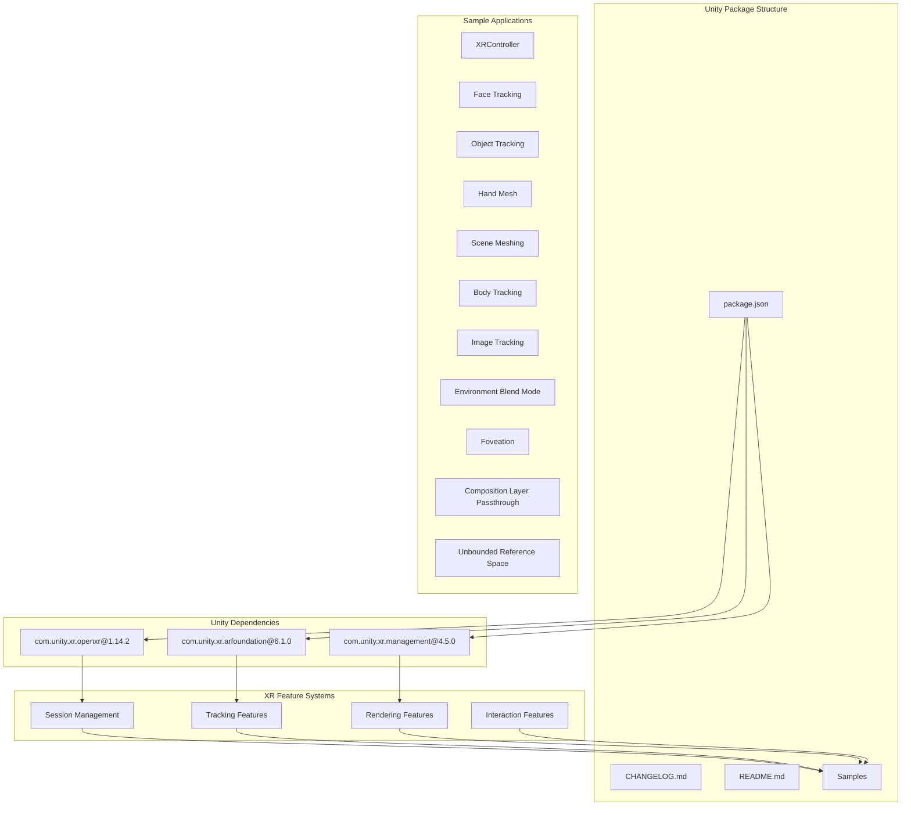
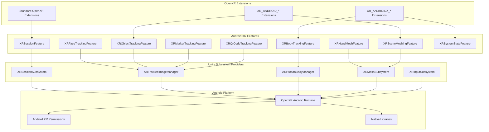

<!-- source: DeepWiki mcp.deepwiki.com · repo android/android-xr-unity-package · page 1 Overview · fetched 2026-10-23 -->

# Overview

Relevant source files

The following files were used as context for generating this wiki page:

- [CHANGELOG.md](CHANGELOG.md)
- [README.md](README.md)
- [package.json](package.json)

This document provides a comprehensive overview of the Android XR Extensions for Unity package (`com.google.xr.extensions`), explaining its purpose, architecture, and integration within the Unity XR ecosystem. The package extends Unity's OpenXR capabilities with additional XR features specifically designed for Android XR platforms.

For detailed information about specific features, see [Core XR Features](#2). For sample implementations, see [Sample Applications](#3). For build system integration, see [Build System Integration](#4).

## Purpose and Scope

The Android XR Extensions for Unity package serves as a bridge between Unity's OpenXR implementation and advanced XR features available on Android XR platforms. It provides APIs and implementations for XR capabilities that are not yet supported by Unity's standard OpenXR Android XR and OpenXR Plugin packages.

The package focuses on three primary areas:
- **Extended Tracking Features**: Object tracking, face tracking, hand mesh, scene meshing, and body tracking
- **Advanced Rendering**: Environment blend modes, foveation, and passthrough composition layers
- **Platform Integration**: Session management, permissions, and Android-specific XR runtime features

## System Architecture

The package implements a layered architecture that extends Unity's XR subsystem framework while integrating with OpenXR extensions and Android XR runtime capabilities.

### Core Package Structure

**Sources:** [package.json:1-75](), [CHANGELOG.md:1-135](), [README.md:1-39]()

### Feature Extension Architecture

The package implements XR features through OpenXR extensions and Unity subsystem providers, creating a comprehensive XR capability framework.

**Sources:** [package.json:12-16](), [CHANGELOG.md:60-81](), [README.md:3-17]()

## Key Components

### Unity Dependencies

The package builds upon three core Unity XR packages:

| Package | Version | Purpose |
|---------|---------|---------|
| `com.unity.xr.openxr` | 1.14.2 | OpenXR runtime and feature framework |
| `com.unity.xr.arfoundation` | 6.1.0 | AR tracking and subsystem management |
| `com.unity.xr.management` | 4.5.0 | XR provider lifecycle management |

### Feature Categories

The package provides features organized into several categories:

**Core Session Management:**
- `XRSessionFeature` - Immersive XR session configuration
- Vulkan subsampling support
- SpaceWarp configuration
- Environment blend mode control

**Tracking Features:**
- `XRObjectTrackingFeature` - Environmental object detection
- `XRFaceTrackingFeature` - Facial expression tracking
- `XRHandMeshFeature` - Hand mesh generation
- `XRSceneMeshingFeature` - Environmental mesh reconstruction
- `XRBodyTrackingFeature` - Human body pose tracking (Experimental)
- `XRMarkerTrackingFeature` - Marker-based tracking
- `XRQrCodeTrackingFeature` - QR code detection

**Rendering Features:**
- Foveation support (Legacy and modern)
- Passthrough composition layers
- Environment blend modes
- Display refresh rate control

**Interaction Features:**
- Mouse interaction profile
- Unbounded reference space
- System state monitoring (Experimental)

### Sample Applications

The package includes comprehensive samples demonstrating each feature:

- **XRController** - Controller input and display
- **Face Tracking** - Facial expression capture and avatar animation
- **Object Tracking** - Environmental object detection
- **Hand Mesh** - Hand mesh rendering
- **Scene Meshing** - Environmental mesh visualization
- **Body Tracking** - Human pose tracking (Experimental)
- **Image Tracking** - QR code and marker tracking
- **Environment Blend Mode** - Rendering mode switching
- **Foveation** - Performance optimization techniques
- **Passthrough** - Real-world overlay capabilities
- **Unbounded Reference Space** - Large-scale tracking

**Sources:** [package.json:18-74](), [CHANGELOG.md:103-104](), [README.md:19-38]()

## Unity Integration

The package integrates with Unity's XR ecosystem through standardized interfaces and build pipeline hooks. It requires Unity 6000.1.0b12 or higher and targets Android API level 24 or above.

### Installation Process

1. Import via Package Manager using tarball
2. Configure OpenXR as the XR provider in Project Settings
3. Enable desired Android XR Extensions features
4. Validate OpenXR configuration through Project Validation
5. Configure Android build settings for minimum API level 24

### Runtime Requirements

The package requires specific Android XR permissions and OpenXR runtime capabilities. It automatically configures the Android manifest during build to include necessary permissions, features, and native library references.

**Sources:** [README.md:20-38](), [CHANGELOG.md:14-17](), [package.json:4-6]()

## Experimental Features

The package includes experimental features that use `XR_ANDROIDX_*` OpenXR extensions. These features provide early access to cutting-edge XR capabilities but cannot be used in applications published to the Google Play Store.

**Current Experimental Features:**
- Body Tracking via `XRBodyTrackingFeature`
- System State monitoring via `XRSystemStateFeature`
- Scene Meshing via `XRSceneMeshingFeature` (promoted to stable in v1.1.0)

Experimental features may undergo breaking changes, deprecation, or removal in future versions as they evolve toward formal releases.

**Sources:** [CHANGELOG.md:70-81](), [CHANGELOG.md:30]()

---

