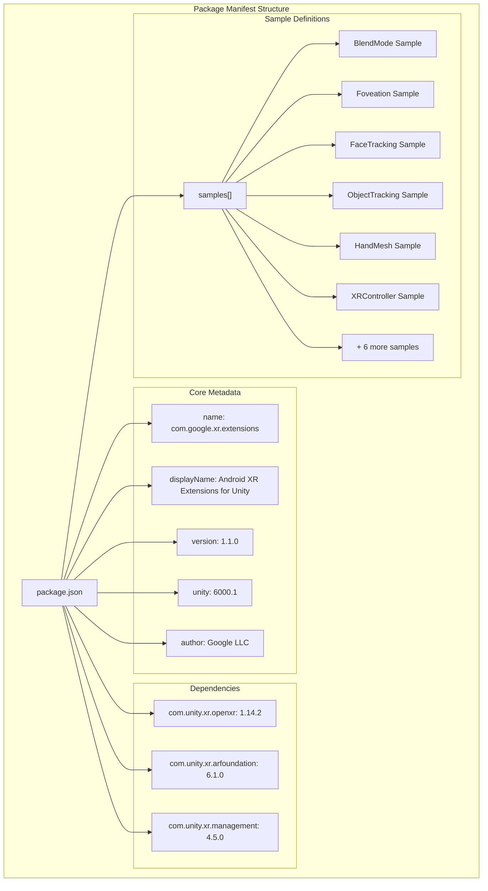
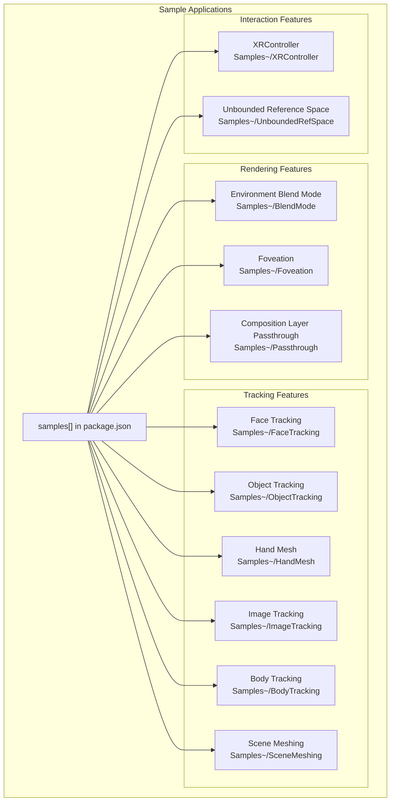
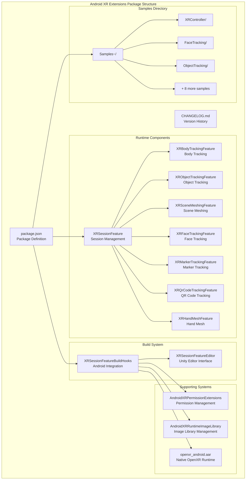
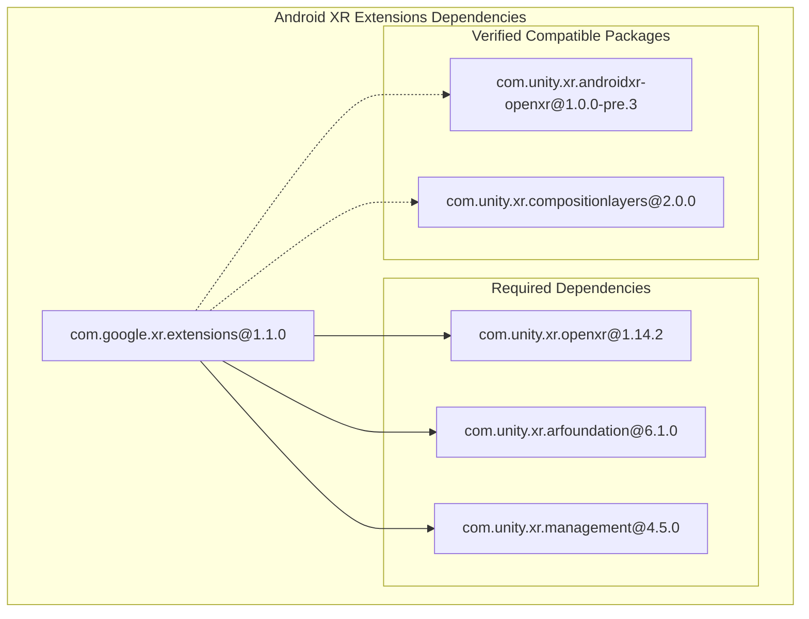

<!-- source: DeepWiki mcp.deepwiki.com · repo android/android-xr-unity-package · page 1.1 Package Structure · fetched 2026-10-23 -->

# Package Structure

<details>
<summary>Relevant source files</summary>

The following files were used as context for generating this wiki page:

- [CHANGELOG.md](CHANGELOG.md)
- [package.json](package.json)

</details>


This document describes the internal organization of the Android XR Extensions for Unity package (`com.google.xr.extensions`), including its manifest configuration, version history, dependency management, and key architectural components. 

For information about individual XR features and their implementations, see [Core XR Features](#2). For build system integration details, see [Build System Integration](#4).

## Package Manifest Configuration

The package is defined by its manifest file `package.json`, which contains essential metadata, dependencies, and sample definitions. The package follows Unity's standard package structure and semantic versioning conventions.

### Package Metadata

The package is identified as `com.google.xr.extensions` with the display name "Android XR Extensions for Unity". The current version is `1.1.0` and requires Unity `6000.1.0b12` or later.



**Sources: [package.json:1-17]()**

### Dependency Management

The package declares three critical Unity dependencies that provide the foundation for XR functionality:

| Dependency | Version | Purpose |
|------------|---------|---------|
| `com.unity.xr.openxr` | 1.14.2 | Core OpenXR runtime support |
| `com.unity.xr.arfoundation` | 6.1.0 | AR Foundation integration for tracking features |
| `com.unity.xr.management` | 4.5.0 | XR subsystem management |

**Sources: [package.json:12-16]()**

## Sample Applications Structure

The package includes 11 sample applications that demonstrate various XR features. Each sample is defined in the `samples` array with a display name, description, and file path.

### Sample Organization



**Sources: [package.json:18-74]()**

### Sample Categories

The samples are organized into three main categories:

1. **Rendering Features** - Demonstrate visual rendering capabilities like environment blending, foveation, and passthrough
2. **Tracking Features** - Show various tracking systems including face, object, hand, image, body, and scene tracking
3. **Interaction Features** - Cover input handling and spatial reference systems

Each sample includes a `displayName`, `description`, and `path` pointing to the `Samples~/` directory structure.

**Sources: [package.json:19-73]()**

## Version History and Change Management

The package maintains a comprehensive changelog following Keep a Changelog format and Semantic Versioning principles.

### Version Timeline

```mermaid
timeline
    title Package Version History
    
    section 2024-12-12 : v0.9.0
        : Initial Developer Preview
        : Basic XR Features
        : Session Management
        : Plane/Anchor Tracking
        : Face Tracking
        : Hand Meshes
        
    section 2025-04-03 : v0.9.1
        : XRController Sample Added
        : Android XR Permission Updates
        
    section 2025-05-07 : v1.0.0
        : Marker & QR Code Tracking
        : Body Tracking (Experimental)
        : Scene Meshing (Experimental)
        : System State (Experimental)
        : Updated Dependencies
        
    section 2025-06-27 : v1.1.0
        : Vulkan Subsampling Default
        : Scene Meshing Promoted
        : Bug Fixes
        : Cross-Platform Compatibility
```

**Sources: [CHANGELOG.md:11-135]()**

### Release Feature Progression

The changelog shows the evolution of features from experimental to stable:

| Version | Key Features Added | Status Changes |
|---------|-------------------|----------------|
| v0.9.0 | Initial core features | Developer Preview |
| v0.9.1 | XRController sample | Stability improvements |
| v1.0.0 | Marker/QR tracking, experimental features | First stable release |
| v1.1.0 | Vulkan subsampling, Scene Meshing promotion | Feature stabilization |

**Sources: [CHANGELOG.md:42-135]()**

## Core Package Architecture

The package is structured around several key architectural components that work together to provide XR functionality.

### Runtime System Organization



**Sources: [package.json:1-75](), [CHANGELOG.md:1-135]()**

### Unity Integration Points

The package integrates with Unity through several key mechanisms:

1. **OpenXR Feature System** - Each XR capability is implemented as an OpenXR feature that can be enabled/disabled
2. **AR Foundation Integration** - Tracking features leverage AR Foundation's subsystem architecture
3. **Build Pipeline Integration** - Build hooks automatically configure Android manifests and permissions
4. **Editor Interface** - Custom editor UI for configuring XR session features

**Sources: [package.json:12-16](), [CHANGELOG.md:60-82]()**

## Package Dependencies and Compatibility

The package maintains strict compatibility requirements with Unity and related XR packages.

### Unity Version Requirements

| Package Version | Minimum Unity Version | Verified Unity Version |
|----------------|----------------------|----------------------|
| v1.1.0 | 6000.1.0b12 | 6000.1.0f1+ |
| v1.0.0 | 6000.1.0b12 | 6000.1.0f1+ |

### Compatible Package Ecosystem



**Sources: [package.json:12-16](), [CHANGELOG.md:14-18](), [CHANGELOG.md:50-52]()**

---

