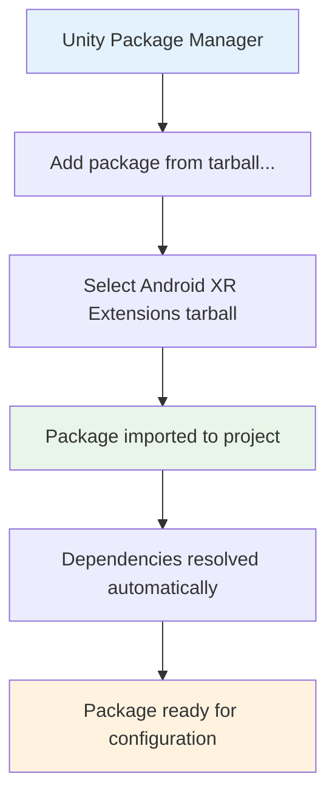
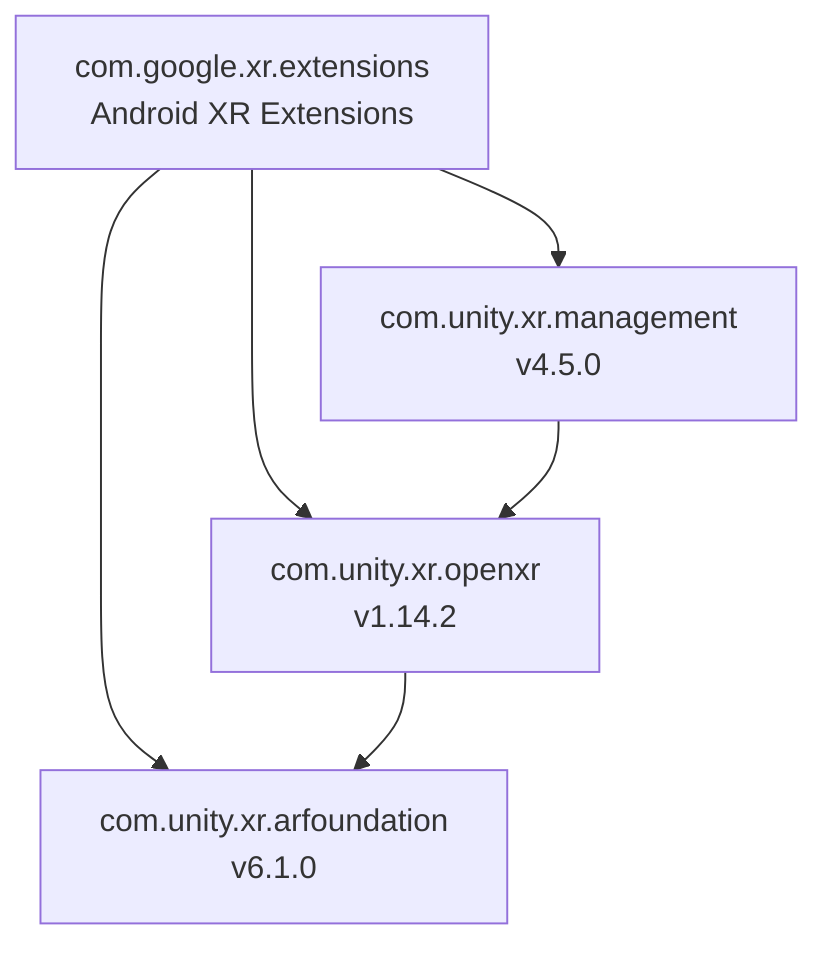
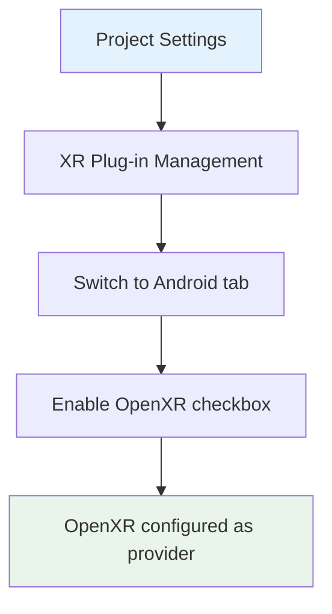
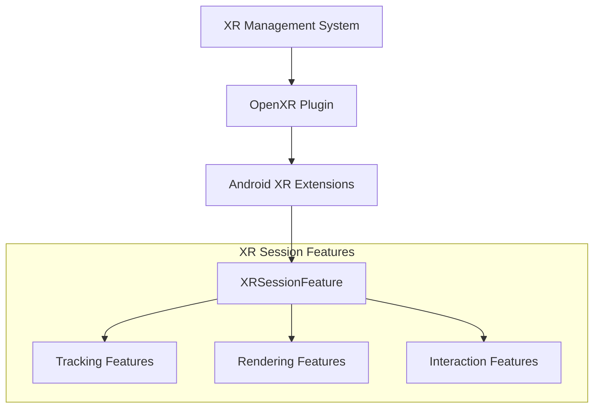
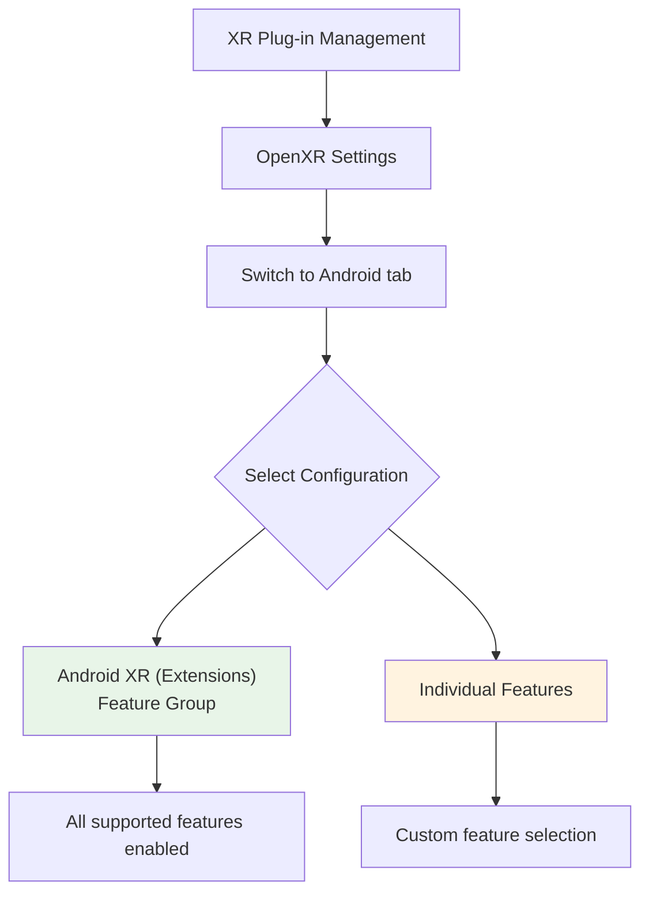
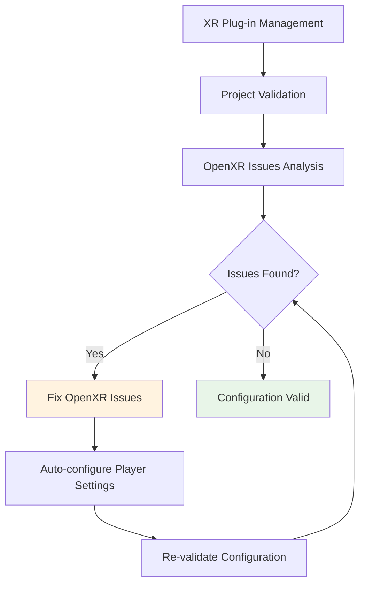
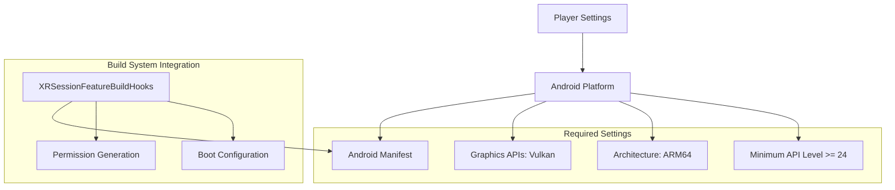
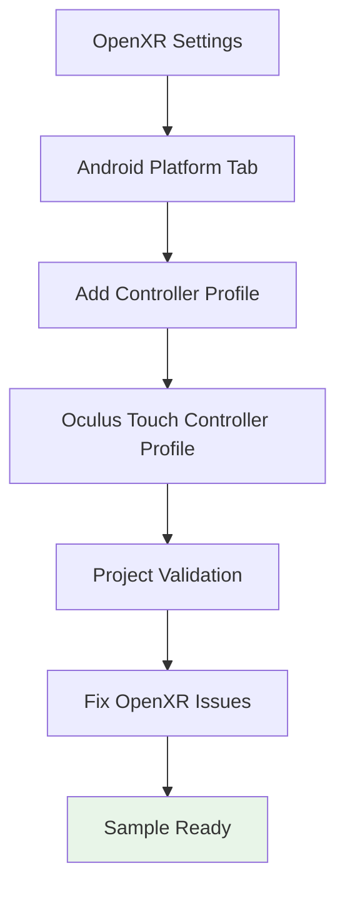

<!-- source: DeepWiki mcp.deepwiki.com · repo android/android-xr-unity-package · page 1.2 Installation and Setup · fetched 2026-10-23 -->

# Installation and Setup

Relevant source files

The following files were used as context for generating this wiki page:

- [README.md](README.md)
- [Samples~/XRController/README.md](Samples~/XRController/README.md)
- [Samples~/XRController/README.md.meta](Samples~/XRController/README.md.meta)

This document provides comprehensive instructions for installing and configuring the Android XR Extensions for Unity package. It covers package installation, XR plugin configuration, OpenXR feature selection, and build settings required to develop Android XR applications.

For information about the package's internal structure and components, see [Package Structure](#1.1). For details about specific XR features and their capabilities, see [Core XR Features](#2).

## Prerequisites

Before installing the Android XR Extensions for Unity package, ensure your development environment meets the following requirements:

| Requirement | Minimum Version | Purpose |
|-------------|----------------|---------|
| Unity Editor | 2022.3 LTS | Base development environment |
| Android Build Support | - | Required for Android platform builds |
| OpenXR Plugin | 1.14.2 | Core XR runtime integration |
| AR Foundation | 6.1.0 | Tracking and computer vision features |
| XR Management | 4.5.0 | XR plugin lifecycle management |
| Android API Level | 24 | Minimum OpenXR Loader requirement |

## Package Installation

### Installation Process

The Android XR Extensions for Unity package is distributed as a tarball and must be imported through Unity's Package Manager.

**Installation Steps:**

1. Open Unity Package Manager via **Window > Package Manager**
2. Click the **+** button in the top-left corner
3. Select **Add package from tarball...**
4. Navigate to and select the Android XR Extensions tarball file
5. Unity will automatically resolve dependencies and import the package

Sources: [README.md:21-23]()

### Package Dependencies

The installation automatically resolves the following Unity package dependencies:

Sources: [README.md:1-39]()

## XR Plugin Configuration

### OpenXR Provider Setup

After package installation, configure Unity's XR Plugin Management system to use OpenXR as the runtime provider.

**Configuration Steps:**

1. Navigate to **Project Settings > XR Plug-in Management**
2. Switch to the **Android** platform tab
3. Check **OpenXR** as the plug-in provider
4. Verify OpenXR appears in the enabled providers list

Sources: [README.md:24-27]()

### XR Management Integration

The `XRSessionFeature` system integrates with Unity's XR Management to provide Android XR-specific capabilities:

Sources: [README.md:24-28]()

## OpenXR Feature Selection

### Feature Group Configuration

The Android XR Extensions provide both grouped and individual feature selection through Unity's OpenXR settings.

**Configuration Steps:**

1. Navigate to **XR Plug-in Management > OpenXR**
2. Switch to the **Android** platform tab
3. Choose one of the following options:
   - Select **Android XR (Extensions)** feature group for all features
   - Select individual features based on your application needs

Sources: [README.md:26-31]()

### Available XR Features

The package provides the following configurable OpenXR features:

| Feature Category | Features | Requirements |
|------------------|----------|-------------|
| Core Session | Session Management, Environment Blend Mode | Always required |
| Tracking | Object Tracking, Face Tracking, Marker Tracking, QR Code Tracking | Additional configuration may be needed |
| Interaction | Hand Mesh, Mouse Interaction Profile | Platform-specific setup |
| Spatial | Scene Meshing, Unbounded Reference Space | Permissions required |
| Rendering | Passthrough Composition Layer | Hardware-dependent |
| Experimental | Body Tracking, System State | Subject to API changes |

Sources: [README.md:3-17]()

## Project Validation

### OpenXR Validation Process

Unity's Project Validation system ensures proper configuration of OpenXR-related settings and identifies potential issues.

**Validation Steps:**

1. Navigate to **XR Plug-in Management > Project Validation**
2. Review all **OpenXR** related issues in the validation report
3. Click **Fix** or **Fix All** to automatically resolve configuration problems
4. Verify that all OpenXR validation checks pass

The validation process automatically configures Player Settings to ensure compatibility with OpenXR requirements.

Sources: [README.md:33-34]()

## Build Configuration

### Android Platform Settings

Configure Android-specific build settings required for OpenXR applications.

**Required Configuration:**

1. Navigate to **Player Settings > Android > Identification**
2. Set **Minimum API Level** to **24** or higher
3. Ensure **Target Architecture** includes **ARM64**
4. Verify **Graphics APIs** includes **Vulkan**

The build system automatically configures the Android manifest through `XRSessionFeatureBuildHooks` to include required permissions and OpenXR feature declarations.

Sources: [README.md:35-38]()

### Build Process Integration

The package integrates with Unity's build pipeline through several components:

| Component | Purpose | Integration Point |
|-----------|---------|------------------|
| `XRSessionFeatureBuildHooks` | Android manifest generation | Pre-build phase |
| `XRSessionFeatureEditor` | Feature configuration UI | Unity Editor |
| Boot Configuration | Runtime feature setup | Application startup |

Sources: [README.md:35-38]()

## Sample Setup

### Controller Sample Configuration

The XR Controller sample demonstrates basic controller functionality and requires additional setup beyond the core package configuration.

**Controller Sample Setup:**

1. Navigate to **Edit > Project Settings > XR Plug-in Management > OpenXR**
2. Switch to the **Android** platform tab
3. Add **Oculus Touch Controller Profile** to the interaction profiles
4. Run **Project Validation** to ensure proper configuration
5. Fix any remaining OpenXR-related issues

Sources: [Samples~/XRController/README.md:5-12]()

### Sample Dependencies

Each sample may have specific requirements beyond the base package installation:

| Sample | Additional Requirements |
|--------|------------------------|
| XR Controller | Oculus Touch Controller Profile |
| Face Tracking | Face tracking permissions and AR Foundation setup |
| Other Features | Refer to individual sample README files |

Sources: [README.md:30-31](), [Samples~/XRController/README.md:10]()

## Troubleshooting

### Common Installation Issues

| Issue | Solution |
|-------|----------|
| Package import fails | Verify Unity version compatibility and dependencies |
| OpenXR not available | Ensure OpenXR plugin is properly installed |
| Build failures | Check minimum API level (24+) and architecture settings |
| Feature not working | Verify feature is enabled in OpenXR settings |
| Permission errors | Run Project Validation to fix manifest configuration |

### Validation Checklist

Before building your project, ensure:

- [ ] Package imported successfully through Package Manager
- [ ] OpenXR enabled in XR Plug-in Management (Android tab)
- [ ] Required features selected in OpenXR settings
- [ ] Project Validation passes for all OpenXR issues
- [ ] Minimum API Level set to 24 or higher
- [ ] Controller profiles added for interaction samples

Sources: [README.md:33-38]()

---

