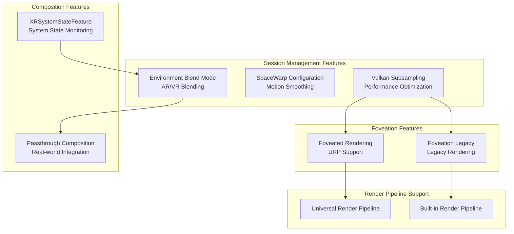

<!-- source: DeepWiki mcp.deepwiki.com · repo android/android-xr-unity-package · page 2 Core XR Features · fetched 2026-10-23 -->

# Core XR Features

Relevant source files

The following files were used as context for generating this wiki page:

- [CHANGELOG.md](CHANGELOG.md)
- [package.json](package.json)

This document provides a comprehensive overview of the core XR capabilities provided by the Android XR Extensions for Unity package. It covers the main feature systems including tracking, rendering, and interaction components that extend Unity's OpenXR functionality for Android XR platforms.

For information about installing and configuring these features, see [Installation and Setup](#1.2). For detailed implementation guides of specific tracking systems, see [Tracking Features](#2.2). For build system integration details, see [Build System Integration](#4).

## Feature Architecture Overview

The Android XR Extensions package provides a layered architecture that extends Unity's OpenXR capabilities through specialized feature implementations and OpenXR extension support.

### Core Feature System

```mermaid
graph TB
    subgraph "OpenXR Extensions Layer"
        ANDROIDX["XR_ANDROIDX_* Extensions<br/>(Experimental)"]
        ANDROID["XR_ANDROID_* Extensions<br/>(Stable)"]
        CORE["Core OpenXR API"]
    end
    
    subgraph "Session Management"
        SESSION["XRSessionFeature<br/>Session Management"]
        VULKAN["Vulkan Subsampling"]
        SPACEWARP["SpaceWarp Configuration"]
        BLEND["Environment Blend Mode"]
    end
    
    subgraph "Tracking Features"
        BODY["XRBodyTrackingFeature"]
        OBJECT["XRObjectTrackingFeature"]
        MESH["XRSceneMeshingFeature"]
        FACE["XRFaceTrackingFeature"]
        MARKER["XRMarkerTrackingFeature"]
        QR["XRQrCodeTrackingFeature"]
        HAND["XRHandMeshFeature"]
    end
    
    subgraph "Rendering Features"
        FOVEATION["Foveation Legacy"]
        PASSTHROUGH["Passthrough Composition"]
        SYSTEM["XRSystemStateFeature"]
    end
    
    subgraph "Unity Integration"
        AR_FOUNDATION["AR Foundation"]
        OPENXR_PLUGIN["OpenXR Plugin"]
        XR_MANAGEMENT["XR Management"]
    end
    
    ANDROIDX --> BODY
    ANDROIDX --> MESH
    ANDROIDX --> SYSTEM
    ANDROID --> OBJECT
    ANDROID --> MARKER
    ANDROID --> QR
    CORE --> SESSION
    CORE --> HAND
    
    SESSION --> VULKAN
    SESSION --> SPACEWARP
    SESSION --> BLEND
    
    BODY --> AR_FOUNDATION
    OBJECT --> AR_FOUNDATION
    FACE --> AR_FOUNDATION
    MARKER --> AR_FOUNDATION
    QR --> AR_FOUNDATION
    
    MESH --> OPENXR_PLUGIN
    HAND --> OPENXR_PLUGIN
    FOVEATION --> OPENXR_PLUGIN
    PASSTHROUGH --> OPENXR_PLUGIN
    
    SESSION --> XR_MANAGEMENT
```

Sources: [package.json:12-16](), [CHANGELOG.md:70-81]()

### Feature Classification

The package organizes XR features into three primary categories based on their OpenXR extension dependencies and stability levels:

| Feature Category | OpenXR Extension | Stability | Examples |
|------------------|------------------|-----------|----------|
| Core Features | Standard OpenXR | Stable | Session Management, Hand Mesh |
| Android Extensions | `XR_ANDROID_*` | Stable | Object Tracking, Marker Tracking |
| Experimental Features | `XR_ANDROIDX_*` | Experimental | Body Tracking, Scene Meshing |

Sources: [CHANGELOG.md:70-72](), [CHANGELOG.md:30]()

## Tracking Features

The package provides comprehensive tracking capabilities through specialized OpenXR features that integrate with Unity's AR Foundation system.

### Tracking Feature Implementation

```mermaid
graph TB
    subgraph "AR Foundation Integration"
        AR_HUMAN["ARHumanBodyManager"]
        AR_TRACKED["ARTrackedImageManager"]
        AR_MESH["XRMeshSubsystem"]
    end
    
    subgraph "XR Tracking Features"
        BODY_FEATURE["XRBodyTrackingFeature<br/>Body Tracking"]
        OBJECT_FEATURE["XRObjectTrackingFeature<br/>Object Detection"]
        MESH_FEATURE["XRSceneMeshingFeature<br/>Scene Meshing"]
        FACE_FEATURE["XRFaceTrackingFeature<br/>Face Tracking"]
        MARKER_FEATURE["XRMarkerTrackingFeature<br/>Marker Detection"]
        QR_FEATURE["XRQrCodeTrackingFeature<br/>QR Code Detection"]
        HAND_FEATURE["XRHandMeshFeature<br/>Hand Mesh"]
    end
    
    subgraph "Data Types"
        FACE_STATE["XRFaceState"]
        FACE_PARAMS["XRFaceParameterIndices"]
        MARKER_DATA["XRMarkerDictionary"]
        MARKER_DB["XRMarkerDatabase"]
        IMAGE_LIB["XRReferenceImageLibrary"]
    end
    
    subgraph "Permission System"
        BODY_PERM["BodyTracking Permission"]
        SCENE_PERM["SceneUnderstanding Permission"]
        HAND_PERM["HandTracking Permission"]
        FACE_PERM["FaceTracking Permission"]
    end
    
    BODY_FEATURE --> AR_HUMAN
    OBJECT_FEATURE --> AR_TRACKED
    MESH_FEATURE --> AR_MESH
    MARKER_FEATURE --> AR_TRACKED
    QR_FEATURE --> AR_TRACKED
    
    FACE_FEATURE --> FACE_STATE
    FACE_FEATURE --> FACE_PARAMS
    MARKER_FEATURE --> MARKER_DATA
    MARKER_FEATURE --> MARKER_DB
    MARKER_FEATURE --> IMAGE_LIB
    QR_FEATURE --> IMAGE_LIB
    
    BODY_FEATURE --> BODY_PERM
    OBJECT_FEATURE --> SCENE_PERM
    MESH_FEATURE --> SCENE_PERM
    FACE_FEATURE --> FACE_PERM
    HAND_FEATURE --> HAND_PERM
```

Sources: [CHANGELOG.md:60-69](), [CHANGELOG.md:73-75](), [CHANGELOG.md:79-81]()

### Face Tracking System

The `XRFaceTrackingFeature` provides facial expression tracking through the `XRFaceState` data structure and `XRFaceParameterIndices` enumeration for blendshape parameters.

**Key Components:**
- `XRFaceState` - Contains face tracking data including confidence regions
- `XRFaceParameterIndices` - Enumeration of facial blendshape parameters including tongue tracking
- `XRFaceConfidenceRegion` - Confidence level indicators for different face regions

Sources: [CHANGELOG.md:85-87]()

### Image Recognition Features

The package provides dual image recognition capabilities through marker tracking and QR code detection:

**Marker Tracking (`XRMarkerTrackingFeature`):**
- Integrates with `ARTrackedImageManager` for marker detection
- `ARTrackedImage.IsMarker()` - Extension method to identify marker instances
- `ARTrackedImage.TryGetMarkerData(out XRMarkerDictionary, out int)` - Retrieves marker data
- `XRMarkerDatabase` - ScriptableObject container for marker reference management

**QR Code Tracking (`XRQrCodeTrackingFeature`):**
- Provides QR code detection through `ARTrackedImageManager`
- `ARTrackedImage.IsQrCode()` - Extension method to identify QR code instances
- `ARTrackedImage.TryGetQrCodeData(out string)` - Retrieves QR code string data
- Requires `XRReferenceImageLibrary` with **QrCode** named reference

Sources: [CHANGELOG.md:60-69]()

## Rendering Features

The package extends Unity's rendering capabilities with specialized XR rendering features for performance optimization and visual enhancement.

### Rendering Feature Architecture

Sources: [CHANGELOG.md:26-29](), [CHANGELOG.md:76-78]()

### Vulkan Subsampling

The **Subsampling (Vulkan)** feature provides performance optimization through reduced rendering resolution. As of version 1.1.0, this feature is enabled by default and requires foveation support:

- **URP Projects**: Requires **Foveated Rendering** feature
- **BiRP Projects**: Requires **Foveation (Legacy)** feature for legacy support
- **Runtime Requirement**: Foveation feature must be enabled to prevent rendering faults

Sources: [CHANGELOG.md:26-29]()

### Environment Blend Mode

The Environment Blend Mode feature supports seamless integration between virtual and real-world content:

- **Additive Mode**: Adds virtual content to real-world view
- **Alpha Mode**: Blends virtual content with transparency
- **Opaque Mode**: Fully virtual environment
- **Integration**: Works with System State feature for dynamic mode switching

Sources: [package.json:20-22](), [CHANGELOG.md:76-78]()

## Interaction Features

The package provides advanced interaction capabilities through hand tracking, controller support, and spatial input systems.

### Hand and Controller Integration

```mermaid
graph TB
    subgraph "Hand Tracking"
        HAND_MESH["XRHandMeshFeature<br/>Hand Mesh Generation"]
        HAND_SUBSYSTEM["XRInputSubsystem<br/>Hand Input Processing"]
        HAND_RENDERER["Mesh Filter<br/>Hand Rendering"]
    end
    
    subgraph "Controller Support"
        XR_CONTROLLER["XRController Asset<br/>Controller Configuration"]
        CONTROLLER_DISPLAY["XRControllerDisplay<br/>Visual Feedback"]
        MOUSE_PROFILE["Android XR Mouse Profile<br/>Input Mapping"]
    end
    
    subgraph "Spatial Input"
        UNBOUNDED["Unbounded Reference Space<br/>Room-scale Tracking"]
        TRACKING_ORIGIN["XRInputSubsystem<br/>Tracking Origin Management"]
    end
    
    HAND_MESH --> HAND_SUBSYSTEM
    HAND_SUBSYSTEM --> HAND_RENDERER
    
    XR_CONTROLLER --> CONTROLLER_DISPLAY
    CONTROLLER_DISPLAY --> MOUSE_PROFILE
    
    UNBOUNDED --> TRACKING_ORIGIN
```

Sources: [package.json:45-47](), [package.json:65-67](), [package.json:50-52]()

### Hand Mesh System

The `XRHandMeshFeature` provides real-time hand mesh generation:

- **Mesh Generation**: Creates dynamic hand meshes for left and right hands
- **Rendering Integration**: Meshes are sent to `Mesh Filter` components for rendering
- **Permission Requirement**: Requires `HandTracking` permission for operation

Sources: [package.json:45-47](), [CHANGELOG.md:97-98]()

### Spatial Reference Systems

The package supports **Unbounded Reference Space** for room-scale XR experiences:

- **Tracking Origin**: Uses `XRInputSubsystem` to verify unbounded tracking mode
- **Room-scale Support**: Enables large-scale spatial tracking beyond seated/standing boundaries
- **Integration**: Works with existing Unity XR input systems

Sources: [package.json:50-52]()

## Experimental Features

The package includes experimental features that utilize `XR_ANDROIDX_*` OpenXR extensions. These features provide cutting-edge capabilities but come with important limitations.

### Experimental Feature Constraints

**Publishing Restrictions:**
- Applications using experimental features cannot be published to Google Play Store
- Features are marked as experimental and subject to breaking changes
- May include deprecation or removal in future versions

**Current Experimental Features:**
- **Body Tracking**: Full body pose tracking through `ARHumanBodyManager`
- **Scene Meshing**: Environment mesh generation (promoted to stable in v1.1.0)
- **System State**: System state monitoring and reporting

Sources: [CHANGELOG.md:70-72](), [CHANGELOG.md:30]()

### Scene Meshing Promotion

The **Scene Meshing** feature was promoted from experimental to stable release feature in version 1.1.0:

- **Previous Status**: Experimental feature using `XR_ANDROIDX_*` extensions
- **Current Status**: Stable release feature
- **Functionality**: Provides scene mesh data via `XRMeshSubsystem`
- **Sample**: Demonstrates usage through **SceneMeshing** sample

Sources: [CHANGELOG.md:30](), [CHANGELOG.md:79-81]()

## Feature Dependencies

The core XR features have specific dependencies on Unity packages and OpenXR extensions:

### Unity Package Dependencies

| Package | Version | Purpose |
|---------|---------|---------|
| `com.unity.xr.openxr` | 1.14.2 | OpenXR plugin support |
| `com.unity.xr.arfoundation` | 6.1.0 | AR Foundation integration |
| `com.unity.xr.management` | 4.5.0 | XR management system |

### Optional Dependencies

| Package | Version | Features |
|---------|---------|----------|
| `com.unity.xr.compositionlayers` | 1.0.0+ | Passthrough composition layers |
| `com.unity.xr.androidxr-openxr` | 1.0.0-pre.3 | Android XR OpenXR runtime |

Sources: [package.json:12-16](), [CHANGELOG.md:16-17]()

---

