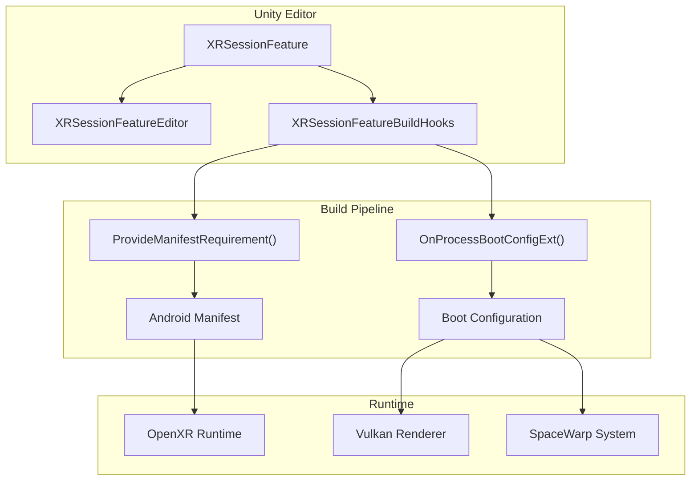
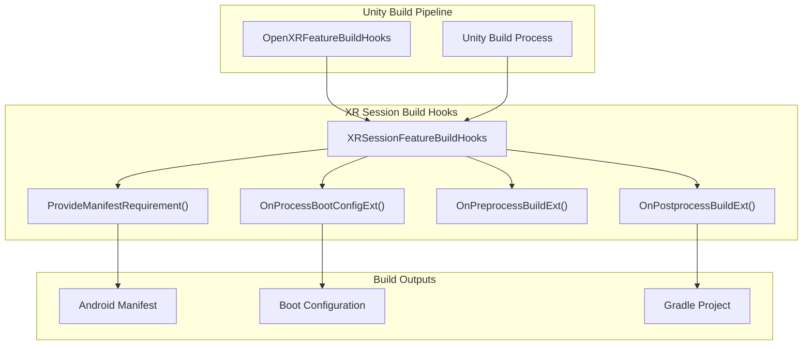

<!-- source: DeepWiki mcp.deepwiki.com · repo android/android-xr-unity-package · page 2.1 Session Management · fetched 2026-10-23 -->

# Session Management

<details>
<summary>Relevant source files</summary>

The following files were used as context for generating this wiki page:

- [Editor/Internal/XRSessionFeatureBuildHooks.cs](Editor/Internal/XRSessionFeatureBuildHooks.cs)
- [Editor/Internal/XRSessionFeatureEditor.cs](Editor/Internal/XRSessionFeatureEditor.cs)

</details>


The Session Management system provides core XR session configuration and lifecycle management for Android XR applications. This system handles immersive XR settings, performance optimizations like Vulkan subsampling and SpaceWarp, and integrates with Unity's build pipeline to automatically configure Android manifests and runtime settings.

For information about tracking-specific features like body tracking or object detection, see [Tracking Features](#2.2). For details about the permission system used by session features, see [Permission System](#2.4).

## Core XRSessionFeature Components

The session management system centers around the `XRSessionFeature` class, which provides three primary configuration options:

| Feature | Purpose | Build Impact |
|---------|---------|--------------|
| **ImmersiveXR** | Configures the application as a full-screen immersive XR experience | Adds immersive HMD intent category and XR activity properties to Android manifest |
| **VulkanSubsampling** | Enables memory bandwidth optimization for foveated rendering | Sets `xr-vulkan-extension-fragment-density-map-enabled` boot configuration |
| **SpaceWarp** | Enables URP SpaceWarp for performance optimization | Sets `xr-meta-enabled` boot configuration |

The system automatically detects which features are enabled and configures the build accordingly through the `XRSessionFeatureBuildHooks` class.

**Sources:** [Editor/Internal/XRSessionFeatureBuildHooks.cs:131-134](), [Editor/Internal/XRSessionFeatureEditor.cs:31-45]()

## Session Feature Configuration Flow



**Sources:** [Editor/Internal/XRSessionFeatureBuildHooks.cs:40-41](), [Editor/Internal/XRSessionFeatureBuildHooks.cs:127-147](), [Editor/Internal/XRSessionFeatureBuildHooks.cs:225-248]()

## Android Manifest Integration

The `XRSessionFeatureBuildHooks` class automatically injects required Android manifest elements based on the enabled session features:

### Immersive XR Manifest Elements

When `ImmersiveXR` is enabled, the system adds two critical manifest elements:

```xml
<!-- Intent category for immersive HMD applications -->
<category android:name="org.khronos.openxr.intent.category.IMMERSIVE_HMD" />

<!-- XR activity start mode property -->
<property android:name="android.window.PROPERTY_XR_ACTIVITY_START_MODE" 
          android:value="XR_ACTIVITY_START_MODE_FULL_SPACE_UNMANAGED" />
```

### Core OpenXR Requirements

All XR applications automatically receive these manifest elements:

```xml
<!-- Native OpenXR library -->
<uses-native-library android:name="libopenxr.google.so" android:required="false" />

<!-- OpenXR feature requirement -->
<uses-feature android:name="android.software.xr.api.openxr" 
              android:required="true" 
              android:version="0x00010001" />
```

**Sources:** [Editor/Internal/XRSessionFeatureBuildHooks.cs:42-67](), [Editor/Internal/XRSessionFeatureBuildHooks.cs:69-99](), [Editor/Internal/XRSessionFeatureBuildHooks.cs:204-208]()

## Permission System Integration

The session management system automatically determines which Android XR permissions are required based on enabled features:

```mermaid
graph TB
    subgraph "Feature Detection"
        CheckSceneCoarse["CheckSceneUnderstandingCoarsePermission()"]
        CheckSceneFine["CheckSceneUnderstandingFinePermission()"]
        CheckHandTracking["CheckHandTrackingPermission()"]
        CheckBodyTracking["CheckBodyTrackingPermission()"]
        CheckEyeTracking["CheckEyeTrackingCoarsePermission()"]
        CheckExperimental["CheckExperimentalPermission()"]
    end
    
    subgraph "Permission Injection"
        SceneCoarsePermission["SCENE_UNDERSTANDING_COARSE"]
        SceneFinePermission["SCENE_UNDERSTANDING_FINE"]
        HandTrackingPermission["HAND_TRACKING"]
        BodyTrackingPermission["BODY_TRACKING"]
        EyeTrackingPermission["EYE_TRACKING_COARSE"]
        ExperimentalMeta["com.android.extensions.xr.uses_experimental_openxr_feature"]
    end
    
    CheckSceneCoarse --> SceneCoarsePermission
    CheckSceneFine --> SceneFinePermission
    CheckHandTracking --> HandTrackingPermission
    CheckBodyTracking --> BodyTrackingPermission
    CheckEyeTracking --> EyeTrackingPermission
    CheckExperimental --> ExperimentalMeta
```



**Sources:** [Editor/Internal/XRSessionFeatureBuildHooks.cs:148-202](), [Editor/Internal/XRSessionFeatureBuildHooks.cs:277-358]()

## Boot Configuration System

The session management system configures low-level runtime behavior through Unity's boot configuration system:

### Vulkan Fragment Density Map

When `VulkanSubsampling` is enabled, or when foveation features are active, the system enables fragment density map support:

```csharp
bool needsFragmentDensityMapEnabled = (sessionFeature != null &&
    sessionFeature.enabled && sessionFeature.VulkanSubsampling) ||
    (foveationFeature != null && foveationFeature.enabled) ||
    (foveatedRendering != null && foveatedRendering.enabled);
    
builder.SetBootConfigBoolean("xr-vulkan-extension-fragment-density-map-enabled",
    needsFragmentDensityMapEnabled);
```

### SpaceWarp Configuration

When `SpaceWarp` is enabled, the system activates the Meta SpaceWarp extension:

```csharp
bool spacewarpEnabled = sessionFeature != null &&
    sessionFeature.enabled && sessionFeature.SpaceWarp;
    
builder.SetBootConfigBoolean("xr-meta-enabled", spacewarpEnabled);
```

**Sources:** [Editor/Internal/XRSessionFeatureBuildHooks.cs:228-248]()

## Unity Editor Interface

The `XRSessionFeatureEditor` provides a custom Unity inspector interface for configuring session features:

### Editor Properties

| Property | Field Name | Description |
|----------|------------|-------------|
| **Immersive XR** | `ImmersiveXR` | Configures full-screen immersive XR mode |
| **Subsampling (Vulkan)** | `_vulkanSubsampling` | Enables Vulkan subsampling for foveated rendering |
| **URP SpaceWarp (Vulkan)** | `_spacewarp` | Enables URP SpaceWarp performance optimization |

### Editor Implementation

The editor uses `SerializedProperty` objects to bind to the underlying `XRSessionFeature` fields and provides toggle controls with descriptive tooltips:

```csharp
_immersiveXR.boolValue = EditorGUILayout.Toggle(
    _immersiveXRLabel, _immersiveXR.boolValue);
_subsampling.boolValue = EditorGUILayout.Toggle(
    _subsamplingLabel, _subsampling.boolValue);
_spacewarp.boolValue = EditorGUILayout.Toggle(_spacewarpLabel, _spacewarp.boolValue);
```

**Sources:** [Editor/Internal/XRSessionFeatureEditor.cs:28-83]()

## Build Hook Integration

The session management system integrates with Unity's OpenXR build pipeline through the `OpenXRFeatureBuildHooks` base class:



The build hooks are executed with `callbackOrder = 1` and target the `XRSessionFeature` type specifically, ensuring proper integration with Unity's XR build pipeline.

**Sources:** [Editor/Internal/XRSessionFeatureBuildHooks.cs:119-126](), [Editor/Internal/XRSessionFeatureBuildHooks.cs:251-263]()

---

