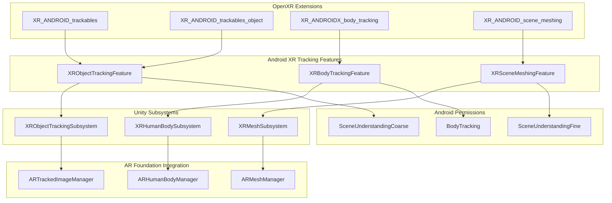
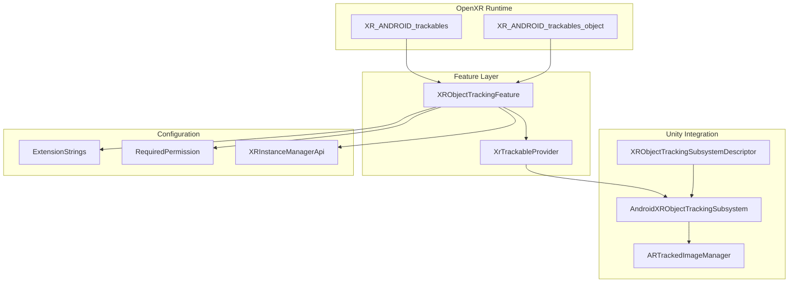
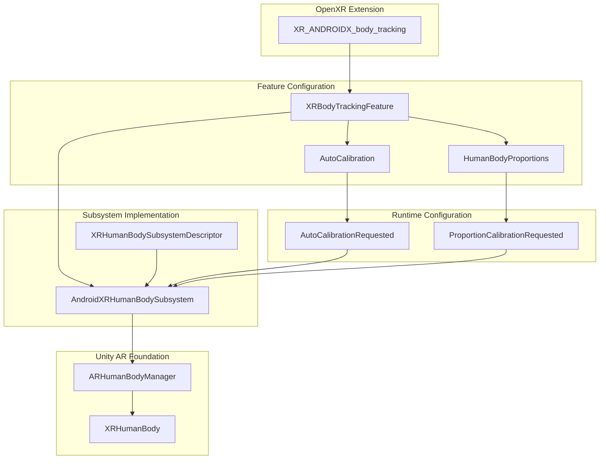
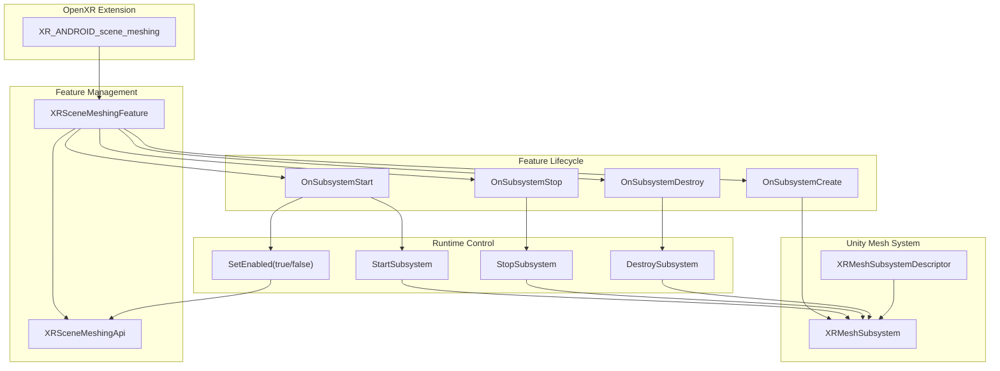
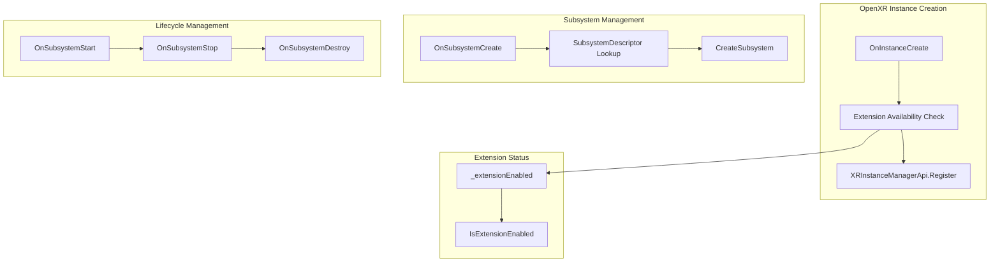

<!-- source: DeepWiki mcp.deepwiki.com · repo android/android-xr-unity-package · page 2.2 Tracking Features · fetched 2026-10-23 -->

# Tracking Features

Relevant source files

The following files were used as context for generating this wiki page:

- [Runtime/Features/XRBodyTrackingFeature.cs](Runtime/Features/XRBodyTrackingFeature.cs)
- [Runtime/Features/XRObjectTrackingFeature.cs](Runtime/Features/XRObjectTrackingFeature.cs)
- [Runtime/Features/XRSceneMeshingFeature.cs](Runtime/Features/XRSceneMeshingFeature.cs)

This document covers the tracking capabilities provided by the Android XR Extensions for Unity package. The tracking features enable real-time detection and monitoring of objects, human bodies, and environmental geometry within XR applications running on Android XR platforms.

The tracking system consists of three main components: object tracking for detecting and following predefined objects, body tracking for human pose estimation, and scene meshing for environmental geometry reconstruction. Each feature integrates with Unity's AR Foundation framework while leveraging Android-specific OpenXR extensions for enhanced performance and capabilities.

For information about managing tracked image libraries, see [Image Recognition System](#2.3). For permission management related to tracking features, see [Permission System](#2.4).

## Architecture Overview

The tracking features are implemented as OpenXR features that extend Unity's base XR capabilities. Each tracking feature follows a consistent architecture pattern that integrates OpenXR extensions with Unity's subsystem framework.

### Tracking Feature System Architecture

**Sources:** [Runtime/Features/XRObjectTrackingFeature.cs:35-42](), [Runtime/Features/XRBodyTrackingFeature.cs:35-43](), [Runtime/Features/XRSceneMeshingFeature.cs:33-35]()

## Object Tracking

The `XRObjectTrackingFeature` enables detection and tracking of predefined objects in the real world. It uses the `XR_ANDROID_trackables` and `XR_ANDROID_trackables_object` OpenXR extensions to provide object recognition capabilities.

### Object Tracking Implementation

**Sources:** [Runtime/Features/XRObjectTrackingFeature.cs:74-76](), [Runtime/Features/XRObjectTrackingFeature.cs:81-82](), [Runtime/Features/XRObjectTrackingFeature.cs:116-117]()

### Object Tracking Configuration

| Property | Value | Description |
|----------|-------|-------------|
| **Feature ID** | `com.google.xr.extensions.object_tracking` | Unique identifier for the object tracking feature |
| **OpenXR Extensions** | `XR_ANDROID_trackables XR_ANDROID_trackables_object` | Required OpenXR extensions |
| **Required Permission** | `SceneUnderstandingCoarse` | Android permission needed for object detection |
| **Priority** | 97 | OpenXR feature initialization priority |

The object tracking feature integrates with Unity's `XRObjectTrackingSubsystem` through the `AndroidXRObjectTrackingSubsystem` implementation. The feature automatically registers the trackable provider with the OpenXR instance manager when the required extensions are available.

**Sources:** [Runtime/Features/XRObjectTrackingFeature.cs:66](), [Runtime/Features/XRObjectTrackingFeature.cs:74-76](), [Runtime/Features/XRObjectTrackingFeature.cs:81-82](), [Runtime/Features/XRObjectTrackingFeature.cs:53]()

## Body Tracking

The `XRBodyTrackingFeature` provides human body pose estimation capabilities using the experimental `XR_ANDROIDX_body_tracking` OpenXR extension. This feature supports both automatic calibration and manual proportions-based calibration.

### Body Tracking Architecture

**Sources:** [Runtime/Features/XRBodyTrackingFeature.cs:103-117](), [Runtime/Features/XRBodyTrackingFeature.cs:123-137](), [Runtime/Features/XRBodyTrackingFeature.cs:89]()

### Body Tracking Configuration

| Property | Value | Description |
|----------|-------|-------------|
| **Feature ID** | `com.google.xr.extensions.body_tracking` | Unique identifier for body tracking |
| **OpenXR Extension** | `XR_ANDROIDX_body_tracking` | Required experimental OpenXR extension |
| **Required Permission** | `BodyTracking` | Android permission for body tracking |
| **Priority** | 97 | OpenXR feature initialization priority |
| **Experimental Status** | Yes | Feature is marked as experimental |

The body tracking feature supports two calibration modes:

- **Automatic Calibration**: When `AutoCalibration` is enabled, the system automatically determines body proportions
- **Manual Proportions**: When disabled, uses the configured `XRHumanBodyProportions` for skeleton computation

**Sources:** [Runtime/Features/XRBodyTrackingFeature.cs:67](), [Runtime/Features/XRBodyTrackingFeature.cs:73](), [Runtime/Features/XRBodyTrackingFeature.cs:78-79](), [Runtime/Features/XRBodyTrackingFeature.cs:84](), [Runtime/Features/XRBodyTrackingFeature.cs:87]()

## Scene Meshing

The `XRSceneMeshingFeature` provides real-time environmental geometry reconstruction using the `XR_ANDROID_scene_meshing` OpenXR extension. This feature generates mesh data representing the physical environment around the user.

### Scene Meshing Lifecycle

**Sources:** [Runtime/Features/XRSceneMeshingFeature.cs:102-106](), [Runtime/Features/XRSceneMeshingFeature.cs:109-117](), [Runtime/Features/XRSceneMeshingFeature.cs:120-128](), [Runtime/Features/XRSceneMeshingFeature.cs:131-134]()

### Scene Meshing Configuration

| Property | Value | Description |
|----------|-------|-------------|
| **Feature ID** | `com.google.xr.extensions.scene_meshing` | Unique identifier for scene meshing |
| **OpenXR Extension** | `XR_ANDROID_scene_meshing` | Required OpenXR extension |
| **Required Permission** | `SceneUnderstandingFine` | Android permission for detailed scene understanding |
| **Priority** | 99 | OpenXR feature initialization priority |
| **AR Foundation Compatibility** | Limited | Not compatible with `ARMeshManager` due to lifecycle conflicts |

The scene meshing feature manages the `XRMeshSubsystem` lifecycle directly rather than relying on AR Foundation's `ARMeshManager`. This approach provides better control over mesh creation and destruction timing.

**Sources:** [Runtime/Features/XRSceneMeshingFeature.cs:58](), [Runtime/Features/XRSceneMeshingFeature.cs:63](), [Runtime/Features/XRSceneMeshingFeature.cs:68-69](), [Runtime/Features/XRSceneMeshingFeature.cs:45](), [Runtime/Features/XRSceneMeshingFeature.cs:112-115]()

## Feature Initialization and Extension Management

All tracking features follow a consistent initialization pattern that checks for OpenXR extension availability and registers the appropriate API features with the XR instance manager.

### Common Initialization Pattern

**Sources:** [Runtime/Features/XRObjectTrackingFeature.cs:97-118](), [Runtime/Features/XRBodyTrackingFeature.cs:140-154](), [Runtime/Features/XRSceneMeshingFeature.cs:82-93]()

Each tracking feature exposes an `IsExtensionEnabled` property that indicates whether the required OpenXR extensions are available on the current device. This allows applications to conditionally enable tracking functionality based on platform capabilities.

**Sources:** [Runtime/Features/XRObjectTrackingFeature.cs:94](), [Runtime/Features/XRBodyTrackingFeature.cs:96](), [Runtime/Features/XRSceneMeshingFeature.cs:79]()

---

