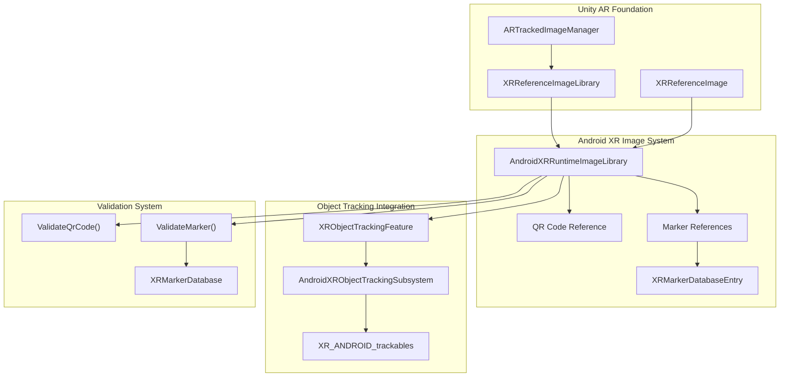
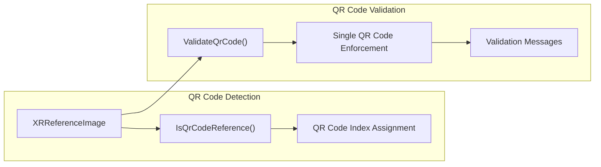
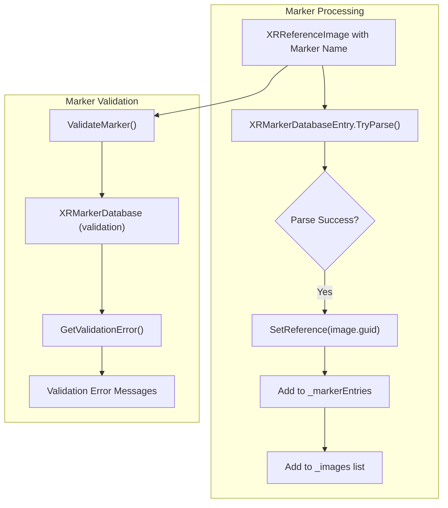
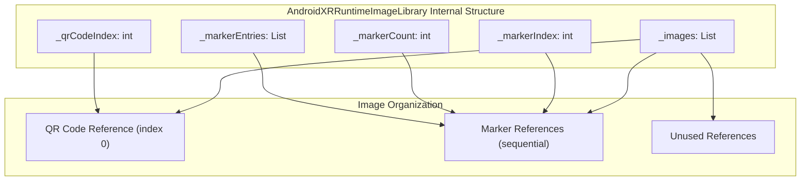
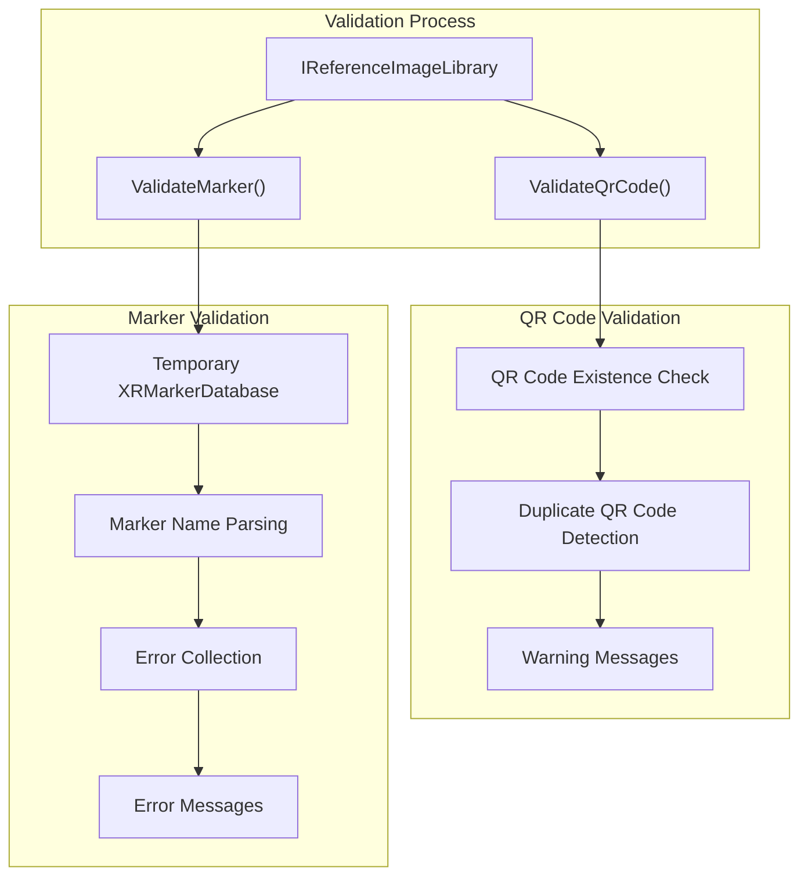

<!-- source: DeepWiki mcp.deepwiki.com · repo android/android-xr-unity-package · page 2.3 Image Recognition System · fetched 2026-10-23 -->

# Image Recognition System

Relevant source files

The following files were used as context for generating this wiki page:

- [Runtime/AndroidXRRuntimeImageLibrary.cs](Runtime/AndroidXRRuntimeImageLibrary.cs)
- [Runtime/Features/XRObjectTrackingFeature.cs](Runtime/Features/XRObjectTrackingFeature.cs)

The Image Recognition System provides runtime image library management for QR codes and markers in Android XR applications. It processes reference images from Unity's AR Foundation system and organizes them for efficient tracking by the Android XR platform. The system validates image configurations at build time and provides runtime access to organized image data for object tracking features.

For information about the broader object tracking capabilities that utilize this system, see [Tracking Features](#2.2). For details about the permissions required for image recognition, see [Permission System](#2.4).

## Core Architecture

The image recognition system is built around the `AndroidXRRuntimeImageLibrary` class, which extends Unity's `RuntimeReferenceImageLibrary` to provide specialized handling for QR codes and markers. The system processes images from `XRReferenceImageLibrary` assets and organizes them into distinct categories for optimal runtime performance.

**Sources:** [Runtime/AndroidXRRuntimeImageLibrary.cs:1-270](), [Runtime/Features/XRObjectTrackingFeature.cs:1-177]()

## QR Code Recognition

The system provides specialized support for QR code tracking through a naming convention-based approach. QR codes are identified by reference images with names starting with "qrcode" (case-insensitive).

### QR Code Processing

The `AndroidXRRuntimeImageLibrary` automatically detects QR code references during initialization and assigns them a special index for efficient runtime access:

| Property | Type | Description |
|----------|------|-------------|
| `QrCodeReferenceIndex` | `int` | Index of the QR code reference, or -1 if not found |
| `QRCodeReference` | `XRReferenceImage?` | The QR code reference image, or null if not available |

The system enforces a single QR code reference per library, with additional QR code references being ignored and logged as warnings.

**Sources:** [Runtime/AndroidXRRuntimeImageLibrary.cs:37-38](), [Runtime/AndroidXRRuntimeImageLibrary.cs:58-66](), [Runtime/AndroidXRRuntimeImageLibrary.cs:131-152](), [Runtime/AndroidXRRuntimeImageLibrary.cs:244-247]()

## Marker Recognition

The marker recognition system handles structured markers that follow specific naming conventions. Markers are processed through the `XRMarkerDatabaseEntry` system, which parses marker names and validates their configurations.

### Marker Processing Pipeline

Marker references are identified and processed through a multi-step pipeline:

1. **Name Parsing**: Marker names are parsed using `XRMarkerDatabaseEntry.TryParse()`
2. **Reference Assignment**: Successfully parsed markers have their GUID references assigned
3. **Organization**: Markers are grouped together in the image library for efficient access

| Property | Type | Description |
|----------|------|-------------|
| `MarkerReferenceIndex` | `int` | Index of the first marker reference, or -1 if none exist |
| `MarkerReferenceCount` | `int` | Total number of marker references in the library |

**Sources:** [Runtime/AndroidXRRuntimeImageLibrary.cs:67-75](), [Runtime/AndroidXRRuntimeImageLibrary.cs:154-163](), [Runtime/AndroidXRRuntimeImageLibrary.cs:210-234]()

## Image Library Organization

The `AndroidXRRuntimeImageLibrary` organizes images into a structured layout for optimal runtime performance. The organization follows a specific order: QR codes first, followed by markers.

### Internal Structure

The constructor processes images in the following order:

1. **QR Code Detection**: Scans for QR code references and assigns the first valid one
2. **Marker Collection**: Collects all valid marker references into a temporary list
3. **Marker Addition**: Adds all marker references to the main image list
4. **Logging**: Outputs a summary of the processed images

**Sources:** [Runtime/AndroidXRRuntimeImageLibrary.cs:50-126](), [Runtime/AndroidXRRuntimeImageLibrary.cs:38-44]()

## Validation System

The image recognition system provides comprehensive validation capabilities for both QR codes and markers. Validation occurs at build time to ensure proper configuration before deployment.

### QR Code Validation

The `ValidateQrCode()` method performs the following checks:

- **Existence Check**: Verifies that at least one QR code reference exists
- **Duplicate Detection**: Warns about multiple QR code references
- **Naming Validation**: Confirms proper QR code naming conventions

### Marker Validation

The `ValidateMarker()` method creates a temporary `XRMarkerDatabase` to validate marker configurations:

- **Marker Parsing**: Validates marker name format and structure
- **Database Consistency**: Checks for conflicts and duplicate markers
- **Configuration Errors**: Reports detailed validation errors

**Sources:** [Runtime/AndroidXRRuntimeImageLibrary.cs:165-235]()

## Runtime Integration

The image recognition system integrates with the broader Android XR tracking infrastructure through the `XRObjectTrackingFeature`. This integration provides the runtime connection between organized image libraries and the native tracking capabilities.

### Integration Points

| Component | Role | Connection |
|-----------|------|------------|
| `XRObjectTrackingFeature` | Feature management | Creates and manages tracking subsystem |
| `AndroidXRObjectTrackingSubsystem` | Subsystem implementation | Processes organized image data |
| `XR_ANDROID_trackables` | OpenXR extension | Provides native tracking capabilities |
| `SceneUnderstandingCoarse` | Permission requirement | Enables object tracking functionality |

The integration follows this initialization sequence:

1. **Feature Registration**: `XRObjectTrackingFeature` registers with OpenXR runtime
2. **Extension Validation**: Confirms availability of required OpenXR extensions
3. **Subsystem Creation**: Creates `AndroidXRObjectTrackingSubsystem` instance
4. **Library Processing**: Processes image libraries through `AndroidXRRuntimeImageLibrary`
5. **Runtime Tracking**: Enables image recognition and tracking capabilities

**Sources:** [Runtime/Features/XRObjectTrackingFeature.cs:74-82](), [Runtime/Features/XRObjectTrackingFeature.cs:96-118](), [Runtime/Features/XRObjectTrackingFeature.cs:129-165]()

---

