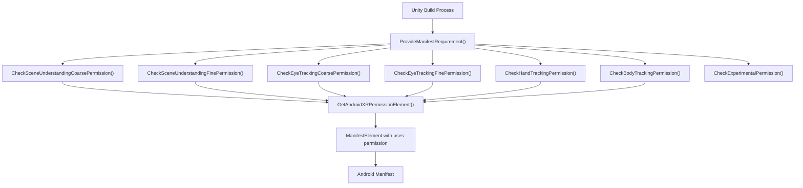
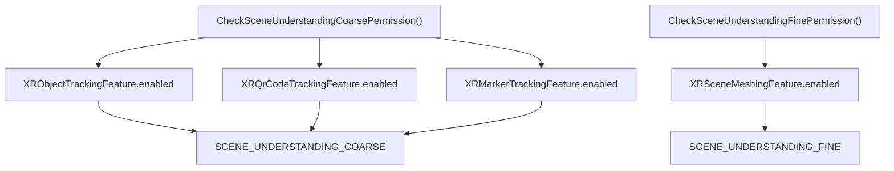
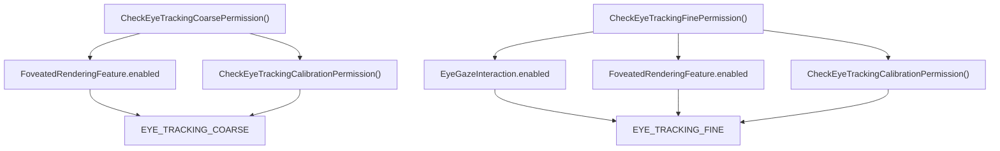
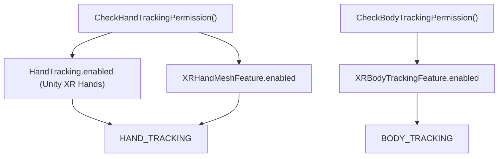
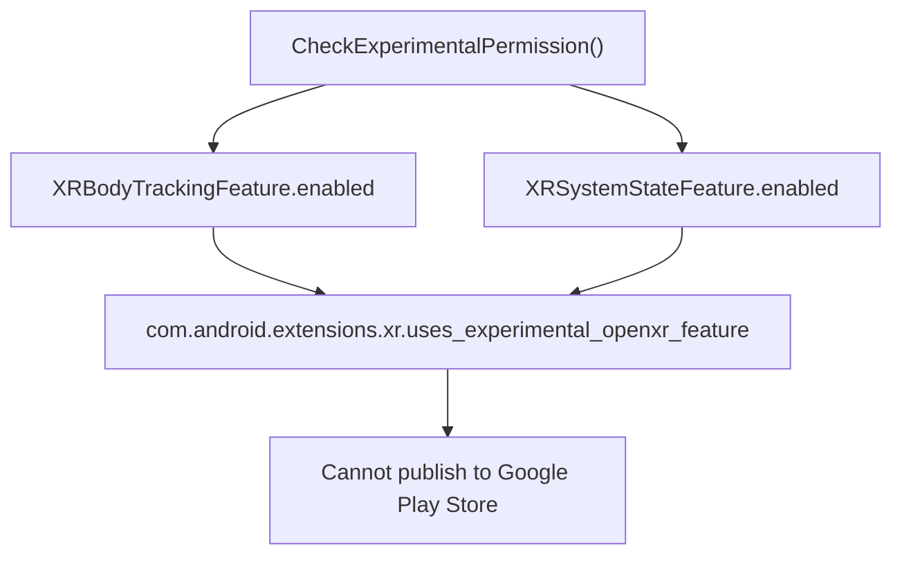

<!-- source: DeepWiki mcp.deepwiki.com · repo android/android-xr-unity-package · page 2.4 Permission System · fetched 2026-10-23 -->

# Permission System

Relevant source files

The following files were used as context for generating this wiki page:

- [Editor/Internal/XRSessionFeatureBuildHooks.cs](Editor/Internal/XRSessionFeatureBuildHooks.cs)
- [Runtime/AndroidXRPermissionExtensions.cs](Runtime/AndroidXRPermissionExtensions.cs)

This document covers the Android XR permission system used by the Unity package, including permission types, build-time injection, and feature-to-permission mapping. The system automatically manages Android manifest permissions based on enabled XR features and provides runtime permission utilities.

For information about XR feature configuration and management, see [Session Management](#2.1). For details about the build system integration, see [Build System Integration](#4).

## Permission Types

The Android XR Extensions package defines specific permission types through the `AndroidXRPermission` enum, each corresponding to different XR tracking capabilities and Android platform permissions.

| Permission Type | Android Permission String | Description |
|---|---|---|
| `SceneUnderstandingCoarse` | `android.permission.SCENE_UNDERSTANDING_COARSE` | Motion tracking, ToF sensor, VST RGB-left cameras |
| `SceneUnderstandingFine` | `android.permission.SCENE_UNDERSTANDING_FINE` | Depth texture, scene meshing |
| `HandTracking` | `android.permission.HAND_TRACKING` | Hand tracking capabilities |
| `EyeTrackingCoarse` | `android.permission.EYE_TRACKING_COARSE` | Basic eye tracking |
| `EyeTrackingFine` | `android.permission.EYE_TRACKING_FINE` | Eye gaze interaction, fine eye tracking |
| `FaceTracking` | `android.permission.FACE_TRACKING` | Face tracking capabilities |
| `BodyTracking` | `com.android.extensions.xr.BODY_TRACKING` | Body tracking capabilities |

```mermaid
graph TD
    AndroidXRPermission["AndroidXRPermission enum"]
    
    AndroidXRPermission --> SceneCoarse["SceneUnderstandingCoarse"]
    AndroidXRPermission --> SceneFine["SceneUnderstandingFine"]
    AndroidXRPermission --> HandTrack["HandTracking"]
    AndroidXRPermission --> EyeCoarse["EyeTrackingCoarse"]
    AndroidXRPermission --> EyeFine["EyeTrackingFine"]
    AndroidXRPermission --> FaceTrack["FaceTracking"]
    AndroidXRPermission --> BodyTrack["BodyTracking"]
    
    SceneCoarse --> SceneCoarseStr["android.permission.SCENE_UNDERSTANDING_COARSE"]
    SceneFine --> SceneFineStr["android.permission.SCENE_UNDERSTANDING_FINE"]
    HandTrack --> HandTrackStr["android.permission.HAND_TRACKING"]
    EyeCoarse --> EyeCoarseStr["android.permission.EYE_TRACKING_COARSE"]
    EyeFine --> EyeFineStr["android.permission.EYE_TRACKING_FINE"]
    FaceTrack --> FaceTrackStr["android.permission.FACE_TRACKING"]
    BodyTrack --> BodyTrackStr["com.android.extensions.xr.BODY_TRACKING"]
```

The `AndroidXRPermissionExtensions` class provides the `ToPermissionString()` method to convert enum values to their corresponding Android permission strings used in manifest declarations and runtime permission requests.

Sources: [Runtime/AndroidXRPermissionExtensions.cs:27-65](), [Runtime/AndroidXRPermissionExtensions.cs:78-100]()

## Build-time Permission Injection

The permission system automatically injects required permissions into the Android manifest during build time through the `XRSessionFeatureBuildHooks` class. This process analyzes enabled XR features and determines which permissions are necessary.

The `GetAndroidXRPermissionElement()` method creates `ManifestElement` objects that specify the `uses-permission` elements to be injected into the Android manifest.

Sources: [Editor/Internal/XRSessionFeatureBuildHooks.cs:127-222](), [Editor/Internal/XRSessionFeatureBuildHooks.cs:265-275]()

## Feature-to-Permission Mapping

The permission system uses specific logic to map enabled XR features to required Android permissions. Each permission check method examines the active XR features and determines permission requirements.

### Scene Understanding Permissions

### Eye Tracking Permissions

### Hand and Body Tracking Permissions

Sources: [Editor/Internal/XRSessionFeatureBuildHooks.cs:277-345](), [Editor/Internal/XRSessionFeatureBuildHooks.cs:347-358]()

## Runtime Permission Management

The `AndroidXRPermissionExtensions` class provides runtime utilities for working with Android XR permissions. The `ToPermissionString()` method converts `AndroidXRPermission` enum values to their corresponding Android permission strings for use in runtime permission requests.

| Method | Purpose | Return Type |
|---|---|---|
| `ToPermissionString()` | Converts enum to Android permission string | `string` |

The method handles each permission type through a switch statement, returning the appropriate Android permission string or logging an error for invalid permissions.

Sources: [Runtime/AndroidXRPermissionExtensions.cs:78-100]()

## Experimental Feature Handling

The system includes special handling for experimental features that require additional manifest metadata. The `CheckExperimentalPermission()` method identifies features that require the experimental OpenXR feature flag.

When experimental features are enabled, the system injects the `com.android.extensions.xr.uses_experimental_openxr_feature` metadata into the Android manifest, which enables access to ANDROIDX extensions but prevents Google Play Store publication.

Sources: [Editor/Internal/XRSessionFeatureBuildHooks.cs:196-202](), [Editor/Internal/XRSessionFeatureBuildHooks.cs:347-358]()

---

