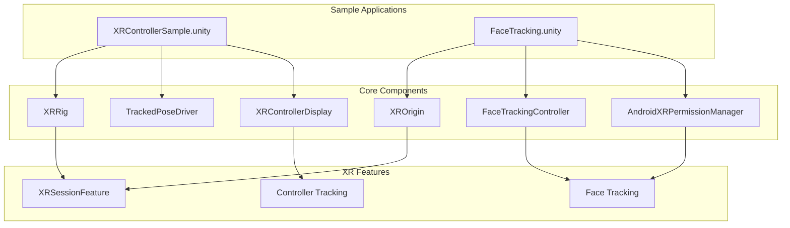
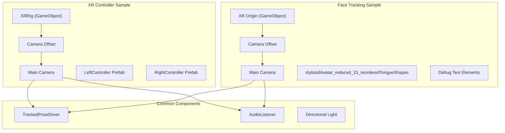
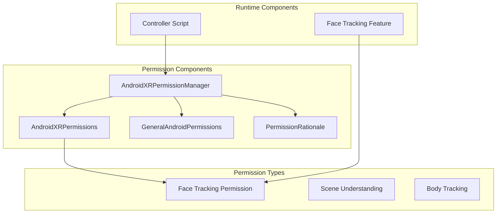

<!-- source: DeepWiki mcp.deepwiki.com · repo android/android-xr-unity-package · page 3 Sample Applications · fetched 2026-10-23 -->

# Sample Applications

Relevant source files

The following files were used as context for generating this wiki page:

- [Samples~/FaceTracking/FaceTracking.unity](Samples~/FaceTracking/FaceTracking.unity)
- [Samples~/XRController/XRControllerSample.unity](Samples~/XRController/XRControllerSample.unity)

This document covers the demonstration applications included with the Android XR Extensions for Unity package. These samples showcase practical implementations of the package's XR features and serve as reference implementations for developers integrating Android XR functionality into their Unity projects.

The samples demonstrate specific feature usage patterns and integration approaches. For detailed information about the underlying XR features themselves, see [Core XR Features](#2). For build system integration details, see [Build System Integration](#4).

## Overview

The package includes two primary sample applications that demonstrate different aspects of Android XR functionality:

| Sample | Purpose | Key Features |
|--------|---------|--------------|
| XR Controller Sample | Basic XR setup and controller tracking | Controller input, pose tracking, XR rig configuration |
| Face Tracking Sample | Facial expression tracking and avatar animation | Face tracking, blend shapes, debug visualization |

Sources: [Samples~/XRController/XRControllerSample.unity:1-627](), [Samples~/FaceTracking/FaceTracking.unity:1-1665]()

## Sample Architecture

Both samples follow a consistent architectural pattern that integrates with Unity's XR framework and the Android XR Extensions package:

### XR Setup Components

Each sample contains essential XR components for establishing the immersive experience:

Sources: [Samples~/XRController/XRControllerSample.unity:537-627](), [Samples~/FaceTracking/FaceTracking.unity:1137-1175]()

### Controller Integration

The XR Controller Sample demonstrates the integration pattern for controller tracking and visualization:

- **XRRig**: Root GameObject managing the XR coordinate system ([Samples~/XRController/XRControllerSample.unity:571-627]())
- **TrackedPoseDriver**: Updates camera position and rotation based on head tracking ([Samples~/XRController/XRControllerSample.unity:215-315]())
- **Controller Prefabs**: Left and right controller GameObjects with tracking and display components ([Samples~/XRController/XRControllerSample.unity:413-531]())

### Face Tracking Integration

The Face Tracking Sample showcases facial expression tracking implementation:

- **XR Origin**: Modern XR framework component replacing the legacy XRRig ([Samples~/FaceTracking/FaceTracking.unity:1137-1175]())
- **Avatar Model**: Skinned mesh with blend shapes for facial expression ([Samples~/FaceTracking/FaceTracking.unity:222-303]())
- **Debug Visualization**: Multiple TextMesh components displaying tracking data ([Samples~/FaceTracking/FaceTracking.unity:122-1275]())

## Permission Management

The Face Tracking Sample demonstrates the Android XR permission system integration:

The Face Tracking Sample includes an `AndroidXRPermissionManager` component configured with face tracking permissions ([Samples~/FaceTracking/FaceTracking.unity:1574-1588]()).

Sources: [Samples~/FaceTracking/FaceTracking.unity:1574-1588]()

## Debug and Visualization Systems

Both samples include comprehensive debug visualization systems for development and testing:

### Debug Text Elements

The Face Tracking Sample provides extensive debug information display:

| Component | Purpose | Configuration |
|-----------|---------|---------------|
| `DebugTextTopCenter` | General status information | Center-aligned, top position |
| `DebugTextBottomCenter` | Additional status data | Center-aligned, bottom position |
| `DebugTextLeft` | Left eye tracking data | Left-aligned display |
| `DebugTextRight` | Right eye tracking data | Right-aligned display |
| `DebugTextTimeStamp` | Frame timing information | Timestamp display |
| `DebugTextFrameValid` | Frame validity status | Boolean validation |
| `FPSCounter` | Performance monitoring | Frame rate display |

### Avatar Debug Information

The face tracking avatar includes confidence display elements positioned relative to facial features:

- **DebugTextConfidenceLeft**: Left eye confidence values ([Samples~/FaceTracking/FaceTracking.unity:1026-1125]())
- **DebugTextConfidenceRight**: Right eye confidence values ([Samples~/FaceTracking/FaceTracking.unity:614-713]())
- **DebugTextConfidenceBottom**: Mouth region confidence ([Samples~/FaceTracking/FaceTracking.unity:1176-1275]())

Sources: [Samples~/FaceTracking/FaceTracking.unity:122-1275](), [Samples~/FaceTracking/FaceTracking.unity:1539-1561]()

## Usage Instructions

### Importing Samples

1. Open Unity Package Manager
2. Select "Android XR Extensions" package
3. Navigate to "Samples" section
4. Click "Import" for desired sample applications

### Running Samples

1. **XR Controller Sample**: 
   - Open [Samples~/XRController/XRControllerSample.unity]()
   - Ensure OpenXR and Android XR providers are configured
   - Build and deploy to Android XR device

2. **Face Tracking Sample**:
   - Open [Samples~/FaceTracking/FaceTracking.unity]()
   - Verify face tracking permissions are enabled
   - Build and deploy to compatible Android XR device

### Integration Patterns

The samples demonstrate several key integration patterns:

- **XR Framework Integration**: Proper setup of Unity XR components
- **Permission Handling**: Runtime permission management for XR features
- **Debug Visualization**: Comprehensive development and testing tools
- **Performance Monitoring**: Frame rate and tracking quality indicators

Sources: [Samples~/XRController/XRControllerSample.unity:1-627](), [Samples~/FaceTracking/FaceTracking.unity:1-1665]()

---

