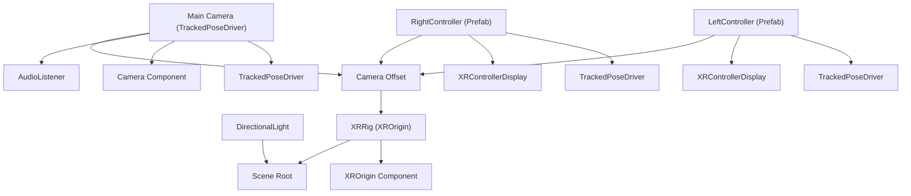
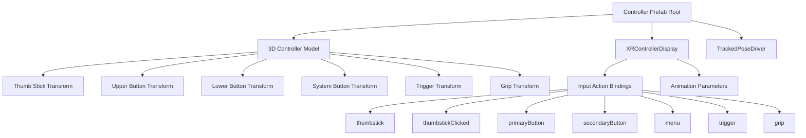
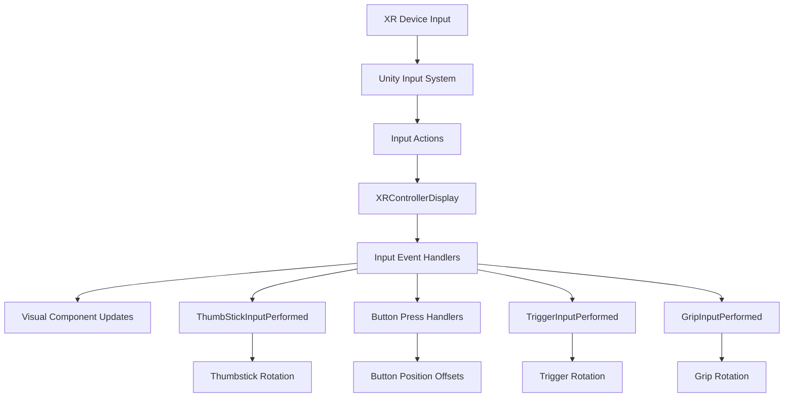
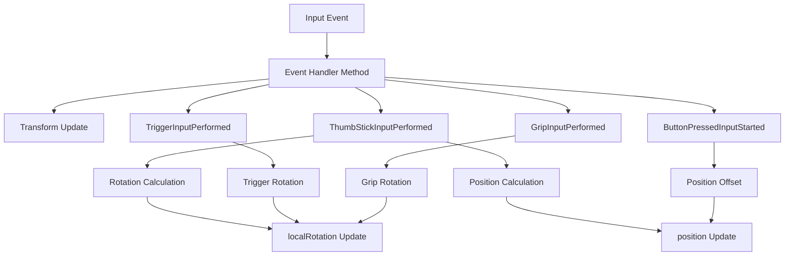

<!-- source: DeepWiki mcp.deepwiki.com · repo android/android-xr-unity-package · page 3.1 XR Controller Sample · fetched 2026-10-23 -->

# XR Controller Sample

<details>
<summary>Relevant source files</summary>

The following files were used as context for generating this wiki page:

- [Samples~/XRController/Prefab/LeftController.prefab](Samples~/XRController/Prefab/LeftController.prefab)
- [Samples~/XRController/Prefab/RightController.prefab](Samples~/XRController/Prefab/RightController.prefab)
- [Samples~/XRController/Script/XRControllerDisplay.cs](Samples~/XRController/Script/XRControllerDisplay.cs)
- [Samples~/XRController/XRControllerSample.unity](Samples~/XRController/XRControllerSample.unity)

</details>


This document covers the XR Controller Sample, a demonstration scene that showcases XR controller input handling and visual feedback systems. The sample provides a complete implementation of controller tracking, input processing, and visual representation for both left and right hand controllers.

For detailed information about the underlying controller display animation system, see [Controller Display System](#3.3). For broader XR feature implementations, see [Core XR Features](#2).

## Purpose and Scope

The XR Controller Sample demonstrates how to:
- Set up XR controller tracking and input handling
- Implement visual feedback for controller interactions
- Configure controller prefabs with appropriate input mappings
- Create a basic XR scene with proper camera and lighting setup

The sample is located in [Samples~/XRController/XRControllerSample.unity]() and serves as a reference implementation for developers integrating XR controller functionality.

## Scene Structure

The XR Controller Sample scene follows a standard XR setup pattern with tracking components and controller representations.

### Scene Hierarchy



**Sources:** [Samples~/XRController/XRControllerSample.unity:571-627]()

### Key Components

| Component | GameObject | Purpose |
|-----------|------------|---------|
| `XROrigin` | XRRig | Manages XR tracking origin and camera offset |
| `TrackedPoseDriver` | Main Camera | Tracks HMD position and rotation |
| `Camera` | Main Camera | Renders XR viewport with stereo configuration |
| `XRControllerDisplay` | Controller Prefabs | Handles controller visual feedback |
| `TrackedPoseDriver` | Controller Prefabs | Tracks controller position and rotation |

**Sources:** [Samples~/XRController/XRControllerSample.unity:588-604](), [Samples~/XRController/XRControllerSample.unity:215-315]()

## Controller Prefabs

The sample includes separate prefabs for left and right controllers, each configured with appropriate input mappings and visual components.

### Prefab Structure



**Sources:** [Samples~/XRController/Prefab/RightController.prefab:131-278](), [Samples~/XRController/Prefab/LeftController.prefab:131-278]()

### Input Mappings

The controller prefabs use Unity's Input System with XR-specific device paths:

| Input Action | Left Controller Path | Right Controller Path | Type |
|-------------|---------------------|----------------------|------|
| Thumbstick | `<XRController>{LeftHand}/thumbstick` | `<XRController>{RightHand}/thumbstick` | Vector2 |
| Thumbstick Click | `<XRController>{LeftHand}/thumbstickClicked` | `<XRController>{RightHand}/thumbstickClicked` | Button |
| Primary Button | `<XRController>{LeftHand}/primaryButton` | `<XRController>{RightHand}/primaryButton` | Button |
| Secondary Button | `<XRController>{LeftHand}/secondaryButton` | `<XRController>{RightHand}/secondaryButton` | Button |
| Menu Button | `<XRController>{LeftHand}/menu` | `<XRController>{RightHand}/menu` | Button |
| Trigger | `<XRController>{LeftHand}/trigger` | `<XRController>{RightHand}/trigger` | Float |
| Grip | `<XRController>{LeftHand}/grip` | `<XRController>{RightHand}/grip` | Float |

**Sources:** [Samples~/XRController/Prefab/LeftController.prefab:156-274](), [Samples~/XRController/Prefab/RightController.prefab:156-274]()

## Input Handling System

The controller input handling is managed through Unity's Input System with XR-specific bindings processed by the `XRControllerDisplay` component.

### Input Processing Flow



**Sources:** [Samples~/XRController/Script/XRControllerDisplay.cs:70-94](), [Samples~/XRController/Script/XRControllerDisplay.cs:132-220]()

### Event Handler Registration

The `XRControllerDisplay` component registers event handlers for all input actions during `OnEnable()`:

```csharp
// Input action event registration
_thumbStickInput.performed += ThumbStickInputPerformed;
_thumbStickInput.canceled += ThumbStickInputCanceled;
_upperButtonPressedInput.started += UpperButtonPressedInputStarted;
_triggerInput.performed += TriggerInputPerformed;
```

**Sources:** [Samples~/XRController/Script/XRControllerDisplay.cs:80-93]()

## Visual Feedback System

The visual feedback system animates controller components based on user input, providing tactile feedback through visual representation.

### Animation Parameters

| Component | Animation Type | Configuration |
|-----------|---------------|---------------|
| Thumbstick | Rotation + Position | Max rotation: 10°, Press offset: 0.002m |
| Upper Button | Position | Press offset: 0.002m |
| Lower Button | Position | Press offset: 0.002m |
| System Button | Position | Press offset: 0.001m |
| Trigger | Rotation | Max rotation: 17° |
| Grip | Rotation | Max rotation: 10° (left), -10° (right) |

**Sources:** [Samples~/XRController/Script/XRControllerDisplay.cs:40-46](), [Samples~/XRController/Prefab/LeftController.prefab:149-155]()

### Visual Update Methods



**Sources:** [Samples~/XRController/Script/XRControllerDisplay.cs:132-220]()

## Configuration and Usage

### Scene Setup Requirements

1. **XR Origin Configuration**: The scene requires an `XROrigin` component with proper tracking settings
2. **Controller Prefabs**: Both left and right controller prefabs must be children of the camera offset object
3. **Input System**: Unity's Input System package must be installed and configured
4. **XR Plugin**: Unity OpenXR plugin must be enabled in XR Management settings

**Sources:** [Samples~/XRController/XRControllerSample.unity:588-604](), [Samples~/XRController/XRControllerSample.unity:565-620]()

### Customization Options

The `XRControllerDisplay` component exposes several configuration parameters:

| Parameter | Purpose | Default Range |
|-----------|---------|---------------|
| `_maxThumbStickRot` | Maximum thumbstick rotation angles | (10°, 10°) |
| `_pressedThumbStickOffset` | Thumbstick press depth | 0.002m |
| `_maxTriggerRot` | Maximum trigger rotation | 17° |
| `_maxGripRot` | Maximum grip rotation | ±10° |
| `_inverseThumbStickX/Y` | Invert thumbstick axes | true |

**Sources:** [Samples~/XRController/Script/XRControllerDisplay.cs:40-59]()

### Integration with XR Systems

The sample integrates with the broader Android XR Extensions package through:
- Unity OpenXR device paths for controller input
- `TrackedPoseDriver` components for positional tracking
- Standard XR camera configuration for stereo rendering

**Sources:** [Samples~/XRController/XRControllerSample.unity:215-315](), [Samples~/XRController/Prefab/RightController.prefab:288-371]()

---

