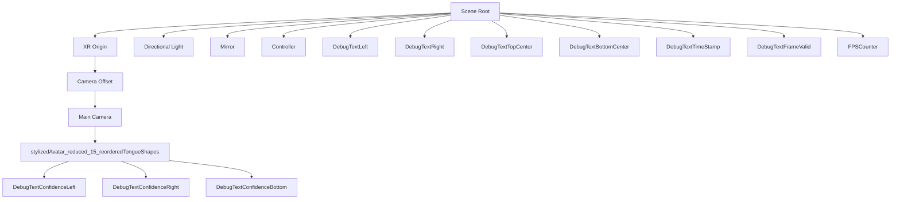
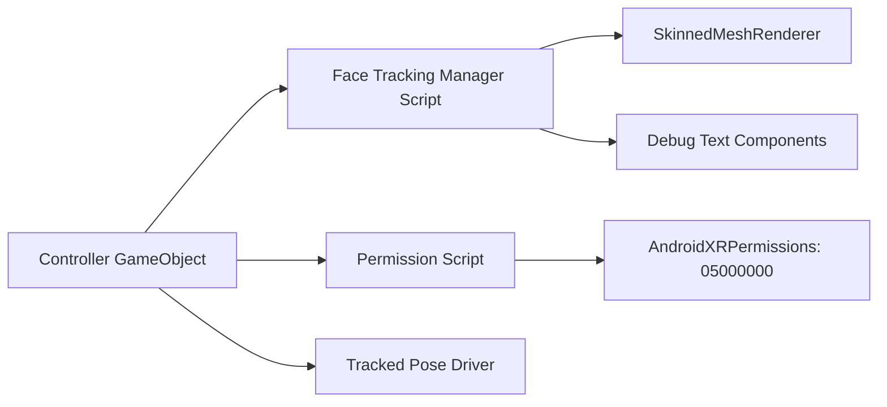
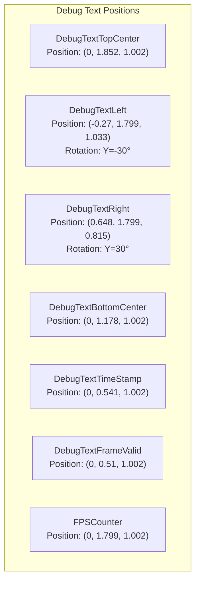
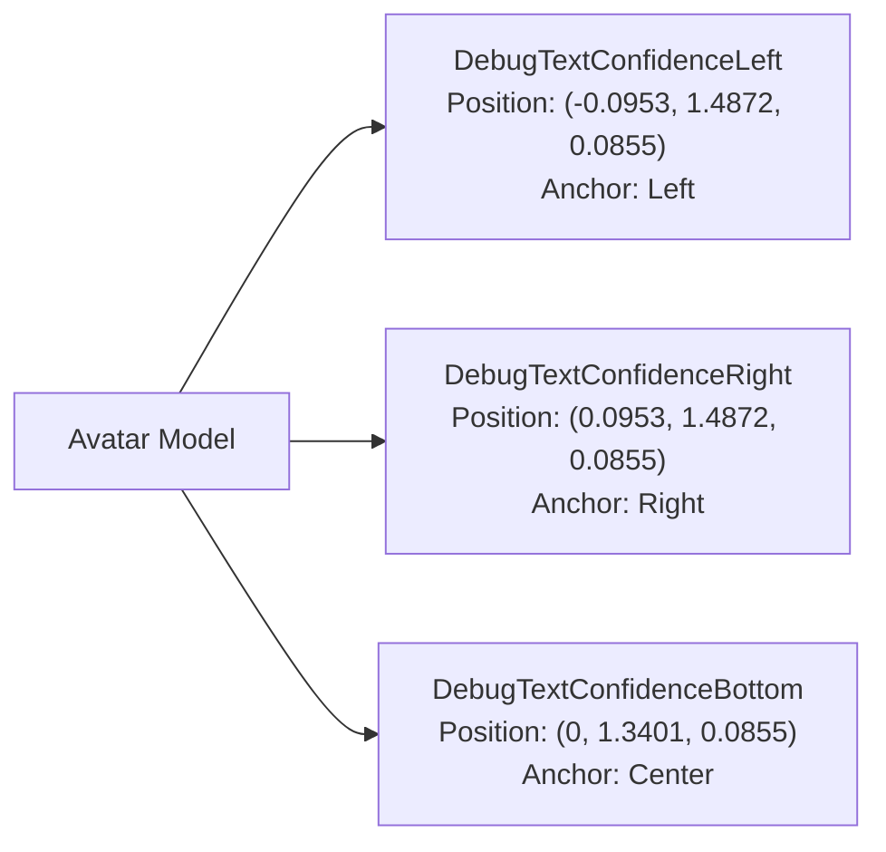
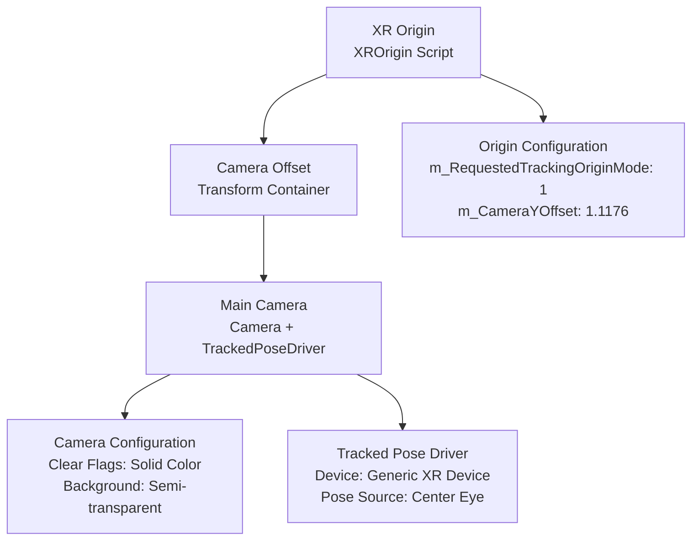
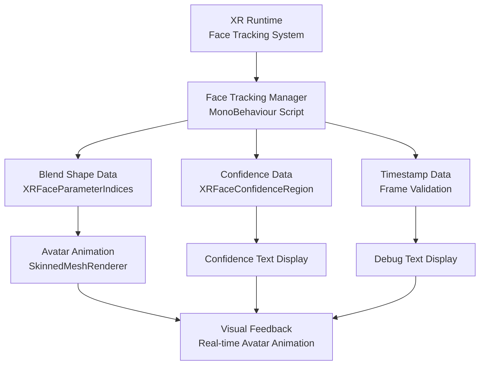

<!-- source: DeepWiki mcp.deepwiki.com · repo android/android-xr-unity-package · page 3.2 Face Tracking Sample · fetched 2026-10-23 -->

# Face Tracking Sample

Relevant source files

The following files were used as context for generating this wiki page:

- [CHANGELOG.md](CHANGELOG.md)
- [Samples~/FaceTracking/FaceTracking.unity](Samples~/FaceTracking/FaceTracking.unity)

## Purpose and Scope

The Face Tracking Sample demonstrates real-time face tracking capabilities using the Android XR Extensions for Unity package. This sample shows how to capture facial expressions, animate a 3D avatar using blend shapes, and display tracking confidence data through a debug visualization system.

For information about the underlying face tracking feature implementation, see [Tracking Features](#2.2). For details about required permissions, see [Permission System](#2.4).

## Scene Overview

The Face Tracking Sample is implemented as a Unity scene located at [Samples~/FaceTracking/FaceTracking.unity](). The scene provides a complete demonstration environment with an animated avatar, debug text displays, and real-time face tracking data visualization.

### Scene Hierarchy

Sources: [Samples~/FaceTracking/FaceTracking.unity:714-1664]()

## Key Components

### Face Tracking Manager

The primary face tracking logic is implemented in a script attached to the Controller GameObject. This component handles face tracking data processing and avatar animation.

The Controller GameObject contains three main MonoBehaviour components:
- Face tracking manager script [Samples~/FaceTracking/FaceTracking.unity:1548]()
- Permission handling script [Samples~/FaceTracking/FaceTracking.unity:1583]()
- Tracked pose driver for XR positioning [Samples~/FaceTracking/FaceTracking.unity:1766]()

Sources: [Samples~/FaceTracking/FaceTracking.unity:1539-1588]()

### Avatar Model Integration

The sample uses a stylized avatar model with blend shape support for facial animation. The avatar is positioned as a child of the Main Camera to maintain proper spatial relationship with the user's head tracking.

| Component | Purpose | Configuration |
|-----------|---------|---------------|
| SkinnedMeshRenderer | Renders the 3D avatar with blend shapes | Referenced in Controller script |
| Transform | Positioned at camera offset | Scale: 1.5127, Position: (0, -2.224, 0.065) |
| Layer | Visual separation | Layer 6 |

Sources: [Samples~/FaceTracking/FaceTracking.unity:332-345](), [Samples~/FaceTracking/FaceTracking.unity:1561]()

## Debug Visualization System

The sample includes a comprehensive debug visualization system that displays face tracking data in real-time through strategically positioned text elements.

### Debug Text Layout

### Confidence Region Visualization

Three confidence text displays are positioned directly on the avatar model to show tracking confidence for different facial regions:

Sources: [Samples~/FaceTracking/FaceTracking.unity:1026-1275](), [Samples~/FaceTracking/FaceTracking.unity:1551-1560]()

## Permission Requirements

The Face Tracking Sample requires specific Android XR permissions to function properly. The permission system is configured through the AndroidXRPermissionExtensions component.

### Required Permissions

| Permission Type | Value | Purpose |
|----------------|-------|---------|
| AndroidXRPermissions | 05000000 | Face tracking access |
| PermissionRationale | "Required for face tracking." | User explanation |

The permission value `05000000` corresponds to face tracking permissions in the Android XR Extensions permission system.

Sources: [Samples~/FaceTracking/FaceTracking.unity:1586-1588]()

## XR Origin Configuration

The scene uses Unity's XR Origin system for proper head tracking and spatial positioning in the XR environment.

### XR Origin Setup

The XR Origin is configured with:
- Tracking origin mode set to floor-level tracking
- Camera Y offset of 1.1176 meters for proper head positioning
- Center eye pose source for head tracking

Sources: [Samples~/FaceTracking/FaceTracking.unity:1143-1159](), [Samples~/FaceTracking/FaceTracking.unity:1761-1766]()

## Face Tracking Data Flow

The face tracking system processes data through several stages to drive avatar animation and debug visualization:

Sources: [Samples~/FaceTracking/FaceTracking.unity:1548-1561](), [CHANGELOG.md:85-87]()

---

