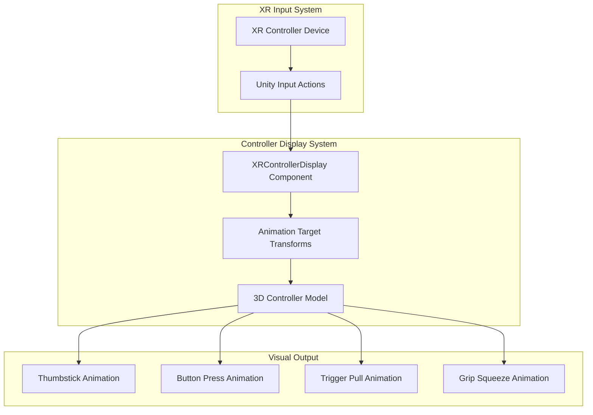
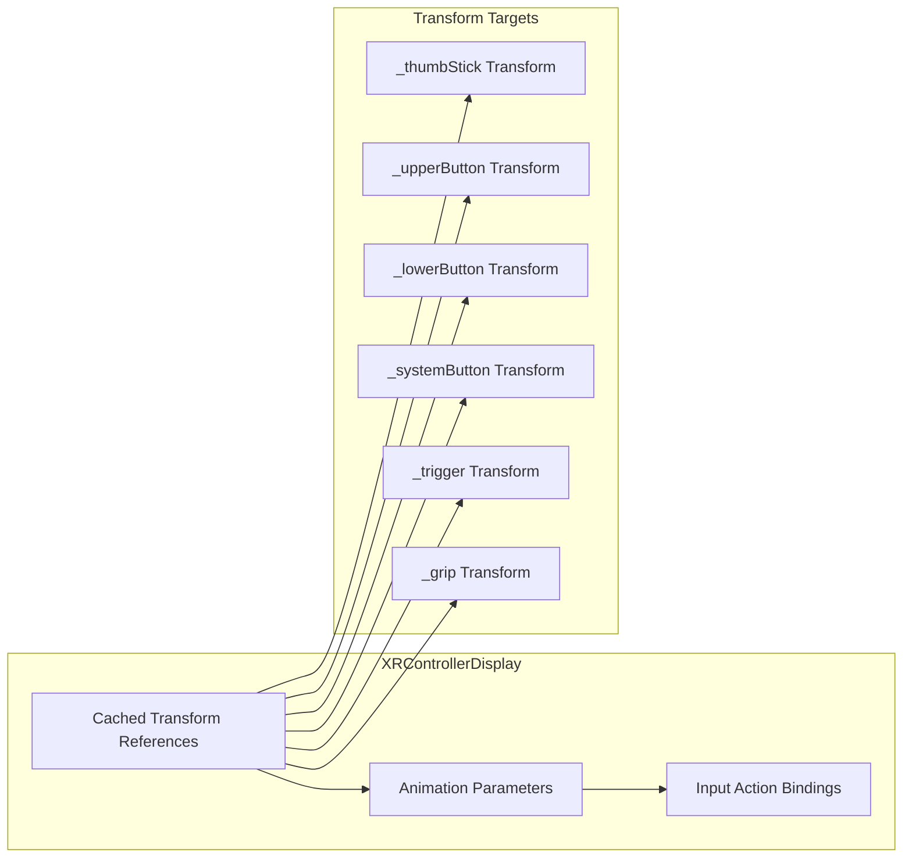
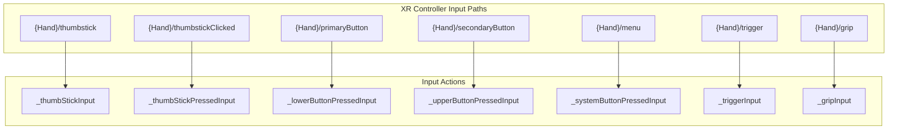
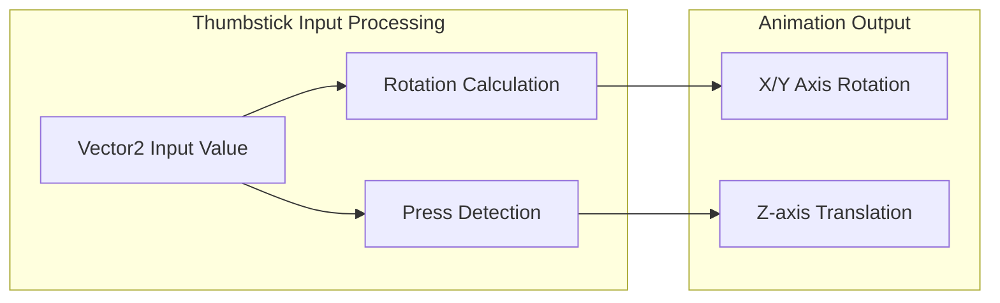
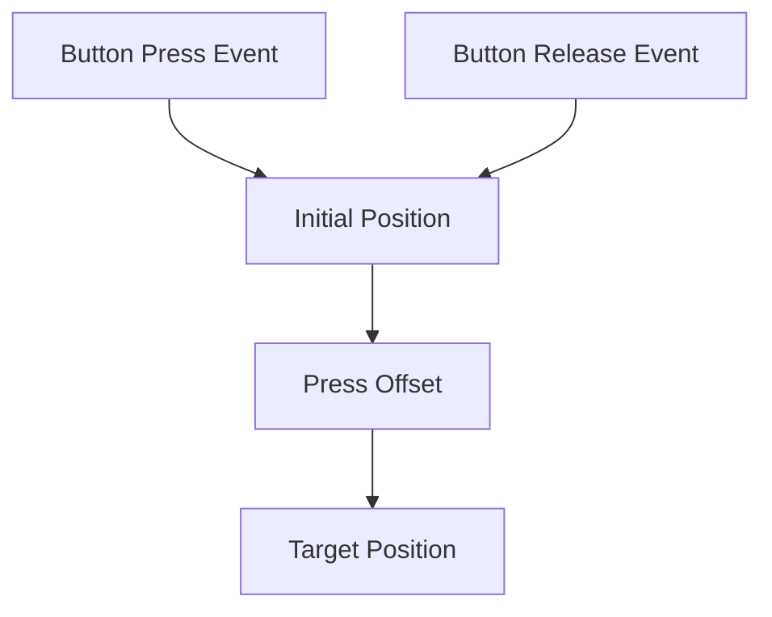
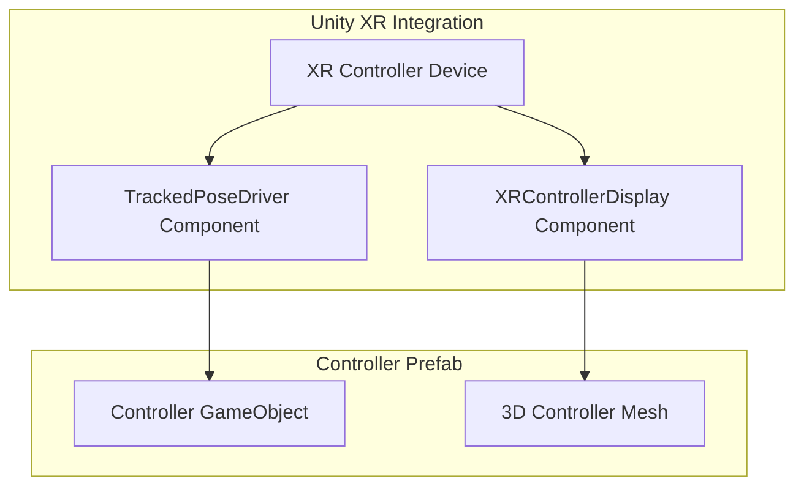

<!-- source: DeepWiki mcp.deepwiki.com · repo android/android-xr-unity-package · page 3.3 Controller Display System · fetched 2026-10-23 -->

# Controller Display System

Relevant source files

The following files were used as context for generating this wiki page:

- [Samples~/XRController/Prefab/LeftController.prefab](Samples~/XRController/Prefab/LeftController.prefab)
- [Samples~/XRController/Prefab/RightController.prefab](Samples~/XRController/Prefab/RightController.prefab)
- [Samples~/XRController/README.md](Samples~/XRController/README.md)
- [Samples~/XRController/README.md.meta](Samples~/XRController/README.md.meta)
- [Samples~/XRController/Script/XRControllerDisplay.cs](Samples~/XRController/Script/XRControllerDisplay.cs)

## Purpose and Scope

The Controller Display System provides visual feedback for XR controllers by animating 3D controller models based on real-time user input. This system demonstrates how to create responsive controller visualizations that mirror physical controller interactions within Unity XR applications.

For information about the broader XR Controller Sample scene setup, see [XR Controller Sample](#3.1). For details about Unity's input system integration with XR features, see [Build System Integration](#4).

## System Overview

The Controller Display System consists of the `XRControllerDisplay` component that monitors XR controller inputs and translates them into visual animations on 3D controller models. The system supports both left and right hand controllers with identical functionality but different configurations.

**Sources:** [Samples~/XRController/Script/XRControllerDisplay.cs:1-223]()

## Component Architecture

The `XRControllerDisplay` class extends Unity's `MonoBehaviour` and manages the visual representation of controller interactions through a collection of `Transform` references and `InputAction` bindings.

### Core Components

| Component | Purpose | Configuration |
|-----------|---------|---------------|
| `_thumbStick` | Thumbstick rotation and press animation | Max rotation angles, press offset |
| `_upperButton` | Secondary button press animation | Press offset distance |
| `_lowerButton` | Primary button press animation | Press offset distance |
| `_systemButton` | Menu button press animation | Press offset distance |
| `_trigger` | Trigger pull animation | Max rotation angle, rotation pivot |
| `_grip` | Grip squeeze animation | Max rotation angle, rotation pivot |

**Sources:** [Samples~/XRController/Script/XRControllerDisplay.cs:28-60]()

## Input Handling System

The system uses Unity's Input System with `InputAction` objects to receive controller input data. Each controller element has dedicated input actions that trigger specific animation behaviors.

### Input Action Mappings

The system registers event handlers during `OnEnable()` and unregisters them during `OnDisable()` to ensure proper lifecycle management.

**Sources:** [Samples~/XRController/Script/XRControllerDisplay.cs:48-60](), [Samples~/XRController/Script/XRControllerDisplay.cs:70-119]()

## Animation System

### Thumbstick Animation

The thumbstick supports both rotation and press animations. Rotation is calculated based on the 2D input vector, while press animation translates the thumbstick along its up vector.

The rotation calculation uses `Mathf.Lerp()` to map input values to rotation angles, with inversion flags for different controller orientations.

**Sources:** [Samples~/XRController/Script/XRControllerDisplay.cs:132-158]()

### Button Press Animation

Button press animations translate the button transforms along their up vector by a configurable offset when pressed, then return to initial position when released.

**Sources:** [Samples~/XRController/Script/XRControllerDisplay.cs:160-194]()

### Trigger and Grip Animation

Trigger and grip animations use rotation around configurable pivot points. The rotation amount is interpolated based on the input value using `Mathf.Lerp()`.

**Sources:** [Samples~/XRController/Script/XRControllerDisplay.cs:196-220]()

## Configuration

### Left vs Right Controller Differences

Both controller prefabs use identical `XRControllerDisplay` configurations with the following key differences:

| Parameter | Left Controller | Right Controller |
|-----------|-----------------|------------------|
| `_maxGripRot` | 10 | -10 |
| Input Bindings | `{LeftHand}` | `{RightHand}` |

### Animation Parameters

| Parameter | Default Value | Purpose |
|-----------|---------------|---------|
| `_maxThumbStickRot` | (10, 10) | Maximum rotation angles for thumbstick |
| `_pressedThumbStickOffset` | 0.002 | Distance thumbstick moves when pressed |
| `_pressedUpperBtnOffset` | 0.002 | Distance upper button moves when pressed |
| `_pressedLowerBtnOffset` | 0.002 | Distance lower button moves when pressed |
| `_pressedSystemBtnOffset` | 0.001 | Distance system button moves when pressed |
| `_maxTriggerRot` | 17 | Maximum trigger rotation angle |
| `_triggerRotationPivot` | (1, 0, 0) | Rotation axis for trigger |
| `_gripRotationPivot` | (0, 0, 1) | Rotation axis for grip |

**Sources:** [Samples~/XRController/Prefab/LeftController.prefab:149-278](), [Samples~/XRController/Prefab/RightController.prefab:149-278]()

## Integration with Unity XR

The system integrates with Unity's XR input system through the `XRController` device layout. Each controller also includes a `TrackedPoseDriver` component for position and rotation tracking.

The `TrackedPoseDriver` handles spatial positioning while `XRControllerDisplay` manages input-based animations, providing a complete controller visualization solution.

**Sources:** [Samples~/XRController/Prefab/LeftController.prefab:279-371](), [Samples~/XRController/Prefab/RightController.prefab:279-371]()

---

