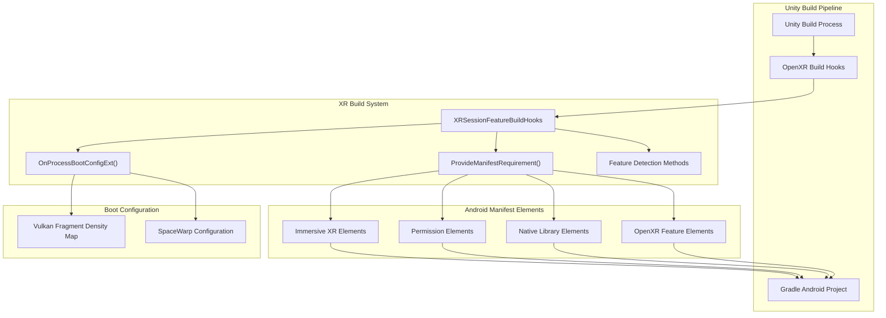
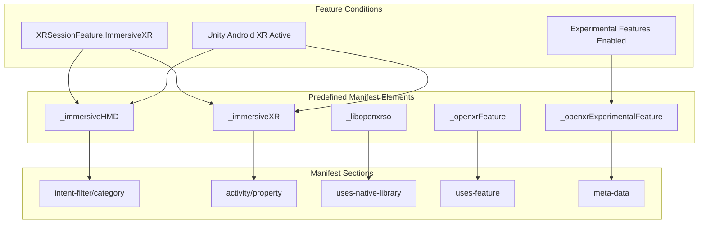
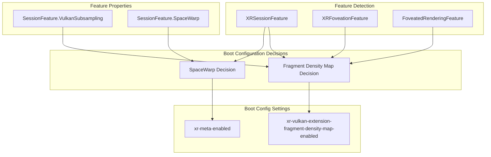
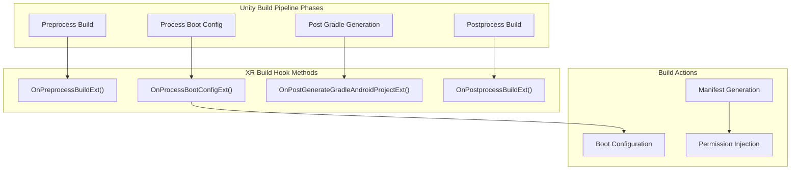
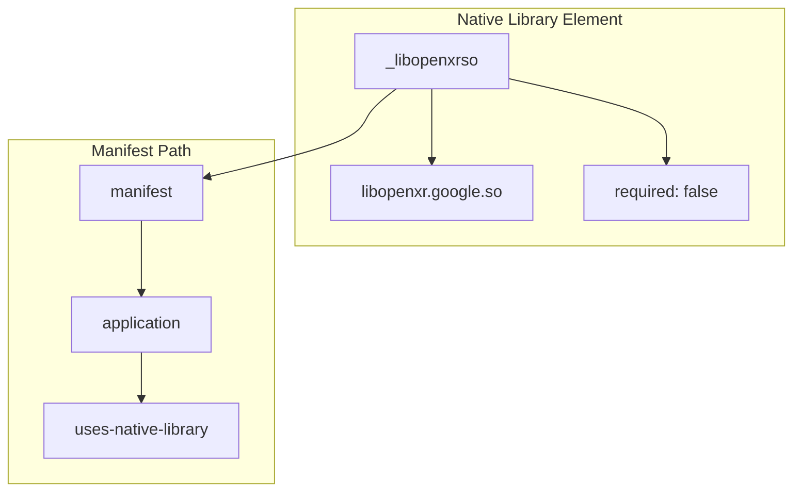

<!-- source: DeepWiki mcp.deepwiki.com · repo android/android-xr-unity-package · page 4 Build System Integration · fetched 2026-10-23 -->

# Build System Integration

Relevant source files

The following files were used as context for generating this wiki page:

- [Editor/Internal/XRSessionFeatureBuildHooks.cs](Editor/Internal/XRSessionFeatureBuildHooks.cs)
- [Runtime/Plugins/openxr_android.aar](Runtime/Plugins/openxr_android.aar)

This document covers the Android XR Extensions package's integration with Unity's build pipeline, focusing on automatic Android manifest generation, permission management, and OpenXR runtime configuration. The build system ensures that XR applications are properly configured for Android XR platforms without requiring manual manifest editing.

For information about specific XR features that trigger build configurations, see [Core XR Features](#2). For Android-specific permissions, see [Permission System](#2.4).

## Architecture Overview

The build system integration is centered around the `XRSessionFeatureBuildHooks` class, which extends Unity's `OpenXRFeatureBuildHooks` to automatically configure Android applications for XR use.

**Sources:** [Editor/Internal/XRSessionFeatureBuildHooks.cs:40-126]()

## Android Manifest Generation

The `ProvideManifestRequirement()` method automatically generates Android manifest entries based on enabled XR features. The system creates predefined `ManifestElement` objects that are injected into the application's manifest.

### Core Manifest Elements

**Sources:** [Editor/Internal/XRSessionFeatureBuildHooks.cs:42-113](), [Editor/Internal/XRSessionFeatureBuildHooks.cs:127-222]()

### Immersive XR Configuration

The system automatically configures immersive XR settings when the `XRSessionFeature.ImmersiveXR` property is enabled:

| Manifest Element | Path | Purpose |
|------------------|------|---------|
| `_immersiveHMD` | `intent-filter/category` | Declares support for immersive HMD applications |
| `_immersiveXR` | `activity/property` | Sets XR activity start mode to full space unmanaged |

**Sources:** [Editor/Internal/XRSessionFeatureBuildHooks.cs:134-146]()

## Permission System Integration

The build system automatically detects which XR features are enabled and injects the corresponding Android permissions into the manifest.

```mermaid
graph TB
    subgraph "Feature Detection Methods"
        CheckSceneCoarse["CheckSceneUnderstandingCoarsePermission()"]
        CheckSceneFine["CheckSceneUnderstandingFinePermission()"]
        CheckEyeCoarse["CheckEyeTrackingCoarsePermission()"]
        CheckEyeFine["CheckEyeTrackingFinePermission()"]
        CheckHand["CheckHandTrackingPermission()"]
        CheckBody["CheckBodyTrackingPermission()"]
        CheckExperimental["CheckExperimentalPermission()"]
    end
    
    subgraph "XR Features"
        ObjectTracking["XRObjectTrackingFeature"]
        QrTracking["XRQrCodeTrackingFeature"]
        MarkerTracking["XRMarkerTrackingFeature"]
        SceneMeshing["XRSceneMeshingFeature"]
        EyeGaze["EyeGazeInteraction"]
        FoveatedRendering["FoveatedRenderingFeature"]
        HandTracking["HandTracking"]
        HandMesh["XRHandMeshFeature"]
        BodyTracking["XRBodyTrackingFeature"]
        SystemState["XRSystemStateFeature"]
    end
    
    subgraph "Android Permissions"
        SceneCoarse["SceneUnderstandingCoarse"]
        SceneFine["SceneUnderstandingFine"]
        EyeCoarse["EyeTrackingCoarse"]
        EyeFine["EyeTrackingFine"]
        Hand["HandTracking"]
        Body["BodyTracking"]
    end
    
    ObjectTracking --> CheckSceneCoarse
    QrTracking --> CheckSceneCoarse
    MarkerTracking --> CheckSceneCoarse
    SceneMeshing --> CheckSceneFine
    EyeGaze --> CheckEyeFine
    FoveatedRendering --> CheckEyeCoarse
    FoveatedRendering --> CheckEyeFine
    HandTracking --> CheckHand
    HandMesh --> CheckHand
    BodyTracking --> CheckBody
    BodyTracking --> CheckExperimental
    SystemState --> CheckExperimental
    
    CheckSceneCoarse --> SceneCoarse
    CheckSceneFine --> SceneFine
    CheckEyeCoarse --> EyeCoarse
    CheckEyeFine --> EyeFine
    CheckHand --> Hand
    CheckBody --> Body
```

**Sources:** [Editor/Internal/XRSessionFeatureBuildHooks.cs:148-202](), [Editor/Internal/XRSessionFeatureBuildHooks.cs:277-358]()

### Permission Detection Logic

The system uses specific methods to detect feature usage:

| Method | Features Checked | Permission Granted |
|--------|------------------|-------------------|
| `CheckSceneUnderstandingCoarsePermission()` | Object, QR, Marker tracking | `SceneUnderstandingCoarse` |
| `CheckSceneUnderstandingFinePermission()` | Scene meshing | `SceneUnderstandingFine` |
| `CheckEyeTrackingCoarsePermission()` | Foveated rendering | `EyeTrackingCoarse` |
| `CheckEyeTrackingFinePermission()` | Eye gaze interaction | `EyeTrackingFine` |
| `CheckHandTrackingPermission()` | Hand tracking/mesh | `HandTracking` |
| `CheckBodyTrackingPermission()` | Body tracking | `BodyTracking` |

**Sources:** [Editor/Internal/XRSessionFeatureBuildHooks.cs:277-345]()

## Boot Configuration System

The `OnProcessBootConfigExt()` method configures Unity's boot settings for optimal XR performance on Android.

**Sources:** [Editor/Internal/XRSessionFeatureBuildHooks.cs:225-248]()

### Configuration Logic

The boot configuration system enables specific rendering optimizations:

- **Fragment Density Map**: Enabled when `VulkanSubsampling` is active or foveation features are enabled
- **SpaceWarp**: Enabled when `XRSessionFeature.SpaceWarp` is active

**Sources:** [Editor/Internal/XRSessionFeatureBuildHooks.cs:234-247]()

## Build Pipeline Integration

The `XRSessionFeatureBuildHooks` class integrates with Unity's build pipeline through several key methods:

**Sources:** [Editor/Internal/XRSessionFeatureBuildHooks.cs:251-263]()

### Build Hook Implementation

The class provides callback order and feature type identification:

- **`callbackOrder`**: Set to 1 (order doesn't matter for this implementation)
- **`featureType`**: Returns `typeof(XRSessionFeature)` to associate with the session feature

**Sources:** [Editor/Internal/XRSessionFeatureBuildHooks.cs:119-125]()

## Native Library Integration

The build system automatically includes the OpenXR Android runtime library:

**Sources:** [Editor/Internal/XRSessionFeatureBuildHooks.cs:69-81](), [Editor/Internal/XRSessionFeatureBuildHooks.cs:204-205]()

The system always includes the `libopenxr.google.so` native library with `required="false"` to ensure compatibility with the OpenXR Android runtime while maintaining flexibility for different deployment scenarios.

---

