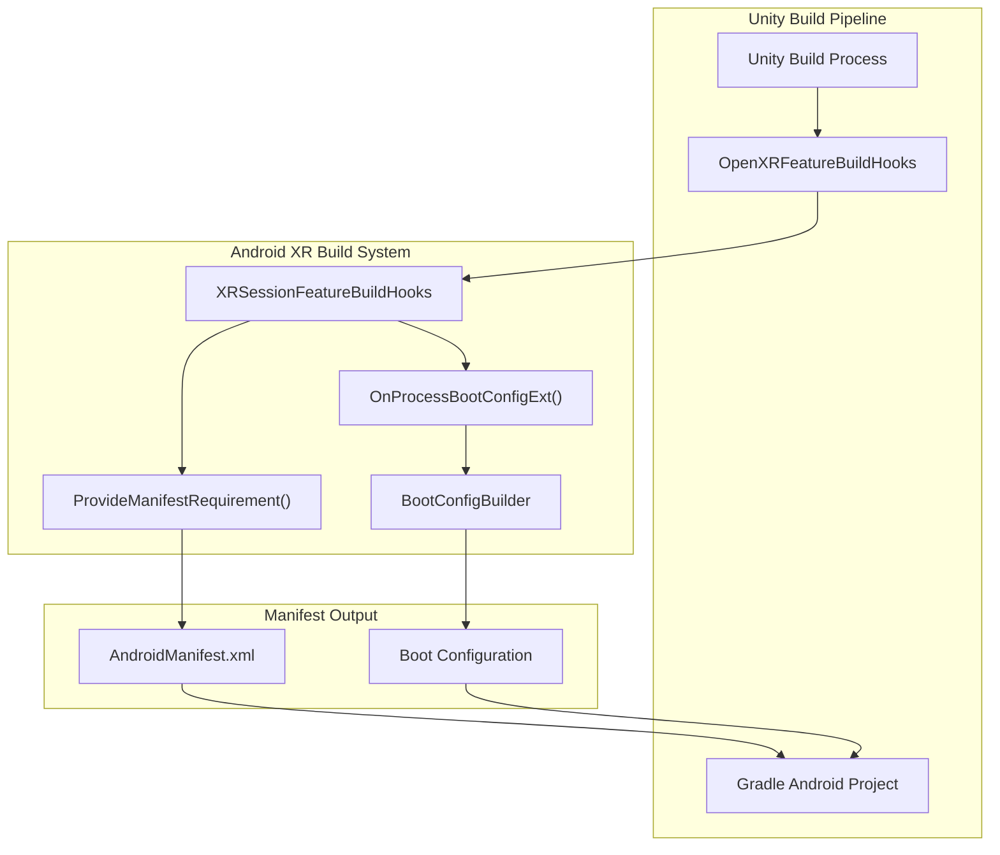
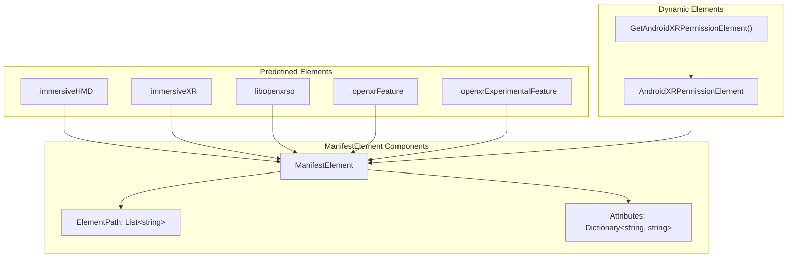
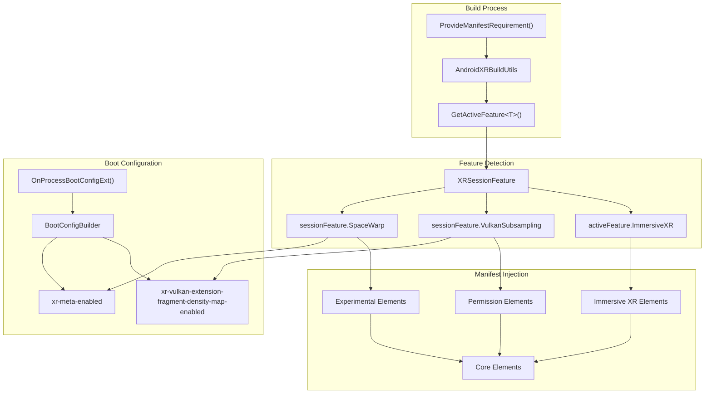

<!-- source: DeepWiki mcp.deepwiki.com · repo android/android-xr-unity-package · page 4.1 Android Manifest Configuration · fetched 2026-10-23 -->

# Android Manifest Configuration

Relevant source files

The following files were used as context for generating this wiki page:

- [Editor/Internal/XRSessionFeatureBuildHooks.cs](Editor/Internal/XRSessionFeatureBuildHooks.cs)
- [Runtime/AndroidXRPermissionExtensions.cs](Runtime/AndroidXRPermissionExtensions.cs)

This document explains how the Android XR Extensions for Unity package automatically configures the Android manifest during the build process. The system uses Unity's build hooks to inject required permissions, features, and metadata based on the enabled XR features in the project.

For information about the individual XR features that trigger manifest modifications, see [Core XR Features](#2). For details on the permission system at runtime, see [Permission System](#2.4).

## Build Hook Architecture

The manifest configuration is handled by the `XRSessionFeatureBuildHooks` class, which extends Unity's `OpenXRFeatureBuildHooks` to integrate with the OpenXR build pipeline. This class automatically detects which XR features are enabled and injects the corresponding manifest elements.

### Build Hook Integration

Sources: [Editor/Internal/XRSessionFeatureBuildHooks.cs:40-41](), [Editor/Internal/XRSessionFeatureBuildHooks.cs:115-125](), [Editor/Internal/XRSessionFeatureBuildHooks.cs:225-248]()

## Manifest Element Injection

The build hooks inject several types of manifest elements based on the enabled features and configuration. Each element is represented by a `ManifestElement` structure that defines the XML path and attributes.

### Core Manifest Elements

| Element Type | Purpose | XML Path | Key Attributes |
|-------------|---------|----------|----------------|
| Immersive HMD Category | Declares XR app category | `manifest/application/activity/intent-filter/category` | `name="org.khronos.openxr.intent.category.IMMERSIVE_HMD"` |
| XR Activity Property | Configures XR activity mode | `manifest/application/activity/property` | `name="android.window.PROPERTY_XR_ACTIVITY_START_MODE"` |
| Native Library | Links OpenXR runtime | `manifest/application/uses-native-library` | `name="libopenxr.google.so"` |
| OpenXR Feature | Declares OpenXR support | `manifest/uses-feature` | `name="android.software.xr.api.openxr"` |
| Experimental Meta-data | Enables experimental features | `manifest/application/meta-data` | `name="com.android.extensions.xr.uses_experimental_openxr_feature"` |

### Manifest Element Structure

Sources: [Editor/Internal/XRSessionFeatureBuildHooks.cs:42-53](), [Editor/Internal/XRSessionFeatureBuildHooks.cs:55-67](), [Editor/Internal/XRSessionFeatureBuildHooks.cs:69-81](), [Editor/Internal/XRSessionFeatureBuildHooks.cs:83-99](), [Editor/Internal/XRSessionFeatureBuildHooks.cs:101-113](), [Editor/Internal/XRSessionFeatureBuildHooks.cs:265-275]()

## Permission System

The build hooks automatically inject Android permissions based on the enabled XR features. The permission system uses the `AndroidXRPermission` enum to define available permissions and their corresponding manifest strings.

### Permission Types and Triggers

```mermaid
graph TD
    subgraph "XR Features"
        XRObjectTrackingFeature["XRObjectTrackingFeature"]
        XRQrCodeTrackingFeature["XRQrCodeTrackingFeature"]
        XRMarkerTrackingFeature["XRMarkerTrackingFeature"]
        XRSceneMeshingFeature["XRSceneMeshingFeature"]
        FoveatedRenderingFeature["FoveatedRenderingFeature"]
        EyeGazeInteraction["EyeGazeInteraction"]
        HandTracking["HandTracking"]
        XRHandMeshFeature["XRHandMeshFeature"]
        XRBodyTrackingFeature["XRBodyTrackingFeature"]
    end
    
    subgraph "Permission Checks"
        CheckSceneUnderstandingCoarsePermission["CheckSceneUnderstandingCoarsePermission()"]
        CheckSceneUnderstandingFinePermission["CheckSceneUnderstandingFinePermission()"]
        CheckEyeTrackingCoarsePermission["CheckEyeTrackingCoarsePermission()"]
        CheckEyeTrackingFinePermission["CheckEyeTrackingFinePermission()"]
        CheckHandTrackingPermission["CheckHandTrackingPermission()"]
        CheckBodyTrackingPermission["CheckBodyTrackingPermission()"]
    end
    
    subgraph "Android Permissions"
        SceneUnderstandingCoarse["SCENE_UNDERSTANDING_COARSE"]
        SceneUnderstandingFine["SCENE_UNDERSTANDING_FINE"]
        EyeTrackingCoarse["EYE_TRACKING_COARSE"]
        EyeTrackingFine["EYE_TRACKING_FINE"]
        HandTrackingPerm["HAND_TRACKING"]
        BodyTrackingPerm["BODY_TRACKING"]
    end
    
    XRObjectTrackingFeature --> CheckSceneUnderstandingCoarsePermission
    XRQrCodeTrackingFeature --> CheckSceneUnderstandingCoarsePermission
    XRMarkerTrackingFeature --> CheckSceneUnderstandingCoarsePermission
    XRSceneMeshingFeature --> CheckSceneUnderstandingFinePermission
    FoveatedRenderingFeature --> CheckEyeTrackingCoarsePermission
    FoveatedRenderingFeature --> CheckEyeTrackingFinePermission
    EyeGazeInteraction --> CheckEyeTrackingFinePermission
    HandTracking --> CheckHandTrackingPermission
    XRHandMeshFeature --> CheckHandTrackingPermission
    XRBodyTrackingFeature --> CheckBodyTrackingPermission
    
    CheckSceneUnderstandingCoarsePermission --> SceneUnderstandingCoarse
    CheckSceneUnderstandingFinePermission --> SceneUnderstandingFine
    CheckEyeTrackingCoarsePermission --> EyeTrackingCoarse
    CheckEyeTrackingFinePermission --> EyeTrackingFine
    CheckHandTrackingPermission --> HandTrackingPerm
    CheckBodyTrackingPermission --> BodyTrackingPerm
```

Sources: [Editor/Internal/XRSessionFeatureBuildHooks.cs:277-290](), [Editor/Internal/XRSessionFeatureBuildHooks.cs:292-299](), [Editor/Internal/XRSessionFeatureBuildHooks.cs:301-318](), [Editor/Internal/XRSessionFeatureBuildHooks.cs:325-338](), [Editor/Internal/XRSessionFeatureBuildHooks.cs:340-345](), [Runtime/AndroidXRPermissionExtensions.cs:27-65]()

### Permission String Mapping

The `AndroidXRPermissionExtensions.ToPermissionString()` method converts the enum values to their corresponding Android permission strings:

| AndroidXRPermission | Permission String |
|-------------------|------------------|
| `SceneUnderstandingCoarse` | `android.permission.SCENE_UNDERSTANDING_COARSE` |
| `SceneUnderstandingFine` | `android.permission.SCENE_UNDERSTANDING_FINE` |
| `HandTracking` | `android.permission.HAND_TRACKING` |
| `EyeTrackingCoarse` | `android.permission.EYE_TRACKING_COARSE` |
| `EyeTrackingFine` | `android.permission.EYE_TRACKING_FINE` |
| `FaceTracking` | `android.permission.FACE_TRACKING` |
| `BodyTracking` | `com.android.extensions.xr.BODY_TRACKING` |

Sources: [Runtime/AndroidXRPermissionExtensions.cs:78-100]()

## Feature-Based Configuration

The build hooks query the active XR features using `AndroidXRBuildUtils.GetActiveFeature<T>()` to determine which manifest elements to inject. This creates a dynamic configuration system that adapts to the project's enabled features.

### Configuration Flow

Sources: [Editor/Internal/XRSessionFeatureBuildHooks.cs:127-222](), [Editor/Internal/XRSessionFeatureBuildHooks.cs:225-248]()

## Boot Configuration

In addition to manifest elements, the build hooks configure boot-time settings through the `OnProcessBootConfigExt()` method. This method sets boolean flags in the boot configuration based on enabled features.

### Boot Configuration Settings

| Setting | Purpose | Trigger Features |
|---------|---------|------------------|
| `xr-vulkan-extension-fragment-density-map-enabled` | Enables Vulkan fragment density map | `XRSessionFeature.VulkanSubsampling`, `XRFoveationFeature`, `FoveatedRenderingFeature` |
| `xr-meta-enabled` | Enables SpaceWarp functionality | `XRSessionFeature.SpaceWarp` |

The boot configuration logic consolidates requirements from multiple features to determine the final boolean values that get passed to the Unity boot configuration system.

Sources: [Editor/Internal/XRSessionFeatureBuildHooks.cs:225-248]()

## Integration with Unity Build Pipeline

The manifest configuration integrates seamlessly with Unity's build pipeline through the `OpenXRFeatureBuildHooks` base class. The `callbackOrder` property ensures proper sequencing, and the `featureType` property associates the hooks with the `XRSessionFeature` class.

The `ProvideManifestRequirement()` method returns a `ManifestRequirement` object that specifies:
- Supported XR loaders (`OpenXRLoader`)
- New manifest elements to add
- Elements to remove (if any)

This integration ensures that the Android manifest is automatically configured correctly without requiring manual intervention from developers.

Sources: [Editor/Internal/XRSessionFeatureBuildHooks.cs:115-125](), [Editor/Internal/XRSessionFeatureBuildHooks.cs:211-222]()

---

