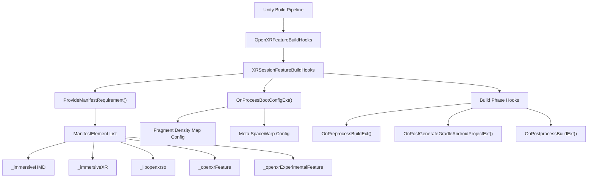
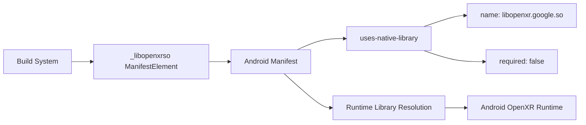
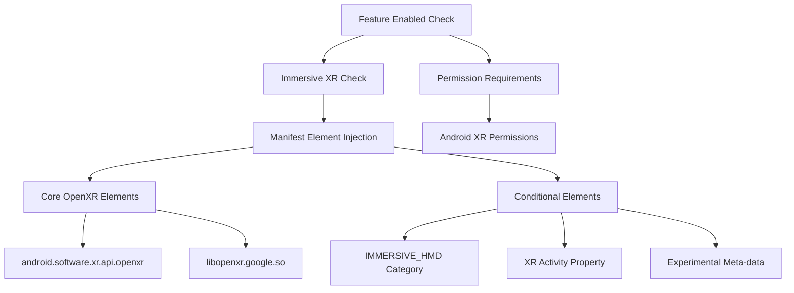
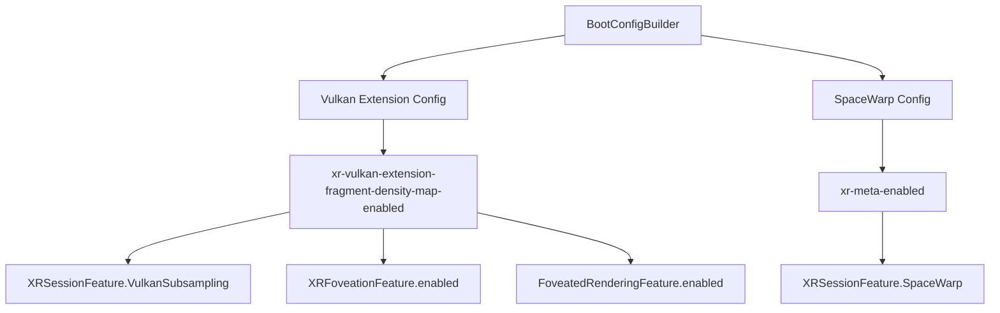
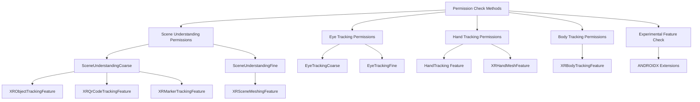

<!-- source: DeepWiki mcp.deepwiki.com · repo android/android-xr-unity-package · page 4.2 OpenXR Runtime Integration · fetched 2026-10-23 -->

# OpenXR Runtime Integration

Relevant source files

The following files were used as context for generating this wiki page:

- [Editor/Internal/XRSessionFeatureBuildHooks.cs](Editor/Internal/XRSessionFeatureBuildHooks.cs)
- [Runtime/Plugins/openxr_android.aar](Runtime/Plugins/openxr_android.aar)

This document covers how the Android XR Extensions for Unity package integrates with the OpenXR Android runtime during build time and at runtime. It details the build hooks, native library integration, Android manifest configuration, and boot configuration management that enable OpenXR features to function on Android XR devices.

For information about the session management and feature configuration, see [Session Management](#2.1). For details about Android manifest generation for permissions and features, see [Android Manifest Configuration](#4.1).

## Build System Integration

The OpenXR runtime integration is primarily handled by the `XRSessionFeatureBuildHooks` class, which extends Unity's `OpenXRFeatureBuildHooks` to inject OpenXR-specific configuration into the Android build process.

### OpenXR Build Hook Architecture

**Sources:** [Editor/Internal/XRSessionFeatureBuildHooks.cs:40-41](), [Editor/Internal/XRSessionFeatureBuildHooks.cs:127-222](), [Editor/Internal/XRSessionFeatureBuildHooks.cs:225-248]()

## Native Library Integration

The package integrates with the OpenXR Android runtime through the `libopenxr.google.so` native library, which provides the core OpenXR implementation for Android XR devices.

### Native Library Configuration

The native library is configured as a manifest element that gets automatically injected during the build process:

- **Library Name**: `libopenxr.google.so`
- **Required Flag**: Set to `false` to allow graceful fallback
- **Manifest Path**: `manifest/application/uses-native-library`

**Sources:** [Editor/Internal/XRSessionFeatureBuildHooks.cs:69-81](), [Editor/Internal/XRSessionFeatureBuildHooks.cs:204-205]()

## Android Manifest Configuration

The build hooks automatically configure the Android manifest with OpenXR-specific elements required for proper runtime integration.

### Core OpenXR Manifest Elements

| Element | Path | Attributes | Purpose |
|---------|------|------------|---------|
| `_immersiveHMD` | `manifest/application/activity/intent-filter/category` | `name: org.khronos.openxr.intent.category.IMMERSIVE_HMD` | Declares immersive HMD capability |
| `_immersiveXR` | `manifest/application/activity/property` | `name: android.window.PROPERTY_XR_ACTIVITY_START_MODE` `value: XR_ACTIVITY_START_MODE_FULL_SPACE_UNMANAGED` | Configures XR activity start mode |
| `_openxrFeature` | `manifest/uses-feature` | `name: android.software.xr.api.openxr` `required: true` `version: 0x00010001` | Declares OpenXR API requirement |
| `_openxrExperimentalFeature` | `manifest/application/meta-data` | `name: com.android.extensions.xr.uses_experimental_openxr_feature` `value: true` | Enables experimental OpenXR features |

### OpenXR Feature Declaration Flow

The system checks for active features and conditionally injects manifest elements based on the `XRSessionFeature` configuration and other enabled features.

**Sources:** [Editor/Internal/XRSessionFeatureBuildHooks.cs:42-53](), [Editor/Internal/XRSessionFeatureBuildHooks.cs:55-67](), [Editor/Internal/XRSessionFeatureBuildHooks.cs:83-99](), [Editor/Internal/XRSessionFeatureBuildHooks.cs:101-113]()

## Boot Configuration Management

The build hooks configure runtime boot parameters that control OpenXR feature behavior through the `OnProcessBootConfigExt` method.

### Boot Configuration Parameters

The boot configuration system evaluates active features and sets corresponding runtime flags:

- **Fragment Density Map**: Enabled when Vulkan subsampling, foveation, or foveated rendering features are active
- **Meta SpaceWarp**: Enabled when the `SpaceWarp` property is set on `XRSessionFeature`

**Sources:** [Editor/Internal/XRSessionFeatureBuildHooks.cs:225-248]()

## Permission Management Integration

The OpenXR runtime integration includes automatic permission management for various XR features, ensuring proper Android XR permissions are declared in the manifest.

### Permission Detection Flow

The system automatically detects which OpenXR features are enabled and ensures the corresponding Android XR permissions are included in the manifest through dedicated check methods:

- `CheckSceneUnderstandingCoarsePermission()` - For object, QR code, and marker tracking
- `CheckSceneUnderstandingFinePermission()` - For scene meshing
- `CheckEyeTrackingCoarsePermission()` - For foveated rendering
- `CheckEyeTrackingFinePermission()` - For eye gaze interaction
- `CheckHandTrackingPermission()` - For hand tracking and hand mesh
- `CheckBodyTrackingPermission()` - For body tracking
- `CheckExperimentalPermission()` - For experimental ANDROIDX features

**Sources:** [Editor/Internal/XRSessionFeatureBuildHooks.cs:277-358](), [Editor/Internal/XRSessionFeatureBuildHooks.cs:148-202]()

---

