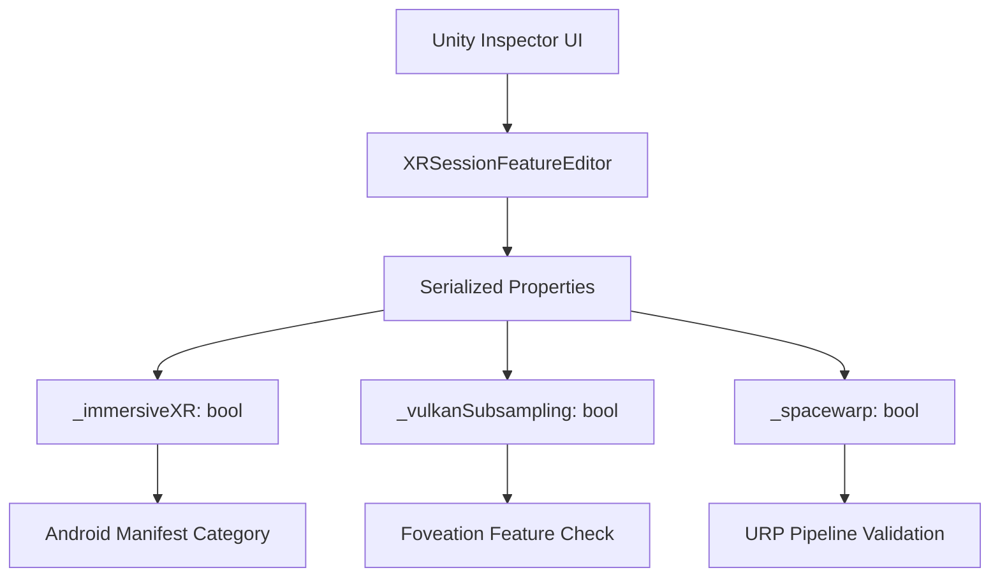
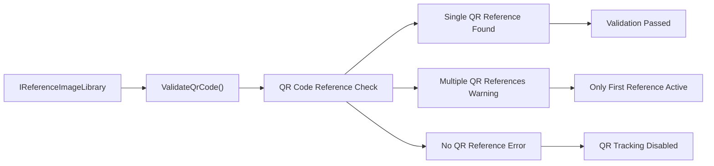
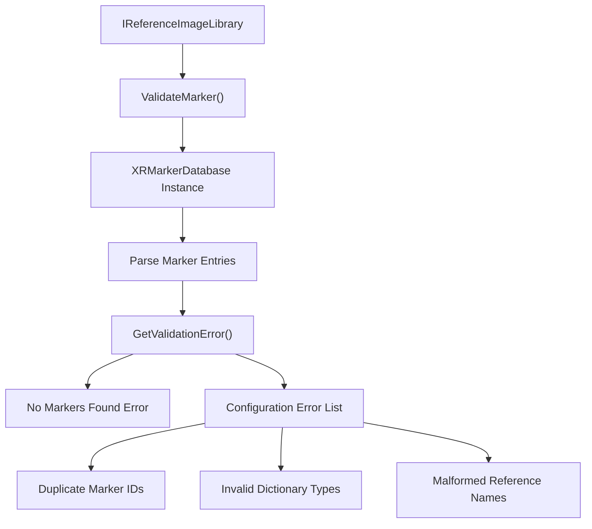
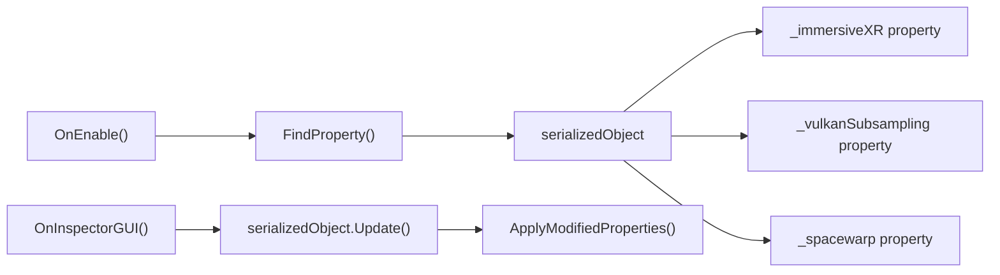

<!-- source: DeepWiki mcp.deepwiki.com · repo android/android-xr-unity-package · page 5 Developer Tools · fetched 2026-10-23 -->

# Developer Tools

<details>
<summary>Relevant source files</summary>

The following files were used as context for generating this wiki page:

- [Editor/Internal/XRSessionFeatureEditor.cs](Editor/Internal/XRSessionFeatureEditor.cs)
- [Runtime/AndroidXRRuntimeImageLibrary.cs](Runtime/AndroidXRRuntimeImageLibrary.cs)

</details>


This page documents the Unity Editor tools and utilities provided by the Android XR Extensions package for developers. These tools assist in configuring XR features, validating project settings, and integrating with Unity's build pipeline.

For information about the build system integration and Android manifest configuration, see [Build System Integration](#4).

## Feature Editor Interface

The package provides a custom Unity Editor interface for configuring XR session features through the `XRSessionFeatureEditor` class. This editor extends Unity's standard inspector functionality to provide specialized controls for Android XR settings.

### XRSessionFeatureEditor Configuration

The `XRSessionFeatureEditor` presents three main configuration options in the Unity Inspector:

| Setting | Purpose | Requirements |
|---------|---------|--------------|
| **Immersive XR** | Indicates the activity starts as an XR immersive app in full-screen mode | None |
| **Subsampling (Vulkan)** | Reduces memory bandwidth on foveated framebuffers | Requires Foveated Rendering or legacy Foveation features |
| **URP SpaceWarp (Vulkan)** | Unlocks additional computation power for suitable content | Vulkan rendering pipeline |



The editor implementation uses Unity's `SerializedProperty` system to bind UI controls to the underlying `XRSessionFeature` data:

- **Immersive XR Toggle**: Controls whether the Android app launches in immersive XR mode
- **Subsampling Toggle**: Enables Vulkan subsampling with validation warnings for foveation dependencies  
- **SpaceWarp Toggle**: Activates URP SpaceWarp optimization for Vulkan

Sources: [Editor/Internal/XRSessionFeatureEditor.cs:25-83]()

## Validation Tools

The package includes validation utilities to help developers identify configuration issues before deployment. These tools are integrated into the image library system and provide compile-time validation.

### QR Code Configuration Validation

The `ValidateQrCode` method analyzes reference image libraries to ensure proper QR code tracking setup:



The validation process:
1. Scans all reference images in the library
2. Identifies QR code references by name pattern (`qrcode` prefix, case-insensitive)
3. Warns if multiple QR references exist (only first is used)
4. Errors if no QR reference is found

### Marker Configuration Validation

The `ValidateMarker` method ensures marker tracking references are properly configured:



The marker validation creates a temporary `XRMarkerDatabase` instance to:
- Parse marker entries from image reference names
- Check for duplicate marker IDs within the same dictionary
- Validate marker dictionary types and naming conventions
- Report configuration errors through Unity's console

Sources: [Runtime/AndroidXRRuntimeImageLibrary.cs:165-234]()

## Integration with Unity Editor

The developer tools integrate with Unity's Editor workflow through several mechanisms:

### Custom Editor Attributes

The `XRSessionFeatureEditor` uses Unity's `CustomEditor` attribute to automatically replace the default inspector for `XRSessionFeature` objects:

```csharp
[CustomEditor(typeof(XRSessionFeature))]
internal class XRSessionFeatureEditor : Editor
```

### Editor-Only Code Compilation

Validation tools are conditionally compiled for editor environments only:

```csharp
#if UNITY_EDITOR
public static void ValidateQrCode(IReferenceImageLibrary imageLibrary)
public static void ValidateMarker(IReferenceImageLibrary imageLibrary)
#endif
```

This ensures validation logic doesn't increase runtime build size while remaining available during development.

### Property Serialization

The custom editor uses Unity's serialization system to persist configuration changes:



Sources: [Editor/Internal/XRSessionFeatureEditor.cs:60-81]()

---

