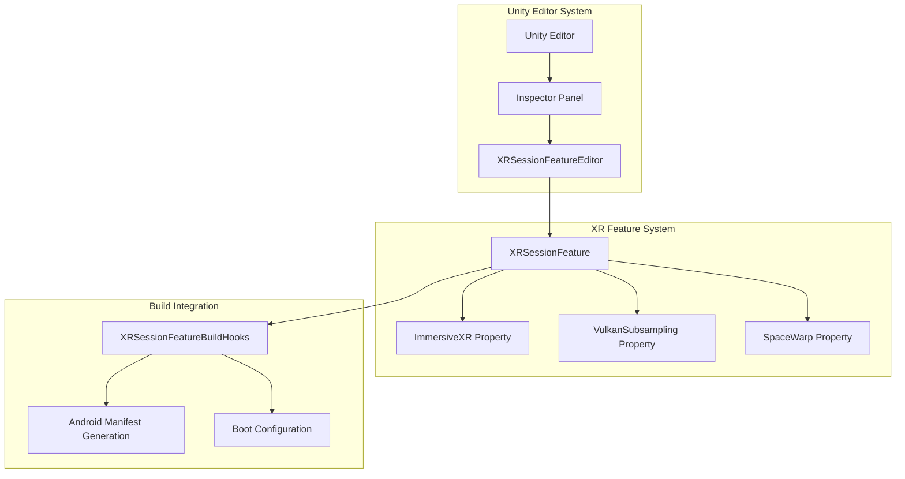
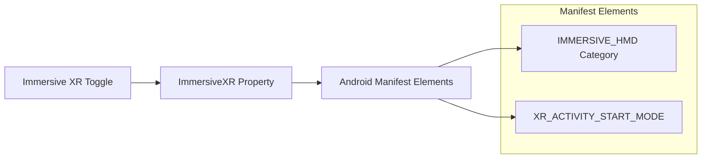
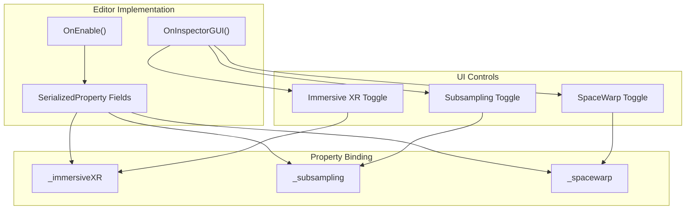
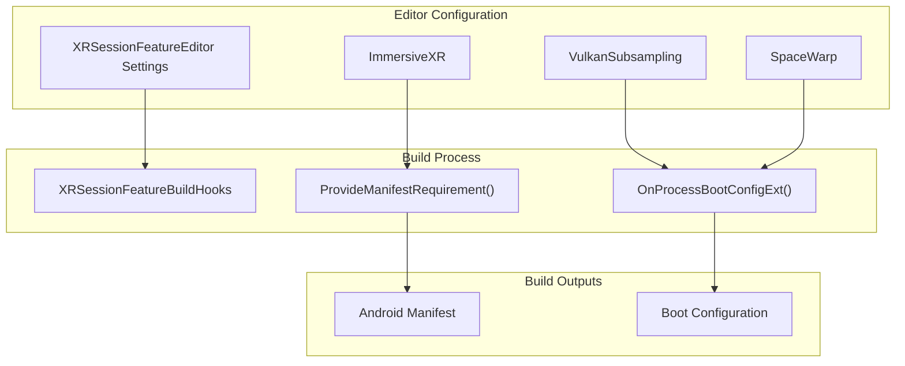

<!-- source: DeepWiki mcp.deepwiki.com · repo android/android-xr-unity-package · page 5.1 Feature Editor Interface · fetched 2026-10-23 -->

# Feature Editor Interface

<details>
<summary>Relevant source files</summary>

The following files were used as context for generating this wiki page:

- [Editor/Internal/XRSessionFeatureBuildHooks.cs](Editor/Internal/XRSessionFeatureBuildHooks.cs)
- [Editor/Internal/XRSessionFeatureEditor.cs](Editor/Internal/XRSessionFeatureEditor.cs)

</details>


This document covers the custom Unity Editor interface for configuring XR session features and their properties, specifically focusing on the `XRSessionFeatureEditor` implementation. The interface provides developers with an intuitive way to configure core XR session settings including immersive mode, Vulkan subsampling, and SpaceWarp rendering optimizations.

For information about the broader build system integration, see [Build System Integration](#4). For details about the underlying session management system, see [Session Management](#2.1).

## Editor Interface Overview

The `XRSessionFeatureEditor` class provides a custom Unity Inspector interface for the `XRSessionFeature` component. This editor extends Unity's standard `Editor` class to create specialized UI controls for XR-specific configuration options.



The editor interface is automatically displayed when selecting an `XRSessionFeature` component in the Unity Inspector. It provides toggle controls for three primary configuration options, each with descriptive tooltips and validation.

**Sources:** [Editor/Internal/XRSessionFeatureEditor.cs:25-83]()

## Configuration Options

### Immersive XR

The Immersive XR setting controls whether the application launches as a full-screen XR immersive experience. When enabled, this setting configures the Android application to start in dedicated XR mode.

| Field | Type | Description |
|-------|------|-------------|
| `ImmersiveXR` | `bool` | Indicates that the activity starts as XR Immersive app and will be launched in full-screen mode |



**Sources:** [Editor/Internal/XRSessionFeatureEditor.cs:31-34](), [Editor/Internal/XRSessionFeatureBuildHooks.cs:133-146]()

### Vulkan Subsampling

The Vulkan Subsampling option enables memory bandwidth optimization for foveated rendering pipelines. This setting requires either the Foveated Rendering feature or legacy Foveation support to be enabled.

| Field | Type | Description |
|-------|------|-------------|
| `_vulkanSubsampling` | `bool` | Enable Subsampling (Vulkan) to reduce memory bandwidth on foveated framebuffers |

The editor provides a warning tooltip indicating that enabling this setting without proper foveated rendering support will result in rendering faults.

**Sources:** [Editor/Internal/XRSessionFeatureEditor.cs:36-41](), [Editor/Internal/XRSessionFeatureBuildHooks.cs:234-242]()

### URP SpaceWarp

The URP SpaceWarp setting enables Vulkan-based spatial warping optimizations for Universal Render Pipeline (URP) applications. This feature provides additional computational power for suitable content types.

| Field | Type | Description |
|-------|------|-------------|
| `_spacewarp` | `bool` | Enable URP Spacewarp (Vulkan) to unlock extra computation power for suitable content |

**Sources:** [Editor/Internal/XRSessionFeatureEditor.cs:43-45](), [Editor/Internal/XRSessionFeatureBuildHooks.cs:244-247]()

## Editor UI Implementation

The `XRSessionFeatureEditor` implements a custom Inspector GUI using Unity's `EditorGUILayout` system. The interface is structured with consistent label widths and tooltip support for enhanced usability.



The editor implementation follows Unity's standard patterns:
- `OnEnable()` method initializes `SerializedProperty` references
- `OnInspectorGUI()` method renders the custom interface
- Property changes are automatically synchronized with the underlying `XRSessionFeature` object

**Sources:** [Editor/Internal/XRSessionFeatureEditor.cs:60-81]()

## Build Integration

The feature editor settings are processed during the Unity build pipeline through the `XRSessionFeatureBuildHooks` class. This integration ensures that editor configurations are properly translated into runtime and Android manifest configurations.



The build hooks process editor settings to:
- Generate Android manifest elements for immersive XR mode
- Configure Vulkan fragment density map settings for subsampling
- Enable SpaceWarp boot configuration options

**Sources:** [Editor/Internal/XRSessionFeatureBuildHooks.cs:127-248]()

## Custom Editor Attributes

The `XRSessionFeatureEditor` class uses Unity's `CustomEditor` attribute to associate the editor with the `XRSessionFeature` type. This ensures the custom interface is automatically displayed when the feature is selected in the Inspector.

```csharp
[CustomEditor(typeof(XRSessionFeature))]
internal class XRSessionFeatureEditor : Editor
```

The editor maintains consistent UI styling by setting `EditorGUIUtility.labelWidth` to 200 pixels during GUI rendering, ensuring proper alignment of toggle controls and their labels.

**Sources:** [Editor/Internal/XRSessionFeatureEditor.cs:28-29](), [Editor/Internal/XRSessionFeatureEditor.cs:63-73]()

---

