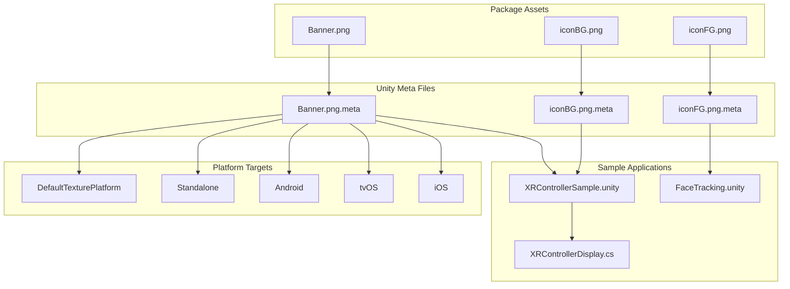
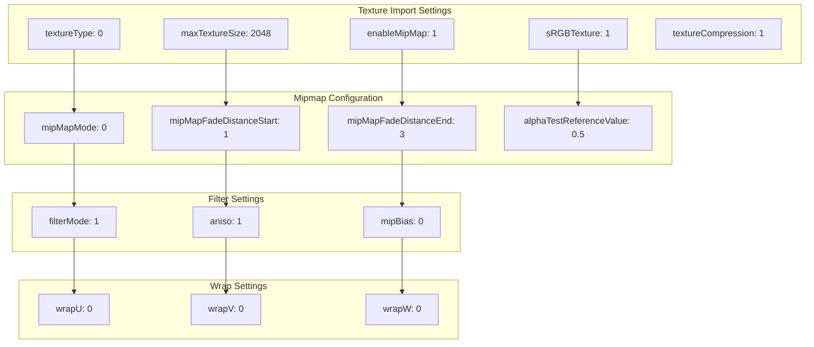
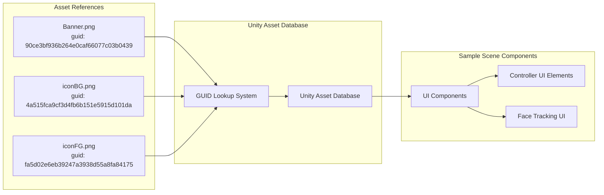

<!-- source: DeepWiki mcp.deepwiki.com · repo android/android-xr-unity-package · page 6 Assets and Resources · fetched 2026-10-23 -->

# Assets and Resources

Relevant source files

The following files were used as context for generating this wiki page:

- [Assets/Banner.png.meta](Assets/Banner.png.meta)
- [Assets/iconBG.png.meta](Assets/iconBG.png.meta)
- [Assets/iconFG.png.meta](Assets/iconFG.png.meta)

This page documents the visual assets, UI elements, and resource configurations included in the Android XR Extensions for Unity package. These assets primarily support the sample applications and provide visual elements for developers to use in their XR projects.

For information about the sample applications that use these assets, see [Sample Applications](#3). For details on the controller display system that utilizes these visual resources, see [Controller Display System](#3.3).

## Package Asset Overview

The Android XR Extensions for Unity package includes a collection of visual assets designed to support sample applications and provide reference implementations for XR UI elements. These assets are configured with cross-platform texture settings to ensure optimal performance across different target platforms.

Sources: [Assets/Banner.png.meta:1-157](), [Assets/iconBG.png.meta:1-157](), [Assets/iconFG.png.meta:1-157]()

## UI and Visual Assets

The package includes three primary visual assets that serve different purposes in the sample applications:

| Asset | Purpose | Usage Context |
|-------|---------|---------------|
| `Banner.png` | Package banner/header image | Sample application UI, documentation |
| `iconBG.png` | Icon background component | UI elements, application icons |
| `iconFG.png` | Icon foreground component | UI elements, application icons |

### Asset Specifications

All included assets follow consistent configuration patterns:

- **Texture Type**: 2D textures (`textureType: 0`)
- **Maximum Resolution**: 2048x2048 pixels
- **Mipmap Generation**: Enabled with standard fade settings
- **sRGB Color Space**: Enabled for proper color reproduction
- **Compression**: Platform-optimized compression settings

Sources: [Assets/Banner.png.meta:57-58](), [Assets/iconBG.png.meta:57-58](), [Assets/iconFG.png.meta:57-58]()

## Texture Import Configuration

The texture assets are configured with Unity's `TextureImporter` settings to ensure optimal performance and quality across different platforms. Each asset includes detailed platform-specific configurations.

Sources: [Assets/Banner.png.meta:7-42](), [Assets/iconBG.png.meta:7-42](), [Assets/iconFG.png.meta:7-42]()

## Platform-Specific Settings

Each texture asset includes platform-specific configurations to optimize performance and file size for different target platforms. The configuration ensures consistent quality across Android, iOS, tvOS, and standalone platforms.

### Platform Configuration Matrix

| Platform | Max Texture Size | Texture Format | Compression Quality | ETC2 Fallback |
|----------|------------------|----------------|-------------------|---------------|
| DefaultTexturePlatform | 2048 | -1 (Auto) | 50 | No |
| Standalone | 2048 | -1 (Auto) | 50 | No |
| Android | 2048 | -1 (Auto) | 50 | No |
| tvOS | 2048 | -1 (Auto) | 50 | No |
| iOS | 2048 | -1 (Auto) | 50 | No |

### Android-Specific Configuration

The Android platform settings include additional considerations for Android XR devices:

- **Texture Compression**: Enabled with quality level 50
- **Crunched Compression**: Disabled for runtime performance
- **Alpha Splitting**: Disabled to maintain quality
- **ETC2 Fallback Override**: Disabled, relying on modern GPU support

Sources: [Assets/Banner.png.meta:96-108](), [Assets/iconBG.png.meta:96-108](), [Assets/iconFG.png.meta:96-108]()

## Asset Integration with Sample Applications

The visual assets are integrated into the sample applications through Unity's standard asset referencing system. The assets support the user interface elements and provide visual feedback in the XR environment.

Sources: [Assets/Banner.png.meta:2](), [Assets/iconBG.png.meta:2](), [Assets/iconFG.png.meta:2]()

## Texture Memory and Performance Considerations

The texture assets are configured to balance visual quality with memory usage and performance requirements for XR applications:

### Memory Usage Optimization

- **Mipmap Generation**: Enabled to reduce memory bandwidth during rendering
- **Streaming Mipmaps**: Disabled (`streamingMipmaps: 0`) for immediate availability
- **Texture Compression**: Enabled to reduce memory footprint
- **Maximum Resolution**: Limited to 2048x2048 to control memory usage

### Performance Configuration

- **Alpha Usage**: Configured appropriately for transparency requirements
- **Read/Write Access**: Disabled (`isReadable: 0`) to prevent unnecessary CPU copies
- **Compression Quality**: Set to 50 for balanced quality and performance

Sources: [Assets/Banner.png.meta:24-25](), [Assets/Banner.png.meta:45-46](), [Assets/iconBG.png.meta:24-25](), [Assets/iconFG.png.meta:24-25]()

## Asset Metadata and Unity Integration

Each asset includes comprehensive metadata for Unity's asset management system:

### Asset Bundle Configuration

- **Asset Bundle Name**: Empty (not bundled)
- **Asset Bundle Variant**: Empty (no variants)
- **User Data**: Empty (no custom data)

### Sprite Configuration

All textures are configured as standard 2D textures rather than sprites:

- **Sprite Mode**: 0 (Single)
- **Sprite Pixels to Units**: 100
- **Sprite Border**: None
- **Sprite Pivot**: Center (0.5, 0.5)

Sources: [Assets/Banner.png.meta:154-156](), [Assets/Banner.png.meta:46-52](), [Assets/iconBG.png.meta:154-156](), [Assets/iconFG.png.meta:154-156]()

---

