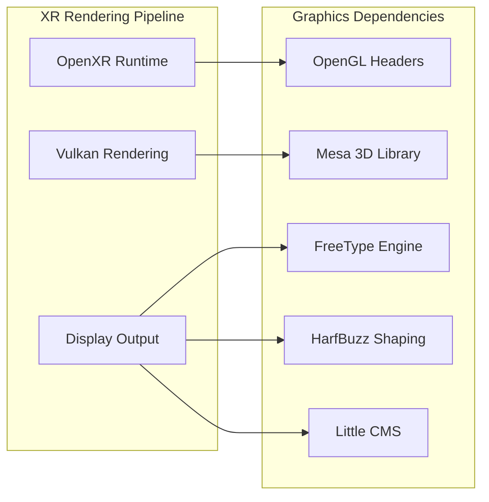
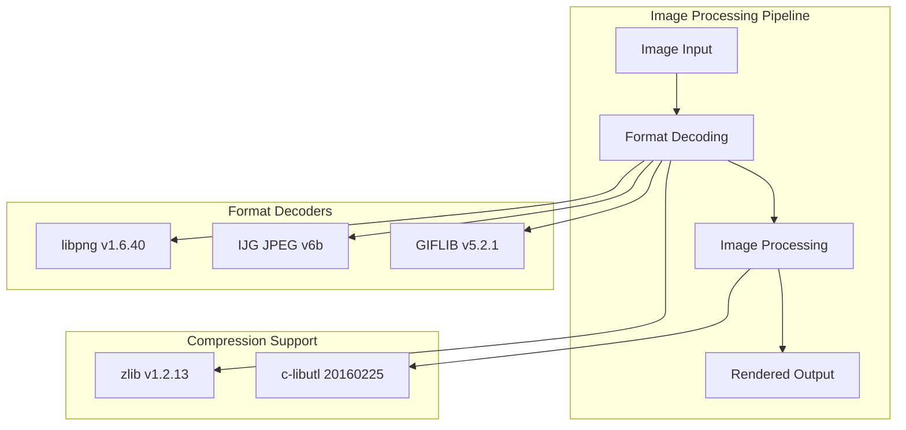
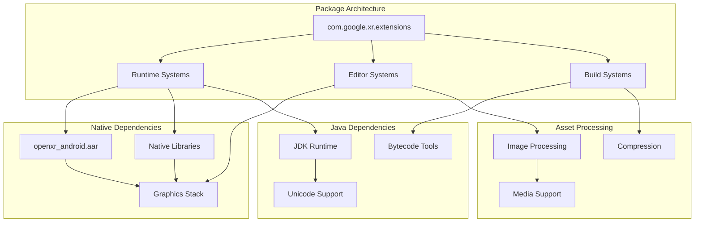

<!-- source: DeepWiki mcp.deepwiki.com · repo android/android-xr-unity-package · page 7 Third-Party Dependencies · fetched 2026-10-23 -->

# Third-Party Dependencies

Relevant source files

The following files were used as context for generating this wiki page:

- [Third Party Notices.md](Third Party Notices.md)

This document provides a comprehensive overview of all third-party software components and their licensing information used by the Android XR Extensions for Unity package. The dependencies are organized by functional category and include detailed licensing compliance information for each component.

For information about the package's own licensing and distribution, see the main package documentation. For details about Unity's built-in dependencies that this package extends, see [Core XR Features](#2).

## Overview of Dependency Categories

The package incorporates third-party components across several functional areas to provide comprehensive XR capabilities:

```mermaid
graph TD
    subgraph "Android XR Extensions Package"
        CORE["Core Package Systems"]
        RUNTIME["Runtime Components"]
        EDITOR["Editor Tools"]
        SAMPLES["Sample Applications"]
    end
    
    subgraph "Graphics & Rendering Dependencies"
        GL["OpenGL Headers & Utilities"]
        MESA["Mesa 3D Graphics Library"]
        FREETYPE["FreeType Font Rendering"]
        HARFBUZZ["HarfBuzz Text Shaping"]
        LCMS["Little CMS Color Management"]
    end
    
    subgraph "Image & Media Processing"
        LIBPNG["libpng Image Processing"]
        JPEG["Independent JPEG Group"]
        GIFLIB["GIFLIB Graphics"]
        ZLIB["zlib Compression"]
    end
    
    subgraph "Java Runtime Environment"
        JDK["Google JDK 21"]
        ICU4J["ICU4J Internationalization"]
        CLDR["Unicode CLDR"]
        UNICODE["Unicode Character Database"]
    end
    
    subgraph "System Integration"
        PIPEWIRE["PipeWire Audio"]
        PCSC["PC/SC Lite Smart Card"]
        XWD["X Window System Utilities"]
        WEPOLL["Windows Event Polling"]
    end
    
    subgraph "Security & Cryptography"
        CRYPTIX["Cryptix AES Encryption"]
        SANTUARIO["Apache Santuario XML Security"]
        BCEL["Apache Commons BCEL"]
        ASM["ASM Bytecode Framework"]
    end
    
    CORE --> GL
    CORE --> MESA
    RUNTIME --> LIBPNG
    RUNTIME --> JPEG
    RUNTIME --> ZLIB
    RUNTIME --> JDK
    RUNTIME --> ICU4J
    RUNTIME --> PIPEWIRE
    EDITOR --> FREETYPE
    EDITOR --> HARFBUZZ
    SAMPLES --> GIFLIB
    SAMPLES --> LCMS
    
    JDK --> UNICODE
    JDK --> CLDR
    JDK --> CRYPTIX
    JDK --> SANTUARIO
    JDK --> BCEL
    JDK --> ASM
```

**Sources:** [Third Party Notices.md:1-3950]()

## Core Graphics and Rendering Dependencies

The package relies on several foundational graphics libraries for OpenXR rendering and visual output:

### OpenGL Integration
- **OpenGL Headers** - Standard OpenGL headers and utilities from The Khronos Group
- **Mesa 3D Graphics Library v21.0.3** - Provides OpenGL implementations and drivers
- **License:** MIT License with Khronos Group extensions

### Font and Text Rendering
- **FreeType v2.13.0** - Font rendering engine with dual FreeType License/GPL v2 options
- **HarfBuzz v8.2.2** - Text shaping library under Old MIT License
- **Little CMS v2.15** - Color management system for accurate color reproduction

**Sources:** [Third Party Notices.md:3-244](), [Third Party Notices.md:2006-2561](), [Third Party Notices.md:2695-2798](), [Third Party Notices.md:2885-2993]()

## Java Runtime Dependencies

The package includes a complete Java runtime environment for Android XR applications:

### Core Java Runtime
- **Google JDK 21** - Complete Java Development Kit under GPL v2 with Classpath exception
- **ASM Bytecode Manipulation Framework v9.3** - Bytecode processing and manipulation
- **Apache Commons BCEL v6.7.0** - Java bytecode engineering library

### Unicode and Internationalization
- **ICU4J v72.1** - International Components for Unicode for Java
- **Unicode CLDR v43** - Common Locale Data Repository for localization
- **Unicode Character Database v15.0.0** - Complete Unicode character definitions

| Component | Version | License | Purpose |
|-----------|---------|---------|---------|
| Google JDK | 21 | GPL v2 + Classpath | Core Java runtime |
| ICU4J | 72.1 | Unicode License | Internationalization |
| Unicode CLDR | 43 | Unicode License | Locale data |
| ASM Framework | 9.3 | BSD-style | Bytecode manipulation |
| Apache BCEL | 6.7.0 | Apache 2.0 | Bytecode engineering |

**Sources:** [Third Party Notices.md:247-596](), [Third Party Notices.md:888-1404](), [Third Party Notices.md:774-882](), [Third Party Notices.md:693-729](), [Third Party Notices.md:3924-3935]()

## Image and Media Processing Dependencies

Essential libraries for handling various image formats and compression:

### Image Format Support
- **libpng v1.6.40** - PNG image format support with PNG Reference Library License
- **Independent JPEG Group JPEG v6b** - JPEG image format with custom IJG license
- **GIFLIB v5.2.1** - GIF image format support under MIT-style license

### Compression and Data Processing
- **zlib v1.2.13** - General-purpose compression library with zlib license
- **c-libutl 20160225** - Utility library functions under BSD license

**Sources:** [Third Party Notices.md:2998-3203](), [Third Party Notices.md:2803-2878](), [Third Party Notices.md:2660-2693](), [Third Party Notices.md:1923-1950](), [Third Party Notices.md:734-768]()

## System Integration Dependencies

Platform-specific components for system-level integration:

### Audio and Multimedia
- **PipeWire v0.3.68** - Modern audio system for Linux under MIT License

### System Utilities
- **xwd v1.0.7** - X Window System utilities for display management
- **wepoll v1.5.8** - Windows event polling library for cross-platform compatibility
- **PC/SC Lite v1.9.9** - Smart card interface for security applications

### Web and Network Support
- **Mozilla Public Suffix List** - Domain suffix handling under MPL 2.0

**Sources:** [Third Party Notices.md:3511-3553](), [Third Party Notices.md:3557-3590](), [Third Party Notices.md:1955-1988](), [Third Party Notices.md:3596-3686](), [Third Party Notices.md:1411-1809]()

## Security and Cryptography Dependencies

Security-focused components for encryption and secure processing:

### Cryptographic Libraries
- **Cryptix AES v3.2.0** - Advanced Encryption Standard implementation
- **Apache Santuario v3.0.2** - XML Security library for digital signatures and encryption

### Additional Security Components
- **Eastman Kodak Color Management** - Portions of color management software
- All components include appropriate copyright notices for legal compliance

**Sources:** [Third Party Notices.md:652-687](), [Third Party Notices.md:3692-3919](), [Third Party Notices.md:1994-2000]()

## License Summary

The package incorporates components under various open source licenses:

| License Type | Components | Key Requirements |
|--------------|------------|------------------|
| MIT/BSD-style | libpng, GIFLIB, HarfBuzz, PipeWire, Mesa | Attribution required |
| Apache 2.0 | Apache Santuario, Apache BCEL | Attribution and notice requirements |
| GPL v2 | FreeType (dual license), Google JDK | Copyleft requirements with exceptions |
| Unicode License | ICU4J, CLDR, Unicode DB | Attribution for Unicode data |
| Custom Licenses | IJG JPEG, zlib, OpenGL headers | Specific attribution requirements |
| MPL 2.0 | Mozilla Public Suffix List | Source disclosure requirements |

## Integration with Package Systems

The third-party dependencies integrate with the main package architecture through several key interfaces:

**Sources:** [Third Party Notices.md:1-3950]()

All third-party dependencies are properly attributed and their licenses are included in the distributed package to ensure full compliance with open source licensing requirements. The complete license texts and attribution notices are maintained in the `Third Party Notices.md` file included with the package distribution.