# Page: Overview

# Overview

<details>
<summary>Relevant source files</summary>

The following files were used as context for generating this wiki page:

- [CHANGELOG.md](CHANGELOG.md)
- [README.md](README.md)
- [package.json](package.json)

</details>


This document provides a comprehensive overview of the Android XR Extensions for Unity package (`com.google.xr.extensions`), explaining its purpose, architecture, and integration within the Unity XR ecosystem. The package extends Unity's OpenXR capabilities with additional XR features specifically designed for Android XR platforms.

For detailed information about specific features, see [Core XR Features](#2). For sample implementations, see [Sample Applications](#3). For build system integration, see [Build System Integration](#4).

## Purpose and Scope

The Android XR Extensions for Unity package serves as a bridge between Unity's OpenXR implementation and advanced XR features available on Android XR platforms. It provides APIs and implementations for XR capabilities that are not yet supported by Unity's standard OpenXR Android XR and OpenXR Plugin packages.

The package focuses on three primary areas:
- **Extended Tracking Features**: Object tracking, face tracking, hand mesh, scene meshing, and body tracking
- **Advanced Rendering**: Environment blend modes, foveation, and passthrough composition layers
- **Platform Integration**: Session management, permissions, and Android-specific XR runtime features

## System Architecture

The package implements a layered architecture that extends Unity's XR subsystem framework while integrating with OpenXR extensions and Android XR runtime capabilities.

### Core Package Structure

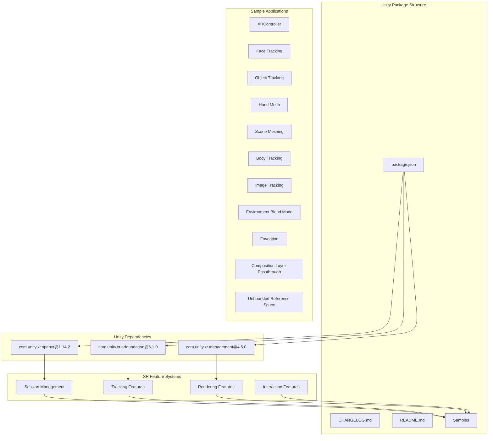

**Sources:** [package.json:1-75](), [CHANGELOG.md:1-135](), [README.md:1-39]()

### Feature Extension Architecture

The package implements XR features through OpenXR extensions and Unity subsystem providers, creating a comprehensive XR capability framework.

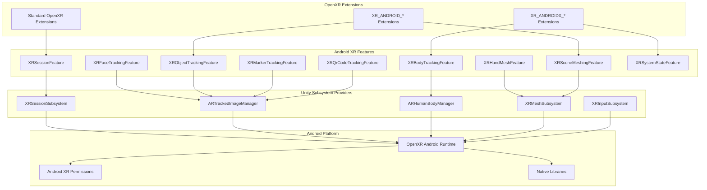

**Sources:** [package.json:12-16](), [CHANGELOG.md:60-81](), [README.md:3-17]()

## Key Components

### Unity Dependencies

The package builds upon three core Unity XR packages:

| Package | Version | Purpose |
|---------|---------|---------|
| `com.unity.xr.openxr` | 1.14.2 | OpenXR runtime and feature framework |
| `com.unity.xr.arfoundation` | 6.1.0 | AR tracking and subsystem management |
| `com.unity.xr.management` | 4.5.0 | XR provider lifecycle management |

### Feature Categories

The package provides features organized into several categories:

**Core Session Management:**
- `XRSessionFeature` - Immersive XR session configuration
- Vulkan subsampling support
- SpaceWarp configuration
- Environment blend mode control

**Tracking Features:**
- `XRObjectTrackingFeature` - Environmental object detection
- `XRFaceTrackingFeature` - Facial expression tracking
- `XRHandMeshFeature` - Hand mesh generation
- `XRSceneMeshingFeature` - Environmental mesh reconstruction
- `XRBodyTrackingFeature` - Human body pose tracking (Experimental)
- `XRMarkerTrackingFeature` - Marker-based tracking
- `XRQrCodeTrackingFeature` - QR code detection

**Rendering Features:**
- Foveation support (Legacy and modern)
- Passthrough composition layers
- Environment blend modes
- Display refresh rate control

**Interaction Features:**
- Mouse interaction profile
- Unbounded reference space
- System state monitoring (Experimental)

### Sample Applications

The package includes comprehensive samples demonstrating each feature:

- **XRController** - Controller input and display
- **Face Tracking** - Facial expression capture and avatar animation
- **Object Tracking** - Environmental object detection
- **Hand Mesh** - Hand mesh rendering
- **Scene Meshing** - Environmental mesh visualization
- **Body Tracking** - Human pose tracking (Experimental)
- **Image Tracking** - QR code and marker tracking
- **Environment Blend Mode** - Rendering mode switching
- **Foveation** - Performance optimization techniques
- **Passthrough** - Real-world overlay capabilities
- **Unbounded Reference Space** - Large-scale tracking

**Sources:** [package.json:18-74](), [CHANGELOG.md:103-104](), [README.md:19-38]()

## Unity Integration

The package integrates with Unity's XR ecosystem through standardized interfaces and build pipeline hooks. It requires Unity 6000.1.0b12 or higher and targets Android API level 24 or above.

### Installation Process

1. Import via Package Manager using tarball
2. Configure OpenXR as the XR provider in Project Settings
3. Enable desired Android XR Extensions features
4. Validate OpenXR configuration through Project Validation
5. Configure Android build settings for minimum API level 24

### Runtime Requirements

The package requires specific Android XR permissions and OpenXR runtime capabilities. It automatically configures the Android manifest during build to include necessary permissions, features, and native library references.

**Sources:** [README.md:20-38](), [CHANGELOG.md:14-17](), [package.json:4-6]()

## Experimental Features

The package includes experimental features that use `XR_ANDROIDX_*` OpenXR extensions. These features provide early access to cutting-edge XR capabilities but cannot be used in applications published to the Google Play Store.

**Current Experimental Features:**
- Body Tracking via `XRBodyTrackingFeature`
- System State monitoring via `XRSystemStateFeature`
- Scene Meshing via `XRSceneMeshingFeature` (promoted to stable in v1.1.0)

Experimental features may undergo breaking changes, deprecation, or removal in future versions as they evolve toward formal releases.

**Sources:** [CHANGELOG.md:70-81](), [CHANGELOG.md:30]()

---

# Page: Package Structure

# Package Structure

<details>
<summary>Relevant source files</summary>

The following files were used as context for generating this wiki page:

- [CHANGELOG.md](CHANGELOG.md)
- [package.json](package.json)

</details>


This document describes the internal organization of the Android XR Extensions for Unity package (`com.google.xr.extensions`), including its manifest configuration, version history, dependency management, and key architectural components. 

For information about individual XR features and their implementations, see [Core XR Features](#2). For build system integration details, see [Build System Integration](#4).

## Package Manifest Configuration

The package is defined by its manifest file `package.json`, which contains essential metadata, dependencies, and sample definitions. The package follows Unity's standard package structure and semantic versioning conventions.

### Package Metadata

The package is identified as `com.google.xr.extensions` with the display name "Android XR Extensions for Unity". The current version is `1.1.0` and requires Unity `6000.1.0b12` or later.

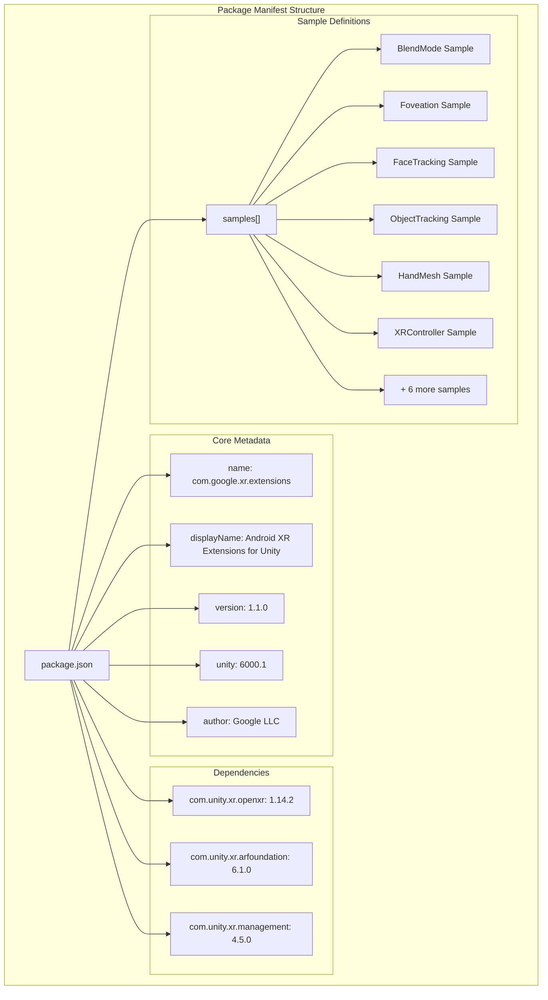

**Sources: [package.json:1-17]()**

### Dependency Management

The package declares three critical Unity dependencies that provide the foundation for XR functionality:

| Dependency | Version | Purpose |
|------------|---------|---------|
| `com.unity.xr.openxr` | 1.14.2 | Core OpenXR runtime support |
| `com.unity.xr.arfoundation` | 6.1.0 | AR Foundation integration for tracking features |
| `com.unity.xr.management` | 4.5.0 | XR subsystem management |

**Sources: [package.json:12-16]()**

## Sample Applications Structure

The package includes 11 sample applications that demonstrate various XR features. Each sample is defined in the `samples` array with a display name, description, and file path.

### Sample Organization

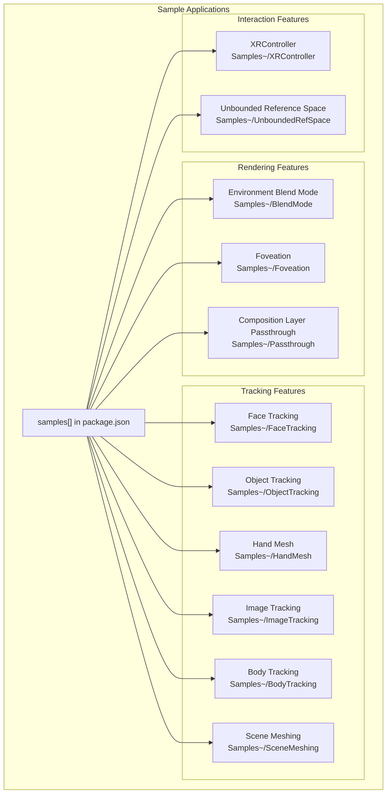

**Sources: [package.json:18-74]()**

### Sample Categories

The samples are organized into three main categories:

1. **Rendering Features** - Demonstrate visual rendering capabilities like environment blending, foveation, and passthrough
2. **Tracking Features** - Show various tracking systems including face, object, hand, image, body, and scene tracking
3. **Interaction Features** - Cover input handling and spatial reference systems

Each sample includes a `displayName`, `description`, and `path` pointing to the `Samples~/` directory structure.

**Sources: [package.json:19-73]()**

## Version History and Change Management

The package maintains a comprehensive changelog following Keep a Changelog format and Semantic Versioning principles.

### Version Timeline

```mermaid
timeline
    title Package Version History
    
    section 2024-12-12 : v0.9.0
        : Initial Developer Preview
        : Basic XR Features
        : Session Management
        : Plane/Anchor Tracking
        : Face Tracking
        : Hand Meshes
        
    section 2025-04-03 : v0.9.1
        : XRController Sample Added
        : Android XR Permission Updates
        
    section 2025-05-07 : v1.0.0
        : Marker & QR Code Tracking
        : Body Tracking (Experimental)
        : Scene Meshing (Experimental)
        : System State (Experimental)
        : Updated Dependencies
        
    section 2025-06-27 : v1.1.0
        : Vulkan Subsampling Default
        : Scene Meshing Promoted
        : Bug Fixes
        : Cross-Platform Compatibility
```

**Sources: [CHANGELOG.md:11-135]()**

### Release Feature Progression

The changelog shows the evolution of features from experimental to stable:

| Version | Key Features Added | Status Changes |
|---------|-------------------|----------------|
| v0.9.0 | Initial core features | Developer Preview |
| v0.9.1 | XRController sample | Stability improvements |
| v1.0.0 | Marker/QR tracking, experimental features | First stable release |
| v1.1.0 | Vulkan subsampling, Scene Meshing promotion | Feature stabilization |

**Sources: [CHANGELOG.md:42-135]()**

## Core Package Architecture

The package is structured around several key architectural components that work together to provide XR functionality.

### Runtime System Organization

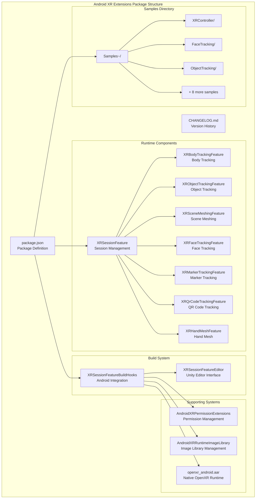

**Sources: [package.json:1-75](), [CHANGELOG.md:1-135]()**

### Unity Integration Points

The package integrates with Unity through several key mechanisms:

1. **OpenXR Feature System** - Each XR capability is implemented as an OpenXR feature that can be enabled/disabled
2. **AR Foundation Integration** - Tracking features leverage AR Foundation's subsystem architecture
3. **Build Pipeline Integration** - Build hooks automatically configure Android manifests and permissions
4. **Editor Interface** - Custom editor UI for configuring XR session features

**Sources: [package.json:12-16](), [CHANGELOG.md:60-82]()**

## Package Dependencies and Compatibility

The package maintains strict compatibility requirements with Unity and related XR packages.

### Unity Version Requirements

| Package Version | Minimum Unity Version | Verified Unity Version |
|----------------|----------------------|----------------------|
| v1.1.0 | 6000.1.0b12 | 6000.1.0f1+ |
| v1.0.0 | 6000.1.0b12 | 6000.1.0f1+ |

### Compatible Package Ecosystem

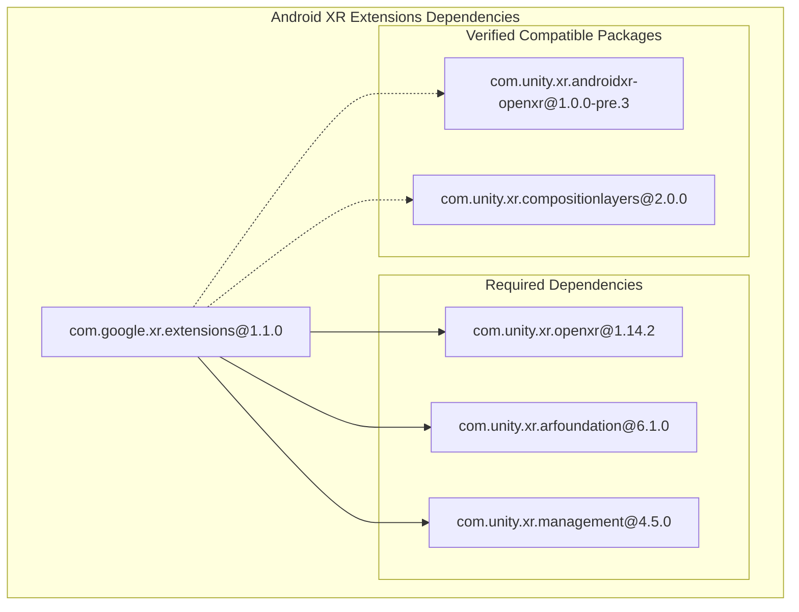

**Sources: [package.json:12-16](), [CHANGELOG.md:14-18](), [CHANGELOG.md:50-52]()**

---

# Page: Installation and Setup

# Installation and Setup

<details>
<summary>Relevant source files</summary>

The following files were used as context for generating this wiki page:

- [README.md](README.md)
- [Samples~/XRController/README.md](Samples~/XRController/README.md)
- [Samples~/XRController/README.md.meta](Samples~/XRController/README.md.meta)

</details>


This document provides comprehensive instructions for installing and configuring the Android XR Extensions for Unity package. It covers package installation, XR plugin configuration, OpenXR feature selection, and build settings required to develop Android XR applications.

For information about the package's internal structure and components, see [Package Structure](#1.1). For details about specific XR features and their capabilities, see [Core XR Features](#2).

## Prerequisites

Before installing the Android XR Extensions for Unity package, ensure your development environment meets the following requirements:

| Requirement | Minimum Version | Purpose |
|-------------|----------------|---------|
| Unity Editor | 2022.3 LTS | Base development environment |
| Android Build Support | - | Required for Android platform builds |
| OpenXR Plugin | 1.14.2 | Core XR runtime integration |
| AR Foundation | 6.1.0 | Tracking and computer vision features |
| XR Management | 4.5.0 | XR plugin lifecycle management |
| Android API Level | 24 | Minimum OpenXR Loader requirement |

## Package Installation

### Installation Process

The Android XR Extensions for Unity package is distributed as a tarball and must be imported through Unity's Package Manager.

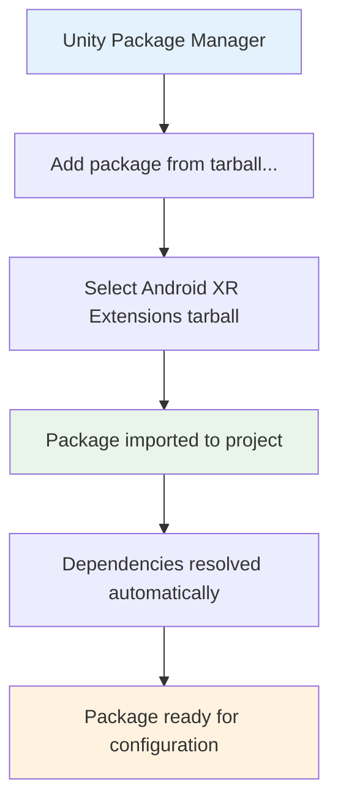

**Installation Steps:**

1. Open Unity Package Manager via **Window > Package Manager**
2. Click the **+** button in the top-left corner
3. Select **Add package from tarball...**
4. Navigate to and select the Android XR Extensions tarball file
5. Unity will automatically resolve dependencies and import the package

Sources: [README.md:21-23]()

### Package Dependencies

The installation automatically resolves the following Unity package dependencies:

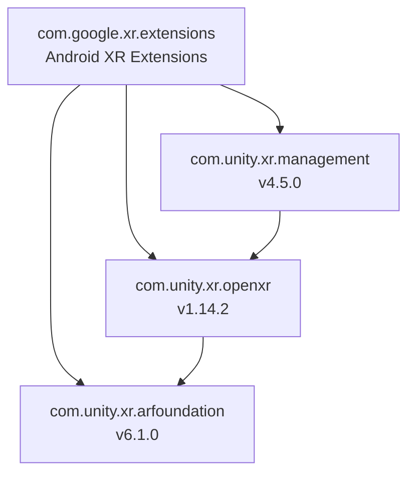

Sources: [README.md:1-39]()

## XR Plugin Configuration

### OpenXR Provider Setup

After package installation, configure Unity's XR Plugin Management system to use OpenXR as the runtime provider.

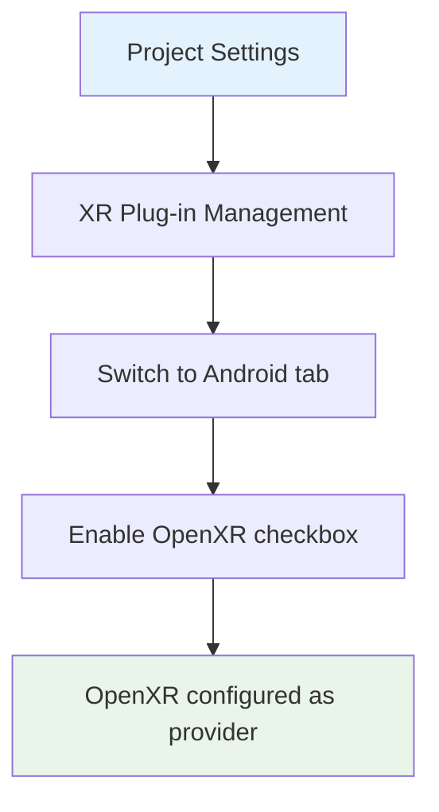

**Configuration Steps:**

1. Navigate to **Project Settings > XR Plug-in Management**
2. Switch to the **Android** platform tab
3. Check **OpenXR** as the plug-in provider
4. Verify OpenXR appears in the enabled providers list

Sources: [README.md:24-27]()

### XR Management Integration

The `XRSessionFeature` system integrates with Unity's XR Management to provide Android XR-specific capabilities:

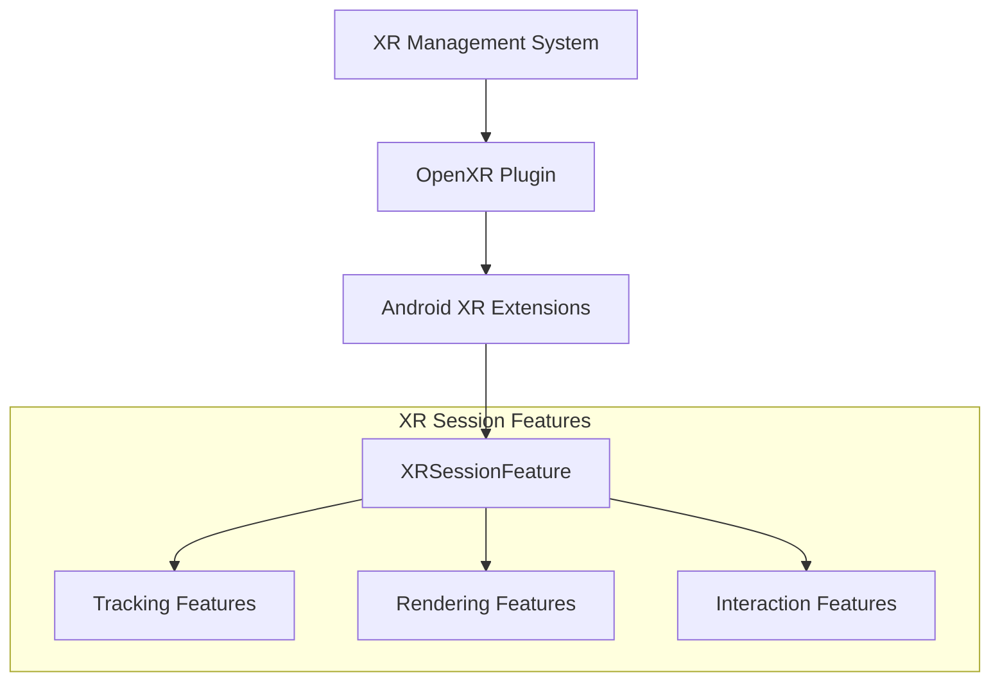

Sources: [README.md:24-28]()

## OpenXR Feature Selection

### Feature Group Configuration

The Android XR Extensions provide both grouped and individual feature selection through Unity's OpenXR settings.

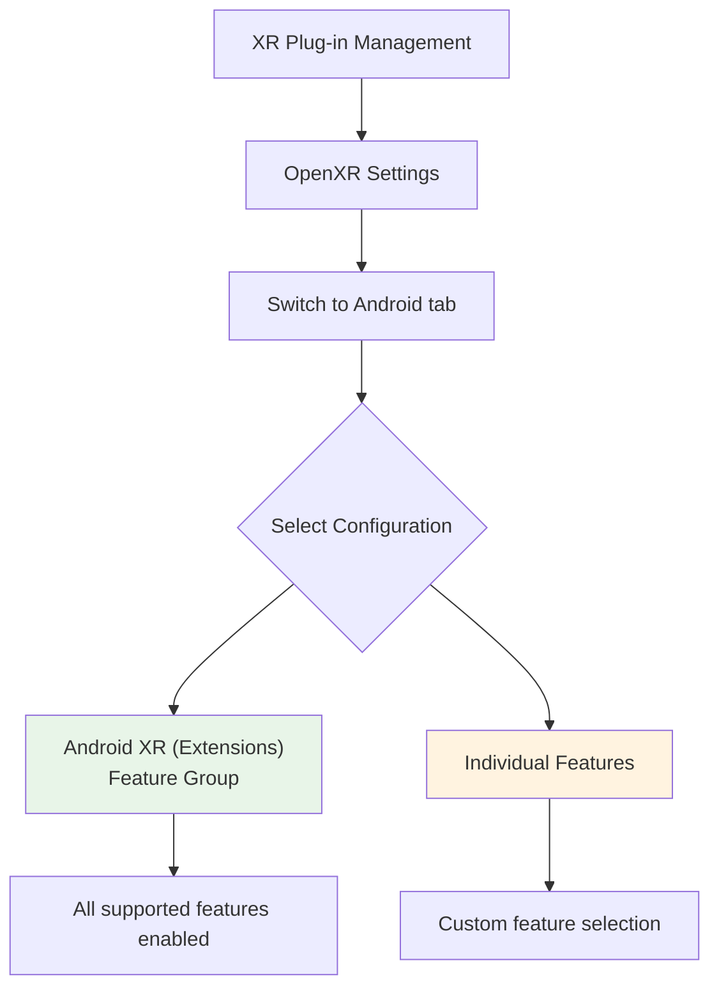

**Configuration Steps:**

1. Navigate to **XR Plug-in Management > OpenXR**
2. Switch to the **Android** platform tab
3. Choose one of the following options:
   - Select **Android XR (Extensions)** feature group for all features
   - Select individual features based on your application needs

Sources: [README.md:26-31]()

### Available XR Features

The package provides the following configurable OpenXR features:

| Feature Category | Features | Requirements |
|------------------|----------|-------------|
| Core Session | Session Management, Environment Blend Mode | Always required |
| Tracking | Object Tracking, Face Tracking, Marker Tracking, QR Code Tracking | Additional configuration may be needed |
| Interaction | Hand Mesh, Mouse Interaction Profile | Platform-specific setup |
| Spatial | Scene Meshing, Unbounded Reference Space | Permissions required |
| Rendering | Passthrough Composition Layer | Hardware-dependent |
| Experimental | Body Tracking, System State | Subject to API changes |

Sources: [README.md:3-17]()

## Project Validation

### OpenXR Validation Process

Unity's Project Validation system ensures proper configuration of OpenXR-related settings and identifies potential issues.

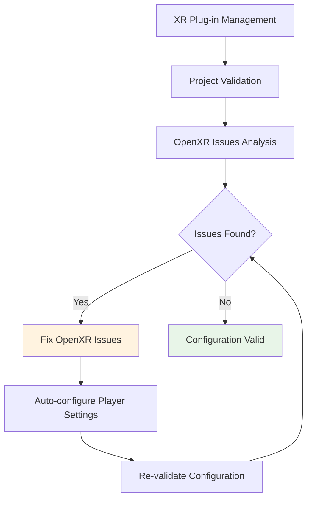

**Validation Steps:**

1. Navigate to **XR Plug-in Management > Project Validation**
2. Review all **OpenXR** related issues in the validation report
3. Click **Fix** or **Fix All** to automatically resolve configuration problems
4. Verify that all OpenXR validation checks pass

The validation process automatically configures Player Settings to ensure compatibility with OpenXR requirements.

Sources: [README.md:33-34]()

## Build Configuration

### Android Platform Settings

Configure Android-specific build settings required for OpenXR applications.

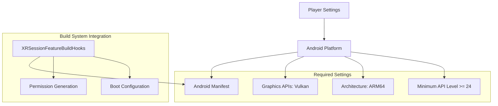

**Required Configuration:**

1. Navigate to **Player Settings > Android > Identification**
2. Set **Minimum API Level** to **24** or higher
3. Ensure **Target Architecture** includes **ARM64**
4. Verify **Graphics APIs** includes **Vulkan**

The build system automatically configures the Android manifest through `XRSessionFeatureBuildHooks` to include required permissions and OpenXR feature declarations.

Sources: [README.md:35-38]()

### Build Process Integration

The package integrates with Unity's build pipeline through several components:

| Component | Purpose | Integration Point |
|-----------|---------|------------------|
| `XRSessionFeatureBuildHooks` | Android manifest generation | Pre-build phase |
| `XRSessionFeatureEditor` | Feature configuration UI | Unity Editor |
| Boot Configuration | Runtime feature setup | Application startup |

Sources: [README.md:35-38]()

## Sample Setup

### Controller Sample Configuration

The XR Controller sample demonstrates basic controller functionality and requires additional setup beyond the core package configuration.

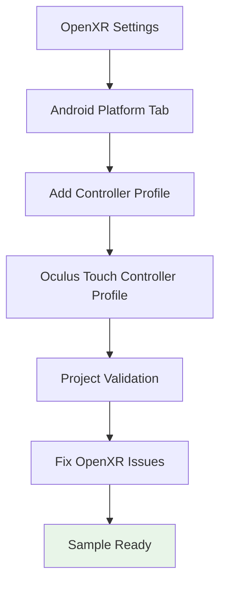

**Controller Sample Setup:**

1. Navigate to **Edit > Project Settings > XR Plug-in Management > OpenXR**
2. Switch to the **Android** platform tab
3. Add **Oculus Touch Controller Profile** to the interaction profiles
4. Run **Project Validation** to ensure proper configuration
5. Fix any remaining OpenXR-related issues

Sources: [Samples~/XRController/README.md:5-12]()

### Sample Dependencies

Each sample may have specific requirements beyond the base package installation:

| Sample | Additional Requirements |
|--------|------------------------|
| XR Controller | Oculus Touch Controller Profile |
| Face Tracking | Face tracking permissions and AR Foundation setup |
| Other Features | Refer to individual sample README files |

Sources: [README.md:30-31](), [Samples~/XRController/README.md:10]()

## Troubleshooting

### Common Installation Issues

| Issue | Solution |
|-------|----------|
| Package import fails | Verify Unity version compatibility and dependencies |
| OpenXR not available | Ensure OpenXR plugin is properly installed |
| Build failures | Check minimum API level (24+) and architecture settings |
| Feature not working | Verify feature is enabled in OpenXR settings |
| Permission errors | Run Project Validation to fix manifest configuration |

### Validation Checklist

Before building your project, ensure:

- [ ] Package imported successfully through Package Manager
- [ ] OpenXR enabled in XR Plug-in Management (Android tab)
- [ ] Required features selected in OpenXR settings
- [ ] Project Validation passes for all OpenXR issues
- [ ] Minimum API Level set to 24 or higher
- [ ] Controller profiles added for interaction samples

Sources: [README.md:33-38]()

---

# Page: Core XR Features

# Core XR Features

<details>
<summary>Relevant source files</summary>

The following files were used as context for generating this wiki page:

- [CHANGELOG.md](CHANGELOG.md)
- [package.json](package.json)

</details>


This document provides a comprehensive overview of the core XR capabilities provided by the Android XR Extensions for Unity package. It covers the main feature systems including tracking, rendering, and interaction components that extend Unity's OpenXR functionality for Android XR platforms.

For information about installing and configuring these features, see [Installation and Setup](#1.2). For detailed implementation guides of specific tracking systems, see [Tracking Features](#2.2). For build system integration details, see [Build System Integration](#4).

## Feature Architecture Overview

The Android XR Extensions package provides a layered architecture that extends Unity's OpenXR capabilities through specialized feature implementations and OpenXR extension support.

### Core Feature System

```mermaid
graph TB
    subgraph "OpenXR Extensions Layer"
        ANDROIDX["XR_ANDROIDX_* Extensions<br/>(Experimental)"]
        ANDROID["XR_ANDROID_* Extensions<br/>(Stable)"]
        CORE["Core OpenXR API"]
    end
    
    subgraph "Session Management"
        SESSION["XRSessionFeature<br/>Session Management"]
        VULKAN["Vulkan Subsampling"]
        SPACEWARP["SpaceWarp Configuration"]
        BLEND["Environment Blend Mode"]
    end
    
    subgraph "Tracking Features"
        BODY["XRBodyTrackingFeature"]
        OBJECT["XRObjectTrackingFeature"]
        MESH["XRSceneMeshingFeature"]
        FACE["XRFaceTrackingFeature"]
        MARKER["XRMarkerTrackingFeature"]
        QR["XRQrCodeTrackingFeature"]
        HAND["XRHandMeshFeature"]
    end
    
    subgraph "Rendering Features"
        FOVEATION["Foveation Legacy"]
        PASSTHROUGH["Passthrough Composition"]
        SYSTEM["XRSystemStateFeature"]
    end
    
    subgraph "Unity Integration"
        AR_FOUNDATION["AR Foundation"]
        OPENXR_PLUGIN["OpenXR Plugin"]
        XR_MANAGEMENT["XR Management"]
    end
    
    ANDROIDX --> BODY
    ANDROIDX --> MESH
    ANDROIDX --> SYSTEM
    ANDROID --> OBJECT
    ANDROID --> MARKER
    ANDROID --> QR
    CORE --> SESSION
    CORE --> HAND
    
    SESSION --> VULKAN
    SESSION --> SPACEWARP
    SESSION --> BLEND
    
    BODY --> AR_FOUNDATION
    OBJECT --> AR_FOUNDATION
    FACE --> AR_FOUNDATION
    MARKER --> AR_FOUNDATION
    QR --> AR_FOUNDATION
    
    MESH --> OPENXR_PLUGIN
    HAND --> OPENXR_PLUGIN
    FOVEATION --> OPENXR_PLUGIN
    PASSTHROUGH --> OPENXR_PLUGIN
    
    SESSION --> XR_MANAGEMENT
```

Sources: [package.json:12-16](), [CHANGELOG.md:70-81]()

### Feature Classification

The package organizes XR features into three primary categories based on their OpenXR extension dependencies and stability levels:

| Feature Category | OpenXR Extension | Stability | Examples |
|------------------|------------------|-----------|----------|
| Core Features | Standard OpenXR | Stable | Session Management, Hand Mesh |
| Android Extensions | `XR_ANDROID_*` | Stable | Object Tracking, Marker Tracking |
| Experimental Features | `XR_ANDROIDX_*` | Experimental | Body Tracking, Scene Meshing |

Sources: [CHANGELOG.md:70-72](), [CHANGELOG.md:30]()

## Tracking Features

The package provides comprehensive tracking capabilities through specialized OpenXR features that integrate with Unity's AR Foundation system.

### Tracking Feature Implementation

```mermaid
graph TB
    subgraph "AR Foundation Integration"
        AR_HUMAN["ARHumanBodyManager"]
        AR_TRACKED["ARTrackedImageManager"]
        AR_MESH["XRMeshSubsystem"]
    end
    
    subgraph "XR Tracking Features"
        BODY_FEATURE["XRBodyTrackingFeature<br/>Body Tracking"]
        OBJECT_FEATURE["XRObjectTrackingFeature<br/>Object Detection"]
        MESH_FEATURE["XRSceneMeshingFeature<br/>Scene Meshing"]
        FACE_FEATURE["XRFaceTrackingFeature<br/>Face Tracking"]
        MARKER_FEATURE["XRMarkerTrackingFeature<br/>Marker Detection"]
        QR_FEATURE["XRQrCodeTrackingFeature<br/>QR Code Detection"]
        HAND_FEATURE["XRHandMeshFeature<br/>Hand Mesh"]
    end
    
    subgraph "Data Types"
        FACE_STATE["XRFaceState"]
        FACE_PARAMS["XRFaceParameterIndices"]
        MARKER_DATA["XRMarkerDictionary"]
        MARKER_DB["XRMarkerDatabase"]
        IMAGE_LIB["XRReferenceImageLibrary"]
    end
    
    subgraph "Permission System"
        BODY_PERM["BodyTracking Permission"]
        SCENE_PERM["SceneUnderstanding Permission"]
        HAND_PERM["HandTracking Permission"]
        FACE_PERM["FaceTracking Permission"]
    end
    
    BODY_FEATURE --> AR_HUMAN
    OBJECT_FEATURE --> AR_TRACKED
    MESH_FEATURE --> AR_MESH
    MARKER_FEATURE --> AR_TRACKED
    QR_FEATURE --> AR_TRACKED
    
    FACE_FEATURE --> FACE_STATE
    FACE_FEATURE --> FACE_PARAMS
    MARKER_FEATURE --> MARKER_DATA
    MARKER_FEATURE --> MARKER_DB
    MARKER_FEATURE --> IMAGE_LIB
    QR_FEATURE --> IMAGE_LIB
    
    BODY_FEATURE --> BODY_PERM
    OBJECT_FEATURE --> SCENE_PERM
    MESH_FEATURE --> SCENE_PERM
    FACE_FEATURE --> FACE_PERM
    HAND_FEATURE --> HAND_PERM
```

Sources: [CHANGELOG.md:60-69](), [CHANGELOG.md:73-75](), [CHANGELOG.md:79-81]()

### Face Tracking System

The `XRFaceTrackingFeature` provides facial expression tracking through the `XRFaceState` data structure and `XRFaceParameterIndices` enumeration for blendshape parameters.

**Key Components:**
- `XRFaceState` - Contains face tracking data including confidence regions
- `XRFaceParameterIndices` - Enumeration of facial blendshape parameters including tongue tracking
- `XRFaceConfidenceRegion` - Confidence level indicators for different face regions

Sources: [CHANGELOG.md:85-87]()

### Image Recognition Features

The package provides dual image recognition capabilities through marker tracking and QR code detection:

**Marker Tracking (`XRMarkerTrackingFeature`):**
- Integrates with `ARTrackedImageManager` for marker detection
- `ARTrackedImage.IsMarker()` - Extension method to identify marker instances
- `ARTrackedImage.TryGetMarkerData(out XRMarkerDictionary, out int)` - Retrieves marker data
- `XRMarkerDatabase` - ScriptableObject container for marker reference management

**QR Code Tracking (`XRQrCodeTrackingFeature`):**
- Provides QR code detection through `ARTrackedImageManager`
- `ARTrackedImage.IsQrCode()` - Extension method to identify QR code instances
- `ARTrackedImage.TryGetQrCodeData(out string)` - Retrieves QR code string data
- Requires `XRReferenceImageLibrary` with **QrCode** named reference

Sources: [CHANGELOG.md:60-69]()

## Rendering Features

The package extends Unity's rendering capabilities with specialized XR rendering features for performance optimization and visual enhancement.

### Rendering Feature Architecture

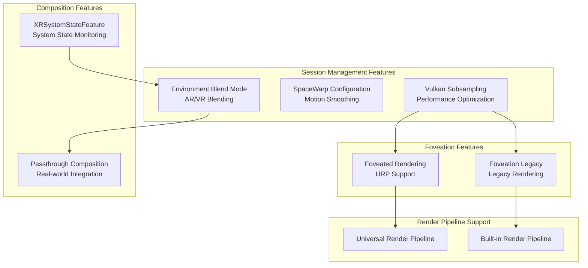

Sources: [CHANGELOG.md:26-29](), [CHANGELOG.md:76-78]()

### Vulkan Subsampling

The **Subsampling (Vulkan)** feature provides performance optimization through reduced rendering resolution. As of version 1.1.0, this feature is enabled by default and requires foveation support:

- **URP Projects**: Requires **Foveated Rendering** feature
- **BiRP Projects**: Requires **Foveation (Legacy)** feature for legacy support
- **Runtime Requirement**: Foveation feature must be enabled to prevent rendering faults

Sources: [CHANGELOG.md:26-29]()

### Environment Blend Mode

The Environment Blend Mode feature supports seamless integration between virtual and real-world content:

- **Additive Mode**: Adds virtual content to real-world view
- **Alpha Mode**: Blends virtual content with transparency
- **Opaque Mode**: Fully virtual environment
- **Integration**: Works with System State feature for dynamic mode switching

Sources: [package.json:20-22](), [CHANGELOG.md:76-78]()

## Interaction Features

The package provides advanced interaction capabilities through hand tracking, controller support, and spatial input systems.

### Hand and Controller Integration

```mermaid
graph TB
    subgraph "Hand Tracking"
        HAND_MESH["XRHandMeshFeature<br/>Hand Mesh Generation"]
        HAND_SUBSYSTEM["XRInputSubsystem<br/>Hand Input Processing"]
        HAND_RENDERER["Mesh Filter<br/>Hand Rendering"]
    end
    
    subgraph "Controller Support"
        XR_CONTROLLER["XRController Asset<br/>Controller Configuration"]
        CONTROLLER_DISPLAY["XRControllerDisplay<br/>Visual Feedback"]
        MOUSE_PROFILE["Android XR Mouse Profile<br/>Input Mapping"]
    end
    
    subgraph "Spatial Input"
        UNBOUNDED["Unbounded Reference Space<br/>Room-scale Tracking"]
        TRACKING_ORIGIN["XRInputSubsystem<br/>Tracking Origin Management"]
    end
    
    HAND_MESH --> HAND_SUBSYSTEM
    HAND_SUBSYSTEM --> HAND_RENDERER
    
    XR_CONTROLLER --> CONTROLLER_DISPLAY
    CONTROLLER_DISPLAY --> MOUSE_PROFILE
    
    UNBOUNDED --> TRACKING_ORIGIN
```

Sources: [package.json:45-47](), [package.json:65-67](), [package.json:50-52]()

### Hand Mesh System

The `XRHandMeshFeature` provides real-time hand mesh generation:

- **Mesh Generation**: Creates dynamic hand meshes for left and right hands
- **Rendering Integration**: Meshes are sent to `Mesh Filter` components for rendering
- **Permission Requirement**: Requires `HandTracking` permission for operation

Sources: [package.json:45-47](), [CHANGELOG.md:97-98]()

### Spatial Reference Systems

The package supports **Unbounded Reference Space** for room-scale XR experiences:

- **Tracking Origin**: Uses `XRInputSubsystem` to verify unbounded tracking mode
- **Room-scale Support**: Enables large-scale spatial tracking beyond seated/standing boundaries
- **Integration**: Works with existing Unity XR input systems

Sources: [package.json:50-52]()

## Experimental Features

The package includes experimental features that utilize `XR_ANDROIDX_*` OpenXR extensions. These features provide cutting-edge capabilities but come with important limitations.

### Experimental Feature Constraints

**Publishing Restrictions:**
- Applications using experimental features cannot be published to Google Play Store
- Features are marked as experimental and subject to breaking changes
- May include deprecation or removal in future versions

**Current Experimental Features:**
- **Body Tracking**: Full body pose tracking through `ARHumanBodyManager`
- **Scene Meshing**: Environment mesh generation (promoted to stable in v1.1.0)
- **System State**: System state monitoring and reporting

Sources: [CHANGELOG.md:70-72](), [CHANGELOG.md:30]()

### Scene Meshing Promotion

The **Scene Meshing** feature was promoted from experimental to stable release feature in version 1.1.0:

- **Previous Status**: Experimental feature using `XR_ANDROIDX_*` extensions
- **Current Status**: Stable release feature
- **Functionality**: Provides scene mesh data via `XRMeshSubsystem`
- **Sample**: Demonstrates usage through **SceneMeshing** sample

Sources: [CHANGELOG.md:30](), [CHANGELOG.md:79-81]()

## Feature Dependencies

The core XR features have specific dependencies on Unity packages and OpenXR extensions:

### Unity Package Dependencies

| Package | Version | Purpose |
|---------|---------|---------|
| `com.unity.xr.openxr` | 1.14.2 | OpenXR plugin support |
| `com.unity.xr.arfoundation` | 6.1.0 | AR Foundation integration |
| `com.unity.xr.management` | 4.5.0 | XR management system |

### Optional Dependencies

| Package | Version | Features |
|---------|---------|----------|
| `com.unity.xr.compositionlayers` | 1.0.0+ | Passthrough composition layers |
| `com.unity.xr.androidxr-openxr` | 1.0.0-pre.3 | Android XR OpenXR runtime |

Sources: [package.json:12-16](), [CHANGELOG.md:16-17]()

---

# Page: Session Management

# Session Management

<details>
<summary>Relevant source files</summary>

The following files were used as context for generating this wiki page:

- [Editor/Internal/XRSessionFeatureBuildHooks.cs](Editor/Internal/XRSessionFeatureBuildHooks.cs)
- [Editor/Internal/XRSessionFeatureEditor.cs](Editor/Internal/XRSessionFeatureEditor.cs)

</details>


The Session Management system provides core XR session configuration and lifecycle management for Android XR applications. This system handles immersive XR settings, performance optimizations like Vulkan subsampling and SpaceWarp, and integrates with Unity's build pipeline to automatically configure Android manifests and runtime settings.

For information about tracking-specific features like body tracking or object detection, see [Tracking Features](#2.2). For details about the permission system used by session features, see [Permission System](#2.4).

## Core XRSessionFeature Components

The session management system centers around the `XRSessionFeature` class, which provides three primary configuration options:

| Feature | Purpose | Build Impact |
|---------|---------|--------------|
| **ImmersiveXR** | Configures the application as a full-screen immersive XR experience | Adds immersive HMD intent category and XR activity properties to Android manifest |
| **VulkanSubsampling** | Enables memory bandwidth optimization for foveated rendering | Sets `xr-vulkan-extension-fragment-density-map-enabled` boot configuration |
| **SpaceWarp** | Enables URP SpaceWarp for performance optimization | Sets `xr-meta-enabled` boot configuration |

The system automatically detects which features are enabled and configures the build accordingly through the `XRSessionFeatureBuildHooks` class.

**Sources:** [Editor/Internal/XRSessionFeatureBuildHooks.cs:131-134](), [Editor/Internal/XRSessionFeatureEditor.cs:31-45]()

## Session Feature Configuration Flow

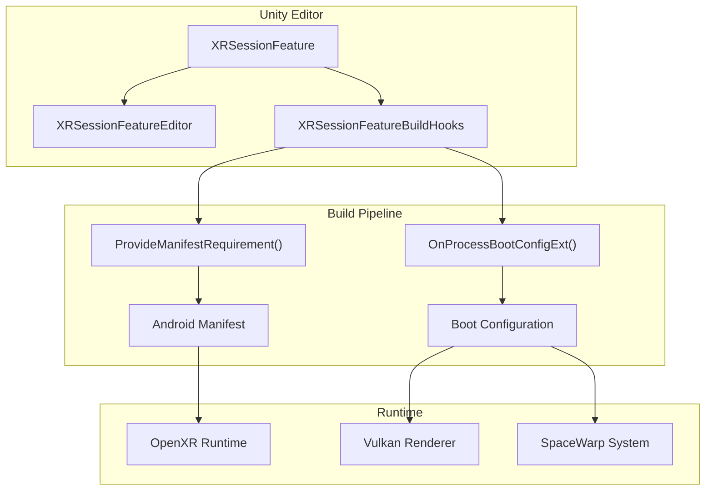

**Sources:** [Editor/Internal/XRSessionFeatureBuildHooks.cs:40-41](), [Editor/Internal/XRSessionFeatureBuildHooks.cs:127-147](), [Editor/Internal/XRSessionFeatureBuildHooks.cs:225-248]()

## Android Manifest Integration

The `XRSessionFeatureBuildHooks` class automatically injects required Android manifest elements based on the enabled session features:

### Immersive XR Manifest Elements

When `ImmersiveXR` is enabled, the system adds two critical manifest elements:

```xml
<!-- Intent category for immersive HMD applications -->
<category android:name="org.khronos.openxr.intent.category.IMMERSIVE_HMD" />

<!-- XR activity start mode property -->
<property android:name="android.window.PROPERTY_XR_ACTIVITY_START_MODE" 
          android:value="XR_ACTIVITY_START_MODE_FULL_SPACE_UNMANAGED" />
```

### Core OpenXR Requirements

All XR applications automatically receive these manifest elements:

```xml
<!-- Native OpenXR library -->
<uses-native-library android:name="libopenxr.google.so" android:required="false" />

<!-- OpenXR feature requirement -->
<uses-feature android:name="android.software.xr.api.openxr" 
              android:required="true" 
              android:version="0x00010001" />
```

**Sources:** [Editor/Internal/XRSessionFeatureBuildHooks.cs:42-67](), [Editor/Internal/XRSessionFeatureBuildHooks.cs:69-99](), [Editor/Internal/XRSessionFeatureBuildHooks.cs:204-208]()

## Permission System Integration

The session management system automatically determines which Android XR permissions are required based on enabled features:

```mermaid
graph TB
    subgraph "Feature Detection"
        CheckSceneCoarse["CheckSceneUnderstandingCoarsePermission()"]
        CheckSceneFine["CheckSceneUnderstandingFinePermission()"]
        CheckHandTracking["CheckHandTrackingPermission()"]
        CheckBodyTracking["CheckBodyTrackingPermission()"]
        CheckEyeTracking["CheckEyeTrackingCoarsePermission()"]
        CheckExperimental["CheckExperimentalPermission()"]
    end
    
    subgraph "Permission Injection"
        SceneCoarsePermission["SCENE_UNDERSTANDING_COARSE"]
        SceneFinePermission["SCENE_UNDERSTANDING_FINE"]
        HandTrackingPermission["HAND_TRACKING"]
        BodyTrackingPermission["BODY_TRACKING"]
        EyeTrackingPermission["EYE_TRACKING_COARSE"]
        ExperimentalMeta["com.android.extensions.xr.uses_experimental_openxr_feature"]
    end
    
    CheckSceneCoarse --> SceneCoarsePermission
    CheckSceneFine --> SceneFinePermission
    CheckHandTracking --> HandTrackingPermission
    CheckBodyTracking --> BodyTrackingPermission
    CheckEyeTracking --> EyeTrackingPermission
    CheckExperimental --> ExperimentalMeta
```

**Sources:** [Editor/Internal/XRSessionFeatureBuildHooks.cs:148-202](), [Editor/Internal/XRSessionFeatureBuildHooks.cs:277-358]()

## Boot Configuration System

The session management system configures low-level runtime behavior through Unity's boot configuration system:

### Vulkan Fragment Density Map

When `VulkanSubsampling` is enabled, or when foveation features are active, the system enables fragment density map support:

```csharp
bool needsFragmentDensityMapEnabled = (sessionFeature != null &&
    sessionFeature.enabled && sessionFeature.VulkanSubsampling) ||
    (foveationFeature != null && foveationFeature.enabled) ||
    (foveatedRendering != null && foveatedRendering.enabled);
    
builder.SetBootConfigBoolean("xr-vulkan-extension-fragment-density-map-enabled",
    needsFragmentDensityMapEnabled);
```

### SpaceWarp Configuration

When `SpaceWarp` is enabled, the system activates the Meta SpaceWarp extension:

```csharp
bool spacewarpEnabled = sessionFeature != null &&
    sessionFeature.enabled && sessionFeature.SpaceWarp;
    
builder.SetBootConfigBoolean("xr-meta-enabled", spacewarpEnabled);
```

**Sources:** [Editor/Internal/XRSessionFeatureBuildHooks.cs:228-248]()

## Unity Editor Interface

The `XRSessionFeatureEditor` provides a custom Unity inspector interface for configuring session features:

### Editor Properties

| Property | Field Name | Description |
|----------|------------|-------------|
| **Immersive XR** | `ImmersiveXR` | Configures full-screen immersive XR mode |
| **Subsampling (Vulkan)** | `_vulkanSubsampling` | Enables Vulkan subsampling for foveated rendering |
| **URP SpaceWarp (Vulkan)** | `_spacewarp` | Enables URP SpaceWarp performance optimization |

### Editor Implementation

The editor uses `SerializedProperty` objects to bind to the underlying `XRSessionFeature` fields and provides toggle controls with descriptive tooltips:

```csharp
_immersiveXR.boolValue = EditorGUILayout.Toggle(
    _immersiveXRLabel, _immersiveXR.boolValue);
_subsampling.boolValue = EditorGUILayout.Toggle(
    _subsamplingLabel, _subsampling.boolValue);
_spacewarp.boolValue = EditorGUILayout.Toggle(_spacewarpLabel, _spacewarp.boolValue);
```

**Sources:** [Editor/Internal/XRSessionFeatureEditor.cs:28-83]()

## Build Hook Integration

The session management system integrates with Unity's OpenXR build pipeline through the `OpenXRFeatureBuildHooks` base class:

```mermaid
graph TB
    subgraph "Unity Build Pipeline"
        OpenXRFeatureBuildHooks["OpenXRFeatureBuildHooks"]
        UnityBuildProcess["Unity Build Process"]
    end
    
    subgraph "XR Session Build Hooks"
        XRSessionFeatureBuildHooks["XRSessionFeatureBuildHooks"]
        ProvideManifestRequirement["ProvideManifestRequirement()"]
        OnProcessBootConfigExt["OnProcessBootConfigExt()"]
        OnPreprocessBuildExt["OnPreprocessBuildExt()"]
        OnPostprocessBuildExt["OnPostprocessBuildExt()"]
    end
    
    subgraph "Build Outputs"
        AndroidManifest["Android Manifest"]
        BootConfig["Boot Configuration"]
        GradleProject["Gradle Project"]
    end
    
    OpenXRFeatureBuildHooks --> XRSessionFeatureBuildHooks
    UnityBuildProcess --> XRSessionFeatureBuildHooks
    XRSessionFeatureBuildHooks --> ProvideManifestRequirement
    XRSessionFeatureBuildHooks --> OnProcessBootConfigExt
    XRSessionFeatureBuildHooks --> OnPreprocessBuildExt
    XRSessionFeatureBuildHooks --> OnPostprocessBuildExt
    ProvideManifestRequirement --> AndroidManifest
    OnProcessBootConfigExt --> BootConfig
    OnPostprocessBuildExt --> GradleProject
```

The build hooks are executed with `callbackOrder = 1` and target the `XRSessionFeature` type specifically, ensuring proper integration with Unity's XR build pipeline.

**Sources:** [Editor/Internal/XRSessionFeatureBuildHooks.cs:119-126](), [Editor/Internal/XRSessionFeatureBuildHooks.cs:251-263]()

---

# Page: Tracking Features

# Tracking Features

<details>
<summary>Relevant source files</summary>

The following files were used as context for generating this wiki page:

- [Runtime/Features/XRBodyTrackingFeature.cs](Runtime/Features/XRBodyTrackingFeature.cs)
- [Runtime/Features/XRObjectTrackingFeature.cs](Runtime/Features/XRObjectTrackingFeature.cs)
- [Runtime/Features/XRSceneMeshingFeature.cs](Runtime/Features/XRSceneMeshingFeature.cs)

</details>


This document covers the tracking capabilities provided by the Android XR Extensions for Unity package. The tracking features enable real-time detection and monitoring of objects, human bodies, and environmental geometry within XR applications running on Android XR platforms.

The tracking system consists of three main components: object tracking for detecting and following predefined objects, body tracking for human pose estimation, and scene meshing for environmental geometry reconstruction. Each feature integrates with Unity's AR Foundation framework while leveraging Android-specific OpenXR extensions for enhanced performance and capabilities.

For information about managing tracked image libraries, see [Image Recognition System](#2.3). For permission management related to tracking features, see [Permission System](#2.4).

## Architecture Overview

The tracking features are implemented as OpenXR features that extend Unity's base XR capabilities. Each tracking feature follows a consistent architecture pattern that integrates OpenXR extensions with Unity's subsystem framework.

### Tracking Feature System Architecture

```mermaid
graph TB
    subgraph "OpenXR Extensions"
        EXT_TRACK["XR_ANDROID_trackables"]
        EXT_OBJ["XR_ANDROID_trackables_object"]
        EXT_BODY["XR_ANDROIDX_body_tracking"]
        EXT_MESH["XR_ANDROID_scene_meshing"]
    end
    
    subgraph "Android XR Tracking Features"
        OBJ_FEAT["XRObjectTrackingFeature"]
        BODY_FEAT["XRBodyTrackingFeature"]
        MESH_FEAT["XRSceneMeshingFeature"]
    end
    
    subgraph "Unity Subsystems"
        OBJ_SUB["XRObjectTrackingSubsystem"]
        BODY_SUB["XRHumanBodySubsystem"]
        MESH_SUB["XRMeshSubsystem"]
    end
    
    subgraph "AR Foundation Integration"
        AR_TRACKED["ARTrackedImageManager"]
        AR_HUMAN["ARHumanBodyManager"]
        AR_MESH["ARMeshManager"]
    end
    
    subgraph "Android Permissions"
        SCENE_COARSE["SceneUnderstandingCoarse"]
        SCENE_FINE["SceneUnderstandingFine"]
        BODY_PERM["BodyTracking"]
    end
    
    EXT_TRACK --> OBJ_FEAT
    EXT_OBJ --> OBJ_FEAT
    EXT_BODY --> BODY_FEAT
    EXT_MESH --> MESH_FEAT
    
    OBJ_FEAT --> OBJ_SUB
    BODY_FEAT --> BODY_SUB
    MESH_FEAT --> MESH_SUB
    
    OBJ_SUB --> AR_TRACKED
    BODY_SUB --> AR_HUMAN
    MESH_SUB --> AR_MESH
    
    OBJ_FEAT --> SCENE_COARSE
    BODY_FEAT --> BODY_PERM
    MESH_FEAT --> SCENE_FINE
```

**Sources:** [Runtime/Features/XRObjectTrackingFeature.cs:35-42](), [Runtime/Features/XRBodyTrackingFeature.cs:35-43](), [Runtime/Features/XRSceneMeshingFeature.cs:33-35]()

## Object Tracking

The `XRObjectTrackingFeature` enables detection and tracking of predefined objects in the real world. It uses the `XR_ANDROID_trackables` and `XR_ANDROID_trackables_object` OpenXR extensions to provide object recognition capabilities.

### Object Tracking Implementation

```mermaid
graph TB
    subgraph "OpenXR Runtime"
        OXR_TRACK["XR_ANDROID_trackables"]
        OXR_OBJ["XR_ANDROID_trackables_object"]
    end
    
    subgraph "Feature Layer"
        OBJ_FEATURE["XRObjectTrackingFeature"]
        TRACKABLE_PROVIDER["XrTrackableProvider"]
    end
    
    subgraph "Unity Integration"
        OBJ_SUBSYSTEM["AndroidXRObjectTrackingSubsystem"]
        AR_MANAGER["ARTrackedImageManager"]
        DESCRIPTORS["XRObjectTrackingSubsystemDescriptor"]
    end
    
    subgraph "Configuration"
        EXTENSION_CHECK["ExtensionStrings"]
        PERMISSION_REQ["RequiredPermission"]
        INSTANCE_MGR["XRInstanceManagerApi"]
    end
    
    OXR_TRACK --> OBJ_FEATURE
    OXR_OBJ --> OBJ_FEATURE
    
    OBJ_FEATURE --> TRACKABLE_PROVIDER
    OBJ_FEATURE --> INSTANCE_MGR
    
    TRACKABLE_PROVIDER --> OBJ_SUBSYSTEM
    DESCRIPTORS --> OBJ_SUBSYSTEM
    
    OBJ_SUBSYSTEM --> AR_MANAGER
    
    OBJ_FEATURE --> EXTENSION_CHECK
    OBJ_FEATURE --> PERMISSION_REQ
```

**Sources:** [Runtime/Features/XRObjectTrackingFeature.cs:74-76](), [Runtime/Features/XRObjectTrackingFeature.cs:81-82](), [Runtime/Features/XRObjectTrackingFeature.cs:116-117]()

### Object Tracking Configuration

| Property | Value | Description |
|----------|-------|-------------|
| **Feature ID** | `com.google.xr.extensions.object_tracking` | Unique identifier for the object tracking feature |
| **OpenXR Extensions** | `XR_ANDROID_trackables XR_ANDROID_trackables_object` | Required OpenXR extensions |
| **Required Permission** | `SceneUnderstandingCoarse` | Android permission needed for object detection |
| **Priority** | 97 | OpenXR feature initialization priority |

The object tracking feature integrates with Unity's `XRObjectTrackingSubsystem` through the `AndroidXRObjectTrackingSubsystem` implementation. The feature automatically registers the trackable provider with the OpenXR instance manager when the required extensions are available.

**Sources:** [Runtime/Features/XRObjectTrackingFeature.cs:66](), [Runtime/Features/XRObjectTrackingFeature.cs:74-76](), [Runtime/Features/XRObjectTrackingFeature.cs:81-82](), [Runtime/Features/XRObjectTrackingFeature.cs:53]()

## Body Tracking

The `XRBodyTrackingFeature` provides human body pose estimation capabilities using the experimental `XR_ANDROIDX_body_tracking` OpenXR extension. This feature supports both automatic calibration and manual proportions-based calibration.

### Body Tracking Architecture

```mermaid
graph TB
    subgraph "OpenXR Extension"
        BODY_EXT["XR_ANDROIDX_body_tracking"]
    end
    
    subgraph "Feature Configuration"
        BODY_FEATURE["XRBodyTrackingFeature"]
        AUTO_CALIB["AutoCalibration"]
        PROPORTIONS["HumanBodyProportions"]
    end
    
    subgraph "Subsystem Implementation"
        BODY_SUBSYSTEM["AndroidXRHumanBodySubsystem"]
        BODY_DESCRIPTOR["XRHumanBodySubsystemDescriptor"]
    end
    
    subgraph "Unity AR Foundation"
        AR_BODY["ARHumanBodyManager"]
        BODY_DATA["XRHumanBody"]
    end
    
    subgraph "Runtime Configuration"
        AUTO_CALIB_REQ["AutoCalibrationRequested"]
        PROP_CALIB_REQ["ProportionCalibrationRequested"]
    end
    
    BODY_EXT --> BODY_FEATURE
    
    BODY_FEATURE --> AUTO_CALIB
    BODY_FEATURE --> PROPORTIONS
    
    AUTO_CALIB --> AUTO_CALIB_REQ
    PROPORTIONS --> PROP_CALIB_REQ
    
    BODY_FEATURE --> BODY_SUBSYSTEM
    BODY_DESCRIPTOR --> BODY_SUBSYSTEM
    
    AUTO_CALIB_REQ --> BODY_SUBSYSTEM
    PROP_CALIB_REQ --> BODY_SUBSYSTEM
    
    BODY_SUBSYSTEM --> AR_BODY
    AR_BODY --> BODY_DATA
```

**Sources:** [Runtime/Features/XRBodyTrackingFeature.cs:103-117](), [Runtime/Features/XRBodyTrackingFeature.cs:123-137](), [Runtime/Features/XRBodyTrackingFeature.cs:89]()

### Body Tracking Configuration

| Property | Value | Description |
|----------|-------|-------------|
| **Feature ID** | `com.google.xr.extensions.body_tracking` | Unique identifier for body tracking |
| **OpenXR Extension** | `XR_ANDROIDX_body_tracking` | Required experimental OpenXR extension |
| **Required Permission** | `BodyTracking` | Android permission for body tracking |
| **Priority** | 97 | OpenXR feature initialization priority |
| **Experimental Status** | Yes | Feature is marked as experimental |

The body tracking feature supports two calibration modes:

- **Automatic Calibration**: When `AutoCalibration` is enabled, the system automatically determines body proportions
- **Manual Proportions**: When disabled, uses the configured `XRHumanBodyProportions` for skeleton computation

**Sources:** [Runtime/Features/XRBodyTrackingFeature.cs:67](), [Runtime/Features/XRBodyTrackingFeature.cs:73](), [Runtime/Features/XRBodyTrackingFeature.cs:78-79](), [Runtime/Features/XRBodyTrackingFeature.cs:84](), [Runtime/Features/XRBodyTrackingFeature.cs:87]()

## Scene Meshing

The `XRSceneMeshingFeature` provides real-time environmental geometry reconstruction using the `XR_ANDROID_scene_meshing` OpenXR extension. This feature generates mesh data representing the physical environment around the user.

### Scene Meshing Lifecycle

```mermaid
graph TB
    subgraph "OpenXR Extension"
        MESH_EXT["XR_ANDROID_scene_meshing"]
    end
    
    subgraph "Feature Management"
        MESH_FEATURE["XRSceneMeshingFeature"]
        MESH_API["XRSceneMeshingApi"]
    end
    
    subgraph "Unity Mesh System"
        MESH_SUBSYSTEM["XRMeshSubsystem"]
        MESH_DESCRIPTOR["XRMeshSubsystemDescriptor"]
    end
    
    subgraph "Feature Lifecycle"
        ON_CREATE["OnSubsystemCreate"]
        ON_START["OnSubsystemStart"]
        ON_STOP["OnSubsystemStop"]
        ON_DESTROY["OnSubsystemDestroy"]
    end
    
    subgraph "Runtime Control"
        SET_ENABLED["SetEnabled(true/false)"]
        START_SUB["StartSubsystem"]
        STOP_SUB["StopSubsystem"]
        DESTROY_SUB["DestroySubsystem"]
    end
    
    MESH_EXT --> MESH_FEATURE
    MESH_FEATURE --> MESH_API
    
    MESH_FEATURE --> ON_CREATE
    MESH_FEATURE --> ON_START
    MESH_FEATURE --> ON_STOP
    MESH_FEATURE --> ON_DESTROY
    
    ON_CREATE --> MESH_SUBSYSTEM
    ON_START --> SET_ENABLED
    ON_START --> START_SUB
    ON_STOP --> STOP_SUB
    ON_DESTROY --> DESTROY_SUB
    
    SET_ENABLED --> MESH_API
    START_SUB --> MESH_SUBSYSTEM
    STOP_SUB --> MESH_SUBSYSTEM
    DESTROY_SUB --> MESH_SUBSYSTEM
    
    MESH_DESCRIPTOR --> MESH_SUBSYSTEM
```

**Sources:** [Runtime/Features/XRSceneMeshingFeature.cs:102-106](), [Runtime/Features/XRSceneMeshingFeature.cs:109-117](), [Runtime/Features/XRSceneMeshingFeature.cs:120-128](), [Runtime/Features/XRSceneMeshingFeature.cs:131-134]()

### Scene Meshing Configuration

| Property | Value | Description |
|----------|-------|-------------|
| **Feature ID** | `com.google.xr.extensions.scene_meshing` | Unique identifier for scene meshing |
| **OpenXR Extension** | `XR_ANDROID_scene_meshing` | Required OpenXR extension |
| **Required Permission** | `SceneUnderstandingFine` | Android permission for detailed scene understanding |
| **Priority** | 99 | OpenXR feature initialization priority |
| **AR Foundation Compatibility** | Limited | Not compatible with `ARMeshManager` due to lifecycle conflicts |

The scene meshing feature manages the `XRMeshSubsystem` lifecycle directly rather than relying on AR Foundation's `ARMeshManager`. This approach provides better control over mesh creation and destruction timing.

**Sources:** [Runtime/Features/XRSceneMeshingFeature.cs:58](), [Runtime/Features/XRSceneMeshingFeature.cs:63](), [Runtime/Features/XRSceneMeshingFeature.cs:68-69](), [Runtime/Features/XRSceneMeshingFeature.cs:45](), [Runtime/Features/XRSceneMeshingFeature.cs:112-115]()

## Feature Initialization and Extension Management

All tracking features follow a consistent initialization pattern that checks for OpenXR extension availability and registers the appropriate API features with the XR instance manager.

### Common Initialization Pattern

```mermaid
graph TB
    subgraph "OpenXR Instance Creation"
        INSTANCE_CREATE["OnInstanceCreate"]
        EXT_CHECK["Extension Availability Check"]
        REGISTER_API["XRInstanceManagerApi.Register"]
    end
    
    subgraph "Subsystem Management"
        SUBSYSTEM_CREATE["OnSubsystemCreate"]
        DESCRIPTOR_LOOKUP["SubsystemDescriptor Lookup"]
        SUBSYSTEM_INSTANTIATE["CreateSubsystem"]
    end
    
    subgraph "Lifecycle Management"
        SUBSYSTEM_START["OnSubsystemStart"]
        SUBSYSTEM_STOP["OnSubsystemStop"]
        SUBSYSTEM_DESTROY["OnSubsystemDestroy"]
    end
    
    subgraph "Extension Status"
        EXT_ENABLED["_extensionEnabled"]
        IS_EXT_ENABLED["IsExtensionEnabled"]
    end
    
    INSTANCE_CREATE --> EXT_CHECK
    EXT_CHECK --> EXT_ENABLED
    EXT_CHECK --> REGISTER_API
    
    EXT_ENABLED --> IS_EXT_ENABLED
    
    SUBSYSTEM_CREATE --> DESCRIPTOR_LOOKUP
    DESCRIPTOR_LOOKUP --> SUBSYSTEM_INSTANTIATE
    
    SUBSYSTEM_START --> SUBSYSTEM_STOP
    SUBSYSTEM_STOP --> SUBSYSTEM_DESTROY
```

**Sources:** [Runtime/Features/XRObjectTrackingFeature.cs:97-118](), [Runtime/Features/XRBodyTrackingFeature.cs:140-154](), [Runtime/Features/XRSceneMeshingFeature.cs:82-93]()

Each tracking feature exposes an `IsExtensionEnabled` property that indicates whether the required OpenXR extensions are available on the current device. This allows applications to conditionally enable tracking functionality based on platform capabilities.

**Sources:** [Runtime/Features/XRObjectTrackingFeature.cs:94](), [Runtime/Features/XRBodyTrackingFeature.cs:96](), [Runtime/Features/XRSceneMeshingFeature.cs:79]()

---

# Page: Image Recognition System

# Image Recognition System

<details>
<summary>Relevant source files</summary>

The following files were used as context for generating this wiki page:

- [Runtime/AndroidXRRuntimeImageLibrary.cs](Runtime/AndroidXRRuntimeImageLibrary.cs)
- [Runtime/Features/XRObjectTrackingFeature.cs](Runtime/Features/XRObjectTrackingFeature.cs)

</details>


The Image Recognition System provides runtime image library management for QR codes and markers in Android XR applications. It processes reference images from Unity's AR Foundation system and organizes them for efficient tracking by the Android XR platform. The system validates image configurations at build time and provides runtime access to organized image data for object tracking features.

For information about the broader object tracking capabilities that utilize this system, see [Tracking Features](#2.2). For details about the permissions required for image recognition, see [Permission System](#2.4).

## Core Architecture

The image recognition system is built around the `AndroidXRRuntimeImageLibrary` class, which extends Unity's `RuntimeReferenceImageLibrary` to provide specialized handling for QR codes and markers. The system processes images from `XRReferenceImageLibrary` assets and organizes them into distinct categories for optimal runtime performance.

```mermaid
graph TB
    subgraph "Unity AR Foundation"
        XRRefLib["XRReferenceImageLibrary"]
        XRRefImage["XRReferenceImage"]
        ARTrackedImageManager["ARTrackedImageManager"]
    end
    
    subgraph "Android XR Image System"
        AndroidXRRuntimeImageLibrary["AndroidXRRuntimeImageLibrary"]
        QRCodeRef["QR Code Reference"]
        MarkerRef["Marker References"]
        XRMarkerDatabaseEntry["XRMarkerDatabaseEntry"]
    end
    
    subgraph "Object Tracking Integration"
        XRObjectTrackingFeature["XRObjectTrackingFeature"]
        AndroidXRObjectTrackingSubsystem["AndroidXRObjectTrackingSubsystem"]
        OpenXRTrackables["XR_ANDROID_trackables"]
    end
    
    subgraph "Validation System"
        ValidateQrCode["ValidateQrCode()"]
        ValidateMarker["ValidateMarker()"]
        XRMarkerDatabase["XRMarkerDatabase"]
    end
    
    XRRefLib --> AndroidXRRuntimeImageLibrary
    XRRefImage --> AndroidXRRuntimeImageLibrary
    
    AndroidXRRuntimeImageLibrary --> QRCodeRef
    AndroidXRRuntimeImageLibrary --> MarkerRef
    MarkerRef --> XRMarkerDatabaseEntry
    
    AndroidXRRuntimeImageLibrary --> XRObjectTrackingFeature
    XRObjectTrackingFeature --> AndroidXRObjectTrackingSubsystem
    AndroidXRObjectTrackingSubsystem --> OpenXRTrackables
    
    AndroidXRRuntimeImageLibrary --> ValidateQrCode
    AndroidXRRuntimeImageLibrary --> ValidateMarker
    ValidateMarker --> XRMarkerDatabase
    
    ARTrackedImageManager --> XRRefLib
```

**Sources:** [Runtime/AndroidXRRuntimeImageLibrary.cs:1-270](), [Runtime/Features/XRObjectTrackingFeature.cs:1-177]()

## QR Code Recognition

The system provides specialized support for QR code tracking through a naming convention-based approach. QR codes are identified by reference images with names starting with "qrcode" (case-insensitive).

### QR Code Processing

The `AndroidXRRuntimeImageLibrary` automatically detects QR code references during initialization and assigns them a special index for efficient runtime access:

| Property | Type | Description |
|----------|------|-------------|
| `QrCodeReferenceIndex` | `int` | Index of the QR code reference, or -1 if not found |
| `QRCodeReference` | `XRReferenceImage?` | The QR code reference image, or null if not available |

The system enforces a single QR code reference per library, with additional QR code references being ignored and logged as warnings.

```mermaid
graph LR
    subgraph "QR Code Detection"
        InputImage["XRReferenceImage"]
        NameCheck["IsQrCodeReference()"]
        QRCodeStorage["QR Code Index Assignment"]
    end
    
    subgraph "QR Code Validation"
        ValidateQrCode["ValidateQrCode()"]
        SingleQRCheck["Single QR Code Enforcement"]
        ValidationOutput["Validation Messages"]
    end
    
    InputImage --> NameCheck
    NameCheck --> QRCodeStorage
    InputImage --> ValidateQrCode
    ValidateQrCode --> SingleQRCheck
    SingleQRCheck --> ValidationOutput
```

**Sources:** [Runtime/AndroidXRRuntimeImageLibrary.cs:37-38](), [Runtime/AndroidXRRuntimeImageLibrary.cs:58-66](), [Runtime/AndroidXRRuntimeImageLibrary.cs:131-152](), [Runtime/AndroidXRRuntimeImageLibrary.cs:244-247]()

## Marker Recognition

The marker recognition system handles structured markers that follow specific naming conventions. Markers are processed through the `XRMarkerDatabaseEntry` system, which parses marker names and validates their configurations.

### Marker Processing Pipeline

Marker references are identified and processed through a multi-step pipeline:

1. **Name Parsing**: Marker names are parsed using `XRMarkerDatabaseEntry.TryParse()`
2. **Reference Assignment**: Successfully parsed markers have their GUID references assigned
3. **Organization**: Markers are grouped together in the image library for efficient access

| Property | Type | Description |
|----------|------|-------------|
| `MarkerReferenceIndex` | `int` | Index of the first marker reference, or -1 if none exist |
| `MarkerReferenceCount` | `int` | Total number of marker references in the library |

```mermaid
graph TB
    subgraph "Marker Processing"
        MarkerInput["XRReferenceImage with Marker Name"]
        TryParse["XRMarkerDatabaseEntry.TryParse()"]
        ParseSuccess{"Parse Success?"}
        SetReference["SetReference(image.guid)"]
        AddToEntries["Add to _markerEntries"]
        AddToImages["Add to _images list"]
    end
    
    subgraph "Marker Validation"
        ValidationDB["XRMarkerDatabase (validation)"]
        ValidateMarker["ValidateMarker()"]
        GetValidationError["GetValidationError()"]
        ErrorOutput["Validation Error Messages"]
    end
    
    MarkerInput --> TryParse
    TryParse --> ParseSuccess
    ParseSuccess -->|Yes| SetReference
    SetReference --> AddToEntries
    AddToEntries --> AddToImages
    
    MarkerInput --> ValidateMarker
    ValidateMarker --> ValidationDB
    ValidationDB --> GetValidationError
    GetValidationError --> ErrorOutput
```

**Sources:** [Runtime/AndroidXRRuntimeImageLibrary.cs:67-75](), [Runtime/AndroidXRRuntimeImageLibrary.cs:154-163](), [Runtime/AndroidXRRuntimeImageLibrary.cs:210-234]()

## Image Library Organization

The `AndroidXRRuntimeImageLibrary` organizes images into a structured layout for optimal runtime performance. The organization follows a specific order: QR codes first, followed by markers.

### Internal Structure

```mermaid
graph TB
    subgraph "AndroidXRRuntimeImageLibrary Internal Structure"
        ImagesList["_images: List<XRReferenceImage>"]
        MarkerEntries["_markerEntries: List<XRMarkerDatabaseEntry>"]
        QRCodeIndex["_qrCodeIndex: int"]
        MarkerIndex["_markerIndex: int"]
        MarkerCount["_markerCount: int"]
    end
    
    subgraph "Image Organization"
        QRCodeSlot["QR Code Reference (index 0)"]
        MarkerSlots["Marker References (sequential)"]
        EmptySlots["Unused References"]
    end
    
    ImagesList --> QRCodeSlot
    ImagesList --> MarkerSlots
    ImagesList --> EmptySlots
    
    QRCodeIndex --> QRCodeSlot
    MarkerIndex --> MarkerSlots
    MarkerCount --> MarkerSlots
    
    MarkerEntries --> MarkerSlots
```

The constructor processes images in the following order:

1. **QR Code Detection**: Scans for QR code references and assigns the first valid one
2. **Marker Collection**: Collects all valid marker references into a temporary list
3. **Marker Addition**: Adds all marker references to the main image list
4. **Logging**: Outputs a summary of the processed images

**Sources:** [Runtime/AndroidXRRuntimeImageLibrary.cs:50-126](), [Runtime/AndroidXRRuntimeImageLibrary.cs:38-44]()

## Validation System

The image recognition system provides comprehensive validation capabilities for both QR codes and markers. Validation occurs at build time to ensure proper configuration before deployment.

### QR Code Validation

The `ValidateQrCode()` method performs the following checks:

- **Existence Check**: Verifies that at least one QR code reference exists
- **Duplicate Detection**: Warns about multiple QR code references
- **Naming Validation**: Confirms proper QR code naming conventions

### Marker Validation

The `ValidateMarker()` method creates a temporary `XRMarkerDatabase` to validate marker configurations:

- **Marker Parsing**: Validates marker name format and structure
- **Database Consistency**: Checks for conflicts and duplicate markers
- **Configuration Errors**: Reports detailed validation errors

```mermaid
graph TB
    subgraph "Validation Process"
        ImageLibrary["IReferenceImageLibrary"]
        QRValidation["ValidateQrCode()"]
        MarkerValidation["ValidateMarker()"]
    end
    
    subgraph "QR Code Validation"
        QRCheck["QR Code Existence Check"]
        QRDuplicate["Duplicate QR Code Detection"]
        QRWarning["Warning Messages"]
    end
    
    subgraph "Marker Validation"
        TempDB["Temporary XRMarkerDatabase"]
        MarkerParsing["Marker Name Parsing"]
        ErrorCollection["Error Collection"]
        ErrorOutput["Error Messages"]
    end
    
    ImageLibrary --> QRValidation
    ImageLibrary --> MarkerValidation
    
    QRValidation --> QRCheck
    QRCheck --> QRDuplicate
    QRDuplicate --> QRWarning
    
    MarkerValidation --> TempDB
    TempDB --> MarkerParsing
    MarkerParsing --> ErrorCollection
    ErrorCollection --> ErrorOutput
```

**Sources:** [Runtime/AndroidXRRuntimeImageLibrary.cs:165-235]()

## Runtime Integration

The image recognition system integrates with the broader Android XR tracking infrastructure through the `XRObjectTrackingFeature`. This integration provides the runtime connection between organized image libraries and the native tracking capabilities.

### Integration Points

| Component | Role | Connection |
|-----------|------|------------|
| `XRObjectTrackingFeature` | Feature management | Creates and manages tracking subsystem |
| `AndroidXRObjectTrackingSubsystem` | Subsystem implementation | Processes organized image data |
| `XR_ANDROID_trackables` | OpenXR extension | Provides native tracking capabilities |
| `SceneUnderstandingCoarse` | Permission requirement | Enables object tracking functionality |

The integration follows this initialization sequence:

1. **Feature Registration**: `XRObjectTrackingFeature` registers with OpenXR runtime
2. **Extension Validation**: Confirms availability of required OpenXR extensions
3. **Subsystem Creation**: Creates `AndroidXRObjectTrackingSubsystem` instance
4. **Library Processing**: Processes image libraries through `AndroidXRRuntimeImageLibrary`
5. **Runtime Tracking**: Enables image recognition and tracking capabilities

**Sources:** [Runtime/Features/XRObjectTrackingFeature.cs:74-82](), [Runtime/Features/XRObjectTrackingFeature.cs:96-118](), [Runtime/Features/XRObjectTrackingFeature.cs:129-165]()

---

# Page: Permission System

# Permission System

<details>
<summary>Relevant source files</summary>

The following files were used as context for generating this wiki page:

- [Editor/Internal/XRSessionFeatureBuildHooks.cs](Editor/Internal/XRSessionFeatureBuildHooks.cs)
- [Runtime/AndroidXRPermissionExtensions.cs](Runtime/AndroidXRPermissionExtensions.cs)

</details>


This document covers the Android XR permission system used by the Unity package, including permission types, build-time injection, and feature-to-permission mapping. The system automatically manages Android manifest permissions based on enabled XR features and provides runtime permission utilities.

For information about XR feature configuration and management, see [Session Management](#2.1). For details about the build system integration, see [Build System Integration](#4).

## Permission Types

The Android XR Extensions package defines specific permission types through the `AndroidXRPermission` enum, each corresponding to different XR tracking capabilities and Android platform permissions.

| Permission Type | Android Permission String | Description |
|---|---|---|
| `SceneUnderstandingCoarse` | `android.permission.SCENE_UNDERSTANDING_COARSE` | Motion tracking, ToF sensor, VST RGB-left cameras |
| `SceneUnderstandingFine` | `android.permission.SCENE_UNDERSTANDING_FINE` | Depth texture, scene meshing |
| `HandTracking` | `android.permission.HAND_TRACKING` | Hand tracking capabilities |
| `EyeTrackingCoarse` | `android.permission.EYE_TRACKING_COARSE` | Basic eye tracking |
| `EyeTrackingFine` | `android.permission.EYE_TRACKING_FINE` | Eye gaze interaction, fine eye tracking |
| `FaceTracking` | `android.permission.FACE_TRACKING` | Face tracking capabilities |
| `BodyTracking` | `com.android.extensions.xr.BODY_TRACKING` | Body tracking capabilities |

```mermaid
graph TD
    AndroidXRPermission["AndroidXRPermission enum"]
    
    AndroidXRPermission --> SceneCoarse["SceneUnderstandingCoarse"]
    AndroidXRPermission --> SceneFine["SceneUnderstandingFine"]
    AndroidXRPermission --> HandTrack["HandTracking"]
    AndroidXRPermission --> EyeCoarse["EyeTrackingCoarse"]
    AndroidXRPermission --> EyeFine["EyeTrackingFine"]
    AndroidXRPermission --> FaceTrack["FaceTracking"]
    AndroidXRPermission --> BodyTrack["BodyTracking"]
    
    SceneCoarse --> SceneCoarseStr["android.permission.SCENE_UNDERSTANDING_COARSE"]
    SceneFine --> SceneFineStr["android.permission.SCENE_UNDERSTANDING_FINE"]
    HandTrack --> HandTrackStr["android.permission.HAND_TRACKING"]
    EyeCoarse --> EyeCoarseStr["android.permission.EYE_TRACKING_COARSE"]
    EyeFine --> EyeFineStr["android.permission.EYE_TRACKING_FINE"]
    FaceTrack --> FaceTrackStr["android.permission.FACE_TRACKING"]
    BodyTrack --> BodyTrackStr["com.android.extensions.xr.BODY_TRACKING"]
```

The `AndroidXRPermissionExtensions` class provides the `ToPermissionString()` method to convert enum values to their corresponding Android permission strings used in manifest declarations and runtime permission requests.

Sources: [Runtime/AndroidXRPermissionExtensions.cs:27-65](), [Runtime/AndroidXRPermissionExtensions.cs:78-100]()

## Build-time Permission Injection

The permission system automatically injects required permissions into the Android manifest during build time through the `XRSessionFeatureBuildHooks` class. This process analyzes enabled XR features and determines which permissions are necessary.

```mermaid
graph TD
    BuildProcess["Unity Build Process"]
    
    BuildProcess --> ProvideManifestRequirement["ProvideManifestRequirement()"]
    
    ProvideManifestRequirement --> CheckSceneCoarse["CheckSceneUnderstandingCoarsePermission()"]
    ProvideManifestRequirement --> CheckSceneFine["CheckSceneUnderstandingFinePermission()"]
    ProvideManifestRequirement --> CheckEyeCoarse["CheckEyeTrackingCoarsePermission()"]
    ProvideManifestRequirement --> CheckEyeFine["CheckEyeTrackingFinePermission()"]
    ProvideManifestRequirement --> CheckHand["CheckHandTrackingPermission()"]
    ProvideManifestRequirement --> CheckBody["CheckBodyTrackingPermission()"]
    ProvideManifestRequirement --> CheckExperimental["CheckExperimentalPermission()"]
    
    CheckSceneCoarse --> GetAndroidXRPermissionElement["GetAndroidXRPermissionElement()"]
    CheckSceneFine --> GetAndroidXRPermissionElement
    CheckEyeCoarse --> GetAndroidXRPermissionElement
    CheckEyeFine --> GetAndroidXRPermissionElement
    CheckHand --> GetAndroidXRPermissionElement
    CheckBody --> GetAndroidXRPermissionElement
    
    GetAndroidXRPermissionElement --> ManifestElement["ManifestElement with uses-permission"]
    ManifestElement --> AndroidManifest["Android Manifest"]
```

The `GetAndroidXRPermissionElement()` method creates `ManifestElement` objects that specify the `uses-permission` elements to be injected into the Android manifest.

Sources: [Editor/Internal/XRSessionFeatureBuildHooks.cs:127-222](), [Editor/Internal/XRSessionFeatureBuildHooks.cs:265-275]()

## Feature-to-Permission Mapping

The permission system uses specific logic to map enabled XR features to required Android permissions. Each permission check method examines the active XR features and determines permission requirements.

### Scene Understanding Permissions

```mermaid
graph TD
    SceneCoarseCheck["CheckSceneUnderstandingCoarsePermission()"]
    SceneFineCheck["CheckSceneUnderstandingFinePermission()"]
    
    SceneCoarseCheck --> XRObjectTrackingFeature["XRObjectTrackingFeature.enabled"]
    SceneCoarseCheck --> XRQrCodeTrackingFeature["XRQrCodeTrackingFeature.enabled"]
    SceneCoarseCheck --> XRMarkerTrackingFeature["XRMarkerTrackingFeature.enabled"]
    
    SceneFineCheck --> XRSceneMeshingFeature["XRSceneMeshingFeature.enabled"]
    
    XRObjectTrackingFeature --> SceneCoarsePermission["SCENE_UNDERSTANDING_COARSE"]
    XRQrCodeTrackingFeature --> SceneCoarsePermission
    XRMarkerTrackingFeature --> SceneCoarsePermission
    
    XRSceneMeshingFeature --> SceneFinePermission["SCENE_UNDERSTANDING_FINE"]
```

### Eye Tracking Permissions

```mermaid
graph TD
    EyeCoarseCheck["CheckEyeTrackingCoarsePermission()"]
    EyeFineCheck["CheckEyeTrackingFinePermission()"]
    
    EyeCoarseCheck --> FoveatedRenderingFeature1["FoveatedRenderingFeature.enabled"]
    EyeCoarseCheck --> EyeTrackingCalibration1["CheckEyeTrackingCalibrationPermission()"]
    
    EyeFineCheck --> EyeGazeInteraction["EyeGazeInteraction.enabled"]
    EyeFineCheck --> FoveatedRenderingFeature2["FoveatedRenderingFeature.enabled"]
    EyeFineCheck --> EyeTrackingCalibration2["CheckEyeTrackingCalibrationPermission()"]
    
    FoveatedRenderingFeature1 --> EyeCoarsePermission["EYE_TRACKING_COARSE"]
    EyeTrackingCalibration1 --> EyeCoarsePermission
    
    EyeGazeInteraction --> EyeFinePermission["EYE_TRACKING_FINE"]
    FoveatedRenderingFeature2 --> EyeFinePermission
    EyeTrackingCalibration2 --> EyeFinePermission
```

### Hand and Body Tracking Permissions

```mermaid
graph TD
    HandCheck["CheckHandTrackingPermission()"]
    BodyCheck["CheckBodyTrackingPermission()"]
    
    HandCheck --> HandTracking["HandTracking.enabled (Unity XR Hands)"]
    HandCheck --> XRHandMeshFeature["XRHandMeshFeature.enabled"]
    
    BodyCheck --> XRBodyTrackingFeature["XRBodyTrackingFeature.enabled"]
    
    HandTracking --> HandPermission["HAND_TRACKING"]
    XRHandMeshFeature --> HandPermission
    
    XRBodyTrackingFeature --> BodyPermission["BODY_TRACKING"]
```

Sources: [Editor/Internal/XRSessionFeatureBuildHooks.cs:277-345](), [Editor/Internal/XRSessionFeatureBuildHooks.cs:347-358]()

## Runtime Permission Management

The `AndroidXRPermissionExtensions` class provides runtime utilities for working with Android XR permissions. The `ToPermissionString()` method converts `AndroidXRPermission` enum values to their corresponding Android permission strings for use in runtime permission requests.

| Method | Purpose | Return Type |
|---|---|---|
| `ToPermissionString()` | Converts enum to Android permission string | `string` |

The method handles each permission type through a switch statement, returning the appropriate Android permission string or logging an error for invalid permissions.

Sources: [Runtime/AndroidXRPermissionExtensions.cs:78-100]()

## Experimental Feature Handling

The system includes special handling for experimental features that require additional manifest metadata. The `CheckExperimentalPermission()` method identifies features that require the experimental OpenXR feature flag.

```mermaid
graph TD
    ExperimentalCheck["CheckExperimentalPermission()"]
    
    ExperimentalCheck --> XRBodyTrackingFeature["XRBodyTrackingFeature.enabled"]
    ExperimentalCheck --> XRSystemStateFeature["XRSystemStateFeature.enabled"]
    
    XRBodyTrackingFeature --> ExperimentalMetadata["com.android.extensions.xr.uses_experimental_openxr_feature"]
    XRSystemStateFeature --> ExperimentalMetadata
    
    ExperimentalMetadata --> PlayStoreWarning["Cannot publish to Google Play Store"]
```

When experimental features are enabled, the system injects the `com.android.extensions.xr.uses_experimental_openxr_feature` metadata into the Android manifest, which enables access to ANDROIDX extensions but prevents Google Play Store publication.

Sources: [Editor/Internal/XRSessionFeatureBuildHooks.cs:196-202](), [Editor/Internal/XRSessionFeatureBuildHooks.cs:347-358]()

---

# Page: Sample Applications

# Sample Applications

<details>
<summary>Relevant source files</summary>

The following files were used as context for generating this wiki page:

- [Samples~/FaceTracking/FaceTracking.unity](Samples~/FaceTracking/FaceTracking.unity)
- [Samples~/XRController/XRControllerSample.unity](Samples~/XRController/XRControllerSample.unity)

</details>


This document covers the demonstration applications included with the Android XR Extensions for Unity package. These samples showcase practical implementations of the package's XR features and serve as reference implementations for developers integrating Android XR functionality into their Unity projects.

The samples demonstrate specific feature usage patterns and integration approaches. For detailed information about the underlying XR features themselves, see [Core XR Features](#2). For build system integration details, see [Build System Integration](#4).

## Overview

The package includes two primary sample applications that demonstrate different aspects of Android XR functionality:

| Sample | Purpose | Key Features |
|--------|---------|--------------|
| XR Controller Sample | Basic XR setup and controller tracking | Controller input, pose tracking, XR rig configuration |
| Face Tracking Sample | Facial expression tracking and avatar animation | Face tracking, blend shapes, debug visualization |

```mermaid
graph TB
    subgraph "Sample Applications"
        CONTROLLER_SAMPLE[XRControllerSample.unity]
        FACE_SAMPLE[FaceTracking.unity]
    end
    
    subgraph "Core Components"
        XR_RIG[XRRig]
        XR_ORIGIN[XROrigin]
        TRACKED_POSE[TrackedPoseDriver]
        CONTROLLER_DISPLAY[XRControllerDisplay]
        FACE_CONTROLLER[FaceTrackingController]
        PERMISSION_MGR[AndroidXRPermissionManager]
    end
    
    subgraph "XR Features"
        SESSION_FEATURE[XRSessionFeature]
        FACE_TRACKING[Face Tracking]
        CONTROLLER_TRACKING[Controller Tracking]
    end
    
    CONTROLLER_SAMPLE --> XR_RIG
    CONTROLLER_SAMPLE --> TRACKED_POSE
    CONTROLLER_SAMPLE --> CONTROLLER_DISPLAY
    
    FACE_SAMPLE --> XR_ORIGIN
    FACE_SAMPLE --> FACE_CONTROLLER
    FACE_SAMPLE --> PERMISSION_MGR
    
    XR_RIG --> SESSION_FEATURE
    XR_ORIGIN --> SESSION_FEATURE
    CONTROLLER_DISPLAY --> CONTROLLER_TRACKING
    FACE_CONTROLLER --> FACE_TRACKING
    PERMISSION_MGR --> FACE_TRACKING
```

Sources: [Samples~/XRController/XRControllerSample.unity:1-627](), [Samples~/FaceTracking/FaceTracking.unity:1-1665]()

## Sample Architecture

Both samples follow a consistent architectural pattern that integrates with Unity's XR framework and the Android XR Extensions package:

### XR Setup Components

Each sample contains essential XR components for establishing the immersive experience:

```mermaid
graph TB
    subgraph "XR Controller Sample"
        XR_RIG_CTRL["XRRig (GameObject)"]
        CAMERA_OFFSET_CTRL["Camera Offset"]
        MAIN_CAMERA_CTRL["Main Camera"]
        LEFT_CONTROLLER["LeftController Prefab"]
        RIGHT_CONTROLLER["RightController Prefab"]
    end
    
    subgraph "Face Tracking Sample"
        XR_ORIGIN_FACE["XR Origin (GameObject)"]
        CAMERA_OFFSET_FACE["Camera Offset"]
        MAIN_CAMERA_FACE["Main Camera"]
        AVATAR_MODEL["stylizedAvatar_reduced_15_reorderedTongueShapes"]
        DEBUG_TEXTS["Debug Text Elements"]
    end
    
    subgraph "Common Components"
        TRACKED_POSE_DRIVER["TrackedPoseDriver"]
        AUDIO_LISTENER["AudioListener"]
        DIRECTIONAL_LIGHT["Directional Light"]
    end
    
    XR_RIG_CTRL --> CAMERA_OFFSET_CTRL
    CAMERA_OFFSET_CTRL --> MAIN_CAMERA_CTRL
    MAIN_CAMERA_CTRL --> TRACKED_POSE_DRIVER
    MAIN_CAMERA_CTRL --> AUDIO_LISTENER
    
    XR_ORIGIN_FACE --> CAMERA_OFFSET_FACE
    CAMERA_OFFSET_FACE --> MAIN_CAMERA_FACE
    MAIN_CAMERA_FACE --> TRACKED_POSE_DRIVER
    MAIN_CAMERA_FACE --> AUDIO_LISTENER
```

Sources: [Samples~/XRController/XRControllerSample.unity:537-627](), [Samples~/FaceTracking/FaceTracking.unity:1137-1175]()

### Controller Integration

The XR Controller Sample demonstrates the integration pattern for controller tracking and visualization:

- **XRRig**: Root GameObject managing the XR coordinate system ([Samples~/XRController/XRControllerSample.unity:571-627]())
- **TrackedPoseDriver**: Updates camera position and rotation based on head tracking ([Samples~/XRController/XRControllerSample.unity:215-315]())
- **Controller Prefabs**: Left and right controller GameObjects with tracking and display components ([Samples~/XRController/XRControllerSample.unity:413-531]())

### Face Tracking Integration

The Face Tracking Sample showcases facial expression tracking implementation:

- **XR Origin**: Modern XR framework component replacing the legacy XRRig ([Samples~/FaceTracking/FaceTracking.unity:1137-1175]())
- **Avatar Model**: Skinned mesh with blend shapes for facial expression ([Samples~/FaceTracking/FaceTracking.unity:222-303]())
- **Debug Visualization**: Multiple TextMesh components displaying tracking data ([Samples~/FaceTracking/FaceTracking.unity:122-1275]())

## Permission Management

The Face Tracking Sample demonstrates the Android XR permission system integration:

```mermaid
graph TB
    subgraph "Permission Components"
        PERMISSION_MGR["AndroidXRPermissionManager"]
        ANDROID_XR_PERMS["AndroidXRPermissions"]
        GENERAL_PERMS["GeneralAndroidPermissions"]
        RATIONALE["PermissionRationale"]
    end
    
    subgraph "Permission Types"
        FACE_TRACKING_PERM["Face Tracking Permission"]
        SCENE_UNDERSTANDING["Scene Understanding"]
        BODY_TRACKING["Body Tracking"]
    end
    
    subgraph "Runtime Components"
        CONTROLLER_SCRIPT["Controller Script"]
        FACE_TRACKING_FEATURE["Face Tracking Feature"]
    end
    
    PERMISSION_MGR --> ANDROID_XR_PERMS
    PERMISSION_MGR --> GENERAL_PERMS
    PERMISSION_MGR --> RATIONALE
    
    ANDROID_XR_PERMS --> FACE_TRACKING_PERM
    CONTROLLER_SCRIPT --> PERMISSION_MGR
    FACE_TRACKING_FEATURE --> FACE_TRACKING_PERM
```

The Face Tracking Sample includes an `AndroidXRPermissionManager` component configured with face tracking permissions ([Samples~/FaceTracking/FaceTracking.unity:1574-1588]()).

Sources: [Samples~/FaceTracking/FaceTracking.unity:1574-1588]()

## Debug and Visualization Systems

Both samples include comprehensive debug visualization systems for development and testing:

### Debug Text Elements

The Face Tracking Sample provides extensive debug information display:

| Component | Purpose | Configuration |
|-----------|---------|---------------|
| `DebugTextTopCenter` | General status information | Center-aligned, top position |
| `DebugTextBottomCenter` | Additional status data | Center-aligned, bottom position |
| `DebugTextLeft` | Left eye tracking data | Left-aligned display |
| `DebugTextRight` | Right eye tracking data | Right-aligned display |
| `DebugTextTimeStamp` | Frame timing information | Timestamp display |
| `DebugTextFrameValid` | Frame validity status | Boolean validation |
| `FPSCounter` | Performance monitoring | Frame rate display |

### Avatar Debug Information

The face tracking avatar includes confidence display elements positioned relative to facial features:

- **DebugTextConfidenceLeft**: Left eye confidence values ([Samples~/FaceTracking/FaceTracking.unity:1026-1125]())
- **DebugTextConfidenceRight**: Right eye confidence values ([Samples~/FaceTracking/FaceTracking.unity:614-713]())
- **DebugTextConfidenceBottom**: Mouth region confidence ([Samples~/FaceTracking/FaceTracking.unity:1176-1275]())

Sources: [Samples~/FaceTracking/FaceTracking.unity:122-1275](), [Samples~/FaceTracking/FaceTracking.unity:1539-1561]()

## Usage Instructions

### Importing Samples

1. Open Unity Package Manager
2. Select "Android XR Extensions" package
3. Navigate to "Samples" section
4. Click "Import" for desired sample applications

### Running Samples

1. **XR Controller Sample**: 
   - Open [Samples~/XRController/XRControllerSample.unity]()
   - Ensure OpenXR and Android XR providers are configured
   - Build and deploy to Android XR device

2. **Face Tracking Sample**:
   - Open [Samples~/FaceTracking/FaceTracking.unity]()
   - Verify face tracking permissions are enabled
   - Build and deploy to compatible Android XR device

### Integration Patterns

The samples demonstrate several key integration patterns:

- **XR Framework Integration**: Proper setup of Unity XR components
- **Permission Handling**: Runtime permission management for XR features
- **Debug Visualization**: Comprehensive development and testing tools
- **Performance Monitoring**: Frame rate and tracking quality indicators

Sources: [Samples~/XRController/XRControllerSample.unity:1-627](), [Samples~/FaceTracking/FaceTracking.unity:1-1665]()

---

# Page: XR Controller Sample

# XR Controller Sample

<details>
<summary>Relevant source files</summary>

The following files were used as context for generating this wiki page:

- [Samples~/XRController/Prefab/LeftController.prefab](Samples~/XRController/Prefab/LeftController.prefab)
- [Samples~/XRController/Prefab/RightController.prefab](Samples~/XRController/Prefab/RightController.prefab)
- [Samples~/XRController/Script/XRControllerDisplay.cs](Samples~/XRController/Script/XRControllerDisplay.cs)
- [Samples~/XRController/XRControllerSample.unity](Samples~/XRController/XRControllerSample.unity)

</details>


This document covers the XR Controller Sample, a demonstration scene that showcases XR controller input handling and visual feedback systems. The sample provides a complete implementation of controller tracking, input processing, and visual representation for both left and right hand controllers.

For detailed information about the underlying controller display animation system, see [Controller Display System](#3.3). For broader XR feature implementations, see [Core XR Features](#2).

## Purpose and Scope

The XR Controller Sample demonstrates how to:
- Set up XR controller tracking and input handling
- Implement visual feedback for controller interactions
- Configure controller prefabs with appropriate input mappings
- Create a basic XR scene with proper camera and lighting setup

The sample is located in [Samples~/XRController/XRControllerSample.unity]() and serves as a reference implementation for developers integrating XR controller functionality.

## Scene Structure

The XR Controller Sample scene follows a standard XR setup pattern with tracking components and controller representations.

### Scene Hierarchy

```mermaid
graph TB
    DL["DirectionalLight"] --> Scene["Scene Root"]
    XRRig["XRRig (XROrigin)"] --> Scene
    CameraOffset["Camera Offset"] --> XRRig
    MainCamera["Main Camera (TrackedPoseDriver)"] --> CameraOffset
    RightController["RightController (Prefab)"] --> CameraOffset
    LeftController["LeftController (Prefab)"] --> CameraOffset
    
    XRRig --> XROriginComponent["XROrigin Component"]
    MainCamera --> AudioListener["AudioListener"]
    MainCamera --> CameraComponent["Camera Component"]
    MainCamera --> TrackedPoseDriver["TrackedPoseDriver"]
    
    RightController --> RightDisplay["XRControllerDisplay"]
    RightController --> RightTracker["TrackedPoseDriver"]
    LeftController --> LeftDisplay["XRControllerDisplay"]
    LeftController --> LeftTracker["TrackedPoseDriver"]
```

**Sources:** [Samples~/XRController/XRControllerSample.unity:571-627]()

### Key Components

| Component | GameObject | Purpose |
|-----------|------------|---------|
| `XROrigin` | XRRig | Manages XR tracking origin and camera offset |
| `TrackedPoseDriver` | Main Camera | Tracks HMD position and rotation |
| `Camera` | Main Camera | Renders XR viewport with stereo configuration |
| `XRControllerDisplay` | Controller Prefabs | Handles controller visual feedback |
| `TrackedPoseDriver` | Controller Prefabs | Tracks controller position and rotation |

**Sources:** [Samples~/XRController/XRControllerSample.unity:588-604](), [Samples~/XRController/XRControllerSample.unity:215-315]()

## Controller Prefabs

The sample includes separate prefabs for left and right controllers, each configured with appropriate input mappings and visual components.

### Prefab Structure

```mermaid
graph TB
    ControllerPrefab["Controller Prefab Root"] --> ControllerModel["3D Controller Model"]
    ControllerPrefab --> XRControllerDisplay["XRControllerDisplay"]
    ControllerPrefab --> TrackedPoseDriver["TrackedPoseDriver"]
    
    ControllerModel --> ThumbStick["Thumb Stick Transform"]
    ControllerModel --> UpperButton["Upper Button Transform"]
    ControllerModel --> LowerButton["Lower Button Transform"]
    ControllerModel --> SystemButton["System Button Transform"]
    ControllerModel --> Trigger["Trigger Transform"]
    ControllerModel --> Grip["Grip Transform"]
    
    XRControllerDisplay --> InputActions["Input Action Bindings"]
    XRControllerDisplay --> AnimationParams["Animation Parameters"]
    
    InputActions --> ThumbStickInput["thumbstick"]
    InputActions --> ThumbStickPressed["thumbstickClicked"]
    InputActions --> PrimaryButton["primaryButton"]
    InputActions --> SecondaryButton["secondaryButton"]
    InputActions --> MenuButton["menu"]
    InputActions --> TriggerInput["trigger"]
    InputActions --> GripInput["grip"]
```

**Sources:** [Samples~/XRController/Prefab/RightController.prefab:131-278](), [Samples~/XRController/Prefab/LeftController.prefab:131-278]()

### Input Mappings

The controller prefabs use Unity's Input System with XR-specific device paths:

| Input Action | Left Controller Path | Right Controller Path | Type |
|-------------|---------------------|----------------------|------|
| Thumbstick | `<XRController>{LeftHand}/thumbstick` | `<XRController>{RightHand}/thumbstick` | Vector2 |
| Thumbstick Click | `<XRController>{LeftHand}/thumbstickClicked` | `<XRController>{RightHand}/thumbstickClicked` | Button |
| Primary Button | `<XRController>{LeftHand}/primaryButton` | `<XRController>{RightHand}/primaryButton` | Button |
| Secondary Button | `<XRController>{LeftHand}/secondaryButton` | `<XRController>{RightHand}/secondaryButton` | Button |
| Menu Button | `<XRController>{LeftHand}/menu` | `<XRController>{RightHand}/menu` | Button |
| Trigger | `<XRController>{LeftHand}/trigger` | `<XRController>{RightHand}/trigger` | Float |
| Grip | `<XRController>{LeftHand}/grip` | `<XRController>{RightHand}/grip` | Float |

**Sources:** [Samples~/XRController/Prefab/LeftController.prefab:156-274](), [Samples~/XRController/Prefab/RightController.prefab:156-274]()

## Input Handling System

The controller input handling is managed through Unity's Input System with XR-specific bindings processed by the `XRControllerDisplay` component.

### Input Processing Flow

```mermaid
graph TB
    XRDevice["XR Device Input"] --> InputSystem["Unity Input System"]
    InputSystem --> InputActions["Input Actions"]
    InputActions --> XRControllerDisplay["XRControllerDisplay"]
    
    XRControllerDisplay --> EventHandlers["Input Event Handlers"]
    EventHandlers --> VisualUpdates["Visual Component Updates"]
    
    EventHandlers --> ThumbStickHandler["ThumbStickInputPerformed"]
    EventHandlers --> ButtonHandlers["Button Press Handlers"]
    EventHandlers --> TriggerHandler["TriggerInputPerformed"]
    EventHandlers --> GripHandler["GripInputPerformed"]
    
    ThumbStickHandler --> ThumbStickRotation["Thumbstick Rotation"]
    ButtonHandlers --> ButtonPositions["Button Position Offsets"]
    TriggerHandler --> TriggerRotation["Trigger Rotation"]
    GripHandler --> GripRotation["Grip Rotation"]
```

**Sources:** [Samples~/XRController/Script/XRControllerDisplay.cs:70-94](), [Samples~/XRController/Script/XRControllerDisplay.cs:132-220]()

### Event Handler Registration

The `XRControllerDisplay` component registers event handlers for all input actions during `OnEnable()`:

```csharp
// Input action event registration
_thumbStickInput.performed += ThumbStickInputPerformed;
_thumbStickInput.canceled += ThumbStickInputCanceled;
_upperButtonPressedInput.started += UpperButtonPressedInputStarted;
_triggerInput.performed += TriggerInputPerformed;
```

**Sources:** [Samples~/XRController/Script/XRControllerDisplay.cs:80-93]()

## Visual Feedback System

The visual feedback system animates controller components based on user input, providing tactile feedback through visual representation.

### Animation Parameters

| Component | Animation Type | Configuration |
|-----------|---------------|---------------|
| Thumbstick | Rotation + Position | Max rotation: 10°, Press offset: 0.002m |
| Upper Button | Position | Press offset: 0.002m |
| Lower Button | Position | Press offset: 0.002m |
| System Button | Position | Press offset: 0.001m |
| Trigger | Rotation | Max rotation: 17° |
| Grip | Rotation | Max rotation: 10° (left), -10° (right) |

**Sources:** [Samples~/XRController/Script/XRControllerDisplay.cs:40-46](), [Samples~/XRController/Prefab/LeftController.prefab:149-155]()

### Visual Update Methods

```mermaid
graph TB
    InputEvent["Input Event"] --> EventHandler["Event Handler Method"]
    EventHandler --> TransformUpdate["Transform Update"]
    
    EventHandler --> ThumbStickUpdate["ThumbStickInputPerformed"]
    EventHandler --> ButtonUpdate["ButtonPressedInputStarted"]
    EventHandler --> TriggerUpdate["TriggerInputPerformed"]
    EventHandler --> GripUpdate["GripInputPerformed"]
    
    ThumbStickUpdate --> RotationCalc["Rotation Calculation"]
    ThumbStickUpdate --> PositionCalc["Position Calculation"]
    ButtonUpdate --> PositionOffset["Position Offset"]
    TriggerUpdate --> TriggerRotation["Trigger Rotation"]
    GripUpdate --> GripRotation["Grip Rotation"]
    
    RotationCalc --> LocalRotation["localRotation Update"]
    PositionCalc --> WorldPosition["position Update"]
    PositionOffset --> WorldPosition
    TriggerRotation --> LocalRotation
    GripRotation --> LocalRotation
```

**Sources:** [Samples~/XRController/Script/XRControllerDisplay.cs:132-220]()

## Configuration and Usage

### Scene Setup Requirements

1. **XR Origin Configuration**: The scene requires an `XROrigin` component with proper tracking settings
2. **Controller Prefabs**: Both left and right controller prefabs must be children of the camera offset object
3. **Input System**: Unity's Input System package must be installed and configured
4. **XR Plugin**: Unity OpenXR plugin must be enabled in XR Management settings

**Sources:** [Samples~/XRController/XRControllerSample.unity:588-604](), [Samples~/XRController/XRControllerSample.unity:565-620]()

### Customization Options

The `XRControllerDisplay` component exposes several configuration parameters:

| Parameter | Purpose | Default Range |
|-----------|---------|---------------|
| `_maxThumbStickRot` | Maximum thumbstick rotation angles | (10°, 10°) |
| `_pressedThumbStickOffset` | Thumbstick press depth | 0.002m |
| `_maxTriggerRot` | Maximum trigger rotation | 17° |
| `_maxGripRot` | Maximum grip rotation | ±10° |
| `_inverseThumbStickX/Y` | Invert thumbstick axes | true |

**Sources:** [Samples~/XRController/Script/XRControllerDisplay.cs:40-59]()

### Integration with XR Systems

The sample integrates with the broader Android XR Extensions package through:
- Unity OpenXR device paths for controller input
- `TrackedPoseDriver` components for positional tracking
- Standard XR camera configuration for stereo rendering

**Sources:** [Samples~/XRController/XRControllerSample.unity:215-315](), [Samples~/XRController/Prefab/RightController.prefab:288-371]()

---

# Page: Face Tracking Sample

# Face Tracking Sample

<details>
<summary>Relevant source files</summary>

The following files were used as context for generating this wiki page:

- [CHANGELOG.md](CHANGELOG.md)
- [Samples~/FaceTracking/FaceTracking.unity](Samples~/FaceTracking/FaceTracking.unity)

</details>


## Purpose and Scope

The Face Tracking Sample demonstrates real-time face tracking capabilities using the Android XR Extensions for Unity package. This sample shows how to capture facial expressions, animate a 3D avatar using blend shapes, and display tracking confidence data through a debug visualization system.

For information about the underlying face tracking feature implementation, see [Tracking Features](#2.2). For details about required permissions, see [Permission System](#2.4).

## Scene Overview

The Face Tracking Sample is implemented as a Unity scene located at [Samples~/FaceTracking/FaceTracking.unity](). The scene provides a complete demonstration environment with an animated avatar, debug text displays, and real-time face tracking data visualization.

### Scene Hierarchy

```mermaid
graph TB
    XROrigin["XR Origin"] --> CameraOffset["Camera Offset"]
    CameraOffset --> MainCamera["Main Camera"]
    MainCamera --> AvatarModel["stylizedAvatar_reduced_15_reorderedTongueShapes"]
    
    AvatarModel --> ConfidenceLeft["DebugTextConfidenceLeft"]
    AvatarModel --> ConfidenceRight["DebugTextConfidenceRight"]
    AvatarModel --> ConfidenceBottom["DebugTextConfidenceBottom"]
    
    Root["Scene Root"] --> XROrigin
    Root --> DirectionalLight["Directional Light"]
    Root --> Mirror["Mirror"]
    Root --> Controller["Controller"]
    
    Root --> DebugLeft["DebugTextLeft"]
    Root --> DebugRight["DebugTextRight"]
    Root --> DebugTop["DebugTextTopCenter"]
    Root --> DebugBottom["DebugTextBottomCenter"]
    Root --> DebugTimeStamp["DebugTextTimeStamp"]
    Root --> DebugFrameValid["DebugTextFrameValid"]
    Root --> FPSCounter["FPSCounter"]
```

Sources: [Samples~/FaceTracking/FaceTracking.unity:714-1664]()

## Key Components

### Face Tracking Manager

The primary face tracking logic is implemented in a script attached to the Controller GameObject. This component handles face tracking data processing and avatar animation.

```mermaid
graph LR
    Controller["Controller GameObject"] --> FaceTrackingScript["Face Tracking Manager Script"]
    Controller --> PermissionScript["Permission Script"]
    Controller --> TrackedPoseDriver["Tracked Pose Driver"]
    
    FaceTrackingScript --> AvatarRenderer["SkinnedMeshRenderer"]
    FaceTrackingScript --> DebugTexts["Debug Text Components"]
    
    PermissionScript --> AndroidPermissions["AndroidXRPermissions: 05000000"]
```

The Controller GameObject contains three main MonoBehaviour components:
- Face tracking manager script [Samples~/FaceTracking/FaceTracking.unity:1548]()
- Permission handling script [Samples~/FaceTracking/FaceTracking.unity:1583]()
- Tracked pose driver for XR positioning [Samples~/FaceTracking/FaceTracking.unity:1766]()

Sources: [Samples~/FaceTracking/FaceTracking.unity:1539-1588]()

### Avatar Model Integration

The sample uses a stylized avatar model with blend shape support for facial animation. The avatar is positioned as a child of the Main Camera to maintain proper spatial relationship with the user's head tracking.

| Component | Purpose | Configuration |
|-----------|---------|---------------|
| SkinnedMeshRenderer | Renders the 3D avatar with blend shapes | Referenced in Controller script |
| Transform | Positioned at camera offset | Scale: 1.5127, Position: (0, -2.224, 0.065) |
| Layer | Visual separation | Layer 6 |

Sources: [Samples~/FaceTracking/FaceTracking.unity:332-345](), [Samples~/FaceTracking/FaceTracking.unity:1561]()

## Debug Visualization System

The sample includes a comprehensive debug visualization system that displays face tracking data in real-time through strategically positioned text elements.

### Debug Text Layout

```mermaid
graph TB
    subgraph "Debug Text Positions"
        TopCenter["DebugTextTopCenter<br/>Position: (0, 1.852, 1.002)"]
        Left["DebugTextLeft<br/>Position: (-0.27, 1.799, 1.033)<br/>Rotation: Y=-30°"]
        Right["DebugTextRight<br/>Position: (0.648, 1.799, 0.815)<br/>Rotation: Y=30°"]
        BottomCenter["DebugTextBottomCenter<br/>Position: (0, 1.178, 1.002)"]
        TimeStamp["DebugTextTimeStamp<br/>Position: (0, 0.541, 1.002)"]
        FrameValid["DebugTextFrameValid<br/>Position: (0, 0.51, 1.002)"]
        FPS["FPSCounter<br/>Position: (0, 1.799, 1.002)"]
    end
```

### Confidence Region Visualization

Three confidence text displays are positioned directly on the avatar model to show tracking confidence for different facial regions:

```mermaid
graph LR
    Avatar["Avatar Model"] --> ConfLeft["DebugTextConfidenceLeft<br/>Position: (-0.0953, 1.4872, 0.0855)<br/>Anchor: Left"]
    Avatar --> ConfRight["DebugTextConfidenceRight<br/>Position: (0.0953, 1.4872, 0.0855)<br/>Anchor: Right"]
    Avatar --> ConfBottom["DebugTextConfidenceBottom<br/>Position: (0, 1.3401, 0.0855)<br/>Anchor: Center"]
```

Sources: [Samples~/FaceTracking/FaceTracking.unity:1026-1275](), [Samples~/FaceTracking/FaceTracking.unity:1551-1560]()

## Permission Requirements

The Face Tracking Sample requires specific Android XR permissions to function properly. The permission system is configured through the AndroidXRPermissionExtensions component.

### Required Permissions

| Permission Type | Value | Purpose |
|----------------|-------|---------|
| AndroidXRPermissions | 05000000 | Face tracking access |
| PermissionRationale | "Required for face tracking." | User explanation |

The permission value `05000000` corresponds to face tracking permissions in the Android XR Extensions permission system.

Sources: [Samples~/FaceTracking/FaceTracking.unity:1586-1588]()

## XR Origin Configuration

The scene uses Unity's XR Origin system for proper head tracking and spatial positioning in the XR environment.

### XR Origin Setup

```mermaid
graph TB
    XROrigin["XR Origin<br/>XROrigin Script"] --> CameraOffset["Camera Offset<br/>Transform Container"]
    CameraOffset --> MainCamera["Main Camera<br/>Camera + TrackedPoseDriver"]
    
    XROrigin --> OriginConfig["Origin Configuration<br/>m_RequestedTrackingOriginMode: 1<br/>m_CameraYOffset: 1.1176"]
    MainCamera --> CameraConfig["Camera Configuration<br/>Clear Flags: Solid Color<br/>Background: Semi-transparent"]
    MainCamera --> TrackedPoseConfig["Tracked Pose Driver<br/>Device: Generic XR Device<br/>Pose Source: Center Eye"]
```

The XR Origin is configured with:
- Tracking origin mode set to floor-level tracking
- Camera Y offset of 1.1176 meters for proper head positioning
- Center eye pose source for head tracking

Sources: [Samples~/FaceTracking/FaceTracking.unity:1143-1159](), [Samples~/FaceTracking/FaceTracking.unity:1761-1766]()

## Face Tracking Data Flow

The face tracking system processes data through several stages to drive avatar animation and debug visualization:

```mermaid
graph TB
    XRRuntime["XR Runtime<br/>Face Tracking System"] --> FaceTrackingManager["Face Tracking Manager<br/>MonoBehaviour Script"]
    
    FaceTrackingManager --> BlendShapeData["Blend Shape Data<br/>XRFaceParameterIndices"]
    FaceTrackingManager --> ConfidenceData["Confidence Data<br/>XRFaceConfidenceRegion"]
    FaceTrackingManager --> TimestampData["Timestamp Data<br/>Frame Validation"]
    
    BlendShapeData --> AvatarAnimation["Avatar Animation<br/>SkinnedMeshRenderer"]
    ConfidenceData --> ConfidenceDisplay["Confidence Text Display"]
    TimestampData --> DebugDisplay["Debug Text Display"]
    
    AvatarAnimation --> VisualFeedback["Visual Feedback<br/>Real-time Avatar Animation"]
    ConfidenceDisplay --> VisualFeedback
    DebugDisplay --> VisualFeedback
```

Sources: [Samples~/FaceTracking/FaceTracking.unity:1548-1561](), [CHANGELOG.md:85-87]()

---

# Page: Controller Display System

# Controller Display System

<details>
<summary>Relevant source files</summary>

The following files were used as context for generating this wiki page:

- [Samples~/XRController/Prefab/LeftController.prefab](Samples~/XRController/Prefab/LeftController.prefab)
- [Samples~/XRController/Prefab/RightController.prefab](Samples~/XRController/Prefab/RightController.prefab)
- [Samples~/XRController/README.md](Samples~/XRController/README.md)
- [Samples~/XRController/README.md.meta](Samples~/XRController/README.md.meta)
- [Samples~/XRController/Script/XRControllerDisplay.cs](Samples~/XRController/Script/XRControllerDisplay.cs)

</details>


## Purpose and Scope

The Controller Display System provides visual feedback for XR controllers by animating 3D controller models based on real-time user input. This system demonstrates how to create responsive controller visualizations that mirror physical controller interactions within Unity XR applications.

For information about the broader XR Controller Sample scene setup, see [XR Controller Sample](#3.1). For details about Unity's input system integration with XR features, see [Build System Integration](#4).

## System Overview

The Controller Display System consists of the `XRControllerDisplay` component that monitors XR controller inputs and translates them into visual animations on 3D controller models. The system supports both left and right hand controllers with identical functionality but different configurations.

```mermaid
graph TB
    subgraph "XR Input System"
        XRController["XR Controller Device"]
        InputActions["Unity Input Actions"]
        XRController --> InputActions
    end
    
    subgraph "Controller Display System"
        XRControllerDisplay["XRControllerDisplay Component"]
        ControllerModel["3D Controller Model"]
        AnimationTargets["Animation Target Transforms"]
        
        InputActions --> XRControllerDisplay
        XRControllerDisplay --> AnimationTargets
        AnimationTargets --> ControllerModel
    end
    
    subgraph "Visual Output"
        ThumbStick["Thumbstick Animation"]
        Buttons["Button Press Animation"]
        Trigger["Trigger Pull Animation"]
        Grip["Grip Squeeze Animation"]
        
        ControllerModel --> ThumbStick
        ControllerModel --> Buttons
        ControllerModel --> Trigger
        ControllerModel --> Grip
    end
```

**Sources:** [Samples~/XRController/Script/XRControllerDisplay.cs:1-223]()

## Component Architecture

The `XRControllerDisplay` class extends Unity's `MonoBehaviour` and manages the visual representation of controller interactions through a collection of `Transform` references and `InputAction` bindings.

### Core Components

| Component | Purpose | Configuration |
|-----------|---------|---------------|
| `_thumbStick` | Thumbstick rotation and press animation | Max rotation angles, press offset |
| `_upperButton` | Secondary button press animation | Press offset distance |
| `_lowerButton` | Primary button press animation | Press offset distance |
| `_systemButton` | Menu button press animation | Press offset distance |
| `_trigger` | Trigger pull animation | Max rotation angle, rotation pivot |
| `_grip` | Grip squeeze animation | Max rotation angle, rotation pivot |

```mermaid
graph LR
    subgraph "XRControllerDisplay"
        CachedTransforms["Cached Transform References"]
        Parameters["Animation Parameters"]
        InputActions["Input Action Bindings"]
        
        CachedTransforms --> Parameters
        Parameters --> InputActions
    end
    
    subgraph "Transform Targets"
        ThumbStick["_thumbStick Transform"]
        UpperButton["_upperButton Transform"]
        LowerButton["_lowerButton Transform"]
        SystemButton["_systemButton Transform"]
        Trigger["_trigger Transform"]
        Grip["_grip Transform"]
    end
    
    CachedTransforms --> ThumbStick
    CachedTransforms --> UpperButton
    CachedTransforms --> LowerButton
    CachedTransforms --> SystemButton
    CachedTransforms --> Trigger
    CachedTransforms --> Grip
```

**Sources:** [Samples~/XRController/Script/XRControllerDisplay.cs:28-60]()

## Input Handling System

The system uses Unity's Input System with `InputAction` objects to receive controller input data. Each controller element has dedicated input actions that trigger specific animation behaviors.

### Input Action Mappings

```mermaid
graph TB
    subgraph "XR Controller Input Paths"
        ThumbstickPath["<XRController>{Hand}/thumbstick"]
        ThumbstickClickPath["<XRController>{Hand}/thumbstickClicked"]
        PrimaryButtonPath["<XRController>{Hand}/primaryButton"]
        SecondaryButtonPath["<XRController>{Hand}/secondaryButton"]
        MenuButtonPath["<XRController>{Hand}/menu"]
        TriggerPath["<XRController>{Hand}/trigger"]
        GripPath["<XRController>{Hand}/grip"]
    end
    
    subgraph "Input Actions"
        ThumbStickInput["_thumbStickInput"]
        ThumbStickPressed["_thumbStickPressedInput"]
        LowerButtonPressed["_lowerButtonPressedInput"]
        UpperButtonPressed["_upperButtonPressedInput"]
        SystemButtonPressed["_systemButtonPressedInput"]
        TriggerInput["_triggerInput"]
        GripInput["_gripInput"]
    end
    
    ThumbstickPath --> ThumbStickInput
    ThumbstickClickPath --> ThumbStickPressed
    PrimaryButtonPath --> LowerButtonPressed
    SecondaryButtonPath --> UpperButtonPressed
    MenuButtonPath --> SystemButtonPressed
    TriggerPath --> TriggerInput
    GripPath --> GripInput
```

The system registers event handlers during `OnEnable()` and unregisters them during `OnDisable()` to ensure proper lifecycle management.

**Sources:** [Samples~/XRController/Script/XRControllerDisplay.cs:48-60](), [Samples~/XRController/Script/XRControllerDisplay.cs:70-119]()

## Animation System

### Thumbstick Animation

The thumbstick supports both rotation and press animations. Rotation is calculated based on the 2D input vector, while press animation translates the thumbstick along its up vector.

```mermaid
graph LR
    subgraph "Thumbstick Input Processing"
        Vector2Input["Vector2 Input Value"]
        RotationCalc["Rotation Calculation"]
        PressDetection["Press Detection"]
        
        Vector2Input --> RotationCalc
        Vector2Input --> PressDetection
    end
    
    subgraph "Animation Output"
        XYRotation["X/Y Axis Rotation"]
        ZTranslation["Z-axis Translation"]
        
        RotationCalc --> XYRotation
        PressDetection --> ZTranslation
    end
```

The rotation calculation uses `Mathf.Lerp()` to map input values to rotation angles, with inversion flags for different controller orientations.

**Sources:** [Samples~/XRController/Script/XRControllerDisplay.cs:132-158]()

### Button Press Animation

Button press animations translate the button transforms along their up vector by a configurable offset when pressed, then return to initial position when released.

```mermaid
graph TB
    ButtonPressed["Button Press Event"]
    InitialPosition["Initial Position"]
    PressOffset["Press Offset"]
    TargetPosition["Target Position"]
    
    ButtonPressed --> InitialPosition
    InitialPosition --> PressOffset
    PressOffset --> TargetPosition
    
    ButtonReleased["Button Release Event"]
    ButtonReleased --> InitialPosition
```

**Sources:** [Samples~/XRController/Script/XRControllerDisplay.cs:160-194]()

### Trigger and Grip Animation

Trigger and grip animations use rotation around configurable pivot points. The rotation amount is interpolated based on the input value using `Mathf.Lerp()`.

**Sources:** [Samples~/XRController/Script/XRControllerDisplay.cs:196-220]()

## Configuration

### Left vs Right Controller Differences

Both controller prefabs use identical `XRControllerDisplay` configurations with the following key differences:

| Parameter | Left Controller | Right Controller |
|-----------|-----------------|------------------|
| `_maxGripRot` | 10 | -10 |
| Input Bindings | `{LeftHand}` | `{RightHand}` |

### Animation Parameters

| Parameter | Default Value | Purpose |
|-----------|---------------|---------|
| `_maxThumbStickRot` | (10, 10) | Maximum rotation angles for thumbstick |
| `_pressedThumbStickOffset` | 0.002 | Distance thumbstick moves when pressed |
| `_pressedUpperBtnOffset` | 0.002 | Distance upper button moves when pressed |
| `_pressedLowerBtnOffset` | 0.002 | Distance lower button moves when pressed |
| `_pressedSystemBtnOffset` | 0.001 | Distance system button moves when pressed |
| `_maxTriggerRot` | 17 | Maximum trigger rotation angle |
| `_triggerRotationPivot` | (1, 0, 0) | Rotation axis for trigger |
| `_gripRotationPivot` | (0, 0, 1) | Rotation axis for grip |

**Sources:** [Samples~/XRController/Prefab/LeftController.prefab:149-278](), [Samples~/XRController/Prefab/RightController.prefab:149-278]()

## Integration with Unity XR

The system integrates with Unity's XR input system through the `XRController` device layout. Each controller also includes a `TrackedPoseDriver` component for position and rotation tracking.

```mermaid
graph TB
    subgraph "Unity XR Integration"
        XRDevice["XR Controller Device"]
        TrackedPoseDriver["TrackedPoseDriver Component"]
        XRControllerDisplay["XRControllerDisplay Component"]
        
        XRDevice --> TrackedPoseDriver
        XRDevice --> XRControllerDisplay
    end
    
    subgraph "Controller Prefab"
        ControllerGameObject["Controller GameObject"]
        ControllerMesh["3D Controller Mesh"]
        
        TrackedPoseDriver --> ControllerGameObject
        XRControllerDisplay --> ControllerMesh
    end
```

The `TrackedPoseDriver` handles spatial positioning while `XRControllerDisplay` manages input-based animations, providing a complete controller visualization solution.

**Sources:** [Samples~/XRController/Prefab/LeftController.prefab:279-371](), [Samples~/XRController/Prefab/RightController.prefab:279-371]()

---

# Page: Build System Integration

# Build System Integration

<details>
<summary>Relevant source files</summary>

The following files were used as context for generating this wiki page:

- [Editor/Internal/XRSessionFeatureBuildHooks.cs](Editor/Internal/XRSessionFeatureBuildHooks.cs)
- [Runtime/Plugins/openxr_android.aar](Runtime/Plugins/openxr_android.aar)

</details>


This document covers the Android XR Extensions package's integration with Unity's build pipeline, focusing on automatic Android manifest generation, permission management, and OpenXR runtime configuration. The build system ensures that XR applications are properly configured for Android XR platforms without requiring manual manifest editing.

For information about specific XR features that trigger build configurations, see [Core XR Features](#2). For Android-specific permissions, see [Permission System](#2.4).

## Architecture Overview

The build system integration is centered around the `XRSessionFeatureBuildHooks` class, which extends Unity's `OpenXRFeatureBuildHooks` to automatically configure Android applications for XR use.

```mermaid
graph TB
    subgraph "Unity Build Pipeline"
        BuildProcess["Unity Build Process"]
        OpenXRBuildHooks["OpenXR Build Hooks"]
        GradleProject["Gradle Android Project"]
    end
    
    subgraph "XR Build System"
        XRSessionFeatureBuildHooks["XRSessionFeatureBuildHooks"]
        ManifestGeneration["ProvideManifestRequirement()"]
        BootConfig["OnProcessBootConfigExt()"]
        FeatureDetection["Feature Detection Methods"]
    end
    
    subgraph "Android Manifest Elements"
        ImmersiveElements["Immersive XR Elements"]
        PermissionElements["Permission Elements"]
        NativeLibElements["Native Library Elements"]
        OpenXRElements["OpenXR Feature Elements"]
    end
    
    subgraph "Boot Configuration"
        VulkanConfig["Vulkan Fragment Density Map"]
        SpaceWarpConfig["SpaceWarp Configuration"]
    end
    
    BuildProcess --> OpenXRBuildHooks
    OpenXRBuildHooks --> XRSessionFeatureBuildHooks
    XRSessionFeatureBuildHooks --> ManifestGeneration
    XRSessionFeatureBuildHooks --> BootConfig
    XRSessionFeatureBuildHooks --> FeatureDetection
    
    ManifestGeneration --> ImmersiveElements
    ManifestGeneration --> PermissionElements
    ManifestGeneration --> NativeLibElements
    ManifestGeneration --> OpenXRElements
    
    BootConfig --> VulkanConfig
    BootConfig --> SpaceWarpConfig
    
    ImmersiveElements --> GradleProject
    PermissionElements --> GradleProject
    NativeLibElements --> GradleProject
    OpenXRElements --> GradleProject
```

**Sources:** [Editor/Internal/XRSessionFeatureBuildHooks.cs:40-126]()

## Android Manifest Generation

The `ProvideManifestRequirement()` method automatically generates Android manifest entries based on enabled XR features. The system creates predefined `ManifestElement` objects that are injected into the application's manifest.

### Core Manifest Elements

```mermaid
graph TB
    subgraph "Predefined Manifest Elements"
        ImmersiveHMD["_immersiveHMD"]
        ImmersiveXR["_immersiveXR"]
        LibOpenXR["_libopenxrso"]
        OpenXRFeature["_openxrFeature"]
        ExperimentalFeature["_openxrExperimentalFeature"]
    end
    
    subgraph "Manifest Sections"
        IntentFilter["intent-filter/category"]
        ActivityProperty["activity/property"]
        NativeLibrary["uses-native-library"]
        UsesFeature["uses-feature"]
        MetaData["meta-data"]
    end
    
    subgraph "Feature Conditions"
        SessionFeature["XRSessionFeature.ImmersiveXR"]
        AndroidXRActive["Unity Android XR Active"]
        ExperimentalEnabled["Experimental Features Enabled"]
    end
    
    ImmersiveHMD --> IntentFilter
    ImmersiveXR --> ActivityProperty
    LibOpenXR --> NativeLibrary
    OpenXRFeature --> UsesFeature
    ExperimentalFeature --> MetaData
    
    SessionFeature --> ImmersiveHMD
    SessionFeature --> ImmersiveXR
    AndroidXRActive --> ImmersiveHMD
    AndroidXRActive --> ImmersiveXR
    ExperimentalEnabled --> ExperimentalFeature
```

**Sources:** [Editor/Internal/XRSessionFeatureBuildHooks.cs:42-113](), [Editor/Internal/XRSessionFeatureBuildHooks.cs:127-222]()

### Immersive XR Configuration

The system automatically configures immersive XR settings when the `XRSessionFeature.ImmersiveXR` property is enabled:

| Manifest Element | Path | Purpose |
|------------------|------|---------|
| `_immersiveHMD` | `intent-filter/category` | Declares support for immersive HMD applications |
| `_immersiveXR` | `activity/property` | Sets XR activity start mode to full space unmanaged |

**Sources:** [Editor/Internal/XRSessionFeatureBuildHooks.cs:134-146]()

## Permission System Integration

The build system automatically detects which XR features are enabled and injects the corresponding Android permissions into the manifest.

```mermaid
graph TB
    subgraph "Feature Detection Methods"
        CheckSceneCoarse["CheckSceneUnderstandingCoarsePermission()"]
        CheckSceneFine["CheckSceneUnderstandingFinePermission()"]
        CheckEyeCoarse["CheckEyeTrackingCoarsePermission()"]
        CheckEyeFine["CheckEyeTrackingFinePermission()"]
        CheckHand["CheckHandTrackingPermission()"]
        CheckBody["CheckBodyTrackingPermission()"]
        CheckExperimental["CheckExperimentalPermission()"]
    end
    
    subgraph "XR Features"
        ObjectTracking["XRObjectTrackingFeature"]
        QrTracking["XRQrCodeTrackingFeature"]
        MarkerTracking["XRMarkerTrackingFeature"]
        SceneMeshing["XRSceneMeshingFeature"]
        EyeGaze["EyeGazeInteraction"]
        FoveatedRendering["FoveatedRenderingFeature"]
        HandTracking["HandTracking"]
        HandMesh["XRHandMeshFeature"]
        BodyTracking["XRBodyTrackingFeature"]
        SystemState["XRSystemStateFeature"]
    end
    
    subgraph "Android Permissions"
        SceneCoarse["SceneUnderstandingCoarse"]
        SceneFine["SceneUnderstandingFine"]
        EyeCoarse["EyeTrackingCoarse"]
        EyeFine["EyeTrackingFine"]
        Hand["HandTracking"]
        Body["BodyTracking"]
    end
    
    ObjectTracking --> CheckSceneCoarse
    QrTracking --> CheckSceneCoarse
    MarkerTracking --> CheckSceneCoarse
    SceneMeshing --> CheckSceneFine
    EyeGaze --> CheckEyeFine
    FoveatedRendering --> CheckEyeCoarse
    FoveatedRendering --> CheckEyeFine
    HandTracking --> CheckHand
    HandMesh --> CheckHand
    BodyTracking --> CheckBody
    BodyTracking --> CheckExperimental
    SystemState --> CheckExperimental
    
    CheckSceneCoarse --> SceneCoarse
    CheckSceneFine --> SceneFine
    CheckEyeCoarse --> EyeCoarse
    CheckEyeFine --> EyeFine
    CheckHand --> Hand
    CheckBody --> Body
```

**Sources:** [Editor/Internal/XRSessionFeatureBuildHooks.cs:148-202](), [Editor/Internal/XRSessionFeatureBuildHooks.cs:277-358]()

### Permission Detection Logic

The system uses specific methods to detect feature usage:

| Method | Features Checked | Permission Granted |
|--------|------------------|-------------------|
| `CheckSceneUnderstandingCoarsePermission()` | Object, QR, Marker tracking | `SceneUnderstandingCoarse` |
| `CheckSceneUnderstandingFinePermission()` | Scene meshing | `SceneUnderstandingFine` |
| `CheckEyeTrackingCoarsePermission()` | Foveated rendering | `EyeTrackingCoarse` |
| `CheckEyeTrackingFinePermission()` | Eye gaze interaction | `EyeTrackingFine` |
| `CheckHandTrackingPermission()` | Hand tracking/mesh | `HandTracking` |
| `CheckBodyTrackingPermission()` | Body tracking | `BodyTracking` |

**Sources:** [Editor/Internal/XRSessionFeatureBuildHooks.cs:277-345]()

## Boot Configuration System

The `OnProcessBootConfigExt()` method configures Unity's boot settings for optimal XR performance on Android.

```mermaid
graph TB
    subgraph "Feature Detection"
        SessionFeature["XRSessionFeature"]
        FoveationFeature["XRFoveationFeature"]
        FoveatedRendering["FoveatedRenderingFeature"]
    end
    
    subgraph "Boot Configuration Decisions"
        VulkanDecision["Fragment Density Map Decision"]
        SpaceWarpDecision["SpaceWarp Decision"]
    end
    
    subgraph "Boot Config Settings"
        VulkanEnabled["xr-vulkan-extension-fragment-density-map-enabled"]
        SpaceWarpEnabled["xr-meta-enabled"]
    end
    
    subgraph "Feature Properties"
        VulkanSubsampling["SessionFeature.VulkanSubsampling"]
        SpaceWarp["SessionFeature.SpaceWarp"]
    end
    
    SessionFeature --> VulkanDecision
    FoveationFeature --> VulkanDecision
    FoveatedRendering --> VulkanDecision
    SessionFeature --> SpaceWarpDecision
    
    VulkanSubsampling --> VulkanDecision
    SpaceWarp --> SpaceWarpDecision
    
    VulkanDecision --> VulkanEnabled
    SpaceWarpDecision --> SpaceWarpEnabled
```

**Sources:** [Editor/Internal/XRSessionFeatureBuildHooks.cs:225-248]()

### Configuration Logic

The boot configuration system enables specific rendering optimizations:

- **Fragment Density Map**: Enabled when `VulkanSubsampling` is active or foveation features are enabled
- **SpaceWarp**: Enabled when `XRSessionFeature.SpaceWarp` is active

**Sources:** [Editor/Internal/XRSessionFeatureBuildHooks.cs:234-247]()

## Build Pipeline Integration

The `XRSessionFeatureBuildHooks` class integrates with Unity's build pipeline through several key methods:

```mermaid
graph TB
    subgraph "Unity Build Pipeline Phases"
        PreprocessBuild["Preprocess Build"]
        ProcessBootConfig["Process Boot Config"]
        PostGradleGeneration["Post Gradle Generation"]
        PostprocessBuild["Postprocess Build"]
    end
    
    subgraph "XR Build Hook Methods"
        OnPreprocessBuildExt["OnPreprocessBuildExt()"]
        OnProcessBootConfigExt["OnProcessBootConfigExt()"]
        OnPostGenerateGradleAndroidProjectExt["OnPostGenerateGradleAndroidProjectExt()"]
        OnPostprocessBuildExt["OnPostprocessBuildExt()"]
    end
    
    subgraph "Build Actions"
        ManifestGeneration["Manifest Generation"]
        BootConfiguration["Boot Configuration"]
        PermissionInjection["Permission Injection"]
    end
    
    PreprocessBuild --> OnPreprocessBuildExt
    ProcessBootConfig --> OnProcessBootConfigExt
    PostGradleGeneration --> OnPostGenerateGradleAndroidProjectExt
    PostprocessBuild --> OnPostprocessBuildExt
    
    OnProcessBootConfigExt --> BootConfiguration
    ManifestGeneration --> PermissionInjection
```

**Sources:** [Editor/Internal/XRSessionFeatureBuildHooks.cs:251-263]()

### Build Hook Implementation

The class provides callback order and feature type identification:

- **`callbackOrder`**: Set to 1 (order doesn't matter for this implementation)
- **`featureType`**: Returns `typeof(XRSessionFeature)` to associate with the session feature

**Sources:** [Editor/Internal/XRSessionFeatureBuildHooks.cs:119-125]()

## Native Library Integration

The build system automatically includes the OpenXR Android runtime library:

```mermaid
graph TB
    subgraph "Native Library Element"
        LibOpenXR["_libopenxrso"]
        LibraryName["libopenxr.google.so"]
        RequiredFalse["required: false"]
    end
    
    subgraph "Manifest Path"
        ManifestRoot["manifest"]
        Application["application"]
        UsesNativeLibrary["uses-native-library"]
    end
    
    LibOpenXR --> LibraryName
    LibOpenXR --> RequiredFalse
    LibOpenXR --> ManifestRoot
    ManifestRoot --> Application
    Application --> UsesNativeLibrary
```

**Sources:** [Editor/Internal/XRSessionFeatureBuildHooks.cs:69-81](), [Editor/Internal/XRSessionFeatureBuildHooks.cs:204-205]()

The system always includes the `libopenxr.google.so` native library with `required="false"` to ensure compatibility with the OpenXR Android runtime while maintaining flexibility for different deployment scenarios.

---

# Page: Android Manifest Configuration

# Android Manifest Configuration

<details>
<summary>Relevant source files</summary>

The following files were used as context for generating this wiki page:

- [Editor/Internal/XRSessionFeatureBuildHooks.cs](Editor/Internal/XRSessionFeatureBuildHooks.cs)
- [Runtime/AndroidXRPermissionExtensions.cs](Runtime/AndroidXRPermissionExtensions.cs)

</details>


This document explains how the Android XR Extensions for Unity package automatically configures the Android manifest during the build process. The system uses Unity's build hooks to inject required permissions, features, and metadata based on the enabled XR features in the project.

For information about the individual XR features that trigger manifest modifications, see [Core XR Features](#2). For details on the permission system at runtime, see [Permission System](#2.4).

## Build Hook Architecture

The manifest configuration is handled by the `XRSessionFeatureBuildHooks` class, which extends Unity's `OpenXRFeatureBuildHooks` to integrate with the OpenXR build pipeline. This class automatically detects which XR features are enabled and injects the corresponding manifest elements.

### Build Hook Integration

```mermaid
graph TD
    subgraph "Unity Build Pipeline"
        UnityBuild["Unity Build Process"]
        OpenXRBuild["OpenXRFeatureBuildHooks"]
        GradleProject["Gradle Android Project"]
    end
    
    subgraph "Android XR Build System"
        XRSessionFeatureBuildHooks["XRSessionFeatureBuildHooks"]
        ProvideManifestRequirement["ProvideManifestRequirement()"]
        OnProcessBootConfigExt["OnProcessBootConfigExt()"]
        BootConfigBuilder["BootConfigBuilder"]
    end
    
    subgraph "Manifest Output"
        AndroidManifest["AndroidManifest.xml"]
        BootConfig["Boot Configuration"]
    end
    
    UnityBuild --> OpenXRBuild
    OpenXRBuild --> XRSessionFeatureBuildHooks
    XRSessionFeatureBuildHooks --> ProvideManifestRequirement
    XRSessionFeatureBuildHooks --> OnProcessBootConfigExt
    OnProcessBootConfigExt --> BootConfigBuilder
    ProvideManifestRequirement --> AndroidManifest
    BootConfigBuilder --> BootConfig
    AndroidManifest --> GradleProject
    BootConfig --> GradleProject
```

Sources: [Editor/Internal/XRSessionFeatureBuildHooks.cs:40-41](), [Editor/Internal/XRSessionFeatureBuildHooks.cs:115-125](), [Editor/Internal/XRSessionFeatureBuildHooks.cs:225-248]()

## Manifest Element Injection

The build hooks inject several types of manifest elements based on the enabled features and configuration. Each element is represented by a `ManifestElement` structure that defines the XML path and attributes.

### Core Manifest Elements

| Element Type | Purpose | XML Path | Key Attributes |
|-------------|---------|----------|----------------|
| Immersive HMD Category | Declares XR app category | `manifest/application/activity/intent-filter/category` | `name="org.khronos.openxr.intent.category.IMMERSIVE_HMD"` |
| XR Activity Property | Configures XR activity mode | `manifest/application/activity/property` | `name="android.window.PROPERTY_XR_ACTIVITY_START_MODE"` |
| Native Library | Links OpenXR runtime | `manifest/application/uses-native-library` | `name="libopenxr.google.so"` |
| OpenXR Feature | Declares OpenXR support | `manifest/uses-feature` | `name="android.software.xr.api.openxr"` |
| Experimental Meta-data | Enables experimental features | `manifest/application/meta-data` | `name="com.android.extensions.xr.uses_experimental_openxr_feature"` |

### Manifest Element Structure

```mermaid
graph TD
    subgraph "ManifestElement Components"
        ManifestElement["ManifestElement"]
        ElementPath["ElementPath: List&lt;string&gt;"]
        Attributes["Attributes: Dictionary&lt;string, string&gt;"]
    end
    
    subgraph "Predefined Elements"
        _immersiveHMD["_immersiveHMD"]
        _immersiveXR["_immersiveXR"]
        _libopenxrso["_libopenxrso"]
        _openxrFeature["_openxrFeature"]
        _openxrExperimentalFeature["_openxrExperimentalFeature"]
    end
    
    subgraph "Dynamic Elements"
        AndroidXRPermissionElement["AndroidXRPermissionElement"]
        GetAndroidXRPermissionElement["GetAndroidXRPermissionElement()"]
    end
    
    ManifestElement --> ElementPath
    ManifestElement --> Attributes
    
    _immersiveHMD --> ManifestElement
    _immersiveXR --> ManifestElement
    _libopenxrso --> ManifestElement
    _openxrFeature --> ManifestElement
    _openxrExperimentalFeature --> ManifestElement
    
    GetAndroidXRPermissionElement --> AndroidXRPermissionElement
    AndroidXRPermissionElement --> ManifestElement
```

Sources: [Editor/Internal/XRSessionFeatureBuildHooks.cs:42-53](), [Editor/Internal/XRSessionFeatureBuildHooks.cs:55-67](), [Editor/Internal/XRSessionFeatureBuildHooks.cs:69-81](), [Editor/Internal/XRSessionFeatureBuildHooks.cs:83-99](), [Editor/Internal/XRSessionFeatureBuildHooks.cs:101-113](), [Editor/Internal/XRSessionFeatureBuildHooks.cs:265-275]()

## Permission System

The build hooks automatically inject Android permissions based on the enabled XR features. The permission system uses the `AndroidXRPermission` enum to define available permissions and their corresponding manifest strings.

### Permission Types and Triggers

```mermaid
graph TD
    subgraph "XR Features"
        XRObjectTrackingFeature["XRObjectTrackingFeature"]
        XRQrCodeTrackingFeature["XRQrCodeTrackingFeature"]
        XRMarkerTrackingFeature["XRMarkerTrackingFeature"]
        XRSceneMeshingFeature["XRSceneMeshingFeature"]
        FoveatedRenderingFeature["FoveatedRenderingFeature"]
        EyeGazeInteraction["EyeGazeInteraction"]
        HandTracking["HandTracking"]
        XRHandMeshFeature["XRHandMeshFeature"]
        XRBodyTrackingFeature["XRBodyTrackingFeature"]
    end
    
    subgraph "Permission Checks"
        CheckSceneUnderstandingCoarsePermission["CheckSceneUnderstandingCoarsePermission()"]
        CheckSceneUnderstandingFinePermission["CheckSceneUnderstandingFinePermission()"]
        CheckEyeTrackingCoarsePermission["CheckEyeTrackingCoarsePermission()"]
        CheckEyeTrackingFinePermission["CheckEyeTrackingFinePermission()"]
        CheckHandTrackingPermission["CheckHandTrackingPermission()"]
        CheckBodyTrackingPermission["CheckBodyTrackingPermission()"]
    end
    
    subgraph "Android Permissions"
        SceneUnderstandingCoarse["SCENE_UNDERSTANDING_COARSE"]
        SceneUnderstandingFine["SCENE_UNDERSTANDING_FINE"]
        EyeTrackingCoarse["EYE_TRACKING_COARSE"]
        EyeTrackingFine["EYE_TRACKING_FINE"]
        HandTrackingPerm["HAND_TRACKING"]
        BodyTrackingPerm["BODY_TRACKING"]
    end
    
    XRObjectTrackingFeature --> CheckSceneUnderstandingCoarsePermission
    XRQrCodeTrackingFeature --> CheckSceneUnderstandingCoarsePermission
    XRMarkerTrackingFeature --> CheckSceneUnderstandingCoarsePermission
    XRSceneMeshingFeature --> CheckSceneUnderstandingFinePermission
    FoveatedRenderingFeature --> CheckEyeTrackingCoarsePermission
    FoveatedRenderingFeature --> CheckEyeTrackingFinePermission
    EyeGazeInteraction --> CheckEyeTrackingFinePermission
    HandTracking --> CheckHandTrackingPermission
    XRHandMeshFeature --> CheckHandTrackingPermission
    XRBodyTrackingFeature --> CheckBodyTrackingPermission
    
    CheckSceneUnderstandingCoarsePermission --> SceneUnderstandingCoarse
    CheckSceneUnderstandingFinePermission --> SceneUnderstandingFine
    CheckEyeTrackingCoarsePermission --> EyeTrackingCoarse
    CheckEyeTrackingFinePermission --> EyeTrackingFine
    CheckHandTrackingPermission --> HandTrackingPerm
    CheckBodyTrackingPermission --> BodyTrackingPerm
```

Sources: [Editor/Internal/XRSessionFeatureBuildHooks.cs:277-290](), [Editor/Internal/XRSessionFeatureBuildHooks.cs:292-299](), [Editor/Internal/XRSessionFeatureBuildHooks.cs:301-318](), [Editor/Internal/XRSessionFeatureBuildHooks.cs:325-338](), [Editor/Internal/XRSessionFeatureBuildHooks.cs:340-345](), [Runtime/AndroidXRPermissionExtensions.cs:27-65]()

### Permission String Mapping

The `AndroidXRPermissionExtensions.ToPermissionString()` method converts the enum values to their corresponding Android permission strings:

| AndroidXRPermission | Permission String |
|-------------------|------------------|
| `SceneUnderstandingCoarse` | `android.permission.SCENE_UNDERSTANDING_COARSE` |
| `SceneUnderstandingFine` | `android.permission.SCENE_UNDERSTANDING_FINE` |
| `HandTracking` | `android.permission.HAND_TRACKING` |
| `EyeTrackingCoarse` | `android.permission.EYE_TRACKING_COARSE` |
| `EyeTrackingFine` | `android.permission.EYE_TRACKING_FINE` |
| `FaceTracking` | `android.permission.FACE_TRACKING` |
| `BodyTracking` | `com.android.extensions.xr.BODY_TRACKING` |

Sources: [Runtime/AndroidXRPermissionExtensions.cs:78-100]()

## Feature-Based Configuration

The build hooks query the active XR features using `AndroidXRBuildUtils.GetActiveFeature<T>()` to determine which manifest elements to inject. This creates a dynamic configuration system that adapts to the project's enabled features.

### Configuration Flow

```mermaid
graph TD
    subgraph "Build Process"
        ProvideManifestRequirement["ProvideManifestRequirement()"]
        AndroidXRBuildUtils["AndroidXRBuildUtils"]
        GetActiveFeature["GetActiveFeature&lt;T&gt;()"]
    end
    
    subgraph "Feature Detection"
        XRSessionFeature["XRSessionFeature"]
        CheckImmersiveXR["activeFeature.ImmersiveXR"]
        CheckVulkanSubsampling["sessionFeature.VulkanSubsampling"]
        CheckSpaceWarp["sessionFeature.SpaceWarp"]
    end
    
    subgraph "Manifest Injection"
        ImmersiveElements["Immersive XR Elements"]
        PermissionElements["Permission Elements"]
        ExperimentalElements["Experimental Elements"]
        CoreElements["Core Elements"]
    end
    
    subgraph "Boot Configuration"
        OnProcessBootConfigExt["OnProcessBootConfigExt()"]
        BootConfigBuilder["BootConfigBuilder"]
        FragmentDensityMap["xr-vulkan-extension-fragment-density-map-enabled"]
        MetaEnabled["xr-meta-enabled"]
    end
    
    ProvideManifestRequirement --> AndroidXRBuildUtils
    AndroidXRBuildUtils --> GetActiveFeature
    GetActiveFeature --> XRSessionFeature
    
    XRSessionFeature --> CheckImmersiveXR
    XRSessionFeature --> CheckVulkanSubsampling
    XRSessionFeature --> CheckSpaceWarp
    
    CheckImmersiveXR --> ImmersiveElements
    CheckVulkanSubsampling --> PermissionElements
    CheckSpaceWarp --> ExperimentalElements
    
    ImmersiveElements --> CoreElements
    PermissionElements --> CoreElements
    ExperimentalElements --> CoreElements
    
    OnProcessBootConfigExt --> BootConfigBuilder
    CheckVulkanSubsampling --> FragmentDensityMap
    CheckSpaceWarp --> MetaEnabled
    BootConfigBuilder --> FragmentDensityMap
    BootConfigBuilder --> MetaEnabled
```

Sources: [Editor/Internal/XRSessionFeatureBuildHooks.cs:127-222](), [Editor/Internal/XRSessionFeatureBuildHooks.cs:225-248]()

## Boot Configuration

In addition to manifest elements, the build hooks configure boot-time settings through the `OnProcessBootConfigExt()` method. This method sets boolean flags in the boot configuration based on enabled features.

### Boot Configuration Settings

| Setting | Purpose | Trigger Features |
|---------|---------|------------------|
| `xr-vulkan-extension-fragment-density-map-enabled` | Enables Vulkan fragment density map | `XRSessionFeature.VulkanSubsampling`, `XRFoveationFeature`, `FoveatedRenderingFeature` |
| `xr-meta-enabled` | Enables SpaceWarp functionality | `XRSessionFeature.SpaceWarp` |

The boot configuration logic consolidates requirements from multiple features to determine the final boolean values that get passed to the Unity boot configuration system.

Sources: [Editor/Internal/XRSessionFeatureBuildHooks.cs:225-248]()

## Integration with Unity Build Pipeline

The manifest configuration integrates seamlessly with Unity's build pipeline through the `OpenXRFeatureBuildHooks` base class. The `callbackOrder` property ensures proper sequencing, and the `featureType` property associates the hooks with the `XRSessionFeature` class.

The `ProvideManifestRequirement()` method returns a `ManifestRequirement` object that specifies:
- Supported XR loaders (`OpenXRLoader`)
- New manifest elements to add
- Elements to remove (if any)

This integration ensures that the Android manifest is automatically configured correctly without requiring manual intervention from developers.

Sources: [Editor/Internal/XRSessionFeatureBuildHooks.cs:115-125](), [Editor/Internal/XRSessionFeatureBuildHooks.cs:211-222]()

---

# Page: OpenXR Runtime Integration

# OpenXR Runtime Integration

<details>
<summary>Relevant source files</summary>

The following files were used as context for generating this wiki page:

- [Editor/Internal/XRSessionFeatureBuildHooks.cs](Editor/Internal/XRSessionFeatureBuildHooks.cs)
- [Runtime/Plugins/openxr_android.aar](Runtime/Plugins/openxr_android.aar)

</details>


This document covers how the Android XR Extensions for Unity package integrates with the OpenXR Android runtime during build time and at runtime. It details the build hooks, native library integration, Android manifest configuration, and boot configuration management that enable OpenXR features to function on Android XR devices.

For information about the session management and feature configuration, see [Session Management](#2.1). For details about Android manifest generation for permissions and features, see [Android Manifest Configuration](#4.1).

## Build System Integration

The OpenXR runtime integration is primarily handled by the `XRSessionFeatureBuildHooks` class, which extends Unity's `OpenXRFeatureBuildHooks` to inject OpenXR-specific configuration into the Android build process.

### OpenXR Build Hook Architecture

```mermaid
graph TD
    UnityBuild["Unity Build Pipeline"] --> OpenXRBuildHooks["OpenXRFeatureBuildHooks"]
    OpenXRBuildHooks --> XRSessionBuildHooks["XRSessionFeatureBuildHooks"]
    
    XRSessionBuildHooks --> ManifestGen["ProvideManifestRequirement()"]
    XRSessionBuildHooks --> BootConfig["OnProcessBootConfigExt()"]
    XRSessionBuildHooks --> BuildHooks["Build Phase Hooks"]
    
    ManifestGen --> ManifestElements["ManifestElement List"]
    ManifestElements --> ImmersiveHMD["_immersiveHMD"]
    ManifestElements --> ImmersiveXR["_immersiveXR"]
    ManifestElements --> OpenXRLib["_libopenxrso"]
    ManifestElements --> OpenXRFeature["_openxrFeature"]
    ManifestElements --> ExperimentalFeature["_openxrExperimentalFeature"]
    
    BootConfig --> VulkanConfig["Fragment Density Map Config"]
    BootConfig --> SpaceWarpConfig["Meta SpaceWarp Config"]
    
    BuildHooks --> PreprocessBuild["OnPreprocessBuildExt()"]
    BuildHooks --> PostGradle["OnPostGenerateGradleAndroidProjectExt()"]
    BuildHooks --> PostprocessBuild["OnPostprocessBuildExt()"]
```

**Sources:** [Editor/Internal/XRSessionFeatureBuildHooks.cs:40-41](), [Editor/Internal/XRSessionFeatureBuildHooks.cs:127-222](), [Editor/Internal/XRSessionFeatureBuildHooks.cs:225-248]()

## Native Library Integration

The package integrates with the OpenXR Android runtime through the `libopenxr.google.so` native library, which provides the core OpenXR implementation for Android XR devices.

### Native Library Configuration

```mermaid
graph LR
    BuildSystem["Build System"] --> LibraryElement["_libopenxrso ManifestElement"]
    LibraryElement --> AndroidManifest["Android Manifest"]
    AndroidManifest --> UsesNativeLibrary["uses-native-library"]
    
    UsesNativeLibrary --> LibraryName["name: libopenxr.google.so"]
    UsesNativeLibrary --> LibraryRequired["required: false"]
    
    AndroidManifest --> RuntimeResolution["Runtime Library Resolution"]
    RuntimeResolution --> OpenXRRuntime["Android OpenXR Runtime"]
```

The native library is configured as a manifest element that gets automatically injected during the build process:

- **Library Name**: `libopenxr.google.so`
- **Required Flag**: Set to `false` to allow graceful fallback
- **Manifest Path**: `manifest/application/uses-native-library`

**Sources:** [Editor/Internal/XRSessionFeatureBuildHooks.cs:69-81](), [Editor/Internal/XRSessionFeatureBuildHooks.cs:204-205]()

## Android Manifest Configuration

The build hooks automatically configure the Android manifest with OpenXR-specific elements required for proper runtime integration.

### Core OpenXR Manifest Elements

| Element | Path | Attributes | Purpose |
|---------|------|------------|---------|
| `_immersiveHMD` | `manifest/application/activity/intent-filter/category` | `name: org.khronos.openxr.intent.category.IMMERSIVE_HMD` | Declares immersive HMD capability |
| `_immersiveXR` | `manifest/application/activity/property` | `name: android.window.PROPERTY_XR_ACTIVITY_START_MODE`<br>`value: XR_ACTIVITY_START_MODE_FULL_SPACE_UNMANAGED` | Configures XR activity start mode |
| `_openxrFeature` | `manifest/uses-feature` | `name: android.software.xr.api.openxr`<br>`required: true`<br>`version: 0x00010001` | Declares OpenXR API requirement |
| `_openxrExperimentalFeature` | `manifest/application/meta-data` | `name: com.android.extensions.xr.uses_experimental_openxr_feature`<br>`value: true` | Enables experimental OpenXR features |

### OpenXR Feature Declaration Flow

```mermaid
graph TD
    FeatureCheck["Feature Enabled Check"] --> ImmersiveCheck["Immersive XR Check"]
    ImmersiveCheck --> ManifestInjection["Manifest Element Injection"]
    
    ManifestInjection --> CoreElements["Core OpenXR Elements"]
    ManifestInjection --> ConditionalElements["Conditional Elements"]
    
    CoreElements --> OpenXRFeatureDecl["android.software.xr.api.openxr"]
    CoreElements --> NativeLibDecl["libopenxr.google.so"]
    
    ConditionalElements --> ImmersiveHMD["IMMERSIVE_HMD Category"]
    ConditionalElements --> ImmersiveProperty["XR Activity Property"]
    ConditionalElements --> ExperimentalMeta["Experimental Meta-data"]
    
    FeatureCheck --> PermissionCheck["Permission Requirements"]
    PermissionCheck --> XRPermissions["Android XR Permissions"]
```

The system checks for active features and conditionally injects manifest elements based on the `XRSessionFeature` configuration and other enabled features.

**Sources:** [Editor/Internal/XRSessionFeatureBuildHooks.cs:42-53](), [Editor/Internal/XRSessionFeatureBuildHooks.cs:55-67](), [Editor/Internal/XRSessionFeatureBuildHooks.cs:83-99](), [Editor/Internal/XRSessionFeatureBuildHooks.cs:101-113]()

## Boot Configuration Management

The build hooks configure runtime boot parameters that control OpenXR feature behavior through the `OnProcessBootConfigExt` method.

### Boot Configuration Parameters

```mermaid
graph TD
    BootConfigBuilder["BootConfigBuilder"] --> VulkanConfig["Vulkan Extension Config"]
    BootConfigBuilder --> SpaceWarpConfig["SpaceWarp Config"]
    
    VulkanConfig --> FragmentDensityMap["xr-vulkan-extension-fragment-density-map-enabled"]
    SpaceWarpConfig --> MetaEnabled["xr-meta-enabled"]
    
    FragmentDensityMap --> VulkanSubsampling["XRSessionFeature.VulkanSubsampling"]
    FragmentDensityMap --> XRFoveationFeature["XRFoveationFeature.enabled"]
    FragmentDensityMap --> FoveatedRenderingFeature["FoveatedRenderingFeature.enabled"]
    
    MetaEnabled --> SpaceWarpEnabled["XRSessionFeature.SpaceWarp"]
```

The boot configuration system evaluates active features and sets corresponding runtime flags:

- **Fragment Density Map**: Enabled when Vulkan subsampling, foveation, or foveated rendering features are active
- **Meta SpaceWarp**: Enabled when the `SpaceWarp` property is set on `XRSessionFeature`

**Sources:** [Editor/Internal/XRSessionFeatureBuildHooks.cs:225-248]()

## Permission Management Integration

The OpenXR runtime integration includes automatic permission management for various XR features, ensuring proper Android XR permissions are declared in the manifest.

### Permission Detection Flow

```mermaid
graph TD
    PermissionCheck["Permission Check Methods"] --> SceneUnderstanding["Scene Understanding Permissions"]
    PermissionCheck --> EyeTracking["Eye Tracking Permissions"]
    PermissionCheck --> HandTracking["Hand Tracking Permissions"]
    PermissionCheck --> BodyTracking["Body Tracking Permissions"]
    PermissionCheck --> ExperimentalCheck["Experimental Feature Check"]
    
    SceneUnderstanding --> SceneCoarse["SceneUnderstandingCoarse"]
    SceneUnderstanding --> SceneFine["SceneUnderstandingFine"]
    
    EyeTracking --> EyeCoarse["EyeTrackingCoarse"]
    EyeTracking --> EyeFine["EyeTrackingFine"]
    
    SceneCoarse --> ObjectTracking["XRObjectTrackingFeature"]
    SceneCoarse --> QrCodeTracking["XRQrCodeTrackingFeature"]
    SceneCoarse --> MarkerTracking["XRMarkerTrackingFeature"]
    
    SceneFine --> SceneMeshing["XRSceneMeshingFeature"]
    
    HandTracking --> HandTrackingFeature["HandTracking Feature"]
    HandTracking --> HandMeshFeature["XRHandMeshFeature"]
    
    BodyTracking --> BodyTrackingFeature["XRBodyTrackingFeature"]
    
    ExperimentalCheck --> AndroidXRExperimental["ANDROIDX Extensions"]
```

The system automatically detects which OpenXR features are enabled and ensures the corresponding Android XR permissions are included in the manifest through dedicated check methods:

- `CheckSceneUnderstandingCoarsePermission()` - For object, QR code, and marker tracking
- `CheckSceneUnderstandingFinePermission()` - For scene meshing
- `CheckEyeTrackingCoarsePermission()` - For foveated rendering
- `CheckEyeTrackingFinePermission()` - For eye gaze interaction
- `CheckHandTrackingPermission()` - For hand tracking and hand mesh
- `CheckBodyTrackingPermission()` - For body tracking
- `CheckExperimentalPermission()` - For experimental ANDROIDX features

**Sources:** [Editor/Internal/XRSessionFeatureBuildHooks.cs:277-358](), [Editor/Internal/XRSessionFeatureBuildHooks.cs:148-202]()

---

# Page: Developer Tools

# Developer Tools

<details>
<summary>Relevant source files</summary>

The following files were used as context for generating this wiki page:

- [Editor/Internal/XRSessionFeatureEditor.cs](Editor/Internal/XRSessionFeatureEditor.cs)
- [Runtime/AndroidXRRuntimeImageLibrary.cs](Runtime/AndroidXRRuntimeImageLibrary.cs)

</details>


This page documents the Unity Editor tools and utilities provided by the Android XR Extensions package for developers. These tools assist in configuring XR features, validating project settings, and integrating with Unity's build pipeline.

For information about the build system integration and Android manifest configuration, see [Build System Integration](#4).

## Feature Editor Interface

The package provides a custom Unity Editor interface for configuring XR session features through the `XRSessionFeatureEditor` class. This editor extends Unity's standard inspector functionality to provide specialized controls for Android XR settings.

### XRSessionFeatureEditor Configuration

The `XRSessionFeatureEditor` presents three main configuration options in the Unity Inspector:

| Setting | Purpose | Requirements |
|---------|---------|--------------|
| **Immersive XR** | Indicates the activity starts as an XR immersive app in full-screen mode | None |
| **Subsampling (Vulkan)** | Reduces memory bandwidth on foveated framebuffers | Requires Foveated Rendering or legacy Foveation features |
| **URP SpaceWarp (Vulkan)** | Unlocks additional computation power for suitable content | Vulkan rendering pipeline |

```mermaid
graph TD
    InspectorUI["Unity Inspector UI"]
    XRSessionFeatureEditor["XRSessionFeatureEditor"]
    SerializedProps["Serialized Properties"]
    
    InspectorUI --> XRSessionFeatureEditor
    XRSessionFeatureEditor --> SerializedProps
    
    SerializedProps --> ImmersiveXR["_immersiveXR: bool"]
    SerializedProps --> VulkanSubsampling["_vulkanSubsampling: bool"] 
    SerializedProps --> SpaceWarp["_spacewarp: bool"]
    
    ImmersiveXR --> AndroidManifest["Android Manifest Category"]
    VulkanSubsampling --> FoveationCheck["Foveation Feature Check"]
    SpaceWarp --> URPValidation["URP Pipeline Validation"]
```

The editor implementation uses Unity's `SerializedProperty` system to bind UI controls to the underlying `XRSessionFeature` data:

- **Immersive XR Toggle**: Controls whether the Android app launches in immersive XR mode
- **Subsampling Toggle**: Enables Vulkan subsampling with validation warnings for foveation dependencies  
- **SpaceWarp Toggle**: Activates URP SpaceWarp optimization for Vulkan

Sources: [Editor/Internal/XRSessionFeatureEditor.cs:25-83]()

## Validation Tools

The package includes validation utilities to help developers identify configuration issues before deployment. These tools are integrated into the image library system and provide compile-time validation.

### QR Code Configuration Validation

The `ValidateQrCode` method analyzes reference image libraries to ensure proper QR code tracking setup:

```mermaid
graph LR
    IReferenceImageLibrary["IReferenceImageLibrary"]
    ValidateQrCode["ValidateQrCode()"]
    QRCodeCheck["QR Code Reference Check"]
    
    IReferenceImageLibrary --> ValidateQrCode
    ValidateQrCode --> QRCodeCheck
    
    QRCodeCheck --> SingleQRFound["Single QR Reference Found"]
    QRCodeCheck --> MultipleQRWarning["Multiple QR References Warning"]
    QRCodeCheck --> NoQRError["No QR Reference Error"]
    
    SingleQRFound --> ValidationPassed["Validation Passed"]
    MultipleQRWarning --> OnlyFirstTakesEffect["Only First Reference Active"]
    NoQRError --> QRTrackingDisabled["QR Tracking Disabled"]
```

The validation process:
1. Scans all reference images in the library
2. Identifies QR code references by name pattern (`qrcode` prefix, case-insensitive)
3. Warns if multiple QR references exist (only first is used)
4. Errors if no QR reference is found

### Marker Configuration Validation

The `ValidateMarker` method ensures marker tracking references are properly configured:

```mermaid
graph TD
    ImageLibrary["IReferenceImageLibrary"]
    ValidateMarker["ValidateMarker()"]
    XRMarkerDatabase["XRMarkerDatabase Instance"]
    
    ImageLibrary --> ValidateMarker
    ValidateMarker --> XRMarkerDatabase
    
    XRMarkerDatabase --> ParseEntries["Parse Marker Entries"]
    ParseEntries --> ValidationErrors["GetValidationError()"]
    
    ValidationErrors --> NoMarkersError["No Markers Found Error"]
    ValidationErrors --> ConfigurationErrors["Configuration Error List"]
    
    ConfigurationErrors --> DuplicateMarkers["Duplicate Marker IDs"]
    ConfigurationErrors --> InvalidDictionaries["Invalid Dictionary Types"]
    ConfigurationErrors --> MalformedNames["Malformed Reference Names"]
```

The marker validation creates a temporary `XRMarkerDatabase` instance to:
- Parse marker entries from image reference names
- Check for duplicate marker IDs within the same dictionary
- Validate marker dictionary types and naming conventions
- Report configuration errors through Unity's console

Sources: [Runtime/AndroidXRRuntimeImageLibrary.cs:165-234]()

## Integration with Unity Editor

The developer tools integrate with Unity's Editor workflow through several mechanisms:

### Custom Editor Attributes

The `XRSessionFeatureEditor` uses Unity's `CustomEditor` attribute to automatically replace the default inspector for `XRSessionFeature` objects:

```csharp
[CustomEditor(typeof(XRSessionFeature))]
internal class XRSessionFeatureEditor : Editor
```

### Editor-Only Code Compilation

Validation tools are conditionally compiled for editor environments only:

```csharp
#if UNITY_EDITOR
public static void ValidateQrCode(IReferenceImageLibrary imageLibrary)
public static void ValidateMarker(IReferenceImageLibrary imageLibrary)
#endif
```

This ensures validation logic doesn't increase runtime build size while remaining available during development.

### Property Serialization

The custom editor uses Unity's serialization system to persist configuration changes:

```mermaid
graph LR
    OnEnable["OnEnable()"]
    FindProperty["FindProperty()"]
    SerializedObject["serializedObject"]
    
    OnEnable --> FindProperty
    FindProperty --> SerializedObject
    
    SerializedObject --> ImmersiveXRProp["_immersiveXR property"]
    SerializedObject --> SubsamplingProp["_vulkanSubsampling property"]  
    SerializedObject --> SpaceWarpProp["_spacewarp property"]
    
    OnInspectorGUI["OnInspectorGUI()"] --> UpdateObject["serializedObject.Update()"]
    UpdateObject --> ApplyChanges["ApplyModifiedProperties()"]
```

Sources: [Editor/Internal/XRSessionFeatureEditor.cs:60-81]()

---

# Page: Feature Editor Interface

# Feature Editor Interface

<details>
<summary>Relevant source files</summary>

The following files were used as context for generating this wiki page:

- [Editor/Internal/XRSessionFeatureBuildHooks.cs](Editor/Internal/XRSessionFeatureBuildHooks.cs)
- [Editor/Internal/XRSessionFeatureEditor.cs](Editor/Internal/XRSessionFeatureEditor.cs)

</details>


This document covers the custom Unity Editor interface for configuring XR session features and their properties, specifically focusing on the `XRSessionFeatureEditor` implementation. The interface provides developers with an intuitive way to configure core XR session settings including immersive mode, Vulkan subsampling, and SpaceWarp rendering optimizations.

For information about the broader build system integration, see [Build System Integration](#4). For details about the underlying session management system, see [Session Management](#2.1).

## Editor Interface Overview

The `XRSessionFeatureEditor` class provides a custom Unity Inspector interface for the `XRSessionFeature` component. This editor extends Unity's standard `Editor` class to create specialized UI controls for XR-specific configuration options.

```mermaid
graph TB
    subgraph "Unity Editor System"
        UnityEditor["Unity Editor"]
        Inspector["Inspector Panel"]
        CustomEditor["XRSessionFeatureEditor"]
    end
    
    subgraph "XR Feature System"
        XRSessionFeature["XRSessionFeature"]
        ImmersiveXR["ImmersiveXR Property"]
        VulkanSubsampling["VulkanSubsampling Property"]
        SpaceWarp["SpaceWarp Property"]
    end
    
    subgraph "Build Integration"
        BuildHooks["XRSessionFeatureBuildHooks"]
        ManifestGen["Android Manifest Generation"]
        BootConfig["Boot Configuration"]
    end
    
    UnityEditor --> Inspector
    Inspector --> CustomEditor
    CustomEditor --> XRSessionFeature
    
    XRSessionFeature --> ImmersiveXR
    XRSessionFeature --> VulkanSubsampling
    XRSessionFeature --> SpaceWarp
    
    XRSessionFeature --> BuildHooks
    BuildHooks --> ManifestGen
    BuildHooks --> BootConfig
```

The editor interface is automatically displayed when selecting an `XRSessionFeature` component in the Unity Inspector. It provides toggle controls for three primary configuration options, each with descriptive tooltips and validation.

**Sources:** [Editor/Internal/XRSessionFeatureEditor.cs:25-83]()

## Configuration Options

### Immersive XR

The Immersive XR setting controls whether the application launches as a full-screen XR immersive experience. When enabled, this setting configures the Android application to start in dedicated XR mode.

| Field | Type | Description |
|-------|------|-------------|
| `ImmersiveXR` | `bool` | Indicates that the activity starts as XR Immersive app and will be launched in full-screen mode |

```mermaid
graph LR
    ImmersiveXRToggle["Immersive XR Toggle"]
    ImmersiveXRProperty["ImmersiveXR Property"]
    AndroidManifest["Android Manifest Elements"]
    
    ImmersiveXRToggle --> ImmersiveXRProperty
    ImmersiveXRProperty --> AndroidManifest
    
    subgraph "Manifest Elements"
        ImmersiveHMD["IMMERSIVE_HMD Category"]
        XRActivityMode["XR_ACTIVITY_START_MODE"]
    end
    
    AndroidManifest --> ImmersiveHMD
    AndroidManifest --> XRActivityMode
```

**Sources:** [Editor/Internal/XRSessionFeatureEditor.cs:31-34](), [Editor/Internal/XRSessionFeatureBuildHooks.cs:133-146]()

### Vulkan Subsampling

The Vulkan Subsampling option enables memory bandwidth optimization for foveated rendering pipelines. This setting requires either the Foveated Rendering feature or legacy Foveation support to be enabled.

| Field | Type | Description |
|-------|------|-------------|
| `_vulkanSubsampling` | `bool` | Enable Subsampling (Vulkan) to reduce memory bandwidth on foveated framebuffers |

The editor provides a warning tooltip indicating that enabling this setting without proper foveated rendering support will result in rendering faults.

**Sources:** [Editor/Internal/XRSessionFeatureEditor.cs:36-41](), [Editor/Internal/XRSessionFeatureBuildHooks.cs:234-242]()

### URP SpaceWarp

The URP SpaceWarp setting enables Vulkan-based spatial warping optimizations for Universal Render Pipeline (URP) applications. This feature provides additional computational power for suitable content types.

| Field | Type | Description |
|-------|------|-------------|
| `_spacewarp` | `bool` | Enable URP Spacewarp (Vulkan) to unlock extra computation power for suitable content |

**Sources:** [Editor/Internal/XRSessionFeatureEditor.cs:43-45](), [Editor/Internal/XRSessionFeatureBuildHooks.cs:244-247]()

## Editor UI Implementation

The `XRSessionFeatureEditor` implements a custom Inspector GUI using Unity's `EditorGUILayout` system. The interface is structured with consistent label widths and tooltip support for enhanced usability.

```mermaid
graph TB
    subgraph "Editor Implementation"
        OnInspectorGUI["OnInspectorGUI()"]
        OnEnable["OnEnable()"]
        SerializedProperties["SerializedProperty Fields"]
    end
    
    subgraph "UI Controls"
        ImmersiveToggle["Immersive XR Toggle"]
        SubsamplingToggle["Subsampling Toggle"]
        SpacewarpToggle["SpaceWarp Toggle"]
    end
    
    subgraph "Property Binding"
        ImmersiveXRProp["_immersiveXR"]
        SubsamplingProp["_subsampling"]
        SpacewarpProp["_spacewarp"]
    end
    
    OnEnable --> SerializedProperties
    SerializedProperties --> ImmersiveXRProp
    SerializedProperties --> SubsamplingProp
    SerializedProperties --> SpacewarpProp
    
    OnInspectorGUI --> ImmersiveToggle
    OnInspectorGUI --> SubsamplingToggle
    OnInspectorGUI --> SpacewarpToggle
    
    ImmersiveToggle --> ImmersiveXRProp
    SubsamplingToggle --> SubsamplingProp
    SpacewarpToggle --> SpacewarpProp
```

The editor implementation follows Unity's standard patterns:
- `OnEnable()` method initializes `SerializedProperty` references
- `OnInspectorGUI()` method renders the custom interface
- Property changes are automatically synchronized with the underlying `XRSessionFeature` object

**Sources:** [Editor/Internal/XRSessionFeatureEditor.cs:60-81]()

## Build Integration

The feature editor settings are processed during the Unity build pipeline through the `XRSessionFeatureBuildHooks` class. This integration ensures that editor configurations are properly translated into runtime and Android manifest configurations.

```mermaid
graph TB
    subgraph "Editor Configuration"
        EditorSettings["XRSessionFeatureEditor Settings"]
        ImmersiveXRSetting["ImmersiveXR"]
        VulkanSubsamplingSetting["VulkanSubsampling"]
        SpaceWarpSetting["SpaceWarp"]
    end
    
    subgraph "Build Process"
        BuildHooks["XRSessionFeatureBuildHooks"]
        ManifestRequirement["ProvideManifestRequirement()"]
        BootConfig["OnProcessBootConfigExt()"]
    end
    
    subgraph "Build Outputs"
        AndroidManifest["Android Manifest"]
        BootConfiguration["Boot Configuration"]
    end
    
    EditorSettings --> BuildHooks
    ImmersiveXRSetting --> ManifestRequirement
    VulkanSubsamplingSetting --> BootConfig
    SpaceWarpSetting --> BootConfig
    
    ManifestRequirement --> AndroidManifest
    BootConfig --> BootConfiguration
```

The build hooks process editor settings to:
- Generate Android manifest elements for immersive XR mode
- Configure Vulkan fragment density map settings for subsampling
- Enable SpaceWarp boot configuration options

**Sources:** [Editor/Internal/XRSessionFeatureBuildHooks.cs:127-248]()

## Custom Editor Attributes

The `XRSessionFeatureEditor` class uses Unity's `CustomEditor` attribute to associate the editor with the `XRSessionFeature` type. This ensures the custom interface is automatically displayed when the feature is selected in the Inspector.

```csharp
[CustomEditor(typeof(XRSessionFeature))]
internal class XRSessionFeatureEditor : Editor
```

The editor maintains consistent UI styling by setting `EditorGUIUtility.labelWidth` to 200 pixels during GUI rendering, ensuring proper alignment of toggle controls and their labels.

**Sources:** [Editor/Internal/XRSessionFeatureEditor.cs:28-29](), [Editor/Internal/XRSessionFeatureEditor.cs:63-73]()

---

# Page: Assets and Resources

# Assets and Resources

<details>
<summary>Relevant source files</summary>

The following files were used as context for generating this wiki page:

- [Assets/Banner.png.meta](Assets/Banner.png.meta)
- [Assets/iconBG.png.meta](Assets/iconBG.png.meta)
- [Assets/iconFG.png.meta](Assets/iconFG.png.meta)

</details>


This page documents the visual assets, UI elements, and resource configurations included in the Android XR Extensions for Unity package. These assets primarily support the sample applications and provide visual elements for developers to use in their XR projects.

For information about the sample applications that use these assets, see [Sample Applications](#3). For details on the controller display system that utilizes these visual resources, see [Controller Display System](#3.3).

## Package Asset Overview

The Android XR Extensions for Unity package includes a collection of visual assets designed to support sample applications and provide reference implementations for XR UI elements. These assets are configured with cross-platform texture settings to ensure optimal performance across different target platforms.

```mermaid
graph TB
    subgraph "Package Assets"
        BANNER["Banner.png"]
        ICON_BG["iconBG.png"]
        ICON_FG["iconFG.png"]
    end
    
    subgraph "Unity Meta Files"
        BANNER_META["Banner.png.meta"]
        ICON_BG_META["iconBG.png.meta"]
        ICON_FG_META["iconFG.png.meta"]
    end
    
    subgraph "Sample Applications"
        CONTROLLER_SAMPLE["XRControllerSample.unity"]
        FACE_SAMPLE["FaceTracking.unity"]
        CONTROLLER_DISPLAY["XRControllerDisplay.cs"]
    end
    
    subgraph "Platform Targets"
        DEFAULT["DefaultTexturePlatform"]
        STANDALONE["Standalone"]
        ANDROID["Android"]
        TVOS["tvOS"]
        IOS["iOS"]
    end
    
    BANNER --> BANNER_META
    ICON_BG --> ICON_BG_META
    ICON_FG --> ICON_FG_META
    
    BANNER_META --> CONTROLLER_SAMPLE
    ICON_BG_META --> CONTROLLER_SAMPLE
    ICON_FG_META --> FACE_SAMPLE
    
    BANNER_META --> DEFAULT
    BANNER_META --> STANDALONE
    BANNER_META --> ANDROID
    BANNER_META --> TVOS
    BANNER_META --> IOS
    
    CONTROLLER_SAMPLE --> CONTROLLER_DISPLAY
```

Sources: [Assets/Banner.png.meta:1-157](), [Assets/iconBG.png.meta:1-157](), [Assets/iconFG.png.meta:1-157]()

## UI and Visual Assets

The package includes three primary visual assets that serve different purposes in the sample applications:

| Asset | Purpose | Usage Context |
|-------|---------|---------------|
| `Banner.png` | Package banner/header image | Sample application UI, documentation |
| `iconBG.png` | Icon background component | UI elements, application icons |
| `iconFG.png` | Icon foreground component | UI elements, application icons |

### Asset Specifications

All included assets follow consistent configuration patterns:

- **Texture Type**: 2D textures (`textureType: 0`)
- **Maximum Resolution**: 2048x2048 pixels
- **Mipmap Generation**: Enabled with standard fade settings
- **sRGB Color Space**: Enabled for proper color reproduction
- **Compression**: Platform-optimized compression settings

Sources: [Assets/Banner.png.meta:57-58](), [Assets/iconBG.png.meta:57-58](), [Assets/iconFG.png.meta:57-58]()

## Texture Import Configuration

The texture assets are configured with Unity's `TextureImporter` settings to ensure optimal performance and quality across different platforms. Each asset includes detailed platform-specific configurations.

```mermaid
graph TB
    subgraph "Texture Import Settings"
        TEXTURE_TYPE["textureType: 0"]
        MAX_SIZE["maxTextureSize: 2048"]
        MIPMAP["enableMipMap: 1"]
        SRGB["sRGBTexture: 1"]
        COMPRESSION["textureCompression: 1"]
    end
    
    subgraph "Mipmap Configuration"
        MIP_MODE["mipMapMode: 0"]
        MIP_FADE_START["mipMapFadeDistanceStart: 1"]
        MIP_FADE_END["mipMapFadeDistanceEnd: 3"]
        ALPHA_REF["alphaTestReferenceValue: 0.5"]
    end
    
    subgraph "Filter Settings"
        FILTER_MODE["filterMode: 1"]
        ANISO["aniso: 1"]
        MIP_BIAS["mipBias: 0"]
    end
    
    subgraph "Wrap Settings"
        WRAP_U["wrapU: 0"]
        WRAP_V["wrapV: 0"]
        WRAP_W["wrapW: 0"]
    end
    
    TEXTURE_TYPE --> MIP_MODE
    MAX_SIZE --> MIP_FADE_START
    MIPMAP --> MIP_FADE_END
    SRGB --> ALPHA_REF
    
    MIP_MODE --> FILTER_MODE
    MIP_FADE_START --> ANISO
    MIP_FADE_END --> MIP_BIAS
    
    FILTER_MODE --> WRAP_U
    ANISO --> WRAP_V
    MIP_BIAS --> WRAP_W
```

Sources: [Assets/Banner.png.meta:7-42](), [Assets/iconBG.png.meta:7-42](), [Assets/iconFG.png.meta:7-42]()

## Platform-Specific Settings

Each texture asset includes platform-specific configurations to optimize performance and file size for different target platforms. The configuration ensures consistent quality across Android, iOS, tvOS, and standalone platforms.

### Platform Configuration Matrix

| Platform | Max Texture Size | Texture Format | Compression Quality | ETC2 Fallback |
|----------|------------------|----------------|-------------------|---------------|
| DefaultTexturePlatform | 2048 | -1 (Auto) | 50 | No |
| Standalone | 2048 | -1 (Auto) | 50 | No |
| Android | 2048 | -1 (Auto) | 50 | No |
| tvOS | 2048 | -1 (Auto) | 50 | No |
| iOS | 2048 | -1 (Auto) | 50 | No |

### Android-Specific Configuration

The Android platform settings include additional considerations for Android XR devices:

- **Texture Compression**: Enabled with quality level 50
- **Crunched Compression**: Disabled for runtime performance
- **Alpha Splitting**: Disabled to maintain quality
- **ETC2 Fallback Override**: Disabled, relying on modern GPU support

Sources: [Assets/Banner.png.meta:96-108](), [Assets/iconBG.png.meta:96-108](), [Assets/iconFG.png.meta:96-108]()

## Asset Integration with Sample Applications

The visual assets are integrated into the sample applications through Unity's standard asset referencing system. The assets support the user interface elements and provide visual feedback in the XR environment.

```mermaid
graph LR
    subgraph "Asset References"
        BANNER_GUID["Banner.png<br/>guid: 90ce3bf936b264e0caf66077c03b0439"]
        ICON_BG_GUID["iconBG.png<br/>guid: 4a515fca9cf3d4fb6b151e5915d101da"]
        ICON_FG_GUID["iconFG.png<br/>guid: fa5d02e6eb39247a3938d55a8fa84175"]
    end
    
    subgraph "Unity Asset Database"
        ASSET_DB["Unity Asset Database"]
        GUID_LOOKUP["GUID Lookup System"]
    end
    
    subgraph "Sample Scene Components"
        UI_COMPONENTS["UI Components"]
        CONTROLLER_UI["Controller UI Elements"]
        FACE_TRACKING_UI["Face Tracking UI"]
    end
    
    BANNER_GUID --> GUID_LOOKUP
    ICON_BG_GUID --> GUID_LOOKUP
    ICON_FG_GUID --> GUID_LOOKUP
    
    GUID_LOOKUP --> ASSET_DB
    ASSET_DB --> UI_COMPONENTS
    
    UI_COMPONENTS --> CONTROLLER_UI
    UI_COMPONENTS --> FACE_TRACKING_UI
```

Sources: [Assets/Banner.png.meta:2](), [Assets/iconBG.png.meta:2](), [Assets/iconFG.png.meta:2]()

## Texture Memory and Performance Considerations

The texture assets are configured to balance visual quality with memory usage and performance requirements for XR applications:

### Memory Usage Optimization

- **Mipmap Generation**: Enabled to reduce memory bandwidth during rendering
- **Streaming Mipmaps**: Disabled (`streamingMipmaps: 0`) for immediate availability
- **Texture Compression**: Enabled to reduce memory footprint
- **Maximum Resolution**: Limited to 2048x2048 to control memory usage

### Performance Configuration

- **Alpha Usage**: Configured appropriately for transparency requirements
- **Read/Write Access**: Disabled (`isReadable: 0`) to prevent unnecessary CPU copies
- **Compression Quality**: Set to 50 for balanced quality and performance

Sources: [Assets/Banner.png.meta:24-25](), [Assets/Banner.png.meta:45-46](), [Assets/iconBG.png.meta:24-25](), [Assets/iconFG.png.meta:24-25]()

## Asset Metadata and Unity Integration

Each asset includes comprehensive metadata for Unity's asset management system:

### Asset Bundle Configuration

- **Asset Bundle Name**: Empty (not bundled)
- **Asset Bundle Variant**: Empty (no variants)
- **User Data**: Empty (no custom data)

### Sprite Configuration

All textures are configured as standard 2D textures rather than sprites:

- **Sprite Mode**: 0 (Single)
- **Sprite Pixels to Units**: 100
- **Sprite Border**: None
- **Sprite Pivot**: Center (0.5, 0.5)

Sources: [Assets/Banner.png.meta:154-156](), [Assets/Banner.png.meta:46-52](), [Assets/iconBG.png.meta:154-156](), [Assets/iconFG.png.meta:154-156]()

---

# Page: Third-Party Dependencies

# Third-Party Dependencies

<details>
<summary>Relevant source files</summary>

The following files were used as context for generating this wiki page:

- [Third Party Notices.md](Third Party Notices.md)

</details>


This document provides a comprehensive overview of all third-party software components and their licensing information used by the Android XR Extensions for Unity package. The dependencies are organized by functional category and include detailed licensing compliance information for each component.

For information about the package's own licensing and distribution, see the main package documentation. For details about Unity's built-in dependencies that this package extends, see [Core XR Features](#2).

## Overview of Dependency Categories

The package incorporates third-party components across several functional areas to provide comprehensive XR capabilities:

```mermaid
graph TD
    subgraph "Android XR Extensions Package"
        CORE["Core Package Systems"]
        RUNTIME["Runtime Components"]
        EDITOR["Editor Tools"]
        SAMPLES["Sample Applications"]
    end
    
    subgraph "Graphics & Rendering Dependencies"
        GL["OpenGL Headers & Utilities"]
        MESA["Mesa 3D Graphics Library"]
        FREETYPE["FreeType Font Rendering"]
        HARFBUZZ["HarfBuzz Text Shaping"]
        LCMS["Little CMS Color Management"]
    end
    
    subgraph "Image & Media Processing"
        LIBPNG["libpng Image Processing"]
        JPEG["Independent JPEG Group"]
        GIFLIB["GIFLIB Graphics"]
        ZLIB["zlib Compression"]
    end
    
    subgraph "Java Runtime Environment"
        JDK["Google JDK 21"]
        ICU4J["ICU4J Internationalization"]
        CLDR["Unicode CLDR"]
        UNICODE["Unicode Character Database"]
    end
    
    subgraph "System Integration"
        PIPEWIRE["PipeWire Audio"]
        PCSC["PC/SC Lite Smart Card"]
        XWD["X Window System Utilities"]
        WEPOLL["Windows Event Polling"]
    end
    
    subgraph "Security & Cryptography"
        CRYPTIX["Cryptix AES Encryption"]
        SANTUARIO["Apache Santuario XML Security"]
        BCEL["Apache Commons BCEL"]
        ASM["ASM Bytecode Framework"]
    end
    
    CORE --> GL
    CORE --> MESA
    RUNTIME --> LIBPNG
    RUNTIME --> JPEG
    RUNTIME --> ZLIB
    RUNTIME --> JDK
    RUNTIME --> ICU4J
    RUNTIME --> PIPEWIRE
    EDITOR --> FREETYPE
    EDITOR --> HARFBUZZ
    SAMPLES --> GIFLIB
    SAMPLES --> LCMS
    
    JDK --> UNICODE
    JDK --> CLDR
    JDK --> CRYPTIX
    JDK --> SANTUARIO
    JDK --> BCEL
    JDK --> ASM
```

**Sources:** [Third Party Notices.md:1-3950]()

## Core Graphics and Rendering Dependencies

The package relies on several foundational graphics libraries for OpenXR rendering and visual output:

### OpenGL Integration
- **OpenGL Headers** - Standard OpenGL headers and utilities from The Khronos Group
- **Mesa 3D Graphics Library v21.0.3** - Provides OpenGL implementations and drivers
- **License:** MIT License with Khronos Group extensions

### Font and Text Rendering
- **FreeType v2.13.0** - Font rendering engine with dual FreeType License/GPL v2 options
- **HarfBuzz v8.2.2** - Text shaping library under Old MIT License
- **Little CMS v2.15** - Color management system for accurate color reproduction

```mermaid
graph LR
    subgraph "XR Rendering Pipeline"
        OPENXR["OpenXR Runtime"]
        VULKAN["Vulkan Rendering"]
        DISPLAY["Display Output"]
    end
    
    subgraph "Graphics Dependencies"
        GL_HEADERS["OpenGL Headers"]
        MESA_LIB["Mesa 3D Library"]
        FREETYPE_LIB["FreeType Engine"]
        HARFBUZZ_LIB["HarfBuzz Shaping"]
        LCMS_LIB["Little CMS"]
    end
    
    OPENXR --> GL_HEADERS
    VULKAN --> MESA_LIB
    DISPLAY --> FREETYPE_LIB
    DISPLAY --> HARFBUZZ_LIB
    DISPLAY --> LCMS_LIB
```

**Sources:** [Third Party Notices.md:3-244](), [Third Party Notices.md:2006-2561](), [Third Party Notices.md:2695-2798](), [Third Party Notices.md:2885-2993]()

## Java Runtime Dependencies

The package includes a complete Java runtime environment for Android XR applications:

### Core Java Runtime
- **Google JDK 21** - Complete Java Development Kit under GPL v2 with Classpath exception
- **ASM Bytecode Manipulation Framework v9.3** - Bytecode processing and manipulation
- **Apache Commons BCEL v6.7.0** - Java bytecode engineering library

### Unicode and Internationalization
- **ICU4J v72.1** - International Components for Unicode for Java
- **Unicode CLDR v43** - Common Locale Data Repository for localization
- **Unicode Character Database v15.0.0** - Complete Unicode character definitions

| Component | Version | License | Purpose |
|-----------|---------|---------|---------|
| Google JDK | 21 | GPL v2 + Classpath | Core Java runtime |
| ICU4J | 72.1 | Unicode License | Internationalization |
| Unicode CLDR | 43 | Unicode License | Locale data |
| ASM Framework | 9.3 | BSD-style | Bytecode manipulation |
| Apache BCEL | 6.7.0 | Apache 2.0 | Bytecode engineering |

**Sources:** [Third Party Notices.md:247-596](), [Third Party Notices.md:888-1404](), [Third Party Notices.md:774-882](), [Third Party Notices.md:693-729](), [Third Party Notices.md:3924-3935]()

## Image and Media Processing Dependencies

Essential libraries for handling various image formats and compression:

### Image Format Support
- **libpng v1.6.40** - PNG image format support with PNG Reference Library License
- **Independent JPEG Group JPEG v6b** - JPEG image format with custom IJG license
- **GIFLIB v5.2.1** - GIF image format support under MIT-style license

### Compression and Data Processing
- **zlib v1.2.13** - General-purpose compression library with zlib license
- **c-libutl 20160225** - Utility library functions under BSD license

```mermaid
graph TD
    subgraph "Image Processing Pipeline"
        INPUT["Image Input"]
        DECODE["Format Decoding"]
        PROCESS["Image Processing"]
        OUTPUT["Rendered Output"]
    end
    
    subgraph "Format Decoders"
        PNG_DECODER["libpng v1.6.40"]
        JPEG_DECODER["IJG JPEG v6b"]
        GIF_DECODER["GIFLIB v5.2.1"]
    end
    
    subgraph "Compression Support"
        ZLIB_COMP["zlib v1.2.13"]
        UTIL_LIB["c-libutl 20160225"]
    end
    
    INPUT --> DECODE
    DECODE --> PNG_DECODER
    DECODE --> JPEG_DECODER
    DECODE --> GIF_DECODER
    DECODE --> ZLIB_COMP
    PROCESS --> UTIL_LIB
    DECODE --> PROCESS
    PROCESS --> OUTPUT
```

**Sources:** [Third Party Notices.md:2998-3203](), [Third Party Notices.md:2803-2878](), [Third Party Notices.md:2660-2693](), [Third Party Notices.md:1923-1950](), [Third Party Notices.md:734-768]()

## System Integration Dependencies

Platform-specific components for system-level integration:

### Audio and Multimedia
- **PipeWire v0.3.68** - Modern audio system for Linux under MIT License

### System Utilities
- **xwd v1.0.7** - X Window System utilities for display management
- **wepoll v1.5.8** - Windows event polling library for cross-platform compatibility
- **PC/SC Lite v1.9.9** - Smart card interface for security applications

### Web and Network Support
- **Mozilla Public Suffix List** - Domain suffix handling under MPL 2.0

**Sources:** [Third Party Notices.md:3511-3553](), [Third Party Notices.md:3557-3590](), [Third Party Notices.md:1955-1988](), [Third Party Notices.md:3596-3686](), [Third Party Notices.md:1411-1809]()

## Security and Cryptography Dependencies

Security-focused components for encryption and secure processing:

### Cryptographic Libraries
- **Cryptix AES v3.2.0** - Advanced Encryption Standard implementation
- **Apache Santuario v3.0.2** - XML Security library for digital signatures and encryption

### Additional Security Components
- **Eastman Kodak Color Management** - Portions of color management software
- All components include appropriate copyright notices for legal compliance

**Sources:** [Third Party Notices.md:652-687](), [Third Party Notices.md:3692-3919](), [Third Party Notices.md:1994-2000]()

## License Summary

The package incorporates components under various open source licenses:

| License Type | Components | Key Requirements |
|--------------|------------|------------------|
| MIT/BSD-style | libpng, GIFLIB, HarfBuzz, PipeWire, Mesa | Attribution required |
| Apache 2.0 | Apache Santuario, Apache BCEL | Attribution and notice requirements |
| GPL v2 | FreeType (dual license), Google JDK | Copyleft requirements with exceptions |
| Unicode License | ICU4J, CLDR, Unicode DB | Attribution for Unicode data |
| Custom Licenses | IJG JPEG, zlib, OpenGL headers | Specific attribution requirements |
| MPL 2.0 | Mozilla Public Suffix List | Source disclosure requirements |

## Integration with Package Systems

The third-party dependencies integrate with the main package architecture through several key interfaces:

```mermaid
graph TB
    subgraph "Package Architecture"
        PACKAGE["com.google.xr.extensions"]
        RUNTIME_SYS["Runtime Systems"]
        EDITOR_SYS["Editor Systems"]
        BUILD_SYS["Build Systems"]
    end
    
    subgraph "Native Dependencies"
        OPENXR_AAR["openxr_android.aar"]
        NATIVE_LIBS["Native Libraries"]
        GRAPHICS_STACK["Graphics Stack"]
    end
    
    subgraph "Java Dependencies"
        JDK_RUNTIME["JDK Runtime"]
        UNICODE_SUPPORT["Unicode Support"]
        BYTECODE_TOOLS["Bytecode Tools"]
    end
    
    subgraph "Asset Processing"
        IMAGE_PIPELINE["Image Processing"]
        COMPRESSION["Compression"]
        MEDIA_SUPPORT["Media Support"]
    end
    
    PACKAGE --> RUNTIME_SYS
    PACKAGE --> EDITOR_SYS
    PACKAGE --> BUILD_SYS
    
    RUNTIME_SYS --> OPENXR_AAR
    RUNTIME_SYS --> NATIVE_LIBS
    RUNTIME_SYS --> JDK_RUNTIME
    
    EDITOR_SYS --> GRAPHICS_STACK
    EDITOR_SYS --> IMAGE_PIPELINE
    
    BUILD_SYS --> BYTECODE_TOOLS
    BUILD_SYS --> COMPRESSION
    
    OPENXR_AAR --> GRAPHICS_STACK
    NATIVE_LIBS --> GRAPHICS_STACK
    JDK_RUNTIME --> UNICODE_SUPPORT
    IMAGE_PIPELINE --> MEDIA_SUPPORT
```

**Sources:** [Third Party Notices.md:1-3950]()

All third-party dependencies are properly attributed and their licenses are included in the distributed package to ensure full compliance with open source licensing requirements. The complete license texts and attribution notices are maintained in the `Third Party Notices.md` file included with the package distribution.