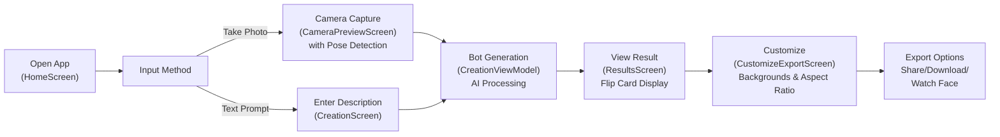
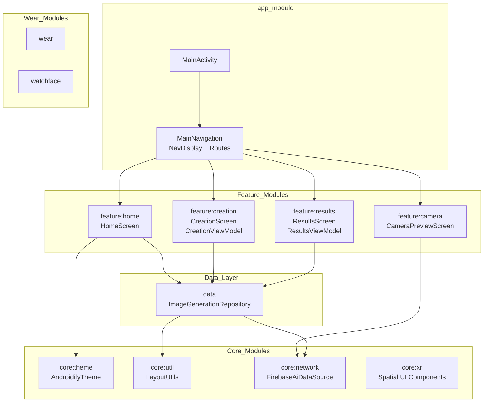
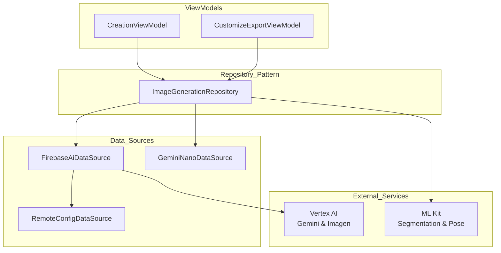

<!-- source: DeepWiki mcp.deepwiki.com · repo android/androidify · page 1 Overview · fetched 2026-10-23 -->

# Overview

Relevant source files

The following files were used as context for generating this wiki page:

- [AGENTS.md](AGENTS.md)
- [README.md](README.md)
- [app/.gitignore](app/.gitignore)
- [app/build.gradle.kts](app/build.gradle.kts)
- [core/theme/build.gradle.kts](core/theme/build.gradle.kts)
- [settings.gradle.kts](settings.gradle.kts)
- [setup/remote_config_defaults.json](setup/remote_config_defaults.json)

## What is Androidify?

Androidify is an open-source Android application that creates customized AI-generated Android bots using Google's Gemini API. Users can either capture a photo of themselves or provide a text description, and the app generates a personalized Android mascot with customizable backgrounds and export options.

The application demonstrates production-ready integration of AI services on Android, including on-device and cloud-based generative models, custom camera implementation using CameraX, and adaptive UI design across different form factors using Jetpack Compose and Navigation 3.

Sources: [README.md:1-17](), [README.md:19-24]()

## Key User Flow

Androidify provides a streamlined workflow from input to export:

### Flow Details

1.  **Home (`HomeScreen`)**: Entry point with promotional content and navigation to creation flow.
2.  **Input Selection (`CreationScreen`)**: User chooses between camera capture or text prompt.
3.  **Camera (`CameraPreviewScreen`)**: Optional photo capture with ML Kit pose detection overlay.
4.  **Creation (`CreationViewModel`)**: AI-powered bot generation via `ImageGenerationRepository`.
5.  **Results (`ResultsScreen`)**: Flippable card showing generated bot (front) and original input (back).
6.  **Customize (`CustomizeExportScreen`)**: Aspect ratio selection and background tools (static or AI-generated).
7.  **Export**: Share via system intent, download to MediaStore, or transfer to Wear OS watch face.

Sources: [README.md:19-24](), [AGENTS.md:21-27](), [app/build.gradle.kts:130-133]()

## Technology Stack

Androidify uses modern Android libraries and AI services:

| Technology | Purpose | Key Classes/Files |
| :--- | :--- | :--- |
| **Jetpack Compose** | Declarative UI with adaptive layouts | `AndroidifyTheme`, `NavDisplay` |
| **Navigation 3** | Type-safe navigation with backstack management | `MainNavigation`, `NavigationRoute` |
| **CameraX** | Camera implementation with custom controls | `feature:camera` |
| **Gemini API** | Text and image generation models | Gemini 2.5 Flash, Imagen 4.0 Ultra |
| **Firebase Services** | Cloud services and configuration | `FirebaseAiDataSource`, Remote Config, App Check |
| **ML Kit** | On-device ML for pose detection and segmentation | `PoseDetector`, `SubjectSegmenter` |
| **Hilt** | Dependency injection | `@HiltViewModel`, `@AssistedFactory` |
| **XR Compose** | Spatial UI for XR devices | `core:xr` |

Sources: [README.md:19-24](), [app/build.gradle.kts:102-125](), [AGENTS.md:7-16]()

## Application Architecture

Androidify follows a multi-module architecture with clear dependency boundaries and separation of concerns.

### High-Level Module Structure

Sources: [settings.gradle.kts:55-70](), [app/build.gradle.kts:130-137](), [AGENTS.md:19-27]()

## AI Integration

Androidify demonstrates a hybrid AI architecture combining on-device and cloud-based models.

### AI Service Architecture

### Remote Configuration

Firebase Remote Config controls AI model selection and feature flags at runtime:

| Parameter | Type | Purpose | Default |
| :--- | :--- | :--- | :--- |
| `use_imagen` | Boolean | Switch between Imagen and fine-tuned model | `true` |
| `use_gemini_nano` | Boolean | Enable on-device Gemini Nano fallback | `false` |
| `background_vibes_feature_enabled` | Boolean | Enable AI background generation | `false` |
| `xr_feature_enabled` | Boolean | Enable spatial UI mode | `false` |
| `watchface_feature_enabled` | Boolean | Enable watch face export | `false` |

Sources: [setup/remote_config_defaults.json:3-45](), [README.md:33-39]()

## Development Status

Androidify is currently under development. While it uses standard Imagen models by default, a fine-tuned model specifically trained for the Android bot mascot is planned for future release. The app serves as a Tier 1 example of large screen optimization, ensuring compatibility across phones, tablets, foldables, and XR devices.

Sources: [README.md:12-15](), [AGENTS.md:73]()

---

