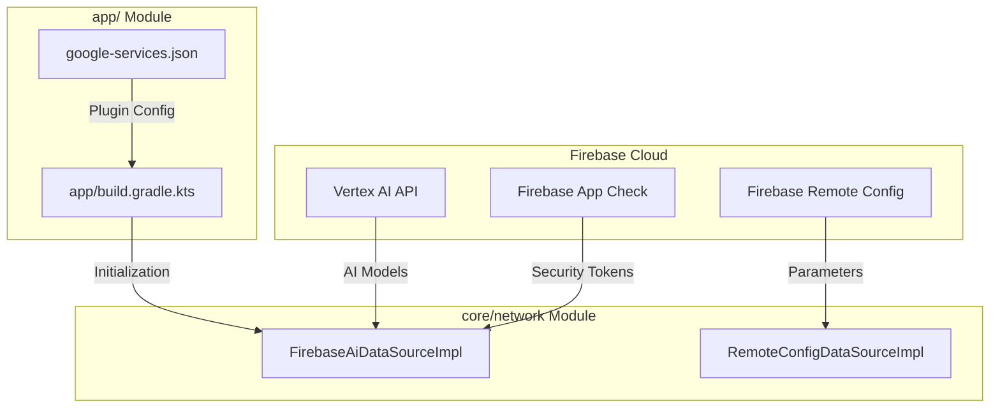
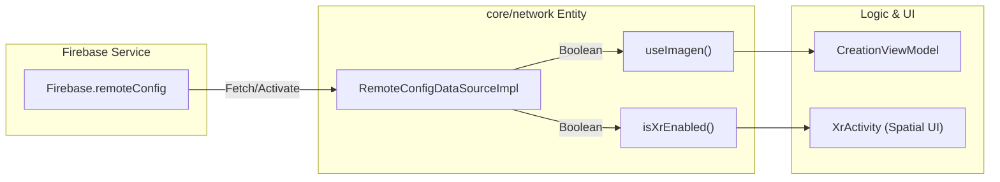

<!-- source: DeepWiki mcp.deepwiki.com · repo android/androidify · page 2 Getting Started · fetched 2026-10-23 -->

# Getting Started

<details>
<summary>Relevant source files</summary>

The following files were used as context for generating this wiki page:

- [README.md](README.md)
- [app/.gitignore](app/.gitignore)
- [app/build.gradle.kts](app/build.gradle.kts)
- [core/network/src/main/java/com/android/developers/androidify/RemoteConfigDataSource.kt](core/network/src/main/java/com/android/developers/androidify/RemoteConfigDataSource.kt)
- [core/network/src/main/res/xml/remote_config_defaults.xml](core/network/src/main/res/xml/remote_config_defaults.xml)
- [core/testing/src/main/java/com/android/developers/testing/network/TestFirebaseAiDataSource.kt](core/testing/src/main/java/com/android/developers/testing/network/TestFirebaseAiDataSource.kt)
- [core/testing/src/main/java/com/android/developers/testing/network/TestRemoteConfigDataSource.kt](core/testing/src/main/java/com/android/developers/testing/network/TestRemoteConfigDataSource.kt)
- [core/testing/src/main/java/com/android/developers/testing/repository/FakeImageGenerationRepository.kt](core/testing/src/main/java/com/android/developers/testing/repository/FakeImageGenerationRepository.kt)
- [core/theme/build.gradle.kts](core/theme/build.gradle.kts)
- [core/theme/src/main/java/com/android/developers/androidify/theme/transitions/LoadingShimmerOverlay.kt](core/theme/src/main/java/com/android/developers/androidify/theme/transitions/LoadingShimmerOverlay.kt)
- [settings.gradle.kts](settings.gradle.kts)
- [setup/remote_config_defaults.json](setup/remote_config_defaults.json)

</details>


This document guides developers through the initial setup process for the Androidify application, including Firebase project configuration, Remote Config parameter setup, and building the application locally. For information about the overall architecture and how components fit together, see **Architecture**. For details about specific AI/ML integration requirements, see **AI and ML Integration**.

---

## Prerequisites

Before beginning setup, ensure you have the following tools and accounts:

| Requirement | Version/Details | Purpose |
|-------------|-----------------|---------|
| **JDK** | 21 (Temurin distribution recommended) | Required for building the application |
| **Android Studio** | Latest stable version | IDE for development |
| **Gradle** | 8.x (via wrapper) | Build system |
| **Firebase Account** | With billing enabled | Required for Vertex AI access |
| **Git** | Any recent version | Source control |

**Note**: The application requires a Firebase account with billing enabled because it uses Vertex AI API for cloud-based AI model access [README.md:31-32]().

**Sources:** [README.md:26-31]()

---

## Repository Setup

Clone the repository from GitHub:

```bash
git clone https://github.com/android/androidify.git
cd androidify
```

The repository uses a multi-module Gradle project structure. The `settings.gradle.kts` file defines the module hierarchy, including `:app`, `:feature` modules, and `:core` modules [settings.gradle.kts:55-70]().

**Sources:** [README.md:28](), [settings.gradle.kts:55-70]()

---

## Firebase Project Configuration

### Creating the Firebase Project

1. Navigate to the [Firebase Console](https://console.firebase.google.com/).
2. Click "Add project" and follow the creation wizard.
3. Once created, add an Android app with package name `com.android.developers.androidify` [app/build.gradle.kts:31-33]().
4. Enable the **Vertex AI API** in the [Google Cloud Console](https://console.cloud.google.com/apis/library/aiplatform.googleapis.com) [README.md:31]().
5. Enable **App Check** in the Firebase Console to prevent API abuse [README.md:32]().

### Generating google-services.json

Download the `google-services.json` file from the Firebase Console and place it in the `app/` directory [README.md:31]().

```
androidify/
├── app/
│   ├── google-services.json    <- Place here
│   ├── build.gradle.kts
│   └── src/
```

**Important**: The `google-services.json` file is git-ignored for security reasons [app/.gitignore:2]().

### Code Entity Association: Firebase Integration

The following diagram shows how the Firebase configuration interacts with the core networking and AI components.



**Sources:** [app/build.gradle.kts:23-24](), [README.md:29-32](), [core/network/src/main/java/com/android/developers/androidify/RemoteConfigDataSource.kt:56-58]()

---

## Remote Config Setup

Firebase Remote Config controls critical runtime behavior including AI model selection and feature flags. The application uses the `RemoteConfigDataSource` interface to access these parameters [core/network/src/main/java/com/android/developers/androidify/RemoteConfigDataSource.kt:23-53]().

### Configuration Parameters

The most important parameters defined in `remote_config_defaults.xml` include:

| Parameter | Type | Default | Description |
|-----------|------|---------|-------------|
| `use_imagen` | Boolean | `false` | Switches between standard Imagen and fine-tuned models [core/network/src/main/res/xml/remote_config_defaults.xml:49]() |
| `use_gemini_nano` | Boolean | `false` | Enables on-device Gemini Nano processing [core/network/src/main/res/xml/remote_config_defaults.xml:89]() |
| `background_vibes_feature_enabled` | Boolean | `false` | Gates the AI-generated backgrounds feature [core/network/src/main/res/xml/remote_config_defaults.xml:24]() |
| `watchface_feature_enabled` | Boolean | `false` | Enables Wear OS watch face export [core/network/src/main/res/xml/remote_config_defaults.xml:20]() |
| `xr_feature_enabled` | Boolean | `false` | Enables XR spatial UI modes [core/network/src/main/res/xml/remote_config_defaults.xml:28]() |

### Uploading Configuration to Firebase

The project provides a template for Remote Config in `setup/remote_config_defaults.json`.

1. Navigate to Firebase Console → Remote Config.
2. Click "Upload template" and select `setup/remote_config_defaults.json` [README.md:38]().
3. **Crucial**: Update `use_imagen` to `true` in the console to use the public Imagen model [README.md:33]().
4. Click "Publish".

### Data Flow: Remote Config to UI



**Sources:** [core/network/src/main/java/com/android/developers/androidify/RemoteConfigDataSource.kt:119-140](), [setup/remote_config_defaults.json:28-33]()

---

## Building the Application

### Build Variants

The `app/build.gradle.kts` file defines three primary build types:
- `debug`: Standard development build with `-debug` suffix [app/build.gradle.kts:39-41]().
- `release`: Minified and resource-shrunk build. For local builds, it signs with the debug key unless `CI_BUILD` is set [app/build.gradle.kts:47-71]().
- `benchmark`: Used for performance profiling and baseline profile generation [app/build.gradle.kts:42-46]().

### Custom Font Configuration

You can customize the font by adding a property to your `~/.gradle/gradle.properties` file:
```properties
fontName="Roboto Flex"
```
The `core/theme` module reads this property and injects it into the `BuildConfig` [core/theme/build.gradle.kts:19-33]().

### Standard Build Commands

```bash
# Clean and build debug APK
./gradlew clean assembleDebug

# Apply Spotless code formatting
./gradlew spotlessApply
```

**Sources:** [app/build.gradle.kts:38-72](), [core/theme/build.gradle.kts:19-33](), [README.md:40-45]()

---

## Verification and Testing

### Unit Testing

The project uses test doubles in the `core/testing` module to verify logic without real network calls:
- `TestRemoteConfigDataSource`: Allows overriding feature flags for tests [core/testing/src/main/java/com/android/developers/testing/network/TestRemoteConfigDataSource.kt:20]().
- `FakeImageGenerationRepository`: Simulates AI image generation and background removal [core/testing/src/main/java/com/android/developers/testing/repository/FakeImageGenerationRepository.kt:26]().
- `TestFirebaseAiDataSource`: Mocks Vertex AI responses [core/testing/src/main/java/com/android/developers/testing/network/TestFirebaseAiDataSource.kt:25]().

Run tests using:
```bash
./gradlew test
```

**Sources:** [core/testing/src/main/java/com/android/developers/testing/network/TestRemoteConfigDataSource.kt:20-102](), [core/testing/src/main/java/com/android/developers/testing/repository/FakeImageGenerationRepository.kt:26-74]()

---

