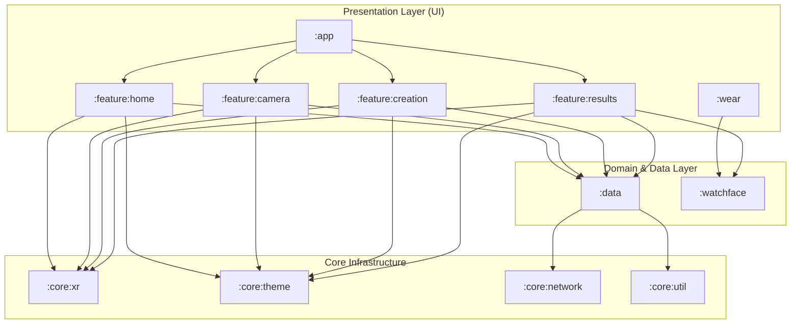

<!-- source: DeepWiki mcp.deepwiki.com · repo android/androidify · page 3 Architecture · fetched 2026-10-23 -->

# Architecture

Relevant source files

The following files were used as context for generating this wiki page:

- [.run/spotlessApply.run.xml](.run/spotlessApply.run.xml)
- [app/build.gradle.kts](app/build.gradle.kts)
- [app/src/main/java/com/android/developers/androidify/MainActivity.kt](app/src/main/java/com/android/developers/androidify/MainActivity.kt)
- [build.gradle.kts](build.gradle.kts)
- [core/testing/src/main/java/com/android/developers/testing/repository/FakeDropImageFactory.kt](core/testing/src/main/java/com/android/developers/testing/repository/FakeDropImageFactory.kt)
- [core/theme/build.gradle.kts](core/theme/build.gradle.kts)
- [data/src/main/java/com/android/developers/androidify/data/DataModule.kt](data/src/main/java/com/android/developers/androidify/data/DataModule.kt)
- [data/src/main/java/com/android/developers/androidify/data/DropBehaviourFactory.kt](data/src/main/java/com/android/developers/androidify/data/DropBehaviourFactory.kt)
- [feature/camera/build.gradle.kts](feature/camera/build.gradle.kts)
- [feature/creation/build.gradle.kts](feature/creation/build.gradle.kts)
- [feature/home/build.gradle.kts](feature/home/build.gradle.kts)
- [feature/results/build.gradle.kts](feature/results/build.gradle.kts)
- [settings.gradle.kts](settings.gradle.kts)

## Purpose and Scope

This document provides a high-level overview of the Androidify application's architectural patterns and system design. The project follows a modern, multi-module Android architecture utilizing the **MVVM (Model-View-ViewModel)** pattern, **Jetpack Compose** for UI, and **Hilt** for dependency injection. 

This is a parent page. For detailed technical specifications, please refer to the following child pages:
*   [Module Structure](#3.1) — Details on feature, core, data, and wear modules.
*   [UI Framework and Adaptive Design](#3.2) — Jetpack Compose, XR spatial UI, and adaptive layouts.
*   [Dependency Injection](#3.3) — Hilt setup and Assisted Injection patterns.
*   [Navigation System](#3.4) — Type-safe navigation and screen transitions.

## High-Level Architecture Pattern

Androidify is built with a clear separation of concerns, organized into layers that facilitate AI integration (Gemini/Vertex AI) and cross-platform support (Mobile, XR, and Wear OS).

### System Component Diagram

**Sources:** [settings.gradle.kts:55-70](), [app/build.gradle.kts:130-137]()

## Multi-Module Structure

The project uses a modularized approach to improve build times and enforce boundaries between features.

*   **Feature Modules**: Contain UI logic and ViewModels for specific user journeys (e.g., `:feature:camera` for capture, `:feature:creation` for AI prompting).
*   **Core Modules**: Provide low-level, reusable functionality like `:core:theme` (Material 3 styling) and `:core:xr` (Spatial computing support).
*   **Data Module**: The `:data` module acts as the single source of truth, managing repositories that abstract AI data sources and local file handling.
*   **Wear & Watchface**: Specialized modules for Wear OS support and the Watch Face Format (WFF) generation.

For details, see [Module Structure](#3.1).

**Sources:** [settings.gradle.kts:55-70](), [data/src/main/java/com/android/developers/androidify/data/DataModule.kt:65-75]()

## UI and Adaptive Design

The application is built entirely with **Jetpack Compose**. It is designed to be adaptive, supporting standard mobile phones, foldables (tabletop mode), and XR headsets (spatial panels).

*   **Spatial UI**: Integration with `androidx.xr.compose` allows the app to transition between Home Space and Full Space modes.
*   **Adaptive Layouts**: Uses `androidx.adaptive` to handle different window size classes.

For details, see [UI Framework and Adaptive Design](#3.2).

**Sources:** [feature/creation/build.gradle.kts:49-55](), [MainActivity.kt:49-65]()

## Dependency Injection (Hilt)

Hilt is used throughout the project to manage the lifecycle of dependencies. The `:data` module defines bindings for key repositories and AI data sources.

| Interface | Implementation | Scope |
|-----------|----------------|-------|
| `ImageGenerationRepository` | `ImageGenerationRepositoryImpl` | `Singleton` |
| `FirebaseAiDataSource` | `FirebaseAiDataSourceImpl` | `Singleton` |
| `LocalFileProvider` | `LocalFileProviderImpl` | `Singleton` |

For details, see [Dependency Injection](#3.3).

**Sources:** [data/src/main/java/com/android/developers/androidify/data/DataModule.kt:44-75](), [app/build.gradle.kts:22]()

## Navigation and State Management

The app uses a type-safe navigation system built on top of Compose Navigation. The `MainActivity` acts as the entry point, hosting the `MainNavigation` component.

*   **NavigationRoute**: A sealed interface defining all destinations.
*   **NavDisplay**: A custom component handling screen transitions and spatial awareness.

For details, see [Navigation System](#3.4).

**Sources:** [app/src/main/java/com/android/developers/androidify/MainActivity.kt:31](), [app/src/main/java/com/android/developers/androidify/MainActivity.kt:62]()

## Build and CI/CD

The build system is managed via Gradle with Kotlin DSL and Version Catalogs.
*   **Spotless**: Enforces code style and license headers across all modules.
*   **Baseline Profiles**: Used to optimize startup performance and frame rates.
*   **SPDX SBOM**: Generates Software Bill of Materials for release builds.

**Sources:** [build.gradle.kts:26-49](), [app/build.gradle.kts:86-99]()

---

