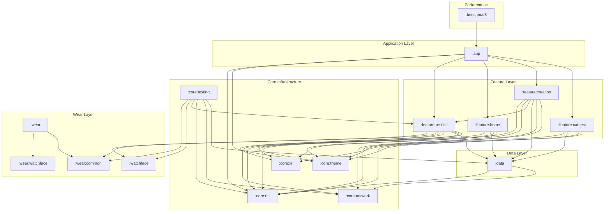
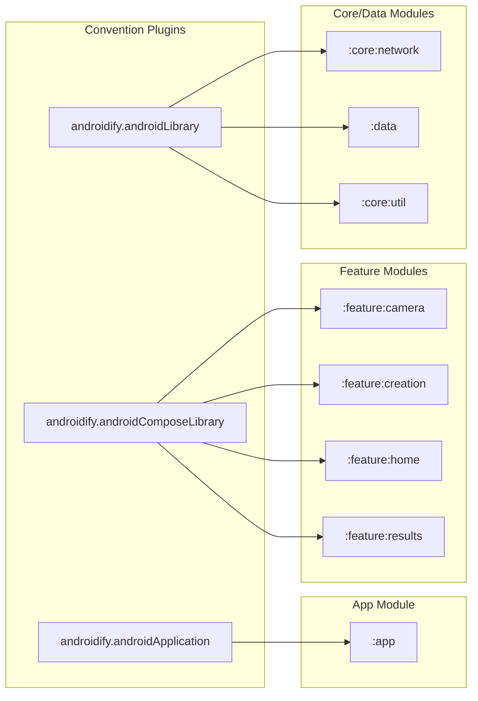
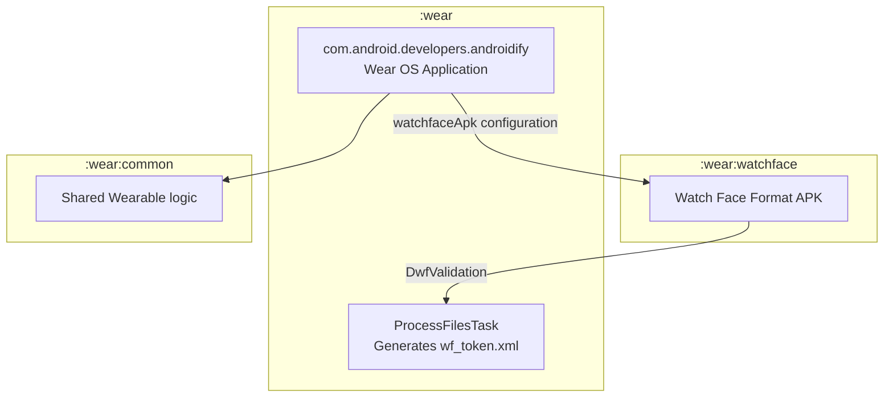

<!-- source: DeepWiki mcp.deepwiki.com · repo android/androidify · page 3.1 Module Structure · fetched 2026-10-23 -->

# Module Structure

Relevant source files

The following files were used as context for generating this wiki page:

- [.gitignore](.gitignore)
- [.run/spotlessApply.run.xml](.run/spotlessApply.run.xml)
- [app/build.gradle.kts](app/build.gradle.kts)
- [benchmark/build.gradle.kts](benchmark/build.gradle.kts)
- [build-plugin/build.gradle.kts](build-plugin/build.gradle.kts)
- [build-plugin/settings.gradle.kts](build-plugin/settings.gradle.kts)
- [build-plugin/src/main/kotlin/com/android/developers/androidify/plugin/AndroidApplicationPlugin.kt](build-plugin/src/main/kotlin/com/android/developers/androidify/plugin/AndroidApplicationPlugin.kt)
- [build-plugin/src/main/kotlin/com/android/developers/androidify/plugin/AndroidComposeLibraryPlugin.kt](build-plugin/src/main/kotlin/com/android/developers/androidify/plugin/AndroidComposeLibraryPlugin.kt)
- [build-plugin/src/main/kotlin/com/android/developers/androidify/plugin/AndroidLibraryPlugin.kt](build-plugin/src/main/kotlin/com/android/developers/androidify/plugin/AndroidLibraryPlugin.kt)
- [build-plugin/src/main/kotlin/com/android/developers/androidify/plugin/VersionCatalogHelper.kt](build-plugin/src/main/kotlin/com/android/developers/androidify/plugin/VersionCatalogHelper.kt)
- [build.gradle.kts](build.gradle.kts)
- [core/network/build.gradle.kts](core/network/build.gradle.kts)
- [core/testing/build.gradle.kts](core/testing/build.gradle.kts)
- [core/theme/build.gradle.kts](core/theme/build.gradle.kts)
- [core/util/build.gradle.kts](core/util/build.gradle.kts)
- [data/build.gradle.kts](data/build.gradle.kts)
- [feature/camera/build.gradle.kts](feature/camera/build.gradle.kts)
- [feature/creation/build.gradle.kts](feature/creation/build.gradle.kts)
- [feature/home/build.gradle.kts](feature/home/build.gradle.kts)
- [feature/results/build.gradle.kts](feature/results/build.gradle.kts)
- [settings.gradle.kts](settings.gradle.kts)
- [wear/build.gradle.kts](wear/build.gradle.kts)
- [wear/watchface/build.gradle.kts](wear/watchface/build.gradle.kts)

This document details the multi-module architecture of the Androidify application, covering the organization of modules, their dependencies, and build configurations. The modular design separates concerns between feature implementations, core infrastructure, and data management components.

For information about the UI framework and responsive design patterns, see [UI Framework and Adaptive Design](#2.2). For details about the data layer implementation and dependency injection setup, see [Data Layer and Dependency Injection](#2.3).

## Module Overview

The Androidify application follows a clean, multi-module architecture organized into logical layers. The structure promotes code reuse, parallel development, and clear separation of concerns.

**Module Dependency Graph**

Sources: [app/build.gradle.kts:130-137](), [feature/camera/build.gradle.kts:57-60](), [feature/creation/build.gradle.kts:61-65](), [feature/home/build.gradle.kts:53-55](), [feature/results/build.gradle.kts:51-58](), [data/build.gradle.kts:33-34](), [core/testing/build.gradle.kts:42-47](), [wear/build.gradle.kts:64-65]()

## Module Dependency Matrix

The following table shows the dependency relationships between modules:

| Module | Dependencies | Purpose |
|--------|-------------|---------|
| `:app` | `:feature:*`, `:core:theme`, `:core:util` | Main application entry, navigation, DI root [app/build.gradle.kts:130-137]() |
| `:feature:camera` | `:core:theme`, `:core:util`, `:data`, `:core:xr` | Camera interface, CameraX integration, pose detection [feature/camera/build.gradle.kts:57-60]() |
| `:feature:creation` | `:core:theme`, `:core:util`, `:data`, `:feature:results`, `:core:network`, `:core:xr` | Bot generation workflow, Gemini/Imagen orchestration [feature/creation/build.gradle.kts:61-65]() |
| `:feature:home` | `:core:theme`, `:core:util`, `:data`, `:core:xr` | Home screen, entry point animations [feature/home/build.gradle.kts:53-55]() |
| `:feature:results` | `:core:theme`, `:core:util`, `:data`, `:core:network`, `:core:xr`, `:wear:common`, `:watchface` | Results display, customization, export to Wear [feature/results/build.gradle.kts:51-58]() |
| `:data` | `:core:network`, `:core:util` | Repository implementations, data models [data/build.gradle.kts:33-34]() |
| `:core:network` | `:core:util` | Firebase AI (Gemini), ML Kit, Retrofit [core/network/build.gradle.kts:48-70]() |
| `:core:theme` | `:core:util` | Material 3 design system, shared elements [core/theme/build.gradle.kts:47]() |
| `:core:util` | None | Layout utilities, file providers, shared extensions [core/util/build.gradle.kts:32-42]() |
| `:core:xr` | None | Spatial UI support and XR-specific layouts [settings.gradle.kts:65]() |
| `:core:testing` | `:data`, `:core:network`, `:core:util`, `:feature:results`, `:watchface`, `:wear:common` | Test doubles (Fakes) and testing utilities [core/testing/build.gradle.kts:42-47]() |
| `:wear` | `:wear:common`, `:wear:watchface` | Wear OS companion application [wear/build.gradle.kts:59-65]() |
| `:wear:watchface` | None | Native Watch Face Format (WFF) implementation [wear/watchface/build.gradle.kts:22]() |
| `:wear:common` | None | Shared logic between mobile and Wear OS [settings.gradle.kts:70]() |

## Build Configuration

### Plugin Usage by Module

The application uses convention plugins (defined in `:build-plugin`) to maintain consistency across the project.

Sources: [app/build.gradle.kts:19](), [feature/camera/build.gradle.kts:17](), [core/network/build.gradle.kts:17](), [data/build.gradle.kts:17]()

### Version Catalog Integration

All modules use the version catalog system defined in `gradle/libs.versions.toml`. The project utilizes `TYPESAFE_PROJECT_ACCESSORS` to refer to modules as properties rather than strings.

| Configuration | Source |
|---------------|--------|
| Compile/Target SDK | `release(37)` [settings.gradle.kts:38-43]() |
| Min SDK | `release(26)` (Mobile) [settings.gradle.kts:45](), `36` (Wear) [wear/build.gradle.kts:31]() |
| App Versioning | `libs.versions.appVersionCode` [app/build.gradle.kts:34]() |

## Feature Module Architecture

All feature modules (`:feature:*`) depend on `androidify.androidComposeLibrary` and follow a consistent structure.

### Specialized Dependencies

Each feature module includes specialized dependencies based on its role in the user journey:

- **`:feature:camera`**: Integrates `androidx.camera.core`, `androidx.camera.camera2`, and `mlkit.pose.detection` for real-time user guidance [feature/camera/build.gradle.kts:38-49]().
- **`:feature:creation`**: Uses `androidx.adaptive` for multi-pane layouts and `androidx.media3.exoplayer` for bot preview videos [feature/creation/build.gradle.kts:49-53]().
- **`:feature:home`**: Includes `androidx.media3.exoplayer` for the background dancing bot animation [feature/home/build.gradle.kts:40-41]().
- **`:feature:results`**: Depends on `mlkit.segmentation` for background removal and includes `:watchface` and `:wear:common` for export functionality [feature/results/build.gradle.kts:40-58]().

## Core Module Organization

### `:core:network` - Service Integration
Centralizes all external communication:
- **Firebase AI**: `libs.firebase.ai` for Gemini 2.5 Flash and Imagen integration [core/network/build.gradle.kts:63]().
- **ML Kit**: `libs.mlkit.segmentation` for on-device image processing [core/network/build.gradle.kts:71]().
- **App Check**: `libs.firebase.app.check` for security [core/network/build.gradle.kts:68]().

### `:core:xr` - Spatial Computing
Enables XR experiences by providing:
- Integration with `androidx.xr.compose` [feature/creation/build.gradle.kts:55]().
- Spatial UI mode management for full-space vs home-space transitions.

### `:core:testing` - Test Infrastructure
A dedicated module for testing utilities used across the project:
- **API**: Exposes `kotlinx.coroutines.test` and `hilt.android.testing` [core/testing/build.gradle.kts:34-41]().
- **Fakes**: Provides `TestFirebaseAiDataSource` and `FakeImageGenerationRepository` to avoid real network calls during tests.

## Wear OS and Watch Face Modules

The project contains a distinct Wear OS stack to support companion features and custom watch faces.

### Wear Architecture

- **`:wear`**: The main Wear OS application. It includes a custom `ProcessFilesTask` that runs the `DwfValidation` CLI tool on the watch face APK to generate a unique `default_wf_token` resource [wear/build.gradle.kts:93-164]().
- **`:wear:watchface`**: A native Android application module that produces a Watch Face Format (WFF) APK. It uses `minSdk 36` and is bundled into the Wear app assets [wear/watchface/build.gradle.kts:21-30]().
- **`:wear:common`**: Contains shared code for data transfer and wearable-specific constants [wear/build.gradle.kts:65]().

Sources: [wear/build.gradle.kts:28-62](), [wear/watchface/build.gradle.kts:21-30](), [settings.gradle.kts:67-70]()

## Build Optimizations and CI/CD

### Packaging and Conflicts
To avoid packaging conflicts when using libraries like `bouncycastle`, several modules explicitly exclude OSGI manifests [app/build.gradle.kts:79-83](), [feature/creation/build.gradle.kts:29-34]().

### Release Signing
The `:app` module handles release signing conditionally. For local builds, it signs with the debug key for easy deployment. For CI builds (detected via `CI_BUILD` property), it produces an unsigned AAB to be signed by the release pipeline [app/build.gradle.kts:57-71]().

### SBOM and Licenses
The project generates Software Bill of Materials (SBOM) for release builds using the `spdxSbom` plugin [app/build.gradle.kts:90-99]() and includes OSS license tracking via `com.google.android.gms.oss-licenses-plugin` [app/build.gradle.kts:26]().

Sources: [app/build.gradle.kts:18-28](), [app/build.gradle.kts:57-71](), [app/build.gradle.kts:90-99]()

---

