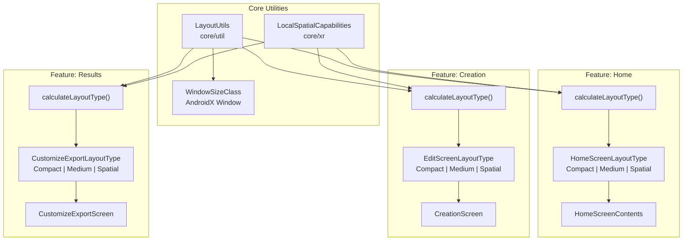
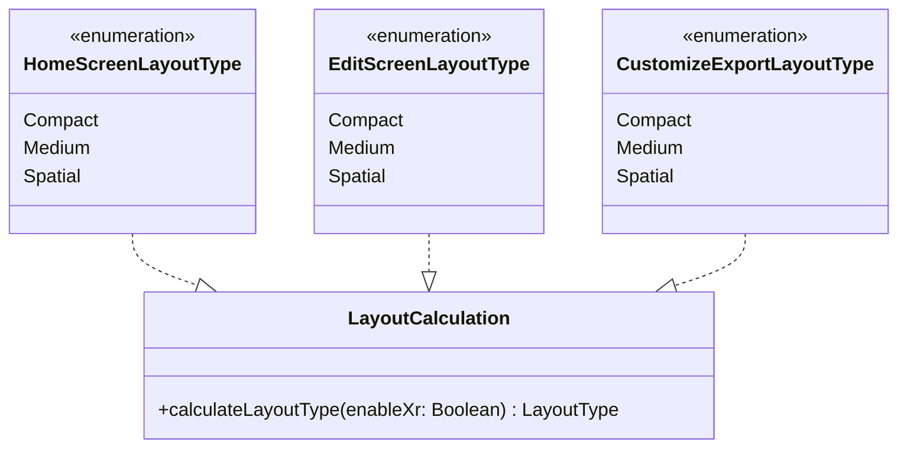
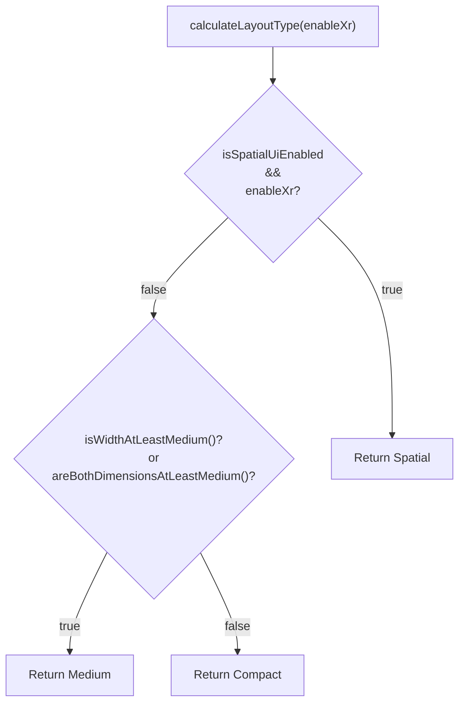
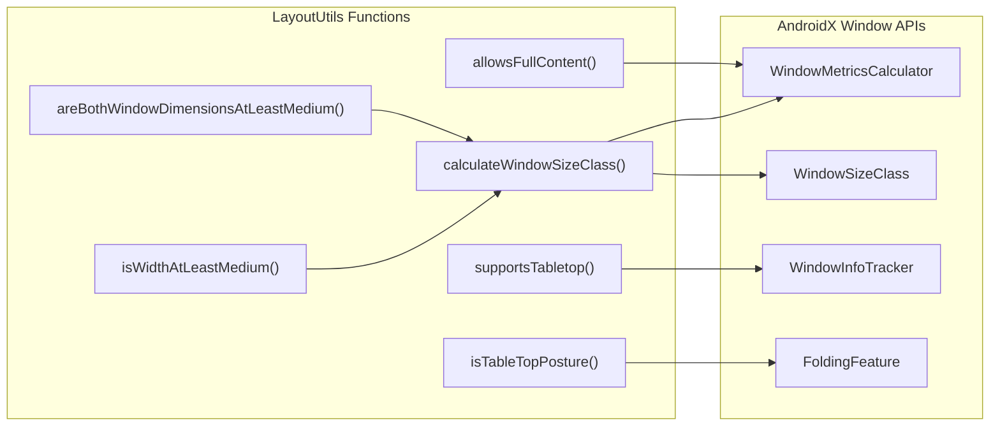
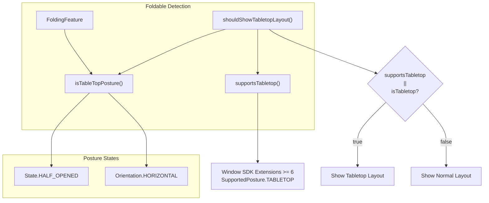
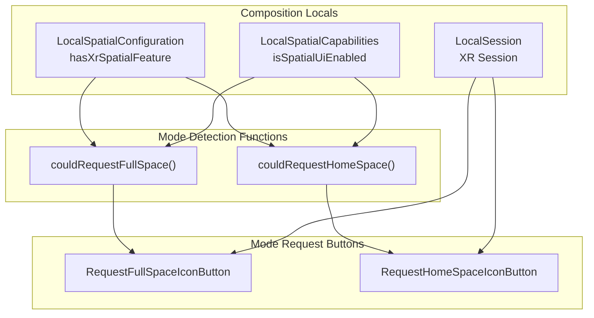
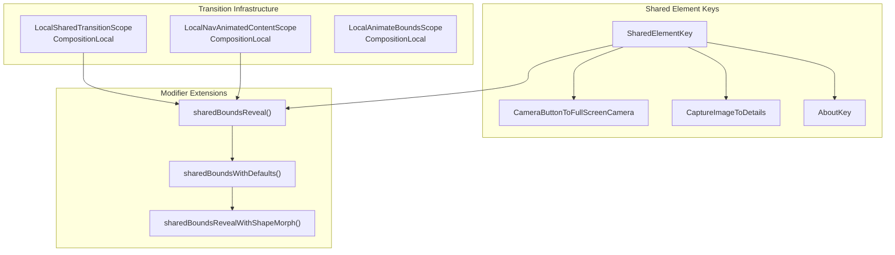

<!-- source: DeepWiki mcp.deepwiki.com · repo android/androidify · page 3.2 UI Framework and Adaptive Design · fetched 2026-10-23 -->

# UI Framework and Adaptive Design

<details>
<summary>Relevant source files</summary>

The following files were used as context for generating this wiki page:

- [app/src/main/java/com/android/developers/androidify/navigation/ListSaver.kt](app/src/main/java/com/android/developers/androidify/navigation/ListSaver.kt)
- [core/theme/src/main/java/com/android/developers/androidify/theme/Motion.kt](core/theme/src/main/java/com/android/developers/androidify/theme/Motion.kt)
- [core/theme/src/main/java/com/android/developers/androidify/theme/SharedElementsConfig.kt](core/theme/src/main/java/com/android/developers/androidify/theme/SharedElementsConfig.kt)
- [core/theme/src/main/java/com/android/developers/androidify/theme/components/Backgrounds.kt](core/theme/src/main/java/com/android/developers/androidify/theme/components/Backgrounds.kt)
- [core/theme/src/main/java/com/android/developers/androidify/theme/transitions/ColorSplashTransition.kt](core/theme/src/main/java/com/android/developers/androidify/theme/transitions/ColorSplashTransition.kt)
- [core/util/src/main/java/com/android/developers/androidify/util/AdaptivePreview.kt](core/util/src/main/java/com/android/developers/androidify/util/AdaptivePreview.kt)
- [core/util/src/main/java/com/android/developers/androidify/util/AnimationUtils.kt](core/util/src/main/java/com/android/developers/androidify/util/AnimationUtils.kt)
- [core/util/src/main/java/com/android/developers/androidify/util/LayoutUtils.kt](core/util/src/main/java/com/android/developers/androidify/util/LayoutUtils.kt)
- [core/xr/src/main/java/com/android/developers/androidify/xr/SpatialUiModes.kt](core/xr/src/main/java/com/android/developers/androidify/xr/SpatialUiModes.kt)
- [core/xr/src/main/java/com/android/developers/androidify/xr/XrPreview.kt](core/xr/src/main/java/com/android/developers/androidify/xr/XrPreview.kt)
- [feature/creation/src/main/java/com/android/developers/androidify/creation/EditScreenLayoutType.kt](feature/creation/src/main/java/com/android/developers/androidify/creation/EditScreenLayoutType.kt)
- [feature/creation/src/main/java/com/android/developers/androidify/creation/PhotoPrompt.kt](feature/creation/src/main/java/com/android/developers/androidify/creation/PhotoPrompt.kt)
- [feature/creation/src/main/java/com/android/developers/androidify/creation/TextPrompt.kt](feature/creation/src/main/java/com/android/developers/androidify/creation/TextPrompt.kt)
- [feature/creation/src/main/java/com/android/developers/androidify/creation/TransformButton.kt](feature/creation/src/main/java/com/android/developers/androidify/creation/TransformButton.kt)
- [feature/creation/src/main/java/com/android/developers/androidify/creation/xr/EditScreenHomeSpaceModePreviews.kt](feature/creation/src/main/java/com/android/developers/androidify/creation/xr/EditScreenHomeSpaceModePreviews.kt)
- [feature/home/src/main/java/com/android/developers/androidify/home/HomeScreenLayoutType.kt](feature/home/src/main/java/com/android/developers/androidify/home/HomeScreenLayoutType.kt)
- [feature/home/src/main/java/com/android/developers/androidify/home/xr/HomeScreenHomeSpaceModePreviews.kt](feature/home/src/main/java/com/android/developers/androidify/home/xr/HomeScreenHomeSpaceModePreviews.kt)
- [feature/results/src/main/java/com/android/developers/androidify/customize/CustomizeExportLayoutType.kt](feature/results/src/main/java/com/android/developers/androidify/customize/CustomizeExportLayoutType.kt)
- [feature/results/src/main/java/com/android/developers/androidify/results/ResultsLayoutType.kt](feature/results/src/main/java/com/android/developers/androidify/results/ResultsLayoutType.kt)

</details>


## Purpose and Scope

This document describes the UI framework and adaptive design strategy used throughout the Androidify application. It covers the Jetpack Compose-based architecture, layout adaptation patterns for different screen sizes and form factors, XR spatial UI support, and shared element transition system.

For information about specific feature module implementations, see [Feature Modules](#5). For theming and reusable UI components, see [Theme and UI Components](#6.3). For XR-specific implementation details, see [XR Support](#6.5).

---

## UI Framework Stack

Androidify is built entirely with **Jetpack Compose** and uses **Material 3** (Material Design 3) for its design system. The application does not use any View-based UI components.

### Core UI Technologies

| Technology | Version | Usage |
|------------|---------|-------|
| Jetpack Compose | BOM-managed | All UI rendering |
| Material 3 | Expressive API | Design system, animations, shapes |
| Material Motion | Expressive API | Shared element transitions |
| AndroidX XR Compose | Latest | Spatial UI for XR devices |
| Compose Window | Latest | Window size class calculations |

**Key Dependencies:**

Each feature module declares Compose dependencies via the `androidify.androidComposeLibrary` convention plugin:

- [feature/home/build.gradle.kts:33-34]()
- [feature/camera/build.gradle.kts:33-34]()
- [feature/creation/build.gradle.kts:38-39]()
- [feature/results/build.gradle.kts:33-34]()

Sources: [feature/home/build.gradle.kts:16-70](), [feature/camera/build.gradle.kts:16-74](), [feature/creation/build.gradle.kts:16-80](), [feature/results/build.gradle.kts:16-71]()

---

## Adaptive Layout Architecture

Androidify implements a **per-feature adaptive layout system** where each feature module defines its own layout types and calculates the appropriate layout based on runtime conditions. This approach provides flexibility while maintaining consistency.

### Layout Type Hierarchy



**Layout Type Definitions by Feature:**

Each feature module defines a sealed enum of layout types:



Sources: [feature/home/src/main/java/com/android/developers/androidify/home/HomeScreenLayoutType.kt:22-26](), [feature/creation/src/main/java/com/android/developers/androidify/creation/EditScreenLayoutType.kt:22-26](), [feature/results/src/main/java/com/android/developers/androidify/customize/CustomizeExportLayoutType.kt:22-26]()

---

## Layout Calculation Pattern

Each feature implements a `calculateLayoutType()` function that determines the appropriate layout variant based on spatial UI capabilities and window size:

### Decision Tree



### Implementation Examples

**Home Feature:**
[feature/home/src/main/java/com/android/developers/androidify/home/HomeScreenLayoutType.kt:28-35]()
```kotlin
@Composable
fun calculateLayoutType(enableXr: Boolean = false): HomeScreenLayoutType {
    return when {
        LocalSpatialCapabilities.current.isSpatialUiEnabled && enableXr -> HomeScreenLayoutType.Spatial
        isWidthAtLeastMedium() -> HomeScreenLayoutType.Medium
        else -> HomeScreenLayoutType.Compact
    }
}
```

**Creation Feature:**
[feature/creation/src/main/java/com/android/developers/androidify/creation/EditScreenLayoutType.kt:28-35]()
```kotlin
@Composable
fun calculateLayoutType(enableXr: Boolean = false): EditScreenLayoutType {
    return when {
        LocalSpatialCapabilities.current.isSpatialUiEnabled && enableXr -> EditScreenLayoutType.Spatial
        areBothWindowDimensionsAtLeastMedium() -> EditScreenLayoutType.Medium
        else -> EditScreenLayoutType.Compact
    }
}
```

Note that Creation uses `areBothWindowDimensionsAtLeastMedium()` while Home uses only `isWidthAtLeastMedium()`, allowing per-feature control over when to switch to expanded layouts.

Sources: [feature/home/src/main/java/com/android/developers/androidify/home/HomeScreenLayoutType.kt:28-35](), [feature/creation/src/main/java/com/android/developers/androidify/creation/EditScreenLayoutType.kt:28-35](), [feature/results/src/main/java/com/android/developers/androidify/customize/CustomizeExportLayoutType.kt:28-35]()

---

## Window Size Class Utilities

The `core/util` module provides utilities for calculating window size classes and determining device capabilities.

### Core Functions



### Window Size Breakpoints

| Breakpoint | Value | Usage |
|------------|-------|-------|
| `WIDTH_DP_MEDIUM_LOWER_BOUND` | 600dp | Minimum width for medium layout |
| `HEIGHT_DP_MEDIUM_LOWER_BOUND` | 480dp | Minimum height for medium layout |

**calculateWindowSizeClass():**
[core/util/src/main/java/com/android/developers/androidify/util/LayoutUtils.kt:33-38]()

Returns the current `WindowSizeClass` based on display metrics using `WindowMetricsCalculator` and `BREAKPOINTS_V1` classification.

**isWidthAtLeastMedium():**
[core/util/src/main/java/com/android/developers/androidify/util/LayoutUtils.kt:40-44]()

Returns `true` if the window width is at least 600dp. Used by Home and Results features.

**areBothWindowDimensionsAtLeastMedium():**
[core/util/src/main/java/com/android/developers/androidify/util/LayoutUtils.kt:46-51]()

Returns `true` if both width ≥ 600dp and height ≥ 480dp. Used by Creation feature to ensure adequate space for both image preview and controls.

**allowsFullContent():**
[core/util/src/main/java/com/android/developers/androidify/util/LayoutUtils.kt:57-63]()

Returns `false` if height < 480dp. Used to conditionally hide UI elements on very small screens to prevent overcrowding.

Sources: [core/util/src/main/java/com/android/developers/androidify/util/LayoutUtils.kt:33-63]()

### Foldable Device Support



**isTableTopPosture():**
[core/util/src/main/java/com/android/developers/androidify/util/LayoutUtils.kt:65-70]()

Detects if the device is in tabletop mode (half-opened horizontally). Uses Kotlin contracts to ensure non-null `FoldingFeature` when returning `true`.

**supportsTabletop():**
[core/util/src/main/java/com/android/developers/androidify/util/LayoutUtils.kt:72-81]()

Queries `WindowInfoTracker.supportedPostures` (requires Window SDK Extensions 6+) to determine if the device can enter tabletop mode.

**shouldShowTabletopLayout():**
[core/util/src/main/java/com/android/developers/androidify/util/LayoutUtils.kt:100-101]()

Wrapper function that handles older devices: returns `true` if either the device reports tabletop support OR is currently in tabletop posture, allowing older foldables without Extension 6 support to still use the tabletop layout.

Sources: [core/util/src/main/java/com/android/developers/androidify/util/LayoutUtils.kt:65-102]()

---

## XR Spatial UI Support

The `core/xr` module provides utilities for detecting and managing XR spatial UI modes on compatible devices.

### Spatial Capability Detection



### Spatial Modes

The application supports two XR spatial modes:

| Mode | Description | Icon |
|------|-------------|------|
| **Home Space** | App rendered in a window within the XR environment | collapse_content_24px |
| **Full Space** | App takes over the entire spatial environment | expand_content_24px |

**couldRequestFullSpace():**
[core/xr/src/main/java/com/android/developers/androidify/xr/SpatialUiModes.kt:37-39]()

Returns `true` if the device has XR spatial feature but is not yet rendering spatial UI. Indicates the user can request full space mode.

**couldRequestHomeSpace():**
[core/xr/src/main/java/com/android/developers/androidify/xr/SpatialUiModes.kt:43-45]()

Returns `true` if the device has XR spatial feature and is currently rendering spatial UI. Indicates the user can return to home space mode.

**RequestFullSpaceIconButton:**
[core/xr/src/main/java/com/android/developers/androidify/xr/SpatialUiModes.kt:74-95]()

Composable button that triggers `session.scene.requestFullSpaceMode()`. Shown in app bars when `couldRequestFullSpace()` is true.

**RequestHomeSpaceIconButton:**
[core/xr/src/main/java/com/android/developers/androidify/xr/SpatialUiModes.kt:49-70]()

Composable button that triggers `session.scene.requestHomeSpaceMode()`.

Sources: [core/xr/src/main/java/com/android/developers/androidify/xr/SpatialUiModes.kt:32-95]()

---

## Shared Element Transitions

Androidify uses Material 3's shared element transition APIs to create smooth animations between screens.

### Shared Element Architecture



### SharedElementKey Definitions

[core/theme/src/main/java/com/android/developers/androidify/theme/SharedElementsConfig.kt:69-73]()

```kotlin
sealed interface SharedElementKey {
    object CameraButtonToFullScreenCamera : SharedElementKey
    object CaptureImageToDetails : SharedElementKey
    object AboutKey : SharedElementKey
}
```

### Modifier Extensions

**sharedBoundsReveal():**
[core/theme/src/main/java/com/android/developers/androidify/theme/SharedElementsConfig.kt:97-120]()

Primary modifier for shared element transitions. Applies shared bounds animation with automatic skip-to-lookahead behavior for stable layout during transitions.

**sharedBoundsRevealWithShapeMorph():**
[core/theme/src/main/java/com/android/developers/androidify/theme/SharedElementsConfig.kt:167-211]()

Advanced modifier that morphs between two `RoundedPolygon` shapes during transition using the `androidx.graphics.shapes.Morph` API.

Example: Camera button circle morphing to full-screen rectangle.

Sources: [core/theme/src/main/java/com/android/developers/androidify/theme/SharedElementsConfig.kt:69-211]()

---

## Background Components

The `core/theme` module provides adaptive background components that adjust based on screen size.

### SquiggleBackground

[core/theme/src/main/java/com/android/developers/androidify/theme/components/Backgrounds.kt:49-79]()

Animated squiggle pattern background used in Home and About screens.

Adaptive behavior:
- Vertical padding (64dp) on compact screens, none on medium (line 56)
- Scale factor 1.3x on medium screens (lines 69-70)
- Fills full height with `ContentScale.FillHeight` (line 76)

### ResultsBackground

[core/theme/src/main/java/com/android/developers/androidify/theme/components/Backgrounds.kt:113-149]()

Animated marquee background used in Results screens.

Adaptive behavior:
- Rounded box height: 175dp (compact) vs 300dp (medium) (line 137)
- Infinite vertical marquee animation (lines 123-127)

Sources: [core/theme/src/main/java/com/android/developers/androidify/theme/components/Backgrounds.kt:48-149]()

---

## Preview Infrastructure

The `core/util` module provides custom preview annotations for testing layouts across form factors.

### Available Annotations

[core/util/src/main/java/com/android/developers/androidify/util/AdaptivePreview.kt:26-48]()

- `@PhonePreview`: Standard phone testing
- `@TabletPreview`: Large screen testing
- `@LargeScreensPreview`: Foldable + Tablet + Desktop

### XR Previews

[core/xr/src/main/java/com/android/developers/androidify/xr/XrPreview.kt:22-26]()

- `@XrHomeSpaceMediumPreview`: Renders on a simulated Pixel Tablet in Home Space Mode.
- `@XrHomeSpaceCompactPreview`: Renders on a simulated Pixel 7 Pro in Home Space Mode.

Example implementation for Creation feature: [feature/creation/src/main/java/com/android/developers/androidify/creation/xr/EditScreenHomeSpaceModePreviews.kt:29-75]()

Sources: [core/util/src/main/java/com/android/developers/androidify/util/AdaptivePreview.kt:26-48](), [core/xr/src/main/java/com/android/developers/androidify/xr/XrPreview.kt:22-26]()

---

## Summary

The Androidify UI framework provides:

1. **Jetpack Compose Foundation:** Pure Compose UI with no View system dependencies.
2. **Adaptive Layouts:** Three-tier system (Compact/Medium/Spatial) with per-feature customization.
3. **Window Size Class Integration:** AndroidX Window library for breakpoint calculations.
4. **XR Support:** Full spatial UI capability with home/full space modes via `LocalSpatialCapabilities`.
5. **Shared Element Transitions:** Material 3 animation APIs with shape morphing.
6. **Background Components:** Adaptive components like `SquiggleBackground` and `ResultsBackground`.
7. **Preview Infrastructure:** Comprehensive annotation system for testing all form factors, including XR.

---

