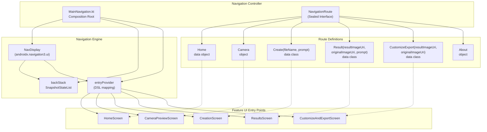
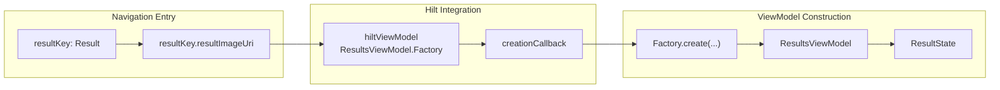

<!-- source: DeepWiki mcp.deepwiki.com · repo android/androidify · page 3.4 Navigation System · fetched 2026-10-23 -->

# Navigation System

<details>
<summary>Relevant source files</summary>

The following files were used as context for generating this wiki page:

- [app/src/main/java/com/android/developers/androidify/navigation/MainNavigation.kt](app/src/main/java/com/android/developers/androidify/navigation/MainNavigation.kt)
- [app/src/main/java/com/android/developers/androidify/navigation/NavigationRoutes.kt](app/src/main/java/com/android/developers/androidify/navigation/NavigationRoutes.kt)
- [app/src/main/java/com/android/developers/androidify/navigation/UriSerializer.kt](app/src/main/java/com/android/developers/androidify/navigation/UriSerializer.kt)
- [core/testing/src/main/java/com/android/developers/testing/data/BitmapSample.kt](core/testing/src/main/java/com/android/developers/testing/data/BitmapSample.kt)
- [core/testing/src/main/java/com/android/developers/testing/data/TestFileProvider.kt](core/testing/src/main/java/com/android/developers/testing/data/TestFileProvider.kt)
- [feature/creation/src/main/java/com/android/developers/androidify/creation/CreationScreen.kt](feature/creation/src/main/java/com/android/developers/androidify/creation/CreationScreen.kt)
- [feature/creation/src/main/java/com/android/developers/androidify/creation/CreationViewModel.kt](feature/creation/src/main/java/com/android/developers/androidify/creation/CreationViewModel.kt)
- [feature/creation/src/test/kotlin/com/android/developers/androidify/creation/CreationViewModelTest.kt](feature/creation/src/test/kotlin/com/android/developers/androidify/creation/CreationViewModelTest.kt)
- [feature/results/src/androidTest/java/com/android/developers/androidify/results/ResultsScreenTest.kt](feature/results/src/androidTest/java/com/android/developers/androidify/results/ResultsScreenTest.kt)
- [feature/results/src/main/java/com/android/developers/androidify/customize/ImageRenderer.kt](feature/results/src/main/java/com/android/developers/androidify/customize/ImageRenderer.kt)
- [feature/results/src/main/java/com/android/developers/androidify/customize/Utils.kt](feature/results/src/main/java/com/android/developers/androidify/customize/Utils.kt)
- [feature/results/src/main/java/com/android/developers/androidify/results/BotResultCard.kt](feature/results/src/main/java/com/android/developers/androidify/results/BotResultCard.kt)
- [feature/results/src/main/java/com/android/developers/androidify/results/ResultsScreen.kt](feature/results/src/main/java/com/android/developers/androidify/results/ResultsScreen.kt)
- [feature/results/src/main/java/com/android/developers/androidify/results/ResultsViewModel.kt](feature/results/src/main/java/com/android/developers/androidify/results/ResultsViewModel.kt)
- [feature/results/src/screenshotTest/java/com/android/developers/androidify/results/ResultsScreenScreenshotTest.kt](feature/results/src/screenshotTest/java/com/android/developers/androidify/results/ResultsScreenScreenshotTest.kt)
- [feature/results/src/test/kotlin/com/android/developers/androidify/customize/CustomizeViewModelTest.kt](feature/results/src/test/kotlin/com/android/developers/androidify/customize/CustomizeViewModelTest.kt)
- [feature/results/src/test/kotlin/com/android/developers/androidify/results/ResultsViewModelTest.kt](feature/results/src/test/kotlin/com/android/developers/androidify/results/ResultsViewModelTest.kt)

</details>


## Purpose and Scope

The Navigation System in Androidify provides type-safe, composable navigation between feature screens using the experimental `androidx.navigation3` library. It manages screen transitions, back stack state, ViewModel parameter passing, and shared element animations. This system replaces traditional fragment-based navigation with a purely Compose-based approach using the `NavDisplay` component and sealed route interfaces.

For information about individual feature screens and their UI implementations, see [Feature Modules](#5). For shared element transition animations specifically, see [Theme and UI Components](#6.3).

---

## Navigation Architecture

The navigation system is built around three core components: a sealed interface hierarchy for type-safe routes, a manually-managed back stack using `SnapshotStateList`, and the `NavDisplay` composable that renders the current screen with animated transitions.

### System Mapping: Code Entities to Navigation Roles

The following diagram bridges the conceptual navigation flow to the specific code entities implementing them.

"Navigation Architecture Mapping"


**Sources:** [app/src/main/java/com/android/developers/androidify/navigation/MainNavigation.kt:54-85](), [app/src/main/java/com/android/developers/androidify/navigation/NavigationRoutes.kt:24-65]()

---

## NavigationRoute Sealed Interface

All navigation destinations are defined as a `NavigationRoute` sealed interface hierarchy [app/src/main/java/com/android/developers/androidify/navigation/NavigationRoutes.kt:24](), enabling compile-time type safety and exhaustive when-expression handling. Each route carries parameters serialized as part of the route definition.

### Route Definitions

| Route Class | Type | Parameters | Purpose |
|------------|------|------------|---------|
| `Home` | `data object` | None | Landing screen entry point [app/src/main/java/com/android/developers/androidify/navigation/NavigationRoutes.kt:27]() |
| `Camera` | `object` | None | Camera capture screen [app/src/main/java/com/android/developers/androidify/navigation/NavigationRoutes.kt:36]() |
| `Create` | `data class` | `fileName: Uri?`, `prompt: String?` | Image generation editor [app/src/main/java/com/android/developers/androidify/navigation/NavigationRoutes.kt:30-33]() |
| `Result` | `data class` | `resultImageUri: Uri`, `originalImageUri: Uri?`, `prompt: String?` | Display generated result [app/src/main/java/com/android/developers/androidify/navigation/NavigationRoutes.kt:49-53]() |
| `CustomizeExport` | `data class` | `resultImageUri: Uri`, `originalImageUri: Uri?` | Customize and share screen [app/src/main/java/com/android/developers/androidify/navigation/NavigationRoutes.kt:62-65]() |
| `About` | `object` | None | About/settings screen [app/src/main/java/com/android/developers/androidify/navigation/NavigationRoutes.kt:39]() |

**Sources:** [app/src/main/java/com/android/developers/androidify/navigation/NavigationRoutes.kt:24-65]()

### URI Serialization

Routes containing `Uri` parameters use a custom `UriSerializer` [app/src/main/java/com/android/developers/androidify/navigation/UriSerializer.kt]() to convert URIs to/from strings for serialization. This enables routes to be saved and restored across process death [app/src/main/java/com/android/developers/androidify/navigation/NavigationRoutes.kt:16-33]().

---

## NavDisplay Component

The `NavDisplay` composable from `androidx.navigation3.ui` serves as the navigation host [app/src/main/java/com/android/developers/androidify/navigation/MainNavigation.kt:64](). It takes a back stack, renders the current destination, and manages enter/exit transitions.

### Configuration

`NavDisplay` is configured with:
*   **`backStack`**: A `SnapshotStateList` containing the navigation history [app/src/main/java/com/android/developers/androidify/navigation/MainNavigation.kt:65]().
*   **`entryDecorators`**: Wrappers for state and ViewModel management [app/src/main/java/com/android/developers/androidify/navigation/MainNavigation.kt:67-70]().
*   **`transitionSpec`**: Defines animations for forward navigation using `MaterialTheme.motionScheme` [app/src/main/java/com/android/developers/androidify/navigation/MainNavigation.kt:71-76]().
*   **`popTransitionSpec`**: Defines animations for backward navigation, typically a `scaleOut` effect [app/src/main/java/com/android/developers/androidify/navigation/MainNavigation.kt:77-84]().

**Sources:** [app/src/main/java/com/android/developers/androidify/navigation/MainNavigation.kt:64-84]()

---

## Back Stack Management

The navigation back stack is implemented as a `SnapshotStateList<NavigationRoute>`, providing observable state changes that trigger recomposition [app/src/main/java/com/android/developers/androidify/navigation/MainNavigation.kt:56]().

### Common Patterns

| Pattern | Implementation | Call Site Example |
|---------|---------------|-------------------|
| **Push destination** | `backStack.add(route)` | [app/src/main/java/com/android/developers/androidify/navigation/MainNavigation.kt:93]() |
| **Replace current** | `backStack.removeAll { ... }` then `add` | [app/src/main/java/com/android/developers/androidify/navigation/MainNavigation.kt:100-102]() |
| **Pop back** | `backStack.removeLastOrNull()` | [app/src/main/java/com/android/developers/androidify/navigation/MainNavigation.kt:66]() |
| **Navigate to Result** | `backStack.add(Result(...))` | [app/src/main/java/com/android/developers/androidify/navigation/MainNavigation.kt:127-133]() |

**Sources:** [app/src/main/java/com/android/developers/androidify/navigation/MainNavigation.kt:56-165]()

---

## Entry Provider and ViewModel Injection

The `entryProvider` DSL maps each `NavigationRoute` to its screen. ViewModels requiring navigation parameters use Hilt's `@AssistedInject` pattern [app/src/main/java/com/android/developers/androidify/creation/CreationViewModel.kt:50]().

### ViewModel Parameter Flow

"Assisted Injection Data Flow"


**Sources:** [app/src/main/java/com/android/developers/androidify/navigation/MainNavigation.kt:138-147](), [feature/results/src/main/java/com/android/developers/androidify/results/ResultsViewModel.kt:31-46]()

### Entry Definition Example: Result Screen
The `entry<Result>` block extracts parameters from the `Result` route and provides them to the `ResultsViewModel.Factory` [app/src/main/java/com/android/developers/androidify/navigation/MainNavigation.kt:138-147]().

```kotlin
entry<Result> { resultKey ->
    val resultsViewModel = hiltViewModel<ResultsViewModel, ResultsViewModel.Factory>(
        creationCallback = { factory ->
            factory.create(
                resultImageUrl = resultKey.resultImageUri,
                originalImageUrl = resultKey.originalImageUri,
                promptText = resultKey.prompt,
            )
        },
    )
    ResultsScreen(..., viewModel = resultsViewModel)
}
```

**Sources:** [app/src/main/java/com/android/developers/androidify/navigation/MainNavigation.kt:138-164]()

---

## Feature Screen Interactions

Screens interact with the navigation system via callback lambdas defined in their composable signatures.

*   **`CreationScreen`**: Notifies the system when a bot is created via `onImageCreated` [feature/creation/src/main/java/com/android/developers/androidify/creation/CreationScreen.kt:45](). This triggers a transition to the `Result` route [app/src/main/java/com/android/developers/androidify/navigation/MainNavigation.kt:125-134]().
*   **`ResultsScreen`**: Uses `onNextPress` to move to the `CustomizeExport` route [feature/results/src/main/java/com/android/developers/androidify/results/ResultsScreen.kt:71]().
*   **`HomeScreen`**: Initiates the creation flow via `onClickLetsGo`, which triggers a splash transition before adding the `Create` route [app/src/main/java/com/android/developers/androidify/navigation/MainNavigation.kt:88-91]().

**Sources:** [feature/creation/src/main/java/com/android/developers/androidify/creation/CreationScreen.kt:40-46](), [feature/results/src/main/java/com/android/developers/androidify/results/ResultsScreen.kt:68-73](), [app/src/main/java/com/android/developers/androidify/navigation/MainNavigation.kt:86-96]()

---

## Testing Navigation Logic

Navigation logic and state management are verified through unit tests on the ViewModels.

*   **`CreationViewModelTest`**: Verifies that calling `onImageSelected` correctly updates the `CreationState` with the provided `Uri` [feature/creation/src/test/kotlin/com/android/developers/androidify/creation/CreationViewModelTest.kt:103-108]().
*   **`ResultsViewModelTest`**: Ensures that parameters passed through the route (like `resultImageUrl` and `promptText`) are correctly reflected in the `ResultState` [feature/results/src/test/kotlin/com/android/developers/androidify/results/ResultsViewModelTest.kt:53-77]().
*   **`CustomizeViewModelTest`**: Validates that the `CustomizeExportViewModel` correctly initializes its `CustomizeExportState` using the `Uri` arguments provided during assisted injection [feature/results/src/test/kotlin/com/android/developers/androidify/customize/CustomizeViewModelTest.kt:72-92]().

**Sources:** [feature/creation/src/test/kotlin/com/android/developers/androidify/creation/CreationViewModelTest.kt:103-108](), [feature/results/src/test/kotlin/com/android/developers/androidify/results/ResultsViewModelTest.kt:53-77](), [feature/results/src/test/kotlin/com/android/developers/androidify/customize/CustomizeViewModelTest.kt:72-92]()

---

