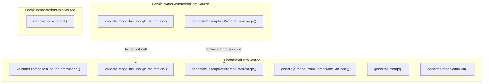
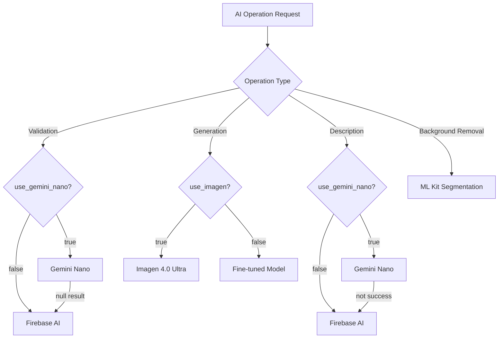

<!-- source: DeepWiki mcp.deepwiki.com · repo android/androidify · page 4 AI and ML Integration · fetched 2026-10-23 -->

# AI and ML Integration

<details>
<summary>Relevant source files</summary>

The following files were used as context for generating this wiki page:

- [app/src/main/AndroidManifest.xml](app/src/main/AndroidManifest.xml)
- [core/network/src/main/java/com/android/developers/androidify/ondevice/LocalSegmentationDataSource.kt](core/network/src/main/java/com/android/developers/androidify/ondevice/LocalSegmentationDataSource.kt)
- [core/network/src/main/java/com/android/developers/androidify/startup/FirebaseAppCheckInitializer.kt](core/network/src/main/java/com/android/developers/androidify/startup/FirebaseAppCheckInitializer.kt)
- [core/network/src/main/java/com/android/developers/androidify/vertexai/FirebaseAiDataSource.kt](core/network/src/main/java/com/android/developers/androidify/vertexai/FirebaseAiDataSource.kt)
- [core/util/src/main/java/com/android/developers/androidify/util/LocalFileProvider.kt](core/util/src/main/java/com/android/developers/androidify/util/LocalFileProvider.kt)
- [data/src/main/java/com/android/developers/androidify/data/ImageGenerationRepository.kt](data/src/main/java/com/android/developers/androidify/data/ImageGenerationRepository.kt)
- [feature/creation/src/main/java/com/android/developers/androidify/creation/xr/EditScreenSpatial.kt](feature/creation/src/main/java/com/android/developers/androidify/creation/xr/EditScreenSpatial.kt)
- [feature/results/src/main/java/com/android/developers/androidify/customize/ComposableBitmapRendererImpl.kt](feature/results/src/main/java/com/android/developers/androidify/customize/ComposableBitmapRendererImpl.kt)
- [feature/results/src/test/kotlin/com/android/developers/androidify/customize/CustomizeStateTest.kt](feature/results/src/test/kotlin/com/android/developers/androidify/customize/CustomizeStateTest.kt)
- [gradle/libs.versions.toml](gradle/libs.versions.toml)
- [wear/src/main/java/com/android/developers/androidify/ui/CallToActionButton.kt](wear/src/main/java/com/android/developers/androidify/ui/CallToActionButton.kt)
- [wear/src/main/java/com/android/developers/androidify/ui/CallToActionScreen.kt](wear/src/main/java/com/android/developers/androidify/ui/CallToActionScreen.kt)
- [wear/src/main/java/com/android/developers/androidify/ui/TransmissionScreen.kt](wear/src/main/java/com/android/developers/androidify/ui/TransmissionScreen.kt)

</details>


## Purpose and Scope

This document provides an overview of the AI and ML architecture in Androidify, covering the integration patterns, component relationships, and orchestration logic for AI-powered features. The system uses a multi-provider strategy that balances on-device processing (Gemini Nano, ML Kit) with cloud-based services (Firebase AI with Vertex AI and Google AI backends) to deliver image generation, validation, and editing capabilities.

For detailed information about specific subsystems:
- Firebase AI models and prompts: [Firebase AI and Generative Models](#4.1)
- Repository orchestration patterns: [Image Generation Repository](#4.2)
- ML Kit pose detection and segmentation: [ML Kit Integration](#4.3)
- Remote configuration and feature flags: [Remote Configuration](#4.4)

## Architecture Overview

The AI/ML system follows a layered architecture with clear separation of concerns:

```mermaid
graph TB
    subgraph "Repository Layer"
        ["ImageGenerationRepositoryImpl"]
    end
    
    subgraph "Data Source Layer"
        ["FirebaseAiDataSourceImpl"]
        ["GeminiNanoGenerationDataSource"]
        ["LocalSegmentationDataSourceImpl"]
    end
    
    subgraph "AI Model Services"
        ["Gemini 2.5 Flash"]
        ["Gemini 2.0 Flash"]
        ["Imagen 4.0 Ultra"]
        ["Fine-tuned Androidify Model"]
        ["Gemini Nano"]
        ["ML Kit Subject Segmentation"]
    end
    
    subgraph "Configuration"
        ["RemoteConfigDataSourceImpl"]
    end
    
    ["ImageGenerationRepositoryImpl"] --> ["FirebaseAiDataSourceImpl"]
    ["ImageGenerationRepositoryImpl"] --> ["GeminiNanoGenerationDataSource"]
    ["ImageGenerationRepositoryImpl"] --> ["LocalSegmentationDataSourceImpl"]
    
    ["FirebaseAiDataSourceImpl"] --> ["Gemini 2.5 Flash"]
    ["FirebaseAiDataSourceImpl"] --> ["Gemini 2.0 Flash"]
    ["FirebaseAiDataSourceImpl"] --> ["Imagen 4.0 Ultra"]
    ["FirebaseAiDataSourceImpl"] --> ["Fine-tuned Androidify Model"]
    ["FirebaseAiDataSourceImpl"] --> ["RemoteConfigDataSourceImpl"]
    
    ["GeminiNanoGenerationDataSource"] --> ["Gemini Nano"]
    ["GeminiNanoGenerationDataSource"] -.fallback.-> ["FirebaseAiDataSourceImpl"]
    
    ["LocalSegmentationDataSourceImpl"] --> ["ML Kit Subject Segmentation"]
    
    ["RemoteConfigDataSourceImpl"] -.controls.-> ["FirebaseAiDataSourceImpl"]
    ["RemoteConfigDataSourceImpl"] -.controls.-> ["GeminiNanoGenerationDataSource"]
```

**Sources:** [data/src/main/java/com/android/developers/androidify/data/ImageGenerationRepository.kt:46-53](), [core/network/src/main/java/com/android/developers/androidify/vertexai/FirebaseAiDataSource.kt:56-58](), [core/network/src/main/java/com/android/developers/androidify/ondevice/LocalSegmentationDataSource.kt:39-41]()

The architecture implements three key patterns:

| Pattern | Implementation | Purpose |
|---------|---------------|---------|
| **Facade** | `ImageGenerationRepository` | Single interface for all AI operations |
| **Strategy** | Runtime model selection via `RemoteConfigDataSource` | A/B testing and gradual rollout |
| **Fallback Chain** | Gemini Nano → Firebase AI | Resilience and availability |

## Core Components

### ImageGenerationRepository

The repository serves as the central orchestration point for all AI/ML operations. It coordinates between multiple data sources and implements validation, generation, and storage workflows.

**Interface:**

```mermaid
graph LR
    subgraph "ImageGenerationRepository Interface"
        ["generateFromDescription()"]
        ["generateFromImage()"]
        ["getDescriptionFromImage()"]
        ["addBackgroundToBot()"]
        ["removeBackground()"]
        ["saveImage()"]
        ["saveImageToExternalStorage()"]
    end
```

The repository implementation at [data/src/main/java/com/android/developers/androidify/data/ImageGenerationRepository.kt:46-167]() coordinates operations across data sources based on feature flags.

**Sources:** [data/src/main/java/com/android/developers/androidify/data/ImageGenerationRepository.kt:33-43]()

### Data Source Hierarchy



**Sources:** [core/network/src/main/java/com/android/developers/androidify/vertexai/FirebaseAiDataSource.kt:45-52](), [data/src/main/java/com/android/developers/androidify/data/ImageGenerationRepository.kt:55-69]()

### Firebase AI Integration

`FirebaseAiDataSource` provides the cloud-based AI capabilities through Firebase Vertex AI integration. It utilizes `GenerativeModel` instances configured for specific tasks.

**Model Configuration:**

| Operation | Model | Backend | Configuration |
|-----------|-------|---------|---------------|
| Text validation | Gemini 2.5 Flash | Vertex AI | `responseMimeType = "application/json"`, `responseSchema` |
| Image generation | Fine-tuned or Imagen | Google AI / Vertex AI | `ResponseModality.IMAGE` |
| Image editing | Gemini 2.0 Flash | Google AI | Multi-modal (Bitmap + Prompt) |

The implementation at [core/network/src/main/java/com/android/developers/androidify/vertexai/FirebaseAiDataSource.kt:56-96]() creates models dynamically based on remote configuration.

**Model Creation Pattern:**

```mermaid
graph LR
    ["createGenerativeTextModel()"] --> ["Firebase.ai(backend)"]
    ["Firebase.ai(backend)"] --> ["generationConfig"]
    ["generationConfig"] --> ["responseSchema: Schema"]
    ["generationConfig"] --> ["temperature: Float?"]
    ["generationConfig"] --> ["responseMimeType: application/json"]
    ["createGenerativeTextModel()"] --> ["safetySettings"]
```

**Sources:** [core/network/src/main/java/com/android/developers/androidify/vertexai/FirebaseAiDataSource.kt:63-78](), [core/network/src/main/java/com/android/developers/androidify/vertexai/FirebaseAiDataSource.kt:80-96]()

### On-Device Processing

**Gemini Nano:**
The on-device model provides fast validation and description generation without network calls. Located in the `GeminiNanoGenerationDataSource`, it attempts processing locally before falling back to cloud services if unavailable or unsuccessful [data/src/main/java/com/android/developers/androidify/data/ImageGenerationRepository.kt:95-111]().

**ML Kit Subject Segmentation:**
Provides background removal capabilities for creating transparent sticker exports. The implementation at [core/network/src/main/java/com/android/developers/androidify/ondevice/LocalSegmentationDataSource.kt:39-129]() handles dynamic module installation using `ModuleInstallClient` [core/network/src/main/java/com/android/developers/androidify/ondevice/LocalSegmentationDataSource.kt:88-93]().

The manifest declares the ML Kit dependency at [app/src/main/AndroidManifest.xml:106-108]():
```xml
<meta-data
    android:name="com.google.mlkit.vision.DEPENDENCIES"
    android:value="subject_segmentation" />
```

**Sources:** [core/network/src/main/java/com/android/developers/androidify/ondevice/LocalSegmentationDataSource.kt:49-129](), [app/src/main/AndroidManifest.xml:106-108]()

### Remote Configuration Integration

`RemoteConfigDataSource` controls AI behavior through Firebase Remote Config, enabling runtime feature toggles and model selection without app updates.

**Key Configuration Parameters:**

| Parameter | Type | Purpose |
|-----------|------|---------|
| `use_imagen` | Boolean | Switch between Imagen and fine-tuned model |
| `use_gemini_nano` | Boolean | Enable on-device processing |
| `background_vibes_enabled` | Boolean | Enable AI background generation |
| `text_model_name` | String | Gemini model for text processing |
| `image_model_name` | String | Imagen model version |

The `FirebaseAiDataSourceImpl` injects this data source to determine which models to initialize [core/network/src/main/java/com/android/developers/androidify/vertexai/FirebaseAiDataSource.kt:56-58]().

**Sources:** [core/network/src/main/java/com/android/developers/androidify/vertexai/FirebaseAiDataSource.kt:64-82](), [data/src/main/java/com/android/developers/androidify/data/ImageGenerationRepository.kt:60-61]()

## AI Model Selection Strategy

The system implements dynamic model selection based on remote configuration flags:



**Implementation at Repository Layer:**

The selection logic is implemented in [data/src/main/java/com/android/developers/androidify/data/ImageGenerationRepository.kt:58-69]() for validation and [data/src/main/java/com/android/developers/androidify/data/ImageGenerationRepository.kt:95-114]() for description generation.

**Sources:** [data/src/main/java/com/android/developers/androidify/data/ImageGenerationRepository.kt:58-114]()

## Processing Pipelines

### Text-to-Image Pipeline

1. **Validation**: `validatePromptHasEnoughInformation` is called to ensure the prompt is descriptive enough [data/src/main/java/com/android/developers/androidify/data/ImageGenerationRepository.kt:78]().
2. **Generation**: `generateImageFromPromptAndSkinTone` sends the validated prompt to the configured cloud model [data/src/main/java/com/android/developers/androidify/data/ImageGenerationRepository.kt:82-85]().

**Sources:** [data/src/main/java/com/android/developers/androidify/data/ImageGenerationRepository.kt:71-86]()

### Background Removal and Editing

1. **Removal**: Uses `LocalSegmentationDataSource.removeBackground` which leverages ML Kit `SubjectSegmenter` [core/network/src/main/java/com/android/developers/androidify/ondevice/LocalSegmentationDataSource.kt:42-47]().
2. **Editing**: Uses `FirebaseAiDataSource.generateImageWithEdit` to combine an existing bot image with a new background prompt [data/src/main/java/com/android/developers/androidify/data/ImageGenerationRepository.kt:158-162]().

**Sources:** [data/src/main/java/com/android/developers/androidify/data/ImageGenerationRepository.kt:158-166](), [core/network/src/main/java/com/android/developers/androidify/ondevice/LocalSegmentationDataSource.kt:101-128]()

## Error Handling and Fallbacks

The system implements multiple layers of error handling:

| Exception | Cause |
|-----------|-------|
| `InsufficientInformationException` | Prompt validation failed [data/src/main/java/com/android/developers/androidify/data/ImageGenerationRepository.kt:77-80]() |
| `ImageValidationException` | Image doesn't meet criteria [data/src/main/java/com/android/developers/androidify/data/ImageGenerationRepository.kt:92]() |
| `NoInternetException` | Connectivity check failed [data/src/main/java/com/android/developers/androidify/data/ImageGenerationRepository.kt:153-155]() |
| `ImageSegmentationException` | ML Kit module install or processing failure [core/network/src/main/java/com/android/developers/androidify/ondevice/LocalSegmentationDataSource.kt:131]() |

**Sources:** [data/src/main/java/com/android/developers/androidify/data/ImageGenerationRepository.kt:55-156](), [core/network/src/main/java/com/android/developers/androidify/ondevice/LocalSegmentationDataSource.kt:62-79]()

---

