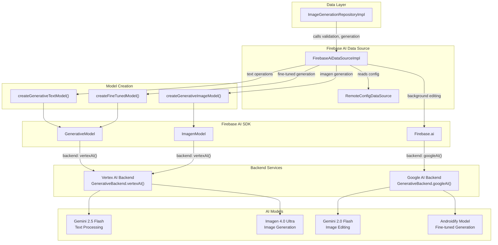
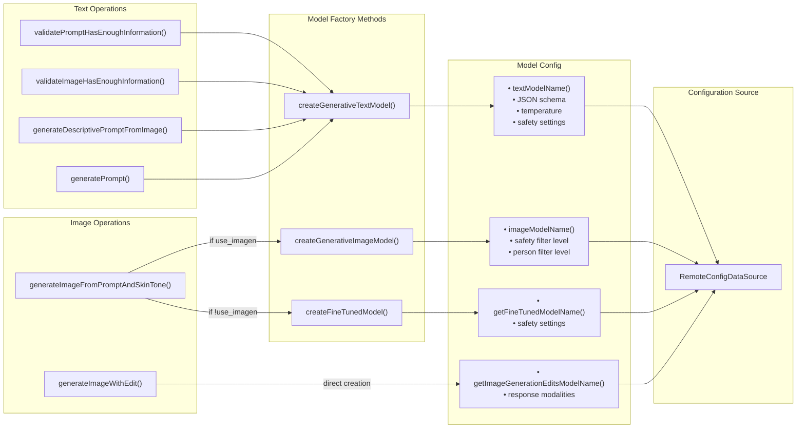
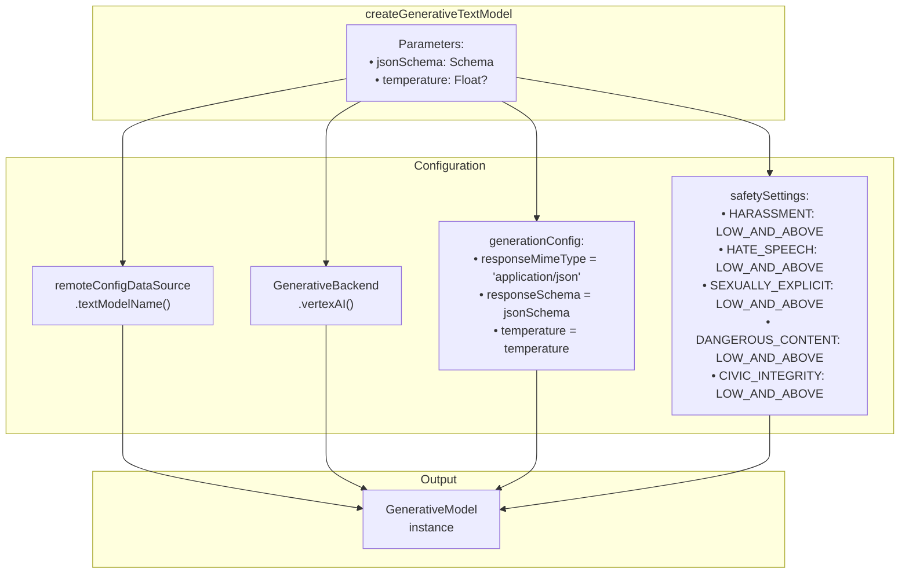
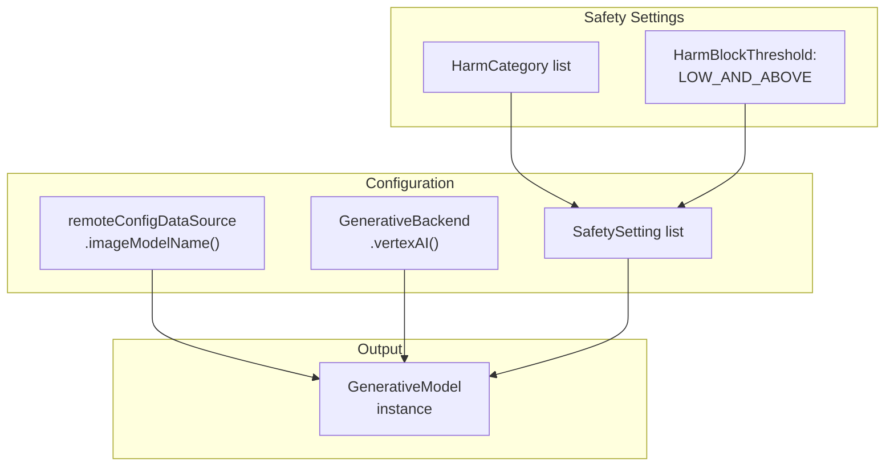
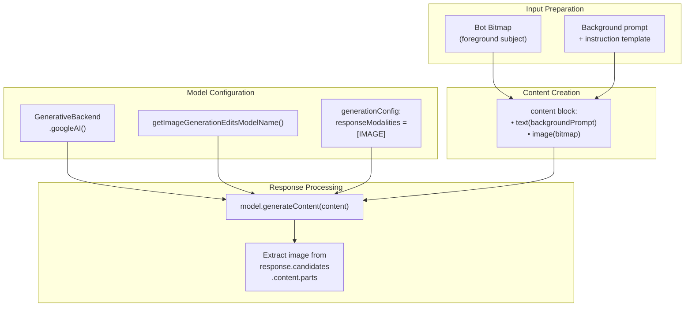
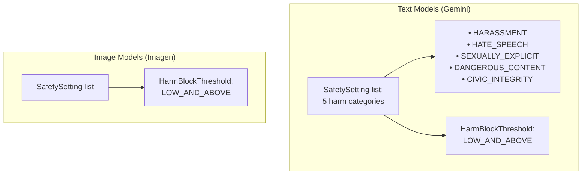

<!-- source: DeepWiki mcp.deepwiki.com · repo android/androidify · page 4.1 Firebase AI and Generative Models · fetched 2026-10-23 -->

# Firebase AI and Generative Models

<details>
<summary>Relevant source files</summary>

The following files were used as context for generating this wiki page:

- [app/src/main/AndroidManifest.xml](app/src/main/AndroidManifest.xml)
- [core/network/src/main/java/com/android/developers/androidify/ondevice/LocalSegmentationDataSource.kt](core/network/src/main/java/com/android/developers/androidify/ondevice/LocalSegmentationDataSource.kt)
- [core/network/src/main/java/com/android/developers/androidify/startup/FirebaseAppCheckInitializer.kt](core/network/src/main/java/com/android/developers/androidify/startup/FirebaseAppCheckInitializer.kt)
- [core/network/src/main/java/com/android/developers/androidify/vertexai/FirebaseAiDataSource.kt](core/network/src/main/java/com/android/developers/androidify/vertexai/FirebaseAiDataSource.kt)
- [core/util/src/main/java/com/android/developers/androidify/util/LocalFileProvider.kt](core/util/src/main/java/com/android/developers/androidify/util/LocalFileProvider.kt)
- [data/src/main/java/com/android/developers/androidify/data/ImageGenerationRepository.kt](data/src/main/java/com/android/developers/androidify/data/ImageGenerationRepository.kt)
- [feature/creation/src/main/java/com/android/developers/androidify/creation/xr/EditScreenSpatial.kt](feature/creation/src/main/java/com/android/developers/androidify/creation/xr/EditScreenSpatial.kt)
- [feature/results/src/main/java/com/android/developers/androidify/customize/ComposableBitmapRendererImpl.kt](feature/results/src/main/java/com/android/developers/androidify/customize/ComposableBitmapRendererImpl.kt)
- [feature/results/src/test/kotlin/com/android/developers/androidify/customize/CustomizeStateTest.kt](feature/results/src/test/kotlin/com/android/developers/androidify/customize/CustomizeStateTest.kt)
- [gradle/libs.versions.toml](gradle/libs.versions.toml)
- [wear/src/main/java/com/android/developers/androidify/ui/CallToActionButton.kt](wear/src/main/java/com/android/developers/androidify/ui/CallToActionButton.kt)
- [wear/src/main/java/com/android/developers/androidify/ui/CallToActionScreen.kt](wear/src/main/java/com/android/developers/androidify/ui/CallToActionScreen.kt)
- [wear/src/main/java/com/android/developers/androidify/ui/TransmissionScreen.kt](wear/src/main/java/com/android/developers/androidify/ui/TransmissionScreen.kt)

</details>


## Purpose and Scope

This document details the `FirebaseAiDataSource` implementation, which serves as the primary interface to cloud-based generative AI models in the Androidify application. The system integrates multiple Google AI models including Gemini 2.5 Flash for text processing, Imagen 4.0 Ultra for image generation, and Gemini 2.0 Flash for image editing. This data source handles prompt validation, image validation, description generation, and AI-powered image generation/editing operations.

For information about the on-device AI alternative, see [ML Kit Integration](4.3). For the repository pattern that orchestrates between Firebase AI and other data sources, see [Image Generation Repository](4.2). For remote configuration that controls model selection and behavior, see [Remote Configuration](4.4).

---

## System Architecture

The `FirebaseAiDataSource` acts as the cloud AI provider within Androidify's multi-tiered AI architecture. It communicates with different Google AI backends (Vertex AI and Google AI Studio) based on the operation type and remote configuration settings.

### Component Interaction Diagram



**Sources:** [core/network/src/main/java/com/android/developers/androidify/vertexai/FirebaseAiDataSource.kt:56-291](), [data/src/main/java/com/android/developers/androidify/data/ImageGenerationRepository.kt:46-53]()

---

## Interface Operations

The `FirebaseAiDataSource` interface defines core operations that cover the entire AI workflow from validation to generation.

### Operations Table

| Operation | Input | Output | Model Used | Purpose |
|-----------|-------|--------|------------|---------|
| `validatePromptHasEnoughInformation()` | Text prompt | `ValidatedDescription` | Gemini 2.5 Flash | Validates user text input has sufficient detail |
| `validateImageHasEnoughInformation()` | `Bitmap` | `ValidatedImage` | Gemini 2.5 Flash | Validates uploaded image meets criteria |
| `generateDescriptivePromptFromImage()` | `Bitmap` | `ValidatedDescription` | Gemini 2.5 Flash | Extracts detailed description from photo |
| `generateImageFromPromptAndSkinTone()` | Text + skin tone | `Bitmap` | Imagen 4.0 Ultra or Androidify | Generates bot image from description |
| `generatePrompt()` | Base prompt | `GeneratedPrompt` | Gemini 2.5 Flash | Generates multiple prompt variations |
| `generateImageWithEdit()` | `Bitmap` + background prompt | `Bitmap` | Gemini 2.0 Flash | Adds AI background to bot image |

**Sources:** [core/network/src/main/java/com/android/developers/androidify/vertexai/FirebaseAiDataSource.kt:45-52]()

---

## Model Configuration and Creation

The implementation creates different model instances based on the operation type. Each model is configured with specific parameters for safety, output format, and behavior.

### Model Creation Flow



**Sources:** [core/network/src/main/java/com/android/developers/androidify/vertexai/FirebaseAiDataSource.kt:59-78](), [core/network/src/main/java/com/android/developers/androidify/vertexai/FirebaseAiDataSource.kt:80-96](), [core/network/src/main/java/com/android/developers/androidify/vertexai/FirebaseAiDataSource.kt:149-160](), [core/network/src/main/java/com/android/developers/androidify/vertexai/FirebaseAiDataSource.kt:254-262]()

---

## Gemini 2.5 Flash: Text Processing Model

Gemini 2.5 Flash serves as the primary text processing model for all validation and description generation tasks. It uses structured JSON output with schemas to ensure predictable responses.

### Text Model Configuration

The `createGenerativeTextModel()` method configures Gemini 2.5 Flash with the following parameters:

- **Model Name:** Retrieved via `remoteConfigDataSource.textModelName()`
- **Backend:** `GenerativeBackend.vertexAI()` - routes to Vertex AI
- **Response Format:** `application/json` with explicit `responseSchema`
- **Temperature:** Configurable per operation (default: null, 0.75 for prompt generation)
- **Safety Settings:** Five harm categories blocked at `LOW_AND_ABOVE` threshold



**Sources:** [core/network/src/main/java/com/android/developers/androidify/vertexai/FirebaseAiDataSource.kt:59-78]()

### JSON Schema Patterns

Each text operation defines a specific JSON schema to structure the response:

#### Prompt Validation Schema
```kotlin
val jsonSchema = Schema.obj(
    mapOf("success" to Schema.boolean(), "user_description" to Schema.string()),
    optionalProperties = listOf("user_description"),
)
```

#### Image Validation Schema
```kotlin
val jsonSchema = Schema.obj(
    properties = mapOf(
        "success" to Schema.boolean(),
        "error" to Schema.enumeration(
            values = ImageValidationError.entries.map { it.description },
            description = "Error message",
            nullable = true,
        ),
    ),
    optionalProperties = listOf("error"),
)
```

**Sources:** [core/network/src/main/java/com/android/developers/androidify/vertexai/FirebaseAiDataSource.kt:99-102](), [core/network/src/main/java/com/android/developers/androidify/vertexai/FirebaseAiDataSource.kt:112-122]()

---

## Imagen 4.0 Ultra: High-Quality Image Generation

Imagen 4.0 Ultra is the primary image generation model when the `use_imagen` remote config flag is enabled. It provides photorealistic, high-quality bot generation.

### Imagen Model Configuration

The `createGenerativeImageModel()` method configures Imagen with safety filters:



**Sources:** [core/network/src/main/java/com/android/developers/androidify/vertexai/FirebaseAiDataSource.kt:80-96]()

---

## Gemini 2.0 Flash: Image Editing Model

Gemini 2.0 Flash with image generation capabilities powers the "Background Vibes" feature, which adds AI-generated backgrounds to bot images.

### Image Editing Configuration

The `generateImageWithEdit()` method creates a model instance with multimodal output:



**Sources:** [core/network/src/main/java/com/android/developers/androidify/vertexai/FirebaseAiDataSource.kt:250-271]()

---

## Safety and Content Filtering

All models in `FirebaseAiDataSource` are configured with comprehensive safety settings to ensure appropriate content generation.

### Safety Configuration Hierarchy



**Sources:** [core/network/src/main/java/com/android/developers/androidify/vertexai/FirebaseAiDataSource.kt:70-76](), [core/network/src/main/java/com/android/developers/androidify/vertexai/FirebaseAiDataSource.kt:88-94]()

---

## Error Handling

The `FirebaseAiDataSource` implementation includes explicit error handling for model response extraction.

### Error Cases

| Operation | Error Condition | Error Type |
|-----------|----------------|------------|
| `generateImageFromPromptAndSkinTone()` (fine-tuned) | Cannot extract image from response | `IllegalStateException` |
| `generateImageWithEdit()` | Cannot extract image from response | `IllegalStateException` |

**Fine-Tuned Model Error:**
```kotlin
return response.candidates.firstOrNull()?.content?.parts?.firstOrNull()?.asImageOrNull()
    ?: throw IllegalStateException("Could not extract image from fine-tuned model response")
```

**Image Editing Error:**
```kotlin
val image = response.candidates.firstOrNull()
    ?.content?.parts?.firstNotNullOfOrNull { it.asImageOrNull() }
return image ?: throw IllegalStateException("Could not extract image from model response")
```

**Sources:** [core/network/src/main/java/com/android/developers/androidify/vertexai/FirebaseAiDataSource.kt:179-180](), [core/network/src/main/java/com/android/developers/androidify/vertexai/FirebaseAiDataSource.kt:268-270]()

---

## Dependency Injection

The `FirebaseAiDataSourceImpl` is configured as a singleton and injected via Hilt.

### Injection Configuration

```kotlin
@Singleton
class FirebaseAiDataSourceImpl @Inject constructor(
    private val remoteConfigDataSource: RemoteConfigDataSource,
) : FirebaseAiDataSource
```

**Sources:** [core/network/src/main/java/com/android/developers/androidify/vertexai/FirebaseAiDataSource.kt:56-58]()

---

