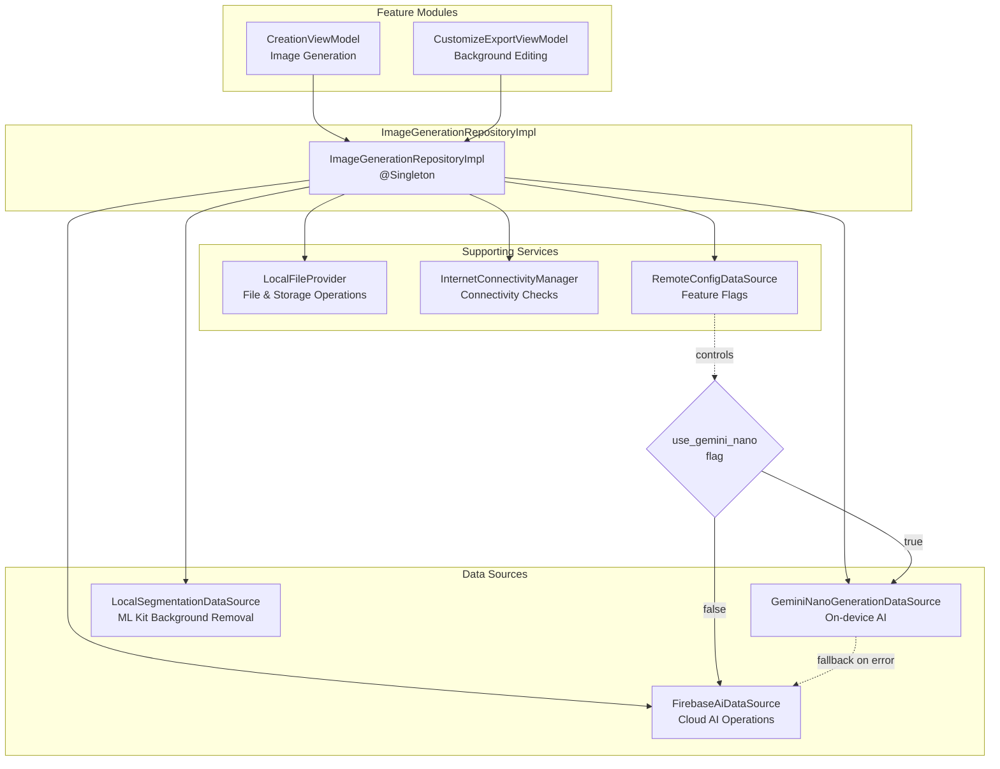
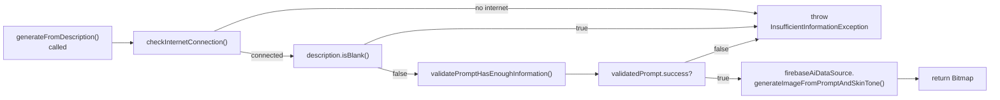
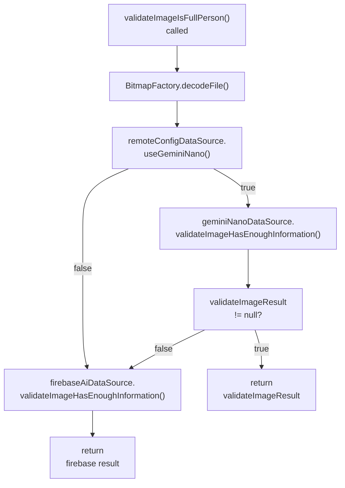
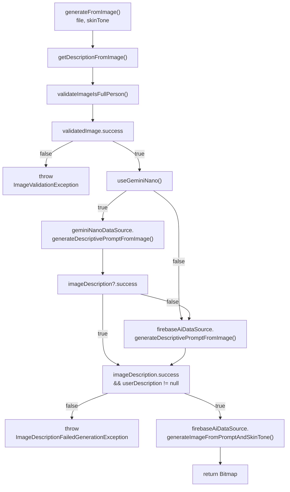
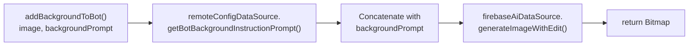

<!-- source: DeepWiki mcp.deepwiki.com · repo android/androidify · page 4.2 Image Generation Repository · fetched 2026-10-23 -->

# Image Generation Repository

<details>
<summary>Relevant source files</summary>

The following files were used as context for generating this wiki page:

- [app/src/main/AndroidManifest.xml](app/src/main/AndroidManifest.xml)
- [app/src/main/java/com/android/developers/androidify/AndroidifyApplication.kt](app/src/main/java/com/android/developers/androidify/AndroidifyApplication.kt)
- [app/src/main/java/com/android/developers/androidify/CrashlyticsTree.kt](app/src/main/java/com/android/developers/androidify/CrashlyticsTree.kt)
- [core/network/src/main/java/com/android/developers/androidify/ondevice/LocalSegmentationDataSource.kt](core/network/src/main/java/com/android/developers/androidify/ondevice/LocalSegmentationDataSource.kt)
- [core/network/src/main/java/com/android/developers/androidify/startup/FirebaseAppCheckInitializer.kt](core/network/src/main/java/com/android/developers/androidify/startup/FirebaseAppCheckInitializer.kt)
- [core/network/src/main/java/com/android/developers/androidify/startup/FirebaseRemoteConfigInitializer.kt](core/network/src/main/java/com/android/developers/androidify/startup/FirebaseRemoteConfigInitializer.kt)
- [core/testing/src/main/java/com/android/developers/testing/data/TestGeminiNanoDownloader.kt](core/testing/src/main/java/com/android/developers/testing/data/TestGeminiNanoDownloader.kt)
- [core/testing/src/main/java/com/android/developers/testing/data/TestGeminiNanoGenerationDataSource.kt](core/testing/src/main/java/com/android/developers/testing/data/TestGeminiNanoGenerationDataSource.kt)
- [core/testing/src/main/java/com/android/developers/testing/network/TestLocalSegmentationDataSource.kt](core/testing/src/main/java/com/android/developers/testing/network/TestLocalSegmentationDataSource.kt)
- [core/util/src/main/java/com/android/developers/androidify/util/LocalFileProvider.kt](core/util/src/main/java/com/android/developers/androidify/util/LocalFileProvider.kt)
- [data/src/main/java/com/android/developers/androidify/data/GeminiNanoGenerationDataSource.kt](data/src/main/java/com/android/developers/androidify/data/GeminiNanoGenerationDataSource.kt)
- [data/src/main/java/com/android/developers/androidify/data/ImageGenerationRepository.kt](data/src/main/java/com/android/developers/androidify/data/ImageGenerationRepository.kt)
- [data/src/main/java/com/android/developers/androidify/data/InternetConnectivityManager.kt](data/src/main/java/com/android/developers/androidify/data/InternetConnectivityManager.kt)
- [data/src/main/java/com/android/developers/androidify/data/TextGenerationRepository.kt](data/src/main/java/com/android/developers/androidify/data/TextGenerationRepository.kt)
- [data/src/main/java/com/android/developers/androidify/startup/GeminiNanoDownloaderInitializer.kt](data/src/main/java/com/android/developers/androidify/startup/GeminiNanoDownloaderInitializer.kt)
- [data/src/test/java/com/android/developers/androidify/data/ImageGenerationRepositoryTest.kt](data/src/test/java/com/android/developers/androidify/data/ImageGenerationRepositoryTest.kt)
- [feature/results/src/main/java/com/android/developers/androidify/customize/ComposableBitmapRendererImpl.kt](feature/results/src/main/java/com/android/developers/androidify/customize/ComposableBitmapRendererImpl.kt)
- [feature/results/src/test/kotlin/com/android/developers/androidify/customize/CustomizeStateTest.kt](feature/results/src/test/kotlin/com/android/developers/androidify/customize/CustomizeStateTest.kt)

</details>


The `ImageGenerationRepository` serves as the central facade for all AI/ML operations in Androidify. It orchestrates validation, generation, and image editing tasks by coordinating between on-device models (Gemini Nano, ML Kit) and cloud-based AI services (Firebase AI). This repository implements the Repository pattern to abstract data sources and provide a clean API to feature modules.

For information about the underlying AI data sources, see [Firebase AI and Generative Models](4.1). For ML Kit operations, see [ML Kit Integration](4.3).

---

## Repository Interface

The `ImageGenerationRepository` interface defines primary operations grouped into three categories: generation, storage, and editing.

### Generation Operations

| Method | Purpose | Returns |
|--------|---------|---------|
| `generateFromDescription(description, skinTone)` | Generate bot image from text prompt | `Bitmap` |
| `getDescriptionFromImage(file)` | Extract validated description from image | `ValidatedDescription` |
| `generateFromImage(file, skinTone)` | Generate bot from source image | `Bitmap` |

### Storage Operations

| Method | Purpose | Returns |
|--------|---------|---------|
| `saveImage(imageBitmap)` | Save to cache for sharing | `Uri` (FileProvider) |
| `saveImageToExternalStorage(imageBitmap)` | Save to MediaStore | `Uri` |
| `saveImageToExternalStorage(imageUri)` | Copy URI to MediaStore | `Uri` |

### Editing Operations

| Method | Purpose | Returns |
|--------|---------|---------|
| `addBackgroundToBot(image, backgroundPrompt)` | Generate AI background | `Bitmap` |
| `removeBackground(image)` | Extract foreground subject | `Bitmap` |

**Sources:** [data/src/main/java/com/android/developers/androidify/data/ImageGenerationRepository.kt:33-43]()

---

## Implementation Architecture

The `ImageGenerationRepositoryImpl` class is a `@Singleton` that coordinates five data sources to provide unified AI operations. It implements intelligent fallback strategies to balance on-device performance with cloud quality.



**Diagram: Repository Dependencies and Feature Module Integration**

The repository injects all dependencies via constructor injection and exposes them as private fields:

- `localFileProvider` - Handles file I/O and MediaStore operations [data/src/main/java/com/android/developers/androidify/data/ImageGenerationRepository.kt:47]()
- `internetConnectivityManager` - Validates network availability before cloud calls [data/src/main/java/com/android/developers/androidify/data/ImageGenerationRepository.kt:48]()
- `geminiNanoDataSource` - Provides on-device AI capabilities when enabled [data/src/main/java/com/android/developers/androidify/data/ImageGenerationRepository.kt:49]()
- `firebaseAiDataSource` - Primary cloud AI service for generation and editing [data/src/main/java/com/android/developers/androidify/data/ImageGenerationRepository.kt:50]()
- `remoteConfigDataSource` - Controls feature flags (`use_gemini_nano`) [data/src/main/java/com/android/developers/androidify/data/ImageGenerationRepository.kt:51]()
- `localSegmentationDataSource` - On-device background removal via ML Kit [data/src/main/java/com/android/developers/androidify/data/ImageGenerationRepository.kt:52]()

**Sources:** [data/src/main/java/com/android/developers/androidify/data/ImageGenerationRepository.kt:45-53]()

---

## Validation Strategy with Fallback

The repository implements a two-tier validation strategy with automatic fallback from on-device to cloud processing.

### Prompt Validation Flow



**Diagram: Text Prompt Validation and Generation Flow**

The `validatePromptHasEnoughInformation()` method delegates directly to Firebase AI for text validation. This ensures prompts contain sufficient detail about appearance, clothing, and accessories.

**Sources:** [data/src/main/java/com/android/developers/androidify/data/ImageGenerationRepository.kt:55-56](), [data/src/main/java/com/android/developers/androidify/data/ImageGenerationRepository.kt:72-86]()

### Image Validation Flow with Fallback



**Diagram: Image Validation with Nano-to-Firebase Fallback**

The validation strategy checks the `use_gemini_nano` remote config flag. When enabled, it first attempts on-device validation via Gemini Nano. If Nano returns `null` (indicating the model isn't downloaded or an error occurred), it automatically falls back to Firebase AI. This ensures maximum reliability while preferring on-device performance when available.

**Sources:** [data/src/main/java/com/android/developers/androidify/data/ImageGenerationRepository.kt:58-69](), [data/src/main/java/com/android/developers/androidify/data/GeminiNanoGenerationDataSource.kt:61-81]()

---

## Image Generation Flows

### Generation from Description

The `generateFromDescription()` method implements a validation-then-generate pattern:

1. **Connectivity Check** - Throws `NoInternetException` if offline [data/src/main/java/com/android/developers/androidify/data/ImageGenerationRepository.kt:153-155]()
2. **Empty Check** - Throws `InsufficientInformationException` if blank [data/src/main/java/com/android/developers/androidify/data/ImageGenerationRepository.kt:77]()
3. **AI Validation** - Calls `validatePromptHasEnoughInformation()` via Firebase [data/src/main/java/com/android/developers/androidify/data/ImageGenerationRepository.kt:78]()
4. **Generation** - Calls `firebaseAiDataSource.generateImageFromPromptAndSkinTone()` with validated prompt and skin tone [data/src/main/java/com/android/developers/androidify/data/ImageGenerationRepository.kt:82-85]()

**Sources:** [data/src/main/java/com/android/developers/androidify/data/ImageGenerationRepository.kt:72-86]()

### Generation from Image



**Diagram: Image-to-Bot Generation Pipeline**

The `generateFromImage()` method orchestrates a multi-step pipeline:

1. **Validation** - Calls `getDescriptionFromImage()` which validates the image shows a full person [data/src/main/java/com/android/developers/androidify/data/ImageGenerationRepository.kt:90-93]()
2. **Description Generation** - Attempts Gemini Nano first (if enabled), falls back to Firebase AI if Nano fails or is unavailable [data/src/main/java/com/android/developers/androidify/data/ImageGenerationRepository.kt:95-111]()
3. **Bot Generation** - Passes the extracted description to the same generation API as text prompts [data/src/main/java/com/android/developers/androidify/data/ImageGenerationRepository.kt:125-128]()

**Sources:** [data/src/main/java/com/android/developers/androidify/data/ImageGenerationRepository.kt:88-129]()

---

## Storage Operations

The repository provides three storage methods that delegate to `LocalFileProvider`:

### Cache Storage for Sharing

```kotlin
override suspend fun saveImage(imageBitmap: Bitmap): Uri {
    val cacheFile = localFileProvider.createCacheFile("shared_image_${UUID.randomUUID()}.png")
    localFileProvider.saveBitmapToFile(imageBitmap, cacheFile)
    return localFileProvider.sharingUriForFile(cacheFile)
}
```

Creates a cache file with UUID naming, saves the bitmap, and returns a FileProvider URI for sharing via intents.

**Sources:** [data/src/main/java/com/android/developers/androidify/data/ImageGenerationRepository.kt:131-135]()

### External Storage for Downloads

The repository supports saving Bitmaps or existing URIs to the device's shared storage (Pictures folder).

- `saveImageToExternalStorage(imageBitmap: Bitmap)`: Saves a new bitmap to external storage [data/src/main/java/com/android/developers/androidify/data/ImageGenerationRepository.kt:137-142]()
- `saveImageToExternalStorage(imageUri: Uri)`: Copies a file from a URI to external storage [data/src/main/java/com/android/developers/androidify/data/ImageGenerationRepository.kt:144-150]()

---

## Background Editing Operations

### AI Background Generation

The `addBackgroundToBot()` method implements the AI background editing feature:



**Diagram: AI Background Addition Flow**

The method constructs a complete instruction by fetching the base instruction template from remote config and appending the user's background prompt. It then calls `generateImageWithEdit()` using Firebase AI.

**Sources:** [data/src/main/java/com/android/developers/androidify/data/ImageGenerationRepository.kt:158-162]()

### Background Removal

The `removeBackground()` method delegates directly to `LocalSegmentationDataSource`:

```kotlin
override suspend fun removeBackground(image: Bitmap): Bitmap {
    return localSegmentationDataSource.removeBackground(image)
}
```

This uses ML Kit's Subject Segmentation to extract the foreground subject with a transparent background. The `LocalSegmentationDataSource` handles checking if the ML Kit module is installed and triggers a download if necessary.

**Sources:** [data/src/main/java/com/android/developers/androidify/data/ImageGenerationRepository.kt:164-166](), [core/network/src/main/java/com/android/developers/androidify/ondevice/LocalSegmentationDataSource.kt:101-128]()

---

## Error Handling

The repository defines and throws specific exceptions to communicate failure states to the UI layer:

| Exception | Trigger Condition |
|-----------|-------------------|
| `NoInternetException` | No active internet connection available [data/src/main/java/com/android/developers/androidify/data/ImageGenerationRepository.kt:154]() |
| `InsufficientInformationException` | Prompt is blank or validation fails [data/src/main/java/com/android/developers/androidify/data/ImageGenerationRepository.kt:77-80]() |
| `ImageValidationException` | Source image is not a full person [data/src/main/java/com/android/developers/androidify/data/ImageGenerationRepository.kt:92]() |
| `ImageDescriptionFailedGenerationException` | Failed to generate a text description from an image [data/src/main/java/com/android/developers/androidify/data/ImageGenerationRepository.kt:123]() |

**Sources:** [data/src/main/java/com/android/developers/androidify/data/ImageGenerationRepository.kt:71-156]()

---

## Text Generation Logic

In addition to image generation, the repository layer handles text prompt generation for the bot creator via `TextGenerationRepositoryImpl`. It uses a similar fallback logic, preferring Gemini Nano for generating bot prompts before falling back to Firebase AI.

**Sources:** [data/src/main/java/com/android/developers/androidify/data/TextGenerationRepository.kt:57-77]()

---

