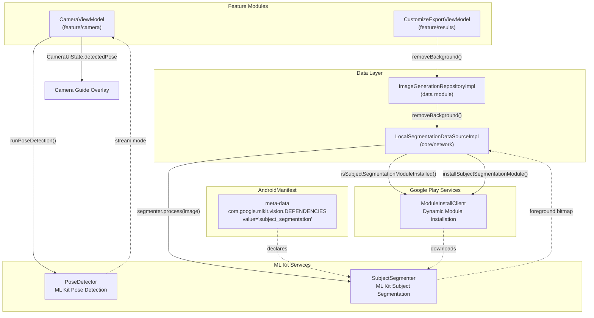
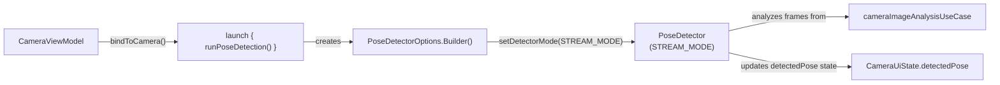
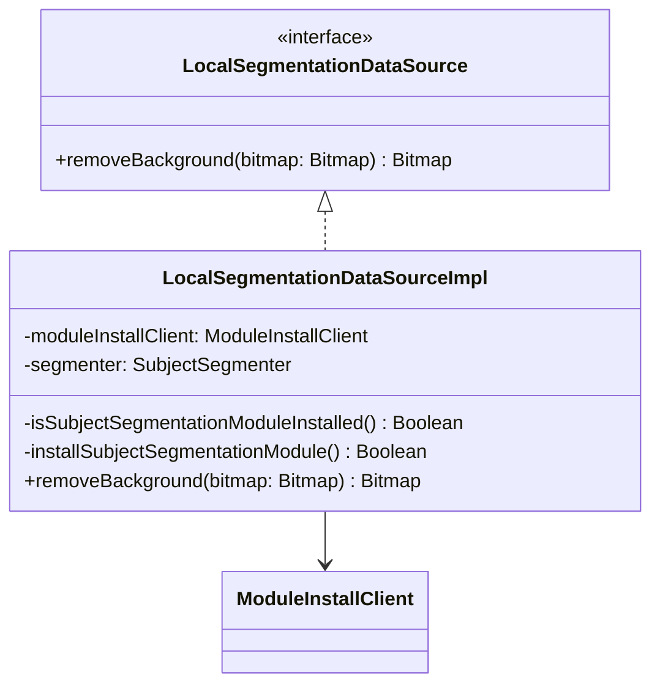

<!-- source: DeepWiki mcp.deepwiki.com · repo android/androidify · page 4.3 ML Kit Integration · fetched 2026-10-23 -->

# ML Kit Integration

<details>
<summary>Relevant source files</summary>

The following files were used as context for generating this wiki page:

- [app/src/main/AndroidManifest.xml](app/src/main/AndroidManifest.xml)
- [core/network/src/main/java/com/android/developers/androidify/ondevice/LocalSegmentationDataSource.kt](core/network/src/main/java/com/android/developers/androidify/ondevice/LocalSegmentationDataSource.kt)
- [core/network/src/main/java/com/android/developers/androidify/startup/FirebaseAppCheckInitializer.kt](core/network/src/main/java/com/android/developers/androidify/startup/FirebaseAppCheckInitializer.kt)
- [core/util/src/main/java/com/android/developers/androidify/util/LocalFileProvider.kt](core/util/src/main/java/com/android/developers/androidify/util/LocalFileProvider.kt)
- [data/src/main/java/com/android/developers/androidify/data/ImageGenerationRepository.kt](data/src/main/java/com/android/developers/androidify/data/ImageGenerationRepository.kt)
- [feature/camera/src/main/java/com/android/developers/androidify/camera/CameraLayout.kt](feature/camera/src/main/java/com/android/developers/androidify/camera/CameraLayout.kt)
- [feature/camera/src/main/java/com/android/developers/androidify/camera/CameraScreen.kt](feature/camera/src/main/java/com/android/developers/androidify/camera/CameraScreen.kt)
- [feature/camera/src/main/java/com/android/developers/androidify/camera/CameraViewModel.kt](feature/camera/src/main/java/com/android/developers/androidify/camera/CameraViewModel.kt)
- [feature/camera/src/main/java/com/android/developers/androidify/camera/CameraViewfinder.kt](feature/camera/src/main/java/com/android/developers/androidify/camera/CameraViewfinder.kt)
- [feature/camera/src/main/java/com/android/developers/androidify/camera/CameraZoomToolbar.kt](feature/camera/src/main/java/com/android/developers/androidify/camera/CameraZoomToolbar.kt)
- [feature/camera/src/main/java/com/android/developers/androidify/camera/xr/CameraLayoutSpatial.kt](feature/camera/src/main/java/com/android/developers/androidify/camera/xr/CameraLayoutSpatial.kt)
- [feature/results/src/main/java/com/android/developers/androidify/customize/ComposableBitmapRendererImpl.kt](feature/results/src/main/java/com/android/developers/androidify/customize/ComposableBitmapRendererImpl.kt)
- [feature/results/src/test/kotlin/com/android/developers/androidify/customize/CustomizeStateTest.kt](feature/results/src/test/kotlin/com/android/developers/androidify/customize/CustomizeStateTest.kt)

</details>


## Purpose and Scope

This document describes the integration of Google ML Kit within the Androidify application. ML Kit provides two distinct on-device machine learning capabilities:

1. **Pose Detection**: Real-time analysis of camera frames to detect whether a full person is visible, used to guide users during image capture in the `feature:camera` module.
2. **Subject Segmentation**: Removal of image backgrounds to create transparent "sticker" exports, encapsulated in the `core:network` module.

For information about cloud-based AI operations (image generation, validation, and background editing), see [Firebase AI and Generative Models](). For the overall orchestration of AI operations, see [Image Generation Repository]().

**Sources**: [data/src/main/java/com/android/developers/androidify/data/ImageGenerationRepository.kt:33-43](), [feature/camera/src/main/java/com/android/developers/androidify/camera/CameraViewModel.kt:1-81](), [core/network/src/main/java/com/android/developers/androidify/ondevice/LocalSegmentationDataSource.kt:1-37]()

---

## ML Kit Integration Architecture

The following diagram shows how ML Kit integrations fit within the Androidify application architecture:



**ML Kit Integration Points**

| ML Kit Feature | Module | Primary Use Case | Installation Method |
|---------------|---------|------------------|---------------------|
| Pose Detection | `feature/camera` | Real-time camera guidance overlay | Bundled with app |
| Subject Segmentation | `core/network` | Background removal for sticker export | Dynamic module installation |

**Sources**: [feature/camera/src/main/java/com/android/developers/androidify/camera/CameraViewModel.kt:75-81](), [core/network/src/main/java/com/android/developers/androidify/ondevice/LocalSegmentationDataSource.kt:39-47](), [data/src/main/java/com/android/developers/androidify/data/ImageGenerationRepository.kt:45-53](), [app/src/main/AndroidManifest.xml:106-109]()

---

## Pose Detection for Camera Guidance

### Implementation

ML Kit Pose Detection analyzes camera frames in real-time to determine whether a full person is visible. This enables the camera screen to display visual guidance and only enable the capture button when appropriate criteria are met.

The `CameraViewModel` initializes the `PoseDetector` in `STREAM_MODE`, optimized for continuous video analysis [feature/camera/src/main/java/com/android/developers/androidify/camera/CameraViewModel.kt:322-326]().



### Detection Criteria

The `detectPersonInFrame` method determines validity by checking three key landmarks with a confidence threshold of `0.7` [feature/camera/src/main/java/com/android/developers/androidify/camera/CameraViewModel.kt:302-318]():

| Landmark | Type | Confidence Threshold | Purpose |
|----------|------|---------------------|---------|
| Nose | `PoseLandmark.NOSE` | > 0.7 | Head presence |
| Left Shoulder | `PoseLandmark.LEFT_SHOULDER` | > 0.7 | Upper body (left) |
| Right Shoulder | `PoseLandmark.RIGHT_SHOULDER` | > 0.7 | Upper body (right) |

**Sources**: [feature/camera/src/main/java/com/android/developers/androidify/camera/CameraViewModel.kt:302-326]()

### Integration with Camera UI

The `detectedPose` boolean in `CameraUiState` controls UI elements in `CameraScreen`:

- **Capture Button**: Enabled only when `uiState.detectedPose` is true [feature/camera/src/main/java/com/android/developers/androidify/camera/CameraScreen.kt:228-232]().
- **Guide Text**: Displays instructional text when a person is not detected [feature/camera/src/main/java/com/android/developers/androidify/camera/CameraScreen.kt:253-260]().

**Sources**: [feature/camera/src/main/java/com/android/developers/androidify/camera/CameraScreen.kt:107-163](), [feature/camera/src/main/java/com/android/developers/androidify/camera/CameraViewModel.kt:332-334]()

---

## Subject Segmentation for Background Removal

### LocalSegmentationDataSource

The `LocalSegmentationDataSourceImpl` encapsulates the ML Kit `SubjectSegmenter`. It is configured with `enableForegroundBitmap()` to produce a bitmap with a transparent background [core/network/src/main/java/com/android/developers/androidify/ondevice/LocalSegmentationDataSource.kt:42-47]().



**Sources**: [core/network/src/main/java/com/android/developers/androidify/ondevice/LocalSegmentationDataSource.kt:35-47]()

### Dynamic Module Installation Flow

Subject Segmentation requires a dynamic module download via Google Play Services `ModuleInstallClient`.

1. **Check Availability**: `isSubjectSegmentationModuleInstalled()` calls `moduleInstallClient.areModulesAvailable()` [core/network/src/main/java/com/android/developers/androidify/ondevice/LocalSegmentationDataSource.kt:49-61]().
2. **Install if Missing**: `installSubjectSegmentationModule()` uses `ModuleInstallRequest` and a `CustomInstallStatusListener` to track download progress [core/network/src/main/java/com/android/developers/androidify/ondevice/LocalSegmentationDataSource.kt:80-99]().
3. **Execution**: Once installed, `segmenter.process(image)` is called, returning the `foregroundBitmap` [core/network/src/main/java/com/android/developers/androidify/ondevice/LocalSegmentationDataSource.kt:115-127]().

**Sources**: [core/network/src/main/java/com/android/developers/androidify/ondevice/LocalSegmentationDataSource.kt:49-128]()

---

## Repository Integration

The `ImageGenerationRepositoryImpl` acts as a facade, delegating background removal to the local segmentation data source:

```kotlin
override suspend fun removeBackground(image: Bitmap): Bitmap {
    return localSegmentationDataSource.removeBackground(image)
}
```

This is used during the customization flow, specifically when users select `SizeOption.Sticker` or `BackgroundOption.None`, requiring the bot to be isolated from the generated background [data/src/main/java/com/android/developers/androidify/data/ImageGenerationRepository.kt:164-166](), [feature/results/src/test/kotlin/com/android/developers/androidify/customize/CustomizeStateTest.kt:94-111]().

**Sources**: [data/src/main/java/com/android/developers/androidify/data/ImageGenerationRepository.kt:52-53](), [data/src/main/java/com/android/developers/androidify/data/ImageGenerationRepository.kt:164-166]()

---

## Performance and Error Handling

### Frame Analysis Strategy
The camera uses `ImageAnalysis.STRATEGY_KEEP_ONLY_LATEST` to ensure the UI remains responsive even if pose detection processing takes longer than the frame rate [feature/camera/src/main/java/com/android/developers/androidify/camera/CameraViewModel.kt:107-109]().

### Exception Handling
The segmentation flow handles several error states:
- **Module Download Failure**: Throws `ImageSegmentationException` if `STATE_FAILED` or `STATE_CANCELED` is received [core/network/src/main/java/com/android/developers/androidify/ondevice/LocalSegmentationDataSource.kt:72-74]().
- **Subject Not Found**: Throws `ImageSegmentationException` if the result contains no foreground bitmap [core/network/src/main/java/com/android/developers/androidify/ondevice/LocalSegmentationDataSource.kt:120]().

**Sources**: [core/network/src/main/java/com/android/developers/androidify/ondevice/LocalSegmentationDataSource.kt:62-79](), [core/network/src/main/java/com/android/developers/androidify/ondevice/LocalSegmentationDataSource.kt:114-128]()

---

