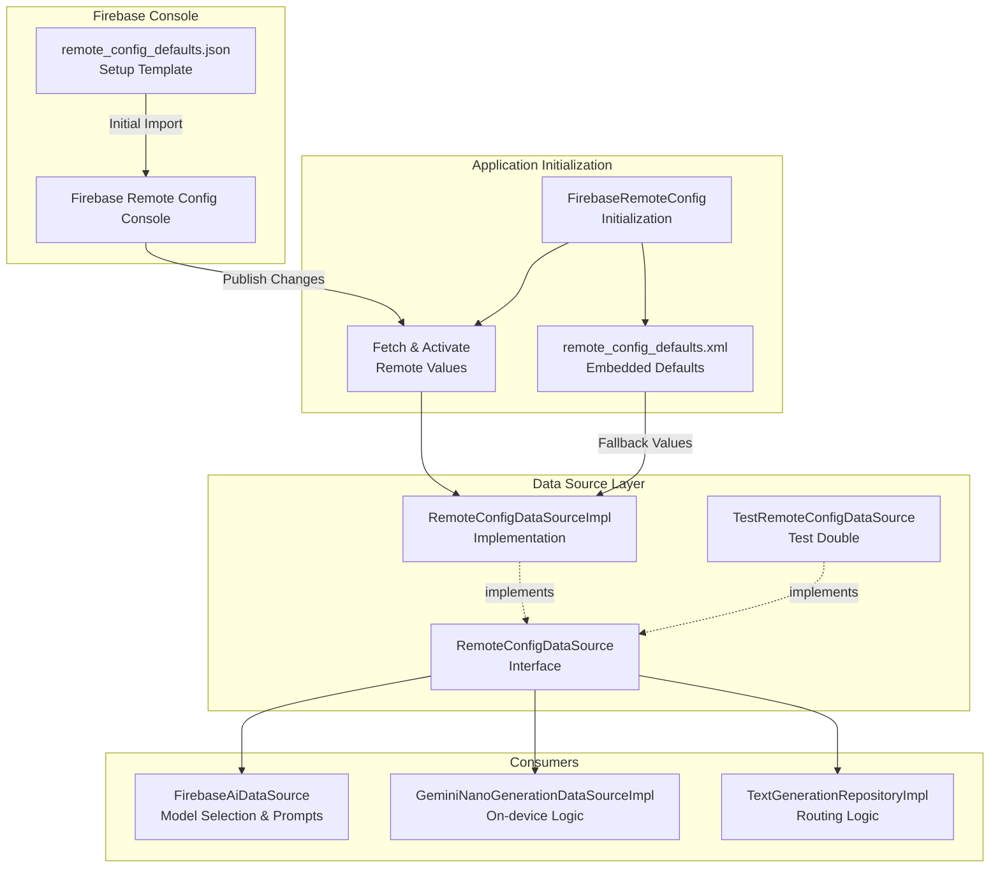
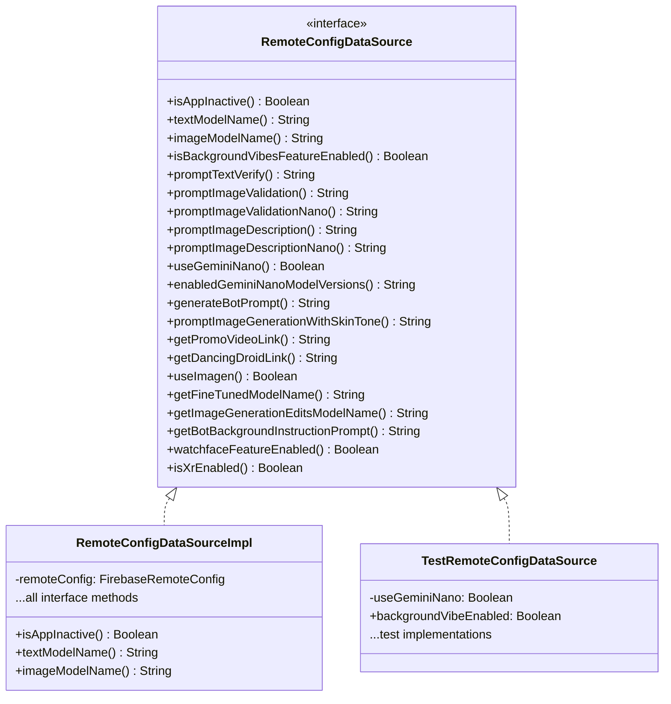
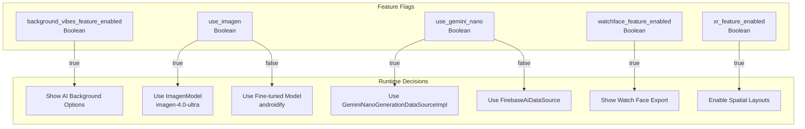

<!-- source: DeepWiki mcp.deepwiki.com · repo android/androidify · page 4.4 Remote Configuration · fetched 2026-10-23 -->

# Remote Configuration

<details>
<summary>Relevant source files</summary>

The following files were used as context for generating this wiki page:

- [app/src/main/java/com/android/developers/androidify/AndroidifyApplication.kt](app/src/main/java/com/android/developers/androidify/AndroidifyApplication.kt)
- [app/src/main/java/com/android/developers/androidify/CrashlyticsTree.kt](app/src/main/java/com/android/developers/androidify/CrashlyticsTree.kt)
- [core/network/src/main/java/com/android/developers/androidify/RemoteConfigDataSource.kt](core/network/src/main/java/com/android/developers/androidify/RemoteConfigDataSource.kt)
- [core/network/src/main/java/com/android/developers/androidify/startup/FirebaseRemoteConfigInitializer.kt](core/network/src/main/java/com/android/developers/androidify/startup/FirebaseRemoteConfigInitializer.kt)
- [core/network/src/main/res/xml/remote_config_defaults.xml](core/network/src/main/res/xml/remote_config_defaults.xml)
- [core/testing/src/main/java/com/android/developers/testing/network/TestFirebaseAiDataSource.kt](core/testing/src/main/java/com/android/developers/testing/network/TestFirebaseAiDataSource.kt)
- [core/testing/src/main/java/com/android/developers/testing/network/TestRemoteConfigDataSource.kt](core/testing/src/main/java/com/android/developers/testing/network/TestRemoteConfigDataSource.kt)
- [core/testing/src/main/java/com/android/developers/testing/repository/FakeImageGenerationRepository.kt](core/testing/src/main/java/com/android/developers/testing/repository/FakeImageGenerationRepository.kt)
- [core/theme/src/main/java/com/android/developers/androidify/theme/transitions/LoadingShimmerOverlay.kt](core/theme/src/main/java/com/android/developers/androidify/theme/transitions/LoadingShimmerOverlay.kt)
- [data/src/main/java/com/android/developers/androidify/data/GeminiNanoGenerationDataSource.kt](data/src/main/java/com/android/developers/androidify/data/GeminiNanoGenerationDataSource.kt)
- [data/src/main/java/com/android/developers/androidify/data/InternetConnectivityManager.kt](data/src/main/java/com/android/developers/androidify/data/InternetConnectivityManager.kt)
- [data/src/main/java/com/android/developers/androidify/data/TextGenerationRepository.kt](data/src/main/java/com/android/developers/androidify/data/TextGenerationRepository.kt)

</details>


## Purpose and Scope

This document explains the Firebase Remote Config integration in Androidify, which provides runtime control over application behavior without requiring code changes or app updates. Remote Config manages feature flags, AI model selection, and prompt engineering templates that drive the AI/ML pipeline.

For information about how AI models are initialized and invoked, see [Firebase AI and Generative Models](). For details on the repository layer that consumes these configurations, see [Image Generation Repository]().

---

## Overview

Firebase Remote Config serves as the central configuration management system for Androidify, enabling dynamic control over:

- **Feature Flags**: Toggle major features on/off (XR mode, watch face export, AI backgrounds).
- **AI Model Selection**: Choose between Imagen and fine-tuned models for generation.
- **On-Device vs Cloud**: Control whether to use Gemini Nano or cloud-based AI.
- **Prompt Templates**: Store and update complex multi-paragraph prompt engineering instructions.
- **Model Identifiers**: Specify exact model versions for text and image generation.
- **Content Links**: Manage URLs for promotional videos and animations.

The configuration system provides default values embedded in the application via `remote_config_defaults.xml` [core/network/src/main/res/xml/remote_config_defaults.xml:17-266]() and allows remote updates through the Firebase console.

**Sources:** [core/network/src/main/res/xml/remote_config_defaults.xml:1-266](), [core/network/src/main/java/com/android/developers/androidify/RemoteConfigDataSource.kt:1-141]()

---

## Architecture and Integration

### Configuration Flow



The `RemoteConfigDataSourceImpl` [core/network/src/main/java/com/android/developers/androidify/RemoteConfigDataSource.kt:56-141]() wraps Firebase's `remoteConfig` singleton and exposes configuration values through a clean interface. The initialization is handled by `FirebaseRemoteConfigInitializer` [core/network/src/main/java/com/android/developers/androidify/startup/FirebaseRemoteConfigInitializer.kt:32-53]() using the App Startup Library.

**Sources:** [core/network/src/main/java/com/android/developers/androidify/RemoteConfigDataSource.kt:56-141](), [core/network/src/main/java/com/android/developers/androidify/startup/FirebaseRemoteConfigInitializer.kt:32-53]()

---

## RemoteConfigDataSource Interface

### Core Interface Definition

The `RemoteConfigDataSource` interface defines all configuration access methods:



The implementation is a singleton injected via Hilt. Each method performs a simple read from Firebase's `remoteConfig` instance, converting the remote value to the appropriate type (Boolean, String).

**Sources:** [core/network/src/main/java/com/android/developers/androidify/RemoteConfigDataSource.kt:23-53](), [core/network/src/main/java/com/android/developers/androidify/RemoteConfigDataSource.kt:56-141]()

---

## Feature Flags

### Feature Flag Configuration Table

| Flag Key | Type | Default | Purpose | Impact |
|----------|------|---------|---------|--------|
| `watchface_feature_enabled` | Boolean | `false` | Enable watch face export | Controls visibility of watch face export in UI [core/network/src/main/java/com/android/developers/androidify/RemoteConfigDataSource.kt:134-136]() |
| `background_vibes_feature_enabled` | Boolean | `false` | Enable AI background generation | Controls background tool availability [core/network/src/main/java/com/android/developers/androidify/RemoteConfigDataSource.kt:71-73]() |
| `xr_feature_enabled` | Boolean | `false` | Enable spatial UI mode | Activates XR spatial layouts [core/network/src/main/java/com/android/developers/androidify/RemoteConfigDataSource.kt:138-140]() |
| `use_imagen` | Boolean | `false` | Select image generation model | Routes to Imagen vs fine-tuned model [core/network/src/main/java/com/android/developers/androidify/RemoteConfigDataSource.kt:119-121]() |
| `use_gemini_nano` | Boolean | `false` | Enable on-device AI | Determines if `GeminiNanoGenerationDataSource` is used [data/src/main/java/com/android/developers/androidify/data/TextGenerationRepository.kt:62-67]() |

### Feature Flag Control Flow



**Sources:** [core/network/src/main/res/xml/remote_config_defaults.xml:18-50](), [core/network/src/main/java/com/android/developers/androidify/RemoteConfigDataSource.kt:59-140]()

---

## AI Model Configuration

### Model Selection Parameters

Remote Config controls which AI models are used throughout the application:

| Configuration Key | Type | Default Value | Consumed By |
|-------------------|------|---------------|-------------|
| `text_model_name` | String | `gemini-2.5-flash` | `FirebaseAiDataSource` |
| `image_model_name` | String | `imagen-4.0-ultra-generate-preview-06-06` | `FirebaseAiDataSource` |
| `fine_tuned_model_name` | String | `androidify` | `FirebaseAiDataSource` |
| `image_generation_model_edits` | String | `gemini-2.0-flash-preview-image-generation` | `FirebaseAiDataSource` |
| `enabled_gemini_nano_model_versions` | String | `nano-v3` | `GeminiNanoGenerationDataSourceImpl` |

### Model Selection Logic

In `TextGenerationRepositoryImpl`, the `useGeminiNano()` flag is checked first. If enabled, it attempts to use `geminiNanoDataSource`. If that fails or returns null, it falls back to `firebaseAiDataSource` [data/src/main/java/com/android/developers/androidify/data/TextGenerationRepository.kt:62-76]().

**Sources:** [data/src/main/java/com/android/developers/androidify/data/TextGenerationRepository.kt:57-77](), [core/network/src/main/java/com/android/developers/androidify/RemoteConfigDataSource.kt:63-128]()

---

## Prompt Engineering Templates

Remote Config stores extensive prompt engineering templates that guide AI model behavior.

### Prompt Template Categories

| Configuration Key | Purpose |
|-------------------|---------|
| `prompt_image_validation` | Validate uploaded images meet safety/quality criteria [core/network/src/main/res/xml/remote_config_defaults.xml:52-64](). |
| `prompt_image_validation_nano` | Optimized image validation for Gemini Nano [core/network/src/main/res/xml/remote_config_defaults.xml:66-86](). |
| `prompt_image_description` | Detailed extraction of visual details from photos [core/network/src/main/res/xml/remote_config_defaults.xml:100-122](). |
| `bot_background_instruction_prompt` | Instructions for AI background generation [core/network/src/main/res/xml/remote_config_defaults.xml:31-45](). |

The `GeminiNanoGenerationDataSourceImpl` specifically uses `promptImageValidationNano()` [data/src/main/java/com/android/developers/androidify/data/GeminiNanoGenerationDataSource.kt:67]() and `promptImageDescriptionNano()` [data/src/main/java/com/android/developers/androidify/data/GeminiNanoGenerationDataSource.kt:89]() to interact with the on-device model.

**Sources:** [core/network/src/main/res/xml/remote_config_defaults.xml:31-122](), [data/src/main/java/com/android/developers/androidify/data/GeminiNanoGenerationDataSource.kt:61-99]()

---

## Testing Support

### Test Double Implementation

The `TestRemoteConfigDataSource` [core/testing/src/main/java/com/android/developers/testing/network/TestRemoteConfigDataSource.kt:20-102]() provides a test implementation with controllable behavior for unit tests:

```kotlin
class TestRemoteConfigDataSource(private val useGeminiNano: Boolean) : RemoteConfigDataSource {
    var backgroundVibeEnabled: Boolean = true
    override fun isBackgroundVibesFeatureEnabled(): Boolean = backgroundVibeEnabled
    override fun useGeminiNano(): Boolean = useGeminiNano
    override fun useImagen(): Boolean = true
    // ... other methods returning test strings or throwing TODO()
}
```

This allows tests like those in `TextGenerationRepositoryImpl` to simulate different environment configurations without a live Firebase connection.

**Sources:** [core/testing/src/main/java/com/android/developers/testing/network/TestRemoteConfigDataSource.kt:20-102]()

---

