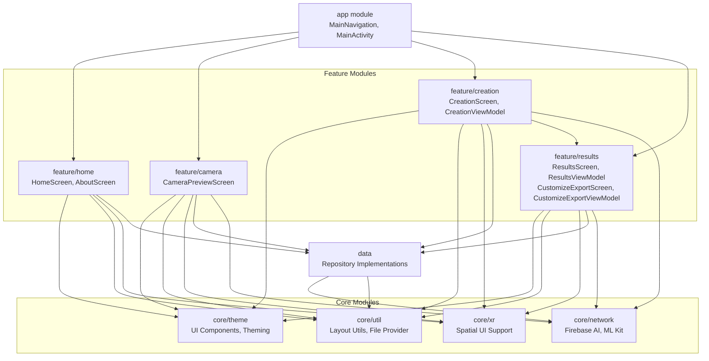
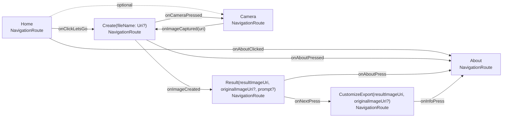
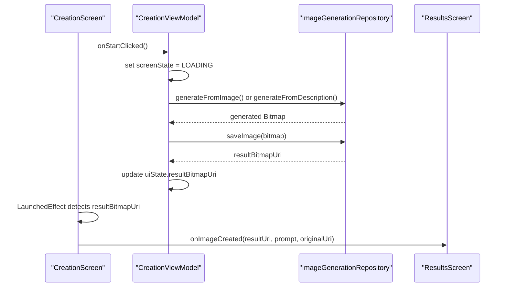

<!-- source: DeepWiki mcp.deepwiki.com · repo android/androidify · page 5 Feature Modules · fetched 2026-10-23 -->

# Feature Modules

<details>
<summary>Relevant source files</summary>

The following files were used as context for generating this wiki page:

- [.run/spotlessApply.run.xml](.run/spotlessApply.run.xml)
- [app/src/main/java/com/android/developers/androidify/navigation/NavigationRoutes.kt](app/src/main/java/com/android/developers/androidify/navigation/NavigationRoutes.kt)
- [build.gradle.kts](build.gradle.kts)
- [feature/camera/build.gradle.kts](feature/camera/build.gradle.kts)
- [feature/creation/build.gradle.kts](feature/creation/build.gradle.kts)
- [feature/creation/src/main/java/com/android/developers/androidify/creation/CreationScreen.kt](feature/creation/src/main/java/com/android/developers/androidify/creation/CreationScreen.kt)
- [feature/creation/src/main/java/com/android/developers/androidify/creation/CreationViewModel.kt](feature/creation/src/main/java/com/android/developers/androidify/creation/CreationViewModel.kt)
- [feature/home/build.gradle.kts](feature/home/build.gradle.kts)
- [feature/results/build.gradle.kts](feature/results/build.gradle.kts)
- [feature/results/src/androidTest/java/com/android/developers/androidify/results/ResultsScreenTest.kt](feature/results/src/androidTest/java/com/android/developers/androidify/results/ResultsScreenTest.kt)
- [feature/results/src/main/java/com/android/developers/androidify/results/BotResultCard.kt](feature/results/src/main/java/com/android/developers/androidify/results/BotResultCard.kt)
- [feature/results/src/main/java/com/android/developers/androidify/results/ResultsViewModel.kt](feature/results/src/main/java/com/android/developers/androidify/results/ResultsViewModel.kt)

</details>


This document provides an overview of the feature module architecture in Androidify. The application uses a multi-module structure with four primary feature modules that form a linear user journey from app launch to bot export. Each feature module is independently compiled and manages its own UI, ViewModels, and navigation interactions.

## Module Structure

Androidify contains five feature modules, four of which represent primary screens in the user journey, and one supporting module for About information.

### Feature Module Diagram



**Sources:** [feature/home/build.gradle.kts:48-55](), [feature/camera/build.gradle.kts:57-60](), [feature/creation/build.gradle.kts:61-65](), [feature/results/build.gradle.kts:51-58]()

### Feature Module Responsibilities

| Module | Primary Screen | ViewModel | Key Responsibilities |
|--------|---------------|-----------|---------------------|
| `feature/home` | `HomeScreen` | None | App landing page, video playback, dancing bot animation |
| `feature/camera` | `CameraPreviewScreen` | `CameraViewModel` | Image capture with CameraX, ML Kit pose detection overlay |
| `feature/creation` | `CreationScreen` | `CreationViewModel` | Prompt/image input, bot color selection, AI generation orchestration |
| `feature/results` | `ResultsScreen`, `CustomizeExportScreen` | `ResultsViewModel`, `CustomizeExportViewModel` | Display generated bot (flippable card), background customization, export |

**Sources:** [feature/creation/src/main/java/com/android/developers/androidify/creation/CreationScreen.kt:40-46](), [feature/results/src/main/java/com/android/developers/androidify/results/ResultsScreen.kt:59-65](), [feature/results/src/main/java/com/android/developers/androidify/results/ResultsViewModel.kt:31-37]()

## User Journey Through Features

The feature modules form a linear workflow from initial app launch to final bot export. The navigation component manages screen transitions using a backstack-based navigation system.

### Navigation Flow Diagram



**Sources:** [app/src/main/java/com/android/developers/androidify/navigation/NavigationRoutes.kt:24-65](), [feature/creation/src/main/java/com/android/developers/androidify/creation/CreationScreen.kt:42-45]()

### Navigation Parameters

Feature modules communicate by passing data through navigation route parameters defined as `@Serializable` data classes:

| Route | Parameters | Purpose |
|-------|-----------|---------|
| `Home` | None | Entry point, no parameters needed |
| `Camera` | None | Standalone camera screen |
| `Create` | `fileName: Uri?`, `prompt: String?` | Optional image URI from camera or gallery |
| `Result` | `resultImageUri: Uri`, `originalImageUri: Uri?`, `prompt: String?` | Display generated bot and original input |
| `CustomizeExport` | `resultImageUri: Uri`, `originalImageUri: Uri?` | Customize and export final result |

**Sources:** [app/src/main/java/com/android/developers/androidify/navigation/NavigationRoutes.kt:26-65]()

## Feature Module Details

### Home Feature (`feature/home`)

The home feature provides the app entry point with an animated Android bot and video background. It offers two primary actions:
- Navigate to bot creation (`Create` route)
- View About information (`About` route)

**See Also:** [Home Feature](#5.1) — Document HomeScreen, adaptive layouts (compact/medium/spatial), video playback, dancing bot animation, and XR mode transitions.

### Camera Feature (`feature/camera`)

The camera feature uses CameraX to capture full-body photos with real-time ML Kit pose detection guidance. 

**Navigation Output:** Captured image URI passed to `Create` route.

**See Also:** [Camera Feature](#5.2) — Explain camera implementation using CameraX, ML Kit pose detection overlay, tabletop mode support, and image capture flow.

### Creation Feature (`feature/creation`)

The creation feature orchestrates the AI generation process. Users can provide input via photo or text prompt, select bot color, and trigger generation. The `CreationViewModel` manages screen states (`ScreenState.EDIT` and `ScreenState.LOADING`) and coordinates with `ImageGenerationRepository` for AI operations.

**Key Components:**
- `CreationScreen`: Main UI with `EditScreen` and `LoadingScreen` states [feature/creation/src/main/java/com/android/developers/androidify/creation/CreationScreen.kt:76-104]().
- `CreationViewModel`: State management, AI generation coordination [feature/creation/src/main/java/com/android/developers/androidify/creation/CreationViewModel.kt:50-60]().

**Navigation Outputs:**
- Generated bot image URI, original image URI, and prompt text passed to `Result` route [feature/creation/src/main/java/com/android/developers/androidify/creation/CreationScreen.kt:61-74]().

**See Also:** [Creation Feature](#5.3) — Detail CreationScreen and CreationViewModel, prompt/image validation, bot color selection, generation process, and error handling.

### Results Feature (`feature/results`)

The results feature displays the generated bot with a flippable card interface showing the result on the front and the original input (image or prompt) on the back.

**Key Components:**
- `ResultsScreen`: Display generated bot with flip animation.
- `ResultsViewModel`: State management for result display [feature/results/src/main/java/com/android/developers/androidify/results/ResultsViewModel.kt:32-37]().
- `BotResultCard`: Flippable card component with `FrontCardImage`, `BackCard`, and `BackCardPrompt` faces [feature/results/src/main/java/com/android/developers/androidify/results/BotResultCard.kt:51-131]().

**See Also:** [Results Feature](#5.4) — Explain ResultsScreen for displaying generated images with flippable cards showing front (result) and back (original/prompt).

### Customization and Export (`feature/results`)

The customization and export functionality is implemented within the results module. Users can select aspect ratios, add static or AI-generated backgrounds, and export to share, download, or watch face.

**See Also:** [Customization and Export](#5.5) — Document CustomizeExportViewModel and CustomizeExportScreen, aspect ratio tools, background tools (static and AI-generated), export to share/download/watch face.

## Inter-Feature Communication

Feature modules communicate through navigation routes and URI-based data passing.

### Creation to Results Flow



**Sources:** [feature/creation/src/main/java/com/android/developers/androidify/creation/CreationScreen.kt:61-74](), [feature/creation/src/main/java/com/android/developers/androidify/creation/CreationViewModel.kt:134-177]()

## Feature Module Dependencies

Feature modules depend on shared core modules for cross-cutting concerns.

| Core Module | Provided Functionality |
|-------------|----------------------|
| `core/theme` | Material 3 theming, shared UI components [feature/creation/build.gradle.kts:61]() |
| `core/util` | `LocalFileProvider` for storage, `LayoutUtils` [feature/creation/build.gradle.kts:62]() |
| `core/xr` | Spatial UI support and XR mode detection [feature/creation/build.gradle.kts:63]() |
| `data` | Repository implementations like `ImageGenerationRepository` [feature/creation/build.gradle.kts:64]() |

## ViewModel Factory Pattern

Feature ViewModels use Hilt's `AssistedFactory` pattern to inject navigation parameters alongside dependencies:

```kotlin
@HiltViewModel(assistedFactory = CreationViewModel.Factory::class)
class CreationViewModel @AssistedInject constructor(
    @Assisted("originalImageUrl") originalImageUrl: Uri?,
    val imageGenerationRepository: ImageGenerationRepository,
    // ...
) : ViewModel() {

    @AssistedFactory
    interface Factory {
        fun create(@Assisted("originalImageUrl") originalImageUrl: Uri?): CreationViewModel
    }
}
```

**Sources:** [feature/creation/src/main/java/com/android/developers/androidify/creation/CreationViewModel.kt:49-65](), [feature/results/src/main/java/com/android/developers/androidify/results/ResultsViewModel.kt:31-46]()

---

