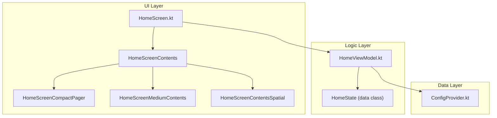
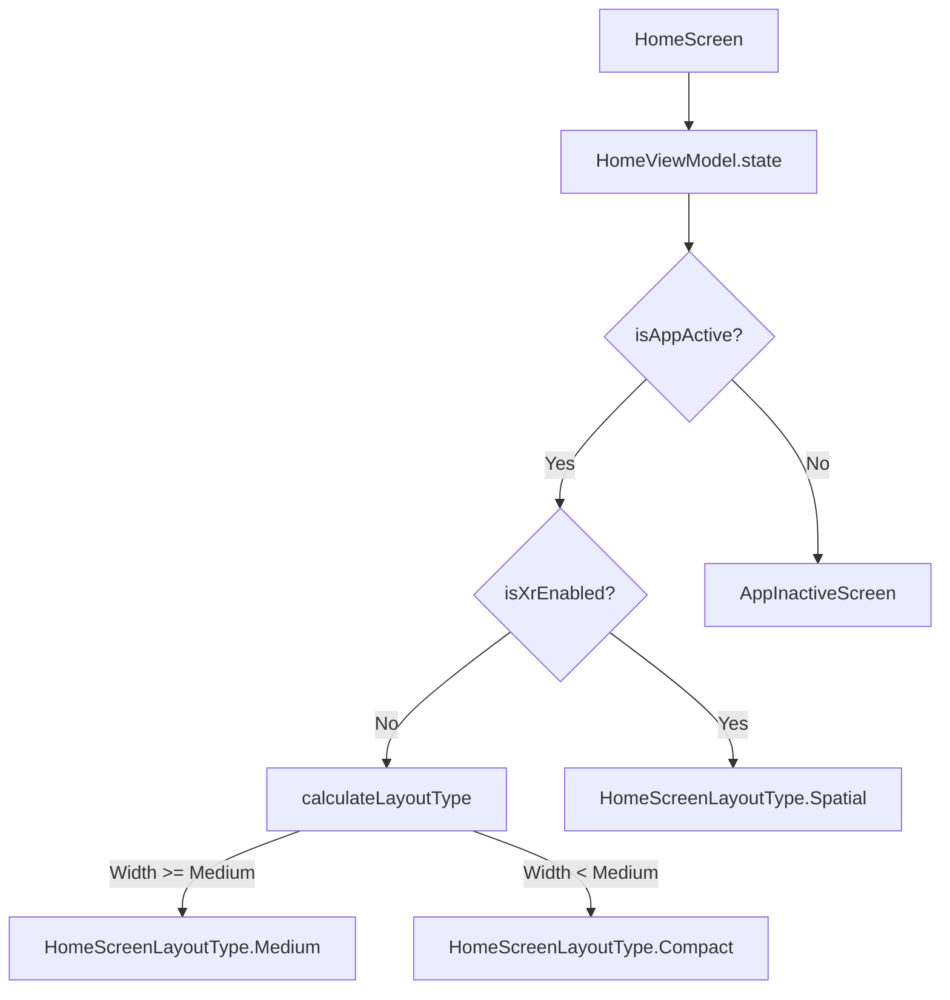

<!-- source: DeepWiki mcp.deepwiki.com · repo android/androidify · page 5.1 Home Feature · fetched 2026-10-23 -->

# Home Feature

<details>
<summary>Relevant source files</summary>

The following files were used as context for generating this wiki page:

- [core/xr/src/main/java/com/android/developers/androidify/xr/SpatialComponents.kt](core/xr/src/main/java/com/android/developers/androidify/xr/SpatialComponents.kt)
- [core/xr/src/main/res/values/strings.xml](core/xr/src/main/res/values/strings.xml)
- [data/src/main/java/com/android/developers/androidify/data/ConfigProvider.kt](data/src/main/java/com/android/developers/androidify/data/ConfigProvider.kt)
- [feature/home/src/main/java/com/android/developers/androidify/home/AboutScreen.kt](feature/home/src/main/java/com/android/developers/androidify/home/AboutScreen.kt)
- [feature/home/src/main/java/com/android/developers/androidify/home/AboutViewModel.kt](feature/home/src/main/java/com/android/developers/androidify/home/AboutViewModel.kt)
- [feature/home/src/main/java/com/android/developers/androidify/home/HomeScreen.kt](feature/home/src/main/java/com/android/developers/androidify/home/HomeScreen.kt)
- [feature/home/src/main/java/com/android/developers/androidify/home/HomeScreenCompact.kt](feature/home/src/main/java/com/android/developers/androidify/home/HomeScreenCompact.kt)
- [feature/home/src/main/java/com/android/developers/androidify/home/HomeScreenComponents.kt](feature/home/src/main/java/com/android/developers/androidify/home/HomeScreenComponents.kt)
- [feature/home/src/main/java/com/android/developers/androidify/home/HomeScreenMedium.kt](feature/home/src/main/java/com/android/developers/androidify/home/HomeScreenMedium.kt)
- [feature/home/src/main/java/com/android/developers/androidify/home/HomeScreenVideoPlayer.kt](feature/home/src/main/java/com/android/developers/androidify/home/HomeScreenVideoPlayer.kt)
- [feature/home/src/main/java/com/android/developers/androidify/home/HomeViewModel.kt](feature/home/src/main/java/com/android/developers/androidify/home/HomeViewModel.kt)
- [feature/home/src/main/java/com/android/developers/androidify/home/xr/AboutScreenSpatial.kt](feature/home/src/main/java/com/android/developers/androidify/home/xr/AboutScreenSpatial.kt)
- [feature/home/src/main/java/com/android/developers/androidify/home/xr/HomeScreenSpatial.kt](feature/home/src/main/java/com/android/developers/androidify/home/xr/HomeScreenSpatial.kt)
- [feature/home/src/main/res/values/strings.xml](feature/home/src/main/res/values/strings.xml)

</details>


## Purpose and Scope

The Home Feature module provides the landing screen and entry point for the Androidify application. This module displays an animated welcome interface that adapts to different screen sizes and form factors, including spatial UI for XR devices. It presents users with the primary entry point to start the bot creation journey.

The module manages the display of promotional video content, a dancing bot animation powered by remote assets, and an "About" section explaining the AI process. It also handles application state checks (active vs. inactive) and provides transitions between standard and XR spatial modes.

**Sources:** [feature/home/src/main/java/com/android/developers/androidify/home/HomeScreen.kt:38-59](), [feature/home/src/main/res/values/strings.xml:18-40]()

---

## Module Architecture

The Home Feature follows the MVVM pattern with adaptive layout selection based on device capabilities and screen dimensions provided by the `HomeViewModel`.

### Component Structure



**Sources:** [feature/home/src/main/java/com/android/developers/androidify/home/HomeScreen.kt:38-102](), [feature/home/src/main/java/com/android/developers/androidify/home/HomeViewModel.kt:25-43](), [data/src/main/java/com/android/developers/androidify/data/ConfigProvider.kt:22-40]()

---

## Layout Type Selection

The Home Feature implements three distinct layout types that adapt to device characteristics and user context. The layout is determined by the `calculateLayoutType` function, which considers screen width and XR capabilities.

### Layout Type Enum
The `HomeScreenLayoutType` defines three layout modes:
- **Compact**: Single-column vertical layout with a pager for phones [feature/home/src/main/java/com/android/developers/androidify/home/HomeScreen.kt:71-80]().
- **Medium**: Two-column horizontal layout for tablets and foldables [feature/home/src/main/java/com/android/developers/androidify/home/HomeScreen.kt:82-92]().
- **Spatial**: Full-space XR layout for spatial computing devices [feature/home/src/main/java/com/android/developers/androidify/home/HomeScreen.kt:94-101]().

### Layout Selection Flow



**Sources:** [feature/home/src/main/java/com/android/developers/androidify/home/HomeScreen.kt:43-58](), [feature/home/src/main/java/com/android/developers/androidify/home/HomeViewModel.kt:38-43]()

---

## Compact Layout Implementation

The compact layout utilizes a `HorizontalPager` to manage the primary content and the instructional video.

### Page Structure
| Page Index | Content | Component |
|------------|---------|-----------|
| 0 | Bot Headline | `MainHomeContent` [feature/home/src/main/java/com/android/developers/androidify/home/HomeScreenCompact.kt:85-91]() |
| 1 | Video Card | `VideoPlayerRotatedCard` [feature/home/src/main/java/com/android/developers/androidify/home/HomeScreenCompact.kt:94-99]() |

### Implementation Details
- **Pager State**: Uses `rememberPagerState(pageCount = { 2 })` [feature/home/src/main/java/com/android/developers/androidify/home/HomeScreenCompact.kt:66]().
- **Indicators**: Custom row of boxes that animate color and width based on `pagerState.currentPage` [feature/home/src/main/java/com/android/developers/androidify/home/HomeScreenCompact.kt:110-129]().
- **CTA Button**: `HomePageButton` positioned at the bottom, capturing its layout coordinates via `onLayoutRectChanged` to support shared element transitions [feature/home/src/main/java/com/android/developers/androidify/home/HomeScreenCompact.kt:135-148]().

**Sources:** [feature/home/src/main/java/com/android/developers/androidify/home/HomeScreenCompact.kt:59-150]()

---

## Medium Layout Implementation

The medium layout presents content side-by-side, optimized for large screens.

### Layout Composition
- **Video Section**: Occupies a weight of `0.8f` on the left, displaying the `VideoPlayerRotatedCard` [feature/home/src/main/java/com/android/developers/androidify/home/HomeScreenMedium.kt:69-78]().
- **Main Content**: Occupies a weight of `1.2f` on the right, containing the `MainHomeContent` and the `HomePageButton` [feature/home/src/main/java/com/android/developers/androidify/home/HomeScreenMedium.kt:79-99]().
- **Top Bar**: Uses `AndroidifyTopAppBar` with `isMediumWindowSize = true` to trigger specific large-screen styling [feature/home/src/main/java/com/android/developers/androidify/home/HomeScreenMedium.kt:54-62]().

**Sources:** [feature/home/src/main/java/com/android/developers/androidify/home/HomeScreenMedium.kt:43-101]()

---

## Spatial Layout (XR Mode)

`HomeScreenContentsSpatial` implements the UI for XR devices using the `androidx.xr` compose libraries.

### Spatial Components
- **SquiggleBackgroundSubspace**: A top-level subspace with a grabbable/movable background [core/xr/src/main/java/com/android/developers/androidify/xr/SpatialComponents.kt:55-69]().
- **SpatialPanel**: The main UI content is placed within a `SpatialPanel` [feature/home/src/main/java/com/android/developers/androidify/home/xr/HomeScreenSpatial.kt:88-90]().
- **Secondary Video Panel**: The instructional video is placed in a separate `SpatialPanel` with a rotation and offset, set to `transformingMovable` [feature/home/src/main/java/com/android/developers/androidify/home/xr/HomeScreenSpatial.kt:91-103]().
- **Orbiter**: A `RequestHomeSpaceIconButton` is anchored to the `TopEnd` of the panel to allow users to exit the immersive mode [feature/home/src/main/java/com/android/developers/androidify/home/xr/HomeScreenSpatial.kt:75-87]().

**Sources:** [feature/home/src/main/java/com/android/developers/androidify/home/xr/HomeScreenSpatial.kt:66-106](), [core/xr/src/main/java/com/android/developers/androidify/xr/SpatialComponents.kt:82-104]()

---

## Core Components

### MainHomeContent
This component aggregates the visual identity of the home screen:
- **DancingBotHeadlineText**: Uses `InlineTextContent` to place the `DancingBot` (loaded via `AsyncImage`) directly within the headline text flow [feature/home/src/main/java/com/android/developers/androidify/home/HomeScreenComponents.kt:180-216]().
- **Decorative Squiggles**: Includes `DecorativeSquiggleLimeGreen` and `DecorativeSquiggleLightGreen`, which use `rememberInfiniteTransition` to rotate continuously [feature/home/src/main/java/com/android/developers/androidify/home/HomeScreenComponents.kt:83-133]().

### Video Playback
Instructional video content is rendered via `VideoPlayer` and `VideoPlayerRotatedCard`. These components use links provided by the `HomeViewModel` which are sourced from `ConfigProvider` [feature/home/src/main/java/com/android/developers/androidify/home/HomeViewModel.kt:31]().

**Sources:** [feature/home/src/main/java/com/android/developers/androidify/home/HomeScreenComponents.kt:66-80](), [feature/home/src/main/java/com/android/developers/androidify/home/HomeScreenVideoPlayer.kt:1-100]()

---

## About Screen

The `AboutScreen` provides technical and legal information about the Androidify creation process.

### Features
- **Adaptive Layouts**: Similar to the Home Screen, it offers `AboutScreenCompact`, `AboutScreenMedium`, and `AboutScreenSpatial` [feature/home/src/main/java/com/android/developers/androidify/home/AboutScreen.kt:108-127]().
- **Shared Element Transitions**: Uses `sharedBoundsReveal` with `SharedElementKey.AboutKey` to transition smoothly from the Home Screen [feature/home/src/main/java/com/android/developers/androidify/home/AboutScreen.kt:131-149]().
- **Content**: Details the 3-step AI process (Photo selection, AI creation, Safety check) using localized strings [feature/home/src/main/java/com/android/developers/androidify/home/AboutScreen.kt:162-185]().
- **Spatial Implementation**: Uses `Orbiter` to anchor the `BackButton` and `FooterButtons` (Terms, Privacy, Licenses) outside the main content panel [feature/home/src/main/java/com/android/developers/androidify/home/xr/AboutScreenSpatial.kt:34-57]().

**Sources:** [feature/home/src/main/java/com/android/developers/androidify/home/AboutScreen.kt:74-128](), [feature/home/src/main/java/com/android/developers/androidify/home/xr/AboutScreenSpatial.kt:34-57]()

---

## State Management

### HomeViewModel
The `HomeViewModel` acts as the bridge to `ConfigProvider` (Firebase Remote Config).

```kotlin
@HiltViewModel
class HomeViewModel @Inject constructor(configProvider: ConfigProvider) : ViewModel() {
    private val _state = MutableStateFlow(
        HomeState(
            isAppActive = !configProvider.isAppInactive(),
            dancingDroidLink = configProvider.getDancingDroidLink(),
            videoLink = configProvider.getPromoVideoLink(),
            isXrEnabled = configProvider.isXrEnabled(),
        ),
    )
    val state = _state.asStateFlow()
}
```

**Sources:** [feature/home/src/main/java/com/android/developers/androidify/home/HomeViewModel.kt:25-36](), [data/src/main/java/com/android/developers/androidify/data/ConfigProvider.kt:25-39]()

---

