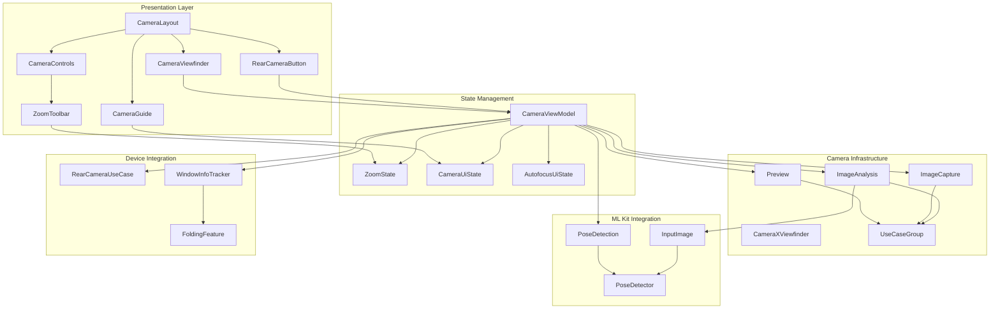
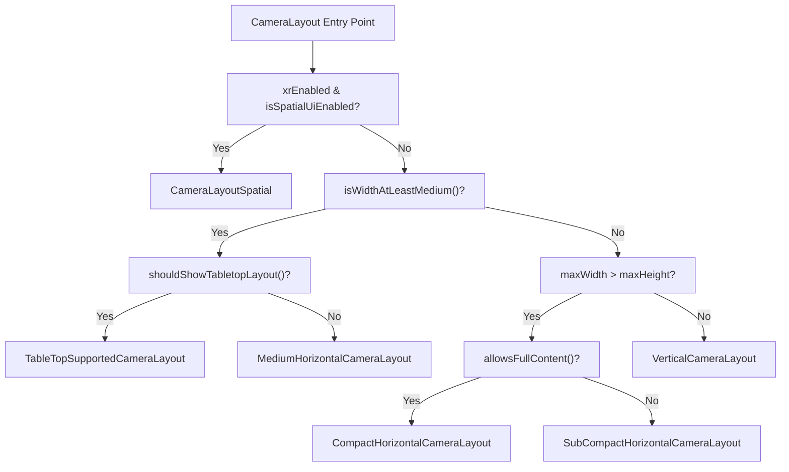
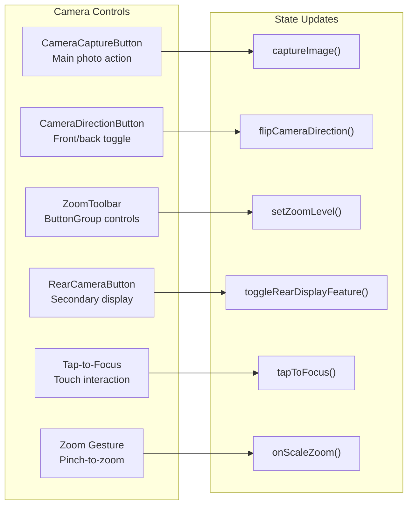
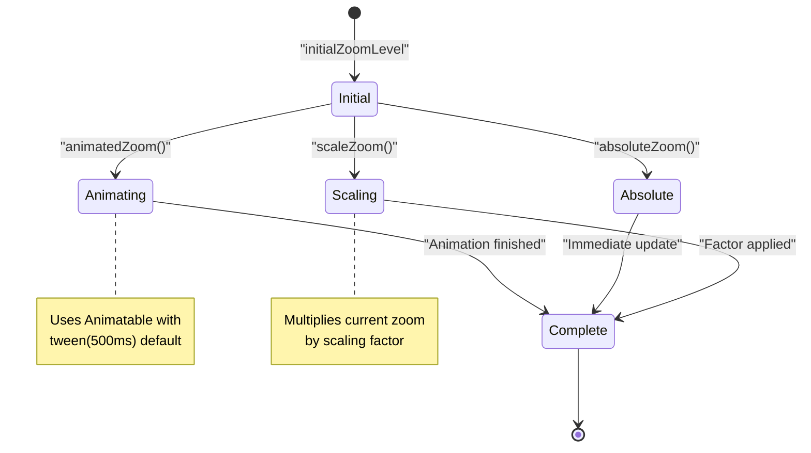
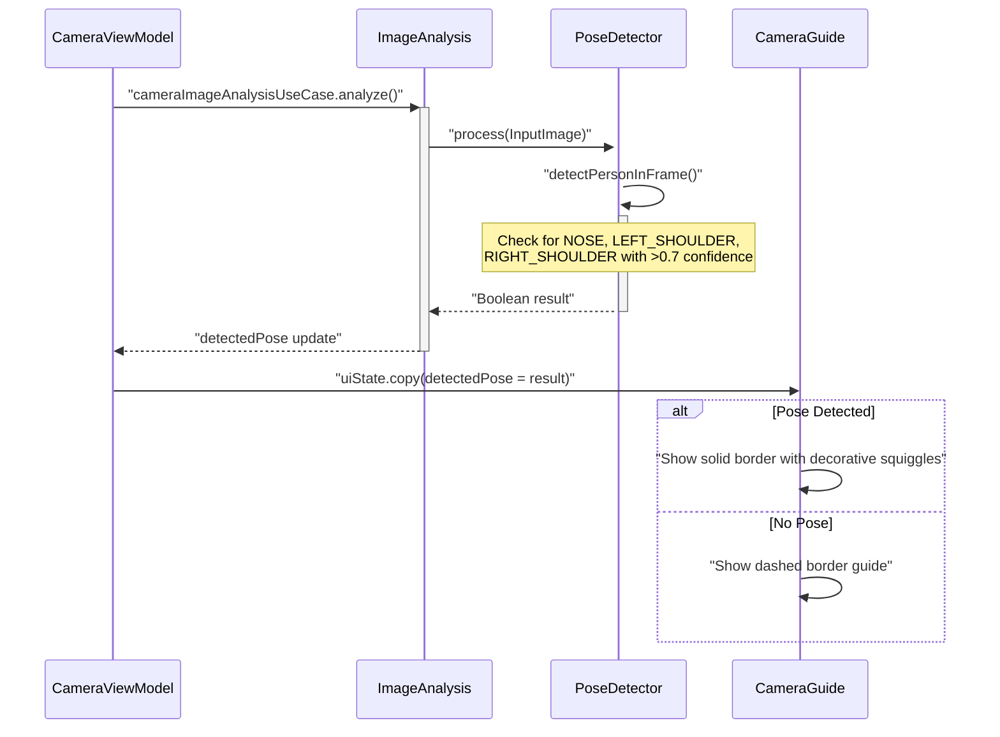
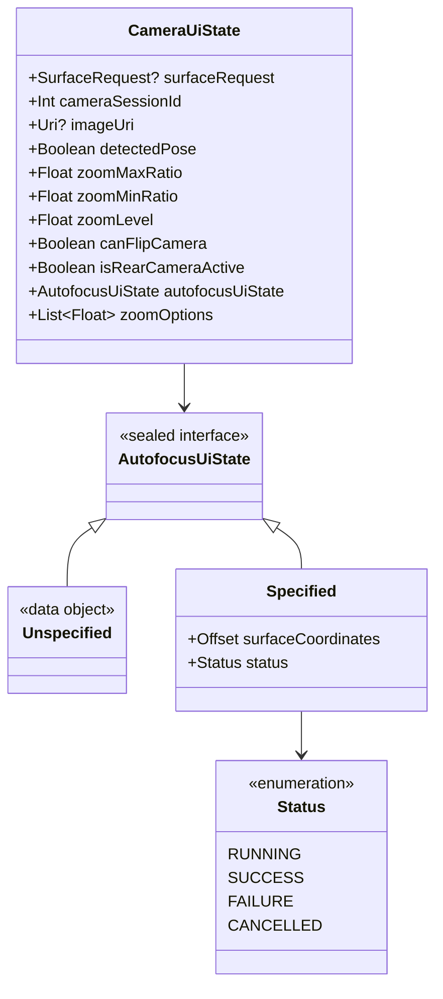
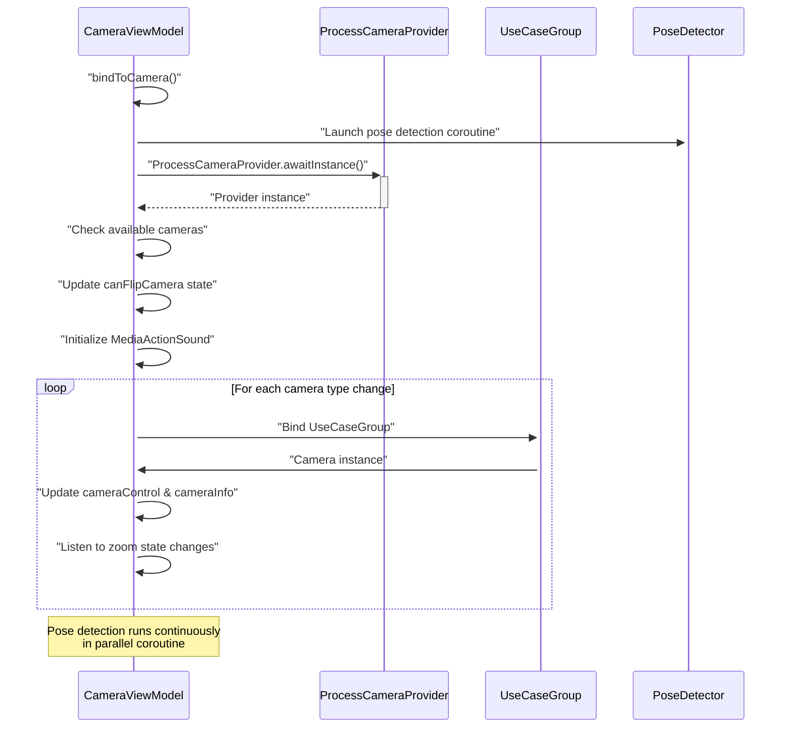

<!-- source: DeepWiki mcp.deepwiki.com · repo android/androidify · page 5.2 Camera Feature · fetched 2026-10-23 -->

# Camera Feature

Relevant source files

The following files were used as context for generating this wiki page:

- [feature/camera/src/main/java/com/android/developers/androidify/camera/CameraControls.kt](feature/camera/src/main/java/com/android/developers/androidify/camera/CameraControls.kt)
- [feature/camera/src/main/java/com/android/developers/androidify/camera/CameraGuide.kt](feature/camera/src/main/java/com/android/developers/androidify/camera/CameraGuide.kt)
- [feature/camera/src/main/java/com/android/developers/androidify/camera/CameraLayout.kt](feature/camera/src/main/java/com/android/developers/androidify/camera/CameraLayout.kt)
- [feature/camera/src/main/java/com/android/developers/androidify/camera/CameraScreen.kt](feature/camera/src/main/java/com/android/developers/androidify/camera/CameraScreen.kt)
- [feature/camera/src/main/java/com/android/developers/androidify/camera/CameraViewModel.kt](feature/camera/src/main/java/com/android/developers/androidify/camera/CameraViewModel.kt)
- [feature/camera/src/main/java/com/android/developers/androidify/camera/CameraViewfinder.kt](feature/camera/src/main/java/com/android/developers/androidify/camera/CameraViewfinder.kt)
- [feature/camera/src/main/java/com/android/developers/androidify/camera/CameraZoomToolbar.kt](feature/camera/src/main/java/com/android/developers/androidify/camera/CameraZoomToolbar.kt)
- [feature/camera/src/main/java/com/android/developers/androidify/camera/RearCameraButton.kt](feature/camera/src/main/java/com/android/developers/androidify/camera/RearCameraButton.kt)
- [feature/camera/src/main/java/com/android/developers/androidify/camera/ZoomState.kt](feature/camera/src/main/java/com/android/developers/androidify/camera/ZoomState.kt)
- [feature/camera/src/main/java/com/android/developers/androidify/camera/xr/CameraLayoutSpatial.kt](feature/camera/src/main/java/com/android/developers/androidify/camera/xr/CameraLayoutSpatial.kt)

The Camera Feature provides an adaptive camera interface for capturing photos with integrated pose detection capabilities. This feature supports multiple device form factors including phones, tablets, and foldable devices, with specialized layouts for tabletop mode and various screen orientations. The camera includes zoom controls, tap-to-focus, camera switching, and ML Kit-powered pose detection to guide users in taking optimal photos for bot generation.

For information about the bot creation workflow that uses captured images, see [Creation Feature](#5.3).

## Architecture Overview

The Camera Feature follows an MVVM architecture with adaptive UI layouts and integrated ML Kit pose detection:

Sources: [feature/camera/src/main/java/com/android/developers/androidify/camera/CameraLayout.kt:64-165](), [feature/camera/src/main/java/com/android/developers/androidify/camera/CameraViewModel.kt:74-115](), [feature/camera/src/main/java/com/android/developers/androidify/camera/CameraControls.kt:31-66]()

## Adaptive Layout System

The Camera Feature implements a sophisticated adaptive layout system that responds to different device configurations and form factors using `BoxWithConstraints` [feature/camera/src/main/java/com/android/developers/androidify/camera/CameraLayout.kt:98-102]().

### Layout Decision Tree

Sources: [feature/camera/src/main/java/com/android/developers/androidify/camera/CameraLayout.kt:103-165]()

### Layout Implementations

| Layout Type | Screen Configuration | Control Arrangement | Features |
|-------------|---------------------|-------------------|----------|
| `VerticalCameraLayout` | Portrait, all sizes | Horizontal controls at bottom | Full feature set with rear camera button |
| `CompactHorizontalCameraLayout` | Small landscape, full content | Vertical controls on left | Zoom controls included |
| `SubCompactHorizontalCameraLayout` | Small landscape, limited content | Vertical controls on left | No zoom controls |
| `MediumHorizontalCameraLayout` | Medium landscape | Controls adapt to camera position | Context-aware zoom placement |
| `TableTopSupportedCameraLayout` | Foldable devices | Adaptive for tabletop posture | Uses `isTabletop` state |
| `CameraLayoutSpatial` | XR Spatial Mode | Orbiter-based controls | Uses `SpatialPanel` and `Orbiter` |

Sources: [feature/camera/src/main/java/com/android/developers/androidify/camera/CameraLayout.kt:103-165](), [feature/camera/src/main/java/com/android/developers/androidify/camera/xr/CameraLayoutSpatial.kt:41-96]()

## Camera Controls and Interactions

### Control Components

The camera interface provides several interactive controls that adapt to different layouts:

Sources: [feature/camera/src/main/java/com/android/developers/androidify/camera/CameraViewModel.kt:178-202](), [feature/camera/src/main/java/com/android/developers/androidify/camera/CameraViewfinder.kt:49-77](), [feature/camera/src/main/java/com/android/developers/androidify/camera/CameraControls.kt:31-66]()

### Zoom State Management

The `ZoomState` class provides smooth zoom control with animation support, utilizing a `MutatorMutex` to prevent concurrent zoom operations [feature/camera/src/main/java/com/android/developers/androidify/camera/ZoomState.kt:32-38]().

Sources: [feature/camera/src/main/java/com/android/developers/androidify/camera/ZoomState.kt:25-71]()

## Pose Detection Integration

The Camera Feature integrates ML Kit pose detection to provide visual feedback for optimal photo capture:

### Pose Detection Pipeline

The `CameraViewModel` runs a pose detection loop in a parallel coroutine [feature/camera/src/main/java/com/android/developers/androidify/camera/CameraViewModel.kt:126](). It processes frames from `ImageAnalysis` [feature/camera/src/main/java/com/android/developers/androidify/camera/CameraViewModel.kt:298-333]().

Sources: [feature/camera/src/main/java/com/android/developers/androidify/camera/CameraViewModel.kt:298-333](), [feature/camera/src/main/java/com/android/developers/androidify/camera/CameraGuide.kt:53-98]()

### Visual Guide States

The `CameraGuide` component provides two distinct visual states based on the `detectedPose` boolean:

| State | Visual Appearance | Trigger Condition |
|-------|------------------|-------------------|
| No Pose Detected | Dashed rounded rectangle border | `detectedPose = false` |
| Pose Detected | Solid border with animated decorative squiggles | `detectedPose = true` |

The pose detection specifically looks for three key landmarks: `NOSE`, `LEFT_SHOULDER`, and `RIGHT_SHOULDER` with confidence levels above 0.7 [feature/camera/src/main/java/com/android/developers/androidify/camera/CameraViewModel.kt:311-314]().

Sources: [feature/camera/src/main/java/com/android/developers/androidify/camera/CameraGuide.kt:53-98](), [feature/camera/src/main/java/com/android/developers/androidify/camera/CameraViewModel.kt:311-314]()

## State Management

### CameraUiState Structure

The `CameraUiState` data class centralizes all camera-related state, including zoom levels and autofocus status:

Sources: [feature/camera/src/main/java/com/android/developers/androidify/camera/CameraViewModel.kt:343-382]()

### Camera Initialization Flow

The camera initialization uses `ProcessCameraProvider` and binds the `UseCaseGroup` containing preview, capture, and analysis [feature/camera/src/main/java/com/android/developers/androidify/camera/CameraViewModel.kt:111-115]().

Sources: [feature/camera/src/main/java/com/android/developers/androidify/camera/CameraViewModel.kt:122-176]()

---

