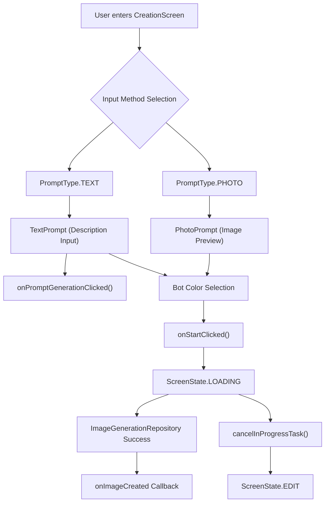
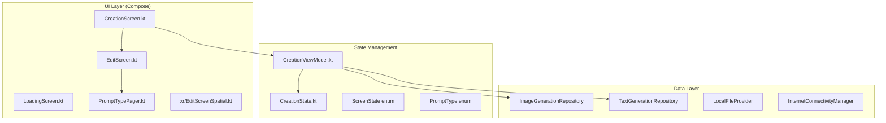

<!-- source: DeepWiki mcp.deepwiki.com · repo android/androidify · page 5.3 Creation Feature · fetched 2026-10-23 -->

# Creation Feature

Relevant source files

The following files were used as context for generating this wiki page:

- [app/src/main/java/com/android/developers/androidify/navigation/NavigationRoutes.kt](app/src/main/java/com/android/developers/androidify/navigation/NavigationRoutes.kt)
- [core/theme/src/main/java/com/android/developers/androidify/theme/components/HorizontalToolbar.kt](core/theme/src/main/java/com/android/developers/androidify/theme/components/HorizontalToolbar.kt)
- [core/theme/src/main/java/com/android/developers/androidify/theme/components/TopAppBar.kt](core/theme/src/main/java/com/android/developers/androidify/theme/components/TopAppBar.kt)
- [feature/creation/src/main/java/com/android/developers/androidify/creation/AndroidBotColorPicker.kt](feature/creation/src/main/java/com/android/developers/androidify/creation/AndroidBotColorPicker.kt)
- [feature/creation/src/main/java/com/android/developers/androidify/creation/CreationScreen.kt](feature/creation/src/main/java/com/android/developers/androidify/creation/CreationScreen.kt)
- [feature/creation/src/main/java/com/android/developers/androidify/creation/CreationViewModel.kt](feature/creation/src/main/java/com/android/developers/androidify/creation/CreationViewModel.kt)
- [feature/creation/src/main/java/com/android/developers/androidify/creation/EditScreen.kt](feature/creation/src/main/java/com/android/developers/androidify/creation/EditScreen.kt)
- [feature/creation/src/main/java/com/android/developers/androidify/creation/EditScreenCompact.kt](feature/creation/src/main/java/com/android/developers/androidify/creation/EditScreenCompact.kt)
- [feature/creation/src/main/java/com/android/developers/androidify/creation/EditScreenMedium.kt](feature/creation/src/main/java/com/android/developers/androidify/creation/EditScreenMedium.kt)
- [feature/creation/src/main/java/com/android/developers/androidify/creation/LoadingScreen.kt](feature/creation/src/main/java/com/android/developers/androidify/creation/LoadingScreen.kt)
- [feature/creation/src/main/java/com/android/developers/androidify/creation/PromptTypePager.kt](feature/creation/src/main/java/com/android/developers/androidify/creation/PromptTypePager.kt)
- [feature/creation/src/main/java/com/android/developers/androidify/creation/xr/LoadingScreenSpatial.kt](feature/creation/src/main/java/com/android/developers/androidify/creation/xr/LoadingScreenSpatial.kt)
- [feature/creation/src/main/res/drawable/squiggle_light.xml](feature/creation/src/main/res/drawable/squiggle_light.xml)
- [feature/results/src/androidTest/java/com/android/developers/androidify/results/ResultsScreenTest.kt](feature/results/src/androidTest/java/com/android/developers/androidify/results/ResultsScreenTest.kt)
- [feature/results/src/main/java/com/android/developers/androidify/results/BotResultCard.kt](feature/results/src/main/java/com/android/developers/androidify/results/BotResultCard.kt)
- [feature/results/src/main/java/com/android/developers/androidify/results/ResultOption.kt](feature/results/src/main/java/com/android/developers/androidify/results/ResultOption.kt)
- [feature/results/src/main/java/com/android/developers/androidify/results/ResultsViewModel.kt](feature/results/src/main/java/com/android/developers/androidify/results/ResultsViewModel.kt)
- [feature/results/src/main/java/com/android/developers/androidify/results/xr/FeatheredEdges.kt](feature/results/src/main/java/com/android/developers/androidify/results/xr/FeatheredEdges.kt)
- [feature/results/src/main/java/com/android/developers/androidify/results/xr/ResultsScreenSpatial.kt](feature/results/src/main/java/com/android/developers/androidify/results/xr/ResultsScreenSpatial.kt)

## Purpose and Scope

The Creation Feature enables users to generate personalized Android bot characters through AI-powered image generation. Users can create bots either by uploading a photo or by providing a text description, with additional customization options for bot colors and AI-assisted prompt generation.

## Creation Workflow Overview

The creation feature implements a multi-stage workflow with adaptive UI that responds to different device form factors, including mobile, tablet, and XR environments.

### Creation Logic Flow
The generation process is orchestrated by `CreationViewModel`, which handles input validation, repository calls, and error mapping.

**Sources:** [feature/creation/src/main/java/com/android/developers/androidify/creation/CreationScreen.kt:76-104](), [feature/creation/src/main/java/com/android/developers/androidify/creation/CreationViewModel.kt:134-177]()

## Key Components and Architecture

### Core Entities
The feature is built using the MVVM pattern, leveraging Hilt for dependency injection and Assisted Injection for navigation parameters.

**Sources:** [feature/creation/src/main/java/com/android/developers/androidify/creation/CreationViewModel.kt:50-60](), [feature/creation/src/main/java/com/android/developers/androidify/creation/CreationScreen.kt:40-47]()

### State Management
`CreationViewModel` manages `CreationState`, which holds the current configuration for the AI generation request.

| State Property | Type | Purpose |
|---|---|---|
| `selectedPromptOption` | `PromptType` | Toggles between `PHOTO` and `TEXT` input modes [feature/creation/src/main/java/com/android/developers/androidify/creation/CreationViewModel.kt:100-104]() |
| `botColor` | `BotColor` | Selected color for the bot generation [feature/creation/src/main/java/com/android/developers/androidify/creation/CreationViewModel.kt:94-98]() |
| `imageUri` | `Uri?` | Source image URI for photo-to-bot transformation [feature/creation/src/main/java/com/android/developers/androidify/creation/CreationViewModel.kt:85-92]() |
| `descriptionText` | `TextFieldState` | The manual text input for bot description [feature/creation/src/main/java/com/android/developers/androidify/creation/CreationViewModel.kt:159-162]() |
| `screenState` | `ScreenState` | Controls visibility of `EDIT` vs `LOADING` screens [feature/creation/src/main/java/com/android/developers/androidify/creation/CreationScreen.kt:76-104]() |

## AI Generation Process

### Image Generation Pipeline
The `onStartClicked` function triggers the generation. It performs a connectivity check before calling the repository.

1.  **Connectivity Check**: Uses `InternetConnectivityManager.isInternetAvailable()` [feature/creation/src/main/java/com/android/developers/androidify/creation/CreationViewModel.kt:137]().
2.  **Repository Call**: 
    *   For `PHOTO`: Calls `imageGenerationRepository.generateFromImage` with the internal file copy [feature/creation/src/main/java/com/android/developers/androidify/creation/CreationViewModel.kt:152-156]().
    *   For `TEXT`: Calls `imageGenerationRepository.generateFromDescription` [feature/creation/src/main/java/com/android/developers/androidify/creation/CreationViewModel.kt:159-162]().
3.  **Result Persistence**: The resulting bitmap is saved via `imageGenerationRepository.saveImage(bitmap)` and the URI is updated in state [feature/creation/src/main/java/com/android/developers/androidify/creation/CreationViewModel.kt:164-169]().

### Error Handling
The ViewModel maps specific repository exceptions to user-facing snackbar messages via `handleImageGenerationError` [feature/creation/src/main/java/com/android/developers/androidify/creation/CreationViewModel.kt:171]().

| Exception | Handling Logic |
|---|---|
| `ImageValidationException` | Maps specific errors (e.g., `NOT_PERSON`) to string resources [feature/creation/src/main/java/com/android/developers/androidify/creation/CreationViewModel.kt:185-195]() |
| `InsufficientInformationException` | Prompts user to add more detail [feature/creation/src/main/java/com/android/developers/androidify/creation/CreationViewModel.kt:196-198]() |
| `NoInternetException` | Displays connectivity error [feature/creation/src/main/java/com/android/developers/androidify/creation/CreationViewModel.kt:174]() |

## Adaptive UI and XR Support

### Layout Selection
`CreationScreen` calculates the layout type based on `uiState.xrEnabled` [feature/creation/src/main/java/com/android/developers/androidify/creation/CreationScreen.kt:48](). The UI then branches into `Compact`, `Medium`, or `Spatial` layouts [feature/creation/src/main/java/com/android/developers/androidify/creation/EditScreen.kt:78-125]().

### Spatial (XR) Implementation
In XR mode, the feature utilizes `SpatialPanel` and `Orbiter` to place UI elements in 3D space.

*   **LoadingScreenSpatial**: Uses a `BackgroundSubspace` with a squiggle drawable and places the loading scaffold in a `SpatialPanel` offset by 10dp on the Z-axis [feature/creation/src/main/java/com/android/developers/androidify/creation/xr/LoadingScreenSpatial.kt:56-79]().
*   **EditScreenSpatial**: Separates the creation pane and the color picker into distinct spatial panels, allowing for a more immersive editing experience [feature/creation/src/main/java/com/android/developers/androidify/creation/xr/EditScreenSpatial.kt:59-110]().

**Sources:** [feature/creation/src/main/java/com/android/developers/androidify/creation/xr/LoadingScreenSpatial.kt:51-89](), [feature/creation/src/main/java/com/android/developers/androidify/creation/EditScreen.kt:109-124]()

## Input Modalities

### Prompt Type Pager
The `MainCreationPane` uses a `HorizontalPager` to switch between `PhotoPrompt` and `TextPrompt` [feature/creation/src/main/java/com/android/developers/androidify/creation/PromptTypePager.kt:69-104]().

*   **Photo Input**: Supports system `PickVisualMedia` contract [feature/creation/src/main/java/com/android/developers/androidify/creation/CreationScreen.kt:54-58]() and Drag and Drop via `dropBehaviourFactory` [feature/creation/src/main/java/com/android/developers/androidify/creation/EditScreen.kt:64]().
*   **Text Input**: Features a `HelpMeWriteButton` that triggers `onPromptGenerationClicked` to fetch suggestions from `TextGenerationRepository` [feature/creation/src/main/java/com/android/developers/androidify/creation/CreationViewModel.kt:106-132]().

### Bot Color Picker
Users can select a base color for their bot using `AndroidBotColorPicker`. This selection is passed to the AI as a "verbose description" to influence the generation [feature/creation/src/main/java/com/android/developers/androidify/creation/CreationViewModel.kt:154-155]().

**Sources:** [feature/creation/src/main/java/com/android/developers/androidify/creation/AndroidBotColorPicker.kt:33-40](), [feature/creation/src/main/java/com/android/developers/androidify/creation/CreationViewModel.kt:94-98]()

---

