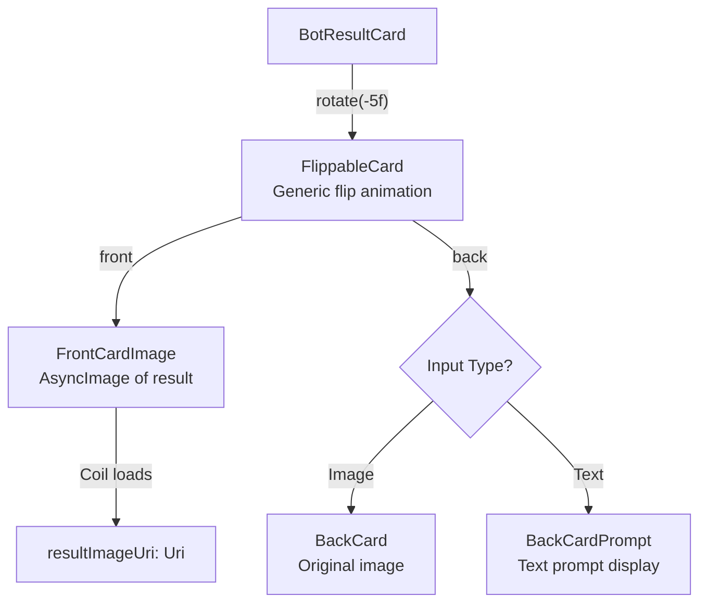
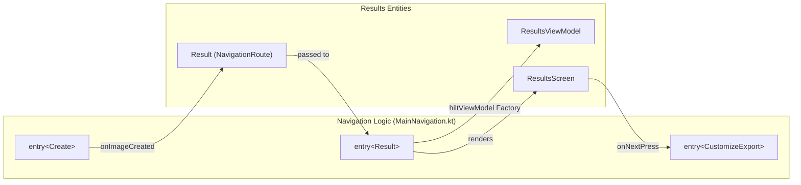

<!-- source: DeepWiki mcp.deepwiki.com · repo android/androidify · page 5.4 Results Feature · fetched 2026-10-23 -->

# Results Feature

<details>
<summary>Relevant source files</summary>

The following files were used as context for generating this wiki page:

- [app/src/main/java/com/android/developers/androidify/navigation/MainNavigation.kt](app/src/main/java/com/android/developers/androidify/navigation/MainNavigation.kt)
- [app/src/main/java/com/android/developers/androidify/navigation/NavigationRoutes.kt](app/src/main/java/com/android/developers/androidify/navigation/NavigationRoutes.kt)
- [feature/creation/src/main/java/com/android/developers/androidify/creation/CreationScreen.kt](feature/creation/src/main/java/com/android/developers/androidify/creation/CreationScreen.kt)
- [feature/creation/src/main/java/com/android/developers/androidify/creation/CreationViewModel.kt](feature/creation/src/main/java/com/android/developers/androidify/creation/CreationViewModel.kt)
- [feature/results/src/androidTest/java/com/android/developers/androidify/results/ResultsScreenTest.kt](feature/results/src/androidTest/java/com/android/developers/androidify/results/ResultsScreenTest.kt)
- [feature/results/src/main/java/com/android/developers/androidify/customize/ImageRenderer.kt](feature/results/src/main/java/com/android/developers/androidify/customize/ImageRenderer.kt)
- [feature/results/src/main/java/com/android/developers/androidify/results/BackgroundQuotes.kt](feature/results/src/main/java/com/android/developers/androidify/results/BackgroundQuotes.kt)
- [feature/results/src/main/java/com/android/developers/androidify/results/BotActionsButtonRow.kt](feature/results/src/main/java/com/android/developers/androidify/results/BotActionsButtonRow.kt)
- [feature/results/src/main/java/com/android/developers/androidify/results/BotResultCard.kt](feature/results/src/main/java/com/android/developers/androidify/results/BotResultCard.kt)
- [feature/results/src/main/java/com/android/developers/androidify/results/ResultsScreen.kt](feature/results/src/main/java/com/android/developers/androidify/results/ResultsScreen.kt)
- [feature/results/src/main/java/com/android/developers/androidify/results/ResultsViewModel.kt](feature/results/src/main/java/com/android/developers/androidify/results/ResultsViewModel.kt)
- [feature/results/src/main/java/com/android/developers/androidify/results/xr/FlippablePanel.kt](feature/results/src/main/java/com/android/developers/androidify/results/xr/FlippablePanel.kt)
- [feature/results/src/main/res/drawable/background_results.xml](feature/results/src/main/res/drawable/background_results.xml)
- [feature/results/src/screenshotTest/java/com/android/developers/androidify/results/ResultsScreenScreenshotTest.kt](feature/results/src/screenshotTest/java/com/android/developers/androidify/results/ResultsScreenScreenshotTest.kt)

</details>


## Purpose and Scope

The Results Feature displays AI-generated Android bot images using an interactive flippable card interface. After image generation completes in the Creation Feature (page 5.3), users are navigated to `ResultsScreen` which presents the generated result on the front of a card and the original input (image or prompt) on the back. Users can flip between views and proceed to customization and export (page 5.5).

The Results Feature is implemented in the `:feature:results` module and provides adaptive layouts for different screen sizes and XR spatial mode.

## Module Structure

The Results Feature is located in the `:feature:results` module with package `com.android.developers.androidify.results`.

**Key Components:**

| File | Purpose |
|------|---------|
| `ResultsScreen.kt` | Main screen composable and layout variants [feature/results/src/main/java/com/android/developers/androidify/results/ResultsScreen.kt:68-102]() |
| `ResultsViewModel.kt` | State holder for result URIs and prompt text [feature/results/src/main/java/com/android/developers/androidify/results/ResultsViewModel.kt:31-60]() |
| `BotResultCard.kt` | Flippable card component for displaying results [feature/results/src/main/java/com/android/developers/androidify/results/BotResultCard.kt:51-69]() |
| `BackgroundQuotes.kt` | Animated background decoration with scrolling text [feature/results/src/main/java/com/android/developers/androidify/results/BackgroundQuotes.kt:42-87]() |
| `BotActionsButtonRow.kt` | Action buttons for proceeding to customization [feature/results/src/main/java/com/android/developers/androidify/results/BotActionsButtonRow.kt:31-57]() |
| `ImageRenderer.kt` | Utilities for rendering images with backgrounds and rotations [feature/results/src/main/java/com/android/developers/androidify/customize/ImageRenderer.kt:51-104]() |

Sources: [feature/results/src/main/java/com/android/developers/androidify/results/ResultsScreen.kt:1-102](), [feature/results/src/main/java/com/android/developers/androidify/results/ResultsViewModel.kt:1-67](), [feature/results/src/main/java/com/android/developers/androidify/results/BotResultCard.kt:1-133]()

## ResultsScreen Component

`ResultsScreen` is the entry point composable that receives navigation parameters and displays the generated result.

### Parameters

The screen accepts the following navigation callbacks and a ViewModel:

```kotlin
@Composable
fun ResultsScreen(
    onBackPress: () -> Unit,
    onAboutPress: () -> Unit,
    onNextPress: (resultImageUri: Uri, originalImageUri: Uri?) -> Unit,
    viewModel: ResultsViewModel,
)
```

- `onBackPress`: Navigate back to Creation screen.
- `onAboutPress`: Open About screen.
- `onNextPress`: Proceed to `CustomizeExport` screen with result and original image URIs [app/src/main/java/com/android/developers/androidify/navigation/MainNavigation.kt:149-156]().
- `viewModel`: Injected via Hilt with assisted factory pattern.

Sources: [feature/results/src/main/java/com/android/developers/androidify/results/ResultsScreen.kt:68-102]()

### State Management

`ResultsScreen` collects state from the ViewModel and manages local UI state:

```kotlin
val state by viewModel.state.collectAsStateWithLifecycle()
val snackbarHostState by viewModel.snackbarHostState.collectAsStateWithLifecycle()
val layoutType = getLayoutType(enableXr = state.xrEnabled)

var selectedResultOption by remember {
    mutableStateOf(ResultOption.ResultImage)
}
```

The `selectedResultOption` tracks which side of the flippable card is visible (`ResultImage` or `OriginalInput`).

Sources: [feature/results/src/main/java/com/android/developers/androidify/results/ResultsScreen.kt:74-89]()

## ResultsViewModel

`ResultsViewModel` is a state holder that receives navigation arguments via Hilt assisted injection.

### Factory Pattern

The ViewModel uses `@AssistedInject` to receive parameters provided during navigation:

```kotlin
@HiltViewModel(assistedFactory = ResultsViewModel.Factory::class)
class ResultsViewModel @AssistedInject constructor(
    @Assisted("resultImageUrl") val resultImageUrl: Uri?,
    @Assisted("originalImageUrl") val originalImageUrl: Uri?,
    @Assisted("promptText") val promptText: String?,
    configProvider: ConfigProvider,
) : ViewModel()
```

The ViewModel is created in `MainNavigation.kt` using Hilt's `hiltViewModel` function with a `creationCallback`:

```kotlin
entry<Result> { resultKey ->
    val resultsViewModel = hiltViewModel<ResultsViewModel, ResultsViewModel.Factory>(
        creationCallback = { factory ->
            factory.create(
                resultImageUrl = resultKey.resultImageUri,
                originalImageUrl = resultKey.originalImageUri,
                promptText = resultKey.prompt,
            )
        },
    )
    ResultsScreen(...)
}
```

Sources: [feature/results/src/main/java/com/android/developers/androidify/results/ResultsViewModel.kt:31-60](), [app/src/main/java/com/android/developers/androidify/navigation/MainNavigation.kt:138-164]()

### ResultState Data Class

The ViewModel maintains a `ResultState` object exposed as a `StateFlow`:

```kotlin
data class ResultState(
    val resultImageUri: Uri? = null,
    val originalImageUrl: Uri? = null,
    val promptText: String? = null,
    val xrEnabled: Boolean = false,
)
```

Sources: [feature/results/src/main/java/com/android/developers/androidify/results/ResultsViewModel.kt:62-67]()

## Flippable Card Component

The core UI element is a flippable card that displays the result on the front and the original input on the back.

### BotResultCard

`BotResultCard` wraps the generic `FlippableCard` with bot-specific styling, including a slight rotation and specific aspect ratio:



The card characteristics:
- **Aspect ratio**: 3:4 (defined as `BOT_ASPECT_RATIO`) [feature/results/src/main/java/com/android/developers/androidify/results/BotResultCard.kt:133]().
- **Rotation**: -5 degrees [feature/results/src/main/java/com/android/developers/androidify/results/BotResultCard.kt:60]().
- **Shadow**: 8dp elevation [feature/results/src/main/java/com/android/developers/androidify/results/BotResultCard.kt:80]().

Sources: [feature/results/src/main/java/com/android/developers/androidify/results/BotResultCard.kt:51-69](), [feature/results/src/main/java/com/android/developers/androidify/results/BotResultCard.kt:133]()

### Back Side Content

The back of the card changes based on the user's initial input method in `CreationScreen`:

*   **BackCard**: Displays the original photo if `originalImageUrl` is present [feature/results/src/main/java/com/android/developers/androidify/results/BotResultCard.kt:86-97]().
*   **BackCardPrompt**: Displays the text prompt with a `pen_spark` icon if no original image exists [feature/results/src/main/java/com/android/developers/androidify/results/BotResultCard.kt:100-131]().

Sources: [feature/results/src/main/java/com/android/developers/androidify/results/BotResultCard.kt:86-131]()

## Adaptive Layouts

`ResultsScreen` provides three layout variants based on screen size and XR mode, determined by `getLayoutType` [feature/results/src/main/java/com/android/developers/androidify/results/ResultsScreen.kt:76]().

### Layout Variants

| Type | Description |
|------|-------------|
| `Verbose` | Used for wide screens (tablets/desktops). Centers the card and toolbar vertically [feature/results/src/main/java/com/android/developers/androidify/results/ResultsScreen.kt:280-307](). |
| `Constrained` | Used for narrow screens (phones). Toolbar and buttons are placed in the bottom corners to maximize card visibility [feature/results/src/main/java/com/android/developers/androidify/results/ResultsScreen.kt:310-331](). |
| `Spatial` | Optimized for XR full space mode, using `ResultsScreenSpatial` and `FlippablePanel` [feature/results/src/main/java/com/android/developers/androidify/results/ResultsScreen.kt:244-252](). |

Sources: [feature/results/src/main/java/com/android/developers/androidify/results/ResultsScreen.kt:76](), [feature/results/src/main/java/com/android/developers/androidify/results/ResultsScreen.kt:280-331]()

## Background Animations

The `BackgroundQuotes` component provides a dynamic background using the `basicMarquee` modifier.

- **AlwaysMarquee**: A utility that ensures text scrolls even if it fits the screen by forcing a larger width [feature/results/src/main/java/com/android/developers/androidify/results/BackgroundQuotes.kt:122-135]().
- **Randomization**: Quotes are randomly selected from `R.array.list_compliments` unless in inspection mode [feature/results/src/main/java/com/android/developers/androidify/results/BackgroundQuotes.kt:90-114]().

Sources: [feature/results/src/main/java/com/android/developers/androidify/results/BackgroundQuotes.kt:42-135]()

## Navigation and Data Flow

The feature bridges the generation process and the final customization step.



Sources: [app/src/main/java/com/android/developers/androidify/navigation/MainNavigation.kt:125-165](), [app/src/main/java/com/android/developers/androidify/navigation/NavigationRoutes.kt:49-53]()

---

